```{=html}
<section class="research-cover" aria-label="Portada de investigación">
<div class="cover-top"><div class="cover-institutions">Universidad Panamericana<br>&amp; King Abdullah<br>University of Science and Technology</div></div>
<div class="cover-main"><p class="cover-kicker">Research · Bitácora experimental</p><h1 class="cover-title">Neural 3D Scene Reconstruction<br>for Clinical Environments</h1><div class="cover-people"><strong>Santiago Hernández Chávez</strong><br>Advisors: Ivan Viola · Ricardo Abel Espinosa Loera</div></div>
<nav class="cover-navigation" aria-label="Accesos de portada"><a href="#resumen-ejecutivo">Qué sabemos</a><a href="#comparacion-referencias-actuales">Referencias actuales</a><a href="#fundamentos-propuesta">Fundamentos y propuesta</a></nav>
<div class="cover-bottom"><div class="cover-place">Aguascalientes, Aguascalientes · 2026<br><span class="cover-note">C3VD y SCARED · actualizado el 24/11/2026</span></div></div>
</section>

<section class="executive-summary" id="resumen-ejecutivo" aria-labelledby="resumen-titulo"><h2 id="resumen-titulo">Qué tenemos y cómo leerlo</h2>
<p>Comparamos <strong>VGGT y VGG-T³</strong> en C3VD y SCARED, usando sus versiones oficiales y sus adaptaciones al dominio.</p>
<p>La caracterización de ambos modelos constituye la base experimental para estudiar los efectos de la iluminación dinámica, los reflejos especulares y las oclusiones sobre la reconstrucción geométrica.</p>
<ul><li><strong>VGG-T³:</strong> V9 es la referencia C3VD; VN19-A/B permiten estudiar el muestreo. En SCARED se documentan VN18 y V9 adaptados.</li><li><strong>VGGT:</strong> R1 es la réplica controlada C3VD; depth-v2 es la adaptación SCARED de profundidad.</li><li><strong>Hallazgo compartido:</strong> mejorar profundidad, puntos o cámara por separado no garantiza una reconstrucción conjunta mejor. El contexto y la ruta geométrica también influyen.</li></ul>
<p>En cada modelo encontrarás datos y splits, métricas frente a su zero-shot y vistas de las reconstrucciones. Las transferencias y comparaciones se reúnen en sus propios desplegables. En SCARED, el GT mide anclas; las trayectorias temporales se muestran como predicciones.</p>
<nav class="summary-links"><a href="#vgg-t3">VGG-T³</a><a href="#vggt">VGGT</a><a href="#vggt-vs-vgg-t3">Comparar modelos</a><a href="#experimentos">Experimentos realizados</a></nav></section>
```

## VGG-T³ {#vgg-t3 .model-workspace}

<p class="model-takeaway">C3VD: conservamos V9. SCARED: VN18 muestra mejor geometría que V9-SCARED en los ejemplos reservados, con resultados de profundidad dependientes del caso.</p>

<details class="reading-fold" id="vgg-t3-versiones"><summary>Resumen de versiones</summary>

| Versión | Papel | Resumen |
|---|---|---|
| Zero-shot | Oficial | Pesos oficiales sin fine-tuning local; referencia para cada protocolo. |
| V9 · C3VD | Referencia C3VD | Checkpoint 850; ajusta cámara, profundidad y puntos. |
| VN19-A · C3VD | Diagnóstico | Dos vistas supervisadas elegidas aleatoriamente por paso. |
| VN19-B · C3VD | Diagnóstico | Cobertura controlada y mayor repetición de vistas profundas. |
| VN18 · SCARED | Candidato SCARED | Profundidad/puntos, cámara congelada; mejor geometría que V9-SCARED en los ejemplos mostrados. |
| V9 adaptado · SCARED | Diagnóstico | Receta V9 adaptada al ancla medida; no sustituyó la referencia conservada. |

</details>


<details class="dataset-fold" id="c3vd"><summary>C3VD</summary>

<span id="estado"></span>
<div class="dataset-takeaway"><p><strong>Lectura breve.</strong> V9 sigue siendo la referencia conservada. VN19-A/B ofrecen intercambios entre métricas y no cumplieron todas las guardas conjuntas.</p><p class="compact-protocol">trans_t4_b · 50 RGB a 336² · 16 objetivos GT · P directo · escala GT compartida, sin ICP.</p>

| Métrica | Zero-shot | V9-C3VD | VN19-A | VN19-B |
|---|---|---|---|---|
| AbsRel ↓ | 0.18236 | 0.14860 | 0.17214 | 0.17216 |
| δ1 (%) ↑ | 72.09577 | 78.38487 | 74.86967 | 73.02579 |
| XYZ (cm) ↓ | 0.72418 | 0.47563 | 0.56825 | 0.57506 |

</div>

<details class="reading-fold" id="ttt-c3vd-split"><summary>1 · Datos, splitting y entrenamiento</summary>

<details class="reading-fold"><summary>V9 · C3VD</summary>

| Partición | Secuencias |
|---|---|
| Entrenamiento | cecum_t1_b, cecum_t2_b, cecum_t3_a, desc_t4_a, sigmoid_t1_a, sigmoid_t3_a |
| Validación | trans_t1_b, trans_t4_b |
| Reservadas, mismo phantom | cecum_t2_a, trans_t1_a |

1.000 pasos; checkpoint de referencia 850. Cámara, profundidad y puntos; encoder/agregador congelados.

</details>

<details class="reading-fold"><summary>VN19-A · C3VD</summary>

| Partición | Secuencias |
|---|---|
| Entrenamiento | cecum_t1_b, cecum_t2_b, desc_t4_a, sigmoid_t1_a, sigmoid_t3_a, trans_t1_b |
| Validación | cecum_t3_a, trans_t4_b |
| Reservadas, mismo phantom | cecum_t2_a, trans_t1_a |

3.240 pasos; selección aleatoria independiente de dos vistas supervisadas por contexto.

</details>

<details class="reading-fold"><summary>VN19-B · C3VD</summary>

| Partición | Secuencias |
|---|---|
| Entrenamiento | cecum_t1_b, cecum_t2_b, desc_t4_a, sigmoid_t1_a, sigmoid_t3_a, trans_t1_b |
| Validación | cecum_t3_a, trans_t4_b |
| Reservadas, mismo phantom | cecum_t2_a, trans_t1_a |

3.240 pasos; cobertura controlada y repetición de vistas profundas. Misma receta y presupuesto que A.

</details>

<details class="reading-fold"><summary>Comparación de splits y recetas</summary>

| Partición | V9-C3VD | VN19-A/B |
|---|---|---|
| Entrenamiento | cecum_t1_b, cecum_t2_b, cecum_t3_a, desc_t4_a, sigmoid_t1_a, sigmoid_t3_a | cecum_t1_b, cecum_t2_b, desc_t4_a, sigmoid_t1_a, sigmoid_t3_a, trans_t1_b |
| Validación | trans_t1_b, trans_t4_b | cecum_t3_a, trans_t4_b |
| Reservadas, mismo phantom | cecum_t2_a, trans_t1_a | cecum_t2_a, trans_t1_a |

V9: 1.000 pasos, checkpoint 850; VN19-A/B: 3.240 pasos. Las tres cabezas nativas se ajustaron con el encoder/agregador congelados. Los contextos y la selección densa difieren entre recetas; su detalle está en los experimentos.

</details>

</details>

<details class="reading-fold"><summary>2 · Métricas y comparación con zero-shot</summary>

<details class="reading-fold" id="comparaciones"><summary>Métricas propias · zero-shot, V9 y VN19 · trans_t4_b</summary>

50 RGB a 336²; 16 objetivos GT comunes. Escala única del contexto, sin ICP. XYZ procede del cabezal global de puntos.

| Métrica | Zero-shot · VGG-T³ · trans_t4_b | V9-C3VD · referencia · trans_t4_b | VN19-A-C3VD · final diagnóstico · trans_t4_b | VN19-B-C3VD · final diagnóstico · trans_t4_b |
|---|---|---|---|---|
| AbsRel ↓ | 0.18236 | 0.14860 | 0.17214 | 0.17216 |
| δ <1,25 (%) ↑ | 72.09577 | 78.38487 | 74.86967 | 73.02579 |
| RMSE profundidad (cm) ↓ | 0.72524 | 0.69779 | 0.59216 | 0.59225 |
| XYZ medio (cm) ↓ | 0.72418 | 0.47563 | 0.56825 | 0.57506 |
| XYZ p95 (cm) ↓ | 2.13060 | 1.30482 | 1.30131 | 1.33700 |
| D+K+pose (cm) ↓ | 0.77112 | 0.59996 | 0.57891 | 0.57302 |
| Coherencia entre cabezas (cm) ↓ | 0.45017 | 0.41602 | 0.50438 | 0.49472 |

<button type="button" class="book-open-metrics" data-metrics="c3vd-zero,c3vd-v9,c3vd-vn19-a,c3vd-vn19-b">Elegir y comparar métricas</button>

</details>

<details class="reading-fold"><summary>Métricas propias · demás secuencias</summary>

<details class="reading-fold"><summary>cecum_t1_b</summary>

| Métrica | VGG-T³ zero-shot · cecum_t1_b | V9 · C3VD · cecum_t1_b | VN19-A final · C3VD · cecum_t1_b | VN19-B final · C3VD · cecum_t1_b |
|---|---|---|---|---|
| AbsRel ↓ | 0.26944 | 0.07687 | 0.03619 | 0.03649 |
| δ <1,25 (%) ↑ | 59.55675 | 95.03802 | 99.83840 | 99.74374 |
| RMSE profundidad (cm) ↓ | 1.18837 | 0.36061 | 0.18972 | 0.19031 |
| XYZ medio (cm) ↓ | 2.10170 | 0.57512 | 0.32537 | 0.35684 |
| XYZ p95 (cm) ↓ | 3.30793 | 1.37859 | 0.63957 | 0.67248 |
| D+K+pose (cm) ↓ | 1.68430 | 1.28260 | 0.99085 | 0.98578 |
| Rotación media (°) ↓ | 4.54513 | 3.29167 | 3.79005 | 3.80584 |

<button type="button" class="book-open-metrics" data-metrics="c3vd-zero-cecum_t1_b,c3vd-v9-cecum_t1_b,c3vd-vn19-a-cecum_t1_b,c3vd-vn19-b-cecum_t1_b">Elegir y comparar métricas</button>

</details>

<details class="reading-fold"><summary>cecum_t2_b</summary>

| Métrica | VGG-T³ zero-shot · cecum_t2_b | V9 · C3VD · cecum_t2_b | VN19-A final · C3VD · cecum_t2_b | VN19-B final · C3VD · cecum_t2_b |
|---|---|---|---|---|
| AbsRel ↓ | 0.18921 | 0.07818 | 0.04559 | 0.04531 |
| δ <1,25 (%) ↑ | 71.63861 | 96.50752 | 99.72763 | 99.61225 |
| RMSE profundidad (cm) ↓ | 0.92194 | 0.42320 | 0.25072 | 0.24708 |
| XYZ medio (cm) ↓ | 2.14021 | 0.79780 | 0.94855 | 0.84569 |
| XYZ p95 (cm) ↓ | 3.90623 | 2.12571 | 1.72638 | 1.60802 |
| D+K+pose (cm) ↓ | 1.87177 | 1.63503 | 1.40339 | 1.40711 |
| Rotación media (°) ↓ | 8.66537 | 7.09060 | 4.86629 | 4.82560 |

<button type="button" class="book-open-metrics" data-metrics="c3vd-zero-cecum_t2_b,c3vd-v9-cecum_t2_b,c3vd-vn19-a-cecum_t2_b,c3vd-vn19-b-cecum_t2_b">Elegir y comparar métricas</button>

</details>

<details class="reading-fold"><summary>cecum_t3_a</summary>

| Métrica | VGG-T³ zero-shot · cecum_t3_a | V9 · C3VD · cecum_t3_a | VN19-A final · C3VD · cecum_t3_a | VN19-B final · C3VD · cecum_t3_a |
|---|---|---|---|---|
| AbsRel ↓ | 0.22385 | 0.05720 | 0.11253 | 0.10663 |
| δ <1,25 (%) ↑ | 56.33265 | 99.13106 | 86.68598 | 87.60308 |
| RMSE profundidad (cm) ↓ | 1.58811 | 0.34178 | 0.72873 | 0.71503 |
| XYZ medio (cm) ↓ | 1.39501 | 0.29857 | 0.61777 | 0.65417 |
| XYZ p95 (cm) ↓ | 4.09852 | 0.72729 | 1.60199 | 1.69470 |
| D+K+pose (cm) ↓ | 1.27250 | 0.36270 | 0.69678 | 0.67297 |
| Rotación media (°) ↓ | 3.50181 | 3.68418 | 5.25056 | 5.23843 |

<button type="button" class="book-open-metrics" data-metrics="c3vd-zero-cecum_t3_a,c3vd-v9-cecum_t3_a,c3vd-vn19-a-cecum_t3_a,c3vd-vn19-b-cecum_t3_a">Elegir y comparar métricas</button>

</details>

<details class="reading-fold"><summary>desc_t4_a</summary>

| Métrica | VGG-T³ zero-shot · desc_t4_a | V9 · C3VD · desc_t4_a | VN19-A final · C3VD · desc_t4_a | VN19-B final · C3VD · desc_t4_a |
|---|---|---|---|---|
| AbsRel ↓ | 0.15171 | 0.07243 | 0.03389 | 0.03435 |
| δ <1,25 (%) ↑ | 82.71590 | 96.73665 | 99.53818 | 99.53458 |
| RMSE profundidad (cm) ↓ | 0.44225 | 0.23864 | 0.14522 | 0.14469 |
| XYZ medio (cm) ↓ | 0.77814 | 0.59591 | 0.15896 | 0.15656 |
| XYZ p95 (cm) ↓ | 2.23806 | 1.27283 | 0.37357 | 0.38320 |
| D+K+pose (cm) ↓ | 0.66105 | 0.45125 | 0.22845 | 0.22802 |
| Rotación media (°) ↓ | 7.42793 | 7.94413 | 2.61320 | 2.56228 |

<button type="button" class="book-open-metrics" data-metrics="c3vd-zero-desc_t4_a,c3vd-v9-desc_t4_a,c3vd-vn19-a-desc_t4_a,c3vd-vn19-b-desc_t4_a">Elegir y comparar métricas</button>

</details>

<details class="reading-fold"><summary>sigmoid_t1_a</summary>

| Métrica | VGG-T³ zero-shot · sigmoid_t1_a | V9 · C3VD · sigmoid_t1_a | VN19-A final · C3VD · sigmoid_t1_a | VN19-B final · C3VD · sigmoid_t1_a |
|---|---|---|---|---|
| AbsRel ↓ | 0.13323 | 0.09674 | 0.04049 | 0.04055 |
| δ <1,25 (%) ↑ | 83.87858 | 93.75448 | 99.19173 | 99.51144 |
| RMSE profundidad (cm) ↓ | 0.42092 | 0.30972 | 0.16324 | 0.16377 |
| XYZ medio (cm) ↓ | 0.75887 | 0.66900 | 0.33215 | 0.33656 |
| XYZ p95 (cm) ↓ | 1.27266 | 1.08926 | 0.54693 | 0.56662 |
| D+K+pose (cm) ↓ | 0.52296 | 0.50910 | 0.39992 | 0.39261 |
| Rotación media (°) ↓ | 5.62471 | 6.03142 | 5.55387 | 5.53334 |

<button type="button" class="book-open-metrics" data-metrics="c3vd-zero-sigmoid_t1_a,c3vd-v9-sigmoid_t1_a,c3vd-vn19-a-sigmoid_t1_a,c3vd-vn19-b-sigmoid_t1_a">Elegir y comparar métricas</button>

</details>

<details class="reading-fold"><summary>sigmoid_t3_a</summary>

| Métrica | VGG-T³ zero-shot · sigmoid_t3_a | V9 · C3VD · sigmoid_t3_a | VN19-A final · C3VD · sigmoid_t3_a | VN19-B final · C3VD · sigmoid_t3_a |
|---|---|---|---|---|
| AbsRel ↓ | 0.19763 | 0.08347 | 0.03244 | 0.03320 |
| δ <1,25 (%) ↑ | 72.52078 | 92.88051 | 99.27334 | 99.26619 |
| RMSE profundidad (cm) ↓ | 0.50679 | 0.26915 | 0.19127 | 0.19480 |
| XYZ medio (cm) ↓ | 1.04855 | 0.55294 | 0.17958 | 0.17609 |
| XYZ p95 (cm) ↓ | 1.84679 | 1.40932 | 0.36089 | 0.34500 |
| D+K+pose (cm) ↓ | 1.16796 | 1.11972 | 0.60361 | 0.60818 |
| Rotación media (°) ↓ | 8.42967 | 7.49219 | 2.89313 | 2.91549 |

<button type="button" class="book-open-metrics" data-metrics="c3vd-zero-sigmoid_t3_a,c3vd-v9-sigmoid_t3_a,c3vd-vn19-a-sigmoid_t3_a,c3vd-vn19-b-sigmoid_t3_a">Elegir y comparar métricas</button>

</details>

<details class="reading-fold"><summary>trans_t1_b</summary>

| Métrica | VGG-T³ zero-shot · trans_t1_b | V9 · C3VD · trans_t1_b | VN19-A final · C3VD · trans_t1_b | VN19-B final · C3VD · trans_t1_b |
|---|---|---|---|---|
| AbsRel ↓ | 0.19873 | 0.16605 | 0.02476 | 0.02497 |
| δ <1,25 (%) ↑ | 61.56230 | 80.44677 | 99.78526 | 99.79007 |
| RMSE profundidad (cm) ↓ | 0.64539 | 0.52868 | 0.12155 | 0.11768 |
| XYZ medio (cm) ↓ | 1.05507 | 0.76989 | 0.12255 | 0.11716 |
| XYZ p95 (cm) ↓ | 1.43140 | 1.27032 | 0.26021 | 0.24259 |
| D+K+pose (cm) ↓ | 0.73513 | 0.56564 | 0.22923 | 0.22248 |
| Rotación media (°) ↓ | 5.55023 | 4.28823 | 1.19330 | 1.14131 |

<button type="button" class="book-open-metrics" data-metrics="c3vd-zero-trans_t1_b,c3vd-v9-trans_t1_b,c3vd-vn19-a-trans_t1_b,c3vd-vn19-b-trans_t1_b">Elegir y comparar métricas</button>

</details>

<details class="reading-fold"><summary>cecum_t2_a</summary>

| Métrica | VGG-T³ zero-shot · cecum_t2_a | V9 · C3VD · cecum_t2_a | VN19-A final · C3VD · cecum_t2_a | VN19-B final · C3VD · cecum_t2_a |
|---|---|---|---|---|
| AbsRel ↓ | 0.17361 | 0.07006 | 0.05387 | 0.05545 |
| δ <1,25 (%) ↑ | 72.80788 | 97.49294 | 99.15293 | 99.11938 |
| RMSE profundidad (cm) ↓ | 0.75470 | 0.38197 | 0.29113 | 0.29563 |
| XYZ medio (cm) ↓ | 2.08758 | 1.01408 | 0.89548 | 0.93722 |
| XYZ p95 (cm) ↓ | 3.24712 | 2.10134 | 2.46207 | 2.50072 |
| D+K+pose (cm) ↓ | 2.08779 | 2.03150 | 1.53814 | 1.53393 |
| Rotación media (°) ↓ | 20.29450 | 17.60448 | 12.80417 | 12.73679 |

<button type="button" class="book-open-metrics" data-metrics="c3vd-zero-cecum_t2_a,c3vd-v9-cecum_t2_a,c3vd-vn19-a-cecum_t2_a,c3vd-vn19-b-cecum_t2_a">Elegir y comparar métricas</button>

</details>

<details class="reading-fold"><summary>trans_t1_a</summary>

| Métrica | VGG-T³ zero-shot · trans_t1_a | V9 · C3VD · trans_t1_a | VN19-A final · C3VD · trans_t1_a | VN19-B final · C3VD · trans_t1_a |
|---|---|---|---|---|
| AbsRel ↓ | 0.21040 | 0.14106 | 0.14712 | 0.14645 |
| δ <1,25 (%) ↑ | 63.30089 | 79.12185 | 77.61659 | 78.47695 |
| RMSE profundidad (cm) ↓ | 0.82810 | 0.68044 | 0.49028 | 0.48745 |
| XYZ medio (cm) ↓ | 1.54963 | 1.40101 | 1.09518 | 1.05579 |
| XYZ p95 (cm) ↓ | 2.49745 | 2.20957 | 2.03694 | 2.07966 |
| D+K+pose (cm) ↓ | 1.41003 | 1.26320 | 1.23411 | 1.23376 |
| Rotación media (°) ↓ | 1.57971 | 1.04759 | 1.42052 | 1.43801 |

<button type="button" class="book-open-metrics" data-metrics="c3vd-zero-trans_t1_a,c3vd-v9-trans_t1_a,c3vd-vn19-a-trans_t1_a,c3vd-vn19-b-trans_t1_a">Elegir y comparar métricas</button>

</details>

</details>

</details>


<details class="reading-fold" id="vistas"><summary>3 · Vistas, nubes y trayectorias</summary>

<figure>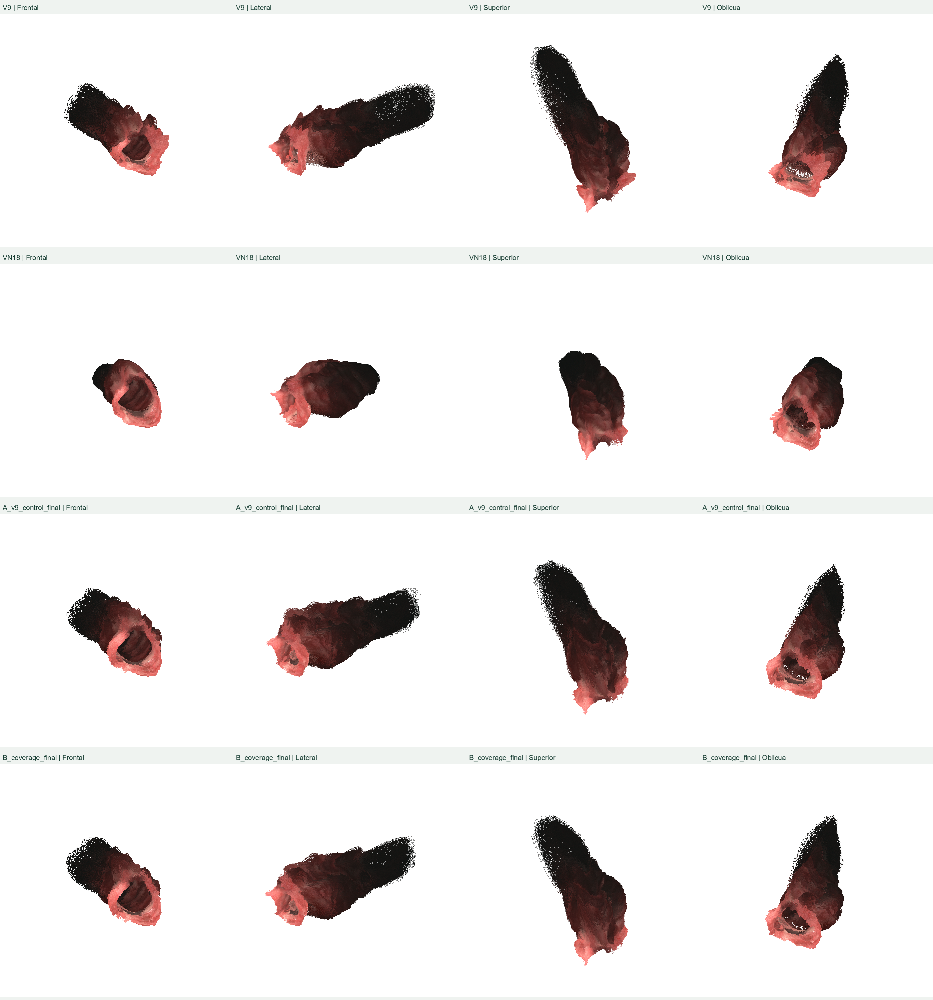<figcaption>Vistas guardadas de V9, VN18 y VN19-A/B · 50 RGB · 336².</figcaption></figure>

<figure><figcaption>Trayectorias C3VD: predicción y referencia GT; versiones identificadas en la leyenda.</figcaption></figure>

<button type="button" class="book-open-clouds" data-clouds="c3vd-zero,c3vd-v9,c3vd-vn19-a,c3vd-vn19-b" data-scope="VGG-T³">Cargar nubes y trayectorias</button>

<div class="book-actions"><button type="button" class="book-open-trajectories" data-trajectories="c3vd-v9,c3vd-vn19-a,c3vd-vn19-b">Comparar trayectorias sin cargar las nubes</button></div>
</details>

<details class="reading-fold"><summary>4 · Comparar este dataset</summary>

<div class="book-actions"><button type="button" class="book-open-metrics" data-metrics="c3vd-zero,c3vd-v9,c3vd-vn19-a,c3vd-vn19-b">Elegir y comparar métricas</button></div>
<div class="book-actions"><button type="button" class="book-open-clouds" data-clouds="c3vd-v9,c3vd-vn19-a,c3vd-vn19-b">Elegir nubes para comparar</button></div>

</details>


</details>

<details class="dataset-fold" id="scared"><summary>SCARED</summary>


<div class="dataset-takeaway"><p><strong>Lectura breve.</strong> VN18 conserva mejor geometría que V9-SCARED en los ejemplos reservados mostrados. La profundidad no mejora uniformemente frente al zero-shot.</p><p class="compact-protocol">Ejemplo SCARED9/KF0 · 50 RGB a 336×266 · GT solo en el ancla · P directo · escala GT positiva, sin ICP.</p>

| Métrica | Zero-shot | VN18-SCARED | V9-SCARED |
|---|---|---|---|
| AbsRel ↓ | 0.13738 | 0.06105 | 0.07533 |
| δ1 (%) ↑ | 79.09464 | 98.41720 | 97.38356 |
| XYZ (cm) ↓ | 2.34485 | 0.65165 | 1.31196 |

</div>

<details class="reading-fold" id="ttt-scared-split"><summary>1 · Datos, splitting y entrenamiento</summary>

<details class="reading-fold"><summary>VN18 · SCARED</summary>

| Partición | Datasets | Anclas medidas |
|---|---|---:|
| Entrenamiento | 1, 2, 3 y 6 | 20 |
| Validación | 7 | 5 |
| Reservados | 8 y 9 | 10 |

3.240 pasos. Profundidad y puntos entrenables; cámara congelada. Pérdidas nativas normalizadas y clipping por cabeza.

</details>

<details class="reading-fold"><summary>V9 adaptado · SCARED</summary>

| Partición | Datasets | Anclas medidas |
|---|---|---:|
| Entrenamiento | 1, 2, 3 y 6 | 20 |
| Validación | 7 | 5 |
| Reservados | 8 y 9 | 10 |

1.000 pasos. Profundidad y puntos entrenables; cámara congelada. Receta V9 adaptada al ancla medida, clipping global. El candidato final no sustituyó al baseline conservado.

</details>

<details class="reading-fold"><summary>Comparación de splits y recetas</summary>

| Partición | Datasets | Anclas medidas |
|---|---|---:|
| Entrenamiento | 1, 2, 3 y 6 | 20 |
| Validación | 7 | 5 |
| Reservados | 8 y 9 | 10 |

Los datasets 4/5 se excluyeron por calibración. Dataset 6/keyframe 1 conserva el ancla medida; su vídeo está en cuarentena temporal. El GT certificado corresponde al ancla, no a toda la trayectoria.

VN18-SCARED final 3240 y V9-SCARED candidato 1000 se conservan como diagnósticos. La auditoría de pérdidas, normalización, clipping y ventanas está en E07/E07-B.

</details>

</details>

<details class="reading-fold"><summary>2 · Métricas y comparación con zero-shot</summary>

<details class="reading-fold" id="ttt-scared8-metrics"><summary>Métricas propias · SCARED8 · zero-shot y afinados</summary>

Mismas 50 RGB a 336×266; GT medido en el ancla; escala positiva de profundidad, sin ICP.

| Métrica | VGG-T³ · zero-shot · SCARED8/KF0 | VN18 · entrenado con SCARED · SCARED8/KF0 | V9-SCARED · candidato diagnóstico · SCARED8/KF0 |
|---|---|---|---|
| AbsRel ↓ | 0.03890 | 0.05378 | 0.08300 |
| δ <1,25 (%) ↑ | 99.95325 | 99.12174 | 94.95566 |
| RMSE profundidad (cm) ↓ | 0.55851 | 0.84103 | 1.24337 |
| XYZ medio (cm) ↓ | 1.87279 | 0.91006 | 0.93464 |
| XYZ p95 (cm) ↓ | 2.74452 | 2.47462 | 2.42242 |

<button type="button" class="book-open-metrics" data-metrics="scared8-zero-new,scared8-vn18,scared8-scared-v9">Elegir y comparar métricas</button>

</details>

<details class="reading-fold" id="ttt-scared9-metrics"><summary>Métricas propias · SCARED9 · zero-shot y afinados</summary>

Mismas 50 RGB a 336×266; GT medido en el ancla; escala positiva de profundidad, sin ICP.

| Métrica | VGG-T³ · zero-shot · SCARED9/KF0 | VN18 · entrenado con SCARED · SCARED9/KF0 | V9-SCARED · candidato diagnóstico · SCARED9/KF0 |
|---|---|---|---|
| AbsRel ↓ | 0.13738 | 0.06105 | 0.07533 |
| δ <1,25 (%) ↑ | 79.09464 | 98.41720 | 97.38356 |
| RMSE profundidad (cm) ↓ | 1.35464 | 0.75981 | 0.89798 |
| XYZ medio (cm) ↓ | 2.34485 | 0.65165 | 1.31196 |
| XYZ p95 (cm) ↓ | 5.21760 | 1.71356 | 2.39606 |

<button type="button" class="book-open-metrics" data-metrics="scared9-zero-new,scared9-vn18,scared9-scared-v9">Elegir y comparar métricas</button>

</details>

<details class="reading-fold"><summary>Validación 7 · protocolo short</summary>

| Métrica | zero_shot · VAL7 short | VN18_final · VAL7 short | V9_selected · VAL7 short | V9_final · VAL7 short |
|---|---|---|---|---|
| AbsRel alineado ↓ | 0.15528 | 0.10636 | 0.15528 | 0.09711 |
| δ <1,25 (%) ↑ | 74.03142 | 84.76748 | 74.03142 | 90.98480 |
| XYZ medio (cm) ↓ | 1.62304 | 0.92969 | 1.62304 | 0.82205 |
| XYZ p95 (cm) ↓ | 3.50388 | 2.29237 | 3.50388 | 1.87885 |

<button type="button" class="book-open-metrics" data-metrics="scared-v9-val-zero_shot-short,scared-v9-val-vn18_final-short,scared-v9-val-v9_selected-short,scared-v9-val-v9_final-short">Elegir y comparar métricas</button>

</details>

<details class="reading-fold"><summary>Validación 7 · protocolo long</summary>

| Métrica | zero_shot · VAL7 long | VN18_final · VAL7 long | V9_selected · VAL7 long | V9_final · VAL7 long |
|---|---|---|---|---|
| AbsRel alineado ↓ | 0.13913 | 0.08823 | 0.13913 | 0.10835 |
| δ <1,25 (%) ↑ | 79.99277 | 90.15824 | 79.99277 | 87.15597 |
| XYZ medio (cm) ↓ | 1.51221 | 0.87642 | 1.51221 | 0.88095 |
| XYZ p95 (cm) ↓ | 3.47420 | 2.13812 | 3.47420 | 2.16914 |

<button type="button" class="book-open-metrics" data-metrics="scared-v9-val-zero_shot-long,scared-v9-val-vn18_final-long,scared-v9-val-v9_selected-long,scared-v9-val-v9_final-long">Elegir y comparar métricas</button>

</details>

</details>


<details class="reading-fold" id="ttt-scared-views"><summary>3 · Vistas, nubes y trayectorias</summary>

<figure><figcaption>SCARED8 · VN18-SCARED y V9-SCARED · mismas 50 imágenes.</figcaption></figure>

<figure>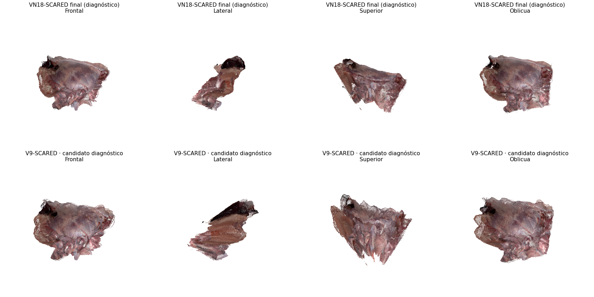<figcaption>SCARED9 · VN18-SCARED y V9-SCARED · mismas 50 imágenes.</figcaption></figure>

<button type="button" class="book-open-clouds" data-clouds="scared8-vn18,scared8-scared-v9,scared9-vn18,scared9-scared-v9" data-scope="VGG-T³">Cargar nubes y trayectorias</button>

<p>Trayectorias predichas en azul. Estas ventanas no tienen trayectoria GT temporal certificada.</p>

<div class="book-actions"><button type="button" class="book-open-trajectories" data-trajectories="scared8-vn18,scared8-scared-v9">Comparar trayectorias sin cargar las nubes</button></div>
</details>

<details class="reading-fold"><summary>4 · Comparar este dataset</summary>

<div class="book-actions"><button type="button" class="book-open-metrics" data-metrics="scared9-zero-new,scared9-vn18,scared9-scared-v9">Elegir y comparar métricas</button></div>
<div class="book-actions"><button type="button" class="book-open-clouds" data-clouds="scared8-vn18,scared8-scared-v9">Elegir nubes para comparar</button></div>

</details>


</details>

<details class="comparison-fold" id="comparadores"><summary>Comparación</summary>

<details class="reading-fold"><summary>Métricas · elegir resultados y referencias</summary>

Selecciona hasta cuatro resultados. Los porcentajes se calculan únicamente entre registros con el mismo caso y protocolo.

<button type="button" class="book-open-metrics" data-metrics="c3vd-zero,c3vd-v9,c3vd-vn19-a,c3vd-vn19-b" data-scope="VGG-T³">Elegir y comparar métricas</button>

</details>

<details class="reading-fold"><summary>Nubes y trayectorias · elegir y manipular</summary>

<button type="button" class="book-open-clouds" data-clouds="c3vd-v9,c3vd-vn19-a,c3vd-vn19-b" data-scope="VGG-T³">Cargar nubes y trayectorias</button>

<p>La selección es dinámica. Se conservan todos los puntos guardados; las rutas y contextos se identifican en cada panel.</p>

</details>

</details>

## VGGT {#vggt .model-workspace}

<p class="model-takeaway">C3VD: referencia R1 FINAL3000; BEST800 queda como diagnóstico. SCARED: referencia depth-v2 BEST500, elegida por validación; su cámara sigue siendo oficial.</p>

<details class="reading-fold" id="vggt-versiones"><summary>Resumen de versiones</summary>

| Versión | Papel | Resumen |
|---|---|---|
| Zero-shot | Oficial | Pesos oficiales sin adaptación local. |
| R1 FINAL3000 · C3VD | Referencia C3VD | Réplica controlada con geometry_v2; cámara/profundidad entrenables. |
| R1 BEST800 · C3VD | Diagnóstico | Checkpoint intermedio de R1; no pasó la mejora conjunta. |
| depth-v2 BEST500 · SCARED | Referencia SCARED | Profundidad afinada; elegido por validación; cámara y encoder congelados. |
| depth-v2 FINAL3000 · SCARED | Comparador | Checkpoint final de la misma ejecución depth-v2. |

</details>


<details class="dataset-fold" id="vggt-c3vd"><summary>C3VD</summary>

<span id="vggt-r1-cierre"></span>
<div class="dataset-takeaway"><p><strong>Lectura breve.</strong> R1 FINAL3000 es la referencia de la réplica. BEST800 no pasó la mejora conjunta; no hay una superioridad uniforme sobre zero-shot.</p><p class="compact-protocol">trans_t4_b · 50 RGB a 336² · 50 GT · D+K calibrada+pose · escala GT compartida, sin ICP.</p>

| Métrica | Zero-shot | R1 FINAL3000 | R1 BEST800 |
|---|---|---|---|
| AbsRel ↓ | 0.25242 | 0.13095 | 0.14541 |
| δ1 (%) ↑ | 55.65412 | 82.67079 | 80.83159 |
| XYZ (cm) ↓ | 0.83852 | 0.64456 | 0.55329 |

</div>

<details class="reading-fold" id="vg-c3vd-split"><summary>1 · Datos, splitting y entrenamiento</summary>

<details class="reading-fold"><summary>R1 FINAL3000 · C3VD</summary>

| Partición | Secuencias |
|---|---|
| Entrenamiento | cecum_t1_b, cecum_t2_b, cecum_t3_a, desc_t4_a, sigmoid_t1_a, sigmoid_t3_a |
| Validación | trans_t1_b, trans_t4_b |
| Reservadas, mismo phantom | cecum_t2_a, trans_t1_a |

3.000 pasos; cámara y profundidad entrenables; encoder/agregador congelados. Es la referencia conservada de la réplica.

</details>

<details class="reading-fold"><summary>R1 BEST800 · diagnóstico</summary>

| Partición | Secuencias |
|---|---|
| Entrenamiento | cecum_t1_b, cecum_t2_b, cecum_t3_a, desc_t4_a, sigmoid_t1_a, sigmoid_t3_a |
| Validación | trans_t1_b, trans_t4_b |
| Reservadas, mismo phantom | cecum_t2_a, trans_t1_a |

Mismo entrenamiento y split que FINAL3000; checkpoint del paso 800. No cumplió la mejora conjunta exigida.

</details>

<details class="reading-fold"><summary>Comparación de splits y recetas</summary>

| Partición | Secuencias |
|---|---|
| Entrenamiento | cecum_t1_b, cecum_t2_b, cecum_t3_a, desc_t4_a, sigmoid_t1_a, sigmoid_t3_a |
| Validación | trans_t1_b, trans_t4_b |
| Reservadas, mismo phantom | cecum_t2_a, trans_t1_a |

Pesos oficiales; cámara y profundidad afinadas, agregador congelado. 3.000 pasos; 4 imágenes y 4 supervisiones por paso; 518² en entrenamiento. AdamW LR1e-5, pérdidas cámara×5 y profundidad×1. Los controles de geometría, integridad y reanudación están documentados en los experimentos R1.

</details>

</details>

<details class="reading-fold"><summary>2 · Métricas y comparación con zero-shot</summary>

<details class="reading-fold" id="vg-r1-trans4-metrics"><summary>Métricas propias · trans_t4_b · oficial, FINAL y BEST</summary>

50 RGB a 336² y 50 objetivos GT; D+K calibrada+pose, escala compartida sin ICP. ATE/RPE tienen su alineamiento de cámara declarado.

| Métrica | VGGT oficial · trans_t4_b | VGGT-C3VD R1 · FINAL3000 · trans_t4_b | VGGT-C3VD R1 · BEST800 · trans_t4_b |
|---|---|---|---|
| AbsRel ↓ | 0.25242 | 0.13095 | 0.14541 |
| δ1 (%) ↑ | 55.65412 | 82.67079 | 80.83159 |
| XYZ medio (cm) ↓ | 0.83852 | 0.64456 | 0.55329 |
| XYZ p95 (cm) ↓ | 2.01401 | 1.62946 | 1.11554 |
| CD sin ICP (cm) ↓ | 0.19227 | 0.18087 | 0.17201 |
| NC ↑ | 0.65387 | 0.71417 | 0.72279 |
| ATE RMSE (cm) ↓ | 0.10023 | 0.06203 | 0.07860 |
| RPEr RMSE (°) ↓ | 0.59001 | 0.57267 | 0.55559 |
| RPEt RMSE (cm) ↓ | 0.05419 | 0.04374 | 0.03992 |

<button type="button" class="book-open-metrics" data-metrics="vggt-c3vd-r1-zs-trans4,vggt-c3vd-r1-final-trans4,vggt-c3vd-r1-best-trans4">Elegir y comparar métricas</button>

</details>

<details class="reading-fold" id="vg-r1-trans1a-metrics"><summary>Métricas propias · trans_t1_a · oficial, FINAL y BEST</summary>

50 RGB a 336² y 50 objetivos GT; D+K calibrada+pose, escala compartida sin ICP. ATE/RPE tienen su alineamiento de cámara declarado.

| Métrica | VGGT oficial · trans_t1_a | VGGT-C3VD R1 · FINAL3000 · trans_t1_a | VGGT-C3VD R1 · BEST800 · trans_t1_a |
|---|---|---|---|
| AbsRel ↓ | 0.28455 | 0.16500 | 0.17477 |
| δ1 (%) ↑ | 47.36494 | 72.28078 | 70.71570 |
| XYZ medio (cm) ↓ | 0.94434 | 0.70773 | 0.63624 |
| XYZ p95 (cm) ↓ | 2.24859 | 1.46252 | 1.30447 |
| CD sin ICP (cm) ↓ | 0.42073 | 0.20490 | 0.19904 |
| NC ↑ | 0.64048 | 0.68849 | 0.71864 |
| ATE RMSE (cm) ↓ | 0.09267 | 0.10965 | 0.09416 |
| RPEr RMSE (°) ↓ | 0.36822 | 0.32351 | 0.35394 |
| RPEt RMSE (cm) ↓ | 0.07173 | 0.06024 | 0.07545 |

<button type="button" class="book-open-metrics" data-metrics="vggt-c3vd-r1-zs-trans1a,vggt-c3vd-r1-final-trans1a,vggt-c3vd-r1-best-trans1a">Elegir y comparar métricas</button>

</details>

<details class="reading-fold"><summary>Todas las métricas propias · secuencias y contextos N1/4/8/16/50</summary>

| Secuencia | Split | N | Pesos | AbsRel ↓ | XYZ cm ↓ | p95 cm ↓ | CD cm ↓ | NC ↑ | ATE cm ↓ |
|---|---|---:|---|---:|---:|---:|---:|---:|---:|
| trans_t1_b | validation | 1 | VGGT_ZS | 0.26552 | 0.83128 | 2.60365 | N/D | N/D | N/D |
| trans_t1_b | validation | 4 | VGGT_ZS | 0.19325 | 0.70286 | 1.36052 | N/D | N/D | 0.13704 |
| trans_t1_b | validation | 8 | VGGT_ZS | 0.18222 | 0.64057 | 1.32898 | N/D | N/D | 0.12918 |
| trans_t1_b | validation | 16 | VGGT_ZS | 0.18499 | 0.65407 | 1.31650 | N/D | N/D | 0.12283 |
| trans_t1_b | validation | 50 | VGGT_ZS | 0.22569 | 0.75377 | 1.51379 | 0.26920 | 0.68272 | 0.11633 |
| trans_t4_b | validation | 1 | VGGT_ZS | 0.17621 | 0.63400 | 2.09818 | N/D | N/D | N/D |
| trans_t4_b | validation | 4 | VGGT_ZS | 0.20550 | 0.68190 | 1.68908 | N/D | N/D | 0.09787 |
| trans_t4_b | validation | 8 | VGGT_ZS | 0.24868 | 0.80002 | 1.91075 | N/D | N/D | 0.08087 |
| trans_t4_b | validation | 16 | VGGT_ZS | 0.26140 | 0.83135 | 1.97714 | N/D | N/D | 0.08910 |
| trans_t4_b | validation | 50 | VGGT_ZS | 0.25242 | 0.83852 | 2.01401 | 0.19227 | 0.65387 | 0.10023 |
| cecum_t2_a | reserved | 1 | VGGT_ZS | 0.20347 | 0.94162 | 2.02411 | N/D | N/D | N/D |
| cecum_t2_a | reserved | 4 | VGGT_ZS | 0.18081 | 1.99868 | 3.81396 | N/D | N/D | 0.92569 |
| cecum_t2_a | reserved | 8 | VGGT_ZS | 0.13551 | 1.99622 | 3.58700 | N/D | N/D | 0.82946 |
| cecum_t2_a | reserved | 16 | VGGT_ZS | 0.13541 | 1.96756 | 3.51679 | N/D | N/D | 0.81716 |
| cecum_t2_a | reserved | 50 | VGGT_ZS | 0.12921 | 1.95051 | 3.33426 | 0.54930 | 0.69492 | 0.63818 |
| trans_t1_a | reserved | 1 | VGGT_ZS | 0.22647 | 0.69408 | 2.34506 | N/D | N/D | N/D |
| trans_t1_a | reserved | 4 | VGGT_ZS | 0.24813 | 1.20543 | 2.52146 | N/D | N/D | 0.29925 |
| trans_t1_a | reserved | 8 | VGGT_ZS | 0.30129 | 1.10043 | 2.46731 | N/D | N/D | 0.32810 |
| trans_t1_a | reserved | 16 | VGGT_ZS | 0.28986 | 1.01964 | 2.35622 | N/D | N/D | 0.15664 |
| trans_t1_a | reserved | 50 | VGGT_ZS | 0.28455 | 0.94434 | 2.24859 | 0.42073 | 0.64048 | 0.09267 |
| trans_t1_b | validation | 1 | R1_FINAL3000 | 0.10268 | 0.35918 | 1.35671 | 0.22787 | 0.84740 | N/D |
| trans_t1_b | validation | 4 | R1_FINAL3000 | 0.11707 | 0.45137 | 0.94684 | 0.18346 | 0.81944 | 0.12054 |
| trans_t1_b | validation | 8 | R1_FINAL3000 | 0.12114 | 0.48790 | 0.92424 | 0.19179 | 0.79396 | 0.12218 |
| trans_t1_b | validation | 16 | R1_FINAL3000 | 0.14970 | 0.55685 | 1.05182 | 0.20968 | 0.76223 | 0.11499 |
| trans_t1_b | validation | 50 | R1_FINAL3000 | 0.17034 | 0.60773 | 1.23512 | 0.22850 | 0.69693 | 0.10489 |
| trans_t4_b | validation | 1 | R1_FINAL3000 | 0.08913 | 0.32193 | 1.37651 | 0.14134 | 0.81504 | N/D |
| trans_t4_b | validation | 4 | R1_FINAL3000 | 0.11206 | 0.54845 | 1.18892 | 0.21107 | 0.81108 | 0.06466 |
| trans_t4_b | validation | 8 | R1_FINAL3000 | 0.12962 | 0.59879 | 1.42875 | 0.21438 | 0.79207 | 0.05153 |
| trans_t4_b | validation | 16 | R1_FINAL3000 | 0.12846 | 0.61100 | 1.45834 | 0.18993 | 0.77158 | 0.05939 |
| trans_t4_b | validation | 50 | R1_FINAL3000 | 0.13095 | 0.64456 | 1.62946 | 0.18087 | 0.71417 | 0.06203 |
| cecum_t2_a | reserved | 1 | R1_FINAL3000 | 0.07037 | 0.35736 | 1.11392 | N/D | N/D | N/D |
| cecum_t2_a | reserved | 4 | R1_FINAL3000 | 0.05851 | 0.95005 | 1.89850 | N/D | N/D | 0.31027 |
| cecum_t2_a | reserved | 8 | R1_FINAL3000 | 0.06311 | 0.95366 | 2.16000 | N/D | N/D | 0.45108 |
| cecum_t2_a | reserved | 16 | R1_FINAL3000 | 0.05622 | 0.83391 | 2.11202 | N/D | N/D | 0.49865 |
| cecum_t2_a | reserved | 50 | R1_FINAL3000 | 0.05586 | 0.84582 | 1.88318 | 0.20355 | 0.69566 | 0.40829 |
| trans_t1_a | reserved | 1 | R1_FINAL3000 | 0.12572 | 0.37138 | 1.09025 | N/D | N/D | N/D |
| trans_t1_a | reserved | 4 | R1_FINAL3000 | 0.15941 | 0.89951 | 1.78078 | N/D | N/D | 0.14694 |
| trans_t1_a | reserved | 8 | R1_FINAL3000 | 0.16702 | 0.81941 | 1.63564 | N/D | N/D | 0.23955 |
| trans_t1_a | reserved | 16 | R1_FINAL3000 | 0.16790 | 0.74219 | 1.52532 | N/D | N/D | 0.10535 |
| trans_t1_a | reserved | 50 | R1_FINAL3000 | 0.16500 | 0.70773 | 1.46252 | 0.20490 | 0.68849 | 0.10965 |
| trans_t1_b | validation | 1 | R1_BEST800 | 0.11553 | 0.40347 | 1.51783 | 0.26195 | 0.84496 | N/D |
| trans_t1_b | validation | 4 | R1_BEST800 | 0.11871 | 0.42750 | 0.87696 | 0.17941 | 0.82289 | 0.12041 |
| trans_t1_b | validation | 8 | R1_BEST800 | 0.12888 | 0.46089 | 0.90989 | 0.18378 | 0.80752 | 0.11826 |
| trans_t1_b | validation | 16 | R1_BEST800 | 0.16342 | 0.55347 | 1.13196 | 0.20085 | 0.77241 | 0.11091 |
| trans_t1_b | validation | 50 | R1_BEST800 | 0.19086 | 0.62905 | 1.39234 | 0.22348 | 0.69723 | 0.10298 |
| trans_t4_b | validation | 1 | R1_BEST800 | 0.10776 | 0.37786 | 1.36704 | 0.17573 | 0.82489 | N/D |
| trans_t4_b | validation | 4 | R1_BEST800 | 0.12686 | 0.46255 | 1.03726 | 0.20714 | 0.83654 | 0.06517 |
| trans_t4_b | validation | 8 | R1_BEST800 | 0.14561 | 0.53011 | 1.08524 | 0.22344 | 0.81460 | 0.06275 |
| trans_t4_b | validation | 16 | R1_BEST800 | 0.14512 | 0.53553 | 1.06606 | 0.19236 | 0.78706 | 0.07088 |
| trans_t4_b | validation | 50 | R1_BEST800 | 0.14541 | 0.55329 | 1.11554 | 0.17201 | 0.72279 | 0.07860 |
| cecum_t2_a | reserved | 1 | R1_BEST800 | 0.06771 | 0.35401 | 1.05434 | N/D | N/D | N/D |
| cecum_t2_a | reserved | 4 | R1_BEST800 | 0.07308 | 1.21865 | 2.86076 | N/D | N/D | 0.82440 |
| cecum_t2_a | reserved | 8 | R1_BEST800 | 0.08596 | 1.13622 | 2.73925 | N/D | N/D | 0.73636 |
| cecum_t2_a | reserved | 16 | R1_BEST800 | 0.07959 | 1.05628 | 2.74009 | N/D | N/D | 0.72546 |
| cecum_t2_a | reserved | 50 | R1_BEST800 | 0.07935 | 1.02878 | 2.53178 | 0.33826 | 0.69842 | 0.58102 |
| trans_t1_a | reserved | 1 | R1_BEST800 | 0.13644 | 0.41975 | 1.36485 | N/D | N/D | N/D |
| trans_t1_a | reserved | 4 | R1_BEST800 | 0.16616 | 1.02985 | 2.01703 | N/D | N/D | 0.28782 |
| trans_t1_a | reserved | 8 | R1_BEST800 | 0.17265 | 0.81669 | 1.52885 | N/D | N/D | 0.30732 |
| trans_t1_a | reserved | 16 | R1_BEST800 | 0.17207 | 0.73495 | 1.40676 | N/D | N/D | 0.16416 |
| trans_t1_a | reserved | 50 | R1_BEST800 | 0.17477 | 0.63624 | 1.30447 | 0.19904 | 0.71864 | 0.09416 |

<button type="button" class="book-open-metrics" data-metrics="r1-cecum_t2_a-n4-zs,r1-cecum_t2_a-n4-final,r1-cecum_t2_a-n4-best" data-scope="VGGT">Elegir y comparar métricas</button>

</details>

</details>


<details class="reading-fold" id="vg-c3vd-views"><summary>3 · Vistas, nubes y trayectorias</summary>

<figure>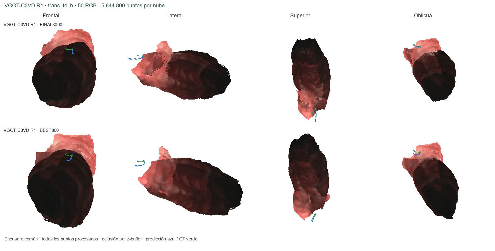<figcaption>R1 FINAL3000 y BEST800 · trans_t4_b · cuatro vistas con encuadre común y todos los puntos proyectados.</figcaption></figure>

<button type="button" class="book-open-clouds" data-clouds="vggt-c3vd-r1-final-trans4,vggt-c3vd-r1-best-trans4" data-scope="VGGT">Cargar nubes y trayectorias</button>

<button type="button" class="book-open-clouds" data-clouds="vggt-c3vd-r1-final-trans1a,vggt-c3vd-r1-best-trans1a" data-scope="VGGT">Comparar el caso trans_t1_a</button>

<p>Predicción azul y GT verde en C3VD. Cada nube contiene 5.644.800 puntos.</p>

<div class="book-actions"><button type="button" class="book-open-trajectories" data-trajectories="vggt-c3vd-r1-final-trans4,vggt-c3vd-r1-best-trans4">Comparar trayectorias sin cargar las nubes</button></div>
</details>

<details class="reading-fold"><summary>4 · Comparar este dataset</summary>

<div class="book-actions"><button type="button" class="book-open-metrics" data-metrics="vggt-c3vd-r1-zs-trans4,vggt-c3vd-r1-final-trans4,vggt-c3vd-r1-best-trans4">Elegir y comparar métricas</button></div>
<div class="book-actions"><button type="button" class="book-open-clouds" data-clouds="vggt-c3vd-r1-final-trans4,vggt-c3vd-r1-best-trans4">Elegir nubes para comparar</button></div>

</details>


</details>

<details class="dataset-fold" id="vggt-scared"><summary>SCARED</summary>

<span id="vggt-scared-audit"></span>
<div class="dataset-takeaway"><p><strong>Lectura breve.</strong> depth-v2 BEST500 es la selección de validación. Mejora profundidad y XYZ local, pero no la cámara: sus pesos permanecieron oficiales.</p><p class="compact-protocol">Reservados 8/9 · 8 anclas con vídeo · N50 · XYZ local del ancla, D+K calibrada+pose · escala GT por ancla, sin ICP.</p>

| Métrica | Zero-shot | depth-v2 BEST500 | depth-v2 FINAL3000 |
|---|---|---|---|
| AbsRel ↓ | 0.07861 | 0.04524 | 0.04466 |
| δ1 (%) ↑ | 93.89758 | 99.55260 | 99.50017 |
| XYZ (cm) ↓ | 0.54383 | 0.32439 | 0.32622 |

</div>

<details class="reading-fold" id="vg-scared-split"><summary>1 · Datos, splitting y entrenamiento</summary>

<details class="reading-fold"><summary>depth-v2 BEST500 · SCARED</summary>

| Partición | Datasets | Anclas medidas |
|---|---|---:|
| Entrenamiento | 1, 2, 3 y 6 | 20 |
| Validación | 7 | 5 |
| Reservados | 8 y 9 | 10 |

3.000 pasos de entrenamiento; checkpoint 500 elegido mediante validación. Solo profundidad entrenable; cámara y encoder congelados.

</details>

<details class="reading-fold"><summary>depth-v2 FINAL3000 · SCARED</summary>

| Partición | Datasets | Anclas medidas |
|---|---|---:|
| Entrenamiento | 1, 2, 3 y 6 | 20 |
| Validación | 7 | 5 |
| Reservados | 8 y 9 | 10 |

Misma ejecución y split que BEST500; checkpoint final del paso 3000. No se continuó el entrenamiento R1-C3VD.

</details>

<details class="reading-fold"><summary>Comparación de splits y recetas</summary>

| Partición | Datasets | Anclas medidas |
|---|---|---:|
| Entrenamiento | 1, 2, 3 y 6 | 20 |
| Validación | 7 | 5 |
| Reservados | 8 y 9 | 10 |

Los datasets 4/5 se excluyeron por calibración. Dataset 6/keyframe 1 conserva el ancla medida; su vídeo está en cuarentena temporal. El GT certificado corresponde al ancla, no a toda la trayectoria.

3.000 pasos; contextos de 4 imágenes cuando existe vídeo validado o 1 en las demás anclas. Solo el ancla recibe supervisión de profundidad. Resolución 266×336; encoder congelado. No es una réplica de la receta R1-C3VD.

</details>

</details>

<details class="reading-fold"><summary>2 · Métricas y comparación con zero-shot</summary>

<details class="reading-fold"><summary>Métricas propias · Validación 7 · N50</summary>

4 anclas de validación. Mismos RGB, máscaras y escala por ancla; XYZ/CD/NC puntúan el ancla local, no toda la reconstrucción temporal.

| Métrica | VGGT oficial zero-shot · validation · N=50 | VGGT-SCARED depth-v2 BEST500 · validation · N=50 | VGGT-SCARED depth-v2 FINAL3000 · validation · N=50 |
|---|---|---|---|
| AbsRel ↓ | 0.17641 | 0.12022 | 0.13249 |
| δ1 (%) ↑ | 70.96087 | 82.11374 | 77.70737 |
| XYZ local (cm) ↓ | 1.27640 | 0.99180 | 1.05005 |
| XYZ p95 (cm) ↓ | 3.08400 | 2.50419 | 2.60789 |
| CD sin ICP (cm) ↓ | 0.76719 | 0.51425 | 0.55928 |
| NC ↑ | 0.71656 | 0.69599 | 0.70038 |
| Error focal (%) ↓ | 51.88250 | 51.88250 | 51.88250 |
| Acuerdo multivista (%) ↑ | 90.48248 | 86.69605 | 92.35939 |

<button type="button" class="book-open-metrics" data-metrics="vggt-scared-review-context-validation-N50-VGGT_ZS,vggt-scared-review-context-validation-N50-VGGT_SCARED_BEST,vggt-scared-review-context-validation-N50-VGGT_SCARED_FINAL">Elegir y comparar métricas</button>

</details>

<details class="reading-fold"><summary>Métricas propias · Reservados 8/9 · N50</summary>

8 anclas reservadas con vídeo. Mismos RGB, máscaras y escala por ancla; XYZ/CD/NC puntúan el ancla local, no toda la reconstrucción temporal.

| Métrica | VGGT oficial zero-shot · reserved · N=50 | VGGT-SCARED depth-v2 BEST500 · reserved · N=50 | VGGT-SCARED depth-v2 FINAL3000 · reserved · N=50 |
|---|---|---|---|
| AbsRel ↓ | 0.07861 | 0.04524 | 0.04466 |
| δ1 (%) ↑ | 93.89758 | 99.55260 | 99.50017 |
| XYZ local (cm) ↓ | 0.54383 | 0.32439 | 0.32622 |
| XYZ p95 (cm) ↓ | 1.42528 | 0.93020 | 0.93818 |
| CD sin ICP (cm) ↓ | 0.36084 | 0.17176 | 0.18213 |
| NC ↑ | 0.78102 | 0.74578 | 0.76895 |
| Error focal (%) ↓ | 79.65849 | 79.65849 | 79.65849 |
| Acuerdo multivista (%) ↑ | 95.23665 | 91.33064 | 96.75277 |

<button type="button" class="book-open-metrics" data-metrics="vggt-scared-review-context-reserved-N50-VGGT_ZS,vggt-scared-review-context-reserved-N50-VGGT_SCARED_BEST,vggt-scared-review-context-reserved-N50-VGGT_SCARED_FINAL">Elegir y comparar métricas</button>

</details>

<details class="reading-fold"><summary>Todas las métricas propias · por split y contexto</summary>

35 anclas en la cohorte N1 completa; 26 en el conjunto fijo con vídeo. No se mezclan ambas cohortes.

| Cohorte | Split | N | Anclas | Pesos | AbsRel ↓ | XYZ cm ↓ | p95 cm ↓ | CD cm ↓ | NC ↑ |
|---|---|---:|---:|---|---:|---:|---:|---:|---:|
| all_measured_anchors_N1 | train | 1 | 20 | VGGT_ZS | 0.10903 | 0.78782 | 2.45777 | 0.51215 | 0.77949 |
| all_measured_anchors_N1 | validation | 1 | 5 | VGGT_ZS | 0.18597 | 1.31609 | 3.03406 | 0.82514 | 0.69509 |
| all_measured_anchors_N1 | reserved | 1 | 10 | VGGT_ZS | 0.09109 | 0.57189 | 1.48227 | 0.38011 | 0.77714 |
| all_measured_anchors_N1 | train | 1 | 20 | VGGT_SCARED_BEST | 0.05011 | 0.37239 | 1.16221 | 0.18658 | 0.75775 |
| all_measured_anchors_N1 | validation | 1 | 5 | VGGT_SCARED_BEST | 0.11812 | 0.91759 | 2.12101 | 0.46568 | 0.68150 |
| all_measured_anchors_N1 | reserved | 1 | 10 | VGGT_SCARED_BEST | 0.07738 | 0.52962 | 1.60320 | 0.27923 | 0.71848 |
| all_measured_anchors_N1 | train | 1 | 20 | VGGT_SCARED_FINAL | 0.03345 | 0.24276 | 0.70929 | 0.13104 | 0.81336 |
| all_measured_anchors_N1 | validation | 1 | 5 | VGGT_SCARED_FINAL | 0.11863 | 0.90469 | 2.07771 | 0.46929 | 0.69852 |
| all_measured_anchors_N1 | reserved | 1 | 10 | VGGT_SCARED_FINAL | 0.06984 | 0.47709 | 1.43934 | 0.26597 | 0.75267 |
| video_eligible_constant | train | 1 | 14 | VGGT_ZS | 0.09724 | 0.74176 | 2.32726 | 0.48164 | 0.78535 |
| video_eligible_constant | validation | 1 | 4 | VGGT_ZS | 0.21058 | 1.44208 | 3.35395 | 0.89312 | 0.68376 |
| video_eligible_constant | reserved | 1 | 8 | VGGT_ZS | 0.09028 | 0.60225 | 1.47329 | 0.40466 | 0.76379 |
| video_eligible_constant | train | 1 | 14 | VGGT_SCARED_BEST | 0.05785 | 0.42866 | 1.31794 | 0.21657 | 0.75330 |
| video_eligible_constant | validation | 1 | 4 | VGGT_SCARED_BEST | 0.13353 | 1.01722 | 2.35115 | 0.50790 | 0.67155 |
| video_eligible_constant | reserved | 1 | 8 | VGGT_SCARED_BEST | 0.07519 | 0.53276 | 1.52113 | 0.28649 | 0.70315 |
| video_eligible_constant | train | 1 | 14 | VGGT_SCARED_FINAL | 0.04126 | 0.30064 | 0.89101 | 0.16268 | 0.79954 |
| video_eligible_constant | validation | 1 | 4 | VGGT_SCARED_FINAL | 0.13479 | 1.00564 | 2.29099 | 0.51270 | 0.68910 |
| video_eligible_constant | reserved | 1 | 8 | VGGT_SCARED_FINAL | 0.06780 | 0.47954 | 1.33536 | 0.27349 | 0.73850 |
| video_eligible_constant | train | 4 | 14 | VGGT_ZS | 0.08355 | 0.65584 | 2.19943 | 0.42255 | 0.80441 |
| video_eligible_constant | validation | 4 | 4 | VGGT_ZS | 0.19495 | 1.35555 | 3.20473 | 0.83467 | 0.69601 |
| video_eligible_constant | reserved | 4 | 8 | VGGT_ZS | 0.08149 | 0.56606 | 1.49630 | 0.37594 | 0.77497 |
| video_eligible_constant | train | 4 | 14 | VGGT_SCARED_BEST | 0.03759 | 0.27286 | 0.85963 | 0.13295 | 0.78446 |
| video_eligible_constant | validation | 4 | 4 | VGGT_SCARED_BEST | 0.12813 | 1.02991 | 2.53715 | 0.54064 | 0.68929 |
| video_eligible_constant | reserved | 4 | 8 | VGGT_SCARED_BEST | 0.05130 | 0.36668 | 1.08612 | 0.19797 | 0.73988 |
| video_eligible_constant | train | 4 | 14 | VGGT_SCARED_FINAL | 0.02578 | 0.18367 | 0.54265 | 0.09567 | 0.82253 |
| video_eligible_constant | validation | 4 | 4 | VGGT_SCARED_FINAL | 0.13379 | 1.04987 | 2.51482 | 0.55736 | 0.69392 |
| video_eligible_constant | reserved | 4 | 8 | VGGT_SCARED_FINAL | 0.04862 | 0.35430 | 1.05298 | 0.19825 | 0.76425 |
| video_eligible_constant | train | 8 | 14 | VGGT_ZS | 0.08273 | 0.65396 | 2.19815 | 0.42017 | 0.80698 |
| video_eligible_constant | validation | 8 | 4 | VGGT_ZS | 0.17367 | 1.24144 | 3.00429 | 0.76007 | 0.71548 |
| video_eligible_constant | reserved | 8 | 8 | VGGT_ZS | 0.07788 | 0.53842 | 1.40813 | 0.35645 | 0.77787 |
| video_eligible_constant | train | 8 | 14 | VGGT_SCARED_BEST | 0.03860 | 0.28270 | 0.86695 | 0.14031 | 0.78485 |
| video_eligible_constant | validation | 8 | 4 | VGGT_SCARED_BEST | 0.12191 | 0.97911 | 2.48406 | 0.51294 | 0.69038 |
| video_eligible_constant | reserved | 8 | 8 | VGGT_SCARED_BEST | 0.04767 | 0.33976 | 0.99642 | 0.18144 | 0.74177 |
| video_eligible_constant | train | 8 | 14 | VGGT_SCARED_FINAL | 0.02741 | 0.19883 | 0.54819 | 0.10570 | 0.82171 |
| video_eligible_constant | validation | 8 | 4 | VGGT_SCARED_FINAL | 0.12853 | 1.01561 | 2.51297 | 0.54413 | 0.69951 |
| video_eligible_constant | reserved | 8 | 8 | VGGT_SCARED_FINAL | 0.04553 | 0.33090 | 0.98579 | 0.18431 | 0.76597 |
| video_eligible_constant | train | 16 | 14 | VGGT_ZS | 0.08416 | 0.66615 | 2.25020 | 0.43144 | 0.80539 |
| video_eligible_constant | validation | 16 | 4 | VGGT_ZS | 0.16879 | 1.22637 | 3.03598 | 0.74105 | 0.71924 |
| video_eligible_constant | reserved | 16 | 8 | VGGT_ZS | 0.07819 | 0.54054 | 1.42122 | 0.35806 | 0.77871 |
| video_eligible_constant | train | 16 | 14 | VGGT_SCARED_BEST | 0.03955 | 0.28829 | 0.85765 | 0.14525 | 0.78579 |
| video_eligible_constant | validation | 16 | 4 | VGGT_SCARED_BEST | 0.11690 | 0.96479 | 2.47912 | 0.50346 | 0.69445 |
| video_eligible_constant | reserved | 16 | 8 | VGGT_SCARED_BEST | 0.04574 | 0.32788 | 0.94162 | 0.17410 | 0.74439 |
| video_eligible_constant | train | 16 | 14 | VGGT_SCARED_FINAL | 0.02805 | 0.20520 | 0.56157 | 0.11024 | 0.81999 |
| video_eligible_constant | validation | 16 | 4 | VGGT_SCARED_FINAL | 0.12787 | 1.02339 | 2.55542 | 0.54640 | 0.69823 |
| video_eligible_constant | reserved | 16 | 8 | VGGT_SCARED_FINAL | 0.04471 | 0.32634 | 0.94929 | 0.18154 | 0.76844 |
| video_eligible_constant | train | 50 | 14 | VGGT_ZS | 0.08513 | 0.67506 | 2.27952 | 0.43958 | 0.80385 |
| video_eligible_constant | validation | 50 | 4 | VGGT_ZS | 0.17641 | 1.27640 | 3.08400 | 0.76719 | 0.71656 |
| video_eligible_constant | reserved | 50 | 8 | VGGT_ZS | 0.07861 | 0.54383 | 1.42528 | 0.36084 | 0.78102 |
| video_eligible_constant | train | 50 | 14 | VGGT_SCARED_BEST | 0.04233 | 0.30558 | 0.89005 | 0.15769 | 0.78328 |
| video_eligible_constant | validation | 50 | 4 | VGGT_SCARED_BEST | 0.12022 | 0.99180 | 2.50419 | 0.51425 | 0.69599 |
| video_eligible_constant | reserved | 50 | 8 | VGGT_SCARED_BEST | 0.04524 | 0.32439 | 0.93020 | 0.17176 | 0.74578 |
| video_eligible_constant | train | 50 | 14 | VGGT_SCARED_FINAL | 0.03056 | 0.22477 | 0.61952 | 0.12203 | 0.81550 |
| video_eligible_constant | validation | 50 | 4 | VGGT_SCARED_FINAL | 0.13249 | 1.05005 | 2.60789 | 0.55928 | 0.70038 |
| video_eligible_constant | reserved | 50 | 8 | VGGT_SCARED_FINAL | 0.04466 | 0.32622 | 0.93818 | 0.18213 | 0.76895 |

<button type="button" class="book-open-metrics" data-metrics="vggt-scared-review-context-train-N8-VGGT_ZS,vggt-scared-review-context-train-N8-VGGT_SCARED_BEST,vggt-scared-review-context-train-N8-VGGT_SCARED_FINAL" data-scope="VGGT">Elegir y comparar métricas</button>

</details>

</details>


<details class="reading-fold" id="vg-scared-views"><summary>3 · Vistas, nubes y trayectorias</summary>

<figure>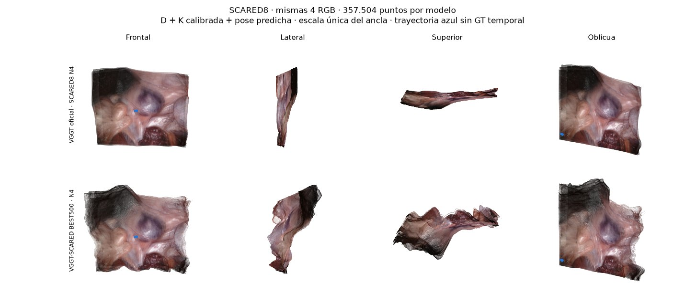<figcaption>VGGT oficial y VGGT-SCARED BEST500 · mismas 4 RGB: ancla medida y vídeo 0/30/60 · 357.504 puntos por nube.</figcaption></figure>

<button type="button" class="book-open-clouds" data-clouds="vggt-scared8-zs-n4,vggt-scared8-best-n4" data-scope="VGGT">Cargar nubes y trayectorias</button>

<button type="button" class="book-open-metrics" data-metrics="vggt-scared8-zs-n4,vggt-scared8-best-n4">Elegir y comparar métricas</button>

<p>La visualización usa un contexto N4 ya inferido; las tablas N50 de arriba son otra condición. No hay trayectoria GT temporal certificada en SCARED.</p>

<div class="book-actions"><button type="button" class="book-open-trajectories" data-trajectories="vggt-scared8-zs-n4,vggt-scared8-best-n4">Comparar trayectorias sin cargar las nubes</button></div>
</details>

<details class="reading-fold"><summary>4 · Comparar este dataset</summary>

<div class="book-actions"><button type="button" class="book-open-metrics" data-metrics="vggt-scared-review-context-reserved-N50-VGGT_ZS,vggt-scared-review-context-reserved-N50-VGGT_SCARED_BEST,vggt-scared-review-context-reserved-N50-VGGT_SCARED_FINAL">Elegir y comparar métricas</button></div>
<div class="book-actions"><button type="button" class="book-open-clouds" data-clouds="vggt-scared8-zs-n4,vggt-scared8-best-n4">Elegir nubes para comparar</button></div>

</details>


</details>

<details class="comparison-fold" id="vggt-comparadores"><summary>Comparación</summary>

<details class="reading-fold"><summary>Métricas · elegir resultados y referencias</summary>

Selecciona hasta cuatro resultados. Los porcentajes se calculan únicamente entre registros con el mismo caso y protocolo.

<button type="button" class="book-open-metrics" data-metrics="vggt-c3vd-r1-zs-trans4,vggt-c3vd-r1-final-trans4,vggt-c3vd-r1-best-trans4" data-scope="VGGT">Elegir y comparar métricas</button>

</details>

<details class="reading-fold"><summary>Nubes y trayectorias · elegir y manipular</summary>

<button type="button" class="book-open-clouds" data-clouds="vggt-c3vd-r1-final-trans4,vggt-c3vd-r1-best-trans4" data-scope="VGGT">Cargar nubes y trayectorias</button>

<p>La selección es dinámica. Se conservan todos los puntos guardados; las rutas y contextos se identifican en cada panel.</p>

</details>

</details>

## VGGT vs VGG-T³ {#vggt-vs-vgg-t3 .model-workspace}

<p id="comparacion-referencias-actuales">Referencias: VGGT R1-C3VD y depth-v2-SCARED; VGG-T³ V9-C3VD y candidatos SCARED documentados. Las recetas no igualan módulos ni presupuesto.</p>

<details class="reading-fold" id="c3vd-r1-v9-pareado"><summary>C3VD · referencias actuales R1–V9 · comparación pareada</summary>

**Protocolo:** mismas 50 RGB a 336×336 y 50 objetivos GT por secuencia; máscaras e intrínsecas compartidas. Ruta **D+K calibrada+pose predicha**, una escala GT de profundidad por contexto y sin ICP. ATE/RPE usan su alineamiento global de cámara por separado. Cada secuencia tiene el mismo peso dentro de su split.

<details class="reading-fold"><summary>Validación · trans_t1_b y trans_t4_b</summary>

| Métrica | VGGT R1 FINAL3000 | VGG-T³ V9 |
|---|---:|---:|
| AbsRel ↓ | 0.15065 | 0.15593 |
| δ1 (%) ↑ | 78.39289 | 79.50007 |
| XYZ D+K+pose (cm) ↓ | 0.62614 | 0.61512 |
| XYZ p95 (cm) ↓ | 1.43229 | 1.62726 |
| CD sin ICP (cm) ↓ | 0.20469 | 0.22249 |
| NC ↑ | 0.70555 | 0.66586 |
| ATE RMSE (cm) ↓ | 0.08346 | 0.10301 |

<div class="book-actions"><button type="button" class="book-open-metrics" data-metrics="c3vd-paired-r1-v9-macro-validation-R1_FINAL3000,c3vd-paired-r1-v9-macro-validation-TTT_C3VD_V9">Comparar todas las métricas de este split</button></div>

</details>

<details class="reading-fold"><summary>Reservadas del mismo phantom · cecum_t2_a y trans_t1_a</summary>

| Métrica | VGGT R1 FINAL3000 | VGG-T³ V9 |
|---|---:|---:|
| AbsRel ↓ | 0.11043 | 0.10457 |
| δ1 (%) ↑ | 85.22153 | 88.39191 |
| XYZ D+K+pose (cm) ↓ | 0.77677 | 1.66351 |
| XYZ p95 (cm) ↓ | 1.67285 | 3.00812 |
| CD sin ICP (cm) ↓ | 0.20422 | 0.42433 |
| NC ↑ | 0.69208 | 0.61276 |
| ATE RMSE (cm) ↓ | 0.25897 | 0.52142 |

<div class="book-actions"><button type="button" class="book-open-metrics" data-metrics="c3vd-paired-r1-v9-macro-reserved-R1_FINAL3000,c3vd-paired-r1-v9-macro-reserved-TTT_C3VD_V9">Comparar todas las métricas de este split</button></div>

</details>

<p>La comparación es descriptiva: R1 y V9 conservan diferencias de arquitectura, cabezas y entrenamiento. En validación hay intercambios entre métricas. En las reservadas, R1 tiene menor error XYZ de esta ruta y V9 menor AbsRel. No se seleccionan nuevos pesos con esta comparación.</p>
<details class="reading-fold"><summary>Resultados por secuencia</summary>

<details class="reading-fold"><summary>trans_t1_b</summary>

| Modelo | AbsRel ↓ | δ1 % ↑ | XYZ cm ↓ | ATE cm ↓ |
|---|---|---|---|---|
| VGGT R1 FINAL3000 | 0.17034 | 74.11499 | 0.60773 | 0.10489 |
| VGG-T³ V9 | 0.16481 | 80.32905 | 0.62315 | 0.10730 |

</details>
<details class="reading-fold"><summary>trans_t4_b</summary>

| Modelo | AbsRel ↓ | δ1 % ↑ | XYZ cm ↓ | ATE cm ↓ |
|---|---|---|---|---|
| VGGT R1 FINAL3000 | 0.13095 | 82.67079 | 0.64456 | 0.06203 |
| VGG-T³ V9 | 0.14706 | 78.67109 | 0.60708 | 0.09872 |

</details>
<details class="reading-fold"><summary>cecum_t2_a</summary>

| Modelo | AbsRel ↓ | δ1 % ↑ | XYZ cm ↓ | ATE cm ↓ |
|---|---|---|---|---|
| VGGT R1 FINAL3000 | 0.05586 | 98.16227 | 0.84582 | 0.40829 |
| VGG-T³ V9 | 0.06843 | 97.08236 | 2.08131 | 0.75315 |

</details>
<details class="reading-fold"><summary>trans_t1_a</summary>

| Modelo | AbsRel ↓ | δ1 % ↑ | XYZ cm ↓ | ATE cm ↓ |
|---|---|---|---|---|
| VGGT R1 FINAL3000 | 0.16500 | 72.28078 | 0.70773 | 0.10965 |
| VGG-T³ V9 | 0.14070 | 79.70146 | 1.24572 | 0.28969 |

</details>

</details>
<details class="reading-fold"><summary>Resumen por split</summary>

| Split | Modelo | AbsRel ↓ | XYZ cm ↓ | ATE cm ↓ |
|---|---|---|---|---|
| validation | VGGT R1 FINAL3000 | 0.15065 | 0.62614 | 0.08346 |
| validation | VGG-T³ V9 | 0.15593 | 0.61512 | 0.10301 |
| reserved | VGGT R1 FINAL3000 | 0.11043 | 0.77677 | 0.25897 |
| reserved | VGG-T³ V9 | 0.10457 | 1.66351 | 0.52142 |

</details>
<details class="reading-fold"><summary>Verificación del emparejamiento</summary>

| Control | Resultado |
|---|---|
| Entradas | Mismos IDs y orden de 50 RGB, resolución 336×336 y hash de entrada. |
| Referencia | Mismos pools, máscaras válidas, GT, intrínsecas y gauge de cámara. |
| Geometría | D+K calibrada+pose; una escala GT compartida; sin ICP. |
| Reproducción | XYZ y p95 reproducidos desde las ocho predicciones guardadas. |
| Límite | Recetas y arquitecturas diferentes: comparación descriptiva, no ablación causal. |

</details>


<div class="book-actions"><button type="button" class="book-open-trajectories" data-trajectories="paired-R1-trans_t4_b,paired-V9-trans_t4_b">Trayectorias · R1 y V9 del protocolo pareado</button></div>
</details>

<details class="reading-fold" id="comparison-metrics"><summary>Métricas · comparación dinámica entre modelos</summary>

<button type="button" class="book-open-metrics" data-metrics="vggt-scared8-zs-n4,vggt-scared8-best-n4,ttt-scared8-vn18-n4">Elegir y comparar métricas</button>

<p>Ejemplo pareado SCARED8 N4: misma ruta D+K+pose y GT local. Puedes elegir otros registros; el comparador separa los protocolos incompatibles y las cifras de los papers.</p>

</details>

<details class="reading-fold" id="comparison-clouds"><summary>Vistas, nubes y trayectorias</summary>


<p>Casos base para comparar los modelos: las mismas 50 imágenes, orden de entrada y ruta D + K calibrada + pose predicha. VN18-C3VD y VN18-SCARED se identifican por separado. La selección de modelos sigue disponible en cada visor.</p>

<details class="reading-fold" id="base-trans_t4_b"><summary>C3VD · trans_t4_b · N50</summary>

<p>Este recorrido se usa como prueba base de reconstrucción y transferencia. Son 50 imágenes entre los frames 0 y 596; no son 597 imágenes procesadas. Ha participado en validación y análisis previos: no se presenta como una prueba ciega. Aquí se puntúan las 50 referencias GT del protocolo común, sin mezclar el protocolo anterior de 16 objetivos.</p>

<details class="protocol-details"><summary>Protocolo común y alcance</summary><p>50 RGB; mismas dimensiones y hash de entrada por caso; intrínsecas calibradas; una escala de profundidad ajustada con GT compartida con la geometría; sin ICP ni filtro de confianza. Las métricas usan todos los píxeles GT válidos. Las nubes guardan el 100 % de los puntos de las 50 vistas.</p></details>

<figure>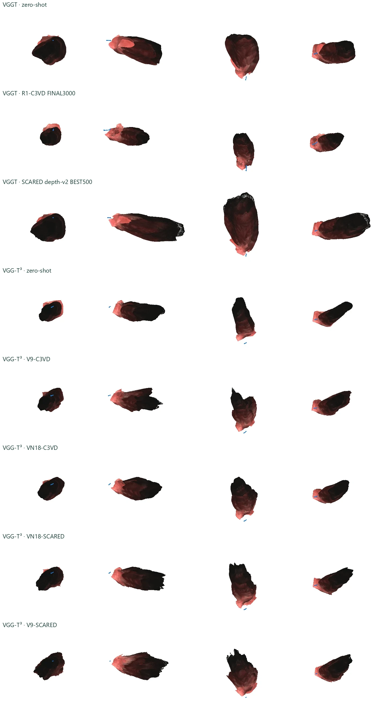<figcaption>Cuatro vistas por modelo con las mismas cámaras y encuadre dentro de cada caso; trayectoria predicha en azul. El encuadre compartido conserva las diferencias de extensión. Haz clic para ampliar y usar el zoom de la imagen.</figcaption></figure>

<div class="book-actions"><button type="button" class="book-open-clouds" data-clouds="base-trans_t4_b-vggt_zs,base-trans_t4_b-r1_final3000,base-trans_t4_b-ttt_zs,base-trans_t4_b-ttt_c3vd_vn18">Comparación base · oficiales, R1 y VN18-C3VD</button><button type="button" class="book-open-clouds" data-clouds="base-trans_t4_b-ttt_c3vd_v9,base-trans_t4_b-ttt_c3vd_vn18,base-trans_t4_b-ttt_scared_vn18,base-trans_t4_b-vggt_scared_best">Comparar fine-tunings · elegir modelos</button><button type="button" class="book-open-trajectories" data-trajectories="base-trans_t4_b-ttt_c3vd_v9,base-trans_t4_b-ttt_c3vd_vn18,base-trans_t4_b-ttt_scared_vn18,base-trans_t4_b-vggt_scared_best">Comparar trayectorias</button><button type="button" class="book-open-metrics" data-metrics="base-trans_t4_b-ttt_c3vd_v9,base-trans_t4_b-ttt_c3vd_vn18,base-trans_t4_b-ttt_scared_vn18,base-trans_t4_b-vggt_scared_best">Comparar métricas · elegir modelos</button></div>

<details class="metrics-fold"><summary>Métricas principales · protocolo pareado N50</summary>


| Modelo | AbsRel ↓ | δ1 (%) ↑ | XYZ (cm) ↓ | p95 (cm) ↓ | CD (cm) ↓ | NC ↑ |
|---|---:|---:|---:|---:|---:|---:|
| VGGT · zero-shot | 0.2524 | 55.6541 | 0.8385 | 2.0140 | 0.1923 | 0.6539 |
| VGGT · R1-C3VD FINAL3000 | 0.1309 | 82.6708 | 0.6446 | 1.6295 | 0.1809 | 0.7142 |
| VGGT · SCARED depth-v2 BEST500 | 0.2746 | 54.8834 | 0.8985 | 2.1130 | 0.2015 | 0.6398 |
| VGG-T³ · zero-shot | 0.1838 | 72.1239 | 0.7830 | 2.0627 | 0.2503 | 0.6562 |
| VGG-T³ · V9-C3VD | 0.1471 | 78.6711 | 0.6071 | 1.9461 | 0.2049 | 0.6640 |
| VGG-T³ · VN18-C3VD | 0.1300 | 83.2051 | 0.6556 | 1.6688 | 0.1762 | 0.7036 |
| VGG-T³ · VN18-SCARED | 0.1927 | 61.3772 | 0.7817 | 1.6676 | 0.2171 | 0.6818 |
| VGG-T³ · V9-SCARED | 0.1737 | 67.8066 | 0.8457 | 1.9344 | 0.2620 | 0.6006 |


</details>

<p>La trayectoria real aparece en verde. El porcentaje posicional usa los centros tras Sim(3) y un umbral explícito; no mide orientación ni constituye una puntuación clínica.</p></details>

<details class="reading-fold" id="base-d8_kf0"><summary>SCARED8 · KF0 original / KF1 processed · N50</summary>

<p>Caso reservado de los entrenamientos SCARED, usado aquí para reconstrucción y transferencia. Son el ancla medida y 49 imágenes del vídeo. El GT permite evaluar profundidad y superficie en el ancla; no permite certificar la trayectoria ni la geometría de todo el vídeo. Estos reservados ya se han inspeccionado en análisis anteriores.</p>

<details class="protocol-details"><summary>Protocolo común y alcance</summary><p>50 RGB; mismas dimensiones y hash de entrada por caso; intrínsecas calibradas; una escala de profundidad ajustada con GT compartida con la geometría; sin ICP ni filtro de confianza. Las métricas usan todos los píxeles GT válidos. Las nubes guardan el 100 % de los puntos de las 50 vistas.</p></details>

<figure>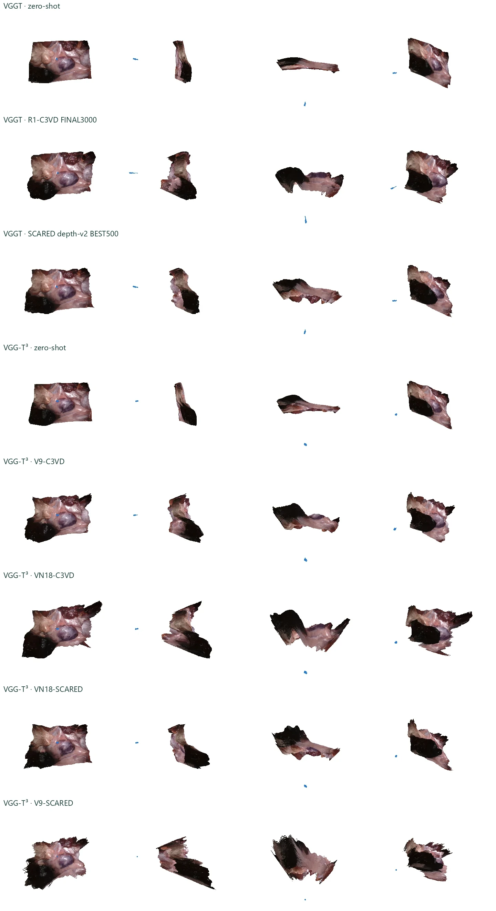<figcaption>Cuatro vistas por modelo con las mismas cámaras y encuadre dentro de cada caso; trayectoria predicha en azul. El encuadre compartido conserva las diferencias de extensión. Haz clic para ampliar y usar el zoom de la imagen.</figcaption></figure>

<div class="book-actions"><button type="button" class="book-open-clouds" data-clouds="base-d8_kf0-vggt_zs,base-d8_kf0-r1_final3000,base-d8_kf0-ttt_zs,base-d8_kf0-ttt_c3vd_vn18">Comparación base · oficiales, R1 y VN18-C3VD</button><button type="button" class="book-open-clouds" data-clouds="base-d8_kf0-ttt_c3vd_v9,base-d8_kf0-ttt_c3vd_vn18,base-d8_kf0-ttt_scared_vn18,base-d8_kf0-vggt_scared_best">Comparar fine-tunings · elegir modelos</button><button type="button" class="book-open-trajectories" data-trajectories="base-d8_kf0-ttt_c3vd_v9,base-d8_kf0-ttt_c3vd_vn18,base-d8_kf0-ttt_scared_vn18,base-d8_kf0-vggt_scared_best">Comparar trayectorias</button><button type="button" class="book-open-metrics" data-metrics="base-d8_kf0-ttt_c3vd_v9,base-d8_kf0-ttt_c3vd_vn18,base-d8_kf0-ttt_scared_vn18,base-d8_kf0-vggt_scared_best">Comparar métricas · elegir modelos</button></div>

<details class="metrics-fold"><summary>Métricas principales · protocolo pareado N50</summary>


| Modelo | AbsRel ↓ | δ1 (%) ↑ | XYZ (cm) ↓ | p95 (cm) ↓ | CD (cm) ↓ | NC ↑ |
|---|---:|---:|---:|---:|---:|---:|
| VGGT · zero-shot | 0.0520 | 99.9788 | 0.6244 | 1.6015 | 0.4160 | 0.8102 |
| VGGT · R1-C3VD FINAL3000 | 0.0872 | 94.4641 | 1.0593 | 2.6947 | 0.6000 | 0.6168 |
| VGGT · SCARED depth-v2 BEST500 | 0.0457 | 99.8598 | 0.5552 | 1.6230 | 0.3076 | 0.6931 |
| VGG-T³ · zero-shot | 0.0391 | 99.9490 | 0.4760 | 1.2264 | 0.2957 | 0.8203 |
| VGG-T³ · V9-C3VD | 0.0771 | 94.4528 | 0.9493 | 3.4077 | 0.5205 | 0.6100 |
| VGG-T³ · VN18-C3VD | 0.1087 | 85.6758 | 1.3338 | 3.7294 | 0.7388 | 0.5698 |
| VGG-T³ · VN18-SCARED | 0.0542 | 99.1345 | 0.6679 | 2.2139 | 0.3708 | 0.7061 |
| VGG-T³ · V9-SCARED | 0.0843 | 94.7403 | 1.0368 | 2.8613 | 0.4837 | 0.5426 |


</details>

<p>Se muestran trayectorias predichas. El acierto posicional aparece como N/D porque no hay GT temporal certificado.</p></details>

<details class="reading-fold" id="base-d9_kf0"><summary>SCARED9 · KF0 original / KF1 processed · N50</summary>

<p>Caso reservado de los entrenamientos SCARED, usado aquí para reconstrucción y transferencia. Son el ancla medida y 49 imágenes del vídeo. El GT permite evaluar profundidad y superficie en el ancla; no permite certificar la trayectoria ni la geometría de todo el vídeo. Estos reservados ya se han inspeccionado en análisis anteriores.</p>

<details class="protocol-details"><summary>Protocolo común y alcance</summary><p>50 RGB; mismas dimensiones y hash de entrada por caso; intrínsecas calibradas; una escala de profundidad ajustada con GT compartida con la geometría; sin ICP ni filtro de confianza. Las métricas usan todos los píxeles GT válidos. Las nubes guardan el 100 % de los puntos de las 50 vistas.</p></details>

<figure>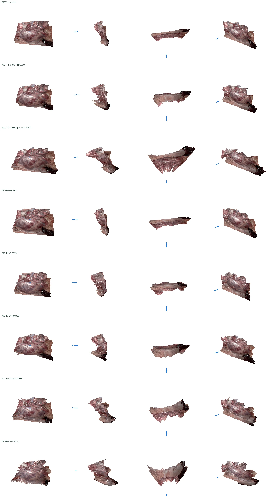<figcaption>Cuatro vistas por modelo con las mismas cámaras y encuadre dentro de cada caso; trayectoria predicha en azul. El encuadre compartido conserva las diferencias de extensión. Haz clic para ampliar y usar el zoom de la imagen.</figcaption></figure>

<div class="book-actions"><button type="button" class="book-open-clouds" data-clouds="base-d9_kf0-vggt_zs,base-d9_kf0-r1_final3000,base-d9_kf0-ttt_zs,base-d9_kf0-ttt_c3vd_vn18">Comparación base · oficiales, R1 y VN18-C3VD</button><button type="button" class="book-open-clouds" data-clouds="base-d9_kf0-ttt_c3vd_v9,base-d9_kf0-ttt_c3vd_vn18,base-d9_kf0-ttt_scared_vn18,base-d9_kf0-vggt_scared_best">Comparar fine-tunings · elegir modelos</button><button type="button" class="book-open-trajectories" data-trajectories="base-d9_kf0-ttt_c3vd_v9,base-d9_kf0-ttt_c3vd_vn18,base-d9_kf0-ttt_scared_vn18,base-d9_kf0-vggt_scared_best">Comparar trayectorias</button><button type="button" class="book-open-metrics" data-metrics="base-d9_kf0-ttt_c3vd_v9,base-d9_kf0-ttt_c3vd_vn18,base-d9_kf0-ttt_scared_vn18,base-d9_kf0-vggt_scared_best">Comparar métricas · elegir modelos</button></div>

<details class="metrics-fold"><summary>Métricas principales · protocolo pareado N50</summary>


| Modelo | AbsRel ↓ | δ1 (%) ↑ | XYZ (cm) ↓ | p95 (cm) ↓ | CD (cm) ↓ | NC ↑ |
|---|---:|---:|---:|---:|---:|---:|
| VGGT · zero-shot | 0.1501 | 77.1251 | 1.2614 | 3.0091 | 0.8011 | 0.7221 |
| VGGT · R1-C3VD FINAL3000 | 0.1499 | 75.8272 | 1.4711 | 4.1126 | 0.8259 | 0.6411 |
| VGGT · SCARED depth-v2 BEST500 | 0.0531 | 98.7489 | 0.4734 | 1.2652 | 0.2035 | 0.6883 |
| VGG-T³ · zero-shot | 0.1377 | 79.0685 | 1.1809 | 2.9573 | 0.7403 | 0.7269 |
| VGG-T³ · V9-C3VD | 0.1290 | 81.7345 | 1.2556 | 3.7951 | 0.7035 | 0.6326 |
| VGG-T³ · VN18-C3VD | 0.1715 | 71.8839 | 1.7687 | 5.2460 | 1.0004 | 0.6278 |
| VGG-T³ · VN18-SCARED | 0.0614 | 98.3745 | 0.5756 | 1.5705 | 0.2762 | 0.7263 |
| VGG-T³ · V9-SCARED | 0.0761 | 97.2858 | 0.7000 | 1.9228 | 0.2967 | 0.5770 |


</details>

<p>Se muestran trayectorias predichas. El acierto posicional aparece como N/D porque no hay GT temporal certificado.</p></details>

<p>Las nubes completas se descargan bajo demanda desde la rama de recursos del mismo repositorio. No se redujo su cantidad de puntos. Las tablas corresponden a la misma ruta D+cámara; las salidas P directas históricas siguen identificadas en el selector.</p></details>

<details class="reading-fold"><summary>Métricas y tablas anteriores · protocolos originales</summary>

Las comparaciones anteriores se conservan en [los experimentos comparativos](#vggt-vs-vgg-t3-experimentos).

<button type="button" class="book-open-metrics" data-metrics="c3vd-vggt_zs-derived,c3vd-vggt_ft-derived,c3vd-zero-derived,c3vd-v9-derived">Elegir y comparar métricas</button>

<button type="button" class="book-open-metrics" data-metrics="paper-vggt-1,paper-vggt-ttt-1">Consultar tablas de los papers</button>

</details>

## Experimentos {#experimentos}

Todos los ensayos realizados se reúnen aquí. Cada ficha conserva la idea, el método, los resultados y la conclusión. Un resultado mixto o descriptivo se identifica como tal, sin forzar una confirmación causal.

<details class="experiments-menu" id="experimentos-menu"><summary>Experimentos realizados · por modelo y dataset</summary>

<div class="experiment-controls" id="experiment-controls"><label>Buscar<input id="experiment-search" type="search" placeholder="Ventanas, escala, cámara, profundidad…"></label><label>Modelo<select id="experiment-model"><option value="">Todos</option><option>VGG-T³</option><option>VGGT</option><option>Comparativo</option></select></label><label>Dataset<select id="experiment-dataset"><option value="">Todos</option><option>C3VD</option><option>SCARED</option><option>Global</option></select></label><button id="experiment-reset" type="button">Limpiar filtros</button><button id="experiment-collapse" type="button">Cerrar fichas</button><span id="experiment-count"></span></div><p id="experiment-empty" hidden>No hay experimentos con estos filtros.</p>

<details class="experiment-model" id="experimentos-ttt"><summary>VGG-T³</summary>

<details class="experiment-group"><summary>C3VD · 35 fichas</summary>

<details class="experiment-card" id="exp-d04" data-research-card data-order="3" data-primary="Eficiencia y secuencias largas" data-problems="Eficiencia y secuencias largas" data-datasets="C3VD" data-status="executed" data-negative="true" data-experiment data-model="VGG-T³" data-scope="C3VD">
<summary><span class="card-status">Ejecutado</span><span class="card-id">D04</span>Comprobar si eliminar los saltos procesando toda Trans4 mejora la nube.<span class="card-teaser">El intento con 597 imágenes a 336² terminó en OOM durante normalización RGB, antes de una reconstrucción completa.</span><span class="card-topics">C3VD · Eficiencia y secuencias largas</span></summary>

<div class="card-content">
<dl class="card-fields"><dt>Hipótesis / pregunta</dt><dd>Procesar todos los frames de Trans4, eliminando los saltos, podría mejorar su geometría respecto a las selecciones parciales.</dd>
<dt>Cómo se realizó</dt><dd>Se intentó un forward con los 597 frames de Trans4, stride 1 y resolución336², sin reducir cantidad ni resolución tras detectar falta de memoria.</dd>
<dt>Controles</dt><dd>Se conservan los controles descritos en la intervención. Esta ficha no incorpora controles nuevos ni completa los ausentes.</dd>
<dt>Métricas</dt><dd>Las medidas y condiciones consignadas en el registro; si son cualitativas o de viabilidad, no se transforman en métricas geométricas.</dd></dl>
<div class="card-result"><strong>Resultados</strong><p>El intento con 597 imágenes a 336² terminó en OOM durante normalización RGB, antes de una reconstrucción completa.</p></div>
<details class="protocol-details"><summary>Protocolo y alcance de la comparación</summary><dl class="protocol-fields"><div><dt>Dataset</dt><dd>C3VD trans_t4_b</dd></div><div><dt>Partición</dt><dd>Según condiciones del registro</dd></div><div><dt>Checkpoint</dt><dd>Variantes indicadas en la intervención; no hay un único checkpoint</dd></div><div><dt>Frames y resolución</dt><dd>597 RGB; stride 1; 336²</dd></div><div><dt>Escala / alineamiento</dt><dd>Según condición; no asumir un registro común</dd></div><div><dt>Unidades</dt><dd>Las consignadas en resultados y tablas</dd></div><div><dt>GT disponible</dt><dd>No se produjo reconstrucción completa; calidad no evaluada</dd></div><div><dt>Modelos / ámbito</dt><dd>TTT V9 / Trans4</dd></div></dl></details>

<dl class="card-fields"><dt>Conclusión</dt><dd><strong>No evaluable por OOM.</strong> Es evidencia de viabilidad en ese equipo y ejecución, no de colapso geométrico del modelo a 597 vistas.</dd><dt>Limitaciones</dt><dd>Límite de recursos de esta ejecución; no prueba de incapacidad geométrica a 597 ni autorización para reducir N silenciosamente.</dd></dl>
<details class="trace-details"><summary>Trazabilidad · configuración, código y resultados</summary><p class="evidence-note"><strong>Registro:</strong> <a href="tablas/experimentos_c3vd.json">experimentos_c3vd.json</a> · ID D04. <strong>Código:</strong> Según la condición del registro histórico. Los archivos operativos, configuraciones y checkpoints completos se conservan localmente; no se publican datos GT ni mapas granulares por píxel.</p><p class="evidence-note"><strong>Checkpoint:</strong> Variantes indicadas en la intervención; no hay un único checkpoint · <strong>Datos:</strong> C3VD trans_t4_b. <a href="tablas/menu_experimentos_unificado.json">Descargar índice estructurado</a> · <a href="#bibliografia">Papers y secciones de referencia</a></p></details>
<p class="evidence-note">Recetas principales y código para lectura: <a href="recursos/recetas/c3vd-v9.html" target="_blank" rel="noopener">V9 · C3VD</a> · <a href="recursos/recetas/c3vd-vn19.html" target="_blank" rel="noopener">VN19-A/B · C3VD</a>. Cada página indica el alcance de la firma conservada; no sustituye la configuración de un piloto diferente.</p>
<p class="evidence-note">Consulta metodológica: <a href="https://arxiv.org/html/2602.23361v1#S4.SS4" target="_blank" rel="noopener">VGG-T³: escala y ablaciones</a> · <a href="https://arxiv.org/html/2503.11651v1#S5.SS0.SSS0.Px2" target="_blank" rel="noopener">VGGT: tiempo y memoria</a>. La evidencia del resultado es el registro local, no una afirmación atribuida al paper.</p>
<p class="book-cloud-note">Esta ficha no tiene una nube específica verificada asociada. Conserva sus mediciones; no se ha lanzado otra inferencia para crearla.</p>
<div class="book-actions"><button type="button" class="book-open-metrics" data-metrics="experiment-D04">Comparar datos de esta ficha</button></div>
<dl class="card-fields verdict"><dt>Confirmación o negación de la hipótesis</dt><dd>No evaluable por OOM. Límite de recursos de esta ejecución; no prueba de incapacidad geométrica a 597 ni autorización para reducir N silenciosamente.</dd></dl><dl class="card-fields"><dt>Modelos evaluados / ámbito</dt><dd>TTT V9 / Trans4</dd></dl></div>
</details>

<details class="experiment-card" id="exp-d08" data-research-card data-order="7" data-primary="Geometría, cámara y datos" data-problems="Geometría, cámara y datos" data-datasets="C3VD" data-status="executed" data-negative="true" data-experiment data-model="VGG-T³" data-scope="C3VD">
<summary><span class="card-status">Ejecutado</span><span class="card-id">D08</span>Comprobar si el comportamiento desaparece con el forward original.<span class="card-teaser">Los 12 forwards originales y controles igualados de poses, profundidad y puntos conservan el comportamiento observado.</span><span class="card-topics">C3VD · Geometría, cámara y datos</span></summary>

<div class="card-content">
<dl class="card-fields"><dt>Hipótesis / pregunta</dt><dd>El fallo podría proceder exclusivamente del wrapper y desaparecer al usar el forward original con condiciones igualadas.</dd>
<dt>Cómo se realizó</dt><dd>Se ejecutó el forward original con pesos y operadores comprobados y se compararon salidas igualadas de cámara, profundidad y puntos contra el wrapper, declarando el chunk utilizado.</dd>
<dt>Controles</dt><dd>Se conservan los controles descritos en la intervención. Esta ficha no incorpora controles nuevos ni completa los ausentes.</dd>
<dt>Métricas</dt><dd>Las medidas y condiciones consignadas en el registro; si son cualitativas o de viabilidad, no se transforman en métricas geométricas.</dd></dl>
<div class="card-result"><strong>Resultados</strong><p>Los 12 forwards originales y controles igualados de poses, profundidad y puntos conservan el comportamiento observado.</p></div>
<details class="protocol-details"><summary>Protocolo y alcance de la comparación</summary><dl class="protocol-fields"><div><dt>Dataset</dt><dd>C3VD</dd></div><div><dt>Partición</dt><dd>Según condiciones del registro</dd></div><div><dt>Checkpoint</dt><dd>Variantes indicadas en la intervención; no hay un único checkpoint</dd></div><div><dt>Frames y resolución</dt><dd>Variables según ensayo; ver intervención</dd></div><div><dt>Escala / alineamiento</dt><dd>Según condición; no asumir un registro común</dd></div><div><dt>Unidades</dt><dd>Las consignadas en resultados y tablas</dd></div><div><dt>GT disponible</dt><dd>El soporte indicado en el registro; no inferir GT donde falta</dd></div><div><dt>Modelos / ámbito</dt><dd>TTT ZS/V9</dd></div></dl></details>

<dl class="card-fields"><dt>Conclusión</dt><dd><strong>No respaldada como explicación única.</strong> El wrapper no explica por sí solo el fallo; la prueba tampoco reproduce todos los benchmarks del paper.</dd><dt>Limitaciones</dt><dd>No establece equivalencia de dominio ni de benchmark con el paper; la variante dechunk debe nombrarse.</dd></dl>
<details class="trace-details"><summary>Trazabilidad · configuración, código y resultados</summary><p class="evidence-note"><strong>Registro:</strong> <a href="tablas/experimentos_c3vd.json">experimentos_c3vd.json</a> · ID D08. <strong>Código:</strong> Según la condición del registro histórico. Los archivos operativos, configuraciones y checkpoints completos se conservan localmente; no se publican datos GT ni mapas granulares por píxel.</p><p class="evidence-note"><strong>Checkpoint:</strong> Variantes indicadas en la intervención; no hay un único checkpoint · <strong>Datos:</strong> C3VD. <a href="tablas/menu_experimentos_unificado.json">Descargar índice estructurado</a> · <a href="#bibliografia">Papers y secciones de referencia</a></p></details>
<p class="evidence-note">Recetas principales y código para lectura: <a href="recursos/recetas/c3vd-v9.html" target="_blank" rel="noopener">V9 · C3VD</a> · <a href="recursos/recetas/c3vd-vn19.html" target="_blank" rel="noopener">VN19-A/B · C3VD</a>. Cada página indica el alcance de la firma conservada; no sustituye la configuración de un piloto diferente.</p>
<p class="evidence-note">Consulta metodológica: <a href="https://arxiv.org/html/2602.23361v1#S3.SS2" target="_blank" rel="noopener">VGG-T³: contexto y TTT</a>. La evidencia del resultado es el registro local, no una afirmación atribuida al paper.</p>
<p class="book-cloud-note">Las nubes enlazadas son referencias o exportaciones relacionadas; consulta su caso y protocolo en el visor. No sustituyen todas las condiciones del ensayo.</p>
<div class="book-actions"><button type="button" class="book-open-clouds" data-clouds="c3vd-v9,c3vd-zero">Ver nubes relacionadas</button><button type="button" class="book-open-metrics" data-metrics="experiment-D08">Comparar datos de esta ficha</button></div>
<dl class="card-fields verdict"><dt>Confirmación o negación de la hipótesis</dt><dd>No respaldada como explicación única. No establece equivalencia de dominio ni de benchmark con el paper; la variante dechunk debe nombrarse.</dd></dl><dl class="card-fields"><dt>Modelos evaluados / ámbito</dt><dd>TTT ZS/V9</dd></dl></div>
</details>

<details class="experiment-card" id="exp-d09" data-research-card data-order="8" data-primary="Geometría, cámara y datos" data-problems="Geometría, cámara y datos" data-datasets="C3VD" data-status="executed" data-negative="true" data-experiment data-model="VGG-T³" data-scope="C3VD">
<summary><span class="card-status">Ejecutado</span><span class="card-id">D09</span>Localizar si los cambios se producen solamente dentro de la cabeza de cámara.<span class="card-teaser">88 salidas separaron contexto del agregador y contexto de la cabeza</span><span class="card-topics">C3VD · Geometría, cámara y datos</span></summary>

<div class="card-content">
<dl class="card-fields"><dt>Hipótesis / pregunta</dt><dd>El deterioro de poses podría originarse únicamente dentro de la cabeza de cámara, sin un cambio relevante previo de los tokens.</dd>
<dt>Cómo se realizó</dt><dd>Se separaron los tokens del agregador y las vistas que lee la cabeza: 8/8,16/8 y 16/16. Se inspeccionaron cuatro refinamientos y controles GT frescos, sin cambiar los pesos.</dd>
<dt>Controles</dt><dd>Se conservan los controles descritos en la intervención. Esta ficha no incorpora controles nuevos ni completa los ausentes.</dd>
<dt>Métricas</dt><dd>Las medidas y condiciones consignadas en el registro; si son cualitativas o de viabilidad, no se transforman en métricas geométricas.</dd></dl>
<div class="card-result"><strong>Resultados</strong><p>88 salidas separaron contexto del agregador y contexto de la cabeza. En el caso de screening, RPEr de V9 fue 15,272→40,857→41,000° en los controles 8/8,16/8,16/16.</p></div>
<details class="protocol-details"><summary>Protocolo y alcance de la comparación</summary><dl class="protocol-fields"><div><dt>Dataset</dt><dd>C3VD</dd></div><div><dt>Partición</dt><dd>Según condiciones del registro</dd></div><div><dt>Checkpoint</dt><dd>Variantes indicadas en la intervención; no hay un único checkpoint</dd></div><div><dt>Frames y resolución</dt><dd>Variables según ensayo; ver intervención</dd></div><div><dt>Escala / alineamiento</dt><dd>Según condición; no asumir un registro común</dd></div><div><dt>Unidades</dt><dd>Las consignadas en resultados y tablas</dd></div><div><dt>GT disponible</dt><dd>El soporte indicado en el registro; no inferir GT donde falta</dd></div><div><dt>Modelos / ámbito</dt><dd>TTT ZS/V9</dd></div></dl></details>

<dl class="card-fields"><dt>Conclusión</dt><dd><strong>No respaldada en su forma exclusiva.</strong> Intervenir solo la cabeza puede no reparar una representación contextual ya alterada. La referencia screening sigue siendo provisional.</dd><dt>Limitaciones</dt><dd>Head-subsets/leave-one-out son intervenciones diagnósticas; screening sigueprovisional. Referencias antiguas no exactas se conservaron.</dd></dl>
<details class="trace-details"><summary>Trazabilidad · configuración, código y resultados</summary><p class="evidence-note"><strong>Registro:</strong> <a href="tablas/experimentos_c3vd.json">experimentos_c3vd.json</a> · ID D09. <strong>Código:</strong> Según la condición del registro histórico. Los archivos operativos, configuraciones y checkpoints completos se conservan localmente; no se publican datos GT ni mapas granulares por píxel.</p><p class="evidence-note"><strong>Checkpoint:</strong> Variantes indicadas en la intervención; no hay un único checkpoint · <strong>Datos:</strong> C3VD. <a href="tablas/menu_experimentos_unificado.json">Descargar índice estructurado</a> · <a href="#bibliografia">Papers y secciones de referencia</a></p></details>
<p class="evidence-note">Recetas principales y código para lectura: <a href="recursos/recetas/c3vd-v9.html" target="_blank" rel="noopener">V9 · C3VD</a> · <a href="recursos/recetas/c3vd-vn19.html" target="_blank" rel="noopener">VN19-A/B · C3VD</a>. Cada página indica el alcance de la firma conservada; no sustituye la configuración de un piloto diferente.</p>
<p class="evidence-note">Consulta metodológica: <a href="https://arxiv.org/html/2602.23361v1#S3.SS2" target="_blank" rel="noopener">VGG-T³: contexto y TTT</a>. La evidencia del resultado es el registro local, no una afirmación atribuida al paper.</p>
<p class="book-cloud-note">Esta ficha no tiene una nube específica verificada asociada. Conserva sus mediciones; no se ha lanzado otra inferencia para crearla.</p>
<div class="book-actions"><button type="button" class="book-open-metrics" data-metrics="experiment-D09">Comparar datos de esta ficha</button></div>
<dl class="card-fields verdict"><dt>Confirmación o negación de la hipótesis</dt><dd>No respaldada en su forma exclusiva. Head-subsets/leave-one-out son intervenciones diagnósticas; screening sigueprovisional. Referencias antiguas no exactas se conservaron.</dd></dl><dl class="card-fields"><dt>Modelos evaluados / ámbito</dt><dd>TTT ZS/V9</dd></dl></div>
</details>

<details class="experiment-card" id="exp-d10" data-research-card data-order="9" data-primary="Geometría, cámara y datos" data-problems="Geometría, cámara y datos" data-datasets="C3VD" data-status="executed" data-negative="false" data-experiment data-model="VGG-T³" data-scope="C3VD">
<summary><span class="card-status">Ejecutado</span><span class="card-id">D10</span>Localizar capas o tipos de estado sensibles antes del decoder.<span class="card-teaser">Se hicieron 204 condiciones, 764 lecturas de cabeza y 3.056 refinamientos, incluyendo intervenciones en 24 capas y trasplantes de estado.</span><span class="card-topics">C3VD · Geometría, cámara y datos</span></summary>

<div class="card-content">
<dl class="card-fields"><dt>Hipótesis / pregunta</dt><dd>El estado de ciertas capas y tipos de tokens del agregador influye en la sensibilidad al contexto antes del decoder.</dd>
<dt>Cómo se realizó</dt><dd>Se intervinieron 24 capas y se trasplantaron estados de cámara, patches y contexto 8↔16 en cuatro grupos; se verificaron controles identidad y que los pesos permanecieran inmutables.</dd>
<dt>Controles</dt><dd>Se conservan los controles descritos en la intervención. Esta ficha no incorpora controles nuevos ni completa los ausentes.</dd>
<dt>Métricas</dt><dd>Las medidas y condiciones consignadas en el registro; si son cualitativas o de viabilidad, no se transforman en métricas geométricas.</dd></dl>
<div class="card-result"><strong>Resultados</strong><p>Se hicieron 204 condiciones, 764 lecturas de cabeza y 3.056 refinamientos, incluyendo intervenciones en 24 capas y trasplantes de estado.</p></div>
<details class="protocol-details"><summary>Protocolo y alcance de la comparación</summary><dl class="protocol-fields"><div><dt>Dataset</dt><dd>C3VD</dd></div><div><dt>Partición</dt><dd>Según condiciones del registro</dd></div><div><dt>Checkpoint</dt><dd>Variantes indicadas en la intervención; no hay un único checkpoint</dd></div><div><dt>Frames y resolución</dt><dd>Variables según ensayo; ver intervención</dd></div><div><dt>Escala / alineamiento</dt><dd>Según condición; no asumir un registro común</dd></div><div><dt>Unidades</dt><dd>Las consignadas en resultados y tablas</dd></div><div><dt>GT disponible</dt><dd>El soporte indicado en el registro; no inferir GT donde falta</dd></div><div><dt>Modelos / ámbito</dt><dd>TTT ZS/V9</dd></div></dl></details>

<dl class="card-fields"><dt>Conclusión</dt><dd><strong>Apoyada para sensibilidad.</strong> Las capas más favorables se encontraron explorando las mismas ventanas; no son una nueva arquitectura validada.</dd><dt>Limitaciones</dt><dd>Mejores/peores capas se escogieron explorando las mismas ventanas; no son arquitectura validada ni checkpoint desplegable.</dd></dl>
<details class="trace-details"><summary>Trazabilidad · configuración, código y resultados</summary><p class="evidence-note"><strong>Registro:</strong> <a href="tablas/experimentos_c3vd.json">experimentos_c3vd.json</a> · ID D10. <strong>Código:</strong> Según la condición del registro histórico. Los archivos operativos, configuraciones y checkpoints completos se conservan localmente; no se publican datos GT ni mapas granulares por píxel.</p><p class="evidence-note"><strong>Checkpoint:</strong> Variantes indicadas en la intervención; no hay un único checkpoint · <strong>Datos:</strong> C3VD. <a href="tablas/menu_experimentos_unificado.json">Descargar índice estructurado</a> · <a href="#bibliografia">Papers y secciones de referencia</a></p></details>
<p class="evidence-note">Recetas principales y código para lectura: <a href="recursos/recetas/c3vd-v9.html" target="_blank" rel="noopener">V9 · C3VD</a> · <a href="recursos/recetas/c3vd-vn19.html" target="_blank" rel="noopener">VN19-A/B · C3VD</a>. Cada página indica el alcance de la firma conservada; no sustituye la configuración de un piloto diferente.</p>
<p class="evidence-note">Consulta metodológica: <a href="https://arxiv.org/html/2602.23361v1#S3.SS2" target="_blank" rel="noopener">VGG-T³: contexto y TTT</a>. La evidencia del resultado es el registro local, no una afirmación atribuida al paper.</p>
<p class="book-cloud-note">Esta ficha no tiene una nube específica verificada asociada. Conserva sus mediciones; no se ha lanzado otra inferencia para crearla.</p>
<div class="book-actions"><button type="button" class="book-open-metrics" data-metrics="experiment-D10">Comparar datos de esta ficha</button></div>
<dl class="card-fields verdict"><dt>Confirmación o negación de la hipótesis</dt><dd>Apoyada para sensibilidad. Mejores/peores capas se escogieron explorando las mismas ventanas; no son arquitectura validada ni checkpoint desplegable.</dd></dl><dl class="card-fields"><dt>Modelos evaluados / ámbito</dt><dd>TTT ZS/V9</dd></dl></div>
</details>

<details class="experiment-card" id="exp-d11" data-research-card data-order="10" data-primary="Geometría, cámara y datos" data-problems="Geometría, cámara y datos" data-datasets="C3VD" data-status="executed" data-negative="true" data-experiment data-model="VGG-T³" data-scope="C3VD">
<summary><span class="card-status">Ejecutado</span><span class="card-id">D11</span>Separar discrepancia entre cabezas, escala y error contra GT.<span class="card-teaser">58 comparaciones de V9/VN2/VN3, controles GT y cambios de gauge muestran que reducir la discrepancia entre P y D+cámara no garantiza menor error externo.</span><span class="card-topics">C3VD · Geometría, cámara y datos</span></summary>

<div class="card-content">
<dl class="card-fields"><dt>Hipótesis / pregunta</dt><dd>Reducir el desacuerdo entre puntos globales y D+cámara sería suficiente para reducir el error geométrico contra GT.</dd>
<dt>Cómo se realizó</dt><dd>Se contrastaron P y D+cámara en seis pares modelo/secuencia, con controles GT, cambios de coordenadas y tolerancias 0,5/1/2 mm. Se separó el efecto del registro del error local.</dd>
<dt>Controles</dt><dd>Se conservan los controles descritos en la intervención. Esta ficha no incorpora controles nuevos ni completa los ausentes.</dd>
<dt>Métricas</dt><dd>Las medidas y condiciones consignadas en el registro; si son cualitativas o de viabilidad, no se transforman en métricas geométricas.</dd></dl>
<div class="card-result"><strong>Resultados</strong><p>58 comparaciones de V9/VN2/VN3, controles GT y cambios de gauge muestran que reducir la discrepancia entre P y D+cámara no garantiza menor error externo.</p></div>
<details class="protocol-details"><summary>Protocolo y alcance de la comparación</summary><dl class="protocol-fields"><div><dt>Dataset</dt><dd>C3VD</dd></div><div><dt>Partición</dt><dd>Según condiciones del registro</dd></div><div><dt>Checkpoint</dt><dd>Variantes indicadas en la intervención; no hay un único checkpoint</dd></div><div><dt>Frames y resolución</dt><dd>Variables según ensayo; ver intervención</dd></div><div><dt>Escala / alineamiento</dt><dd>Según condición; no asumir un registro común</dd></div><div><dt>Unidades</dt><dd>Las consignadas en resultados y tablas</dd></div><div><dt>GT disponible</dt><dd>El soporte indicado en el registro; no inferir GT donde falta</dd></div><div><dt>Modelos / ámbito</dt><dd>TTT V9 / VN2 / VN3</dd></div></dl></details>

<dl class="card-fields"><dt>Conclusión</dt><dd><strong>No respaldada como explicación suficiente.</strong> El alineamiento Sim(3)/ICP de evaluación no corrige por sí solo deformaciones espaciales locales ni está disponible sin GT.</dd><dt>Limitaciones</dt><dd>Sim3/ICP de scoring no son datos que el modelo tenga en despliegue; no corrigen deformación espacial local.</dd></dl>
<details class="trace-details"><summary>Trazabilidad · configuración, código y resultados</summary><p class="evidence-note"><strong>Registro:</strong> <a href="tablas/experimentos_c3vd.json">experimentos_c3vd.json</a> · ID D11. <strong>Código:</strong> Según la condición del registro histórico. Los archivos operativos, configuraciones y checkpoints completos se conservan localmente; no se publican datos GT ni mapas granulares por píxel.</p><p class="evidence-note"><strong>Checkpoint:</strong> Variantes indicadas en la intervención; no hay un único checkpoint · <strong>Datos:</strong> C3VD. <a href="tablas/menu_experimentos_unificado.json">Descargar índice estructurado</a> · <a href="#bibliografia">Papers y secciones de referencia</a></p></details>
<p class="evidence-note">Recetas principales y código para lectura: <a href="recursos/recetas/c3vd-v9.html" target="_blank" rel="noopener">V9 · C3VD</a> · <a href="recursos/recetas/c3vd-vn19.html" target="_blank" rel="noopener">VN19-A/B · C3VD</a>. Cada página indica el alcance de la firma conservada; no sustituye la configuración de un piloto diferente.</p>
<p class="evidence-note">Consulta metodológica: <a href="https://arxiv.org/html/2602.23361v1#S3.SS2" target="_blank" rel="noopener">VGG-T³: contexto y TTT</a>. La evidencia del resultado es el registro local, no una afirmación atribuida al paper.</p>
<p class="book-cloud-note">Las nubes enlazadas son referencias o exportaciones relacionadas; consulta su caso y protocolo en el visor. No sustituyen todas las condiciones del ensayo.</p>
<div class="book-actions"><button type="button" class="book-open-metrics" data-metrics="experiment-D11">Comparar datos de esta ficha</button></div>
<dl class="card-fields verdict"><dt>Confirmación o negación de la hipótesis</dt><dd>No respaldada como explicación suficiente. Sim3/ICP de scoring no son datos que el modelo tenga en despliegue; no corrigen deformación espacial local.</dd></dl><dl class="card-fields"><dt>Modelos evaluados / ámbito</dt><dd>TTT V9 / VN2 / VN3</dd></dl></div>
</details>

<details class="experiment-card" id="exp-d12" data-research-card data-order="11" data-primary="Geometría, cámara y datos" data-problems="Geometría, cámara y datos" data-datasets="C3VD" data-status="executed" data-negative="true" data-experiment data-model="VGG-T³" data-scope="C3VD">
<summary><span class="card-status">Ejecutado</span><span class="card-id">D12</span>Comprobar si el deterioro de VN6 era solamente escala.<span class="card-teaser">P raw de VN6 empeora 4,247%; una escala única cambia esa comparación a +0,221%, mientras Sim(3) sigue en −0,458% favorable.</span><span class="card-topics">C3VD · Geometría, cámara y datos</span></summary>

<div class="card-content">
<dl class="card-fields"><dt>Hipótesis / pregunta</dt><dd>Una diferencia de escala podría explicar una parte importante del deterioro observado y cambiar la lectura al alinear las salidas.</dd>
<dt>Cómo se realizó</dt><dd>Se revisaron 146 contextos GT y 2.095 frames; se hicieron 2.352 lecturas densas de VN3/VN5/VN6 y controles con escala de secuencia, escala por frame y Sim(3), todos etiquetados como diagnósticos GT.</dd>
<dt>Controles</dt><dd>Se conservan los controles descritos en la intervención. Esta ficha no incorpora controles nuevos ni completa los ausentes.</dd>
<dt>Métricas</dt><dd>Las medidas y condiciones consignadas en el registro; si son cualitativas o de viabilidad, no se transforman en métricas geométricas.</dd></dl>
<div class="card-result"><strong>Resultados</strong><p>P raw de VN6 empeora 4,247%; una escala única cambia esa comparación a +0,221%, mientras Sim(3) sigue en −0,458% favorable.</p></div>
<details class="protocol-details"><summary>Protocolo y alcance de la comparación</summary><dl class="protocol-fields"><div><dt>Dataset</dt><dd>C3VD</dd></div><div><dt>Partición</dt><dd>Según condiciones del registro</dd></div><div><dt>Checkpoint</dt><dd>Variantes indicadas en la intervención; no hay un único checkpoint</dd></div><div><dt>Frames y resolución</dt><dd>Variables según ensayo; ver intervención</dd></div><div><dt>Escala / alineamiento</dt><dd>Según condición; no asumir un registro común</dd></div><div><dt>Unidades</dt><dd>Las consignadas en resultados y tablas</dd></div><div><dt>GT disponible</dt><dd>El soporte indicado en el registro; no inferir GT donde falta</dd></div><div><dt>Modelos / ámbito</dt><dd>TTT VN3/VN5/VN6</dd></div></dl></details>

<dl class="card-fields"><dt>Conclusión</dt><dd><strong>Apoyada parcialmente.</strong> Cambiar m a cm solo cambia unidades. Los ajustes GT son oráculos de diagnóstico, no una reparación desplegable.</dd><dt>Limitaciones</dt><dd>OráculosGT son diagnósticos; 2 secuencias,una semilla,24 actualizaciones. No causan prueba de generalización.</dd></dl>
<details class="trace-details"><summary>Trazabilidad · configuración, código y resultados</summary><p class="evidence-note"><strong>Registro:</strong> <a href="tablas/experimentos_c3vd.json">experimentos_c3vd.json</a> · ID D12. <strong>Código:</strong> Según la condición del registro histórico. Los archivos operativos, configuraciones y checkpoints completos se conservan localmente; no se publican datos GT ni mapas granulares por píxel.</p><p class="evidence-note"><strong>Checkpoint:</strong> Variantes indicadas en la intervención; no hay un único checkpoint · <strong>Datos:</strong> C3VD. <a href="tablas/menu_experimentos_unificado.json">Descargar índice estructurado</a> · <a href="#bibliografia">Papers y secciones de referencia</a></p></details>
<p class="evidence-note">Recetas principales y código para lectura: <a href="recursos/recetas/c3vd-v9.html" target="_blank" rel="noopener">V9 · C3VD</a> · <a href="recursos/recetas/c3vd-vn19.html" target="_blank" rel="noopener">VN19-A/B · C3VD</a>. Cada página indica el alcance de la firma conservada; no sustituye la configuración de un piloto diferente.</p>
<p class="evidence-note">Consulta metodológica: <a href="https://arxiv.org/html/2602.23361v1#S3.SS2" target="_blank" rel="noopener">VGG-T³: contexto y TTT</a>. La evidencia del resultado es el registro local, no una afirmación atribuida al paper.</p>
<p class="book-cloud-note">Esta ficha no tiene una nube específica verificada asociada. Conserva sus mediciones; no se ha lanzado otra inferencia para crearla.</p>
<div class="book-actions"><button type="button" class="book-open-metrics" data-metrics="experiment-D12">Comparar datos de esta ficha</button></div>
<dl class="card-fields verdict"><dt>Confirmación o negación de la hipótesis</dt><dd>Apoyada parcialmente. OráculosGT son diagnósticos; 2 secuencias,una semilla,24 actualizaciones. No causan prueba de generalización.</dd></dl><dl class="card-fields"><dt>Modelos evaluados / ámbito</dt><dd>TTT VN3/VN5/VN6</dd></dl></div>
</details>

<details class="experiment-card" id="exp-d13" data-research-card data-order="12" data-primary="Entrenamiento y generalización" data-problems="Entrenamiento y generalización" data-datasets="C3VD" data-status="executed" data-negative="true" data-experiment data-model="VGG-T³" data-scope="C3VD">
<summary><span class="card-status">Ejecutado</span><span class="card-id">D13</span>Verificar si train y validación pueden favorecer direcciones diferentes y si las ramas son separables.<span class="card-teaser">Se midieron gradientes de 24 contextos y seis objetivos de validación; al restaurar cabezas se conservaron 100 salidas P nativas exactas.</span><span class="card-topics">C3VD · Entrenamiento y generalización</span></summary>

<div class="card-content">
<dl class="card-fields"><dt>Hipótesis / pregunta</dt><dd>El descenso de la pérdida TRAIN puede tener direcciones desfavorables para VAL; cambiar D/cámara puede afectar rutas derivadas sin modificar P.</dd>
<dt>Cómo se realizó</dt><dd>Se midieron gradientes de 24 contextos TRAIN y seis objetivos VAL, con clipping; después se restauraron de forma independiente profundidad y cámara, manteniendo encoder y puntos fijos.</dd>
<dt>Controles</dt><dd>Se conservan los controles descritos en la intervención. Esta ficha no incorpora controles nuevos ni completa los ausentes.</dd>
<dt>Métricas</dt><dd>Las medidas y condiciones consignadas en el registro; si son cualitativas o de viabilidad, no se transforman en métricas geométricas.</dd></dl>
<div class="card-result"><strong>Resultados</strong><p>Se midieron gradientes de 24 contextos y seis objetivos de validación; al restaurar cabezas se conservaron 100 salidas P nativas exactas.</p></div>
<details class="protocol-details"><summary>Protocolo y alcance de la comparación</summary><dl class="protocol-fields"><div><dt>Dataset</dt><dd>C3VD</dd></div><div><dt>Partición</dt><dd>Según condiciones del registro</dd></div><div><dt>Checkpoint</dt><dd>Variantes indicadas en la intervención; no hay un único checkpoint</dd></div><div><dt>Frames y resolución</dt><dd>Variables según ensayo; ver intervención</dd></div><div><dt>Escala / alineamiento</dt><dd>Según condición; no asumir un registro común</dd></div><div><dt>Unidades</dt><dd>Las consignadas en resultados y tablas</dd></div><div><dt>GT disponible</dt><dd>El soporte indicado en el registro; no inferir GT donde falta</dd></div><div><dt>Modelos / ámbito</dt><dd>TTT VN7</dd></div></dl></details>

<dl class="card-fields"><dt>Conclusión</dt><dd><strong>Compatible, sin prueba causal.</strong> El coseno de gradientes no reproduce el precondicionamiento de Adam y no demuestra qué término causó el resultado final.</dd><dt>Limitaciones</dt><dd>Coseno de gradientes sin precondicionamiento no predice por sí solo Adam ni atribuye causalmente una métrica.</dd></dl>
<details class="trace-details"><summary>Trazabilidad · configuración, código y resultados</summary><p class="evidence-note"><strong>Registro:</strong> <a href="tablas/experimentos_c3vd.json">experimentos_c3vd.json</a> · ID D13. <strong>Código:</strong> Según la condición del registro histórico. Los archivos operativos, configuraciones y checkpoints completos se conservan localmente; no se publican datos GT ni mapas granulares por píxel.</p><p class="evidence-note"><strong>Checkpoint:</strong> Variantes indicadas en la intervención; no hay un único checkpoint · <strong>Datos:</strong> C3VD. <a href="tablas/menu_experimentos_unificado.json">Descargar índice estructurado</a> · <a href="#bibliografia">Papers y secciones de referencia</a></p></details>
<p class="evidence-note">Recetas principales y código para lectura: <a href="recursos/recetas/c3vd-v9.html" target="_blank" rel="noopener">V9 · C3VD</a> · <a href="recursos/recetas/c3vd-vn19.html" target="_blank" rel="noopener">VN19-A/B · C3VD</a>. Cada página indica el alcance de la firma conservada; no sustituye la configuración de un piloto diferente.</p>
<p class="evidence-note">Consulta metodológica: <a href="https://arxiv.org/html/2602.23361v1#S3.SS2" target="_blank" rel="noopener">VGG-T³: contexto y TTT</a>. La evidencia del resultado es el registro local, no una afirmación atribuida al paper.</p>
<p class="book-cloud-note">Esta ficha no tiene una nube específica verificada asociada. Conserva sus mediciones; no se ha lanzado otra inferencia para crearla.</p>
<div class="book-actions"><button type="button" class="book-open-metrics" data-metrics="experiment-D13">Comparar datos de esta ficha</button></div>
<dl class="card-fields verdict"><dt>Confirmación o negación de la hipótesis</dt><dd>Compatible, sin prueba causal. Coseno de gradientes sin precondicionamiento no predice por sí solo Adam ni atribuye causalmente una métrica.</dd></dl><dl class="card-fields"><dt>Modelos evaluados / ámbito</dt><dd>TTT VN7</dd></dl></div>
</details>

<details class="experiment-card" id="exp-d14" data-research-card data-order="13" data-primary="Iluminación y reflejos" data-problems="Iluminación y reflejos|Geometría, cámara y datos" data-datasets="C3VD" data-status="executed" data-negative="false" data-experiment data-model="VGG-T³" data-scope="C3VD">
<summary><span class="card-status">Ejecutado</span><span class="card-id">D14</span>Revisar cache, luz, profundidad y paralaje sin adjudicar una causa de antemano.<span class="card-teaser">La ruta RGB/cache/export pasó tras corregir tolerancia numérica del preflight</span><span class="card-topics">C3VD · Iluminación y reflejos / Geometría, cámara y datos</span></summary>

<div class="card-content">
<dl class="card-fields"><dt>Hipótesis / pregunta</dt><dd>Las discrepancias de caché, la iluminación, la profundidad o la falta de paralaje podrían explicar parte de los errores; es necesario separar estas alternativas.</dd>
<dt>Cómo se realizó</dt><dd>Se contrastaron RGB, caché y exportación; se analizaron estratos GT de profundidad/brillo, paralaje, solapamiento, conectividad de pérdidas y normas de gradiente. No se manipuló causalmente la iluminación.</dd>
<dt>Controles</dt><dd>Se conservan los controles descritos en la intervención. Esta ficha no incorpora controles nuevos ni completa los ausentes.</dd>
<dt>Métricas</dt><dd>Las medidas y condiciones consignadas en el registro; si son cualitativas o de viabilidad, no se transforman en métricas geométricas.</dd></dl>
<div class="card-result"><strong>Resultados</strong><p>La ruta RGB/cache/export pasó tras corregir tolerancia numérica del preflight. Se observaron giros de entrenamiento y asociaciones entre profundidad, brillo y error.</p></div>
<details class="protocol-details"><summary>Protocolo y alcance de la comparación</summary><dl class="protocol-fields"><div><dt>Dataset</dt><dd>C3VD</dd></div><div><dt>Partición</dt><dd>Según condiciones del registro</dd></div><div><dt>Checkpoint</dt><dd>Variantes indicadas en la intervención; no hay un único checkpoint</dd></div><div><dt>Frames y resolución</dt><dd>Variables según ensayo; ver intervención</dd></div><div><dt>Escala / alineamiento</dt><dd>Según condición; no asumir un registro común</dd></div><div><dt>Unidades</dt><dd>Las consignadas en resultados y tablas</dd></div><div><dt>GT disponible</dt><dd>El soporte indicado en el registro; no inferir GT donde falta</dd></div><div><dt>Modelos / ámbito</dt><dd>TTT VN12</dd></div></dl></details>

<dl class="card-fields"><dt>Conclusión</dt><dd><strong>Compatible, sin prueba causal.</strong> También es el diagnóstico VN12. No prueba que todo se deba a reflejos, instrumentos, falta de giro o saturación.</dd><dt>Limitaciones</dt><dd>No se demostró que toda la causa sean reflejos, instrumentos, falta absoluta de giros ni saturación global.</dd></dl>
<details class="trace-details"><summary>Trazabilidad · configuración, código y resultados</summary><p class="evidence-note"><strong>Registro:</strong> <a href="tablas/experimentos_c3vd.json">experimentos_c3vd.json</a> · ID D14. <strong>Código:</strong> Según la condición del registro histórico. Los archivos operativos, configuraciones y checkpoints completos se conservan localmente; no se publican datos GT ni mapas granulares por píxel.</p><p class="evidence-note"><strong>Checkpoint:</strong> Variantes indicadas en la intervención; no hay un único checkpoint · <strong>Datos:</strong> C3VD. <a href="tablas/menu_experimentos_unificado.json">Descargar índice estructurado</a> · <a href="#bibliografia">Papers y secciones de referencia</a></p></details>
<p class="evidence-note">Recetas principales y código para lectura: <a href="recursos/recetas/c3vd-v9.html" target="_blank" rel="noopener">V9 · C3VD</a> · <a href="recursos/recetas/c3vd-vn19.html" target="_blank" rel="noopener">VN19-A/B · C3VD</a>. Cada página indica el alcance de la firma conservada; no sustituye la configuración de un piloto diferente.</p>
<p class="evidence-note">Consulta metodológica: <a href="https://arxiv.org/html/2602.23361v1#S3.SS2" target="_blank" rel="noopener">VGG-T³: contexto y TTT</a>. La evidencia del resultado es el registro local, no una afirmación atribuida al paper.</p>
<p class="book-cloud-note">Las nubes enlazadas son referencias o exportaciones relacionadas; consulta su caso y protocolo en el visor. No sustituyen todas las condiciones del ensayo.</p>
<div class="book-actions"><button type="button" class="book-open-metrics" data-metrics="experiment-D14">Comparar datos de esta ficha</button></div>
<dl class="card-fields verdict"><dt>Confirmación o negación de la hipótesis</dt><dd>Compatible, sin prueba causal. No se demostró que toda la causa sean reflejos, instrumentos, falta absoluta de giros ni saturación global.</dd></dl><dl class="card-fields"><dt>Modelos evaluados / ámbito</dt><dd>TTT VN12</dd></dl></div>
</details>

<details class="experiment-card" id="exp-d17" data-research-card data-order="15" data-primary="Entrenamiento y generalización" data-problems="Entrenamiento y generalización" data-datasets="C3VD" data-status="executed" data-negative="true" data-experiment data-model="VGG-T³" data-scope="C3VD">
<summary><span class="card-status">Ejecutado</span><span class="card-id">D17</span>Comprobar aprendizaje e integración antes de un entrenamiento largo.<span class="card-teaser">16 regresiones, ocho ZIP auditados, 80 pasos de muestra pequeña y dos de integración</span><span class="card-topics">C3VD · Entrenamiento y generalización</span></summary>

<div class="card-content">
<dl class="card-fields"><dt>Hipótesis / pregunta</dt><dd>Con un contrato geométrico coherente, la tubería puede completar forward/backward, actualizar pesos y aprender una muestra pequeña.</dd>
<dt>Cómo se realizó</dt><dd>Se ejecutaron 16 regresiones, auditoría de ocho ZIP,80 pasos sobre una muestra pequeña y dos pasos descartables de integración, comparando las predicciones con GT.</dd>
<dt>Controles</dt><dd>Se conservan los controles descritos en la intervención. Esta ficha no incorpora controles nuevos ni completa los ausentes.</dd>
<dt>Métricas</dt><dd>Las medidas y condiciones consignadas en el registro; si son cualitativas o de viabilidad, no se transforman en métricas geométricas.</dd></dl>
<div class="card-result"><strong>Resultados</strong><p>16 regresiones, ocho ZIP auditados, 80 pasos de muestra pequeña y dos de integración. AbsRel de la muestra: 8,73484→0,08522; XYZ: 339,857→6,592 mm.</p></div>
<details class="protocol-details"><summary>Protocolo y alcance de la comparación</summary><dl class="protocol-fields"><div><dt>Dataset</dt><dd>C3VD</dd></div><div><dt>Partición</dt><dd>Según condiciones del registro</dd></div><div><dt>Checkpoint</dt><dd>Variantes indicadas en la intervención; no hay un único checkpoint</dd></div><div><dt>Frames y resolución</dt><dd>Variables según ensayo; ver intervención</dd></div><div><dt>Escala / alineamiento</dt><dd>Según condición; no asumir un registro común</dd></div><div><dt>Unidades</dt><dd>Las consignadas en resultados y tablas</dd></div><div><dt>GT disponible</dt><dd>El soporte indicado en el registro; no inferir GT donde falta</dd></div><div><dt>Modelos / ámbito</dt><dd>TTT C3VD, cámara/profundidad</dd></div></dl></details>

<dl class="card-fields"><dt>Conclusión</dt><dd><strong>Apoyada para viabilidad.</strong> Memorizar una muestra no demuestra generalización ni calidad final de la corrida larga.</dd><dt>Limitaciones</dt><dd>Es memorización de una muestra y prueba de integración, no resultado de generalización ni calidad final del entrenamiento largo.</dd></dl>
<details class="trace-details"><summary>Trazabilidad · configuración, código y resultados</summary><p class="evidence-note"><strong>Registro:</strong> <a href="tablas/experimentos_c3vd.json">experimentos_c3vd.json</a> · ID D17. <strong>Código:</strong> Según la condición del registro histórico. Los archivos operativos, configuraciones y checkpoints completos se conservan localmente; no se publican datos GT ni mapas granulares por píxel.</p><p class="evidence-note"><strong>Checkpoint:</strong> Variantes indicadas en la intervención; no hay un único checkpoint · <strong>Datos:</strong> C3VD. <a href="tablas/menu_experimentos_unificado.json">Descargar índice estructurado</a> · <a href="#bibliografia">Papers y secciones de referencia</a></p></details>
<p class="evidence-note">Recetas principales y código para lectura: <a href="recursos/recetas/c3vd-v9.html" target="_blank" rel="noopener">V9 · C3VD</a> · <a href="recursos/recetas/c3vd-vn19.html" target="_blank" rel="noopener">VN19-A/B · C3VD</a>. Cada página indica el alcance de la firma conservada; no sustituye la configuración de un piloto diferente.</p>
<p class="evidence-note">Consulta metodológica: <a href="https://arxiv.org/html/2602.23361v1#S3.SS2" target="_blank" rel="noopener">VGG-T³: contexto y TTT</a>. La evidencia del resultado es el registro local, no una afirmación atribuida al paper.</p>
<p class="book-cloud-note">Esta ficha no tiene una nube específica verificada asociada. Conserva sus mediciones; no se ha lanzado otra inferencia para crearla.</p>
<div class="book-actions"><button type="button" class="book-open-metrics" data-metrics="experiment-D17">Comparar datos de esta ficha</button></div>
<dl class="card-fields verdict"><dt>Confirmación o negación de la hipótesis</dt><dd>Apoyada para viabilidad. Es memorización de una muestra y prueba de integración, no resultado de generalización ni calidad final del entrenamiento largo.</dd></dl><dl class="card-fields"><dt>Modelos evaluados / ámbito</dt><dd>TTT C3VD, cámara/profundidad</dd></dl></div>
</details>

<details class="experiment-card" id="exp-d18" data-research-card data-order="16" data-primary="Entrenamiento y generalización" data-problems="Entrenamiento y generalización" data-datasets="C3VD" data-status="executed" data-negative="false" data-experiment data-model="VGG-T³" data-scope="C3VD">
<summary><span class="card-status">Ejecutado</span><span class="card-id">D18</span>Comprobar una adaptación con más exposición y encoder fijo.<span class="card-teaser">V11 histórico completó 18.000 pasos y seleccionó 13.200; el readout de selección registró P raw 4,76914 mm y AbsRel 0,142286, con exportación y paridad verificadas.</span><span class="card-topics">C3VD · Entrenamiento y generalización</span></summary>

<div class="card-content">
<dl class="card-fields"><dt>Hipótesis / pregunta</dt><dd>Aumentar la exposición con encoder fijo podría producir una adaptación globalmente superior a los candidatos anteriores.</dd>
<dt>Cómo se realizó</dt><dd>Se descartó una prueba de 100 pasos y se ejecutaron 18.000 pasos reales. Se verificó la exportación de 193 tensores de cabezas y 1.281 congelados y cuatro inferencias comunes en Trans1b/Trans4b.</dd>
<dt>Controles</dt><dd>Se conservan los controles descritos en la intervención. Esta ficha no incorpora controles nuevos ni completa los ausentes.</dd>
<dt>Métricas</dt><dd>Las medidas y condiciones consignadas en el registro; si son cualitativas o de viabilidad, no se transforman en métricas geométricas.</dd></dl>
<div class="card-result"><strong>Resultados</strong><p>V11 histórico completó 18.000 pasos y seleccionó 13.200; el readout de selección registró P raw 4,76914 mm y AbsRel 0,142286, con exportación y paridad verificadas.</p></div>
<details class="protocol-details"><summary>Protocolo y alcance de la comparación</summary><dl class="protocol-fields"><div><dt>Dataset</dt><dd>C3VD</dd></div><div><dt>Partición</dt><dd>Según condiciones del registro</dd></div><div><dt>Checkpoint</dt><dd>Variantes indicadas en la intervención; no hay un único checkpoint</dd></div><div><dt>Frames y resolución</dt><dd>Variables según ensayo; ver intervención</dd></div><div><dt>Escala / alineamiento</dt><dd>Según condición; no asumir un registro común</dd></div><div><dt>Unidades</dt><dd>Las consignadas en resultados y tablas</dd></div><div><dt>GT disponible</dt><dd>El soporte indicado en el registro; no inferir GT donde falta</dd></div><div><dt>Modelos / ámbito</dt><dd>TTT C3VD; no es VN11</dd></div></dl></details>

<dl class="card-fields"><dt>Conclusión</dt><dd><strong>No concluyente para superioridad general.</strong> No es VN11. Las métricas de selección no son el mismo protocolo que el readout final común de 16 objetivos.</dd><dt>Limitaciones</dt><dd>Validación usada para seleccionar pesos; métricas de selección no son equivalentes a la comparación final de 50 vistas ni prueban superioridad visual o generalización.</dd></dl>
<details class="trace-details"><summary>Trazabilidad · configuración, código y resultados</summary><p class="evidence-note"><strong>Registro:</strong> <a href="tablas/experimentos_c3vd.json">experimentos_c3vd.json</a> · ID D18. <strong>Código:</strong> Según la condición del registro histórico. Los archivos operativos, configuraciones y checkpoints completos se conservan localmente; no se publican datos GT ni mapas granulares por píxel.</p><p class="evidence-note"><strong>Checkpoint:</strong> Variantes indicadas en la intervención; no hay un único checkpoint · <strong>Datos:</strong> C3VD. <a href="tablas/menu_experimentos_unificado.json">Descargar índice estructurado</a> · <a href="#bibliografia">Papers y secciones de referencia</a></p></details>
<p class="evidence-note">Recetas principales y código para lectura: <a href="recursos/recetas/c3vd-v9.html" target="_blank" rel="noopener">V9 · C3VD</a> · <a href="recursos/recetas/c3vd-vn19.html" target="_blank" rel="noopener">VN19-A/B · C3VD</a>. Cada página indica el alcance de la firma conservada; no sustituye la configuración de un piloto diferente.</p>
<p class="evidence-note">Consulta metodológica: <a href="https://arxiv.org/html/2602.23361v1#S3.SS2" target="_blank" rel="noopener">VGG-T³: contexto y TTT</a>. La evidencia del resultado es el registro local, no una afirmación atribuida al paper.</p>
<p class="book-cloud-note">Esta ficha no tiene una nube específica verificada asociada. Conserva sus mediciones; no se ha lanzado otra inferencia para crearla.</p>
<div class="book-actions"><button type="button" class="book-open-metrics" data-metrics="experiment-D18">Comparar datos de esta ficha</button></div>
<dl class="card-fields verdict"><dt>Confirmación o negación de la hipótesis</dt><dd>No concluyente para superioridad general. Validación usada para seleccionar pesos; métricas de selección no son equivalentes a la comparación final de 50 vistas ni prueban superioridad visual o generalización.</dd></dl><dl class="card-fields"><dt>Modelos evaluados / ámbito</dt><dd>TTT C3VD; no es VN11</dd></dl></div>
</details>

<details class="experiment-card" id="exp-d19" data-research-card data-order="17" data-primary="Eficiencia y secuencias largas" data-problems="Eficiencia y secuencias largas" data-datasets="C3VD" data-status="executed" data-negative="true" data-experiment data-model="VGG-T³" data-scope="C3VD">
<summary><span class="card-status">Ejecutado</span><span class="card-id">D19</span>Evaluar si más pasos internos TTT mejoran siempre la calidad.<span class="card-teaser">De 20 condiciones,16 terminaron y 4 dieron OOM</span><span class="card-topics">C3VD · Eficiencia y secuencias largas</span></summary>

<div class="card-content">
<dl class="card-fields"><dt>Hipótesis / pregunta</dt><dd>Aumentar los pasos internos TTT, manteniendo los pesos, mejora siempre la reconstrucción XYZ.</dd>
<dt>Cómo se realizó</dt><dd>Se probaron pesos fijos ZS/V9 en Trans1b/Trans4b con 0/1/2/3 pasos TTT y chunks 3486/27380; se comprobaron las salidas congeladas y se registró cada OOM.</dd>
<dt>Controles</dt><dd>Se conservan los controles descritos en la intervención. Esta ficha no incorpora controles nuevos ni completa los ausentes.</dd>
<dt>Métricas</dt><dd>Las medidas y condiciones consignadas en el registro; si son cualitativas o de viabilidad, no se transforman en métricas geométricas.</dd></dl>
<div class="card-result"><strong>Resultados</strong><p>De 20 condiciones,16 terminaron y 4 dieron OOM. Con pesos fijos, TTT2 tuvo menor XYZ que 1 o 3 en las dos secuencias; 3 mejoró rotación y empeoró XYZ.</p></div>
<details class="protocol-details"><summary>Protocolo y alcance de la comparación</summary><dl class="protocol-fields"><div><dt>Dataset</dt><dd>C3VD</dd></div><div><dt>Partición</dt><dd>Según condiciones del registro</dd></div><div><dt>Checkpoint</dt><dd>Variantes indicadas en la intervención; no hay un único checkpoint</dd></div><div><dt>Frames y resolución</dt><dd>Variables según ensayo; ver intervención</dd></div><div><dt>Escala / alineamiento</dt><dd>Según condición; no asumir un registro común</dd></div><div><dt>Unidades</dt><dd>Las consignadas en resultados y tablas</dd></div><div><dt>GT disponible</dt><dd>El soporte indicado en el registro; no inferir GT donde falta</dd></div><div><dt>Modelos / ámbito</dt><dd>TTT ZS/V9, Trans1b/Trans4b</dd></div></dl></details>

<dl class="card-fields"><dt>Conclusión</dt><dd><strong>Contradice una mejora garantizada.</strong> Se mantuvo TTT2. TTT0 usa memoria inicial y no equivale a entrenar de nuevo una arquitectura sin TTT.</dd><dt>Limitaciones</dt><dd>Paso 0 usa memoria inicial; no equivale a reentrenar un modelo sin TTT. No se usa el conjunto reservado para ajustar.</dd></dl>
<details class="trace-details"><summary>Trazabilidad · configuración, código y resultados</summary><p class="evidence-note"><strong>Registro:</strong> <a href="tablas/experimentos_c3vd.json">experimentos_c3vd.json</a> · ID D19. <strong>Código:</strong> Según la condición del registro histórico. Los archivos operativos, configuraciones y checkpoints completos se conservan localmente; no se publican datos GT ni mapas granulares por píxel.</p><p class="evidence-note"><strong>Checkpoint:</strong> Variantes indicadas en la intervención; no hay un único checkpoint · <strong>Datos:</strong> C3VD. <a href="tablas/menu_experimentos_unificado.json">Descargar índice estructurado</a> · <a href="#bibliografia">Papers y secciones de referencia</a></p></details>
<p class="evidence-note">Recetas principales y código para lectura: <a href="recursos/recetas/c3vd-v9.html" target="_blank" rel="noopener">V9 · C3VD</a> · <a href="recursos/recetas/c3vd-vn19.html" target="_blank" rel="noopener">VN19-A/B · C3VD</a>. Cada página indica el alcance de la firma conservada; no sustituye la configuración de un piloto diferente.</p>
<p class="evidence-note">Consulta metodológica: <a href="https://arxiv.org/html/2602.23361v1#S4.SS4" target="_blank" rel="noopener">VGG-T³: escala y ablaciones</a> · <a href="https://arxiv.org/html/2503.11651v1#S5.SS0.SSS0.Px2" target="_blank" rel="noopener">VGGT: tiempo y memoria</a>. La evidencia del resultado es el registro local, no una afirmación atribuida al paper.</p>
<p class="book-cloud-note">Las nubes enlazadas son referencias o exportaciones relacionadas; consulta su caso y protocolo en el visor. No sustituyen todas las condiciones del ensayo.</p>
<div class="book-actions"><button type="button" class="book-open-clouds" data-clouds="c3vd-v9,c3vd-zero">Ver nubes relacionadas</button><button type="button" class="book-open-metrics" data-metrics="experiment-D19">Comparar datos de esta ficha</button></div>
<dl class="card-fields verdict"><dt>Confirmación o negación de la hipótesis</dt><dd>Contradice una mejora garantizada. Paso 0 usa memoria inicial; no equivale a reentrenar un modelo sin TTT. No se usa el conjunto reservado para ajustar.</dd></dl><dl class="card-fields"><dt>Modelos evaluados / ámbito</dt><dd>TTT ZS/V9, Trans1b/Trans4b</dd></dl></div>
</details>

<details class="experiment-card" id="exp-d21" data-research-card data-order="19" data-primary="Geometría, cámara y datos" data-problems="Geometría, cámara y datos" data-datasets="C3VD" data-status="executed" data-negative="true" data-experiment data-model="VGG-T³" data-scope="C3VD">
<summary><span class="card-status">Ejecutado</span><span class="card-id">D21</span>Determinar si el filtrado o la confianza explican los huecos.<span class="card-teaser">Tres políticas retuvieron 4.798.080 puntos cada una</span><span class="card-topics">C3VD · Geometría, cámara y datos</span></summary>

<div class="card-content">
<dl class="card-fields"><dt>Hipótesis / pregunta</dt><dd>El filtrado y la confianza podrían explicar parte de la falta de cobertura, aunque no se cambien las coordenadas reconstruidas.</dd>
<dt>Cómo se realizó</dt><dd>Se compararon cuotas globales, por frame y por celdas con idéntico número de puntos retenidos. Se hizo backward para inspeccionar el gradiente directo del canal final de confianza.</dd>
<dt>Controles</dt><dd>Se conservan los controles descritos en la intervención. Esta ficha no incorpora controles nuevos ni completa los ausentes.</dd>
<dt>Métricas</dt><dd>Las medidas y condiciones consignadas en el registro; si son cualitativas o de viabilidad, no se transforman en métricas geométricas.</dd></dl>
<div class="card-result"><strong>Resultados</strong><p>Tres políticas retuvieron 4.798.080 puntos cada una. Las cuotas por celdas mejoraron cobertura media pero empeoraron F1; el canal final de confianza no recibió gradiente directo con la pérdida V9.</p></div>
<details class="protocol-details"><summary>Protocolo y alcance de la comparación</summary><dl class="protocol-fields"><div><dt>Dataset</dt><dd>C3VD</dd></div><div><dt>Partición</dt><dd>Según condiciones del registro</dd></div><div><dt>Checkpoint</dt><dd>Variantes indicadas en la intervención; no hay un único checkpoint</dd></div><div><dt>Frames y resolución</dt><dd>Variables según ensayo; ver intervención</dd></div><div><dt>Escala / alineamiento</dt><dd>Según condición; no asumir un registro común</dd></div><div><dt>Unidades</dt><dd>Las consignadas en resultados y tablas</dd></div><div><dt>GT disponible</dt><dd>El soporte indicado en el registro; no inferir GT donde falta</dd></div><div><dt>Modelos / ámbito</dt><dd>TTT V9; ambos modelos como referencia</dd></div></dl></details>

<dl class="card-fields"><dt>Conclusión</dt><dd><strong>Apoyada parcialmente.</strong> El filtro no inventa superficies. No se estableció que explique toda la región que falta; la confianza puede cambiar indirectamente.</dd><dt>Limitaciones</dt><dd>Confianza puede cambiar indirectamente; no se demostró que explique todo el hueco de la captura. No se escogió filtro por apariencia.</dd></dl>
<details class="trace-details"><summary>Trazabilidad · configuración, código y resultados</summary><p class="evidence-note"><strong>Registro:</strong> <a href="tablas/experimentos_c3vd.json">experimentos_c3vd.json</a> · ID D21. <strong>Código:</strong> Según la condición del registro histórico. Los archivos operativos, configuraciones y checkpoints completos se conservan localmente; no se publican datos GT ni mapas granulares por píxel.</p><p class="evidence-note"><strong>Checkpoint:</strong> Variantes indicadas en la intervención; no hay un único checkpoint · <strong>Datos:</strong> C3VD. <a href="tablas/menu_experimentos_unificado.json">Descargar índice estructurado</a> · <a href="#bibliografia">Papers y secciones de referencia</a></p></details>
<p class="evidence-note">Recetas principales y código para lectura: <a href="recursos/recetas/c3vd-v9.html" target="_blank" rel="noopener">V9 · C3VD</a> · <a href="recursos/recetas/c3vd-vn19.html" target="_blank" rel="noopener">VN19-A/B · C3VD</a>. Cada página indica el alcance de la firma conservada; no sustituye la configuración de un piloto diferente.</p>
<p class="evidence-note">Consulta metodológica: <a href="https://arxiv.org/html/2602.23361v1#S3.SS2" target="_blank" rel="noopener">VGG-T³: contexto y TTT</a>. La evidencia del resultado es el registro local, no una afirmación atribuida al paper.</p>
<p class="book-cloud-note">Las nubes enlazadas son referencias o exportaciones relacionadas; consulta su caso y protocolo en el visor. No sustituyen todas las condiciones del ensayo.</p>
<div class="book-actions"><button type="button" class="book-open-clouds" data-clouds="c3vd-v9,c3vd-zero">Ver nubes relacionadas</button><button type="button" class="book-open-metrics" data-metrics="experiment-D21">Comparar datos de esta ficha</button></div>
<dl class="card-fields verdict"><dt>Confirmación o negación de la hipótesis</dt><dd>Apoyada parcialmente. Confianza puede cambiar indirectamente; no se demostró que explique todo el hueco de la captura. No se escogió filtro por apariencia.</dd></dl><dl class="card-fields"><dt>Modelos evaluados / ámbito</dt><dd>TTT V9; ambos modelos como referencia</dd></dl></div>
</details>

<details class="experiment-card" id="exp-d22" data-research-card data-order="20" data-primary="Geometría, cámara y datos" data-problems="Geometría, cámara y datos" data-datasets="C3VD" data-status="executed" data-negative="true" data-experiment data-model="VGG-T³" data-scope="C3VD">
<summary><span class="card-status">Ejecutado</span><span class="card-id">D22</span>Verificar que la caché conserva las mismas características que la ruta nativa.<span class="card-teaser">59 colecciones/1.358 vistas; 11 contextos nativos comprobaron cuatro features bit-exactas</span><span class="card-topics">C3VD · Geometría, cámara y datos</span></summary>

<div class="card-content">
<dl class="card-fields"><dt>Hipótesis / pregunta</dt><dd>La caché podría entregar tokens o geometría distintos del forward nativo y explicar el fallo observado.</dd>
<dt>Cómo se realizó</dt><dd>Se auditaron 59 colecciones, se reprodujeron 11 contextos de 3/6/12/50 vistas en ambos órdenes y se verificó la procedencia del control GT de cuatro vistas contra malla. No se volvió a calcular esa malla.</dd>
<dt>Controles</dt><dd>Se conservan los controles descritos en la intervención. Esta ficha no incorpora controles nuevos ni completa los ausentes.</dd>
<dt>Métricas</dt><dd>Las medidas y condiciones consignadas en el registro; si son cualitativas o de viabilidad, no se transforman en métricas geométricas.</dd></dl>
<div class="card-result"><strong>Resultados</strong><p>59 colecciones/1.358 vistas; 11 contextos nativos comprobaron cuatro features bit-exactas. El control físico histórico tuvo mediana 0,01585 mm y p950,04637 mm contra malla, sin registro.</p></div>
<details class="protocol-details"><summary>Protocolo y alcance de la comparación</summary><dl class="protocol-fields"><div><dt>Dataset</dt><dd>C3VD</dd></div><div><dt>Partición</dt><dd>Según condiciones del registro</dd></div><div><dt>Checkpoint</dt><dd>Variantes indicadas en la intervención; no hay un único checkpoint</dd></div><div><dt>Frames y resolución</dt><dd>Variables según ensayo; ver intervención</dd></div><div><dt>Escala / alineamiento</dt><dd>Según condición; no asumir un registro común</dd></div><div><dt>Unidades</dt><dd>Las consignadas en resultados y tablas</dd></div><div><dt>GT disponible</dt><dd>El soporte indicado en el registro; no inferir GT donde falta</dd></div><div><dt>Modelos / ámbito</dt><dd>TTT V9; referencia GT C3VD</dd></div></dl></details>

<dl class="card-fields"><dt>Conclusión</dt><dd><strong>No respaldada como fallo detectado.</strong> El control físico corresponde a cuatro vistas de Cecum 1 b; no certifica todas las secuencias completas.</dd><dt>Limitaciones</dt><dd>El control físico no certifica las diez secuencias. Aquí se revisa su procedencia; no se recalcula la malla ni se afirma velocidad de carga nueva.</dd></dl>
<details class="trace-details"><summary>Trazabilidad · configuración, código y resultados</summary><p class="evidence-note"><strong>Registro:</strong> <a href="tablas/experimentos_c3vd.json">experimentos_c3vd.json</a> · ID D22. <strong>Código:</strong> Según la condición del registro histórico. Los archivos operativos, configuraciones y checkpoints completos se conservan localmente; no se publican datos GT ni mapas granulares por píxel.</p><p class="evidence-note"><strong>Checkpoint:</strong> Variantes indicadas en la intervención; no hay un único checkpoint · <strong>Datos:</strong> C3VD. <a href="tablas/menu_experimentos_unificado.json">Descargar índice estructurado</a> · <a href="#bibliografia">Papers y secciones de referencia</a></p></details>
<p class="evidence-note">Recetas principales y código para lectura: <a href="recursos/recetas/c3vd-v9.html" target="_blank" rel="noopener">V9 · C3VD</a> · <a href="recursos/recetas/c3vd-vn19.html" target="_blank" rel="noopener">VN19-A/B · C3VD</a>. Cada página indica el alcance de la firma conservada; no sustituye la configuración de un piloto diferente.</p>
<p class="evidence-note">Consulta metodológica: <a href="https://arxiv.org/html/2602.23361v1#S3.SS2" target="_blank" rel="noopener">VGG-T³: contexto y TTT</a>. La evidencia del resultado es el registro local, no una afirmación atribuida al paper.</p>
<p class="book-cloud-note">Esta ficha no tiene una nube específica verificada asociada. Conserva sus mediciones; no se ha lanzado otra inferencia para crearla.</p>
<div class="book-actions"><button type="button" class="book-open-metrics" data-metrics="experiment-D22">Comparar datos de esta ficha</button></div>
<dl class="card-fields verdict"><dt>Confirmación o negación de la hipótesis</dt><dd>No respaldada como fallo detectado. El control físico no certifica las diez secuencias. Aquí se revisa su procedencia; no se recalcula la malla ni se afirma velocidad de carga nueva.</dd></dl><dl class="card-fields"><dt>Modelos evaluados / ámbito</dt><dd>TTT V9; referencia GT C3VD</dd></dl></div>
</details>

<details class="experiment-card" id="exp-vn1" data-research-card data-order="21" data-primary="Entrenamiento y generalización" data-problems="Entrenamiento y generalización" data-datasets="C3VD" data-status="executed" data-negative="false" data-experiment data-model="VGG-T³" data-scope="C3VD">
<summary><span class="card-status">Ejecutado</span><span class="card-id">VN1</span>Ampliar el muestreo con receta V9.<span class="card-teaser">P pasó de 9,950 a 9,268 mm y AbsRel de 0,32446 a 0,20030</span><span class="card-topics">C3VD · Entrenamiento y generalización</span></summary>

<div class="card-content">
<dl class="card-fields"><dt>Hipótesis / pregunta</dt><dd>Ampliar el muestreo con encoder congelado puede mejorar la adaptación.</dd>
<dt>Cómo se realizó</dt><dd>Se amplió el muestreo conservando el encoder fijo y la receta V9; se ejecutaron 1.000 pasos y se seleccionó el 600.</dd>
<dt>Controles</dt><dd>Se conservan los controles descritos en la intervención. Esta ficha no incorpora controles nuevos ni completa los ausentes.</dd>
<dt>Métricas</dt><dd>Las medidas y condiciones consignadas en el registro; si son cualitativas o de viabilidad, no se transforman en métricas geométricas.</dd></dl>
<div class="card-result"><strong>Resultados</strong><p>P pasó de 9,950 a 9,268 mm y AbsRel de 0,32446 a 0,20030. Se planificó cobertura densa de 1.239 IDs frente a 430 supervisados históricamente.</p></div>
<details class="protocol-details"><summary>Protocolo y alcance de la comparación</summary><dl class="protocol-fields"><div><dt>Dataset</dt><dd>C3VD</dd></div><div><dt>Partición</dt><dd>Según condiciones del registro</dd></div><div><dt>Checkpoint</dt><dd>Variantes indicadas en la intervención; no hay un único checkpoint</dd></div><div><dt>Frames y resolución</dt><dd>Variables según ensayo; ver intervención</dd></div><div><dt>Escala / alineamiento</dt><dd>Según condición; no asumir un registro común</dd></div><div><dt>Unidades</dt><dd>Las consignadas en resultados y tablas</dd></div><div><dt>GT disponible</dt><dd>El soporte indicado en el registro; no inferir GT donde falta</dd></div><div><dt>Modelos / ámbito</dt><dd>TTT C3VD</dd></div></dl></details>

<dl class="card-fields"><dt>Conclusión</dt><dd><strong>Apoyada parcialmente.</strong> Se aprendió respecto a la inicialización, pero cambiar cobertura y datos no prueba superar V9.</dd><dt>Limitaciones</dt><dd>Conclusión limitada a la receta, las ventanas y el presupuesto de este ensayo; no sustituye una evaluación independiente.</dd></dl>
<details class="trace-details"><summary>Trazabilidad · configuración, código y resultados</summary><p class="evidence-note"><strong>Registro:</strong> <a href="tablas/experimentos_c3vd.json">experimentos_c3vd.json</a> · ID VN1. <strong>Código:</strong> Según la condición del registro histórico. Los archivos operativos, configuraciones y checkpoints completos se conservan localmente; no se publican datos GT ni mapas granulares por píxel.</p><p class="evidence-note"><strong>Checkpoint:</strong> Variantes indicadas en la intervención; no hay un único checkpoint · <strong>Datos:</strong> C3VD. <a href="tablas/menu_experimentos_unificado.json">Descargar índice estructurado</a> · <a href="#bibliografia">Papers y secciones de referencia</a></p></details>
<p class="evidence-note">Recetas principales y código para lectura: <a href="recursos/recetas/c3vd-v9.html" target="_blank" rel="noopener">V9 · C3VD</a> · <a href="recursos/recetas/c3vd-vn19.html" target="_blank" rel="noopener">VN19-A/B · C3VD</a>. Cada página indica el alcance de la firma conservada; no sustituye la configuración de un piloto diferente.</p>
<p class="evidence-note">Consulta metodológica: <a href="https://arxiv.org/html/2503.11651v1#S3.SS4" target="_blank" rel="noopener">VGGT: entrenamiento y normalización</a> · <a href="https://arxiv.org/html/2602.23361v1#S1a" target="_blank" rel="noopener">VGG-T³: implementación</a>. La evidencia del resultado es el registro local, no una afirmación atribuida al paper.</p>
<p class="book-cloud-note">Esta ficha no tiene una nube específica verificada asociada. Conserva sus mediciones; no se ha lanzado otra inferencia para crearla.</p>
<div class="book-actions"><button type="button" class="book-open-metrics" data-metrics="experiment-VN1">Comparar datos de esta ficha</button></div>
<dl class="card-fields verdict"><dt>Confirmación o negación de la hipótesis</dt><dd>Apoyada parcialmente. Conclusión limitada a la receta, las ventanas y el presupuesto de este ensayo; no sustituye una evaluación independiente.</dd></dl><dl class="card-fields"><dt>Modelos evaluados / ámbito</dt><dd>TTT C3VD</dd></dl></div>
</details>

<details class="experiment-card" id="exp-vn2" data-research-card data-order="22" data-primary="Entrenamiento y generalización" data-problems="Entrenamiento y generalización" data-datasets="C3VD" data-status="executed" data-negative="false" data-experiment data-model="VGG-T³" data-scope="C3VD">
<summary><span class="card-status">Ejecutado</span><span class="card-id">VN2</span>Añadir supervisión de movimiento relativo.<span class="card-teaser">RPEr pasó de 0,91561 a 0,82589° y RPEt de 0,59578 a 0,55148 mm; el cambio en puntos fue pequeño.</span><span class="card-topics">C3VD · Entrenamiento y generalización</span></summary>

<div class="card-content">
<dl class="card-fields"><dt>Hipótesis / pregunta</dt><dd>Añadir movimiento relativo puede mejorar los errores relativos sin cambiar el calendario.</dd>
<dt>Cómo se realizó</dt><dd>Se conservaron el calendario y los targets de VN1 y se añadió la supervisión de movimiento relativo; 1.000 pasos, seleccionado 600.</dd>
<dt>Controles</dt><dd>Se conservan los controles descritos en la intervención. Esta ficha no incorpora controles nuevos ni completa los ausentes.</dd>
<dt>Métricas</dt><dd>Las medidas y condiciones consignadas en el registro; si son cualitativas o de viabilidad, no se transforman en métricas geométricas.</dd></dl>
<div class="card-result"><strong>Resultados</strong><p>RPEr pasó de 0,91561 a 0,82589° y RPEt de 0,59578 a 0,55148 mm; el cambio en puntos fue pequeño.</p></div>
<details class="protocol-details"><summary>Protocolo y alcance de la comparación</summary><dl class="protocol-fields"><div><dt>Dataset</dt><dd>C3VD</dd></div><div><dt>Partición</dt><dd>Según condiciones del registro</dd></div><div><dt>Checkpoint</dt><dd>Variantes indicadas en la intervención; no hay un único checkpoint</dd></div><div><dt>Frames y resolución</dt><dd>Variables según ensayo; ver intervención</dd></div><div><dt>Escala / alineamiento</dt><dd>Según condición; no asumir un registro común</dd></div><div><dt>Unidades</dt><dd>Las consignadas en resultados y tablas</dd></div><div><dt>GT disponible</dt><dd>El soporte indicado en el registro; no inferir GT donde falta</dd></div><div><dt>Modelos / ámbito</dt><dd>TTT C3VD</dd></div></dl></details>

<dl class="card-fields"><dt>Conclusión</dt><dd><strong>Apoyada para movimiento relativo.</strong> La contribución a puntos fue pequeña; no es una solución completa de reconstrucción.</dd><dt>Limitaciones</dt><dd>Conclusión limitada a la receta, las ventanas y el presupuesto de este ensayo; no sustituye una evaluación independiente.</dd></dl>
<details class="trace-details"><summary>Trazabilidad · configuración, código y resultados</summary><p class="evidence-note"><strong>Registro:</strong> <a href="tablas/experimentos_c3vd.json">experimentos_c3vd.json</a> · ID VN2. <strong>Código:</strong> Según la condición del registro histórico. Los archivos operativos, configuraciones y checkpoints completos se conservan localmente; no se publican datos GT ni mapas granulares por píxel.</p><p class="evidence-note"><strong>Checkpoint:</strong> Variantes indicadas en la intervención; no hay un único checkpoint · <strong>Datos:</strong> C3VD. <a href="tablas/menu_experimentos_unificado.json">Descargar índice estructurado</a> · <a href="#bibliografia">Papers y secciones de referencia</a></p></details>
<p class="evidence-note">Recetas principales y código para lectura: <a href="recursos/recetas/c3vd-v9.html" target="_blank" rel="noopener">V9 · C3VD</a> · <a href="recursos/recetas/c3vd-vn19.html" target="_blank" rel="noopener">VN19-A/B · C3VD</a>. Cada página indica el alcance de la firma conservada; no sustituye la configuración de un piloto diferente.</p>
<p class="evidence-note">Consulta metodológica: <a href="https://arxiv.org/html/2503.11651v1#S3.SS4" target="_blank" rel="noopener">VGGT: entrenamiento y normalización</a> · <a href="https://arxiv.org/html/2602.23361v1#S1a" target="_blank" rel="noopener">VGG-T³: implementación</a>. La evidencia del resultado es el registro local, no una afirmación atribuida al paper.</p>
<p class="book-cloud-note">Esta ficha no tiene una nube específica verificada asociada. Conserva sus mediciones; no se ha lanzado otra inferencia para crearla.</p>
<div class="book-actions"><button type="button" class="book-open-metrics" data-metrics="experiment-VN2">Comparar datos de esta ficha</button></div>
<dl class="card-fields verdict"><dt>Confirmación o negación de la hipótesis</dt><dd>Apoyada para movimiento relativo. Conclusión limitada a la receta, las ventanas y el presupuesto de este ensayo; no sustituye una evaluación independiente.</dd></dl><dl class="card-fields"><dt>Modelos evaluados / ámbito</dt><dd>TTT C3VD</dd></dl></div>
</details>

<details class="experiment-card" id="exp-vn3" data-research-card data-order="23" data-primary="Entrenamiento y generalización" data-problems="Entrenamiento y generalización" data-datasets="C3VD" data-status="executed" data-negative="false" data-experiment data-model="VGG-T³" data-scope="C3VD">
<summary><span class="card-status">Ejecutado</span><span class="card-id">VN3</span>Descongelar el último bloque global TTT.<span class="card-teaser">P pasó de 9,260 a 8,993 mm y AbsRel de 0,20032 a 0,19341</span><span class="card-topics">C3VD · Entrenamiento y generalización</span></summary>

<div class="card-content">
<dl class="card-fields"><dt>Hipótesis / pregunta</dt><dd>Descongelar el último bloque global TTT puede mejorar el control VN2.</dd>
<dt>Cómo se realizó</dt><dd>Se actualizaron el bloque global 23 y las tres cabezas, comparando con VN2; 1.000 pasos, seleccionado 950.</dd>
<dt>Controles</dt><dd>Se conservan los controles descritos en la intervención. Esta ficha no incorpora controles nuevos ni completa los ausentes.</dd>
<dt>Métricas</dt><dd>Las medidas y condiciones consignadas en el registro; si son cualitativas o de viabilidad, no se transforman en métricas geométricas.</dd></dl>
<div class="card-result"><strong>Resultados</strong><p>P pasó de 9,260 a 8,993 mm y AbsRel de 0,20032 a 0,19341. RPEr mejoró 2,665% frente al VN2 seleccionado.</p></div>
<details class="protocol-details"><summary>Protocolo y alcance de la comparación</summary><dl class="protocol-fields"><div><dt>Dataset</dt><dd>C3VD</dd></div><div><dt>Partición</dt><dd>Según condiciones del registro</dd></div><div><dt>Checkpoint</dt><dd>Variantes indicadas en la intervención; no hay un único checkpoint</dd></div><div><dt>Frames y resolución</dt><dd>Variables según ensayo; ver intervención</dd></div><div><dt>Escala / alineamiento</dt><dd>Según condición; no asumir un registro común</dd></div><div><dt>Unidades</dt><dd>Las consignadas en resultados y tablas</dd></div><div><dt>GT disponible</dt><dd>El soporte indicado en el registro; no inferir GT donde falta</dd></div><div><dt>Modelos / ámbito</dt><dd>TTT C3VD</dd></div></dl></details>

<dl class="card-fields"><dt>Conclusión</dt><dd><strong>Apoyada parcialmente.</strong> La mejora controlada fue limitada y no elimina las inconsistencias de las demás salidas.</dd><dt>Limitaciones</dt><dd>Conclusión limitada a la receta, las ventanas y el presupuesto de este ensayo; no sustituye una evaluación independiente.</dd></dl>
<details class="trace-details"><summary>Trazabilidad · configuración, código y resultados</summary><p class="evidence-note"><strong>Registro:</strong> <a href="tablas/experimentos_c3vd.json">experimentos_c3vd.json</a> · ID VN3. <strong>Código:</strong> Según la condición del registro histórico. Los archivos operativos, configuraciones y checkpoints completos se conservan localmente; no se publican datos GT ni mapas granulares por píxel.</p><p class="evidence-note"><strong>Checkpoint:</strong> Variantes indicadas en la intervención; no hay un único checkpoint · <strong>Datos:</strong> C3VD. <a href="tablas/menu_experimentos_unificado.json">Descargar índice estructurado</a> · <a href="#bibliografia">Papers y secciones de referencia</a></p></details>
<p class="evidence-note">Recetas principales y código para lectura: <a href="recursos/recetas/c3vd-v9.html" target="_blank" rel="noopener">V9 · C3VD</a> · <a href="recursos/recetas/c3vd-vn19.html" target="_blank" rel="noopener">VN19-A/B · C3VD</a>. Cada página indica el alcance de la firma conservada; no sustituye la configuración de un piloto diferente.</p>
<p class="evidence-note">Consulta metodológica: <a href="https://arxiv.org/html/2503.11651v1#S3.SS4" target="_blank" rel="noopener">VGGT: entrenamiento y normalización</a> · <a href="https://arxiv.org/html/2602.23361v1#S1a" target="_blank" rel="noopener">VGG-T³: implementación</a>. La evidencia del resultado es el registro local, no una afirmación atribuida al paper.</p>
<p class="book-cloud-note">Esta ficha no tiene una nube específica verificada asociada. Conserva sus mediciones; no se ha lanzado otra inferencia para crearla.</p>
<div class="book-actions"><button type="button" class="book-open-metrics" data-metrics="experiment-VN3">Comparar datos de esta ficha</button></div>
<dl class="card-fields verdict"><dt>Confirmación o negación de la hipótesis</dt><dd>Apoyada parcialmente. Conclusión limitada a la receta, las ventanas y el presupuesto de este ensayo; no sustituye una evaluación independiente.</dd></dl><dl class="card-fields"><dt>Modelos evaluados / ámbito</dt><dd>TTT C3VD</dd></dl></div>
</details>

<details class="experiment-card" id="exp-vn4" data-research-card data-order="24" data-primary="Entrenamiento y generalización" data-problems="Entrenamiento y generalización" data-datasets="C3VD" data-status="executed" data-negative="true" data-experiment data-model="VGG-T³" data-scope="C3VD">
<summary><span class="card-status">Ejecutado</span><span class="card-id">VN4</span>Comparar cámara global, coherencia y su combinación.<span class="card-teaser">Ninguno cumplió las guardas conjuntas</span><span class="card-topics">C3VD · Entrenamiento y generalización</span></summary>

<div class="card-content">
<dl class="card-fields"><dt>Hipótesis / pregunta</dt><dd>Cámara global, coherencia o su combinación pueden mejorar conjuntamente la geometría.</dd>
<dt>Cómo se realizó</dt><dd>Se ejecutaron cuatro brazos:control, cámara global anclada, coherencia y combinación; 24 actualizaciones por brazo.</dd>
<dt>Controles</dt><dd>Se conservan los controles descritos en la intervención. Esta ficha no incorpora controles nuevos ni completa los ausentes.</dd>
<dt>Métricas</dt><dd>Las medidas y condiciones consignadas en el registro; si son cualitativas o de viabilidad, no se transforman en métricas geométricas.</dd></dl>
<div class="card-result"><strong>Resultados</strong><p>Ninguno cumplió las guardas conjuntas. También se deterioró el control respecto a la inicialización.</p></div>
<details class="protocol-details"><summary>Protocolo y alcance de la comparación</summary><dl class="protocol-fields"><div><dt>Dataset</dt><dd>C3VD</dd></div><div><dt>Partición</dt><dd>Según condiciones del registro</dd></div><div><dt>Checkpoint</dt><dd>Variantes indicadas en la intervención; no hay un único checkpoint</dd></div><div><dt>Frames y resolución</dt><dd>Variables según ensayo; ver intervención</dd></div><div><dt>Escala / alineamiento</dt><dd>Según condición; no asumir un registro común</dd></div><div><dt>Unidades</dt><dd>Las consignadas en resultados y tablas</dd></div><div><dt>GT disponible</dt><dd>El soporte indicado en el registro; no inferir GT donde falta</dd></div><div><dt>Modelos / ámbito</dt><dd>TTT C3VD</dd></div></dl></details>

<dl class="card-fields"><dt>Conclusión</dt><dd><strong>No respaldada en este piloto.</strong> Ningún brazo cumplió las guardas y el control también se deterioró; no prolongar por suposición.</dd><dt>Limitaciones</dt><dd>Conclusión limitada a la receta, las ventanas y el presupuesto de este ensayo; no sustituye una evaluación independiente.</dd></dl>
<details class="trace-details"><summary>Trazabilidad · configuración, código y resultados</summary><p class="evidence-note"><strong>Registro:</strong> <a href="tablas/experimentos_c3vd.json">experimentos_c3vd.json</a> · ID VN4. <strong>Código:</strong> Según la condición del registro histórico. Los archivos operativos, configuraciones y checkpoints completos se conservan localmente; no se publican datos GT ni mapas granulares por píxel.</p><p class="evidence-note"><strong>Checkpoint:</strong> Variantes indicadas en la intervención; no hay un único checkpoint · <strong>Datos:</strong> C3VD. <a href="tablas/menu_experimentos_unificado.json">Descargar índice estructurado</a> · <a href="#bibliografia">Papers y secciones de referencia</a></p></details>
<p class="evidence-note">Recetas principales y código para lectura: <a href="recursos/recetas/c3vd-v9.html" target="_blank" rel="noopener">V9 · C3VD</a> · <a href="recursos/recetas/c3vd-vn19.html" target="_blank" rel="noopener">VN19-A/B · C3VD</a>. Cada página indica el alcance de la firma conservada; no sustituye la configuración de un piloto diferente.</p>
<p class="evidence-note">Consulta metodológica: <a href="https://arxiv.org/html/2503.11651v1#S3.SS4" target="_blank" rel="noopener">VGGT: entrenamiento y normalización</a> · <a href="https://arxiv.org/html/2602.23361v1#S1a" target="_blank" rel="noopener">VGG-T³: implementación</a>. La evidencia del resultado es el registro local, no una afirmación atribuida al paper.</p>
<p class="book-cloud-note">Esta ficha no tiene una nube específica verificada asociada. Conserva sus mediciones; no se ha lanzado otra inferencia para crearla.</p>
<div class="book-actions"><button type="button" class="book-open-metrics" data-metrics="experiment-VN4">Comparar datos de esta ficha</button></div>
<dl class="card-fields verdict"><dt>Confirmación o negación de la hipótesis</dt><dd>No respaldada en este piloto. Conclusión limitada a la receta, las ventanas y el presupuesto de este ensayo; no sustituye una evaluación independiente.</dd></dl><dl class="card-fields"><dt>Modelos evaluados / ámbito</dt><dd>TTT C3VD</dd></dl></div>
</details>

<details class="experiment-card" id="exp-vn5" data-research-card data-order="25" data-primary="Entrenamiento y generalización" data-problems="Entrenamiento y generalización" data-datasets="C3VD" data-status="executed" data-negative="true" data-experiment data-model="VGG-T³" data-scope="C3VD">
<summary><span class="card-status">Ejecutado</span><span class="card-id">VN5</span>Reducir LR y aislar el ajuste de cámara.<span class="card-teaser">El LR menor mejoró P3,10% respecto al control VN4, pero quedó 3,95% peor que el VN3 inicial; AbsRel empeoró 4,36%</span><span class="card-topics">C3VD · Entrenamiento y generalización</span></summary>

<div class="card-content">
<dl class="card-fields"><dt>Hipótesis / pregunta</dt><dd>Un LR menor puede evitar parte del deterioro; aislar cámara puede reparar poses sin mover D/P.</dd>
<dt>Cómo se realizó</dt><dd>Se comparó un LR conjunto menor con un control de cámara aislada y geometría congelada;dos brazos de 24 pasos.</dd>
<dt>Controles</dt><dd>Se conservan los controles descritos en la intervención. Esta ficha no incorpora controles nuevos ni completa los ausentes.</dd>
<dt>Métricas</dt><dd>Las medidas y condiciones consignadas en el registro; si son cualitativas o de viabilidad, no se transforman en métricas geométricas.</dd></dl>
<div class="card-result"><strong>Resultados</strong><p>El LR menor mejoró P3,10% respecto al control VN4, pero quedó 3,95% peor que el VN3 inicial; AbsRel empeoró 4,36%. Ambos seleccionaron paso 0.</p></div>
<details class="protocol-details"><summary>Protocolo y alcance de la comparación</summary><dl class="protocol-fields"><div><dt>Dataset</dt><dd>C3VD</dd></div><div><dt>Partición</dt><dd>Según condiciones del registro</dd></div><div><dt>Checkpoint</dt><dd>Variantes indicadas en la intervención; no hay un único checkpoint</dd></div><div><dt>Frames y resolución</dt><dd>Variables según ensayo; ver intervención</dd></div><div><dt>Escala / alineamiento</dt><dd>Según condición; no asumir un registro común</dd></div><div><dt>Unidades</dt><dd>Las consignadas en resultados y tablas</dd></div><div><dt>GT disponible</dt><dd>El soporte indicado en el registro; no inferir GT donde falta</dd></div><div><dt>Modelos / ámbito</dt><dd>TTT C3VD</dd></div></dl></details>

<dl class="card-fields"><dt>Conclusión</dt><dd><strong>Apoyada parcialmente.</strong> Reducir deterioro frente a un control no equivale a mejorar la inicialización ni la referencia.</dd><dt>Limitaciones</dt><dd>Conclusión limitada a la receta, las ventanas y el presupuesto de este ensayo; no sustituye una evaluación independiente.</dd></dl>
<details class="trace-details"><summary>Trazabilidad · configuración, código y resultados</summary><p class="evidence-note"><strong>Registro:</strong> <a href="tablas/experimentos_c3vd.json">experimentos_c3vd.json</a> · ID VN5. <strong>Código:</strong> Según la condición del registro histórico. Los archivos operativos, configuraciones y checkpoints completos se conservan localmente; no se publican datos GT ni mapas granulares por píxel.</p><p class="evidence-note"><strong>Checkpoint:</strong> Variantes indicadas en la intervención; no hay un único checkpoint · <strong>Datos:</strong> C3VD. <a href="tablas/menu_experimentos_unificado.json">Descargar índice estructurado</a> · <a href="#bibliografia">Papers y secciones de referencia</a></p></details>
<p class="evidence-note">Recetas principales y código para lectura: <a href="recursos/recetas/c3vd-v9.html" target="_blank" rel="noopener">V9 · C3VD</a> · <a href="recursos/recetas/c3vd-vn19.html" target="_blank" rel="noopener">VN19-A/B · C3VD</a>. Cada página indica el alcance de la firma conservada; no sustituye la configuración de un piloto diferente.</p>
<p class="evidence-note">Consulta metodológica: <a href="https://arxiv.org/html/2503.11651v1#S3.SS4" target="_blank" rel="noopener">VGGT: entrenamiento y normalización</a> · <a href="https://arxiv.org/html/2602.23361v1#S1a" target="_blank" rel="noopener">VGG-T³: implementación</a>. La evidencia del resultado es el registro local, no una afirmación atribuida al paper.</p>
<p class="book-cloud-note">Esta ficha no tiene una nube específica verificada asociada. Conserva sus mediciones; no se ha lanzado otra inferencia para crearla.</p>
<div class="book-actions"><button type="button" class="book-open-metrics" data-metrics="experiment-VN5">Comparar datos de esta ficha</button></div>
<dl class="card-fields verdict"><dt>Confirmación o negación de la hipótesis</dt><dd>Apoyada parcialmente. Conclusión limitada a la receta, las ventanas y el presupuesto de este ensayo; no sustituye una evaluación independiente.</dd></dl><dl class="card-fields"><dt>Modelos evaluados / ámbito</dt><dd>TTT C3VD</dd></dl></div>
</details>

<details class="experiment-card" id="exp-vn6" data-research-card data-order="26" data-primary="Entrenamiento y generalización" data-problems="Entrenamiento y generalización" data-datasets="C3VD" data-status="executed" data-negative="true" data-experiment data-model="VGG-T³" data-scope="C3VD">
<summary><span class="card-status">Ejecutado</span><span class="card-id">VN6</span>Entrenar tres cabezas con lecturas y targets fijos.<span class="card-teaser">La pérdida TRAIN bajó, pero P de VAL empeoró 4,247% y AbsRel 4,264%; se seleccionó paso 0.</span><span class="card-topics">C3VD · Entrenamiento y generalización</span></summary>

<div class="card-content">
<dl class="card-fields"><dt>Hipótesis / pregunta</dt><dd>Entrenar las tres cabezas sobre targets fijos puede mejorar también validación.</dd>
<dt>Cómo se realizó</dt><dd>Con encoder congelado se actualizaron las tres cabezas durante 24 pasos y se evaluaron los targets y lecturas fijos.</dd>
<dt>Controles</dt><dd>Se conservan los controles descritos en la intervención. Esta ficha no incorpora controles nuevos ni completa los ausentes.</dd>
<dt>Métricas</dt><dd>Las medidas y condiciones consignadas en el registro; si son cualitativas o de viabilidad, no se transforman en métricas geométricas.</dd></dl>
<div class="card-result"><strong>Resultados</strong><p>La pérdida TRAIN bajó, pero P de VAL empeoró 4,247% y AbsRel 4,264%; se seleccionó paso 0.</p></div>
<details class="protocol-details"><summary>Protocolo y alcance de la comparación</summary><dl class="protocol-fields"><div><dt>Dataset</dt><dd>C3VD</dd></div><div><dt>Partición</dt><dd>Según condiciones del registro</dd></div><div><dt>Checkpoint</dt><dd>Variantes indicadas en la intervención; no hay un único checkpoint</dd></div><div><dt>Frames y resolución</dt><dd>Variables según ensayo; ver intervención</dd></div><div><dt>Escala / alineamiento</dt><dd>Según condición; no asumir un registro común</dd></div><div><dt>Unidades</dt><dd>Las consignadas en resultados y tablas</dd></div><div><dt>GT disponible</dt><dd>El soporte indicado en el registro; no inferir GT donde falta</dd></div><div><dt>Modelos / ámbito</dt><dd>TTT C3VD</dd></div></dl></details>

<dl class="card-fields"><dt>Conclusión</dt><dd><strong>No respaldada en este piloto.</strong> La pérdida train bajó mientras validación empeoró. No fue un fallo de ejecución.</dd><dt>Limitaciones</dt><dd>Conclusión limitada a la receta, las ventanas y el presupuesto de este ensayo; no sustituye una evaluación independiente.</dd></dl>
<details class="trace-details"><summary>Trazabilidad · configuración, código y resultados</summary><p class="evidence-note"><strong>Registro:</strong> <a href="tablas/experimentos_c3vd.json">experimentos_c3vd.json</a> · ID VN6. <strong>Código:</strong> Según la condición del registro histórico. Los archivos operativos, configuraciones y checkpoints completos se conservan localmente; no se publican datos GT ni mapas granulares por píxel.</p><p class="evidence-note"><strong>Checkpoint:</strong> Variantes indicadas en la intervención; no hay un único checkpoint · <strong>Datos:</strong> C3VD. <a href="tablas/menu_experimentos_unificado.json">Descargar índice estructurado</a> · <a href="#bibliografia">Papers y secciones de referencia</a></p></details>
<p class="evidence-note">Recetas principales y código para lectura: <a href="recursos/recetas/c3vd-v9.html" target="_blank" rel="noopener">V9 · C3VD</a> · <a href="recursos/recetas/c3vd-vn19.html" target="_blank" rel="noopener">VN19-A/B · C3VD</a>. Cada página indica el alcance de la firma conservada; no sustituye la configuración de un piloto diferente.</p>
<p class="evidence-note">Consulta metodológica: <a href="https://arxiv.org/html/2503.11651v1#S3.SS4" target="_blank" rel="noopener">VGGT: entrenamiento y normalización</a> · <a href="https://arxiv.org/html/2602.23361v1#S1a" target="_blank" rel="noopener">VGG-T³: implementación</a>. La evidencia del resultado es el registro local, no una afirmación atribuida al paper.</p>
<p class="book-cloud-note">Esta ficha no tiene una nube específica verificada asociada. Conserva sus mediciones; no se ha lanzado otra inferencia para crearla.</p>
<div class="book-actions"><button type="button" class="book-open-metrics" data-metrics="experiment-VN6">Comparar datos de esta ficha</button></div>
<dl class="card-fields verdict"><dt>Confirmación o negación de la hipótesis</dt><dd>No respaldada en este piloto. Conclusión limitada a la receta, las ventanas y el presupuesto de este ensayo; no sustituye una evaluación independiente.</dd></dl><dl class="card-fields"><dt>Modelos evaluados / ámbito</dt><dd>TTT C3VD</dd></dl></div>
</details>

<details class="experiment-card" id="exp-vn7" data-research-card data-order="27" data-primary="Entrenamiento y generalización" data-problems="Entrenamiento y generalización" data-datasets="C3VD" data-status="executed" data-negative="true" data-experiment data-model="VGG-T³" data-scope="C3VD">
<summary><span class="card-status">Ejecutado</span><span class="card-id">VN7</span>Estratificar el muestreo usando solo TRAIN.<span class="card-teaser">P mejoró 3,876% frente a VN6, pero quedó 0,207% peor que la inicialización</span><span class="card-topics">C3VD · Entrenamiento y generalización</span></summary>

<div class="card-content">
<dl class="card-fields"><dt>Hipótesis / pregunta</dt><dd>Estratificar con información de TRAIN puede mejorar el control VN6.</dd>
<dt>Cómo se realizó</dt><dd>Se introdujo estratificación basada en TRAIN y se comparó de forma pareada con VN6 durante 24 pasos.</dd>
<dt>Controles</dt><dd>Se conservan los controles descritos en la intervención. Esta ficha no incorpora controles nuevos ni completa los ausentes.</dd>
<dt>Métricas</dt><dd>Las medidas y condiciones consignadas en el registro; si son cualitativas o de viabilidad, no se transforman en métricas geométricas.</dd></dl>
<div class="card-result"><strong>Resultados</strong><p>P mejoró 3,876% frente a VN6, pero quedó 0,207% peor que la inicialización. AbsRel empeoró 5,905% y D+cámara 4,737% frente al inicial.</p></div>
<details class="protocol-details"><summary>Protocolo y alcance de la comparación</summary><dl class="protocol-fields"><div><dt>Dataset</dt><dd>C3VD</dd></div><div><dt>Partición</dt><dd>Según condiciones del registro</dd></div><div><dt>Checkpoint</dt><dd>Variantes indicadas en la intervención; no hay un único checkpoint</dd></div><div><dt>Frames y resolución</dt><dd>Variables según ensayo; ver intervención</dd></div><div><dt>Escala / alineamiento</dt><dd>Según condición; no asumir un registro común</dd></div><div><dt>Unidades</dt><dd>Las consignadas en resultados y tablas</dd></div><div><dt>GT disponible</dt><dd>El soporte indicado en el registro; no inferir GT donde falta</dd></div><div><dt>Modelos / ámbito</dt><dd>TTT C3VD</dd></div></dl></details>

<dl class="card-fields"><dt>Conclusión</dt><dd><strong>Apoyada solo frente al control deteriorado.</strong> La ganancia respecto a VN6 no produjo una mejora conjunta respecto al punto de partida.</dd><dt>Limitaciones</dt><dd>Conclusión limitada a la receta, las ventanas y el presupuesto de este ensayo; no sustituye una evaluación independiente.</dd></dl>
<details class="trace-details"><summary>Trazabilidad · configuración, código y resultados</summary><p class="evidence-note"><strong>Registro:</strong> <a href="tablas/experimentos_c3vd.json">experimentos_c3vd.json</a> · ID VN7. <strong>Código:</strong> Según la condición del registro histórico. Los archivos operativos, configuraciones y checkpoints completos se conservan localmente; no se publican datos GT ni mapas granulares por píxel.</p><p class="evidence-note"><strong>Checkpoint:</strong> Variantes indicadas en la intervención; no hay un único checkpoint · <strong>Datos:</strong> C3VD. <a href="tablas/menu_experimentos_unificado.json">Descargar índice estructurado</a> · <a href="#bibliografia">Papers y secciones de referencia</a></p></details>
<p class="evidence-note">Recetas principales y código para lectura: <a href="recursos/recetas/c3vd-v9.html" target="_blank" rel="noopener">V9 · C3VD</a> · <a href="recursos/recetas/c3vd-vn19.html" target="_blank" rel="noopener">VN19-A/B · C3VD</a>. Cada página indica el alcance de la firma conservada; no sustituye la configuración de un piloto diferente.</p>
<p class="evidence-note">Consulta metodológica: <a href="https://arxiv.org/html/2503.11651v1#S3.SS4" target="_blank" rel="noopener">VGGT: entrenamiento y normalización</a> · <a href="https://arxiv.org/html/2602.23361v1#S1a" target="_blank" rel="noopener">VGG-T³: implementación</a>. La evidencia del resultado es el registro local, no una afirmación atribuida al paper.</p>
<p class="book-cloud-note">Esta ficha no tiene una nube específica verificada asociada. Conserva sus mediciones; no se ha lanzado otra inferencia para crearla.</p>
<div class="book-actions"><button type="button" class="book-open-metrics" data-metrics="experiment-VN7">Comparar datos de esta ficha</button></div>
<dl class="card-fields verdict"><dt>Confirmación o negación de la hipótesis</dt><dd>Apoyada solo frente al control deteriorado. Conclusión limitada a la receta, las ventanas y el presupuesto de este ensayo; no sustituye una evaluación independiente.</dd></dl><dl class="card-fields"><dt>Modelos evaluados / ámbito</dt><dd>TTT C3VD</dd></dl></div>
</details>

<details class="experiment-card" id="exp-vn8" data-research-card data-order="28" data-primary="Entrenamiento y generalización" data-problems="Entrenamiento y generalización" data-datasets="C3VD" data-status="executed" data-negative="true" data-experiment data-model="VGG-T³" data-scope="C3VD">
<summary><span class="card-status">Ejecutado</span><span class="card-id">VN8</span>Congelar profundidad y ajustar cámara/puntos.<span class="card-teaser">D se mantuvo exacta</span><span class="card-topics">C3VD · Entrenamiento y generalización</span></summary>

<div class="card-content">
<dl class="card-fields"><dt>Hipótesis / pregunta</dt><dd>Congelar profundidad y actualizar cámara/puntos puede producir una mejora estable.</dd>
<dt>Cómo se realizó</dt><dd>Se mantuvo D congelada y se actualizaron cámara y P con el calendario VN7 durante 24 pasos.</dd>
<dt>Controles</dt><dd>Se conservan los controles descritos en la intervención. Esta ficha no incorpora controles nuevos ni completa los ausentes.</dd>
<dt>Métricas</dt><dd>Las medidas y condiciones consignadas en el registro; si son cualitativas o de viabilidad, no se transforman en métricas geométricas.</dd></dl>
<div class="card-result"><strong>Resultados</strong><p>D se mantuvo exacta. P mejoró 0,9745% en el paso 6, pero al 24 quedó 0,1353% peor. Se seleccionó paso 6.</p></div>
<details class="protocol-details"><summary>Protocolo y alcance de la comparación</summary><dl class="protocol-fields"><div><dt>Dataset</dt><dd>C3VD</dd></div><div><dt>Partición</dt><dd>Según condiciones del registro</dd></div><div><dt>Checkpoint</dt><dd>Variantes indicadas en la intervención; no hay un único checkpoint</dd></div><div><dt>Frames y resolución</dt><dd>Variables según ensayo; ver intervención</dd></div><div><dt>Escala / alineamiento</dt><dd>Según condición; no asumir un registro común</dd></div><div><dt>Unidades</dt><dd>Las consignadas en resultados y tablas</dd></div><div><dt>GT disponible</dt><dd>El soporte indicado en el registro; no inferir GT donde falta</dd></div><div><dt>Modelos / ámbito</dt><dd>TTT C3VD</dd></div></dl></details>

<dl class="card-fields"><dt>Conclusión</dt><dd><strong>No respaldada como mejora estable.</strong> La pequeña ganancia intermedia fue transitoria; requiere controles de orden.</dd><dt>Limitaciones</dt><dd>Conclusión limitada a la receta, las ventanas y el presupuesto de este ensayo; no sustituye una evaluación independiente.</dd></dl>
<details class="trace-details"><summary>Trazabilidad · configuración, código y resultados</summary><p class="evidence-note"><strong>Registro:</strong> <a href="tablas/experimentos_c3vd.json">experimentos_c3vd.json</a> · ID VN8. <strong>Código:</strong> Según la condición del registro histórico. Los archivos operativos, configuraciones y checkpoints completos se conservan localmente; no se publican datos GT ni mapas granulares por píxel.</p><p class="evidence-note"><strong>Checkpoint:</strong> Variantes indicadas en la intervención; no hay un único checkpoint · <strong>Datos:</strong> C3VD. <a href="tablas/menu_experimentos_unificado.json">Descargar índice estructurado</a> · <a href="#bibliografia">Papers y secciones de referencia</a></p></details>
<p class="evidence-note">Recetas principales y código para lectura: <a href="recursos/recetas/c3vd-v9.html" target="_blank" rel="noopener">V9 · C3VD</a> · <a href="recursos/recetas/c3vd-vn19.html" target="_blank" rel="noopener">VN19-A/B · C3VD</a>. Cada página indica el alcance de la firma conservada; no sustituye la configuración de un piloto diferente.</p>
<p class="evidence-note">Consulta metodológica: <a href="https://arxiv.org/html/2503.11651v1#S3.SS4" target="_blank" rel="noopener">VGGT: entrenamiento y normalización</a> · <a href="https://arxiv.org/html/2602.23361v1#S1a" target="_blank" rel="noopener">VGG-T³: implementación</a>. La evidencia del resultado es el registro local, no una afirmación atribuida al paper.</p>
<p class="book-cloud-note">Esta ficha no tiene una nube específica verificada asociada. Conserva sus mediciones; no se ha lanzado otra inferencia para crearla.</p>
<div class="book-actions"><button type="button" class="book-open-metrics" data-metrics="experiment-VN8">Comparar datos de esta ficha</button></div>
<dl class="card-fields verdict"><dt>Confirmación o negación de la hipótesis</dt><dd>No respaldada como mejora estable. Conclusión limitada a la receta, las ventanas y el presupuesto de este ensayo; no sustituye una evaluación independiente.</dd></dl><dl class="card-fields"><dt>Modelos evaluados / ámbito</dt><dd>TTT C3VD</dd></dl></div>
</details>

<details class="experiment-card" id="exp-vn9" data-research-card data-order="29" data-primary="Entrenamiento y generalización" data-problems="Entrenamiento y generalización" data-datasets="C3VD" data-status="executed" data-negative="true" data-experiment data-model="VGG-T³" data-scope="C3VD">
<summary><span class="card-status">Ejecutado</span><span class="card-id">VN9</span>Repetir las mismas exposiciones en otros órdenes.<span class="card-teaser">Los tres controles seleccionaron paso 0</span><span class="card-topics">C3VD · Entrenamiento y generalización</span></summary>

<div class="card-content">
<dl class="card-fields"><dt>Hipótesis / pregunta</dt><dd>La ganancia de VN8 se mantiene al repetir las mismas exposiciones en otros órdenes.</dd>
<dt>Cómo se realizó</dt><dd>Se conservaron las exposiciones y se cambiaron tres órdenes: 1235,1236,1237; 24 pasos por orden.</dd>
<dt>Controles</dt><dd>Se conservan los controles descritos en la intervención. Esta ficha no incorpora controles nuevos ni completa los ausentes.</dd>
<dt>Métricas</dt><dd>Las medidas y condiciones consignadas en el registro; si son cualitativas o de viabilidad, no se transforman en métricas geométricas.</dd></dl>
<div class="card-result"><strong>Resultados</strong><p>Los tres controles seleccionaron paso 0. La media final de P fue 9,08256±0,17170 mm; la ganancia de VN8 no se reprodujo de forma robusta.</p></div>
<details class="protocol-details"><summary>Protocolo y alcance de la comparación</summary><dl class="protocol-fields"><div><dt>Dataset</dt><dd>C3VD</dd></div><div><dt>Partición</dt><dd>Según condiciones del registro</dd></div><div><dt>Checkpoint</dt><dd>Variantes indicadas en la intervención; no hay un único checkpoint</dd></div><div><dt>Frames y resolución</dt><dd>Variables según ensayo; ver intervención</dd></div><div><dt>Escala / alineamiento</dt><dd>Según condición; no asumir un registro común</dd></div><div><dt>Unidades</dt><dd>Las consignadas en resultados y tablas</dd></div><div><dt>GT disponible</dt><dd>El soporte indicado en el registro; no inferir GT donde falta</dd></div><div><dt>Modelos / ámbito</dt><dd>TTT C3VD</dd></div></dl></details>

<dl class="card-fields"><dt>Conclusión</dt><dd><strong>No reproducida en los órdenes probados.</strong> Variar el orden no equivale a tres entrenamientos con inicializaciones independientes; los tres seleccionaron paso 0.</dd><dt>Limitaciones</dt><dd>Conclusión limitada a la receta, las ventanas y el presupuesto de este ensayo; no sustituye una evaluación independiente.</dd></dl>
<details class="trace-details"><summary>Trazabilidad · configuración, código y resultados</summary><p class="evidence-note"><strong>Registro:</strong> <a href="tablas/experimentos_c3vd.json">experimentos_c3vd.json</a> · ID VN9. <strong>Código:</strong> Según la condición del registro histórico. Los archivos operativos, configuraciones y checkpoints completos se conservan localmente; no se publican datos GT ni mapas granulares por píxel.</p><p class="evidence-note"><strong>Checkpoint:</strong> Variantes indicadas en la intervención; no hay un único checkpoint · <strong>Datos:</strong> C3VD. <a href="tablas/menu_experimentos_unificado.json">Descargar índice estructurado</a> · <a href="#bibliografia">Papers y secciones de referencia</a></p></details>
<p class="evidence-note">Recetas principales y código para lectura: <a href="recursos/recetas/c3vd-v9.html" target="_blank" rel="noopener">V9 · C3VD</a> · <a href="recursos/recetas/c3vd-vn19.html" target="_blank" rel="noopener">VN19-A/B · C3VD</a>. Cada página indica el alcance de la firma conservada; no sustituye la configuración de un piloto diferente.</p>
<p class="evidence-note">Consulta metodológica: <a href="https://arxiv.org/html/2503.11651v1#S3.SS4" target="_blank" rel="noopener">VGGT: entrenamiento y normalización</a> · <a href="https://arxiv.org/html/2602.23361v1#S1a" target="_blank" rel="noopener">VGG-T³: implementación</a>. La evidencia del resultado es el registro local, no una afirmación atribuida al paper.</p>
<p class="book-cloud-note">Esta ficha no tiene una nube específica verificada asociada. Conserva sus mediciones; no se ha lanzado otra inferencia para crearla.</p>
<div class="book-actions"><button type="button" class="book-open-metrics" data-metrics="experiment-VN9">Comparar datos de esta ficha</button></div>
<dl class="card-fields verdict"><dt>Confirmación o negación de la hipótesis</dt><dd>No reproducida en los órdenes probados. Conclusión limitada a la receta, las ventanas y el presupuesto de este ensayo; no sustituye una evaluación independiente.</dd></dl><dl class="card-fields"><dt>Modelos evaluados / ámbito</dt><dd>TTT C3VD</dd></dl></div>
</details>

<details class="experiment-card" id="exp-vn10" data-research-card data-order="30" data-primary="Entrenamiento y generalización" data-problems="Entrenamiento y generalización" data-datasets="C3VD" data-status="executed" data-negative="true" data-experiment data-model="VGG-T³" data-scope="C3VD">
<summary><span class="card-status">Ejecutado</span><span class="card-id">VN10</span>Factorizar la pérdida de puntos en forma y radio.<span class="card-teaser">El cambio favorable de P fue−2,917% raw,−0,131% con escala única y+0,413% con Sim(3)</span><span class="card-topics">C3VD · Entrenamiento y generalización</span></summary>

<div class="card-content">
<dl class="card-fields"><dt>Hipótesis / pregunta</dt><dd>Separar forma y radio puede reparar la geometría de puntos.</dd>
<dt>Cómo se realizó</dt><dd>Se probó una pérdida de forma y log-radio, con profundidad congelada, durante 24 pasos;comparación con VN8.</dd>
<dt>Controles</dt><dd>Se conservan los controles descritos en la intervención. Esta ficha no incorpora controles nuevos ni completa los ausentes.</dd>
<dt>Métricas</dt><dd>Las medidas y condiciones consignadas en el registro; si son cualitativas o de viabilidad, no se transforman en métricas geométricas.</dd></dl>
<div class="card-result"><strong>Resultados</strong><p>El cambio favorable de P fue−2,917% raw,−0,131% con escala única y+0,413% con Sim(3). No mejoró el error sin registro.</p></div>
<details class="protocol-details"><summary>Protocolo y alcance de la comparación</summary><dl class="protocol-fields"><div><dt>Dataset</dt><dd>C3VD</dd></div><div><dt>Partición</dt><dd>Según condiciones del registro</dd></div><div><dt>Checkpoint</dt><dd>Variantes indicadas en la intervención; no hay un único checkpoint</dd></div><div><dt>Frames y resolución</dt><dd>Variables según ensayo; ver intervención</dd></div><div><dt>Escala / alineamiento</dt><dd>Según condición; no asumir un registro común</dd></div><div><dt>Unidades</dt><dd>Las consignadas en resultados y tablas</dd></div><div><dt>GT disponible</dt><dd>El soporte indicado en el registro; no inferir GT donde falta</dd></div><div><dt>Modelos / ámbito</dt><dd>TTT C3VD</dd></div></dl></details>

<dl class="card-fields"><dt>Conclusión</dt><dd><strong>No respaldada para error sin registro.</strong> Los alineamientos GT cambian la lectura, pero no convierten la pérdida en una mejora raw.</dd><dt>Limitaciones</dt><dd>Conclusión limitada a la receta, las ventanas y el presupuesto de este ensayo; no sustituye una evaluación independiente.</dd></dl>
<details class="trace-details"><summary>Trazabilidad · configuración, código y resultados</summary><p class="evidence-note"><strong>Registro:</strong> <a href="tablas/experimentos_c3vd.json">experimentos_c3vd.json</a> · ID VN10. <strong>Código:</strong> Según la condición del registro histórico. Los archivos operativos, configuraciones y checkpoints completos se conservan localmente; no se publican datos GT ni mapas granulares por píxel.</p><p class="evidence-note"><strong>Checkpoint:</strong> Variantes indicadas en la intervención; no hay un único checkpoint · <strong>Datos:</strong> C3VD. <a href="tablas/menu_experimentos_unificado.json">Descargar índice estructurado</a> · <a href="#bibliografia">Papers y secciones de referencia</a></p></details>
<p class="evidence-note">Recetas principales y código para lectura: <a href="recursos/recetas/c3vd-v9.html" target="_blank" rel="noopener">V9 · C3VD</a> · <a href="recursos/recetas/c3vd-vn19.html" target="_blank" rel="noopener">VN19-A/B · C3VD</a>. Cada página indica el alcance de la firma conservada; no sustituye la configuración de un piloto diferente.</p>
<p class="evidence-note">Consulta metodológica: <a href="https://arxiv.org/html/2503.11651v1#S3.SS4" target="_blank" rel="noopener">VGGT: entrenamiento y normalización</a> · <a href="https://arxiv.org/html/2602.23361v1#S1a" target="_blank" rel="noopener">VGG-T³: implementación</a>. La evidencia del resultado es el registro local, no una afirmación atribuida al paper.</p>
<p class="book-cloud-note">Esta ficha no tiene una nube específica verificada asociada. Conserva sus mediciones; no se ha lanzado otra inferencia para crearla.</p>
<div class="book-actions"><button type="button" class="book-open-metrics" data-metrics="experiment-VN10">Comparar datos de esta ficha</button></div>
<dl class="card-fields verdict"><dt>Confirmación o negación de la hipótesis</dt><dd>No respaldada para error sin registro. Conclusión limitada a la receta, las ventanas y el presupuesto de este ensayo; no sustituye una evaluación independiente.</dd></dl><dl class="card-fields"><dt>Modelos evaluados / ámbito</dt><dd>TTT C3VD</dd></dl></div>
</details>

<details class="experiment-card" id="exp-vn11" data-research-card data-order="31" data-primary="Entrenamiento y generalización" data-problems="Entrenamiento y generalización" data-datasets="C3VD" data-status="executed" data-negative="true" data-experiment data-model="VGG-T³" data-scope="C3VD">
<summary><span class="card-status">Ejecutado</span><span class="card-id">VN11</span>Cambiar la representación anatómica de TRAIN.<span class="card-teaser">El representado mejoró P18,750%, AbsRel 6,756% y D+cámara 2,551% frente al control, pero empeoró rotación 1,279%.</span><span class="card-topics">C3VD · Entrenamiento y generalización</span></summary>

<div class="card-content">
<dl class="card-fields"><dt>Hipótesis / pregunta</dt><dd>Representar mejor el colon transverso en TRAIN puede mejorar el resultado.</dd>
<dt>Cómo se realizó</dt><dd>Dos brazos frescos desde pesos publicados compararon el split control y el representado; 200 pasos por brazo.</dd>
<dt>Controles</dt><dd>Se conservan los controles descritos en la intervención. Esta ficha no incorpora controles nuevos ni completa los ausentes.</dd>
<dt>Métricas</dt><dd>Las medidas y condiciones consignadas en el registro; si son cualitativas o de viabilidad, no se transforman en métricas geométricas.</dd></dl>
<div class="card-result"><strong>Resultados</strong><p>El representado mejoró P18,750%, AbsRel 6,756% y D+cámara 2,551% frente al control, pero empeoró rotación 1,279%.</p></div>
<details class="protocol-details"><summary>Protocolo y alcance de la comparación</summary><dl class="protocol-fields"><div><dt>Dataset</dt><dd>C3VD</dd></div><div><dt>Partición</dt><dd>Según condiciones del registro</dd></div><div><dt>Checkpoint</dt><dd>Variantes indicadas en la intervención; no hay un único checkpoint</dd></div><div><dt>Frames y resolución</dt><dd>Variables según ensayo; ver intervención</dd></div><div><dt>Escala / alineamiento</dt><dd>Según condición; no asumir un registro común</dd></div><div><dt>Unidades</dt><dd>Las consignadas en resultados y tablas</dd></div><div><dt>GT disponible</dt><dd>El soporte indicado en el registro; no inferir GT donde falta</dd></div><div><dt>Modelos / ámbito</dt><dd>TTT C3VD</dd></div></dl></details>

<dl class="card-fields"><dt>Conclusión</dt><dd><strong>Apoyada parcialmente.</strong> La representación anatómica importa en estos controles; no todas las métricas mejoraron.</dd><dt>Limitaciones</dt><dd>Conclusión limitada a la receta, las ventanas y el presupuesto de este ensayo; no sustituye una evaluación independiente.</dd></dl>
<details class="trace-details"><summary>Trazabilidad · configuración, código y resultados</summary><p class="evidence-note"><strong>Registro:</strong> <a href="tablas/experimentos_c3vd.json">experimentos_c3vd.json</a> · ID VN11. <strong>Código:</strong> Según la condición del registro histórico. Los archivos operativos, configuraciones y checkpoints completos se conservan localmente; no se publican datos GT ni mapas granulares por píxel.</p><p class="evidence-note"><strong>Checkpoint:</strong> Variantes indicadas en la intervención; no hay un único checkpoint · <strong>Datos:</strong> C3VD. <a href="tablas/menu_experimentos_unificado.json">Descargar índice estructurado</a> · <a href="#bibliografia">Papers y secciones de referencia</a></p></details>
<p class="evidence-note">Recetas principales y código para lectura: <a href="recursos/recetas/c3vd-v9.html" target="_blank" rel="noopener">V9 · C3VD</a> · <a href="recursos/recetas/c3vd-vn19.html" target="_blank" rel="noopener">VN19-A/B · C3VD</a>. Cada página indica el alcance de la firma conservada; no sustituye la configuración de un piloto diferente.</p>
<p class="evidence-note">Consulta metodológica: <a href="https://arxiv.org/html/2503.11651v1#S3.SS4" target="_blank" rel="noopener">VGGT: entrenamiento y normalización</a> · <a href="https://arxiv.org/html/2602.23361v1#S1a" target="_blank" rel="noopener">VGG-T³: implementación</a>. La evidencia del resultado es el registro local, no una afirmación atribuida al paper.</p>
<p class="book-cloud-note">Esta ficha no tiene una nube específica verificada asociada. Conserva sus mediciones; no se ha lanzado otra inferencia para crearla.</p>
<div class="book-actions"><button type="button" class="book-open-metrics" data-metrics="experiment-VN11">Comparar datos de esta ficha</button></div>
<dl class="card-fields verdict"><dt>Confirmación o negación de la hipótesis</dt><dd>Apoyada parcialmente. Conclusión limitada a la receta, las ventanas y el presupuesto de este ensayo; no sustituye una evaluación independiente.</dd></dl><dl class="card-fields"><dt>Modelos evaluados / ámbito</dt><dd>TTT C3VD</dd></dl></div>
</details>

<details class="experiment-card" id="exp-vn13" data-research-card data-order="32" data-primary="Entrenamiento y generalización" data-problems="Entrenamiento y generalización" data-datasets="C3VD" data-status="executed" data-negative="true" data-experiment data-model="VGG-T³" data-scope="C3VD">
<summary><span class="card-status">Ejecutado</span><span class="card-id">VN13</span>Repetir el control anatómico en tres órdenes.<span class="card-teaser">El representado mejoró P1,205±0,265%, AbsRel 4,026±0,259% y D+cámara 1,385±0,131%</span><span class="card-topics">C3VD · Entrenamiento y generalización</span></summary>

<div class="card-content">
<dl class="card-fields"><dt>Hipótesis / pregunta</dt><dd>El beneficio del muestreo representado puede mantenerse en varios órdenes.</dd>
<dt>Cómo se realizó</dt><dd>Se ejecutaron tres órdenes por control/representado, con 100 pasos por brazo y mismas exposiciones por par:seis brazos.</dd>
<dt>Controles</dt><dd>Se conservan los controles descritos en la intervención. Esta ficha no incorpora controles nuevos ni completa los ausentes.</dd>
<dt>Métricas</dt><dd>Las medidas y condiciones consignadas en el registro; si son cualitativas o de viabilidad, no se transforman en métricas geométricas.</dd></dl>
<div class="card-result"><strong>Resultados</strong><p>El representado mejoró P1,205±0,265%, AbsRel 4,026±0,259% y D+cámara 1,385±0,131%. Rotación y focal empeoraron 0,522% y 0,608%.</p></div>
<details class="protocol-details"><summary>Protocolo y alcance de la comparación</summary><dl class="protocol-fields"><div><dt>Dataset</dt><dd>C3VD</dd></div><div><dt>Partición</dt><dd>Según condiciones del registro</dd></div><div><dt>Checkpoint</dt><dd>Variantes indicadas en la intervención; no hay un único checkpoint</dd></div><div><dt>Frames y resolución</dt><dd>Variables según ensayo; ver intervención</dd></div><div><dt>Escala / alineamiento</dt><dd>Según condición; no asumir un registro común</dd></div><div><dt>Unidades</dt><dd>Las consignadas en resultados y tablas</dd></div><div><dt>GT disponible</dt><dd>El soporte indicado en el registro; no inferir GT donde falta</dd></div><div><dt>Modelos / ámbito</dt><dd>TTT C3VD</dd></div></dl></details>

<dl class="card-fields"><dt>Conclusión</dt><dd><strong>Apoyada parcialmente.</strong> Se repitió una ganancia pequeña; sigue habiendo regresiones en rotación y focal.</dd><dt>Limitaciones</dt><dd>Conclusión limitada a la receta, las ventanas y el presupuesto de este ensayo; no sustituye una evaluación independiente.</dd></dl>
<details class="trace-details"><summary>Trazabilidad · configuración, código y resultados</summary><p class="evidence-note"><strong>Registro:</strong> <a href="tablas/experimentos_c3vd.json">experimentos_c3vd.json</a> · ID VN13. <strong>Código:</strong> Según la condición del registro histórico. Los archivos operativos, configuraciones y checkpoints completos se conservan localmente; no se publican datos GT ni mapas granulares por píxel.</p><p class="evidence-note"><strong>Checkpoint:</strong> Variantes indicadas en la intervención; no hay un único checkpoint · <strong>Datos:</strong> C3VD. <a href="tablas/menu_experimentos_unificado.json">Descargar índice estructurado</a> · <a href="#bibliografia">Papers y secciones de referencia</a></p></details>
<p class="evidence-note">Recetas principales y código para lectura: <a href="recursos/recetas/c3vd-v9.html" target="_blank" rel="noopener">V9 · C3VD</a> · <a href="recursos/recetas/c3vd-vn19.html" target="_blank" rel="noopener">VN19-A/B · C3VD</a>. Cada página indica el alcance de la firma conservada; no sustituye la configuración de un piloto diferente.</p>
<p class="evidence-note">Consulta metodológica: <a href="https://arxiv.org/html/2503.11651v1#S3.SS4" target="_blank" rel="noopener">VGGT: entrenamiento y normalización</a> · <a href="https://arxiv.org/html/2602.23361v1#S1a" target="_blank" rel="noopener">VGG-T³: implementación</a>. La evidencia del resultado es el registro local, no una afirmación atribuida al paper.</p>
<p class="book-cloud-note">Esta ficha no tiene una nube específica verificada asociada. Conserva sus mediciones; no se ha lanzado otra inferencia para crearla.</p>
<div class="book-actions"><button type="button" class="book-open-metrics" data-metrics="experiment-VN13">Comparar datos de esta ficha</button></div>
<dl class="card-fields verdict"><dt>Confirmación o negación de la hipótesis</dt><dd>Apoyada parcialmente. Conclusión limitada a la receta, las ventanas y el presupuesto de este ensayo; no sustituye una evaluación independiente.</dd></dl><dl class="card-fields"><dt>Modelos evaluados / ámbito</dt><dd>TTT C3VD</dd></dl></div>
</details>

<details class="experiment-card" id="exp-vn14" data-research-card data-order="33" data-primary="Entrenamiento y generalización" data-problems="Entrenamiento y generalización" data-datasets="C3VD" data-status="executed" data-negative="true" data-experiment data-model="VGG-T³" data-scope="C3VD">
<summary><span class="card-status">Ejecutado</span><span class="card-id">VN14</span>Aislar el ajuste de cámara, D y ambos.<span class="card-teaser">Cambios favorables D+cámara:−1,402%,+0,290% y+0,060%</span><span class="card-topics">C3VD · Entrenamiento y generalización</span></summary>

<div class="card-content">
<dl class="card-fields"><dt>Hipótesis / pregunta</dt><dd>Actualizar cámara, profundidad o ambas aisladamente puede reparar la geometría global.</dd>
<dt>Cómo se realizó</dt><dd>Se compararon cámara sola, profundidad sola y cámara+profundidad con la misma evaluación; 100 pasos por brazo.</dd>
<dt>Controles</dt><dd>Se conservan los controles descritos en la intervención. Esta ficha no incorpora controles nuevos ni completa los ausentes.</dd>
<dt>Métricas</dt><dd>Las medidas y condiciones consignadas en el registro; si son cualitativas o de viabilidad, no se transforman en métricas geométricas.</dd></dl>
<div class="card-result"><strong>Resultados</strong><p>Cambios favorables D+cámara:−1,402%,+0,290% y+0,060%. Se seleccionaron pasos 0/100/25 respectivamente.</p></div>
<details class="protocol-details"><summary>Protocolo y alcance de la comparación</summary><dl class="protocol-fields"><div><dt>Dataset</dt><dd>C3VD</dd></div><div><dt>Partición</dt><dd>Según condiciones del registro</dd></div><div><dt>Checkpoint</dt><dd>Variantes indicadas en la intervención; no hay un único checkpoint</dd></div><div><dt>Frames y resolución</dt><dd>Variables según ensayo; ver intervención</dd></div><div><dt>Escala / alineamiento</dt><dd>Según condición; no asumir un registro común</dd></div><div><dt>Unidades</dt><dd>Las consignadas en resultados y tablas</dd></div><div><dt>GT disponible</dt><dd>El soporte indicado en el registro; no inferir GT donde falta</dd></div><div><dt>Modelos / ámbito</dt><dd>TTT C3VD</dd></div></dl></details>

<dl class="card-fields"><dt>Conclusión</dt><dd><strong>No respaldada como corrección material.</strong> Los efectos fueron pequeños y no aparece una reparación conjunta de las ramas.</dd><dt>Limitaciones</dt><dd>Conclusión limitada a la receta, las ventanas y el presupuesto de este ensayo; no sustituye una evaluación independiente.</dd></dl>
<details class="trace-details"><summary>Trazabilidad · configuración, código y resultados</summary><p class="evidence-note"><strong>Registro:</strong> <a href="tablas/experimentos_c3vd.json">experimentos_c3vd.json</a> · ID VN14. <strong>Código:</strong> Según la condición del registro histórico. Los archivos operativos, configuraciones y checkpoints completos se conservan localmente; no se publican datos GT ni mapas granulares por píxel.</p><p class="evidence-note"><strong>Checkpoint:</strong> Variantes indicadas en la intervención; no hay un único checkpoint · <strong>Datos:</strong> C3VD. <a href="tablas/menu_experimentos_unificado.json">Descargar índice estructurado</a> · <a href="#bibliografia">Papers y secciones de referencia</a></p></details>
<p class="evidence-note">Recetas principales y código para lectura: <a href="recursos/recetas/c3vd-v9.html" target="_blank" rel="noopener">V9 · C3VD</a> · <a href="recursos/recetas/c3vd-vn19.html" target="_blank" rel="noopener">VN19-A/B · C3VD</a>. Cada página indica el alcance de la firma conservada; no sustituye la configuración de un piloto diferente.</p>
<p class="evidence-note">Consulta metodológica: <a href="https://arxiv.org/html/2503.11651v1#S3.SS4" target="_blank" rel="noopener">VGGT: entrenamiento y normalización</a> · <a href="https://arxiv.org/html/2602.23361v1#S1a" target="_blank" rel="noopener">VGG-T³: implementación</a>. La evidencia del resultado es el registro local, no una afirmación atribuida al paper.</p>
<p class="book-cloud-note">Esta ficha no tiene una nube específica verificada asociada. Conserva sus mediciones; no se ha lanzado otra inferencia para crearla.</p>
<div class="book-actions"><button type="button" class="book-open-metrics" data-metrics="experiment-VN14">Comparar datos de esta ficha</button></div>
<dl class="card-fields verdict"><dt>Confirmación o negación de la hipótesis</dt><dd>No respaldada como corrección material. Conclusión limitada a la receta, las ventanas y el presupuesto de este ensayo; no sustituye una evaluación independiente.</dd></dl><dl class="card-fields"><dt>Modelos evaluados / ámbito</dt><dd>TTT C3VD</dd></dl></div>
</details>

<details class="experiment-card" id="exp-vn15" data-research-card data-order="34" data-primary="Entrenamiento y generalización" data-problems="Entrenamiento y generalización" data-datasets="C3VD" data-status="executed" data-negative="true" data-experiment data-model="VGG-T³" data-scope="C3VD">
<summary><span class="card-status">Ejecutado</span><span class="card-id">VN15</span>Separar clipping por cabeza y gradiente espacial D.<span class="card-teaser">D+cámara mejoró 0,17905%,0,00013% y 0,17816% respectivamente</span><span class="card-topics">C3VD · Entrenamiento y generalización</span></summary>

<div class="card-content">
<dl class="card-fields"><dt>Hipótesis / pregunta</dt><dd>Clipping por cabeza o gradiente espacial de D pueden mejorar materialmente el control.</dd>
<dt>Cómo se realizó</dt><dd>Se reutilizó el control y se ejecutaron tres brazos nuevos:clipping por cabeza, gradiente D y combinación; 100 pasos por brazo.</dd>
<dt>Controles</dt><dd>Se conservan los controles descritos en la intervención. Esta ficha no incorpora controles nuevos ni completa los ausentes.</dd>
<dt>Métricas</dt><dd>Las medidas y condiciones consignadas en el registro; si son cualitativas o de viabilidad, no se transforman en métricas geométricas.</dd></dl>
<div class="card-result"><strong>Resultados</strong><p>D+cámara mejoró 0,17905%,0,00013% y 0,17816% respectivamente. Ninguno cumplió la mejora conjunta del 1% con guardas.</p></div>
<details class="protocol-details"><summary>Protocolo y alcance de la comparación</summary><dl class="protocol-fields"><div><dt>Dataset</dt><dd>C3VD</dd></div><div><dt>Partición</dt><dd>Según condiciones del registro</dd></div><div><dt>Checkpoint</dt><dd>Variantes indicadas en la intervención; no hay un único checkpoint</dd></div><div><dt>Frames y resolución</dt><dd>Variables según ensayo; ver intervención</dd></div><div><dt>Escala / alineamiento</dt><dd>Según condición; no asumir un registro común</dd></div><div><dt>Unidades</dt><dd>Las consignadas en resultados y tablas</dd></div><div><dt>GT disponible</dt><dd>El soporte indicado en el registro; no inferir GT donde falta</dd></div><div><dt>Modelos / ámbito</dt><dd>TTT C3VD</dd></div></dl></details>

<dl class="card-fields"><dt>Conclusión</dt><dd><strong>No respaldada bajo las guardas.</strong> Las mejoras fueron menores del 1% conjunto exigido. No demuestra que clipping nunca influya.</dd><dt>Limitaciones</dt><dd>Conclusión limitada a la receta, las ventanas y el presupuesto de este ensayo; no sustituye una evaluación independiente.</dd></dl>
<details class="trace-details"><summary>Trazabilidad · configuración, código y resultados</summary><p class="evidence-note"><strong>Registro:</strong> <a href="tablas/experimentos_c3vd.json">experimentos_c3vd.json</a> · ID VN15. <strong>Código:</strong> Según la condición del registro histórico. Los archivos operativos, configuraciones y checkpoints completos se conservan localmente; no se publican datos GT ni mapas granulares por píxel.</p><p class="evidence-note"><strong>Checkpoint:</strong> Variantes indicadas en la intervención; no hay un único checkpoint · <strong>Datos:</strong> C3VD. <a href="tablas/menu_experimentos_unificado.json">Descargar índice estructurado</a> · <a href="#bibliografia">Papers y secciones de referencia</a></p></details>
<p class="evidence-note">Recetas principales y código para lectura: <a href="recursos/recetas/c3vd-v9.html" target="_blank" rel="noopener">V9 · C3VD</a> · <a href="recursos/recetas/c3vd-vn19.html" target="_blank" rel="noopener">VN19-A/B · C3VD</a>. Cada página indica el alcance de la firma conservada; no sustituye la configuración de un piloto diferente.</p>
<p class="evidence-note">Consulta metodológica: <a href="https://arxiv.org/html/2503.11651v1#S3.SS4" target="_blank" rel="noopener">VGGT: entrenamiento y normalización</a> · <a href="https://arxiv.org/html/2602.23361v1#S1a" target="_blank" rel="noopener">VGG-T³: implementación</a>. La evidencia del resultado es el registro local, no una afirmación atribuida al paper.</p>
<p class="book-cloud-note">Esta ficha no tiene una nube específica verificada asociada. Conserva sus mediciones; no se ha lanzado otra inferencia para crearla.</p>
<div class="book-actions"><button type="button" class="book-open-metrics" data-metrics="experiment-VN15">Comparar datos de esta ficha</button></div>
<dl class="card-fields verdict"><dt>Confirmación o negación de la hipótesis</dt><dd>No respaldada bajo las guardas. Conclusión limitada a la receta, las ventanas y el presupuesto de este ensayo; no sustituye una evaluación independiente.</dd></dl><dl class="card-fields"><dt>Modelos evaluados / ámbito</dt><dd>TTT C3VD</dd></dl></div>
</details>

<details class="experiment-card" id="exp-vn18-c3vd" data-research-card data-order="36" data-primary="Entrenamiento y generalización" data-problems="Entrenamiento y generalización" data-datasets="C3VD" data-status="executed" data-negative="false" data-experiment data-model="VGG-T³" data-scope="C3VD">
<summary><span class="card-status">Ejecutado</span><span class="card-id">VN18-C3VD</span>Extender cobertura D/P y validar también con contexto largo.<span class="card-teaser">En el macro largo, AbsRel mejoró 50,476%, P57,651% y D+cámara 51,265% frente a su propio zero-shot</span><span class="card-topics">C3VD · Entrenamiento y generalización</span></summary>

<div class="card-content">
<dl class="card-fields"><dt>Hipótesis / pregunta</dt><dd>La cobertura densa con contexto 4/8/16 y validación 16/50 puede mejorar su zero-shot.</dd>
<dt>Cómo se realizó</dt><dd>Se actualizaron D/P con una vista densa por paso, contextos 4/8/16 y cobertura base;validación 16/50. Se completaron 3.240 pasos y se seleccionó 3240.</dd>
<dt>Controles</dt><dd>Se conservan los controles descritos en la intervención. Esta ficha no incorpora controles nuevos ni completa los ausentes.</dd>
<dt>Métricas</dt><dd>Las medidas y condiciones consignadas en el registro; si son cualitativas o de viabilidad, no se transforman en métricas geométricas.</dd></dl>
<div class="card-result"><strong>Resultados</strong><p>En el macro largo, AbsRel mejoró 50,476%, P57,651% y D+cámara 51,265% frente a su propio zero-shot. Pasó sus guardas locales.</p></div>
<details class="protocol-details"><summary>Protocolo y alcance de la comparación</summary><dl class="protocol-fields"><div><dt>Dataset</dt><dd>C3VD</dd></div><div><dt>Partición</dt><dd>Según condiciones del registro</dd></div><div><dt>Checkpoint</dt><dd>Variantes indicadas en la intervención; no hay un único checkpoint</dd></div><div><dt>Frames y resolución</dt><dd>Variables según ensayo; ver intervención</dd></div><div><dt>Escala / alineamiento</dt><dd>Según condición; no asumir un registro común</dd></div><div><dt>Unidades</dt><dd>Las consignadas en resultados y tablas</dd></div><div><dt>GT disponible</dt><dd>El soporte indicado en el registro; no inferir GT donde falta</dd></div><div><dt>Modelos / ámbito</dt><dd>TTT</dd></div></dl></details>

<dl class="card-fields"><dt>Conclusión</dt><dd><strong>Apoyada bajo sus guardas locales.</strong> Mejoró frente a su inicialización; no demuestra superar V9 en todas las rutas ni mejorar poses, que estaban congeladas.</dd><dt>Limitaciones</dt><dd>Conclusión limitada a la receta, las ventanas y el presupuesto de este ensayo; no sustituye una evaluación independiente.</dd></dl>
<details class="trace-details"><summary>Trazabilidad · configuración, código y resultados</summary><p class="evidence-note"><strong>Registro:</strong> <a href="tablas/experimentos_c3vd.json">experimentos_c3vd.json</a> · ID VN18-C3VD. <strong>Código:</strong> Según la condición del registro histórico. Los archivos operativos, configuraciones y checkpoints completos se conservan localmente; no se publican datos GT ni mapas granulares por píxel.</p><p class="evidence-note"><strong>Checkpoint:</strong> Variantes indicadas en la intervención; no hay un único checkpoint · <strong>Datos:</strong> C3VD. <a href="tablas/menu_experimentos_unificado.json">Descargar índice estructurado</a> · <a href="#bibliografia">Papers y secciones de referencia</a></p></details>
<p class="evidence-note">Recetas principales y código para lectura: <a href="recursos/recetas/c3vd-v9.html" target="_blank" rel="noopener">V9 · C3VD</a> · <a href="recursos/recetas/c3vd-vn19.html" target="_blank" rel="noopener">VN19-A/B · C3VD</a>. Cada página indica el alcance de la firma conservada; no sustituye la configuración de un piloto diferente.</p>
<p class="evidence-note">Consulta metodológica: <a href="https://arxiv.org/html/2503.11651v1#S3.SS4" target="_blank" rel="noopener">VGGT: entrenamiento y normalización</a> · <a href="https://arxiv.org/html/2602.23361v1#S1a" target="_blank" rel="noopener">VGG-T³: implementación</a>. La evidencia del resultado es el registro local, no una afirmación atribuida al paper.</p>
<p class="book-cloud-note">Las nubes enlazadas son referencias o exportaciones relacionadas; consulta su caso y protocolo en el visor. No sustituyen todas las condiciones del ensayo.</p>
<div class="book-actions"><button type="button" class="book-open-clouds" data-clouds="c3vd-vn18">Ver nubes relacionadas</button><button type="button" class="book-open-metrics" data-metrics="experiment-VN18-C3VD">Comparar datos de esta ficha</button></div>
<dl class="card-fields verdict"><dt>Confirmación o negación de la hipótesis</dt><dd>Apoyada bajo sus guardas locales. Conclusión limitada a la receta, las ventanas y el presupuesto de este ensayo; no sustituye una evaluación independiente.</dd></dl><dl class="card-fields"><dt>Modelos evaluados / ámbito</dt><dd>TTT</dd></dl></div>
</details>

<details class="experiment-card" id="exp-vn19-ab" data-research-card data-order="37" data-primary="Entrenamiento y generalización" data-problems="Entrenamiento y generalización" data-datasets="C3VD" data-status="executed" data-negative="true" data-experiment data-model="VGG-T³" data-scope="C3VD">
<summary><span class="card-status">Ejecutado</span><span class="card-id">VN19-AB</span>Volver a una receta V9 contrastada y comparar la distribución de supervisión.<span class="card-teaser">Ambas terminaron y se reprodujeron sus 60 decisiones de validación</span><span class="card-topics">C3VD · Entrenamiento y generalización</span></summary>

<div class="card-content">
<dl class="card-fields"><dt>Hipótesis / pregunta</dt><dd>Con idénticos pesos, contextos, pérdidas y presupuesto, cobertura y repetición profunda(B) pueden mejorar conjuntamente a selección aleatoria(A).</dd>
<dt>Cómo se realizó</dt><dd>Dos corridas independientes desde pesos oficiales; 3.240 actualizaciones cada una, 6.480 targets densos, mismas 78 ventanas y orden de contextos. La diferencia es la política compuesta de selección densa.</dd>
<dt>Controles</dt><dd>Se conservan los controles descritos en la intervención. Esta ficha no incorpora controles nuevos ni completa los ausentes.</dd>
<dt>Métricas</dt><dd>Las medidas y condiciones consignadas en el registro; si son cualitativas o de viabilidad, no se transforman en métricas geométricas.</dd></dl>
<div class="card-result"><strong>Resultados</strong><p>Ambas terminaron y se reprodujeron sus 60 decisiones de validación. Ningún checkpoint entrenado pasó todas las guardas frente a su inicialización. B frente aA: XYZ +3,79% favorable enTRAIN, −3,64% enVAL y −0,12% enreservas.</p></div>
<details class="protocol-details"><summary>Protocolo y alcance de la comparación</summary><dl class="protocol-fields"><div><dt>Dataset</dt><dd>C3VD</dd></div><div><dt>Partición</dt><dd>Según condiciones del registro</dd></div><div><dt>Checkpoint</dt><dd>V9 de referencia; VN19-A/B y sus intermedios conservados, según fila</dd></div><div><dt>Frames y resolución</dt><dd>Ventanas del calendario VN19; lectura larga con 50 RGB y 16 objetivos GT comunes</dd></div><div><dt>Escala / alineamiento</dt><dd>Comparaciones raw y diagnósticas declaradas; no equiparar Sim(3) con escala métrica</dd></div><div><dt>Unidades</dt><dd>Las consignadas en resultados y tablas</dd></div><div><dt>GT disponible</dt><dd>El soporte indicado en el registro; no inferir GT donde falta</dd></div><div><dt>Modelos / ámbito</dt><dd>VGG-T³ · C3VD</dd></div></dl></details>

<dl class="card-fields"><dt>Conclusión</dt><dd><strong>No respaldada como mejora conjunta.</strong> No separar causalmente cobertura y profundidad con este A/B. V9 tampoco es un control de presupuesto/split idéntico aVN19.</dd><dt>Limitaciones</dt><dd>Una semilla por brazo original; datos del mismo phantom y validación inspeccionada.</dd></dl>
<details class="trace-details"><summary>Trazabilidad · configuración, código y resultados</summary><p class="evidence-note"><strong>Registro:</strong> <a href="tablas/experimentos_c3vd.json">experimentos_c3vd.json</a> · ID VN19-AB. <strong>Código:</strong> engine19.py / features19.py. Los archivos operativos, configuraciones y checkpoints completos se conservan localmente; no se publican datos GT ni mapas granulares por píxel.</p><p class="evidence-note"><strong>Checkpoint:</strong> V9 de referencia; VN19-A/B y sus intermedios conservados, según fila · <strong>Datos:</strong> C3VD. <a href="tablas/menu_experimentos_unificado.json">Descargar índice estructurado</a> · <a href="#bibliografia">Papers y secciones de referencia</a></p></details>
<p class="evidence-note">Recetas principales y código para lectura: <a href="recursos/recetas/c3vd-v9.html" target="_blank" rel="noopener">V9 · C3VD</a> · <a href="recursos/recetas/c3vd-vn19.html" target="_blank" rel="noopener">VN19-A/B · C3VD</a>. Cada página indica el alcance de la firma conservada; no sustituye la configuración de un piloto diferente.</p>
<p class="evidence-note">Consulta metodológica: <a href="https://arxiv.org/html/2503.11651v1#S3.SS4" target="_blank" rel="noopener">VGGT: entrenamiento y normalización</a> · <a href="https://arxiv.org/html/2602.23361v1#S1a" target="_blank" rel="noopener">VGG-T³: implementación</a>. La evidencia del resultado es el registro local, no una afirmación atribuida al paper.</p>
<p class="book-cloud-note">Las nubes enlazadas son referencias o exportaciones relacionadas; consulta su caso y protocolo en el visor. No sustituyen todas las condiciones del ensayo.</p>
<div class="book-actions"><button type="button" class="book-open-clouds" data-clouds="c3vd-v9,c3vd-vn19-a,c3vd-vn19-b">Ver nubes relacionadas</button><button type="button" class="book-open-metrics" data-metrics="experiment-VN19-AB">Comparar datos de esta ficha</button></div>
<dl class="card-fields verdict"><dt>Confirmación o negación de la hipótesis</dt><dd>No respaldada como mejora conjunta. Una semilla por brazo original; datos del mismo phantom y validación inspeccionada.</dd></dl><dl class="card-fields"><dt>Modelos evaluados / ámbito</dt><dd>VGG-T³ · C3VD</dd></dl></div>
</details>

<details class="experiment-card" id="exp-vn19-ckpt" data-research-card data-order="38" data-primary="Entrenamiento y generalización" data-problems="Entrenamiento y generalización" data-datasets="C3VD" data-status="executed" data-negative="true" data-experiment data-model="VGG-T³" data-scope="C3VD">
<summary><span class="card-status">Ejecutado</span><span class="card-id">VN19-CKPT</span>Comprobar si el checkpoint final ocultó un mejor intermedio.<span class="card-teaser">El paso 3240 tuvo el menor score conjunto en ambos brazos, sin cumplir todas las guardas</span><span class="card-topics">C3VD · Entrenamiento y generalización</span></summary>

<div class="card-content">
<dl class="card-fields"><dt>Hipótesis / pregunta</dt><dd>Un intermedio conservado puede superar al final y cumplir las guardas que este no cumple.</dd>
<dt>Cómo se realizó</dt><dd>Revisión de 30 validaciones por brazo y reproducción de las decisiones. Reevaluación de B3132 conservado en diez secuencias; inventario de los pesos realmente disponibles.</dd>
<dt>Controles</dt><dd>Se conservan los controles descritos en la intervención. Esta ficha no incorpora controles nuevos ni completa los ausentes.</dd>
<dt>Métricas</dt><dd>Las medidas y condiciones consignadas en el registro; si son cualitativas o de viabilidad, no se transforman en métricas geométricas.</dd></dl>
<div class="card-result"><strong>Resultados</strong><p>El paso 3240 tuvo el menor score conjunto en ambos brazos, sin cumplir todas las guardas. B3132 mejoró XYZ2,44% enTrans4 frente aBfinal, pero empeoró 5,88% en la reservaCecum2a. DeA no quedaron todos los pesos intermedios.</p></div>
<details class="protocol-details"><summary>Protocolo y alcance de la comparación</summary><dl class="protocol-fields"><div><dt>Dataset</dt><dd>C3VD</dd></div><div><dt>Partición</dt><dd>Según condiciones del registro</dd></div><div><dt>Checkpoint</dt><dd>V9 de referencia; VN19-A/B y sus intermedios conservados, según fila</dd></div><div><dt>Frames y resolución</dt><dd>Ventanas del calendario VN19; lectura larga con 50 RGB y 16 objetivos GT comunes</dd></div><div><dt>Escala / alineamiento</dt><dd>Comparaciones raw y diagnósticas declaradas; no equiparar Sim(3) con escala métrica</dd></div><div><dt>Unidades</dt><dd>Las consignadas en resultados y tablas</dd></div><div><dt>GT disponible</dt><dd>El soporte indicado en el registro; no inferir GT donde falta</dd></div><div><dt>Modelos / ámbito</dt><dd>VGG-T³ · C3VD</dd></div></dl></details>

<dl class="card-fields"><dt>Conclusión</dt><dd><strong>No se encontró un intermedio aceptable.</strong> Los mínimos aislados por métrica no forman un checkpoint que mejore todo. No afirmar que se reevaluaron pesos intermedios no conservados.</dd><dt>Limitaciones</dt><dd>Los historiales existen, pero no permiten reconstruir todos los pesos descartados.</dd></dl>
<details class="trace-details"><summary>Trazabilidad · configuración, código y resultados</summary><p class="evidence-note"><strong>Registro:</strong> <a href="tablas/experimentos_c3vd.json">experimentos_c3vd.json</a> · ID VN19-CKPT. <strong>Código:</strong> engine19.py / features19.py. Los archivos operativos, configuraciones y checkpoints completos se conservan localmente; no se publican datos GT ni mapas granulares por píxel.</p><p class="evidence-note"><strong>Checkpoint:</strong> V9 de referencia; VN19-A/B y sus intermedios conservados, según fila · <strong>Datos:</strong> C3VD. <a href="tablas/menu_experimentos_unificado.json">Descargar índice estructurado</a> · <a href="#bibliografia">Papers y secciones de referencia</a></p></details>
<p class="evidence-note">Recetas principales y código para lectura: <a href="recursos/recetas/c3vd-v9.html" target="_blank" rel="noopener">V9 · C3VD</a> · <a href="recursos/recetas/c3vd-vn19.html" target="_blank" rel="noopener">VN19-A/B · C3VD</a>. Cada página indica el alcance de la firma conservada; no sustituye la configuración de un piloto diferente.</p>
<p class="evidence-note">Consulta metodológica: <a href="https://arxiv.org/html/2503.11651v1#S3.SS4" target="_blank" rel="noopener">VGGT: entrenamiento y normalización</a> · <a href="https://arxiv.org/html/2602.23361v1#S1a" target="_blank" rel="noopener">VGG-T³: implementación</a>. La evidencia del resultado es el registro local, no una afirmación atribuida al paper.</p>
<p class="book-cloud-note">Las nubes enlazadas son referencias o exportaciones relacionadas; consulta su caso y protocolo en el visor. No sustituyen todas las condiciones del ensayo.</p>
<div class="book-actions"><button type="button" class="book-open-clouds" data-clouds="c3vd-vn19-a,c3vd-vn19-b">Ver nubes relacionadas</button><button type="button" class="book-open-metrics" data-metrics="experiment-VN19-CKPT">Comparar datos de esta ficha</button></div>
<dl class="card-fields verdict"><dt>Confirmación o negación de la hipótesis</dt><dd>No se encontró un intermedio aceptable. Los historiales existen, pero no permiten reconstruir todos los pesos descartados.</dd></dl><dl class="card-fields"><dt>Modelos evaluados / ámbito</dt><dd>VGG-T³ · C3VD</dd></dl></div>
</details>

<details class="experiment-card" id="exp-vn19-clip" data-research-card data-order="39" data-primary="Entrenamiento y generalización" data-problems="Entrenamiento y generalización" data-datasets="C3VD" data-status="executed" data-negative="false" data-experiment data-model="VGG-T³" data-scope="C3VD">
<summary><span class="card-status">Ejecutado</span><span class="card-id">VN19-CLIP</span>Identificar una interacción técnica entre gradientes densos y cámara.<span class="card-teaser">Primer paso: misma pérdida cámara 3,078119 y norma de gradiente cámara 1,325042; norma total 10,511245 enA y 9,637219 enB</span><span class="card-topics">C3VD · Entrenamiento y generalización</span></summary>

<div class="card-content">
<dl class="card-fields"><dt>Hipótesis / pregunta</dt><dd>El clipping global acopla las tres cabezas y podría influir en las diferencias A/B.</dd>
<dt>Cómo se realizó</dt><dd>Revisión de código y gradientes guardados: norma por cabeza, norma total antes de clipping y factor aplicado. A/B comparten la supervisión de cámara.</dd>
<dt>Controles</dt><dd>Se conservan los controles descritos en la intervención. Esta ficha no incorpora controles nuevos ni completa los ausentes.</dd>
<dt>Métricas</dt><dd>Las medidas y condiciones consignadas en el registro; si son cualitativas o de viabilidad, no se transforman en métricas geométricas.</dd></dl>
<div class="card-result"><strong>Resultados</strong><p>Primer paso: misma pérdida cámara 3,078119 y norma de gradiente cámara 1,325042; norma total 10,511245 enA y 9,637219 enB. Al recortar una norma conjunta, cambia también el factor aplicado a cámara.</p></div>
<details class="protocol-details"><summary>Protocolo y alcance de la comparación</summary><dl class="protocol-fields"><div><dt>Dataset</dt><dd>C3VD</dd></div><div><dt>Partición</dt><dd>Según condiciones del registro</dd></div><div><dt>Checkpoint</dt><dd>V9 de referencia; VN19-A/B y sus intermedios conservados, según fila</dd></div><div><dt>Frames y resolución</dt><dd>Ventanas del calendario VN19; lectura larga con 50 RGB y 16 objetivos GT comunes</dd></div><div><dt>Escala / alineamiento</dt><dd>Comparaciones raw y diagnósticas declaradas; no equiparar Sim(3) con escala métrica</dd></div><div><dt>Unidades</dt><dd>Las consignadas en resultados y tablas</dd></div><div><dt>GT disponible</dt><dd>El soporte indicado en el registro; no inferir GT donde falta</dd></div><div><dt>Modelos / ámbito</dt><dd>VGG-T³ · C3VD</dd></div></dl></details>

<dl class="card-fields"><dt>Conclusión</dt><dd><strong>Mecanismo confirmado; causalidad abierta.</strong> El acoplamiento existe matemáticamente. No prueba que cause el deterioro final. VN15 ya probó clipping por cabeza en otra receta corta, sin mejora material.</dd><dt>Limitaciones</dt><dd>No hay una ablación causal específica de clipping en el entrenamiento completo VN19.</dd></dl>
<details class="trace-details"><summary>Trazabilidad · configuración, código y resultados</summary><p class="evidence-note"><strong>Registro:</strong> <a href="tablas/experimentos_c3vd.json">experimentos_c3vd.json</a> · ID VN19-CLIP. <strong>Código:</strong> engine19.py / features19.py. Los archivos operativos, configuraciones y checkpoints completos se conservan localmente; no se publican datos GT ni mapas granulares por píxel.</p><p class="evidence-note"><strong>Checkpoint:</strong> V9 de referencia; VN19-A/B y sus intermedios conservados, según fila · <strong>Datos:</strong> C3VD. <a href="tablas/menu_experimentos_unificado.json">Descargar índice estructurado</a> · <a href="#bibliografia">Papers y secciones de referencia</a></p></details>
<p class="evidence-note">Recetas principales y código para lectura: <a href="recursos/recetas/c3vd-v9.html" target="_blank" rel="noopener">V9 · C3VD</a> · <a href="recursos/recetas/c3vd-vn19.html" target="_blank" rel="noopener">VN19-A/B · C3VD</a>. Cada página indica el alcance de la firma conservada; no sustituye la configuración de un piloto diferente.</p>
<p class="evidence-note">Consulta metodológica: <a href="https://arxiv.org/html/2503.11651v1#S3.SS4" target="_blank" rel="noopener">VGGT: entrenamiento y normalización</a> · <a href="https://arxiv.org/html/2602.23361v1#S1a" target="_blank" rel="noopener">VGG-T³: implementación</a>. La evidencia del resultado es el registro local, no una afirmación atribuida al paper.</p>
<p class="book-cloud-note">Las nubes enlazadas son referencias o exportaciones relacionadas; consulta su caso y protocolo en el visor. No sustituyen todas las condiciones del ensayo.</p>
<div class="book-actions"><button type="button" class="book-open-clouds" data-clouds="c3vd-vn19-a,c3vd-vn19-b">Ver nubes relacionadas</button><button type="button" class="book-open-metrics" data-metrics="experiment-VN19-CLIP">Comparar datos de esta ficha</button></div>
<dl class="card-fields verdict"><dt>Confirmación o negación de la hipótesis</dt><dd>Mecanismo confirmado; causalidad abierta. No hay una ablación causal específica de clipping en el entrenamiento completo VN19.</dd></dl><dl class="card-fields"><dt>Modelos evaluados / ámbito</dt><dd>VGG-T³ · C3VD</dd></dl></div>
</details>

<details class="experiment-card" id="exp-vn19-cob" data-research-card data-order="40" data-primary="Entrenamiento y generalización" data-problems="Entrenamiento y generalización" data-datasets="C3VD" data-status="executed" data-negative="false" data-experiment data-model="VGG-T³" data-scope="C3VD">
<summary><span class="card-status">Ejecutado</span><span class="card-id">VN19-COB</span>Auditar lo que realmente recibió pérdida densa en cada variante.<span class="card-teaser">A: 1.188/1.367 posiciones y 919/1.020 frames con pérdida densa; B: 1.367 y 1.020</span><span class="card-topics">C3VD · Entrenamiento y generalización</span></summary>

<div class="card-content">
<dl class="card-fields"><dt>Hipótesis / pregunta</dt><dd>B cumple la cobertura anunciada y aumenta la exposición a regiones profundas.</dd>
<dt>Cómo se realizó</dt><dd>Reproducción de índices por actualización; conteos por posición, frame original y píxelGT. Vista profunda: al menos 20% de píxeles válidos con profundidad≥60 mm.</dd>
<dt>Controles</dt><dd>Se conservan los controles descritos en la intervención. Esta ficha no incorpora controles nuevos ni completa los ausentes.</dd>
<dt>Métricas</dt><dd>Las medidas y condiciones consignadas en el registro; si son cualitativas o de viabilidad, no se transforman en métricas geométricas.</dd></dl>
<div class="card-result"><strong>Resultados</strong><p>A: 1.188/1.367 posiciones y 919/1.020 frames con pérdida densa; B: 1.367 y 1.020. B completó cobertura en 3193 y tuvo 514 selecciones de repetición profunda. Exposición de píxeles≥60 mm: 9,127% enA y 9,631% enB.</p></div>
<details class="protocol-details"><summary>Protocolo y alcance de la comparación</summary><dl class="protocol-fields"><div><dt>Dataset</dt><dd>C3VD</dd></div><div><dt>Partición</dt><dd>Según condiciones del registro</dd></div><div><dt>Checkpoint</dt><dd>V9 de referencia; VN19-A/B y sus intermedios conservados, según fila</dd></div><div><dt>Frames y resolución</dt><dd>Ventanas del calendario VN19; lectura larga con 50 RGB y 16 objetivos GT comunes</dd></div><div><dt>Escala / alineamiento</dt><dd>Comparaciones raw y diagnósticas declaradas; no equiparar Sim(3) con escala métrica</dd></div><div><dt>Unidades</dt><dd>Las consignadas en resultados y tablas</dd></div><div><dt>GT disponible</dt><dd>El soporte indicado en el registro; no inferir GT donde falta</dd></div><div><dt>Modelos / ámbito</dt><dd>VGG-T³ · C3VD</dd></div></dl></details>

<dl class="card-fields"><dt>Conclusión</dt><dd><strong>Apoyada para la distribución medida.</strong> B aplicó la política. Cobertura densa no equivale a ausencia de toda supervisión previa: cámara usa todas las vistas y una rejilla geométrica.</dd><dt>Limitaciones</dt><dd>Este resultado verifica una intervención, no demuestra que mejore generalización.</dd></dl>
<details class="trace-details"><summary>Trazabilidad · configuración, código y resultados</summary><p class="evidence-note"><strong>Registro:</strong> <a href="tablas/experimentos_c3vd.json">experimentos_c3vd.json</a> · ID VN19-COB. <strong>Código:</strong> engine19.py / features19.py. Los archivos operativos, configuraciones y checkpoints completos se conservan localmente; no se publican datos GT ni mapas granulares por píxel.</p><p class="evidence-note"><strong>Checkpoint:</strong> V9 de referencia; VN19-A/B y sus intermedios conservados, según fila · <strong>Datos:</strong> C3VD. <a href="tablas/menu_experimentos_unificado.json">Descargar índice estructurado</a> · <a href="#bibliografia">Papers y secciones de referencia</a></p></details>
<p class="evidence-note">Recetas principales y código para lectura: <a href="recursos/recetas/c3vd-v9.html" target="_blank" rel="noopener">V9 · C3VD</a> · <a href="recursos/recetas/c3vd-vn19.html" target="_blank" rel="noopener">VN19-A/B · C3VD</a>. Cada página indica el alcance de la firma conservada; no sustituye la configuración de un piloto diferente.</p>
<p class="evidence-note">Consulta metodológica: <a href="https://arxiv.org/html/2503.11651v1#S3.SS4" target="_blank" rel="noopener">VGGT: entrenamiento y normalización</a> · <a href="https://arxiv.org/html/2602.23361v1#S1a" target="_blank" rel="noopener">VGG-T³: implementación</a>. La evidencia del resultado es el registro local, no una afirmación atribuida al paper.</p>
<p class="book-cloud-note">Las nubes enlazadas son referencias o exportaciones relacionadas; consulta su caso y protocolo en el visor. No sustituyen todas las condiciones del ensayo.</p>
<div class="book-actions"><button type="button" class="book-open-clouds" data-clouds="c3vd-vn19-a,c3vd-vn19-b">Ver nubes relacionadas</button><button type="button" class="book-open-metrics" data-metrics="experiment-VN19-COB">Comparar datos de esta ficha</button></div>
<dl class="card-fields verdict"><dt>Confirmación o negación de la hipótesis</dt><dd>Apoyada para la distribución medida. Este resultado verifica una intervención, no demuestra que mejore generalización.</dd></dl><dl class="card-fields"><dt>Modelos evaluados / ámbito</dt><dd>VGG-T³ · C3VD</dd></dl></div>
</details>

<details class="experiment-card" id="exp-vn19-reg" data-research-card data-order="41" data-primary="Entrenamiento y generalización" data-problems="Entrenamiento y generalización" data-datasets="C3VD" data-status="executed" data-negative="true" data-experiment data-model="VGG-T³" data-scope="C3VD">
<summary><span class="card-status">Ejecutado</span><span class="card-id">VN19-REG</span>Revisar si B mejoró específicamente la profundidad que priorizó.<span class="card-teaser">En regiones≥60 mm, XYZ deB frente aA mejora 3,18% enTRAIN, empeora 8,03% enVAL y 10,47% enreservas</span><span class="card-topics">C3VD · Entrenamiento y generalización</span></summary>

<div class="card-content">
<dl class="card-fields"><dt>Hipótesis / pregunta</dt><dd>La mayor exposición profunda mejora XYZ en regiones≥60 mm y en movimientos exigentes fuera deTRAIN.</dd>
<dt>Cómo se realizó</dt><dd>Evaluación de 50 combinaciones de diez secuencias y cinco pesos, por binsGT de profundidad y movimiento. Se mantienen raw y escala compartida; soporte inválido no cuenta como cero.</dd>
<dt>Controles</dt><dd>Se conservan los controles descritos en la intervención. Esta ficha no incorpora controles nuevos ni completa los ausentes.</dd>
<dt>Métricas</dt><dd>Las medidas y condiciones consignadas en el registro; si son cualitativas o de viabilidad, no se transforman en métricas geométricas.</dd></dl>
<div class="card-result"><strong>Resultados</strong><p>En regiones≥60 mm, XYZ deB frente aA mejora 3,18% enTRAIN, empeora 8,03% enVAL y 10,47% enreservas. En giro desde ancla≥25° tampoco aparece una ganancia uniforme.</p></div>
<details class="protocol-details"><summary>Protocolo y alcance de la comparación</summary><dl class="protocol-fields"><div><dt>Dataset</dt><dd>C3VD</dd></div><div><dt>Partición</dt><dd>Según condiciones del registro</dd></div><div><dt>Checkpoint</dt><dd>V9 de referencia; VN19-A/B y sus intermedios conservados, según fila</dd></div><div><dt>Frames y resolución</dt><dd>Ventanas del calendario VN19; lectura larga con 50 RGB y 16 objetivos GT comunes</dd></div><div><dt>Escala / alineamiento</dt><dd>Comparaciones raw y diagnósticas declaradas; no equiparar Sim(3) con escala métrica</dd></div><div><dt>Unidades</dt><dd>Las consignadas en resultados y tablas</dd></div><div><dt>GT disponible</dt><dd>El soporte indicado en el registro; no inferir GT donde falta</dd></div><div><dt>Modelos / ámbito</dt><dd>VGG-T³ · C3VD</dd></div></dl></details>

<dl class="card-fields"><dt>Conclusión</dt><dd><strong>No respaldada fuera de TRAIN.</strong> La media de entrenamiento puede ocultar un deterioro precisamente en la región objetivo. No atribuye el efecto a cobertura o sesgo profundo por separado.</dd><dt>Limitaciones</dt><dd>Los roles varían entre V9 yVN19; las reservas ya fueron inspeccionadas.</dd></dl>
<details class="trace-details"><summary>Trazabilidad · configuración, código y resultados</summary><p class="evidence-note"><strong>Registro:</strong> <a href="tablas/experimentos_c3vd.json">experimentos_c3vd.json</a> · ID VN19-REG. <strong>Código:</strong> engine19.py / features19.py. Los archivos operativos, configuraciones y checkpoints completos se conservan localmente; no se publican datos GT ni mapas granulares por píxel.</p><p class="evidence-note"><strong>Checkpoint:</strong> V9 de referencia; VN19-A/B y sus intermedios conservados, según fila · <strong>Datos:</strong> C3VD. <a href="tablas/menu_experimentos_unificado.json">Descargar índice estructurado</a> · <a href="#bibliografia">Papers y secciones de referencia</a></p></details>
<p class="evidence-note">Recetas principales y código para lectura: <a href="recursos/recetas/c3vd-v9.html" target="_blank" rel="noopener">V9 · C3VD</a> · <a href="recursos/recetas/c3vd-vn19.html" target="_blank" rel="noopener">VN19-A/B · C3VD</a>. Cada página indica el alcance de la firma conservada; no sustituye la configuración de un piloto diferente.</p>
<p class="evidence-note">Consulta metodológica: <a href="https://arxiv.org/html/2503.11651v1#S3.SS4" target="_blank" rel="noopener">VGGT: entrenamiento y normalización</a> · <a href="https://arxiv.org/html/2602.23361v1#S1a" target="_blank" rel="noopener">VGG-T³: implementación</a>. La evidencia del resultado es el registro local, no una afirmación atribuida al paper.</p>
<p class="book-cloud-note">Las nubes enlazadas son referencias o exportaciones relacionadas; consulta su caso y protocolo en el visor. No sustituyen todas las condiciones del ensayo.</p>
<div class="book-actions"><button type="button" class="book-open-clouds" data-clouds="c3vd-vn19-a,c3vd-vn19-b">Ver nubes relacionadas</button><button type="button" class="book-open-metrics" data-metrics="experiment-VN19-REG">Comparar datos de esta ficha</button></div>
<dl class="card-fields verdict"><dt>Confirmación o negación de la hipótesis</dt><dd>No respaldada fuera de TRAIN. Los roles varían entre V9 yVN19; las reservas ya fueron inspeccionadas.</dd></dl><dl class="card-fields"><dt>Modelos evaluados / ámbito</dt><dd>VGG-T³ · C3VD</dd></dl></div>
</details>

<details class="experiment-card" id="exp-k-learn" data-research-card data-order="42" data-primary="Entrenamiento y generalización" data-problems="Entrenamiento y generalización" data-datasets="C3VD" data-status="executed" data-negative="true" data-experiment data-model="VGG-T³" data-scope="C3VD">
<summary><span class="card-status">Ejecutado</span><span class="card-id">K-LEARN</span>Probar si más targets densos mejoran conjuntamente validación.<span class="card-teaser">Medias deXYZ: 7,210/7,646/8,233 mm paraK1/2/10; AbsRel: 0,1577/0,1538/0,1486</span><span class="card-topics">C3VD · Entrenamiento y generalización</span></summary>

<div class="card-content">
<dl class="card-fields"><dt>Hipótesis / pregunta</dt><dd>K10 mejora la reconstrucción conjunta respecto a K2; K1 podría ser insuficiente.</dd>
<dt>Cómo se realizó</dt><dd>Seis pilotos:K1/K2/K10 × semillas 1234/5678,300 actualizaciones cada uno, seis contextosTRAIN50 y validación fija. Mismo encoder, tres cabezas, pérdidas y muestreo uniforme, sin prioridad profunda.</dd>
<dt>Controles</dt><dd>Se conservan los controles descritos en la intervención. Esta ficha no incorpora controles nuevos ni completa los ausentes.</dd>
<dt>Métricas</dt><dd>Las medidas y condiciones consignadas en el registro; si son cualitativas o de viabilidad, no se transforman en métricas geométricas.</dd></dl>
<div class="card-result"><strong>Resultados</strong><p>Medias deXYZ: 7,210/7,646/8,233 mm paraK1/2/10; AbsRel: 0,1577/0,1538/0,1486. K1 mejoraXYZ5,70% frenteK2 pero empeoraAbsRel2,56%;K10 empeoraXYZ7,68% y mejoraAbsRel3,39%.</p></div>
<details class="protocol-details"><summary>Protocolo y alcance de la comparación</summary><dl class="protocol-fields"><div><dt>Dataset</dt><dd>C3VD</dd></div><div><dt>Partición</dt><dd>Según condiciones del registro</dd></div><div><dt>Checkpoint</dt><dd>Controles/pilotos; no promovidos como sustitutos de V9</dd></div><div><dt>Frames y resolución</dt><dd>N y K se separan explícitamente en el método</dd></div><div><dt>Escala / alineamiento</dt><dd>Según condición; no asumir un registro común</dd></div><div><dt>Unidades</dt><dd>Las consignadas en resultados y tablas</dd></div><div><dt>GT disponible</dt><dd>El soporte indicado en el registro; no inferir GT donde falta</dd></div><div><dt>Modelos / ámbito</dt><dd>VGG-T³ · C3VD</dd></div></dl></details>

<dl class="card-fields"><dt>Conclusión</dt><dd><strong>No hay un K óptimo conjunto demostrado.</strong> Más supervisión densa no garantiza mejorar todas las salidas. Se mantieneK2 como control, sin promover pesos de pilotos.</dd><dt>Limitaciones</dt><dd>Igualar pasos cambia exposiciones densas; igualar 300 exposiciones cambia pasosAdamW, LR y exposición de cámara. Dos semillas y dos secuenciasVAL no prueban superioridad estadística.</dd></dl>
<details class="trace-details"><summary>Trazabilidad · configuración, código y resultados</summary><p class="evidence-note"><strong>Registro:</strong> <a href="tablas/experimentos_c3vd.json">experimentos_c3vd.json</a> · ID K-LEARN. <strong>Código:</strong> Según la condición del registro histórico. Los archivos operativos, configuraciones y checkpoints completos se conservan localmente; no se publican datos GT ni mapas granulares por píxel.</p><p class="evidence-note"><strong>Checkpoint:</strong> Controles/pilotos; no promovidos como sustitutos de V9 · <strong>Datos:</strong> C3VD. <a href="tablas/menu_experimentos_unificado.json">Descargar índice estructurado</a> · <a href="#bibliografia">Papers y secciones de referencia</a></p></details>
<p class="evidence-note">Recetas principales y código para lectura: <a href="recursos/recetas/c3vd-v9.html" target="_blank" rel="noopener">V9 · C3VD</a> · <a href="recursos/recetas/c3vd-vn19.html" target="_blank" rel="noopener">VN19-A/B · C3VD</a>. Cada página indica el alcance de la firma conservada; no sustituye la configuración de un piloto diferente.</p>
<p class="evidence-note">Consulta metodológica: <a href="https://arxiv.org/html/2602.23361v1#S3.SS2" target="_blank" rel="noopener">VGG-T³: contexto y TTT</a>. La evidencia del resultado es el registro local, no una afirmación atribuida al paper.</p>
<p class="book-cloud-note">Esta ficha no tiene una nube específica verificada asociada. Conserva sus mediciones; no se ha lanzado otra inferencia para crearla.</p>
<div class="book-actions"><button type="button" class="book-open-metrics" data-metrics="experiment-K-LEARN">Comparar datos de esta ficha</button></div>
<dl class="card-fields verdict"><dt>Confirmación o negación de la hipótesis</dt><dd>No hay un K óptimo conjunto demostrado. Igualar pasos cambia exposiciones densas; igualar 300 exposiciones cambia pasosAdamW, LR y exposición de cámara. Dos semillas y dos secuenciasVAL no prueban superioridad estadística.</dd></dl><dl class="card-fields"><dt>Modelos evaluados / ámbito</dt><dd>VGG-T³ · C3VD</dd></dl></div>
</details>

<details class="experiment-card" id="exp-k-mem" data-research-card data-order="43" data-primary="Eficiencia y secuencias largas" data-problems="Eficiencia y secuencias largas" data-datasets="C3VD" data-status="executed" data-negative="true" data-experiment data-model="VGG-T³" data-scope="C3VD">
<summary><span class="card-status">Ejecutado</span><span class="card-id">K-MEM</span>Verificar si dos targets densos son una obligación de arquitectura o recursos.<span class="card-teaser">29 casos v2: 26 pasaron y 3 OOM</span><span class="card-topics">C3VD · Eficiencia y secuencias largas</span></summary>

<div class="card-content">
<dl class="card-fields"><dt>Hipótesis / pregunta</dt><dd>K&gt; 2 puede ser viable si se controla la memoria sin cambiar el contexto N50.</dd>
<dt>Cómo se realizó</dt><dd>Barrido deK en N3/6/12/50 con features nativas congeladas; tres actualizaciones reales por caso, backward y estadosAdamW. Separación entre erroresGPU y memoria comprometibleWindows.</dd>
<dt>Controles</dt><dd>Se conservan los controles descritos en la intervención. Esta ficha no incorpora controles nuevos ni completa los ausentes.</dd>
<dt>Métricas</dt><dd>Las medidas y condiciones consignadas en el registro; si son cualitativas o de viabilidad, no se transforman en métricas geométricas.</dd></dl>
<div class="card-result"><strong>Resultados</strong><p>29 casos v2: 26 pasaron y 3 OOM. EnN50,K16 completó tres pasos;K24 y K50 fallaron enbackward;K32 enforward/loss después de una actualización. K10 pasó con otra semilla y contexto.</p></div>
<details class="protocol-details"><summary>Protocolo y alcance de la comparación</summary><dl class="protocol-fields"><div><dt>Dataset</dt><dd>C3VD</dd></div><div><dt>Partición</dt><dd>Según condiciones del registro</dd></div><div><dt>Checkpoint</dt><dd>Controles/pilotos; no promovidos como sustitutos de V9</dd></div><div><dt>Frames y resolución</dt><dd>N y K se separan explícitamente en el método</dd></div><div><dt>Escala / alineamiento</dt><dd>Según condición; no asumir un registro común</dd></div><div><dt>Unidades</dt><dd>Las consignadas en resultados y tablas</dd></div><div><dt>GT disponible</dt><dd>El soporte indicado en el registro; no inferir GT donde falta</dd></div><div><dt>Modelos / ámbito</dt><dd>VGG-T³ · C3VD</dd></div></dl></details>

<dl class="card-fields"><dt>Conclusión</dt><dd><strong>Apoyada para viabilidad medida.</strong> Dos no es un requisito de la arquitectura. K16 es el mayor probado que pasó, no un límite exacto: no se barrió 17..23 ni se incluye un encoder simultáneo residente.</dd><dt>Limitaciones</dt><dd>Presupuesto y staging registrados; no es un máximo universal deGPU/modelo.</dd></dl>
<details class="trace-details"><summary>Trazabilidad · configuración, código y resultados</summary><p class="evidence-note"><strong>Registro:</strong> <a href="tablas/experimentos_c3vd.json">experimentos_c3vd.json</a> · ID K-MEM. <strong>Código:</strong> Según la condición del registro histórico. Los archivos operativos, configuraciones y checkpoints completos se conservan localmente; no se publican datos GT ni mapas granulares por píxel.</p><p class="evidence-note"><strong>Checkpoint:</strong> Controles/pilotos; no promovidos como sustitutos de V9 · <strong>Datos:</strong> C3VD. <a href="tablas/menu_experimentos_unificado.json">Descargar índice estructurado</a> · <a href="#bibliografia">Papers y secciones de referencia</a></p></details>
<p class="evidence-note">Recetas principales y código para lectura: <a href="recursos/recetas/c3vd-v9.html" target="_blank" rel="noopener">V9 · C3VD</a> · <a href="recursos/recetas/c3vd-vn19.html" target="_blank" rel="noopener">VN19-A/B · C3VD</a>. Cada página indica el alcance de la firma conservada; no sustituye la configuración de un piloto diferente.</p>
<p class="evidence-note">Consulta metodológica: <a href="https://arxiv.org/html/2602.23361v1#S3.SS2" target="_blank" rel="noopener">VGG-T³: contexto y TTT</a>. La evidencia del resultado es el registro local, no una afirmación atribuida al paper.</p>
<p class="book-cloud-note">Esta ficha no tiene una nube específica verificada asociada. Conserva sus mediciones; no se ha lanzado otra inferencia para crearla.</p>
<div class="book-actions"><button type="button" class="book-open-metrics" data-metrics="experiment-K-MEM">Comparar datos de esta ficha</button></div>
<dl class="card-fields verdict"><dt>Confirmación o negación de la hipótesis</dt><dd>Apoyada para viabilidad medida. Presupuesto y staging registrados; no es un máximo universal deGPU/modelo.</dd></dl><dl class="card-fields"><dt>Modelos evaluados / ámbito</dt><dd>VGG-T³ · C3VD</dd></dl></div>
</details>

<details class="evidence-archive"><summary>Tablas, figuras y protocolos detallados conservados</summary>

<h4 id="detalle-c3vd">C3VD · referencias y resultados</h4>

<h4 id="detalle-estado">Resumen de C3VD</h4>

<details class="protocol-main" id="protocolo-versiones-c3vd"><summary>Protocolo principal · versiones C3VD</summary><dl class="protocol-fields"><div><dt>Dataset</dt><dd>C3VD</dd></div><div><dt>Partición</dt><dd>Resumen histórico de versiones; particiones desglosadas en tabla-protocolo-04</dd></div><div><dt>Checkpoint</dt><dd>V9 paso 850; VN19-A y VN19-B finales 3240</dd></div><div><dt>Frames y resolución</dt><dd>No aplica: tabla de documentación</dd></div><div><dt>Escala / alineamiento</dt><dd>No aplica: no es una medición geométrica</dd></div><div><dt>Unidades</dt><dd>No aplica a una medición nueva; conservar las unidades escritas en cada definición o parámetro</dd></div><div><dt>GT disponible</dt><dd>No aplica a esta tabla de documentación</dd></div></dl><p class="evidence-note"><a href="tablas/protocolos_lectura_20261124.json">Trazabilidad completa por tabla</a> · <a href="tablas/protocolos_tablas.json">Índice original y firmas</a></p></details>

<div class="table-context" id="tabla-protocolo-01" data-main-protocol="protocolo-versiones-c3vd"><span class="protocol-kind">Documentación</span> · <a href="#protocolo-versiones-c3vd">Protocolo principal</a></div>

| Versión | Qué representa | Entrenamiento y selección | Estado |
|---|---|---|---|
| **V9** | Referencia de adaptación de las tres cabezas nativas de VGG-T³ | 1.000 pasos; seleccionado **850** | Referencia conservada. |
| **VN19-A** | Receta V9 sobre split y calendario actuales; selección densa aleatoria | 3.240 pasos; se examina el **final 3240** | Ningún candidato entrenado pasó todas las guardas. |
| **VN19-B** | Mismo control A, cambiando la selección densa a cobertura y repeticiones profundas | 3.240 pasos; se examina el **final 3240** | Ningún candidato entrenado pasó todas las guardas. |

**Conclusión actual:** VN19 mejora algunas métricas y ejemplos, pero no constituye una mejora conjunta demostrada sobre V9. A/B es una comparación controlada de una política compuesta; V9 frente a VN19 también cambia datos y presupuesto. Una reconstrucción visualmente favorable no sustituye las comprobaciones por secuencia.


<h4 id="datos">Datos y protocolo de comparación</h4>

Las tablas y vistas principales usan **trans_t4_b**, los mismos **50 RGB a 336×336**, seleccionados entre IDs **0–596**. Las métricas puntúan los mismos **16 frames GT**, con **1.771.907 píxeles válidos**. Para esta comparación se utiliza una escala de profundidad compartida por contexto, **sin ICP**.

La nube de VGG-T³ procede de su **cabeza global de puntos**. La trayectoria procede de una **cabeza de cámara separada**. También se evalúa la ruta derivada D+K+pose: una mejora en una ruta no garantiza mejorar la otra.

<details class="protocol-main" id="protocolo-datos-c3vd"><summary>Protocolo principal · datos y particiones C3VD</summary><dl class="protocol-fields"><div><dt>Dataset</dt><dd>C3VD</dd></div><div><dt>Partición</dt><dd>Contrato C3VD de datos y cámara; no es una evaluación por split</dd></div><div><dt>Checkpoint</dt><dd>No aplica: contrato de datos, no pesos de un modelo</dd></div><div><dt>Frames y resolución</dt><dd>No aplica: tabla de documentación</dd></div><div><dt>Escala / alineamiento</dt><dd>No aplica: no es una medición geométrica</dd></div><div><dt>Unidades</dt><dd>No aplica a una medición nueva; conservar las unidades escritas en cada definición o parámetro</dd></div><div><dt>GT disponible</dt><dd>No aplica a esta tabla de documentación</dd></div></dl><p class="evidence-note"><a href="tablas/protocolos_lectura_20261124.json">Trazabilidad completa por tabla</a> · <a href="tablas/protocolos_tablas.json">Índice original y firmas</a></p></details>

<div class="table-context" id="tabla-protocolo-02" data-main-protocol="protocolo-datos-c3vd"><span class="protocol-kind">Documentación</span> · <a href="#protocolo-datos-c3vd">Protocolo principal</a></div>

| Contrato | Qué se verificó / se usa |
|---|---|
| RGB y GT | Rectificación ocam→pinhole coherente y correspondencia de frames. |
| Profundidad | Z axial en metros, separada de distancia radial y de unidades de visualización. |
| Intrínsecas | K ajustada con el mismo resize; a 336: fx=fy≈214,054; cx=cy=168. |
| Poses y puntos | Convención C2W, traslación en SI y referencia del primer frame; puntos GT desde D/K/C2W coherentes. |
| Inferencia | RGB; no se suministran profundidad ni poses GT. K conocida solo en las rutas que lo declaran. |
| Evaluación y figuras | El ajuste de escala con GT está declarado; no equivale a recuperar escala absoluta sin GT. |


<details>
<summary>C3VD: secuencias disponibles y roles por versión</summary>


<div class="table-context" id="tabla-protocolo-03" data-main-protocol="protocolo-datos-c3vd"><span class="protocol-kind">Documentación</span> · <a href="#protocolo-datos-c3vd">Protocolo principal</a><span class="protocol-differences">Cambios de esta tabla · <strong>Partición:</strong> Inventario: diez secuencias con GT y screening_t1 sin profundidad GT local; <strong>Checkpoint:</strong> No aplica: inventario de secuencias</span></div>

| Secuencia | Frames disponibles | IDs fuente | Referencia disponible |
| --- | --- | --- | --- |
| cecum_t1_b | 765 | 0--764 | Profundidad, calibración y poses por frame. |
| cecum_t2_b | 1142 | 0--1141 | Profundidad, calibración y poses por frame. |
| cecum_t3_a | 730 | 0--729 | Profundidad, calibración y poses por frame. |
| desc_t4_a | 148 | 0--147 | Profundidad, calibración y poses por frame. |
| sigmoid_t1_a | 700 | 0--699 | Profundidad, calibración y poses por frame. |
| sigmoid_t3_a | 613 | 0--612 | Profundidad, calibración y poses por frame. |
| trans_t1_b | 700 | 0--699 | Profundidad, calibración y poses por frame. |
| trans_t4_b | 597 | 0--596 | Profundidad, calibración y poses por frame. |
| cecum_t2_a | 370 | 0--369 | Profundidad, calibración y poses por frame. |
| trans_t1_a | 61 | 0--60 | Profundidad, calibración y poses por frame. |
| screening_t1 | 5458 | 0--5457 | RGB y calibración; poses provisionales. Sin profundidad GT local. |


<div class="table-context" id="tabla-protocolo-04" data-main-protocol="protocolo-datos-c3vd"><span class="protocol-kind">Documentación</span> · <a href="#protocolo-datos-c3vd">Protocolo principal</a><span class="protocol-differences">Cambios de esta tabla · <strong>Partición:</strong> Roles TRAIN/VAL/reserva separados en columnas históricas y actuales de cada secuencia; <strong>Checkpoint:</strong> Columnas: VGGT histórico/TTT V9-V11 y TTT VN18/VN19</span></div>

| Secuencia | VGGT histórico / TTT V9 y V11 histórico | TTT VN18 / preparación VN19 |
| --- | --- | --- |
| cecum_t1_b | Entrenamiento | Entrenamiento |
| cecum_t2_b | Entrenamiento | Entrenamiento |
| cecum_t3_a | Entrenamiento | Validación |
| desc_t4_a | Entrenamiento | Entrenamiento |
| sigmoid_t1_a | Entrenamiento | Entrenamiento |
| sigmoid_t3_a | Entrenamiento | Entrenamiento |
| trans_t1_b | Validación | Entrenamiento |
| trans_t4_b | Validación | Validación |
| cecum_t2_a | Reserva del mismo phantom | Reserva del mismo phantom |
| trans_t1_a | Reserva del mismo phantom | Reserva del mismo phantom |
| screening_t1 | Reserva larga; sin profundidad GT local | Reserva larga; sin profundidad GT local |


El split cambió: `cecum_t3_a` pasó de TRAIN en V9 a VAL en VN19; `trans_t1_b` pasó de VAL a TRAIN. Por ello, comparar promedios sin declarar el rol de cada secuencia no es una comparación de generalización homogénea. Las reservas son del mismo phantom y ya han sido inspeccionadas; no son pacientes nuevos ni un test clínico ciego.

El inventario contiene diez secuencias cortas con D/K/poses y una screening larga. “Todos los ZIP disponibles” incluye versiones originales/derivadas y no equivale a secuencias independientes.


</details>

<details>
<summary>Por qué los splits importan al comparar V9 y VN19</summary>

V9 entrena con cecum_t1_b, cecum_t2_b, cecum_t3_a, desc_t4_a, sigmoid_t1_a y sigmoid_t3_a; valida con trans_t1_b y trans_t4_b.

VN19 sustituye cecum_t3_a por trans_t1_b en TRAIN y valida con cecum_t3_a/trans_t4_b. Cecum_t2_a y trans_t1_a permanecen como reservas del mismo phantom, ya inspeccionadas en el desarrollo. No son pacientes nuevos ni un test clínico ciego.

Por eso las diferencias V9/VN19 no aíslan solo el muestreo. Entre A/B sí se mantuvieron los contextos y su orden; cambiar únicamente ese muestreo tampoco separa los dos componentes internos de B.

</details>


<h4 id="entrenamientos">Cómo se entrenaron V9, VN19-A y VN19-B</h4>

Son **fine-tunings desde pesos oficiales preentrenados**, no entrenamientos desde cero. Ejecutar primero zero-shot es una evaluación; no cambia esos pesos iniciales.

<details class="protocol-main" id="protocolo-recetas-c3vd"><summary>Protocolo principal · entrenamientos V9 y VN19</summary><dl class="protocol-fields"><div><dt>Dataset</dt><dd>C3VD</dd></div><div><dt>Partición</dt><dd>Splits históricos V9 frente a VN19-A/B; roles de cada secuencia en tabla-protocolo-04</dd></div><div><dt>Checkpoint</dt><dd>V9 paso 850 y VN19-A/B finales 3240</dd></div><div><dt>Frames y resolución</dt><dd>No aplica: tabla de documentación</dd></div><div><dt>Escala / alineamiento</dt><dd>No aplica: no es una medición geométrica</dd></div><div><dt>Unidades</dt><dd>No aplica a una medición nueva; conservar las unidades escritas en cada definición o parámetro</dd></div><div><dt>GT disponible</dt><dd>No aplica a esta tabla de documentación</dd></div></dl><p class="evidence-note"><a href="tablas/protocolos_lectura_20261124.json">Trazabilidad completa por tabla</a> · <a href="tablas/protocolos_tablas.json">Índice original y firmas</a></p></details>

<div class="table-context" id="tabla-protocolo-05" data-main-protocol="protocolo-recetas-c3vd"><span class="protocol-kind">Documentación</span> · <a href="#protocolo-recetas-c3vd">Protocolo principal</a></div>

<details class="metrics-fold"><summary>Cómo se entrenaron V9, VN19-A y VN19-B · ver tabla (12 filas)</summary>

| Elemento | V9 | VN19-A | VN19-B |
|---|---|---|---|
| Inicialización | Pesos oficiales; no hereda las cabezas V7 incompatibles con TTT2 | Pesos oficiales frescos | La misma fuente y firma inicial que A |
| Módulos actualizados | Cabezas nativas de cámara, profundidad y puntos | Las mismas tres cabezas | Las mismas tres cabezas |
| Módulos congelados | Encoder/agregador y parámetros externos de TTT | Igual | Igual |
| TTT interno | Dos actualizaciones durante el forward | Dos | Dos |
| Resolución | 336×336 | 336×336 | 336×336 |
| Contextos RGB | 3 / 6 / 12 / 50 vistas; 56 ventanas | 3 / 6 / 12 / 50; 78 ventanas auditadas | Las mismas ventanas y orden que A |
| Selección densa | Dos vistas aleatorias por actualización | Dos vistas aleatorias independientes por actualización | Dos vistas con calendario de cobertura y repeticiones profundas |
| Actualizaciones | 1.000 | 3.240 | 3.240 |
| Targets densos, contando repeticiones | 2.000 | 6.480 | 6.480 |
| Frames originales con pérdida densa al finalizar | 430 | 919 de 1.020 en el pool actual | 1.020 de 1.020 en el pool actual |
| Checkpoint mostrado | Paso 850 seleccionado en su validación | Final 3240, diagnóstico | Final 3240, diagnóstico |
| Aceptación | Selección mediante score conjunto V9 | Ningún afinado admisible por todas las guardas VN19 | Ningún afinado admisible por todas las guardas VN19 |

</details>


Los conteos de frames únicos se refieren a pérdida densa completa y a pools distintos. No significa que los demás frames no tengan contexto o supervisión de cámara. **Congelar TTT en el optimizador externo no desactiva su adaptación interna.** No se utilizó LoRA.


<details>
<summary>Pérdidas, hiperparámetros y módulos: detalle técnico</summary>


<div class="table-context" id="tabla-protocolo-06" data-main-protocol="protocolo-recetas-c3vd"><span class="protocol-kind">Documentación</span> · <a href="#protocolo-recetas-c3vd">Protocolo principal</a><span class="protocol-differences">Cambios de esta tabla · <strong>Partición:</strong> Recetas TRAIN V9/VN19; no es una tabla de evaluación; <strong>Checkpoint:</strong> V9 y VN19-A/B: hiperparámetros de entrenamiento</span></div>

| Parámetro | V9 | VN19-A y VN19-B |
|---|---|---|
| Pérdida | $3L_{XYZ}+L_{\log D}+0.2L_{\nabla XYZ}+0.2L_{camera}$ | Se reutiliza la misma receta V9. |
| Referencia geométrica | 0,03 m para parametrizar puntos, profundidad y traslación | Igual; no es una escala GT por secuencia durante inferencia. |
| Optimizador | AdamW | AdamW |
| LR máximo | 1e-5 | 1e-5 |
| Betas / eps | (0,9; 0,95) / 1e-6 | Igual |
| Weight decay | 0,01 | 0,01 |
| LR temporal | Warmup 25 y coseno, ligado al presupuesto total | Mismo esquema, sobre 3.240 actualizaciones. |
| Clipping | Norma global 1 de las cabezas | Igual; introduce acoplamiento entre gradientes. |
| Semilla | 1234 | 1234; A/B comparte firma inicial, no es una repetición con varias semillas. |
| Pérdidas densas | Dos imágenes; solo GT válido y vecinos válidos para gradientes | Igual; cambia cuáles se seleccionan. |
| Cámara | GT del contexto, cuatro refinamientos y geometría de cámara | Igual; geometría GT en rejilla cada 12 píxeles y K comprobada. |
| Features congeladas | Caché comprobada contra forward nativo | Igual; no se interpreta como latencia de inferencia RGB. |

Las cabezas son los módulos entrenables; no se descongela el backbone completo. La disponibilidad de parámetros entrenables no garantiza gradiente directo útil en cada canal: por ejemplo, la confianza final no tenía pérdida directa en V9.


</details>


<details>
<summary>Calendarios, exposición real y límites de la comparación</summary>


<div class="table-context" id="tabla-protocolo-07" data-main-protocol="protocolo-recetas-c3vd"><span class="protocol-kind">Documentación</span> · <a href="#protocolo-recetas-c3vd">Protocolo principal</a><span class="protocol-differences">Cambios de esta tabla · <strong>Partición:</strong> Actualizaciones TRAIN, agrupadas por tamaño de contexto; <strong>Checkpoint:</strong> V9 y brazos VN19-A/B; no son mediciones de un checkpoint</span></div>

| Vistas del contexto N | Pasos observados V9 | Pasos por brazo VN19 |
| --- | --- | --- |
| 3 | 131 | 720 |
| 6 | 356 | 720 |
| 12 | 183 | 720 |
| 50 | 330 | 1080 |


En VN19 se igualó el presupuesto de secuencia y cuartos de movimiento angular, con solapamiento GT auditado en TRAIN. Los dos targets son **imágenes dentro del contexto**, no dos ventanas ni las únicas poses supervisadas.

B recorre posiciones de las ventanas para asegurar cobertura densa y añade selecciones de vistas con una fracción profunda suficiente. Las repeticiones profundas no amplían el total de 6.480 targets: cambian su distribución. La auditoría encontró 514 selecciones de repetición adicional y cobertura completa en el paso 3193.

Los pasos de V9 son los 1.000 registrados; se muestra su checkpoint 850. Las cifras totales de exposición no se atribuyen retrospectivamente todas al checkpoint 850. Los tamaños 3/6/12/50 son la receta estudiada, no capacidades óptimas demostradas.


</details>


<h4 id="detalle-comparaciones">Comparaciones cuantitativas</h4>

**Mismos RGB y GT dentro de cada tabla.** Δ favorable>0 significa mejora; Δ<0, deterioro. Los porcentajes de A/B se calculan respecto a **V9**, mientras la tabla de zero-shot indica explícitamente esa otra referencia. Las distancias se muestran en **cm**, las rotaciones en **grados**.

<h4>Profundidad y geometría</h4>


<details class="protocol-main" id="protocolo-c3vd-local"><summary>Protocolo principal · C3VD · trans_t4_b</summary><dl class="protocol-fields"><div><dt>Dataset</dt><dd>C3VD trans_t4_b</dd></div><div><dt>Partición</dt><dd>Validación de los modelos C3VD; lectura de transferencia para pesos SCARED</dd></div><div><dt>Checkpoint</dt><dd>Zero-shot de referencia VGG-T³; V9 paso 850; VN19-A/B finales 3240; solo los pesos nombrados en columnas/filas</dd></div><div><dt>Frames y resolución</dt><dd>50 RGB 336²; 16 objetivos GT comunes</dd></div><div><dt>Escala / alineamiento</dt><dd>Una escala positiva GT compartida por contexto; sin ICP</dd></div><div><dt>Unidades</dt><dd>cm, grados, porcentajes; AbsRel sin unidad</dd></div><div><dt>GT disponible</dt><dd>Profundidad, K y poses de los 16 objetivos; 1.771.907 píxeles válidos</dd></div></dl><p class="evidence-note"><a href="tablas/protocolos_lectura_20261124.json">Trazabilidad completa por tabla</a> · <a href="tablas/protocolos_tablas.json">Índice original y firmas</a></p></details>

<div class="table-context" id="tabla-protocolo-08" data-main-protocol="protocolo-c3vd-local"><span class="protocol-kind">Evaluación local</span> · <a href="#protocolo-c3vd-local">Protocolo principal</a></div>

<details class="metrics-fold"><summary>Profundidad y geometría · ver tabla (6 filas)</summary>

| Métrica | Zero-shot | V9 | VN19-A | VN19-B | Δ A/V9 favorable | Δ B/V9 favorable |
| --- | --- | --- | --- | --- | --- | --- |
| AbsRel ↓ | 0,1824 | 0,1486 | 0,1721 | 0,1722 | -15,84 % | -15,85 % |
| δ1 (%) ↑ | 72,10 | 78,38 | 74,87 | 73,03 | -4,48 % | -6,84 % |
| RMSE profundidad (cm) ↓ | 0,725 | 0,698 | 0,592 | 0,592 | +15,14 % | +15,12 % |
| XYZ medio (cm) ↓ | 0,724 | 0,476 | 0,568 | 0,575 | -19,47 % | -20,91 % |
| XYZ p95 (cm) ↓ | 2,131 | 1,305 | 1,301 | 1,337 | +0,27 % | -2,47 % |
| D + K calibrada + pose (cm) ↓ | 0,771 | 0,600 | 0,579 | 0,573 | +3,51 % | +4,49 % |

</details>


<h4>Cámara y movimiento</h4>


<div class="table-context" id="tabla-protocolo-09" data-main-protocol="protocolo-c3vd-local"><span class="protocol-kind">Evaluación local</span> · <a href="#protocolo-c3vd-local">Protocolo principal</a></div>

<details class="metrics-fold"><summary>Cámara y movimiento · ver tabla (5 filas)</summary>

| Métrica | Zero-shot | V9 | VN19-A | VN19-B | Δ A/V9 favorable | Δ B/V9 favorable |
| --- | --- | --- | --- | --- | --- | --- |
| Rotación media (°) ↓ | 10,797 | 6,907 | 6,340 | 6,169 | +8,20 % | +10,68 % |
| Centros anclados RMSE (cm) ↓ | 0,195 | 0,181 | 0,199 | 0,199 | -10,16 % | -10,40 % |
| RPEr histórico (°) ↓ | 1,759 | 1,476 | 1,261 | 1,250 | +14,57 % | +15,31 % |
| RPEt histórico (cm) ↓ | 0,065 | 0,065 | 0,062 | 0,062 | +4,46 % | +4,33 % |
| Error focal relativo (%) ↓ | 20,48 | 3,63 | 1,28 | 1,31 | +64,72 % | +63,79 % |

</details>


En Trans4, A/B mejoran focal, rotación y algunas medidas de D+cámara respecto a V9, pero empeoran AbsRel y XYZ global medio. Esa compensación impide describirlos como una mejora general.


<details>
<summary>Respecto a los pesos oficiales zero-shot</summary>


<div class="table-context" id="tabla-protocolo-10" data-main-protocol="protocolo-c3vd-local"><span class="protocol-kind">Evaluación local</span> · <a href="#protocolo-c3vd-local">Protocolo principal</a></div>

| Pesos | AbsRel ↓ | δ1 (%) ↑ | XYZ medio (cm) ↓ | Δ XYZ favorable/ZS | RPEr histórico (°) ↓ |
| --- | --- | --- | --- | --- | --- |
| Zero-shot | 0,1824 | 72,10 | 0,724 | 0,00 % | 1,759 |
| V9 | 0,1486 | 78,38 | 0,476 | +34,32 % | 1,476 |
| VN19-A | 0,1721 | 74,87 | 0,568 | +21,53 % | 1,261 |
| VN19-B | 0,1722 | 73,03 | 0,575 | +20,59 % | 1,250 |


Mismos 50 RGB y mismos 16 objetivos. Es una comparación de desarrollo. V9 es seleccionado 850; VN19-A/B son finales 3240, no aceptados por todas las guardas.
Los cuatro modelos se evalúan sobre los mismos 50 RGB y 16 objetivos GT. No usar el porcentaje frente a zero-shot como si fuera porcentaje frente aV9.

</details>


<details>
<summary>Ampliación a diez secuencias: TRAIN, VAL y reservas</summary>


<details class="protocol-main" id="protocolo-c3vd-diez-secuencias"><summary>Protocolo principal · C3VD · diez secuencias</summary><dl class="protocol-fields"><div><dt>Dataset</dt><dd>C3VD · diez secuencias</dd></div><div><dt>Partición</dt><dd>Diez secuencias: grupos TRAIN/VAL/reserva definidos por VN19; la columna Rol V9/VN19 conserva ambos roles</dd></div><div><dt>Checkpoint</dt><dd>Zero-shot de referencia VGG-T³; V9 paso 850; VN19-A/B finales 3240; solo los pesos nombrados en columnas/filas</dd></div><div><dt>Frames y resolución</dt><dd>50 RGB 336²; 16 objetivos GT comunes</dd></div><div><dt>Escala / alineamiento</dt><dd>Una escala positiva GT compartida por contexto; sin ICP</dd></div><div><dt>Unidades</dt><dd>cm, grados, porcentajes; AbsRel sin unidad</dd></div><div><dt>GT disponible</dt><dd>16 objetivos GT por contexto; soporte válido por secuencia</dd></div></dl><p class="evidence-note"><a href="tablas/protocolos_lectura_20261124.json">Trazabilidad completa por tabla</a> · <a href="tablas/protocolos_tablas.json">Índice original y firmas</a></p></details>

<div class="table-context" id="tabla-protocolo-11" data-main-protocol="protocolo-c3vd-diez-secuencias"><span class="protocol-kind">Evaluación local</span> · <a href="#protocolo-c3vd-diez-secuencias">Protocolo principal</a></div>

| Grupo según VN19 | Secuencias | V9 XYZ(cm) | A XYZ(cm) | B XYZ(cm) | Δ B/A favorable |
| --- | --- | --- | --- | --- | --- |
| validation | 2 | 0,387 | 0,593 | 0,615 | -3,64 % |
| reserved | 2 | 1,208 | 0,995 | 0,997 | -0,12 % |
| train | 6 | 0,660 | 0,345 | 0,331 | 3,79 % |


La tabla utiliza escala compartida de profundidad por contexto, no ICP. La población VAL de VN19 incluye Cecum 3, que fue TRAIN de V9; por eso el rol por modelo debe acompañar los valores. El análisis de las reservas es del mismo phantom y ya fue inspeccionado.


<div class="table-context" id="tabla-protocolo-12" data-main-protocol="protocolo-c3vd-diez-secuencias"><span class="protocol-kind">Evaluación local</span> · <a href="#protocolo-c3vd-diez-secuencias">Protocolo principal</a></div>

| Secuencia | Rol V9 / VN19 | V9 XYZ(cm) | A XYZ(cm) | B XYZ(cm) |
| --- | --- | --- | --- | --- |
| cecum_t1_b | train / train | 0,575 | 0,325 | 0,357 |
| cecum_t2_b | train / train | 0,798 | 0,949 | 0,846 |
| desc_t4_a | train / train | 0,596 | 0,159 | 0,157 |
| sigmoid_t1_a | train / train | 0,669 | 0,332 | 0,337 |
| sigmoid_t3_a | train / train | 0,553 | 0,180 | 0,176 |
| trans_t1_b | validation / train | 0,770 | 0,123 | 0,117 |
| cecum_t3_a | train / validation | 0,299 | 0,618 | 0,654 |
| trans_t4_b | validation / validation | 0,476 | 0,568 | 0,575 |
| cecum_t2_a | reserved / reserved | 1,014 | 0,895 | 0,937 |
| trans_t1_a | reserved / reserved | 1,401 | 1,095 | 1,056 |


</details>


<details>
<summary>Checkpoints: finales, intermedios y guardas</summary>

Se revisaron 30 validaciones de cada brazo y se reprodujeron las 60 decisiones. El final 3240 tuvo el menor score conjunto A/B, pero ningún afinado pasó todas las guardas frente a la inicialización oficial. Eso no significa que los parámetros no se actualizaran ni que ninguna métrica mejorara.

Los intermedios deA tienen métricas registradas, pero no todos sus pesos conservados. DeB se reevaluó 3132: mejoróXYZ2,44% enTrans4 frente aBfinal, pero empeoró 5,88% enCecum2a. No se encontró un intermedio aceptable de forma conjunta.

Las guardas son criterios locales, no criterios del paper. V9 utilizó otra selección y otro split; comparar checkpoints finales con uno previamente seleccionado debe declararse.

[Inventario de pesos disponibles](tablas/diagnosticos/checkpoint_inventory.json) · [B3132 frente a final](tablas/diagnosticos/retained_intermediate_comparisons.csv)

{loading="lazy"}

</details>


<h4 id="detalle-vistas">Vistas de las reconstrucciones</h4>

**Trans4 · 50 imágenes · 336² · 5.644.800 puntos por modelo.** La figura fuente procesó todos los puntos finitos; no se elimina geometría para esta presentación. Se mantienen centro y extensión comunes de visualización, con la escala GT compartida declarada, sin ICP ni ajuste rígido.

Cada fila presenta **frontal, lateral, superior y oblicua**. Se muestran las filas V9/A/B de la figura existente; no se ha recalculado ni editado la nube. [Abrir figura fuente completa a tamaño original](imagenes/C3VD_V9_VN18_VN19_cuatro_vistas.png), que también conserva la fila histórica VN18.


<figure class="c3vd-view-row">
<figcaption><strong>V9</strong> · Checkpoint seleccionado 850</figcaption>
<div class="c3vd-sprite" style="--row:0"></div>
</figure>
<div class="book-actions"><button type="button" class="book-open-clouds" data-clouds="c3vd-v9">Cargar nube 3D</button><button type="button" class="book-open-metrics" data-metrics="c3vd-v9">Comparar métricas</button></div>


<figure class="c3vd-view-row">
<figcaption><strong>VN19-A</strong> · Final 3240 · selección densa aleatoria</figcaption>
<div class="c3vd-sprite" style="--row:2"></div>
</figure>
<div class="book-actions"><button type="button" class="book-open-clouds" data-clouds="c3vd-vn19-a">Cargar nube 3D</button><button type="button" class="book-open-metrics" data-metrics="c3vd-vn19-a">Comparar métricas</button></div>


<figure class="c3vd-view-row">
<figcaption><strong>VN19-B</strong> · Final 3240 · cobertura y repetición profunda</figcaption>
<div class="c3vd-sprite" style="--row:3"></div>
</figure>
<div class="book-actions"><button type="button" class="book-open-clouds" data-clouds="c3vd-vn19-b">Cargar nube 3D</button><button type="button" class="book-open-metrics" data-metrics="c3vd-vn19-b">Comparar métricas</button></div>


La trayectoria predicha es una salida distinta de la cabeza global de puntos. Una nube más compacta no demuestra una trayectoria más exacta.

{loading="lazy"}


<details>
<summary>Referencia visual adicional: VGGT y V9</summary>

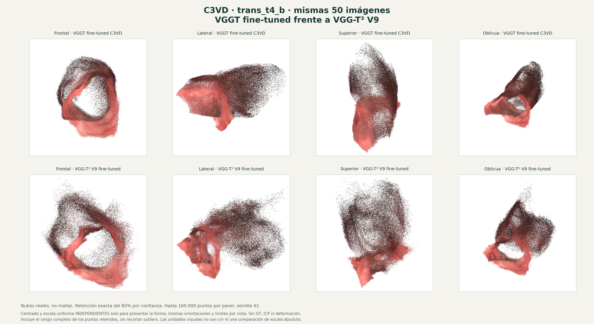{loading="lazy"}

La referencia VGGT es útil para examinar forma y apariencia, pero su entrenamiento histórico no tuvo el mismo presupuesto y módulos que V9/VN19. El visor portable histórico 80/50 vistas y 518/336² tampoco es una comparación igualada de arquitectura.

</details>

<div class="book-actions"><button type="button" class="book-open-clouds" data-clouds="c3vd-v9,c3vd-vn19-a,c3vd-vn19-b">Comparar estas tres nubes en 3D</button><button type="button" class="book-open-metrics" data-metrics="c3vd-v9,c3vd-vn19-a,c3vd-vn19-b">Comparar tablas V9/A/B</button></div>


<h4 id="interpretacion">Interpretación y límites</h4>

<details class="protocol-main" id="protocolo-hallazgos-c3vd"><summary>Protocolo principal · hallazgos C3VD</summary><dl class="protocol-fields"><div><dt>Dataset</dt><dd>C3VD</dd></div><div><dt>Partición</dt><dd>Síntesis de los experimentos C3VD enlazados; sin agregado nuevo</dd></div><div><dt>Checkpoint</dt><dd>Versiones citadas en cada conclusión; no un único peso</dd></div><div><dt>Frames y resolución</dt><dd>No aplica: tabla de documentación</dd></div><div><dt>Escala / alineamiento</dt><dd>No aplica: no es una medición geométrica</dd></div><div><dt>Unidades</dt><dd>No aplica a una medición nueva; conservar las unidades escritas en cada definición o parámetro</dd></div><div><dt>GT disponible</dt><dd>No aplica a esta tabla de documentación</dd></div></dl><p class="evidence-note"><a href="tablas/protocolos_lectura_20261124.json">Trazabilidad completa por tabla</a> · <a href="tablas/protocolos_tablas.json">Índice original y firmas</a></p></details>

<div class="table-context" id="tabla-protocolo-13" data-main-protocol="protocolo-hallazgos-c3vd"><span class="protocol-kind">Documentación</span> · <a href="#protocolo-hallazgos-c3vd">Protocolo principal</a></div>

| Conclusión respaldada | Lo que no demuestra |
|---|---|
| Calibración, unidades y referencia geométrica debían ser coherentes; los controles auditados pasan. | Que todos los errores residuales del dataset o del modelo estén descartados. |
| Las mismas imágenes pueden cambiar de estimación al cambiar sus acompañantes o el primer frame. | Un máximo universal de 50 vistas o saturación de atención como causa única. |
| Profundidad, cámara y puntos globales pueden mejorar de forma diferente. | Que mejorar un componente garantice mejorar toda la reconstrucción. |
| VN19-B alcanzó más cobertura densa; no mejoró conjuntamente VAL y reservas. | Si cobertura, profundidad o su interacción causaron cada regresión. |
| K1/K2/K10 tienen compensaciones; K16 fue viable en el staging probado. | Que K2 sea óptimo o que K16 sea el límite exacto del modelo/GPU. |
| V9 sigue siendo la referencia conservada; A/B son candidatos útiles para diagnóstico. | Superioridad universal de V9, utilidad clínica o generalización a pacientes. |

Los experimentos propuestos pero **no realizados** —como el factorial cobertura×prioridad profunda con varias semillas— se mantienen fuera de la lista de resultados ejecutados. No se lanza un entrenamiento por reorganizar este documento.


<details>
<summary>Glosario: significado, cálculo y límites de las métricas</summary>


<details class="protocol-main" id="protocolo-glosario"><summary>Protocolo principal · glosario</summary><dl class="protocol-fields"><div><dt>Dataset</dt><dd>C3VD</dd></div><div><dt>Partición</dt><dd>Glosario metodológico; no corresponde a una partición experimental</dd></div><div><dt>Checkpoint</dt><dd>No aplica: definiciones de métricas</dd></div><div><dt>Frames y resolución</dt><dd>No aplica: tabla de documentación</dd></div><div><dt>Escala / alineamiento</dt><dd>No aplica: no es una medición geométrica</dd></div><div><dt>Unidades</dt><dd>No aplica a una medición nueva; conservar las unidades escritas en cada definición o parámetro</dd></div><div><dt>GT disponible</dt><dd>No aplica a esta tabla de documentación</dd></div></dl><p class="evidence-note"><a href="tablas/protocolos_lectura_20261124.json">Trazabilidad completa por tabla</a> · <a href="tablas/protocolos_tablas.json">Índice original y firmas</a></p></details>

<div class="table-context" id="tabla-protocolo-14" data-main-protocol="protocolo-glosario"><span class="protocol-kind">Documentación</span> · <a href="#protocolo-glosario">Protocolo principal</a></div>

| Métrica | Cálculo / significado | Precaución |
|---|---|---|
| AbsRel↓ | Media de $|D_p-D_g|/D_g$ sobre GT válido | Declarar escala y soporte; no mide directamente poses. |
| RMSE D↓ | Raíz de la media de $(D_p-D_g)^2$ | Depende de unidades y penaliza errores grandes. |
| δ1↑ | Fracción con $\max(D_p/D_g,D_g/D_p)<1.25$ | δ2/δ3 usan 1,25²/1,25³; no son metros. |
| XYZ medio / p95↓ | Media / percentil 95 de distancia euclídea entre puntos correspondientes | No es CD; depende del marco y alineamiento. |
| CD↓ | Distancias de vecinos más próximos en ambos sentidos | Declarar suma/media, sin cuadrado y registro; Sim(3)+ICP puede ocultar parte de los errores originales. |
| NC↑ | Consistencia de normales en correspondencias de superficie | Depende de cómo se estiman normales; reducir CD no garantiza subir NC. |
| Accuracy / Completeness↓ | Predicción→GT / GT→predicción; Overall combina ambas | Se mide la superficie GT observada, no el colon anatómico completo. |
| ATE↓ | RMSE de centros tras el alineamiento global declarado | Sim(3) elimina escala global y marco; no demuestra escala métrica absoluta. |
| RPEr/RPEt↓ | Error del movimiento relativo entre pares de poses | Declarar intervalo de pares, agregación y unidades; pares seleccionados no son todos los frames originales. |
| AUC@θ↑ | Área normalizada bajo la curva de aciertos de error relativo de pose hasta θ | Error angular y parejas según protocolo; no intercambiable con ATE ni mAA. |
| RRA/RTA/mAA↑ | Aciertos angulares de rotación/dirección de traslación y agregado multiumbral del repo | No equivalen a traslación en cm ni a RPE consecutivo. |
| Error focal↓ | Diferencia relativa de focal predicha frente a K GT | No puntuar K suministrada como si hubiera sido aprendida. |
| Coherencia entre cabezas↓ | Distancia entre XYZ directo y desproyección D+K+pose | Una nube equivocada puede ser internamente coherente. |
| Cobertura@2 mm↑ | Proporción de superficie GT observada cerca de una predicción bajo ese umbral | Métrica añadida; no es cobertura del órgano completo ni criterio nativo del paper. |
| Latencia / memoria↓ | Intervalos temporales / pico de memoria del proceso medido | Separar carga, preparación, inferencia, TTT, copiaCPU y exportación; GPU/software/resolución importan. |

**Sim(3):** transformación global $X'=sRX+t$ (escala, rotación y traslación). **ICP:** refinamiento iterativo del registro por correspondencias cercanas. Son herramientas de evaluación, no datos suministrados al encoder ni arreglos del modelo. Las tablas con escala de profundidad única y sinICP se mantienen separadas de las tablas conSim(3)+ICP.

**Porcentaje favorable:** para menor-es-mejor, $100(b-n)/b$; para mayor-es-mejor, $100(n-b)/b$. Bases cercanas a cero pueden producir porcentajes enormes; mirar también el valor absoluto. El cambio relativo deδ no son puntos porcentuales.

La profundidad/puntos y pose usan evaluadores, no salen como “calidad conocida” al llamar al modelo: requieren GT y un protocolo. Las métricas añadidas no se presentan como resultados nativos de los artículos.

</details>

<details>
<summary>Métricas del paper VGG-T³: referencia metodológica y C3VD</summary>

**Paper · Table 1. Pointmap estimation**


<details class="protocol-main" id="protocolo-paper-puntos"><summary>Protocolo principal · paper · puntos</summary><dl class="protocol-fields"><div><dt>Dataset</dt><dd>7Scenes-D, 7Scenes-S, DTU, ETH3D, NRGBD-D y NRGBD-S; cada fila conserva su benchmark original</dd></div><div><dt>Partición</dt><dd>Protocolo original del paper; distinto del local</dd></div><div><dt>Checkpoint</dt><dd>VGG-T³ publicado</dd></div><div><dt>Frames y resolución</dt><dd>Los del benchmark; no equivalen a nuestra selección C3VD</dd></div><div><dt>Escala / alineamiento</dt><dd>Protocolo original; no transferir ajustes entre benchmarks</dd></div><div><dt>Unidades</dt><dd>NC adimensional; CD en las unidades originales de cada benchmark, sin conversión local</dd></div><div><dt>GT disponible</dt><dd>Referencia original de cada benchmark; no nuestro GT local</dd></div></dl><p class="evidence-note"><a href="tablas/protocolos_lectura_20261124.json">Trazabilidad completa por tabla</a> · <a href="tablas/protocolos_tablas.json">Índice original y firmas</a></p></details>

<div class="table-context" id="tabla-protocolo-15" data-main-protocol="protocolo-paper-puntos"><span class="protocol-kind">Referencia publicada</span> · <a href="#protocolo-paper-puntos">Protocolo principal</a></div>

| Dataset | CD ↓ | NC ↑ |
| --- | --- | --- |
| 7Scenes-D | 0.030 | 0.679 |
| 7Scenes-S | 0.107 | 0.716 |
| DTU | 1.654 | 0.685 |
| ETH3D | 0.480 | 0.789 |
| NRGBD-D | 0.029 | 0.867 |
| NRGBD-S | 0.056 | 0.893 |


CD conserva las unidades publicadas de cada benchmark. Dense/sparse no equivale a TRAIN/VAL ni a reducir puntos del visor. Resultados publicados en otros benchmarks; referencia metodológica, sin ranking ni porcentaje directo frente a C3VD/SCARED.

**Nuestras mediciones · familia de Table 1**


<div class="table-context" id="tabla-protocolo-16" data-main-protocol="protocolo-c3vd-local"><span class="protocol-kind">Evaluación local</span> · <a href="#protocolo-c3vd-local">Protocolo principal</a><span class="protocol-differences">Cambios de esta tabla · <strong>Escala / alineamiento:</strong> CD: Sim(3)+ICP; NC: normales KNN30. No mezclar con XYZ sin ICP</span></div>

| Dataset | Contexto | Pesos | Vistas GT | CD (cm) ↓ | NC ↑ |
| --- | --- | --- | --- | --- | --- |
| C3VD | trans_t4_b | V9 | 16 | 0,14720 | 0,70143 |
| C3VD | trans_t4_b | VN19-A | 16 | 0,17493 | 0,68614 |
| C3VD | trans_t4_b | VN19-B | 16 | 0,17588 | 0,70010 |


CD: Chamfer bidireccional medio sin cuadrado, tras Sim(3)+ICP. NC: normales KNN30. Se utilizan todos los píxeles GT válidos, sin submuestreo ni filtro de confianza. En SCARED solo es una superficie de un keyframe; no se puntúa la nube temporal completa.

**Paper · Table 2. Video depth estimation**


<details class="protocol-main" id="protocolo-paper-profundidad"><summary>Protocolo principal · paper · profundidad</summary><dl class="protocol-fields"><div><dt>Dataset</dt><dd>Bonn, KITTI y Sintel; cada fila conserva su benchmark original</dd></div><div><dt>Partición</dt><dd>Protocolo original del paper; distinto del local</dd></div><div><dt>Checkpoint</dt><dd>VGG-T³ publicado</dd></div><div><dt>Frames y resolución</dt><dd>Los del benchmark; no equivalen a nuestra selección C3VD</dd></div><div><dt>Escala / alineamiento</dt><dd>Protocolo original; no transferir ajustes entre benchmarks</dd></div><div><dt>Unidades</dt><dd>δ &lt; 1.25 y Abs Rel: adimensionales</dd></div><div><dt>GT disponible</dt><dd>Referencia original de cada benchmark; no nuestro GT local</dd></div></dl><p class="evidence-note"><a href="tablas/protocolos_lectura_20261124.json">Trazabilidad completa por tabla</a> · <a href="tablas/protocolos_tablas.json">Índice original y firmas</a></p></details>

<div class="table-context" id="tabla-protocolo-17" data-main-protocol="protocolo-paper-profundidad"><span class="protocol-kind">Referencia publicada</span> · <a href="#protocolo-paper-profundidad">Protocolo principal</a></div>

| Dataset | δ < 1.25 ↑ | Abs Rel ↓ |
| --- | --- | --- |
| Bonn | 0.963 | 0.063 |
| KITTI | 0.967 | 0.076 |
| Sintel | 0.581 | 0.345 |


Resultados publicados en otros benchmarks; referencia metodológica, sin ranking ni porcentaje directo frente a C3VD/SCARED.

**Nuestras mediciones · familia de Table 2**


<div class="table-context" id="tabla-protocolo-18" data-main-protocol="protocolo-c3vd-local"><span class="protocol-kind">Evaluación local</span> · <a href="#protocolo-c3vd-local">Protocolo principal</a></div>

| Dataset | Contexto | Pesos | Vistas GT | δ < 1,25 ↑ | Abs Rel ↓ |
| --- | --- | --- | --- | --- | --- |
| C3VD | trans_t4_b | V9 | 16 | 0,78385 | 0,14860 |
| C3VD | trans_t4_b | VN19-A | 16 | 0,74870 | 0,17214 |
| C3VD | trans_t4_b | VN19-B | 16 | 0,73026 | 0,17216 |


Misma familia de métricas y una escala positiva por contexto. C3VD se evalúa en 16 frames; SCARED solo en un ancla, por lo que no constituye un benchmark de profundidad de vídeo completo.

**Paper · Table 3. Camera pose estimation**


<details class="protocol-main" id="protocolo-paper-camara"><summary>Protocolo principal · paper · cámara</summary><dl class="protocol-fields"><div><dt>Dataset</dt><dd>ScanNet, Sintel y TUM; cada fila conserva su benchmark original</dd></div><div><dt>Partición</dt><dd>Protocolo original del paper; distinto del local</dd></div><div><dt>Checkpoint</dt><dd>VGG-T³ publicado</dd></div><div><dt>Frames y resolución</dt><dd>Los del benchmark; no equivalen a nuestra selección C3VD</dd></div><div><dt>Escala / alineamiento</dt><dd>Protocolo original; no transferir ajustes entre benchmarks</dd></div><div><dt>Unidades</dt><dd>RPEr en grados; ATE/RPEt en las unidades originales publicadas, sin conversión local</dd></div><div><dt>GT disponible</dt><dd>Referencia original de cada benchmark; no nuestro GT local</dd></div></dl><p class="evidence-note"><a href="tablas/protocolos_lectura_20261124.json">Trazabilidad completa por tabla</a> · <a href="tablas/protocolos_tablas.json">Índice original y firmas</a></p></details>

<div class="table-context" id="tabla-protocolo-19" data-main-protocol="protocolo-paper-camara"><span class="protocol-kind">Referencia publicada</span> · <a href="#protocolo-paper-camara">Protocolo principal</a></div>

| Dataset | ATE ↓ | RPEr ↓ (°) | RPEt ↓ |
| --- | --- | --- | --- |
| ScanNet | 0.070 | 0.878 | 0.034 |
| Sintel | 0.234 | 1.553 | 0.117 |
| TUM | 0.037 | 0.533 | 0.028 |


ATE y RPEt se mantienen en las unidades originales del artículo. Nuestros valores C3VD aparecen explícitamente en cm. Resultados publicados en otros benchmarks; referencia metodológica, sin ranking ni porcentaje directo frente a C3VD/SCARED.

**Nuestras mediciones · familia de Table 3**


<div class="table-context" id="tabla-protocolo-20" data-main-protocol="protocolo-c3vd-local"><span class="protocol-kind">Evaluación local</span> · <a href="#protocolo-c3vd-local">Protocolo principal</a><span class="protocol-differences">Cambios de esta tabla · <strong>Escala / alineamiento:</strong> Sim(3) global de centros mediante evo; RPE entre poses seleccionadas consecutivas; <strong>GT disponible:</strong> Poses GT de los objetivos C3VD; SCARED temporal se omite</span></div>

| Dataset | Contexto | Pesos | ATE RMSE (cm) ↓ | RPEr RMSE (°) ↓ | RPEt RMSE (cm) ↓ |
| --- | --- | --- | --- | --- | --- |
| C3VD | trans_t4_b | V9 | 0,10172 | 1,47466 | 0,06841 |
| C3VD | trans_t4_b | VN19-A | 0,09598 | 1,25928 | 0,06262 |
| C3VD | trans_t4_b | VN19-B | 0,09659 | 1,24846 | 0,06250 |


Alineamiento global Sim(3) de centros mediante evo; RPE entre poses seleccionadas consecutivas, no entre todos los frames originales. SCARED se omite: no hay GT temporal independiente validada para estas ventanas. Estos valores difieren del control histórico anclado a escala de profundidad.

**Paper · Table 4. Reconstruction latency**


<details class="protocol-main" id="protocolo-paper-latencia"><summary>Protocolo principal · paper · latencia</summary><dl class="protocol-fields"><div><dt>Dataset</dt><dd>Colecciones grandes del paper</dd></div><div><dt>Partición</dt><dd>Protocolo original del paper; distinto del local</dd></div><div><dt>Checkpoint</dt><dd>VGG-T³ publicado</dd></div><div><dt>Frames y resolución</dt><dd>1500/2000 imágenes; 1/2/4 A100 de 80 GB</dd></div><div><dt>Escala / alineamiento</dt><dd>Protocolo original; no transferir ajustes entre benchmarks</dd></div><div><dt>Unidades</dt><dd>Segundos; no mismo hardware ni resolución local</dd></div><div><dt>GT disponible</dt><dd>Referencia original de cada benchmark; no nuestro GT local</dd></div></dl><p class="evidence-note"><a href="tablas/protocolos_lectura_20261124.json">Trazabilidad completa por tabla</a> · <a href="tablas/protocolos_tablas.json">Índice original y firmas</a></p></details>

<div class="table-context" id="tabla-protocolo-21" data-main-protocol="protocolo-paper-latencia"><span class="protocol-kind">Referencia publicada</span> · <a href="#protocolo-paper-latencia">Protocolo principal</a></div>

| Imágenes | 1 GPU (s) | 2 GPU (s) | 4 GPU (s) |
| --- | --- | --- | --- |
| 1500 | 173.1 | 56.8 | 29.7 |
| 2000 | 230.7 | 74.8 | 48.5 |


A100 de 80 GB. No es el mismo hardware ni el mismo tamaño de colección que C3VD.

Las cifras publicadas proceden de otros datasets y hardware. No calcular un ranking o porcentaje directo C3VD/paper como si fueran el mismo benchmark.

</details>

<details>
<summary>Archivo cuantitativo VGGT y V9: reservas C3VD y protocolo histórico</summary>

**Reservas comunes:** cecum_t2_a y trans_t1_a; 50 vistas336². Estas tablas pertenecen al protocolo congelado de octubre; no son las métricas del contexto Trans4 de 16 objetivos de noviembre.

**VGG-T³ zero-shot / V9**

<details class="protocol-main" id="protocolo-tiempos-historicos"><summary>Protocolo principal · tiempos históricos</summary><dl class="protocol-fields"><div><dt>Dataset</dt><dd>C3VD cecum_t2_a + trans_t1_a</dd></div><div><dt>Partición</dt><dd>Reservas del protocolo histórico de octubre; mismo phantom</dd></div><div><dt>Checkpoint</dt><dd>Zero-shot y fine-tuning histórico VGG-T³ V9</dd></div><div><dt>Frames y resolución</dt><dd>50 vistas a 336²; protocolo histórico, distinto de Trans4/16 objetivos</dd></div><div><dt>Escala / alineamiento</dt><dd>Filas CD/NC: registro Sim(3)+ICP; profundidad: escala única de secuencia; ATE/RPE: Sim(3); latencia/memoria no son registro geométrico</dd></div><div><dt>Unidades</dt><dd>cm, grados, %, segundos y GiB según fila</dd></div><div><dt>GT disponible</dt><dd>GT de las secuencias reservadas y soporte histórico</dd></div></dl><p class="evidence-note"><a href="tablas/protocolos_lectura_20261124.json">Trazabilidad completa por tabla</a> · <a href="tablas/protocolos_tablas.json">Índice original y firmas</a></p></details>

<div class="table-context" id="tabla-protocolo-22" data-main-protocol="protocolo-tiempos-historicos"><span class="protocol-kind">Evaluación histórica local</span> · <a href="#protocolo-tiempos-historicos">Protocolo principal</a></div>

| Métrica / protocolo | Zero-shot | Afinado | Cambio favorable |
| --- | --- | --- | --- |
| CD(cm),Sim(3)+ICP | 0,22377 | 0,14711 | +34,26% |
| NC,después de registro | 0,71698 | 0,62603 | −12,68% |
| δ1,escala única de secuencia | 0,68468 | 0,88522 | +29,29% |
| AbsRel,escala única de secuencia | 0,19141 | 0,10427 | +45,53% |
| ATE RMSE(cm),Sim(3) | 0,55621 | 0,52393 | +5,80% |
| RPEr RMSE(°) | 1,01695 | 1,18046 | −16,08% |
| RPEt RMSE(cm) | 0,26458 | 0,23721 | +10,34% |

**VGGT zero-shot / fine-tuning histórico**

<div class="table-context" id="tabla-protocolo-23" data-main-protocol="protocolo-tiempos-historicos"><span class="protocol-kind">Evaluación histórica local</span> · <a href="#protocolo-tiempos-historicos">Protocolo principal</a><span class="protocol-differences">Cambios de esta tabla · <strong>Checkpoint:</strong> Zero-shot y fine-tuning histórico VGGT; <strong>Escala / alineamiento:</strong> Accuracy/Completeness/Overall: Sim(3), sin ICP; AUC conserva su protocolo angular; latencia/memoria no son registro geométrico</span></div>

| Métrica / protocolo | Zero-shot | Afinado | Cambio favorable |
| --- | --- | --- | --- |
| Pose AUC@30(%) | 42,96190 | 46,01088 | +7,10% |
| Accuracy(cm),Sim(3),sinICP | 0,42109 | 0,25879 | +38,54% |
| Completeness(cm) | 0,25480 | 0,08506 | +66,62% |
| Overall(cm) | 0,33795 | 0,17192 | +49,13% |
| Inferencia histórica wrapper(s) | 11,600 | 11,747 | −1,26% |
| Pico CUDA asignado(GiB) | 5,620 | 5,620 | 0,00% |


Se conservan también los resultados de validación, las cifras publicadas Re10K/CO3Dv2, DTU y ETH3D, la curva memoria/tiempo y las tablas extendidas en el documento original. AUC es una métrica; Re10K, CO3Dv2 y ETH3D son datasets. Las superficies locales D+pose+K y puntos globales no son la misma ruta de salida.

[Tablas completas en LaTeX](tablas/tablas_papers_c3vd.tex) · [Informe completo de métricas/papers](tablas/index.html) · [Paper VGGT](https://arxiv.org/abs/2503.11651)

</details>

<h4 id="archivo">Continuidad y consulta del archivo</h4>

La lectura principal está dedicada a C3VD. Los originales y ediciones anteriores se conservan en el archivo local. Esta edición web comparte la documentación, las tablas y una selección de reconstrucciones completas.

[Contenido de la edición web](catalogo/index.html){.pill} [Biblioteca de tablas](tablas/index.html){.pill} [Fichas de experimentos](tablas/experimentos_c3vd.csv){.pill}

</details>

</details>

<details class="experiment-group"><summary>SCARED · 13 fichas</summary>

<details class="scared-experiment-card" id="scared-e01" data-research-card data-order="44" data-primary="Eficiencia y secuencias largas" data-problems="Eficiencia y secuencias largas" data-datasets="SCARED" data-status="executed" data-negative="false" data-experiment data-model="VGG-T³" data-scope="SCARED">
<summary><span class="card-status">Ejecutado</span><span class="card-id">E01</span>Sensibilidad al tamaño de contexto<span class="card-teaser">De N1 a N50, VN18 cambia XYZ-7.03% y AbsRel-20.85%; V9 cambia XYZ+8.87% y AbsRel+15.99%.</span><span class="card-topics">SCARED · Eficiencia y secuencias largas</span></summary>

<div class="card-content">
<dl class="card-fields"><dt>Hipótesis / pregunta</dt><dd>VN18 y V9 responden de manera distinta al contexto.</dd>
<dt>Cómo se realizó</dt><dd>Reutilizados 63 resultados de ancla. Para comparar N1/4/8/16/50 se mantienen exactamente KF1-4, GT y peso igual por ancla. N4-50 cubre vídeo 0-60; N1 no cubre ese recorrido.</dd>
<dt>Controles</dt><dd>KF1–4, GT y peso igual por ancla constantes. N=1 no cubre el recorrido que sí cubren N=4–50.</dd>
<dt>Métricas</dt><dd>Las columnas de las tablas conservadas, con su soporte y unidades originales.</dd></dl>
<div class="card-result"><strong>Resultados</strong><p>De N1 a N50, VN18 cambia XYZ-7.03% y AbsRel-20.85%; V9 cambia XYZ+8.87% y AbsRel+15.99%.</p></div>
<details class="protocol-main" id="protocolo-experimento-scared-e01"><summary>Protocolo principal · E01</summary><dl class="protocol-fields"><div><dt>Dataset</dt><dd>SCARED · dataset 7</dd></div><div><dt>Partición</dt><dd>SCARED VAL dataset 7; mismas cuatro anclas KF1–4, KF5 excluido de la comparación entre N</dd></div><div><dt>Checkpoint</dt><dd>VGG-T³ oficial, VN18-SCARED final 3240 y V9-SCARED candidato 1000; únicamente las variantes nombradas en filas</dd></div><div><dt>Frames y resolución</dt><dd>N=1/4/8/16/50 en tabla 38; N=4 frente a 50 en tabla 39; vídeo 0–60 para N≥4; RGB 336×266</dd></div><div><dt>Escala / alineamiento</dt><dd>Escala GT de profundidad por ancla; registros secundarios se identifican aparte</dd></div><div><dt>Unidades</dt><dd>XYZ en cm; AbsRel sin unidad; porcentajes y ángulos según columnas</dd></div><div><dt>GT disponible</dt><dd>XYZ/profundidad medidos en el keyframe; sin trayectoria GT temporal validada</dd></div></dl><p class="evidence-note"><a href="tablas/protocolos_lectura_20261124.json">Trazabilidad completa por tabla</a> · <a href="tablas/protocolos_tablas.json">Índice original y firmas</a></p></details>

<details class="result-tables"><summary>Tablas, cifras y figuras del experimento</summary>

<div class="table-context" id="tabla-protocolo-38" data-main-protocol="protocolo-experimento-scared-e01"><span class="protocol-kind">Registro experimental</span> · <a href="#protocolo-experimento-scared-e01">Protocolo principal</a></div>

| N | AbsRel VN18 | AbsRel V9 | XYZ VN18 (cm) | XYZ V9 (cm) |
| --- | --- | --- | --- | --- |
| 1 | 0.1207 | 0.1067 | 1.0579 | 0.8480 |
| 4 | 0.1020 | 0.1164 | 0.9839 | 0.9203 |
| 8 | 0.0977 | 0.1207 | 1.0068 | 0.9249 |
| 16 | 0.0968 | 0.1223 | 0.9910 | 0.9180 |
| 50 | 0.0955 | 0.1238 | 0.9835 | 0.9232 |


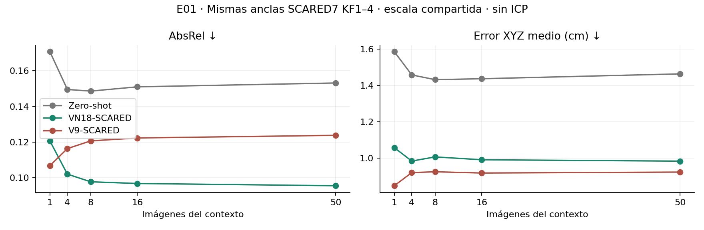{loading="lazy"}

</details>
<dl class="card-fields"><dt>Conclusión</dt><dd><strong>Resultado diagnóstico; consultar límites.</strong> No hay ruptura universal. V9 aún tiene menor XYZ medio en N50.</dd><dt>Limitaciones</dt><dd>La ventaja agregada anterior de VN18 no significa superioridad universal en puntos: incluía KF5 solo N1. Cantidad, composición y espaciado del contexto no son una única variable.</dd></dl>
<details class="trace-details"><summary>Trazabilidad · configuración, código y resultados</summary><p class="evidence-note"><strong>Registro:</strong> <a href="tablas/experimentos_scared_e01_e12.json">experimentos_scared_e01_e12.json</a> · ID E01. <strong>Código:</strong> engine.py / loss_v9.py; engine_vn18.py / loss_contract.py (recetas de los pesos comparados). Los archivos operativos, configuraciones y checkpoints completos se conservan localmente; no se publican datos GT ni mapas granulares por píxel.</p><p class="evidence-note"><strong>Checkpoint:</strong> Zero-shot oficial; VN18-SCARED 3240; V9-SCARED 1000 (según cada tabla) · <strong>Datos:</strong> SCARED · dataset 7. <a href="tablas/menu_experimentos_unificado.json">Descargar índice estructurado</a> · <a href="#bibliografia">Papers y secciones de referencia</a></p></details>
<p class="evidence-note">Recetas principales y código para lectura: <a href="recursos/recetas/scared-vn18.html" target="_blank" rel="noopener">VN18 · SCARED</a> · <a href="recursos/recetas/scared-v9.html" target="_blank" rel="noopener">V9 adaptado · SCARED</a>. Cada página indica el alcance de la firma conservada; no sustituye la configuración de un piloto diferente.</p>
<p class="evidence-note">Consulta metodológica: <a href="https://arxiv.org/html/2602.23361v1#S4.SS4" target="_blank" rel="noopener">VGG-T³: escala y ablaciones</a> · <a href="https://arxiv.org/html/2503.11651v1#S5.SS0.SSS0.Px2" target="_blank" rel="noopener">VGGT: tiempo y memoria</a>. La evidencia del resultado es el registro local, no una afirmación atribuida al paper.</p>

<dl class="card-fields verdict"><dt>Confirmación o negación de la hipótesis</dt><dd>Diagnóstico descriptivo: la conclusión conserva el resultado observado; no establece una confirmación causal binaria.</dd></dl></div>
</details>

<details class="scared-experiment-card" id="scared-e02" data-research-card data-order="45" data-primary="Eficiencia y secuencias largas" data-problems="Eficiencia y secuencias largas" data-datasets="SCARED" data-status="executed" data-negative="false" data-experiment data-model="VGG-T³" data-scope="SCARED">
<summary><span class="card-status">Ejecutado</span><span class="card-id">E02</span>Consistencia de los mismos frames entre contextos<span class="card-teaser">Las predicciones cambian aun manteniendo primer frame y píxeles comunes.</span><span class="card-topics">SCARED · Eficiencia y secuencias largas</span></summary>

<div class="card-content">
<dl class="card-fields"><dt>Hipótesis / pregunta</dt><dd>Añadir contexto puede cambiar imágenes que ya estaban presentes.</dd>
<dt>Cómo se realizó</dt><dd>Mismas tres imágenes por KF: ancla, vídeo 0 yvídeo 60; identidad RGB y GT verificada por hash en N4/8/16/50.63 lecturas de cabezas sobre features nativas existentes, necesarias también para confianza; sin encoder nuevo. TablaN4→50; el registro técnico local conserva las 144 comparaciones.</dd>
<dt>Controles</dt><dd>Mismos RGB de ancla, vídeo 0 y vídeo 60; hashes de RGB/GT, mismo primer frame y features nativas conservadas.</dd>
<dt>Métricas</dt><dd>Las columnas de las tablas conservadas, con su soporte y unidades originales.</dd></dl>
<div class="card-result"><strong>Resultados</strong><p>Las predicciones cambian aun manteniendo primer frame y píxeles comunes.</p></div>
<details class="protocol-main" id="protocolo-experimento-scared-e02"><summary>Protocolo principal · E02</summary><dl class="protocol-fields"><div><dt>Dataset</dt><dd>SCARED · dataset 7</dd></div><div><dt>Partición</dt><dd>SCARED VAL dataset 7; mismas cuatro anclas KF1–4, KF5 excluido de la comparación entre N</dd></div><div><dt>Checkpoint</dt><dd>VGG-T³ oficial, VN18-SCARED final 3240 y V9-SCARED candidato 1000; únicamente las variantes nombradas en filas</dd></div><div><dt>Frames y resolución</dt><dd>N=1/4/8/16/50 en tabla 38; N=4 frente a 50 en tabla 39; vídeo 0–60 para N≥4; RGB 336×266</dd></div><div><dt>Escala / alineamiento</dt><dd>Escala GT de profundidad por ancla; registros secundarios se identifican aparte</dd></div><div><dt>Unidades</dt><dd>XYZ en cm; AbsRel sin unidad; porcentajes y ángulos según columnas</dd></div><div><dt>GT disponible</dt><dd>Ancla medida; vídeo 0 y 60 sin GT. El registro entre predicciones no equivale a exactitud GT</dd></div></dl><p class="evidence-note"><a href="tablas/protocolos_lectura_20261124.json">Trazabilidad completa por tabla</a> · <a href="tablas/protocolos_tablas.json">Índice original y firmas</a></p></details>

<details class="result-tables"><summary>Tablas, cifras y figuras del experimento</summary>

<div class="table-context" id="tabla-protocolo-39" data-main-protocol="protocolo-experimento-scared-e02"><span class="protocol-kind">Registro experimental</span> · <a href="#protocolo-experimento-scared-e02">Protocolo principal</a></div>

| Modelo | Frames comunes | Cambio D (%) | Cambio XYZ (cm) | Cambio P tras Sim3 sin GT / mediana D (%) |
| --- | --- | --- | --- | --- |
| Zero-shot | Ancla GT | 2.1108 | 0.1578 | 1.8233 |
| Zero-shot | Vídeo 0/60 sin GT | 5.9786 | 0.2008 | 2.7388 |
| VN18-SCARED | Ancla GT | 2.2983 | 0.1568 | 2.0657 |
| VN18-SCARED | Vídeo 0/60 sin GT | 5.7207 | 0.2435 | 3.6736 |
| V9-SCARED | Ancla GT | 2.7554 | 0.2342 | 3.1617 |
| V9-SCARED | Vídeo 0/60 sin GT | 6.6230 | 0.3148 | 4.4228 |


</details>
<dl class="card-fields"><dt>Conclusión</dt><dd><strong>Resultado diagnóstico; consultar límites.</strong> El cambio persiste tras un registro diagnóstico sin GT; V9 no es más estable en todas las salidas.</dd><dt>Limitaciones</dt><dd>Cambio no equivale a error en los RGB sin GT. La escala compartida principal usa solo el ancla medida; Sim3 contra la predicción anterior mide consistencia, no exactitud.</dd></dl>
<details class="trace-details"><summary>Trazabilidad · configuración, código y resultados</summary><p class="evidence-note"><strong>Registro:</strong> <a href="tablas/experimentos_scared_e01_e12.json">experimentos_scared_e01_e12.json</a> · ID E02. <strong>Código:</strong> engine.py / loss_v9.py; engine_vn18.py / loss_contract.py (recetas de los pesos comparados). Los archivos operativos, configuraciones y checkpoints completos se conservan localmente; no se publican datos GT ni mapas granulares por píxel.</p><p class="evidence-note"><strong>Checkpoint:</strong> Zero-shot oficial; VN18-SCARED 3240; V9-SCARED 1000 (según cada tabla) · <strong>Datos:</strong> SCARED · dataset 7. <a href="tablas/menu_experimentos_unificado.json">Descargar índice estructurado</a> · <a href="#bibliografia">Papers y secciones de referencia</a></p></details>
<p class="evidence-note">Recetas principales y código para lectura: <a href="recursos/recetas/scared-vn18.html" target="_blank" rel="noopener">VN18 · SCARED</a> · <a href="recursos/recetas/scared-v9.html" target="_blank" rel="noopener">V9 adaptado · SCARED</a>. Cada página indica el alcance de la firma conservada; no sustituye la configuración de un piloto diferente.</p>
<p class="evidence-note">Consulta metodológica: <a href="https://arxiv.org/html/2602.23361v1#S4.SS4" target="_blank" rel="noopener">VGG-T³: escala y ablaciones</a> · <a href="https://arxiv.org/html/2503.11651v1#S5.SS0.SSS0.Px2" target="_blank" rel="noopener">VGGT: tiempo y memoria</a>. La evidencia del resultado es el registro local, no una afirmación atribuida al paper.</p>

<dl class="card-fields verdict"><dt>Confirmación o negación de la hipótesis</dt><dd>Diagnóstico descriptivo: la conclusión conserva el resultado observado; no establece una confirmación causal binaria.</dd></dl></div>
</details>

<details class="scared-experiment-card" id="scared-e03" data-research-card data-order="46" data-primary="Eficiencia y secuencias largas" data-problems="Eficiencia y secuencias largas" data-datasets="SCARED" data-status="executed" data-negative="false" data-experiment data-model="VGG-T³" data-scope="SCARED">
<summary><span class="card-status">Ejecutado</span><span class="card-id">E03</span>Aislamiento del primer frame<span class="card-teaser">Cambiar la primera imagen altera profundidad y forma local, pero el signo depende del modelo y KF.</span><span class="card-topics">SCARED · Eficiencia y secuencias largas</span></summary>

<div class="card-content">
<dl class="card-fields"><dt>Hipótesis / pregunta</dt><dd>Cambiar la vista inicial puede producir algo más que un cambio de coordenadas.</dd>
<dt>Cómo se realizó</dt><dd>Seis encoder forwards nuevos: KF2/4,N16; identidad, transposición de posiciones 1/2 conservando la primera y transposición 0/1. Mismos RGB. Tres modelos leen cada feature. La repetición identidad reproduce la caché con tolerancia máxima1e-4.</dd>
<dt>Controles</dt><dd>Identidad repetida, intercambio 1/2 con primer frame fijo e intercambio 0/1; mismos RGB. Paridad de identidad con tolerancia1e-4.</dd>
<dt>Métricas</dt><dd>Las columnas de las tablas conservadas, con su soporte y unidades originales.</dd></dl>
<div class="card-result"><strong>Resultados</strong><p>Cambiar la primera imagen altera profundidad y forma local, pero el signo depende del modelo y KF.</p></div>
<details class="protocol-main" id="protocolo-experimento-scared-e03"><summary>Protocolo principal · E03</summary><dl class="protocol-fields"><div><dt>Dataset</dt><dd>SCARED · dataset 7</dd></div><div><dt>Partición</dt><dd>SCARED VAL7, KF2 y KF4</dd></div><div><dt>Checkpoint</dt><dd>VGG-T³ oficial, VN18-SCARED final 3240 y V9-SCARED candidato 1000; únicamente las variantes nombradas en filas</dd></div><div><dt>Frames y resolución</dt><dd>N=16; identidad, intercambio 1/2 y 0/1 de los mismos RGB336×266</dd></div><div><dt>Escala / alineamiento</dt><dd>Profundidad con escala del ancla; P comparado tras Sim(3) del ancla para separar el cambio de marco</dd></div><div><dt>Unidades</dt><dd>XYZ en cm; AbsRel sin unidad; porcentajes y ángulos según columnas</dd></div><div><dt>GT disponible</dt><dd>XYZ/profundidad medidos en el keyframe; sin trayectoria GT temporal validada</dd></div></dl><p class="evidence-note"><a href="tablas/protocolos_lectura_20261124.json">Trazabilidad completa por tabla</a> · <a href="tablas/protocolos_tablas.json">Índice original y firmas</a></p></details>

<details class="result-tables"><summary>Tablas, cifras y figuras del experimento</summary>

<div class="table-context" id="tabla-protocolo-40" data-main-protocol="protocolo-experimento-scared-e03"><span class="protocol-kind">Registro experimental</span> · <a href="#protocolo-experimento-scared-e03">Protocolo principal</a></div>

| KF | Modelo | AbsRel identidad | AbsRel swap otras | AbsRel swap primera | P Sim3 identidad (cm) | P Sim3 swap primera (cm) |
| --- | --- | --- | --- | --- | --- | --- |
| 2 | Zero-shot | 0.1809 | 0.1785 | 0.1860 | 0.6816 | 0.6957 |
| 2 | VN18-SCARED | 0.1042 | 0.1036 | 0.1072 | 0.7211 | 0.7371 |
| 2 | V9-SCARED | 0.1424 | 0.1444 | 0.1342 | 0.7030 | 0.6757 |
| 4 | Zero-shot | 0.0690 | 0.0693 | 0.0666 | 0.5158 | 0.4817 |
| 4 | VN18-SCARED | 0.0580 | 0.0578 | 0.0561 | 0.5034 | 0.4657 |
| 4 | V9-SCARED | 0.0940 | 0.0938 | 0.0957 | 0.5530 | 0.5737 |


</details>
<dl class="card-fields"><dt>Conclusión</dt><dd><strong>Resultado diagnóstico; consultar límites.</strong> El control de orden también produce cambios: no existe una primera vista universalmente mejor.</dd><dt>Limitaciones</dt><dd>La transposición cambia orden y posición de la primera imagen. P se compara con Sim3 del ancla para no confundir marcos globales; solo dos casos N16, no una prueba de trayectoria completa.</dd></dl>
<details class="trace-details"><summary>Trazabilidad · configuración, código y resultados</summary><p class="evidence-note"><strong>Registro:</strong> <a href="tablas/experimentos_scared_e01_e12.json">experimentos_scared_e01_e12.json</a> · ID E03. <strong>Código:</strong> engine.py / loss_v9.py; engine_vn18.py / loss_contract.py (recetas de los pesos comparados). Los archivos operativos, configuraciones y checkpoints completos se conservan localmente; no se publican datos GT ni mapas granulares por píxel.</p><p class="evidence-note"><strong>Checkpoint:</strong> Zero-shot oficial; VN18-SCARED 3240; V9-SCARED 1000 (según cada tabla) · <strong>Datos:</strong> SCARED · dataset 7. <a href="tablas/menu_experimentos_unificado.json">Descargar índice estructurado</a> · <a href="#bibliografia">Papers y secciones de referencia</a></p></details>
<p class="evidence-note">Recetas principales y código para lectura: <a href="recursos/recetas/scared-vn18.html" target="_blank" rel="noopener">VN18 · SCARED</a> · <a href="recursos/recetas/scared-v9.html" target="_blank" rel="noopener">V9 adaptado · SCARED</a>. Cada página indica el alcance de la firma conservada; no sustituye la configuración de un piloto diferente.</p>
<p class="evidence-note">Consulta metodológica: <a href="https://arxiv.org/html/2602.23361v1#S4.SS4" target="_blank" rel="noopener">VGG-T³: escala y ablaciones</a> · <a href="https://arxiv.org/html/2503.11651v1#S5.SS0.SSS0.Px2" target="_blank" rel="noopener">VGGT: tiempo y memoria</a>. La evidencia del resultado es el registro local, no una afirmación atribuida al paper.</p>

<dl class="card-fields verdict"><dt>Confirmación o negación de la hipótesis</dt><dd>Diagnóstico descriptivo: la conclusión conserva el resultado observado; no establece una confirmación causal binaria.</dd></dl></div>
</details>

<details class="scared-experiment-card" id="scared-e04" data-research-card data-order="47" data-primary="Geometría, cámara y datos" data-problems="Geometría, cámara y datos" data-datasets="SCARED" data-status="executed" data-negative="true" data-experiment data-model="VGG-T³" data-scope="SCARED">
<summary><span class="card-status">Ejecutado</span><span class="card-id">E04</span>Análisis profundo de KF4<span class="card-teaser">La diferencia media XYZ original→target es 0.138 mm.</span><span class="card-topics">SCARED · Geometría, cámara y datos</span></summary>

<div class="card-content">
<dl class="card-fields"><dt>Hipótesis / pregunta</dt><dd>Una incoherencia del target, la escala o una zona difícil podrían explicar su regresión.</dd>
<dt>Cómo se realizó</dt><dd>Reutilizada auditoría independiente del XYZ original. Comparados errores con escala compartida, escala propia P ySim3; normales con baselines 1/2/4/8/16. Añadidas estratificaciones por textura, intensidad y proxy de brillo; sin optimización.</dd>
<dt>Controles</dt><dd>Referencia XYZ original independiente; separar escalaD, escalaP y Sim(3), sin optimización adicional.</dd>
<dt>Métricas</dt><dd>Las columnas de las tablas conservadas, con su soporte y unidades originales.</dd></dl>
<div class="card-result"><strong>Resultados</strong><p>La diferencia media XYZ original→target es 0.138 mm.</p></div>
<details class="protocol-main" id="protocolo-experimento-scared-e04"><summary>Protocolo principal · E04</summary><dl class="protocol-fields"><div><dt>Dataset</dt><dd>SCARED · dataset 7</dd></div><div><dt>Partición</dt><dd>Validación; secundarios identificados en el método</dd></div><div><dt>Checkpoint</dt><dd>VGG-T³ oficial, VN18-SCARED final 3240 y V9-SCARED candidato 1000; únicamente las variantes nombradas en filas</dd></div><div><dt>Frames y resolución</dt><dd>N=1/4/8/16/50; RGB 336×266; consultar condiciones de esta ficha</dd></div><div><dt>Escala / alineamiento</dt><dd>Escala GT de profundidad por ancla; registros secundarios se identifican aparte</dd></div><div><dt>Unidades</dt><dd>XYZ en cm; AbsRel sin unidad; porcentajes y ángulos según columnas</dd></div><div><dt>GT disponible</dt><dd>XYZ/profundidad medidos en el keyframe; sin trayectoria GT temporal validada</dd></div></dl><p class="evidence-note"><a href="tablas/protocolos_lectura_20261124.json">Trazabilidad completa por tabla</a> · <a href="tablas/protocolos_tablas.json">Índice original y firmas</a></p></details>

<details class="result-tables"><summary>Tablas, cifras y figuras del experimento</summary>

<div class="table-context" id="tabla-protocolo-41" data-main-protocol="protocolo-experimento-scared-e04"><span class="protocol-kind">Registro experimental</span> · <a href="#protocolo-experimento-scared-e04">Protocolo principal</a></div>

| Modelo | AbsRel | XYZ (cm) | P escala propia (cm) | P Sim3 (cm) | Normal paso 8 (°) |
| --- | --- | --- | --- | --- | --- |
| Zero-shot | 0.0718 | 0.6962 | 0.7487 | 0.5305 | 31.2342 |
| VN18-SCARED | 0.0569 | 0.8277 | 0.8216 | 0.5252 | 33.4254 |
| V9-SCARED | 0.0901 | 0.8404 | 0.8213 | 0.5700 | 45.6295 |


{loading="lazy"}

</details>
<dl class="card-fields"><dt>Conclusión</dt><dd><strong>Resultado diagnóstico; consultar límites.</strong> Escala propia no elimina la regresión. Sim3 aproxima VN18 al zero-shot, pero V9 mantiene más error local. V9 tiene más error de orientación también con baseline 8/16.</dd><dt>Limitaciones</dt><dd>No se identifica una causa única ni se atribuye causalidad a reflejos. Normales finas dependen del remuestreo/ruido GT. Los proxies de brillo no son segmentaciones GT de especularidad. No se certifica registro físico RGB/GT.</dd></dl>
<details class="trace-details"><summary>Trazabilidad · configuración, código y resultados</summary><p class="evidence-note"><strong>Registro:</strong> <a href="tablas/experimentos_scared_e01_e12.json">experimentos_scared_e01_e12.json</a> · ID E04. <strong>Código:</strong> engine.py / loss_v9.py; engine_vn18.py / loss_contract.py (recetas de los pesos comparados). Los archivos operativos, configuraciones y checkpoints completos se conservan localmente; no se publican datos GT ni mapas granulares por píxel.</p><p class="evidence-note"><strong>Checkpoint:</strong> Zero-shot oficial; VN18-SCARED 3240; V9-SCARED 1000 (según cada tabla) · <strong>Datos:</strong> SCARED · dataset 7. <a href="tablas/menu_experimentos_unificado.json">Descargar índice estructurado</a> · <a href="#bibliografia">Papers y secciones de referencia</a></p></details>
<p class="evidence-note">Recetas principales y código para lectura: <a href="recursos/recetas/scared-vn18.html" target="_blank" rel="noopener">VN18 · SCARED</a> · <a href="recursos/recetas/scared-v9.html" target="_blank" rel="noopener">V9 adaptado · SCARED</a>. Cada página indica el alcance de la firma conservada; no sustituye la configuración de un piloto diferente.</p>
<p class="evidence-note">Consulta metodológica: <a href="https://arxiv.org/html/2101.01133v1#S6" target="_blank" rel="noopener">SCARED: inexactitudes del dataset</a>. La evidencia del resultado es el registro local, no una afirmación atribuida al paper.</p>

<dl class="card-fields verdict"><dt>Confirmación o negación de la hipótesis</dt><dd>Diagnóstico descriptivo: la conclusión conserva el resultado observado; no establece una confirmación causal binaria.</dd></dl></div>
</details>

<details class="scared-experiment-card" id="scared-e05" data-research-card data-order="48" data-primary="Geometría, cámara y datos" data-problems="Geometría, cámara y datos" data-datasets="SCARED" data-status="executed" data-negative="false" data-experiment data-model="VGG-T³" data-scope="SCARED">
<summary><span class="card-status">Ejecutado</span><span class="card-id">E05</span>Profundidad frente a puntos globales<span class="card-teaser">VN18 conserva mejor profundidad y menor desacuerdo entre salidas; V9 conserva menor error medio P en estas cuatro anclas.</span><span class="card-topics">SCARED · Geometría, cámara y datos</span></summary>

<div class="card-content">
<dl class="card-fields"><dt>Hipótesis / pregunta</dt><dd>Las dos rutas pueden mejorar de forma diferente.</dd>
<dt>Cómo se realizó</dt><dd>Mismas cuatro anclasVAL,N50, K calibrada. Comparados P directo, puntos derivados deD/K y discrepancia entre ambos. La cámara del ancla es identidad conocida; no se supone GT temporal.</dd>
<dt>Controles</dt><dd>Las mismas cuatro anclas VAL con N=50 y K calibrada; pose del ancla identidad. No inventar GT temporal.</dd>
<dt>Métricas</dt><dd>Las columnas de las tablas conservadas, con su soporte y unidades originales.</dd></dl>
<div class="card-result"><strong>Resultados</strong><p>VN18 conserva mejor profundidad y menor desacuerdo entre salidas; V9 conserva menor error medio P en estas cuatro anclas.</p></div>
<details class="protocol-main" id="protocolo-experimento-scared-e05"><summary>Protocolo principal · E05</summary><dl class="protocol-fields"><div><dt>Dataset</dt><dd>SCARED · dataset 7</dd></div><div><dt>Partición</dt><dd>Validación; secundarios identificados en el método</dd></div><div><dt>Checkpoint</dt><dd>VGG-T³ oficial, VN18-SCARED final 3240 y V9-SCARED candidato 1000; únicamente las variantes nombradas en filas</dd></div><div><dt>Frames y resolución</dt><dd>N=1/4/8/16/50; RGB 336×266; consultar condiciones de esta ficha</dd></div><div><dt>Escala / alineamiento</dt><dd>Escala GT de profundidad por ancla; registros secundarios se identifican aparte</dd></div><div><dt>Unidades</dt><dd>XYZ en cm; AbsRel sin unidad; porcentajes y ángulos según columnas</dd></div><div><dt>GT disponible</dt><dd>XYZ/profundidad medidos en el keyframe; sin trayectoria GT temporal validada</dd></div></dl><p class="evidence-note"><a href="tablas/protocolos_lectura_20261124.json">Trazabilidad completa por tabla</a> · <a href="tablas/protocolos_tablas.json">Índice original y firmas</a></p></details>

<details class="result-tables"><summary>Tablas, cifras y figuras del experimento</summary>

<div class="table-context" id="tabla-protocolo-42" data-main-protocol="protocolo-experimento-scared-e05"><span class="protocol-kind">Registro experimental</span> · <a href="#protocolo-experimento-scared-e05">Protocolo principal</a></div>

| Modelo | AbsRel | P global (cm) | D+K en ancla (cm) | Desacuerdo P / D+K (cm) |
| --- | --- | --- | --- | --- |
| Zero-shot | 0.1532 | 1.4641 | 1.1295 | 0.7070 |
| VN18-SCARED | 0.0955 | 0.9835 | 0.7645 | 0.5296 |
| V9-SCARED | 0.1238 | 0.9232 | 0.8607 | 0.6581 |


</details>
<dl class="card-fields"><dt>Conclusión</dt><dd><strong>Resultado diagnóstico; consultar límites.</strong> El desacuerdo y el error contra GT no tienen el mismo orden.</dd><dt>Limitaciones</dt><dd>Coherencia entre cabezas no es exactitud. Esta tabla no mide la reconstrucción temporal derivada completa. No hay una restricción que haga idénticas ambas salidas.</dd></dl>
<details class="trace-details"><summary>Trazabilidad · configuración, código y resultados</summary><p class="evidence-note"><strong>Registro:</strong> <a href="tablas/experimentos_scared_e01_e12.json">experimentos_scared_e01_e12.json</a> · ID E05. <strong>Código:</strong> engine.py / loss_v9.py; engine_vn18.py / loss_contract.py (recetas de los pesos comparados). Los archivos operativos, configuraciones y checkpoints completos se conservan localmente; no se publican datos GT ni mapas granulares por píxel.</p><p class="evidence-note"><strong>Checkpoint:</strong> Zero-shot oficial; VN18-SCARED 3240; V9-SCARED 1000 (según cada tabla) · <strong>Datos:</strong> SCARED · dataset 7. <a href="tablas/menu_experimentos_unificado.json">Descargar índice estructurado</a> · <a href="#bibliografia">Papers y secciones de referencia</a></p></details>
<p class="evidence-note">Recetas principales y código para lectura: <a href="recursos/recetas/scared-vn18.html" target="_blank" rel="noopener">VN18 · SCARED</a> · <a href="recursos/recetas/scared-v9.html" target="_blank" rel="noopener">V9 adaptado · SCARED</a>. Cada página indica el alcance de la firma conservada; no sustituye la configuración de un piloto diferente.</p>
<p class="evidence-note">Consulta metodológica: <a href="https://arxiv.org/html/2602.23361v1#S3.SS2" target="_blank" rel="noopener">VGG-T³: contexto y TTT</a>. La evidencia del resultado es el registro local, no una afirmación atribuida al paper.</p>

<dl class="card-fields verdict"><dt>Confirmación o negación de la hipótesis</dt><dd>Diagnóstico descriptivo: la conclusión conserva el resultado observado; no establece una confirmación causal binaria.</dd></dl></div>
</details>

<details class="scared-followup-card" id="scared-e05-b" data-research-card data-order="49" data-primary="Geometría, cámara y datos" data-problems="Geometría, cámara y datos" data-datasets="SCARED" data-status="executed" data-negative="false" data-experiment data-model="VGG-T³" data-scope="SCARED">
<summary><span class="card-status">Ejecutado</span><span class="card-id">E05-B</span>Coherencia D/P frente a GT<span class="card-teaser">En KF4,N50, el desacuerdo se asocia al mayor error: ρ=0,859 en VN18 y 0,751 en V9.</span><span class="card-topics">SCARED · Geometría, cámara y datos</span></summary>

<div class="card-content">
<dl class="card-fields"><dt>Hipótesis / pregunta</dt><dd>Pregunta diagnóstica: Coherencia D/P frente a GT. Se conserva la formulación del método, sin presentarla como prerregistro.</dd>
<dt>Cómo se realizó</dt><dd>Mismos 63 resultados, misma escala GT compartida. P directo frente a Q=unproject(D,K) en ancla de pose identidad. Errores de ambas rutas contra GT, Spearman por ancla/contexto/bin y descomposición axial/lateral. Verificadas desigualdades triangulares en todos los píxeles válidos.</dd>
<dt>Controles</dt><dd>Misma escala compartida y GT de ancla; P frente a unproject(D,K), errores de ambas rutas y desigualdades triangulares.</dd>
<dt>Métricas</dt><dd>Las columnas de las tablas conservadas; análisis por ancla y agregados identificados.</dd></dl>
<div class="card-result"><strong>Resultados</strong><p>En KF4,N50, el desacuerdo se asocia al mayor error: ρ=0,859 en VN18 y 0,751 en V9.</p></div>
<details class="protocol-main" id="protocolo-experimento-scared-e05-b"><summary>Protocolo principal · E05-B</summary><dl class="protocol-fields"><div><dt>Dataset</dt><dd>SCARED · dataset 7</dd></div><div><dt>Partición</dt><dd>Validación; secundarios identificados en el método</dd></div><div><dt>Checkpoint</dt><dd>VGG-T³ oficial, VN18-SCARED final 3240 y V9-SCARED candidato 1000; únicamente las variantes nombradas en filas</dd></div><div><dt>Frames y resolución</dt><dd>Principal: KF1–4 con N=50; secundarios identificados; RGB 336×266</dd></div><div><dt>Escala / alineamiento</dt><dd>Escala GT de profundidad por ancla; registros secundarios se identifican aparte</dd></div><div><dt>Unidades</dt><dd>XYZ en cm; AbsRel sin unidad; porcentajes y ángulos según columnas</dd></div><div><dt>GT disponible</dt><dd>XYZ/profundidad medidos en el keyframe; sin trayectoria GT temporal validada</dd></div></dl><p class="evidence-note"><a href="tablas/protocolos_lectura_20261124.json">Trazabilidad completa por tabla</a> · <a href="tablas/protocolos_tablas.json">Índice original y firmas</a></p></details>

<details class="result-tables"><summary>Tablas, cifras y figuras del experimento</summary>

<div class="table-context" id="tabla-protocolo-43" data-main-protocol="protocolo-experimento-scared-e05-b"><span class="protocol-kind">Registro experimental</span> · <a href="#protocolo-experimento-scared-e05-b">Protocolo principal</a></div>

| Modelo | P error (cm) | D+K error (cm) | Desacuerdo (cm) | ρ desacuerdo / mayor error | P peor en desacuerdo >5 mm (%) |
| --- | --- | --- | --- | --- | --- |
| Zero-shot | 0.6962 | 0.5468 | 0.3264 | 0.4190 | 99.2116 |
| VN18-SCARED | 0.8277 | 0.4096 | 0.6635 | 0.8587 | 96.1863 |
| V9-SCARED | 0.8404 | 0.6169 | 0.7692 | 0.7513 | 70.4260 |


<div class="table-context" id="tabla-protocolo-44" data-main-protocol="protocolo-experimento-scared-e05-b"><span class="protocol-kind">Registro experimental</span> · <a href="#protocolo-experimento-scared-e05-b">Protocolo principal</a></div>

| Modelo | KF | Píxeles con acuerdo <2 mm (%) | Entre ellos, alguna ruta con error >5 mm (%) |
| --- | --- | --- | --- |
| VN18-SCARED | 1 | 4.5717 | 38.4615 |
| VN18-SCARED | 2 | 9.0787 | 29.7612 |
| V9-SCARED | 1 | 9.6797 | 84.2676 |
| V9-SCARED | 2 | 2.9791 | 83.7975 |


{loading="lazy"}

</details>
<dl class="card-fields"><dt>Conclusión</dt><dd><strong>Resultado diagnóstico; consultar límites.</strong> En las regiones con desacuerdo &gt; 5 mm, P es peor que D/K en 96,19% y 70,43% respectivamente. Pero hay acuerdos falsos: en V9-KF1,84,27% de los píxeles con acuerdo &lt; 2 mm aún tienen alguna ruta con error &gt; 5 mm.</dd><dt>Limitaciones</dt><dd>Correlaciones descriptivas con píxeles espacialmente dependientes; no causalidad. El acuerdo entre dos rutas no demuestra exactitud. Solo se puntúa el ancla GT: no se valida así la trayectoria completa, y los umbrales 2/5 mm son diagnósticos de investigación, no criterios clínicos.</dd></dl>
<details class="trace-details"><summary>Trazabilidad · configuración, código y resultados</summary><p class="evidence-note"><strong>Registro:</strong> <a href="tablas/scared_followups_b_resumen.json">scared_followups_b_resumen.json</a> · ID E05-B. <strong>Código:</strong> engine.py / loss_v9.py; engine_vn18.py / loss_contract.py (recetas de los pesos comparados). Los archivos operativos, configuraciones y checkpoints completos se conservan localmente; no se publican datos GT ni mapas granulares por píxel.</p><p class="evidence-note"><strong>Checkpoint:</strong> Zero-shot oficial; VN18-SCARED 3240; V9-SCARED 1000 (según cada tabla) · <strong>Datos:</strong> SCARED · dataset 7. <a href="tablas/menu_experimentos_unificado.json">Descargar índice estructurado</a> · <a href="#bibliografia">Papers y secciones de referencia</a></p></details>
<p class="evidence-note">Recetas principales y código para lectura: <a href="recursos/recetas/scared-vn18.html" target="_blank" rel="noopener">VN18 · SCARED</a> · <a href="recursos/recetas/scared-v9.html" target="_blank" rel="noopener">V9 adaptado · SCARED</a>. Cada página indica el alcance de la firma conservada; no sustituye la configuración de un piloto diferente.</p>
<p class="evidence-note">Consulta metodológica: <a href="https://arxiv.org/html/2602.23361v1#S3.SS2" target="_blank" rel="noopener">VGG-T³: contexto y TTT</a>. La evidencia del resultado es el registro local, no una afirmación atribuida al paper.</p>

<dl class="card-fields verdict"><dt>Confirmación o negación de la hipótesis</dt><dd>Diagnóstico descriptivo: la conclusión conserva el resultado observado; no establece una confirmación causal binaria.</dd></dl></div>
</details>

<details class="scared-experiment-card" id="scared-e07" data-research-card data-order="51" data-primary="Entrenamiento y generalización" data-problems="Entrenamiento y generalización" data-datasets="SCARED" data-status="executed" data-negative="false" data-experiment data-model="VGG-T³" data-scope="SCARED">
<summary><span class="card-status">Ejecutado</span><span class="card-id">E07</span>Auditoría diferencial de VN18/V9<span class="card-teaser">Las diferencias entre los fine-tunings bajo features idénticos se localizan en las cabezasD/P.</span><span class="card-topics">SCARED · Entrenamiento y generalización</span></summary>

<div class="card-content">
<dl class="card-fields"><dt>Hipótesis / pregunta</dt><dd>Diferencias de receta podrían explicar el comportamiento sin cambiar la arquitectura.</dd>
<dt>Cómo se realizó</dt><dd>Auditados config, código de pérdida,1000 logs de gradiente V9, checkpoints y manifests; mismos pesos oficiales, split y caché del encoder. No se entrenó una ablación nueva.</dd>
<dt>Controles</dt><dd>Pesos oficiales, split y caché comunes; auditoría de fuentes y logs, sin una nueva ablación de entrenamiento.</dd>
<dt>Métricas</dt><dd>Las columnas de las tablas conservadas, con su soporte y unidades originales.</dd></dl>
<div class="card-result"><strong>Resultados</strong><p>Las diferencias entre los fine-tunings bajo features idénticos se localizan en las cabezasD/P.</p></div>
<details class="protocol-main" id="protocolo-experimento-scared-e07"><summary>Protocolo principal · E07</summary><dl class="protocol-fields"><div><dt>Dataset</dt><dd>SCARED · TRAIN1/2/3/6 y VAL7</dd></div><div><dt>Partición</dt><dd>Auditoría de TRAIN y fuentes; validación contextual citada aparte</dd></div><div><dt>Checkpoint</dt><dd>VGG-T³ oficial, VN18-SCARED final 3240 y V9-SCARED candidato 1000; únicamente las variantes nombradas en filas</dd></div><div><dt>Frames y resolución</dt><dd>Calendarios reales de ambas recetas; no un único contexto</dd></div><div><dt>Escala / alineamiento</dt><dd>Normalización de cada pérdida; no es una nueva evaluación de reconstrucción</dd></div><div><dt>Unidades</dt><dd>Parámetros y normas consignadas; no equivalen a calidad geométrica</dd></div><div><dt>GT disponible</dt><dd>XYZ/profundidad medidos en el keyframe; sin trayectoria GT temporal validada</dd></div></dl><p class="evidence-note"><a href="tablas/protocolos_lectura_20261124.json">Trazabilidad completa por tabla</a> · <a href="tablas/protocolos_tablas.json">Índice original y firmas</a></p></details>

<details class="result-tables"><summary>Tablas, cifras y figuras del experimento</summary>

<div class="table-context" id="tabla-protocolo-46" data-main-protocol="protocolo-experimento-scared-e07"><span class="protocol-kind">Registro experimental</span> · <a href="#protocolo-experimento-scared-e07">Protocolo principal</a></div>

| Elemento | VN18-SCARED | V9-SCARED |
| --- | --- | --- |
| Origen | Oficial fresco | Mismo oficial fresco |
| Módulos entrenados | Profundidad y puntos | Profundidad y puntos |
| Encoder / cámara / TTT | Parámetros congelados; TTT interno 2 activo | Igual; mismos features oficiales |
| GT distinto / exposiciones | 20 anclas /3240 | 20 anclas /2000 |
| Pasos | 3240 | 1000 |
| Normalización | Norma media GT del ancla | Referencia fija 0,03 m |
| Pérdida | Regresión nativa con confianza + gradienteD + normalesP | 3 XYZ + logD +0,2 gradienteXYZ |
| Clipping | Por cabeza, norma 1 | Global, norma 1 |
| Contextos TRAIN | 1/4/8/16 | 1/3/6/12/50 |
| Supervisión / actualización | Una ancla | Dos anclas de contextos independientes |
| Confianza | Supervisión nativa de confianza | Sin pérdida directa de confianza |


</details>
<dl class="card-fields"><dt>Conclusión</dt><dd><strong>Resultado diagnóstico; consultar límites.</strong> Hay múltiples factores confundidos. Clipping global activo en 100% de actualizaciones; mediana normaP/D≈6,91, sin equivalencia con actualizaciónAdamW.</dd><dt>Limitaciones</dt><dd>Una auditoría identifica diferencias, no cuál causó la ventaja. VN15 ya probó clipping enC3VD sin mejora material; no se repitió como entrenamiento ni se presenta como solución nueva.</dd></dl>
<details class="trace-details"><summary>Trazabilidad · configuración, código y resultados</summary><p class="evidence-note"><strong>Registro:</strong> <a href="tablas/experimentos_scared_e01_e12.json">experimentos_scared_e01_e12.json</a> · ID E07. <strong>Código:</strong> engine.py / loss_v9.py; engine_vn18.py / loss_contract.py (recetas de los pesos comparados). Los archivos operativos, configuraciones y checkpoints completos se conservan localmente; no se publican datos GT ni mapas granulares por píxel.</p><p class="evidence-note"><strong>Checkpoint:</strong> Zero-shot oficial; VN18-SCARED 3240; V9-SCARED 1000 (según cada tabla) · <strong>Datos:</strong> SCARED · TRAIN1/2/3/6 y VAL7. <a href="tablas/menu_experimentos_unificado.json">Descargar índice estructurado</a> · <a href="#bibliografia">Papers y secciones de referencia</a></p></details>
<p class="evidence-note">Recetas principales y código para lectura: <a href="recursos/recetas/scared-vn18.html" target="_blank" rel="noopener">VN18 · SCARED</a> · <a href="recursos/recetas/scared-v9.html" target="_blank" rel="noopener">V9 adaptado · SCARED</a>. Cada página indica el alcance de la firma conservada; no sustituye la configuración de un piloto diferente.</p>
<p class="evidence-note">Consulta metodológica: <a href="https://arxiv.org/html/2503.11651v1#S3.SS4" target="_blank" rel="noopener">VGGT: entrenamiento y normalización</a> · <a href="https://arxiv.org/html/2602.23361v1#S1a" target="_blank" rel="noopener">VGG-T³: implementación</a>. La evidencia del resultado es el registro local, no una afirmación atribuida al paper.</p>

<dl class="card-fields verdict"><dt>Confirmación o negación de la hipótesis</dt><dd>Diagnóstico descriptivo: la conclusión conserva el resultado observado; no establece una confirmación causal binaria.</dd></dl></div>
</details>

<details class="scared-followup-card" id="scared-e07-b" data-research-card data-order="52" data-primary="Entrenamiento y generalización" data-problems="Entrenamiento y generalización" data-datasets="SCARED" data-status="executed" data-negative="false" data-experiment data-model="VGG-T³" data-scope="SCARED">
<summary><span class="card-status">Ejecutado</span><span class="card-id">E07-B</span>Comparación separada de recetas<span class="card-teaser">No cambió únicamente el tamaño de ventana: cambian el tipo y peso de pérdidas, filtrado, unidades de optimización, clipping, warmup, mezcla de contextos y presupuesto.</span><span class="card-topics">SCARED · Entrenamiento y generalización</span></summary>

<div class="card-content">
<dl class="card-fields"><dt>Hipótesis / pregunta</dt><dd>Pregunta diagnóstica: Comparación separada de recetas. Se conserva la formulación del método, sin presentarla como prerregistro.</dd>
<dt>Cómo se realizó</dt><dd>Auditados código, configuraciones y todos los pasos ejecutados, no solo calendarios propuestos. Verificados 3240/1000 registros. Controles CPU con 20 anclas TRAIN: misma perturbación física suave 0,5–1,5 mm en tensores P/D, confianza 1 y auxiliar nativo apagado para separar la parte primaria; sin optimizador.</dd>
<dt>Controles</dt><dd>Calendarios reales y todas las fuentes auditados; misma perturbación física en tensoresP/D, confianza 1 y auxiliar nativo apagado. Sin actualizar el modelo.</dd>
<dt>Métricas</dt><dd>Las columnas de las tablas conservadas; análisis por ancla y agregados identificados.</dd></dl>
<div class="card-result"><strong>Resultados</strong><p>No cambió únicamente el tamaño de ventana: cambian el tipo y peso de pérdidas, filtrado, unidades de optimización, clipping, warmup, mezcla de contextos y presupuesto.</p></div>
<details class="protocol-main" id="protocolo-experimento-scared-e07-b"><summary>Protocolo principal · E07-B</summary><dl class="protocol-fields"><div><dt>Dataset</dt><dd>SCARED · TRAIN1/2/3/6 y VAL7</dd></div><div><dt>Partición</dt><dd>Auditoría de TRAIN y fuentes; validación contextual citada aparte</dd></div><div><dt>Checkpoint</dt><dd>VGG-T³ oficial, VN18-SCARED final 3240 y V9-SCARED candidato 1000; únicamente las variantes nombradas en filas</dd></div><div><dt>Frames y resolución</dt><dd>Calendarios reales de ambas recetas; no un único contexto</dd></div><div><dt>Escala / alineamiento</dt><dd>Normalización de cada pérdida; no es una nueva evaluación de reconstrucción</dd></div><div><dt>Unidades</dt><dd>Parámetros y normas consignadas; no equivalen a calidad geométrica</dd></div><div><dt>GT disponible</dt><dd>XYZ/profundidad medidos en el keyframe; sin trayectoria GT temporal validada</dd></div></dl><p class="evidence-note"><a href="tablas/protocolos_lectura_20261124.json">Trazabilidad completa por tabla</a> · <a href="tablas/protocolos_tablas.json">Índice original y firmas</a></p></details>

<details class="result-tables"><summary>Tablas, cifras y figuras del experimento</summary>

<div class="table-context" id="tabla-protocolo-47" data-main-protocol="protocolo-experimento-scared-e07-b"><span class="protocol-kind">Registro experimental</span> · <a href="#protocolo-experimento-scared-e07-b">Protocolo principal</a></div>

| Factor | VN18-SCARED | V9-SCARED |
| --- | --- | --- |
| Regresión | Euclídea sin cuadrado, término libre + término ponderado por confianza | L1 por coordenada XYZ; L1 del log de profundidad |
| Espacial | Gradiente D y normales P multiescala | Gradiente XYZ |
| Filtro de pérdidas | Percentil 0,98, desigualdad estricta; clamp 100 | Sin filtro por percentil en la pérdida densa |
| Normalización | Norma GT del ancla; 1.38–3.68 veces 0,03 m en TRAIN | Referencia fija 0,03 m |
| Clipping | Por cabeza, norma 1 | Global, norma 1 |
| Norma mediana D/P después de clipping | 1.000 / 1.000 | 0.143 / 0.990 |
| Warmup / primer LR real | 162 pasos / 6.173e-08 | 25 pasos / 1.360e-06 |
| Actualizaciones / exposiciones | 3240 / 3240 | 1000 / 2000 |
| Contextos: exposiciones reales | {'1': 990, '4': 750, '8': 750, '16': 750} | {'1': 598, '3': 326, '6': 367, '12': 367, '50': 342} |
| Repeticiones profundas explícitas | 240 | 0 |


</details>
<dl class="card-fields"><dt>Conclusión</dt><dd><strong>Resultado diagnóstico; consultar límites.</strong> El código nativo usa norma euclídea sin cuadrado aunque un docstring menciona cuadrado. El encoder y la cámara continúan congelados. Las sondas confirman distinto acondicionamiento para el mismo error físico.</dd><dt>Limitaciones</dt><dd>No es una ablación causal de entrenamiento: no identifica cuál modificación causó el resultado. Normas de gradiente no equivalen a actualización AdamW ni a cuánto aprendió cada cabeza. Percentil 0,98 no garantiza retirar exactamente 2% si hay empates. Las pérdidas de familias distintas no se comparan como puntuaciones de calidad.</dd></dl>
<details class="trace-details"><summary>Trazabilidad · configuración, código y resultados</summary><p class="evidence-note"><strong>Registro:</strong> <a href="tablas/scared_followups_b_resumen.json">scared_followups_b_resumen.json</a> · ID E07-B. <strong>Código:</strong> engine.py / loss_v9.py; engine_vn18.py / loss_contract.py (recetas de los pesos comparados). Los archivos operativos, configuraciones y checkpoints completos se conservan localmente; no se publican datos GT ni mapas granulares por píxel.</p><p class="evidence-note"><strong>Checkpoint:</strong> Zero-shot oficial; VN18-SCARED 3240; V9-SCARED 1000 (según cada tabla) · <strong>Datos:</strong> SCARED · TRAIN1/2/3/6 y VAL7. <a href="tablas/menu_experimentos_unificado.json">Descargar índice estructurado</a> · <a href="#bibliografia">Papers y secciones de referencia</a></p></details>
<p class="evidence-note">Recetas principales y código para lectura: <a href="recursos/recetas/scared-vn18.html" target="_blank" rel="noopener">VN18 · SCARED</a> · <a href="recursos/recetas/scared-v9.html" target="_blank" rel="noopener">V9 adaptado · SCARED</a>. Cada página indica el alcance de la firma conservada; no sustituye la configuración de un piloto diferente.</p>
<p class="evidence-note">Consulta metodológica: <a href="https://arxiv.org/html/2503.11651v1#S3.SS4" target="_blank" rel="noopener">VGGT: entrenamiento y normalización</a> · <a href="https://arxiv.org/html/2602.23361v1#S1a" target="_blank" rel="noopener">VGG-T³: implementación</a>. La evidencia del resultado es el registro local, no una afirmación atribuida al paper.</p>

<dl class="card-fields verdict"><dt>Confirmación o negación de la hipótesis</dt><dd>Diagnóstico descriptivo: la conclusión conserva el resultado observado; no establece una confirmación causal binaria.</dd></dl></div>
</details>

<details class="scared-experiment-card" id="scared-e08" data-research-card data-order="53" data-primary="Eficiencia y secuencias largas" data-problems="Eficiencia y secuencias largas" data-datasets="SCARED" data-status="executed" data-negative="false" data-experiment data-model="VGG-T³" data-scope="SCARED">
<summary><span class="card-status">Ejecutado</span><span class="card-id">E08</span>Consistencia entre vistas sin GT temporal<span class="card-teaser">V9 tiene mayor desacuerdo entre puntos de correspondencias que VN18 en ambos casos.</span><span class="card-topics">SCARED · Eficiencia y secuencias largas</span></summary>

<div class="card-content">
<dl class="card-fields"><dt>Hipótesis / pregunta</dt><dd>La geometría podría no concordar entre vistas de la misma superficie.</dd>
<dt>Cómo se realizó</dt><dd>Reutilizadas seis nubes N50 de SCARED8/9. Comparados puntos de matchesRGB con SIFT+RANSAC independientes del modelo; reproyecciónD bidireccional en 98 pares por nube y 89376 píxeles por dirección, con K conocida y también K predicha. Oclusión y soporte se registran aparte.</dd>
<dt>Controles</dt><dd>Matches SIFT+RANSAC independientes del modelo; K conocida/predicha y soporte/oclusión desglosados. Sin GT temporal.</dd>
<dt>Métricas</dt><dd>Las columnas de las tablas conservadas, con su soporte y unidades originales.</dd></dl>
<div class="card-result"><strong>Resultados</strong><p>V9 tiene mayor desacuerdo entre puntos de correspondencias que VN18 en ambos casos.</p></div>
<details class="protocol-main" id="protocolo-experimento-scared-e08"><summary>Protocolo principal · E08</summary><dl class="protocol-fields"><div><dt>Dataset</dt><dd>SCARED datasets 8/9</dd></div><div><dt>Partición</dt><dd>Recorridos reservados; pesos fijos</dd></div><div><dt>Checkpoint</dt><dd>VGG-T³ oficial, VN18-SCARED final 3240 y V9-SCARED candidato 1000; únicamente las variantes nombradas en filas</dd></div><div><dt>Frames y resolución</dt><dd>N=50; mismo recorrido entre variantes</dd></div><div><dt>Escala / alineamiento</dt><dd>Escala GT de profundidad por ancla; registros secundarios se identifican aparte</dd></div><div><dt>Unidades</dt><dd>XYZ en cm; AbsRel sin unidad; porcentajes y ángulos según columnas</dd></div><div><dt>GT disponible</dt><dd>Sin GT temporal validada: consistencia/reproyección son proxies, no exactitud temporal</dd></div></dl><p class="evidence-note"><a href="tablas/protocolos_lectura_20261124.json">Trazabilidad completa por tabla</a> · <a href="tablas/protocolos_tablas.json">Índice original y firmas</a></p></details>

<details class="result-tables"><summary>Tablas, cifras y figuras del experimento</summary>

<div class="table-context" id="tabla-protocolo-48" data-main-protocol="protocolo-experimento-scared-e08"><span class="protocol-kind">Registro experimental</span> · <a href="#protocolo-experimento-scared-e08">Protocolo principal</a></div>

| Caso | Modelo | P entre matches / mediana D (%) | Desajuste D visible (%) | Soporte proyectado (%) | Acuerdo D dentro 5% (%) |
| --- | --- | --- | --- | --- | --- |
| SCARED8 | Zero-shot | 0.2873 | 0.3755 | 99.0019 | 98.9103 |
| SCARED8 | VN18-SCARED | 0.7791 | 0.7561 | 98.9657 | 97.9543 |
| SCARED8 | V9-SCARED | 1.8463 | 2.0055 | 98.8750 | 80.7818 |
| SCARED9 | Zero-shot | 0.2511 | 0.2432 | 98.9067 | 99.1072 |
| SCARED9 | VN18-SCARED | 0.6517 | 0.6464 | 98.7378 | 98.3439 |
| SCARED9 | V9-SCARED | 1.6015 | 1.6364 | 99.2249 | 87.4035 |


</details>
<dl class="card-fields"><dt>Conclusión</dt><dd><strong>Resultado diagnóstico; consultar límites.</strong> El zero-shot puede ser más consistente pese a tener peor XYZ: consistencia y exactitud no son intercambiables.</dd><dt>Limitaciones</dt><dd>No hay GT temporal. Cámaras predichas sesgan reproyección y los matches pueden fallar. Un mapa de puntos constante produce acuerdo perfecto sin superficie: control negativo que impide usar esta prueba sola para seleccionar pesos.</dd></dl>
<details class="trace-details"><summary>Trazabilidad · configuración, código y resultados</summary><p class="evidence-note"><strong>Registro:</strong> <a href="tablas/experimentos_scared_e01_e12.json">experimentos_scared_e01_e12.json</a> · ID E08. <strong>Código:</strong> engine.py / loss_v9.py; engine_vn18.py / loss_contract.py (recetas de los pesos comparados). Los archivos operativos, configuraciones y checkpoints completos se conservan localmente; no se publican datos GT ni mapas granulares por píxel.</p><p class="evidence-note"><strong>Checkpoint:</strong> Zero-shot oficial; VN18-SCARED 3240; V9-SCARED 1000 (según cada tabla) · <strong>Datos:</strong> SCARED datasets 8/9. <a href="tablas/menu_experimentos_unificado.json">Descargar índice estructurado</a> · <a href="#bibliografia">Papers y secciones de referencia</a></p></details>
<p class="evidence-note">Recetas principales y código para lectura: <a href="recursos/recetas/scared-vn18.html" target="_blank" rel="noopener">VN18 · SCARED</a> · <a href="recursos/recetas/scared-v9.html" target="_blank" rel="noopener">V9 adaptado · SCARED</a>. Cada página indica el alcance de la firma conservada; no sustituye la configuración de un piloto diferente.</p>
<p class="evidence-note">Consulta metodológica: <a href="https://arxiv.org/html/2602.23361v1#S3.SS2" target="_blank" rel="noopener">VGG-T³: contexto y TTT</a>. La evidencia del resultado es el registro local, no una afirmación atribuida al paper.</p>

<dl class="card-fields verdict"><dt>Confirmación o negación de la hipótesis</dt><dd>Diagnóstico descriptivo: la conclusión conserva el resultado observado; no establece una confirmación causal binaria.</dd></dl></div>
</details>

<details class="scared-experiment-card" id="scared-e10" data-research-card data-order="55" data-primary="Geometría, cámara y datos" data-problems="Geometría, cámara y datos" data-datasets="SCARED" data-status="executed" data-negative="true" data-experiment data-model="VGG-T³" data-scope="SCARED">
<summary><span class="card-status">Ejecutado</span><span class="card-id">E10</span>Error condicionado por profundidad<span class="card-teaser">En estas cuatro anclas N50, VN18 tiene menor AbsRel y XYZ en los cuatro bins por debajo de 100 mm.</span><span class="card-topics">SCARED · Geometría, cámara y datos</span></summary>

<div class="card-content">
<dl class="card-fields"><dt>Hipótesis / pregunta</dt><dd>El promedio puede ocultar mejoras y regresiones a diferentes distancias.</dd>
<dt>Cómo se realizó</dt><dd>Reutilizados bins de cuatro anclasVAL,N50; añadidos bins de las anclas reservadas 8/9. Rangos 0-20/20-40/40-60/60-100/≥100 mm, misma máscara. TablaVAL ponderada por píxeles; los soportes reservados quedan en el registro técnico local.</dd>
<dt>Controles</dt><dd>Mismos rangos de profundidad y máscara válida; agregado por píxeles identificado y soporte por bin conservado.</dd>
<dt>Métricas</dt><dd>Las columnas de las tablas conservadas, con su soporte y unidades originales.</dd></dl>
<div class="card-result"><strong>Resultados</strong><p>En estas cuatro anclas N50, VN18 tiene menor AbsRel y XYZ en los cuatro bins por debajo de 100 mm.</p></div>
<details class="protocol-main" id="protocolo-experimento-scared-e10"><summary>Protocolo principal · E10</summary><dl class="protocol-fields"><div><dt>Dataset</dt><dd>SCARED7 principal; anclas reservadas 8/9 como secundarios identificados</dd></div><div><dt>Partición</dt><dd>Validación; secundarios identificados en el método</dd></div><div><dt>Checkpoint</dt><dd>VGG-T³ oficial, VN18-SCARED final 3240 y V9-SCARED candidato 1000; únicamente las variantes nombradas en filas</dd></div><div><dt>Frames y resolución</dt><dd>N=1/4/8/16/50; RGB 336×266; consultar condiciones de esta ficha</dd></div><div><dt>Escala / alineamiento</dt><dd>Escala GT de profundidad por ancla; registros secundarios se identifican aparte</dd></div><div><dt>Unidades</dt><dd>XYZ en cm; AbsRel sin unidad; porcentajes y ángulos según columnas</dd></div><div><dt>GT disponible</dt><dd>XYZ/profundidad medidos en el keyframe; sin trayectoria GT temporal validada</dd></div></dl><p class="evidence-note"><a href="tablas/protocolos_lectura_20261124.json">Trazabilidad completa por tabla</a> · <a href="tablas/protocolos_tablas.json">Índice original y firmas</a></p></details>

<details class="result-tables"><summary>Tablas, cifras y figuras del experimento</summary>

<div class="table-context" id="tabla-protocolo-51" data-main-protocol="protocolo-experimento-scared-e10"><span class="protocol-kind">Registro experimental</span> · <a href="#protocolo-experimento-scared-e10">Protocolo principal</a></div>

| Profundidad GT (mm) | Píxeles | AbsRel VN18 | AbsRel V9 | XYZ VN18 (cm) | XYZ V9 (cm) |
| --- | --- | --- | --- | --- | --- |
| 0–20 | 1020 | 0.1741 | 0.3901 | 0.5012 | 0.5672 |
| 20–40 | 25975 | 0.0968 | 0.1718 | 0.5716 | 0.5960 |
| 40–60 | 122757 | 0.0735 | 0.1145 | 0.7274 | 0.7639 |
| 60–100 | 64033 | 0.0780 | 0.0998 | 0.8520 | 0.9550 |
| ≥100 | 28336 | 0.2255 | 0.1632 | 2.8888 | 1.9255 |


</details>
<dl class="card-fields"><dt>Conclusión</dt><dd><strong>Resultado diagnóstico; consultar límites.</strong> V9 gana ambos en≥100 mm: XYZ1,926 cm frente 2,889 cm. La ventaja agregada depende del rango de profundidad; no hay un ganador uniforme. Se conservan bins sin soporte comoN/D, nunca como error cero.</dd><dt>Limitaciones</dt><dd>Distancia está confundida con anatomía, textura y caso. Un bin con pocos píxeles no representa un nuevo sujeto independiente; no explica por sí mismo la causa.</dd></dl>
<details class="trace-details"><summary>Trazabilidad · configuración, código y resultados</summary><p class="evidence-note"><strong>Registro:</strong> <a href="tablas/experimentos_scared_e01_e12.json">experimentos_scared_e01_e12.json</a> · ID E10. <strong>Código:</strong> engine.py / loss_v9.py; engine_vn18.py / loss_contract.py (recetas de los pesos comparados). Los archivos operativos, configuraciones y checkpoints completos se conservan localmente; no se publican datos GT ni mapas granulares por píxel.</p><p class="evidence-note"><strong>Checkpoint:</strong> Zero-shot oficial; VN18-SCARED 3240; V9-SCARED 1000 (según cada tabla) · <strong>Datos:</strong> SCARED7 principal; anclas reservadas 8/9 como secundarios identificados. <a href="tablas/menu_experimentos_unificado.json">Descargar índice estructurado</a> · <a href="#bibliografia">Papers y secciones de referencia</a></p></details>
<p class="evidence-note">Recetas principales y código para lectura: <a href="recursos/recetas/scared-vn18.html" target="_blank" rel="noopener">VN18 · SCARED</a> · <a href="recursos/recetas/scared-v9.html" target="_blank" rel="noopener">V9 adaptado · SCARED</a>. Cada página indica el alcance de la firma conservada; no sustituye la configuración de un piloto diferente.</p>
<p class="evidence-note">Consulta metodológica: <a href="https://arxiv.org/html/2602.23361v1#S3.SS2" target="_blank" rel="noopener">VGG-T³: contexto y TTT</a>. La evidencia del resultado es el registro local, no una afirmación atribuida al paper.</p>

<dl class="card-fields verdict"><dt>Confirmación o negación de la hipótesis</dt><dd>Resultado parcial o dependiente del caso; no confirma una regla universal.</dd></dl></div>
</details>

<details class="scared-followup-card" id="scared-e10-b" data-research-card data-order="56" data-primary="Geometría, cámara y datos" data-problems="Geometría, cámara y datos" data-datasets="SCARED" data-status="executed" data-negative="false" data-experiment data-model="VGG-T³" data-scope="SCARED">
<summary><span class="card-status">Ejecutado</span><span class="card-id">E10-B</span>Profundidad por ancla<span class="card-teaser">KF1 aporta 83,89% de los píxeles ≥100 mm.</span><span class="card-topics">SCARED · Geometría, cámara y datos</span></summary>

<div class="card-content">
<dl class="card-fields"><dt>Hipótesis / pregunta</dt><dd>Pregunta diagnóstica: Profundidad por ancla. Se conserva la formulación del método, sin presentarla como prerregistro.</dd>
<dt>Cómo se realizó</dt><dd>Reutilizadas 63 predicciones. Principal: KF1–4 N50, mismos bins y GT. Se muestran soporte por ancla, agregado por píxeles, macro igual por ancla y retirada de una ancla. Mínimo 1000 píxeles para interpretar un bin, como la guarda histórica de VN18; bins menores quedan registrados localmente.</dd>
<dt>Controles</dt><dd>Mismos bins y GT; mínimo 1000 píxeles para interpretar un bin. Agregado por píxeles, macro por ancla y retirada de cada ancla.</dd>
<dt>Métricas</dt><dd>Las columnas de las tablas conservadas; análisis por ancla y agregados identificados.</dd></dl>
<div class="card-result"><strong>Resultados</strong><p>KF1 aporta 83,89% de los píxeles ≥100 mm.</p></div>
<details class="protocol-main" id="protocolo-experimento-scared-e10-b"><summary>Protocolo principal · E10-B</summary><dl class="protocol-fields"><div><dt>Dataset</dt><dd>SCARED · dataset 7</dd></div><div><dt>Partición</dt><dd>Validación; secundarios identificados en el método</dd></div><div><dt>Checkpoint</dt><dd>VGG-T³ oficial, VN18-SCARED final 3240 y V9-SCARED candidato 1000; únicamente las variantes nombradas en filas</dd></div><div><dt>Frames y resolución</dt><dd>Principal: KF1–4 con N=50; secundarios identificados; RGB 336×266</dd></div><div><dt>Escala / alineamiento</dt><dd>Escala GT de profundidad por ancla; registros secundarios se identifican aparte</dd></div><div><dt>Unidades</dt><dd>XYZ en cm; AbsRel sin unidad; porcentajes y ángulos según columnas</dd></div><div><dt>GT disponible</dt><dd>XYZ/profundidad medidos en el keyframe; sin trayectoria GT temporal validada</dd></div></dl><p class="evidence-note"><a href="tablas/protocolos_lectura_20261124.json">Trazabilidad completa por tabla</a> · <a href="tablas/protocolos_tablas.json">Índice original y firmas</a></p></details>

<details class="result-tables"><summary>Tablas, cifras y figuras del experimento</summary>

<div class="table-context" id="tabla-protocolo-52" data-main-protocol="protocolo-experimento-scared-e10-b"><span class="protocol-kind">Registro experimental</span> · <a href="#protocolo-experimento-scared-e10-b">Protocolo principal</a></div>

| KF | Píxeles ≥100 mm | Peso del bin (%) | XYZ VN18 (cm) | XYZ V9 (cm) | AbsRel VN18 | AbsRel V9 |
| --- | --- | --- | --- | --- | --- | --- |
| 1 | 23771 | 83.8898 | 2.9333 | 1.8334 | 0.2352 | 0.1554 |
| 2 | 2987 | 10.5414 | 1.7579 | 1.6085 | 0.1271 | 0.1346 |
| 3 | 2 | 0.0071 | N/D | N/D | N/D | N/D |
| 4 | 1576 | 5.5618 | 4.3471 | 3.9010 | 0.2652 | 0.3343 |


<div class="table-context" id="tabla-protocolo-53" data-main-protocol="protocolo-experimento-scared-e10-b"><span class="protocol-kind">Registro experimental</span> · <a href="#protocolo-experimento-scared-e10-b">Protocolo principal</a></div>

| Ancla retirada | Ventaja XYZ V9/VN18 (%) | Ventaja AbsRel V9/VN18 (%) |
| --- | --- | --- |
| Ninguna | 33.3448 | 27.6236 |
| KF1 | 9.4823 | -16.4127 |
| KF2 | 35.0479 | 29.7398 |
| KF3 | 33.3554 | 27.6289 |
| KF4 | 35.4532 | 31.3791 |


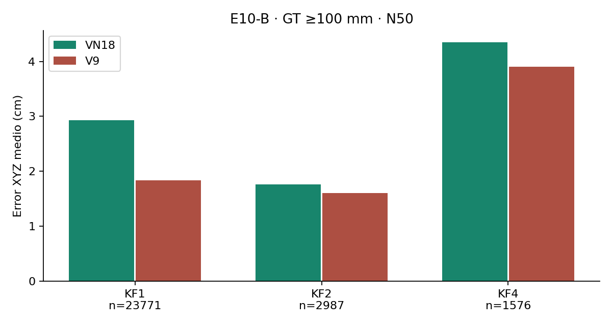{loading="lazy"}

</details>
<dl class="card-fields"><dt>Conclusión</dt><dd><strong>Resultado diagnóstico; consultar límites.</strong> V9 gana XYZ en KF1/2/4, por lo que esa ventaja no se limita a KF4 ni desaparece al retirar KF1: baja de 33,34% a 9,48%. En profundidad, en cambio, V9 solo gana en KF1: al retirarlo, la ventaja AbsRel cambia de +27,62% a −16,41%. El agregado profundo no describe uniformemente las anclas.</dd><dt>Limitaciones</dt><dd>100 mm es un corte de análisis, no un umbral físico universal. Solo tres anclas tienen soporte profundo suficiente; KF3 tiene dos píxeles. Píxeles y ventanas no son sujetos independientes.</dd></dl>
<details class="trace-details"><summary>Trazabilidad · configuración, código y resultados</summary><p class="evidence-note"><strong>Registro:</strong> <a href="tablas/scared_followups_b_resumen.json">scared_followups_b_resumen.json</a> · ID E10-B. <strong>Código:</strong> engine.py / loss_v9.py; engine_vn18.py / loss_contract.py (recetas de los pesos comparados). Los archivos operativos, configuraciones y checkpoints completos se conservan localmente; no se publican datos GT ni mapas granulares por píxel.</p><p class="evidence-note"><strong>Checkpoint:</strong> Zero-shot oficial; VN18-SCARED 3240; V9-SCARED 1000 (según cada tabla) · <strong>Datos:</strong> SCARED · dataset 7. <a href="tablas/menu_experimentos_unificado.json">Descargar índice estructurado</a> · <a href="#bibliografia">Papers y secciones de referencia</a></p></details>
<p class="evidence-note">Recetas principales y código para lectura: <a href="recursos/recetas/scared-vn18.html" target="_blank" rel="noopener">VN18 · SCARED</a> · <a href="recursos/recetas/scared-v9.html" target="_blank" rel="noopener">V9 adaptado · SCARED</a>. Cada página indica el alcance de la firma conservada; no sustituye la configuración de un piloto diferente.</p>
<p class="evidence-note">Consulta metodológica: <a href="https://arxiv.org/html/2602.23361v1#S3.SS2" target="_blank" rel="noopener">VGG-T³: contexto y TTT</a>. La evidencia del resultado es el registro local, no una afirmación atribuida al paper.</p>

<dl class="card-fields verdict"><dt>Confirmación o negación de la hipótesis</dt><dd>Diagnóstico descriptivo: la conclusión conserva el resultado observado; no establece una confirmación causal binaria.</dd></dl></div>
</details>

<details class="scared-experiment-card" id="scared-e11" data-research-card data-order="57" data-primary="Geometría, cámara y datos" data-problems="Geometría, cámara y datos" data-datasets="SCARED" data-status="executed" data-negative="false" data-experiment data-model="VGG-T³" data-scope="SCARED">
<summary><span class="card-status">Ejecutado</span><span class="card-id">E11</span>Análisis de confianza y cobertura<span class="card-teaser">Retener el 50% de mayor confianza reduce el error en VN18, pero lo aumenta en V9 en este macro.</span><span class="card-topics">SCARED · Geometría, cámara y datos</span></summary>

<div class="card-content">
<dl class="card-fields"><dt>Hipótesis / pregunta</dt><dd>Los puntos de mayor confianza podrían ser más fiables.</dd>
<dt>Cómo se realizó</dt><dd>Extraída confianza nativa no guardada antes. Riesgo/cobertura 10/25/50/75/100% sobre todos los píxeles GT válidos de 21 contextos; tabla de cuatro anclas N50 con igual peso. No se recorta ninguna nube.</dd>
<dt>Controles</dt><dd>Confianza nativa y escala fijada antes de retener puntos; evaluar sobre GT válido. No se filtra ninguna nube guardada.</dd>
<dt>Métricas</dt><dd>Las columnas de las tablas conservadas, con su soporte y unidades originales.</dd></dl>
<div class="card-result"><strong>Resultados</strong><p>Retener el 50% de mayor confianza reduce el error en VN18, pero lo aumenta en V9 en este macro.</p></div>
<details class="protocol-main" id="protocolo-experimento-scared-e11"><summary>Protocolo principal · E11</summary><dl class="protocol-fields"><div><dt>Dataset</dt><dd>SCARED · dataset 7</dd></div><div><dt>Partición</dt><dd>Validación; secundarios identificados en el método</dd></div><div><dt>Checkpoint</dt><dd>VGG-T³ oficial, VN18-SCARED final 3240 y V9-SCARED candidato 1000; únicamente las variantes nombradas en filas</dd></div><div><dt>Frames y resolución</dt><dd>N=1/4/8/16/50; RGB 336×266; consultar condiciones de esta ficha</dd></div><div><dt>Escala / alineamiento</dt><dd>Escala GT de profundidad por ancla; registros secundarios se identifican aparte</dd></div><div><dt>Unidades</dt><dd>XYZ en cm; AbsRel sin unidad; porcentajes y ángulos según columnas</dd></div><div><dt>GT disponible</dt><dd>XYZ/profundidad medidos en el keyframe; sin trayectoria GT temporal validada</dd></div></dl><p class="evidence-note"><a href="tablas/protocolos_lectura_20261124.json">Trazabilidad completa por tabla</a> · <a href="tablas/protocolos_tablas.json">Índice original y firmas</a></p></details>

<details class="result-tables"><summary>Tablas, cifras y figuras del experimento</summary>

<div class="table-context" id="tabla-protocolo-54" data-main-protocol="protocolo-experimento-scared-e11"><span class="protocol-kind">Registro experimental</span> · <a href="#protocolo-experimento-scared-e11">Protocolo principal</a></div>

| Modelo | Retenido (%) | Error P (cm) | GT válido retenido y <2 mm (%) |
| --- | --- | --- | --- |
| Zero-shot | 25.0000 | 0.9531 | 0.1383 |
| Zero-shot | 50.0000 | 0.9978 | 0.2388 |
| Zero-shot | 100.0000 | 1.4641 | 0.2654 |
| VN18-SCARED | 25.0000 | 0.7487 | 1.2787 |
| VN18-SCARED | 50.0000 | 0.7919 | 2.4277 |
| VN18-SCARED | 100.0000 | 0.9835 | 3.3531 |
| V9-SCARED | 25.0000 | 1.2094 | 3.0585 |
| V9-SCARED | 50.0000 | 1.0650 | 3.5458 |
| V9-SCARED | 100.0000 | 0.9232 | 7.0493 |


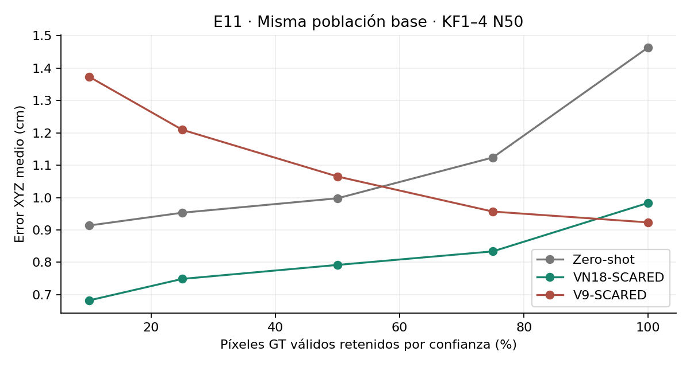{loading="lazy"}

</details>
<dl class="card-fields"><dt>Conclusión</dt><dd><strong>Resultado diagnóstico; consultar límites.</strong> La confianza V9 no es un filtro fiable por defecto, coherente con que no recibió supervisión directa de confianza.</dd><dt>Limitaciones</dt><dd>No son probabilidades calibradas. Cobertura es soporteGT del ancla, no superficie completa ni órgano. Cambia la población evaluada al filtrar; no es una mejora del modelo.</dd></dl>
<details class="trace-details"><summary>Trazabilidad · configuración, código y resultados</summary><p class="evidence-note"><strong>Registro:</strong> <a href="tablas/experimentos_scared_e01_e12.json">experimentos_scared_e01_e12.json</a> · ID E11. <strong>Código:</strong> engine.py / loss_v9.py; engine_vn18.py / loss_contract.py (recetas de los pesos comparados). Los archivos operativos, configuraciones y checkpoints completos se conservan localmente; no se publican datos GT ni mapas granulares por píxel.</p><p class="evidence-note"><strong>Checkpoint:</strong> Zero-shot oficial; VN18-SCARED 3240; V9-SCARED 1000 (según cada tabla) · <strong>Datos:</strong> SCARED · dataset 7. <a href="tablas/menu_experimentos_unificado.json">Descargar índice estructurado</a> · <a href="#bibliografia">Papers y secciones de referencia</a></p></details>
<p class="evidence-note">Recetas principales y código para lectura: <a href="recursos/recetas/scared-vn18.html" target="_blank" rel="noopener">VN18 · SCARED</a> · <a href="recursos/recetas/scared-v9.html" target="_blank" rel="noopener">V9 adaptado · SCARED</a>. Cada página indica el alcance de la firma conservada; no sustituye la configuración de un piloto diferente.</p>
<p class="evidence-note">Consulta metodológica: <a href="https://arxiv.org/html/2602.23361v1#S3.SS2" target="_blank" rel="noopener">VGG-T³: contexto y TTT</a>. La evidencia del resultado es el registro local, no una afirmación atribuida al paper.</p>

<dl class="card-fields verdict"><dt>Confirmación o negación de la hipótesis</dt><dd>Diagnóstico descriptivo: la conclusión conserva el resultado observado; no establece una confirmación causal binaria.</dd></dl></div>
</details>

<details class="scared-followup-card" id="scared-e11-b" data-research-card data-order="58" data-primary="Geometría, cámara y datos" data-problems="Geometría, cámara y datos" data-datasets="SCARED" data-status="executed" data-negative="true" data-experiment data-model="VGG-T³" data-scope="SCARED">
<summary><span class="card-status">Ejecutado</span><span class="card-id">E11-B</span>Error–cobertura y controles<span class="card-teaser">VN18 reduce el error al retener 50% en las cuatro anclas N=50: 12,98–23,25%; la ventaja permanece 8,74–11,48% frente al aleatorio con la misma composición de profundidad.</span><span class="card-topics">SCARED · Geometría, cámara y datos</span></summary>

<div class="card-content">
<dl class="card-fields"><dt>Hipótesis / pregunta</dt><dd>Pregunta diagnóstica: Error–cobertura y controles. Se conserva la formulación del método, sin presentarla como prerregistro.</dd>
<dt>Cómo se realizó</dt><dd>Confianza nativa extraída en 63 anclas sobre features guardadas: cero nuevos encoders. Principal N=50 y secundario N=1. Escala GT fijada antes de filtrar. Comparación con riesgo aleatorio esperado a igual cantidad, composición de profundidad igualada, ranking por profundidad, confianza inversa y oráculo GT. 256 remuestreos de bloques 32×32 por ancla.</dd>
<dt>Controles</dt><dd>Escala fijada antes del filtrado; aleatorio a igual cobertura, aleatorio con profundidad igualada, confianza inversa y oráculo GT. Bootstrap espacial, no sujetos independientes.</dd>
<dt>Métricas</dt><dd>Las columnas de las tablas conservadas; análisis por ancla y agregados identificados.</dd></dl>
<div class="card-result"><strong>Resultados</strong><p>VN18 reduce el error al retener 50% en las cuatro anclas N=50: 12,98–23,25%; la ventaja permanece 8,74–11,48% frente al aleatorio con la misma composición de profundidad.</p></div>
<details class="protocol-main" id="protocolo-experimento-scared-e11-b"><summary>Protocolo principal · E11-B</summary><dl class="protocol-fields"><div><dt>Dataset</dt><dd>SCARED · dataset 7</dd></div><div><dt>Partición</dt><dd>Validación; secundarios identificados en el método</dd></div><div><dt>Checkpoint</dt><dd>VGG-T³ oficial, VN18-SCARED final 3240 y V9-SCARED candidato 1000; únicamente las variantes nombradas en filas</dd></div><div><dt>Frames y resolución</dt><dd>Principal: KF1–4 con N=50; secundarios identificados; RGB 336×266</dd></div><div><dt>Escala / alineamiento</dt><dd>Escala GT de profundidad por ancla; registros secundarios se identifican aparte</dd></div><div><dt>Unidades</dt><dd>XYZ en cm; AbsRel sin unidad; porcentajes y ángulos según columnas</dd></div><div><dt>GT disponible</dt><dd>XYZ/profundidad medidos en el keyframe; sin trayectoria GT temporal validada</dd></div></dl><p class="evidence-note"><a href="tablas/protocolos_lectura_20261124.json">Trazabilidad completa por tabla</a> · <a href="tablas/protocolos_tablas.json">Índice original y firmas</a></p></details>

<details class="result-tables"><summary>Tablas, cifras y figuras del experimento</summary>

<div class="table-context" id="tabla-protocolo-55" data-main-protocol="protocolo-experimento-scared-e11-b"><span class="protocol-kind">Registro experimental</span> · <a href="#protocolo-experimento-scared-e11-b">Protocolo principal</a></div>

| KF | Todos XYZ (cm) | Top 50% XYZ (cm) | Mejora vs aleatorio (%) | Mejora vs aleatorio misma profundidad (%) | V9: mejora top 50% vs aleatorio (%) | Intervalo espacial 95% (%) |
| --- | --- | --- | --- | --- | --- | --- |
| 1 | 1.6287 | 1.2500 | 23.2501 | 11.4809 | -12.5364 | 7.42 a 36.64 |
| 2 | 0.8785 | 0.7645 | 12.9803 | 9.1306 | -19.4349 | 2.97 a 23.32 |
| 3 | 0.5993 | 0.5142 | 14.2024 | 8.7365 | -21.2632 | 7.56 a 20.90 |
| 4 | 0.8277 | 0.6389 | 22.8156 | 9.2587 | -11.4101 | 12.82 a 30.61 |


{loading="lazy"}

</details>
<dl class="card-fields"><dt>Conclusión</dt><dd><strong>Resultado diagnóstico; consultar límites.</strong> Los cuatro intervalos espaciales quedan por encima de 0. En N=1 la mejora aparece en 5/5 anclas. V9 empeora con top 50% en las cuatro N=50: 11,41–21,26%.</dd><dt>Limitaciones</dt><dd>Confianza útil para ordenar en estos casos no equivale a probabilidad calibrada. Los intervalos describen variación espacial condicionada a estas imágenes, no generalización a pacientes. La cobertura es del GT del ancla; no se filtraron archivos de nubes ni se refitió escala por cobertura. El oráculo usa GT y no es desplegable.</dd></dl>
<details class="trace-details"><summary>Trazabilidad · configuración, código y resultados</summary><p class="evidence-note"><strong>Registro:</strong> <a href="tablas/scared_followups_b_resumen.json">scared_followups_b_resumen.json</a> · ID E11-B. <strong>Código:</strong> engine.py / loss_v9.py; engine_vn18.py / loss_contract.py (recetas de los pesos comparados). Los archivos operativos, configuraciones y checkpoints completos se conservan localmente; no se publican datos GT ni mapas granulares por píxel.</p><p class="evidence-note"><strong>Checkpoint:</strong> Zero-shot oficial; VN18-SCARED 3240; V9-SCARED 1000 (según cada tabla) · <strong>Datos:</strong> SCARED · dataset 7. <a href="tablas/menu_experimentos_unificado.json">Descargar índice estructurado</a> · <a href="#bibliografia">Papers y secciones de referencia</a></p></details>
<p class="evidence-note">Recetas principales y código para lectura: <a href="recursos/recetas/scared-vn18.html" target="_blank" rel="noopener">VN18 · SCARED</a> · <a href="recursos/recetas/scared-v9.html" target="_blank" rel="noopener">V9 adaptado · SCARED</a>. Cada página indica el alcance de la firma conservada; no sustituye la configuración de un piloto diferente.</p>
<p class="evidence-note">Consulta metodológica: <a href="https://arxiv.org/html/2602.23361v1#S3.SS2" target="_blank" rel="noopener">VGG-T³: contexto y TTT</a>. La evidencia del resultado es el registro local, no una afirmación atribuida al paper.</p>

<dl class="card-fields verdict"><dt>Confirmación o negación de la hipótesis</dt><dd>Diagnóstico descriptivo: la conclusión conserva el resultado observado; no establece una confirmación causal binaria.</dd></dl></div>
</details>

<details class="evidence-archive"><summary>Tablas, figuras y protocolos detallados conservados</summary>

<h4 id="detalle-scared">SCARED · adaptación y transferencia</h4>

<h4 id="scared-vn18">SCARED · entrenamiento VN18</h4>

Este bloque documenta **VN18 entrenado con SCARED**, separado de VN18-C3VD y de VN19-A/B. Partió de pesos oficiales frescos; no heredó el fine-tuning C3VD. Terminó **3.240 actualizaciones**. El final se conserva como **candidato diagnóstico**: mejoró medias, pero no pasó todas las guardas de validación.

<h4>Cómo se entrenó</h4>


<details class="protocol-main" id="protocolo-receta-vn18-scared"><summary>Protocolo principal · SCARED · receta VN18</summary><dl class="protocol-fields"><div><dt>Dataset</dt><dd>SCARED</dd></div><div><dt>Partición</dt><dd>SCARED: TRAIN datasets 1/2/3/6, VAL7, reservados 8/9; comparación C3VD cuando su columna lo declara</dd></div><div><dt>Checkpoint</dt><dd>VN18-SCARED final 3240; contraste con las recetas V9/VN19-C3VD</dd></div><div><dt>Frames y resolución</dt><dd>No aplica: tabla de documentación</dd></div><div><dt>Escala / alineamiento</dt><dd>No aplica: no es una medición geométrica</dd></div><div><dt>Unidades</dt><dd>Las explícitas en el registro</dd></div><div><dt>GT disponible</dt><dd>Un keyframe medido por contexto; sin GT temporal validada</dd></div></dl><p class="evidence-note"><a href="tablas/protocolos_lectura_20261124.json">Trazabilidad completa por tabla</a> · <a href="tablas/protocolos_tablas.json">Índice original y firmas</a></p></details>

<div class="table-context" id="tabla-protocolo-24" data-main-protocol="protocolo-receta-vn18-scared"><span class="protocol-kind">Documentación</span> · <a href="#protocolo-receta-vn18-scared">Protocolo principal</a></div>

<details class="metrics-fold"><summary>Cómo se entrenó · ver tabla (16 filas)</summary>

| Aspecto | VN18-SCARED | Diferencia respecto a V9 / VN19 |
| --- | --- | --- |
| Pesos iniciales | Pesos oficiales publicados, inicialización fresca. | También oficiales; no significa entrenamiento desde cero. |
| Módulos actualizados | Depth head y point head. | V9/VN19 también ajustan camera head. |
| Módulos congelados | Encoder, agregador/TTT externo y camera head. | No se supervisa cámara temporal en SCARED. |
| Adaptación interna TTT | Dos actualizaciones durante el forward. | Congelar sus parámetros externos no desactiva este mecanismo. |
| TRAIN | Datasets 1, 2, 3 y 6: 20 keyframes medidos; 48 ventanas. | Contextos con solo un ancla densa GT validada. |
| VAL / reservas | Dataset 7: 5 anclas. Datasets 8/9 fuera del ajuste; inspeccionados después. | No mezclar validación con un test clínico independiente. |
| Cuarentena | Datasets 4/5 fuera del ajuste geométrico; dataset 6/KF1 excluido del análisis temporal, ancla medida conservada. | Problemas documentados de calibración y tiempos; no se borraron los datos. |
| Entrada | Contextos de 1/4/8/16 vistas; RGB 336×266 (ancho×alto). | V9/VN19-C3VD usa 336² y 3/6/12/50 vistas. |
| GT de entrenamiento | XYZ medido del keyframe;Z axial mm→m, RGB/D rectificados y K con el mismo resize. | No se fabricaron etiquetas temporales para los RGB adicionales. |
| Supervisión | Un ancla medida por contexto y actualización; 3.240 exposiciones densas, incluyendo repeticiones. | V9/VN19 utiliza dos targets densos por actualización. |
| Normalización | D y XYZ divididos por la norma media de puntos GT válidos del ancla. | No se aplica directamente la referencia fija de 0,03 m de la receta V9. |
| Pérdida | Regresión nativa normalizada y confianza para D/P; auxiliar de calidad; pesos D=1, P=1. | La contribución de calidad no está demostrada como mejora causal por sí sola. |
| Optimizador | AdamW; LR 1e-5; betas (0,9; 0,95); eps 1e-6; weight decay 0,01. | Comparte varios hiperparámetros, pero la receta no es idéntica. |
| Clipping y LR | Norma 1 por cabeza; warmup 5%; coseno hasta 0,1×LR inicial. | V9/VN19 usa clipping global y warmup de 25 pasos. |
| Presupuesto / semilla | 3.240 pasos; semilla 1234. | Igual techo de pasos no implica igual cantidad de GT. |
| Selección | Mejora conjunta exigida 1%, máxima regresión 2%; ningún afinado admitido. | best_heads conserva paso 0; last.pt contiene el final 3240. |

</details>


<details>
<summary>Calendario real y alcance de la supervisión</summary>


<div class="table-context" id="tabla-protocolo-25" data-main-protocol="protocolo-receta-vn18-scared"><span class="protocol-kind">Documentación</span> · <a href="#protocolo-receta-vn18-scared">Protocolo principal</a><span class="protocol-differences">Cambios de esta tabla · <strong>Checkpoint:</strong> VN18-SCARED: distribución de las 3240 actualizaciones TRAIN</span></div>

| Distribución | Actualizaciones |
| --- | --- |
| Contexto 4 vistas | 750 |
| Contexto 1 vistas | 990 |
| Contexto 16 vistas | 750 |
| Contexto 8 vistas | 750 |
| dataset 2 | 810 |
| dataset 1 | 810 |
| dataset 6 | 810 |
| dataset 3 | 810 |


3.000 selecciones corresponden a cobertura equilibrada de anclas medidas y 240 a repetición de anclas profundas de TRAIN, con umbral de 0,10 m. Se mantienen 20 frames con supervisión densa GT distinta; los RGB de vídeo aportan contexto. Estos conteos no equivalen a 3.240 anclas independientes.

La escala de salida es normalizada por escena. Un único factor positivo GT usado al evaluar o visualizar no demuestra profundidad métrica absoluta a partir de RGB.

</details>

<h4>Validación: la media y cada keyframe</h4>


<details class="protocol-main" id="protocolo-val-vn18-scared"><summary>Protocolo principal · SCARED · validación VN18</summary><dl class="protocol-fields"><div><dt>Dataset</dt><dd>SCARED dataset 7</dd></div><div><dt>Partición</dt><dd>Validación; no test 8/9</dd></div><div><dt>Checkpoint</dt><dd>Zero-shot; VN18-SCARED final 3240; V9-SCARED candidato 1000 y selección oficial paso 0 cuando aparezca en la fila</dd></div><div><dt>Frames y resolución</dt><dd>17 contextos largos: KF1–4 con N=4/8/16/50; KF5 solo N=1. RGB336×266; agregado por KF según tabla</dd></div><div><dt>Escala / alineamiento</dt><dd>Una escala GT de profundidad compartida con puntos por contexto; sin ICP</dd></div><div><dt>Unidades</dt><dd>XYZ/p95 en cm; AbsRel sin unidad; δ/Δ en %</dd></div><div><dt>GT disponible</dt><dd>Un keyframe medido por contexto; sin GT temporal validada</dd></div></dl><p class="evidence-note"><a href="tablas/protocolos_lectura_20261124.json">Trazabilidad completa por tabla</a> · <a href="tablas/protocolos_tablas.json">Índice original y firmas</a></p></details>

<div class="table-context" id="tabla-protocolo-26" data-main-protocol="protocolo-val-vn18-scared"><span class="protocol-kind">Validación local</span> · <a href="#protocolo-val-vn18-scared">Protocolo principal</a></div>

<details class="metrics-fold"><summary>Validación: la media y cada keyframe · ver tabla (6 filas)</summary>

| Validación | AbsRel ZS | AbsRel VN18 | Δ favorable | XYZ ZS (cm) | XYZ VN18 (cm) | Δ favorable |
| --- | --- | --- | --- | --- | --- | --- |
| KF1 | 0,2796 | 0,1731 | +38,08 % | 2,726 | 1,610 | +40,95 % |
| KF2 | 0,1836 | 0,1091 | +40,60 % | 1,521 | 0,915 | +39,83 % |
| KF3 | 0,0702 | 0,0490 | +30,29 % | 0,875 | 0,579 | +33,78 % |
| KF4 | 0,0689 | 0,0609 | +11,69 % | 0,670 | 0,861 | -28,52 % |
| KF5 | 0,0933 | 0,0491 | +47,32 % | 1,769 | 0,417 | +76,44 % |
| Promedio igual por KF | 0,1391 | 0,0882 | +36,59 % | 1,512 | 0,876 | +42,04 % |

</details>


Dataset 7. Primero se promedian los contextos de cada keyframe; después los cinco keyframes reciben el mismo peso. KF4 empeora en XYZ aunque mejora el promedio. Esta es evidencia de validación, no de test.

La mejora media no anula la regresión XYZ de KF4. Por eso no se presenta `last.pt` como un checkpoint aceptado, aunque se utilice para estudiar sus reconstrucciones.

<h4>SCARED8 y SCARED9: vistas y métricas reservadas</h4>

Cada caso utiliza el keyframe medido y 49 RGB de vídeo, 50 imágenes en total, 336×266. La reconstrucción guarda **4.468.800 puntos**. Las métricas describen **solo el ancla con GT**, no toda la superficie temporal ni la trayectoria. Se comparan los mismos RGB/GT entre pesos.


**SCARED8 · keyframe original 0**

<details class="protocol-main" id="protocolo-vn18-scared8"><summary>Protocolo principal · SCARED8 · VN18</summary><dl class="protocol-fields"><div><dt>Dataset</dt><dd>SCARED dataset 8</dd></div><div><dt>Partición</dt><dd>Reservado durante entrenamiento; ya inspeccionado históricamente</dd></div><div><dt>Checkpoint</dt><dd>Columnas/filas identificadas: zero-shot, V9-C3VD 850, VN19-A-C3VD 3240, VN18-SCARED 3240 y V9-SCARED 1000; no se agregan pesos ausentes</dd></div><div><dt>Frames y resolución</dt><dd>50 RGB336×266; ventana indicada en la sección</dd></div><div><dt>Escala / alineamiento</dt><dd>Una escala GT compartida de profundidad/puntos; sin ICP</dd></div><div><dt>Unidades</dt><dd>cm y %, AbsRel sin unidad</dd></div><div><dt>GT disponible</dt><dd>Solo el keyframe de referencia; no toda la nube ni la trayectoria</dd></div></dl><p class="evidence-note"><a href="tablas/protocolos_lectura_20261124.json">Trazabilidad completa por tabla</a> · <a href="tablas/protocolos_tablas.json">Índice original y firmas</a></p></details>

<div class="table-context" id="tabla-protocolo-27" data-main-protocol="protocolo-vn18-scared8"><span class="protocol-kind">Reconstrucción reservada</span> · <a href="#protocolo-vn18-scared8">Protocolo principal</a></div>

<details class="metrics-fold"><summary>SCARED8 y SCARED9: vistas y métricas reservadas · ver tabla (5 filas)</summary>

| Métrica | V9 · C3VD | VN19-A · C3VD | VN18 · SCARED | Δ favorable VN18/V9 |
| --- | --- | --- | --- | --- |
| AbsRel ↓ | 0,0770 | 0,0964 | 0,0538 | +30,14 % |
| δ < 1,25 ↑ (%) | 94,38 | 92,07 | 99,12 | +5,03 % |
| RMSE profundidad ↓ (cm) | 1,202 | 1,377 | 0,841 | +30,01 % |
| Error XYZ medio ↓ (cm) | 2,510 | 4,231 | 0,910 | +63,75 % |
| Error XYZ p95 ↓ (cm) | 7,229 | 9,611 | 2,475 | +65,77 % |

</details>


Mismos 50 RGB. Las métricas describen el único keyframe medido tras una escala positiva por contexto. No demuestran exactitud de toda la trayectoria. La comparación no aísla el efecto del dataset porque las recetas también difieren.

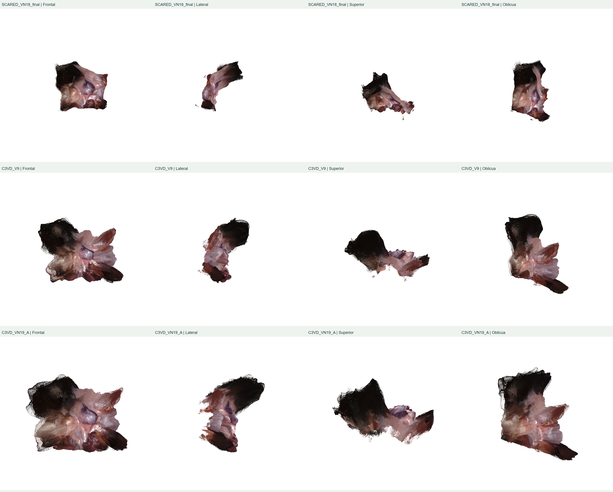{loading="lazy"}
<div class="book-actions"><button type="button" class="book-open-clouds" data-clouds="scared8-vn18,scared8-v9,scared8-vn19-a">Cargar las tres nubes SCARED8</button><button type="button" class="book-open-metrics" data-metrics="scared8-vn18,scared8-v9,scared8-vn19-a">Comparar métricas SCARED8</button></div>

**SCARED9 · keyframe original 0**

<details class="protocol-main" id="protocolo-vn18-scared9"><summary>Protocolo principal · SCARED9 · VN18</summary><dl class="protocol-fields"><div><dt>Dataset</dt><dd>SCARED dataset 9</dd></div><div><dt>Partición</dt><dd>Reservado durante entrenamiento; ya inspeccionado históricamente</dd></div><div><dt>Checkpoint</dt><dd>Columnas/filas identificadas: zero-shot, V9-C3VD 850, VN19-A-C3VD 3240, VN18-SCARED 3240 y V9-SCARED 1000; no se agregan pesos ausentes</dd></div><div><dt>Frames y resolución</dt><dd>50 RGB336×266; ventana indicada en la sección</dd></div><div><dt>Escala / alineamiento</dt><dd>Una escala GT compartida de profundidad/puntos; sin ICP</dd></div><div><dt>Unidades</dt><dd>cm y %, AbsRel sin unidad</dd></div><div><dt>GT disponible</dt><dd>Solo el keyframe de referencia; no toda la nube ni la trayectoria</dd></div></dl><p class="evidence-note"><a href="tablas/protocolos_lectura_20261124.json">Trazabilidad completa por tabla</a> · <a href="tablas/protocolos_tablas.json">Índice original y firmas</a></p></details>

<div class="table-context" id="tabla-protocolo-28" data-main-protocol="protocolo-vn18-scared9"><span class="protocol-kind">Reconstrucción reservada</span> · <a href="#protocolo-vn18-scared9">Protocolo principal</a></div>

<details class="metrics-fold"><summary>SCARED8 y SCARED9: vistas y métricas reservadas · ver tabla (5 filas)</summary>

| Métrica | V9 · C3VD | VN19-A · C3VD | VN18 · SCARED | Δ favorable VN18/V9 |
| --- | --- | --- | --- | --- |
| AbsRel ↓ | 0,1277 | 0,1229 | 0,0610 | +52,21 % |
| δ < 1,25 ↑ (%) | 82,19 | 80,38 | 98,42 | +19,74 % |
| RMSE profundidad ↓ (cm) | 1,468 | 1,541 | 0,760 | +48,23 % |
| Error XYZ medio ↓ (cm) | 2,796 | 2,773 | 0,652 | +76,69 % |
| Error XYZ p95 ↓ (cm) | 5,321 | 5,603 | 1,714 | +67,80 % |

</details>


Mismos 50 RGB. Las métricas describen el único keyframe medido tras una escala positiva por contexto. No demuestran exactitud de toda la trayectoria. La comparación no aísla el efecto del dataset porque las recetas también difieren.

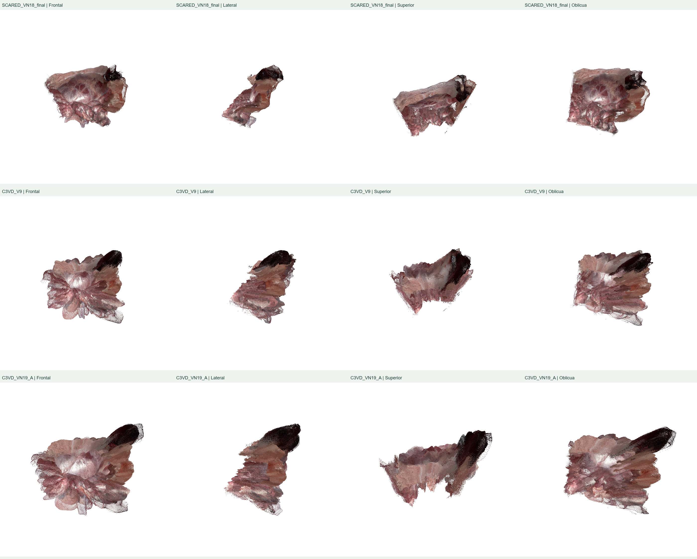{loading="lazy"}
<div class="book-actions"><button type="button" class="book-open-clouds" data-clouds="scared9-vn18,scared9-v9,scared9-vn19-a">Cargar las tres nubes SCARED9</button><button type="button" class="book-open-metrics" data-metrics="scared9-vn18,scared9-v9,scared9-vn19-a">Comparar métricas SCARED9</button></div>


La transferencia VN18-SCARED → C3VD está integrada en la [comparación ampliada con V9-SCARED y las referencias C3VD](#scared-c3vd-trans4).


**Límite:** SCARED no aporta GT temporal independiente validada para estas ventanas. El visor distingue la trayectoria predicha y no inventa una trayectoria GT. VN19-SCARED A/B sigue en espera.


<!-- SCARED_V9_RESULTS_START -->


<h4 id="scared-v9">SCARED · V9 adaptado</h4>

Entrenamiento completado: **1.000 actualizaciones**, 2.000 exposiciones densas de 20 anclas medidas distintas. Reconstrucciones mostradas: **paso 1000**, V9-SCARED · candidato diagnóstico. **Ningún checkpoint afinado pasó todas las guardas**: se muestra un candidato diagnóstico elegido por VAL; el selector conserva los pesos oficiales de paso 0.

La mejora conjunta media alineada fue **37.67 %**, pero hubo regresiones superiores al 2 % en los keyframes **4**. Esta guarda añadida de investigación impide promocionar una mejora media que perjudica casos particulares; no es un criterio de aceptación del paper.

La cámara permanece congelada. Estas métricas describen profundidad/puntos en las anclas, no certifican la trayectoria o toda la reconstrucción temporal. La compatibilidad de ejecución y gradientes se comprobó; el registro físico RGB/XYZ independiente sigue siendo una limitación, distinta del chequeo algebraico D/K.

<details>
<summary>Receta, adaptación y split</summary>


<details class="protocol-main" id="protocolo-receta-v9-scared"><summary>Protocolo principal · SCARED · receta V9</summary><dl class="protocol-fields"><div><dt>Dataset</dt><dd>C3VD y SCARED; comparación de las dos recetas V9</dd></div><div><dt>Partición</dt><dd>SCARED: TRAIN datasets 1/2/3/6, VAL7, reservados 8/9; comparación C3VD cuando su columna lo declara</dd></div><div><dt>Checkpoint</dt><dd>V9-C3VD de referencia y V9-SCARED candidato 1000; no implica aceptación</dd></div><div><dt>Frames y resolución</dt><dd>No aplica: tabla de documentación</dd></div><div><dt>Escala / alineamiento</dt><dd>No aplica: no es una medición geométrica</dd></div><div><dt>Unidades</dt><dd>Las explícitas en el registro</dd></div><div><dt>GT disponible</dt><dd>Un keyframe medido por contexto; sin GT temporal validada</dd></div></dl><p class="evidence-note"><a href="tablas/protocolos_lectura_20261124.json">Trazabilidad completa por tabla</a> · <a href="tablas/protocolos_tablas.json">Índice original y firmas</a></p></details>

<div class="table-context" id="tabla-protocolo-29" data-main-protocol="protocolo-receta-v9-scared"><span class="protocol-kind">Documentación</span> · <a href="#protocolo-receta-v9-scared">Protocolo principal</a></div>

| Elemento | V9-C3VD de referencia | V9 adaptado a SCARED |
| --- | --- | --- |
| Inicio | Pesos oficiales frescos | Pesos oficiales frescos; no continúa C3VD ni VN18 |
| Actualizar | Cámara + profundidad + puntos | Profundidad + puntos; cámara congelada por falta de GT temporal validada |
| Congelar | Encoder / TTT externo | Encoder / TTT externo; TTT interno de 2 pasos conservado |
| Pérdida | 3 L_XYZ + L_logD + 0,2 L_gradXYZ + 0,2 L_camera | Misma parte densa, omitiendo L_camera |
| Unidades | Referencia fija 0,03 m | Referencia fija 0,03 m; sin escala GT ajustada en TRAIN |
| Resolución / ventanas | 336²; 3/6/12/50 | 336×266; 3/6/12/50 + seis excepciones N=1 |
| Presupuesto | 1.000 pasos / 2.000 exposiciones densas | 1.000 pasos / 2.000 exposiciones; dos anclas en contextos independientes por paso |
| Optimizador | AdamW LR1e-5, WD0,01; clipping global 1 | Igual; betas 0,9/0,95, eps1e-6, warmup 25 + coseno |
| Muestreo | Equilibrio por secuencia y giro | Rotación de datasets 1/2/3/6; dos anclas distintas aleatorias; semilla 1234 |
| TRAIN / VAL / reserva | Split histórico C3VD | 1/2/3/6: 20 anclas y 62 ventanas; VAL7: 5 anclas; reserva 8/9 |
| Exclusiones | Según geometría C3VD | 4/5 en cuarentena; vídeo 6/KF1 excluido, ancla medida conservada |
| Comparación | Referencia histórica | Adaptación de receta; no reproducción literal ni ablación causal de un único factor |


Frente a VN18-SCARED cambian pérdidas, unidades, clipping, contextos, muestreo y presupuesto. Se comparan recetas completas bajo evaluación común; este contraste no identifica causalmente el efecto de una sola modificación.

</details>

<details>
<summary>Métricas de validación: zero-shot, VN18 y V9; medias y keyframes</summary>

Las columnas alineadas usan una escala positiva del ancla compartida por profundidad y puntos, sin ICP. No se comparan directamente las unidades raw normalizadas de VN18 con la referencia fija de V9.

**Ancla aislada · N=1**

<details class="protocol-main" id="protocolo-val-v9-scared"><summary>Protocolo principal · SCARED · validación V9</summary><dl class="protocol-fields"><div><dt>Dataset</dt><dd>SCARED dataset 7</dd></div><div><dt>Partición</dt><dd>Validación; no test 8/9</dd></div><div><dt>Checkpoint</dt><dd>Zero-shot; VN18-SCARED final 3240; V9-SCARED candidato 1000 y selección oficial paso 0 cuando aparezca en la fila</dd></div><div><dt>Frames y resolución</dt><dd>N=1; KF1–5; RGB336×266</dd></div><div><dt>Escala / alineamiento</dt><dd>Una escala GT de profundidad compartida con puntos por contexto; sin ICP</dd></div><div><dt>Unidades</dt><dd>XYZ/p95 en cm; AbsRel sin unidad; δ/Δ en %</dd></div><div><dt>GT disponible</dt><dd>Un keyframe medido por contexto; sin GT temporal validada</dd></div></dl><p class="evidence-note"><a href="tablas/protocolos_lectura_20261124.json">Trazabilidad completa por tabla</a> · <a href="tablas/protocolos_tablas.json">Índice original y firmas</a></p></details>

<div class="table-context" id="tabla-protocolo-30" data-main-protocol="protocolo-val-v9-scared"><span class="protocol-kind">Validación local</span> · <a href="#protocolo-val-v9-scared">Protocolo principal</a></div>

| Pesos | AbsRel ↓ | δ1 (%) ↑ | XYZ (cm) ↓ | p95 (cm) ↓ | Δ AbsRel / ZS | Δ XYZ / ZS |
| --- | --- | --- | --- | --- | --- | --- |
| zero_shot | 0.15528 | 74.03142 | 1.62304 | 3.50388 | +0.00 % | +0.00 % |
| VN18_final | 0.10636 | 84.76748 | 0.92969 | 2.29237 | +31.50 % | +42.72 % |
| V9_best_candidate | 0.09711 | 90.98480 | 0.82205 | 1.87885 | +37.46 % | +49.35 % |
| V9_selected | 0.15528 | 74.03142 | 1.62304 | 3.50388 | +0.00 % | +0.00 % |
| V9_final | 0.09711 | 90.98480 | 0.82205 | 1.87885 | +37.46 % | +49.35 % |


**Contextos largos · mismas ventanas VN18**

<div class="table-context" id="tabla-protocolo-31" data-main-protocol="protocolo-val-v9-scared"><span class="protocol-kind">Validación local</span> · <a href="#protocolo-val-v9-scared">Protocolo principal</a><span class="protocol-differences">Cambios de esta tabla · <strong>Frames y resolución:</strong> 17 contextos largos: KF1–4 con N=4/8/16/50; KF5 solo N=1. RGB336×266; agregado por KF según tabla</span></div>

| Pesos | AbsRel ↓ | δ1 (%) ↑ | XYZ (cm) ↓ | p95 (cm) ↓ | Δ AbsRel / ZS | Δ XYZ / ZS |
| --- | --- | --- | --- | --- | --- | --- |
| zero_shot | 0.13913 | 79.99277 | 1.51221 | 3.47420 | +0.00 % | +0.00 % |
| VN18_final | 0.08823 | 90.15824 | 0.87642 | 2.13812 | +36.59 % | +42.04 % |
| V9_best_candidate | 0.10835 | 87.15597 | 0.88095 | 2.16914 | +22.13 % | +41.74 % |
| V9_selected | 0.13913 | 79.99277 | 1.51221 | 3.47420 | +0.00 % | +0.00 % |
| V9_final | 0.10835 | 87.15597 | 0.88095 | 2.16914 | +22.13 % | +41.74 % |


**Por keyframe, contextos largos (peso igual por keyframe)**

<div class="table-context" id="tabla-protocolo-32" data-main-protocol="protocolo-val-v9-scared"><span class="protocol-kind">Validación local</span> · <a href="#protocolo-val-v9-scared">Protocolo principal</a><span class="protocol-differences">Cambios de esta tabla · <strong>Frames y resolución:</strong> 17 contextos largos: KF1–4 con N=4/8/16/50; KF5 solo N=1. RGB336×266; agregado por KF según tabla</span></div>

| KF | AbsRel ZS | AbsRel candidato | Δ favorable | XYZ ZS (cm) | XYZ candidato (cm) | Δ favorable |
| --- | --- | --- | --- | --- | --- | --- |
| 1 | 0.27962 | 0.18234 | +34.79 % | 2.72642 | 1.33575 | +51.01 % |
| 2 | 0.18365 | 0.14046 | +23.52 % | 1.52107 | 1.03459 | +31.98 % |
| 3 | 0.07023 | 0.06417 | +8.63 % | 0.87451 | 0.45715 | +47.72 % |
| 4 | 0.06891 | 0.09620 | -39.59 % | 0.67004 | 0.85901 | -28.20 % |
| 5 | 0.09325 | 0.05856 | +37.20 % | 1.76900 | 0.71827 | +59.40 % |


{loading="lazy"}

</details>

<details>
<summary>SCARED8: reconstrucción reservada, cuatro vistas y comparación interactiva</summary>

Mismos 50 RGB y soporte GT histórico. El keyframe original 0 es el único medido; los otros 49 frames aportan contexto. Escala positiva del ancla solo al evaluar/visualizar, sin ICP. **4.468.800 puntos por nube, sin submuestreo**. Reservas ya inspeccionadas históricamente; no son test clínico ciego nuevo.

<details class="protocol-main" id="protocolo-v9-scared8"><summary>Protocolo principal · SCARED8 · V9</summary><dl class="protocol-fields"><div><dt>Dataset</dt><dd>SCARED dataset 8</dd></div><div><dt>Partición</dt><dd>Reservado durante entrenamiento; ya inspeccionado históricamente</dd></div><div><dt>Checkpoint</dt><dd>Columnas/filas identificadas: zero-shot, V9-C3VD 850, VN19-A-C3VD 3240, VN18-SCARED 3240 y V9-SCARED 1000; no se agregan pesos ausentes</dd></div><div><dt>Frames y resolución</dt><dd>50 RGB336×266; ventana indicada en la sección</dd></div><div><dt>Escala / alineamiento</dt><dd>Una escala GT compartida de profundidad/puntos; sin ICP</dd></div><div><dt>Unidades</dt><dd>cm y %, AbsRel sin unidad</dd></div><div><dt>GT disponible</dt><dd>Solo el keyframe de referencia; no toda la nube ni la trayectoria</dd></div></dl><p class="evidence-note"><a href="tablas/protocolos_lectura_20261124.json">Trazabilidad completa por tabla</a> · <a href="tablas/protocolos_tablas.json">Índice original y firmas</a></p></details>

<div class="table-context" id="tabla-protocolo-33" data-main-protocol="protocolo-v9-scared8"><span class="protocol-kind">Reconstrucción reservada</span> · <a href="#protocolo-v9-scared8">Protocolo principal</a></div>

| Pesos | AbsRel ↓ | δ1 (%) ↑ | XYZ (cm) ↓ | p95 (cm) ↓ | Δ AbsRel / ZS | Δ XYZ / ZS |
| --- | --- | --- | --- | --- | --- | --- |
| VGG-T³ · zero-shot | 0.03890 | 99.95325 | 1.87279 | 2.74452 | +0.00 % | +0.00 % |
| VN18 · entrenado con SCARED | 0.05378 | 99.12174 | 0.91006 | 2.47462 | -38.26 % | +51.41 % |
| V9 · entrenado con C3VD | 0.07698 | 94.37771 | 2.51041 | 7.22945 | -97.91 % | -34.05 % |
| VN19-A · entrenado con C3VD | 0.09638 | 92.07015 | 4.23054 | 9.61134 | -147.81 % | -125.89 % |
| V9-SCARED · candidato diagnóstico | 0.08300 | 94.95566 | 0.93464 | 2.42242 | -113.39 % | +50.09 % |


{loading="lazy"}
<div class="book-actions"><button type="button" class="book-open-clouds" data-clouds="scared8-vn18,scared8-scared-v9,scared8-v9,scared8-vn19-a">Comparar nubes y trayectorias predichas</button><button type="button" class="book-open-metrics" data-metrics="scared8-vn18,scared8-scared-v9,scared8-v9,scared8-vn19-a">Comparar métricas</button></div>

</details>

<details>
<summary>SCARED9: reconstrucción reservada, cuatro vistas y comparación interactiva</summary>

Mismos 50 RGB y soporte GT histórico. El keyframe original 0 es el único medido; los otros 49 frames aportan contexto. Escala positiva del ancla solo al evaluar/visualizar, sin ICP. **4.468.800 puntos por nube, sin submuestreo**. Reservas ya inspeccionadas históricamente; no son test clínico ciego nuevo.

<details class="protocol-main" id="protocolo-v9-scared9"><summary>Protocolo principal · SCARED9 · V9</summary><dl class="protocol-fields"><div><dt>Dataset</dt><dd>SCARED dataset 9</dd></div><div><dt>Partición</dt><dd>Reservado durante entrenamiento; ya inspeccionado históricamente</dd></div><div><dt>Checkpoint</dt><dd>Columnas/filas identificadas: zero-shot, V9-C3VD 850, VN19-A-C3VD 3240, VN18-SCARED 3240 y V9-SCARED 1000; no se agregan pesos ausentes</dd></div><div><dt>Frames y resolución</dt><dd>50 RGB336×266; ventana indicada en la sección</dd></div><div><dt>Escala / alineamiento</dt><dd>Una escala GT compartida de profundidad/puntos; sin ICP</dd></div><div><dt>Unidades</dt><dd>cm y %, AbsRel sin unidad</dd></div><div><dt>GT disponible</dt><dd>Solo el keyframe de referencia; no toda la nube ni la trayectoria</dd></div></dl><p class="evidence-note"><a href="tablas/protocolos_lectura_20261124.json">Trazabilidad completa por tabla</a> · <a href="tablas/protocolos_tablas.json">Índice original y firmas</a></p></details>

<div class="table-context" id="tabla-protocolo-34" data-main-protocol="protocolo-v9-scared9"><span class="protocol-kind">Reconstrucción reservada</span> · <a href="#protocolo-v9-scared9">Protocolo principal</a></div>

| Pesos | AbsRel ↓ | δ1 (%) ↑ | XYZ (cm) ↓ | p95 (cm) ↓ | Δ AbsRel / ZS | Δ XYZ / ZS |
| --- | --- | --- | --- | --- | --- | --- |
| VGG-T³ · zero-shot | 0.13738 | 79.09464 | 2.34485 | 5.21760 | +0.00 % | +0.00 % |
| VN18 · entrenado con SCARED | 0.06105 | 98.41720 | 0.65165 | 1.71356 | +55.56 % | +72.21 % |
| V9 · entrenado con C3VD | 0.12774 | 82.19280 | 2.79592 | 5.32090 | +7.02 % | -19.24 % |
| VN19-A · entrenado con C3VD | 0.12288 | 80.37739 | 2.77307 | 5.60324 | +10.56 % | -18.26 % |
| V9-SCARED · candidato diagnóstico | 0.07533 | 97.38356 | 1.31196 | 2.39606 | +45.17 % | +44.05 % |


{loading="lazy"}
<div class="book-actions"><button type="button" class="book-open-clouds" data-clouds="scared9-vn18,scared9-scared-v9,scared9-v9,scared9-vn19-a">Comparar nubes y trayectorias predichas</button><button type="button" class="book-open-metrics" data-metrics="scared9-vn18,scared9-scared-v9,scared9-v9,scared9-vn19-a">Comparar métricas</button></div>

</details>

[Descargar métricas de validación](tablas/scared_v9_validation.csv) · [Datos del resultado](tablas/scared_v9_resultados.json)

<!-- SCARED_V9_RESULTS_END -->

<!-- SCARED_C3VD_TRANSFER_V1_START -->

<h4 id="scared-c3vd-trans4">Transferencia SCARED → C3VD · trans_t4_b</h4>

Se aplicaron **V9-SCARED (paso 1000)** y **VN18-SCARED (paso 3240)** al mismo recorrido C3VD: **50 RGB a 336×336, IDs0–596**. VN18-SCARED ya estaba inferido y se verificó/reutilizó; se generó únicamente la nueva inferencia V9-SCARED. Se conservan **5.644.800 puntos por nube**, sin filtro de confianza, máscara GT ni submuestreo de la exportación.

Frente a VN18-SCARED, V9-SCARED reduce AbsRel un **8.35 %**, pero aumenta el error XYZ un **8.18 %** y p95 un **17.98 %**. No hay mejora conjunta demostrada. Ambos siguen siendo candidatos diagnósticos; no se eligen pesos usando este recorrido.
<div class="book-actions"><button type="button" class="book-open-clouds" data-clouds="c3vd-v9,c3vd-scared-vn18,c3vd-scared-v9">Comparar nubes y trayectorias</button><button type="button" class="book-open-metrics" data-metrics="c3vd-v9,c3vd-scared-vn18,c3vd-scared-v9">Comparar métricas</button></div>

<details>
<summary>Métricas comparables: profundidad y cabeza global de puntos · siete variantes</summary>

Se puntúan exactamente 16 frames GT y 1.771.907 píxeles válidos. Profundidad, puntos y traslación comparten una escala positiva ajustada únicamente al evaluar; sin ICP ni registro rígido. Errores en cm.

<details class="protocol-main" id="protocolo-transferencia-v9-scared"><summary>Protocolo principal · SCARED → C3VD</summary><dl class="protocol-fields"><div><dt>Dataset</dt><dd>C3VD trans_t4_b</dd></div><div><dt>Partición</dt><dd>Validación de los modelos C3VD; lectura de transferencia para pesos SCARED</dd></div><div><dt>Checkpoint</dt><dd>VGG-T³: oficial, V9-C3VD 850, VN18-C3VD 3240, VN19-A/B 3240, VN18-SCARED 3240, V9-SCARED 1000; tabla 36 añade VGGT oficial/C3VD 30 épocas</dd></div><div><dt>Frames y resolución</dt><dd>50 RGB 336²; 16 objetivos GT comunes</dd></div><div><dt>Escala / alineamiento</dt><dd>Una escala positiva GT compartida por contexto; sin ICP</dd></div><div><dt>Unidades</dt><dd>cm, grados, porcentajes; AbsRel sin unidad</dd></div><div><dt>GT disponible</dt><dd>Profundidad, K y poses de los 16 objetivos; 1.771.907 píxeles válidos</dd></div></dl><p class="evidence-note"><a href="tablas/protocolos_lectura_20261124.json">Trazabilidad completa por tabla</a> · <a href="tablas/protocolos_tablas.json">Índice original y firmas</a></p></details>

<div class="table-context" id="tabla-protocolo-35" data-main-protocol="protocolo-transferencia-v9-scared"><span class="protocol-kind">Evaluación local</span> · <a href="#protocolo-transferencia-v9-scared">Protocolo principal</a></div>

| Pesos | Paso | AbsRel ↓ | δ1 (%) ↑ | RMSE D ↓ | XYZ medio ↓ | XYZ p95 ↓ |
| --- | --- | --- | --- | --- | --- | --- |
| Zero-shot · VGG-T³ | 0 | 0.1824 | 72.0958 | 0.7252 | 0.7242 | 2.1306 |
| V9-C3VD · referencia | 850 | 0.1486 | 78.3849 | 0.6978 | 0.4756 | 1.3048 |
| VN18-C3VD · seleccionado | 3240 | 0.1305 | 82.8774 | 0.4759 | 0.4656 | 1.1263 |
| VN19-A-C3VD · final diagnóstico | 3240 | 0.1721 | 74.8697 | 0.5922 | 0.5683 | 1.3013 |
| VN19-B-C3VD · final diagnóstico | 3240 | 0.1722 | 73.0258 | 0.5923 | 0.5751 | 1.3370 |
| VN18-SCARED · final diagnóstico | 3240 | 0.1942 | 61.4292 | 0.5725 | 0.7986 | 1.7163 |
| V9-SCARED · candidato diagnóstico | 1000 | 0.1780 | 66.5609 | 0.5999 | 0.8639 | 2.0248 |


</details>

<details>
<summary>Ruta D+K+pose y cámaras · comparación adicional con VGGT</summary>


<div class="table-context" id="tabla-protocolo-36" data-main-protocol="protocolo-transferencia-v9-scared"><span class="protocol-kind">Evaluación local</span> · <a href="#protocolo-transferencia-v9-scared">Protocolo principal</a></div>

| Pesos | D+K+pose (cm) ↓ | p95 (cm) ↓ | Rotación (°) ↓ | RMSE centros (cm) ↓ | Error focal (%) ↓ |
| --- | --- | --- | --- | --- | --- |
| Zero-shot · VGG-T³ | 0.7711 | 2.0430 | 10.7966 | 0.1950 | 20.4771 |
| V9-C3VD · referencia | 0.6000 | 1.9298 | 6.9067 | 0.1807 | 3.6312 |
| VN18-C3VD · seleccionado | 0.6420 | 1.6295 | 10.7966 | 0.2004 | 20.4771 |
| VN19-A-C3VD · final diagnóstico | 0.5789 | 1.5579 | 6.3401 | 0.1990 | 1.2811 |
| VN19-B-C3VD · final diagnóstico | 0.5730 | 1.5336 | 6.1691 | 0.1994 | 1.3149 |
| VN18-SCARED · final diagnóstico | 0.7705 | 1.6294 | 10.7966 | 0.1961 | 20.4771 |
| V9-SCARED · candidato diagnóstico | 0.8377 | 1.9059 | 10.7966 | 0.2485 | 20.4771 |
| VGGT · zero-shot | 0.8265 | 2.0024 | 7.7004 | 0.2073 | 26.4429 |
| VGGT · fine-tuning C3VD | 0.7638 | 1.7177 | 5.5409 | 0.6945 | 10.9758 |


Aquí se compara la misma ruta: profundidad predicha + pose predicha + K calibrada conocida, para VGGT y VGG-T³. La calibración entra en la desproyección, no como profundidad/pose GT en el encoder. Los valores de VGGT son la referencia igualada de 50 vistas/336², no la demo histórica de 80 vistas/518².

Los modelos SCARED mantienen exactamente los pesos oficiales de cámara: coinciden sus rotaciones e intrínsecas predichas con zero-shot. Las diferencias de traslación tras alinear dependen también de la escala de profundidad; no se presentan como aprendizaje nuevo de poses. El RMSE de centros anclados no es ATE con Sim(3).

</details>

<details>
<summary>Cuatro vistas con orientación y encuadre comunes</summary>

Se proyectan todos los puntos guardados. Las oclusiones del z-buffer pertenecen a la imagen estática; el visor conserva el 100 % de los vértices.

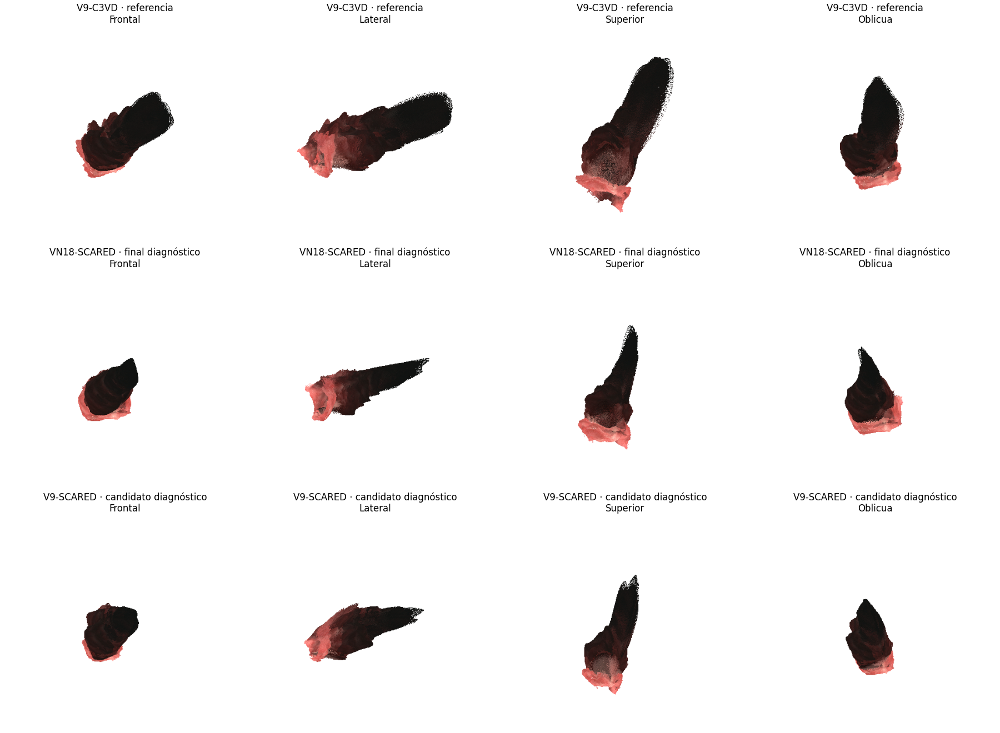{loading="lazy"}
<div class="book-actions"><button type="button" class="book-open-clouds" data-clouds="c3vd-v9,c3vd-scared-vn18,c3vd-scared-v9">Comparar nubes y trayectorias</button><button type="button" class="book-open-metrics" data-metrics="c3vd-v9,c3vd-scared-vn18,c3vd-scared-v9">Comparar métricas</button></div>

</details>

<details>
<summary>Índice relativo D/P propuesto · lectura rápida, no métrica del paper</summary>

Zero-shot=50. Se usa S=100/(1+R), con R=(AbsRel/AbsRel_ZS)^0,5×(XYZ/XYZ_ZS)^0,25×(p95/p95_ZS)^0,25. Los pesos son una convención exploratoria. No mide calidad clínica, trayectoria ni porcentaje de superficie correcta; no intervino en la selección.

<details class="protocol-main" id="protocolo-score-exploratorio"><summary>Protocolo principal · score exploratorio</summary><dl class="protocol-fields"><div><dt>Dataset</dt><dd>C3VD trans_t4_b</dd></div><div><dt>Partición</dt><dd>Validación de los modelos C3VD; lectura de transferencia para pesos SCARED</dd></div><div><dt>Checkpoint</dt><dd>VGG-T³: oficial, V9-C3VD 850, VN18-C3VD 3240, VN19-A/B 3240, VN18-SCARED 3240, V9-SCARED 1000; tabla 36 añade VGGT oficial/C3VD 30 épocas</dd></div><div><dt>Frames y resolución</dt><dd>50 RGB 336²; 16 objetivos GT comunes</dd></div><div><dt>Escala / alineamiento</dt><dd>Una escala positiva GT compartida por contexto; sin ICP</dd></div><div><dt>Unidades</dt><dd>Índice relativo /100; no es una métrica original ni una puntuación clínica</dd></div><div><dt>GT disponible</dt><dd>Profundidad, K y poses de los 16 objetivos; 1.771.907 píxeles válidos</dd></div></dl><p class="evidence-note"><a href="tablas/protocolos_lectura_20261124.json">Trazabilidad completa por tabla</a> · <a href="tablas/protocolos_tablas.json">Índice original y firmas</a></p></details>

<div class="table-context" id="tabla-protocolo-37" data-main-protocol="protocolo-score-exploratorio"><span class="protocol-kind">Índice exploratorio</span> · <a href="#protocolo-score-exploratorio">Protocolo principal</a></div>

| Pesos | Índice relativo /100 |
| --- | --- |
| Zero-shot · VGG-T³ | 50.0 |
| V9-C3VD · referencia | 58.2 |
| VN18-C3VD · seleccionado | 60.8 |
| VN19-A-C3VD · final diagnóstico | 55.3 |
| VN19-B-C3VD · final diagnóstico | 55.1 |
| VN18-SCARED · final diagnóstico | 50.0 |
| V9-SCARED · candidato diagnóstico | 49.5 |


</details>

Para las variantes VGG-T³ de esta tabla, la secuencia quedó fuera de sus ajustes locales, pero se ha inspeccionado repetidamente durante el desarrollo. No se presupone que el entrenamiento histórico de VGGT tuviera el mismo split y presupuesto. Las recetas C3VD/SCARED difieren en GT, pérdidas, normalización y presupuesto; esta transferencia no aísla causalmente el efecto del dataset.

[Descargar tabla de métricas](tablas/c3vd_scared_transfer_v1.csv) · [Datos de la comparación](tablas/c3vd_scared_transfer_v1.json)

<!-- SCARED_C3VD_TRANSFER_V1_END -->

<!-- SCARED_E01_E12_START -->

</details>

</details>

<details class="experiment-group"><summary>Experimentos globales y entre datasets · 3 fichas</summary>

<details class="scared-experiment-card" id="scared-e06" data-research-card data-order="50" data-primary="Geometría, cámara y datos" data-problems="Geometría, cámara y datos" data-datasets="SCARED|C3VD" data-status="executed" data-negative="false" data-experiment data-model="VGG-T³" data-scope="Global">
<summary><span class="card-status">Ejecutado</span><span class="card-id">E06</span>Diagnóstico de escala y alineación<span class="card-teaser">El ranking V9/VN18-SCARED se invierte después de un Sim3 global enC3VD.</span><span class="card-topics">SCARED + C3VD · Geometría, cámara y datos</span></summary>

<div class="card-content">
<dl class="card-fields"><dt>Hipótesis / pregunta</dt><dd>Parte del error puede proceder de escala/registro y otra parte de forma.</dd>
<dt>Cómo se realizó</dt><dd>Reutilizadas las transformaciones de C3VDTrans4, mismos 16 GT de un contexto 50, y las del anclaSCARED. Comparación escalaD, escalaP, un Sim3 global y Sim3 independiente por frame.</dd>
<dt>Controles</dt><dd>Mismos objetivos GT; distinguir un registro global de registros independientes por frame.</dd>
<dt>Métricas</dt><dd>Las columnas de las tablas conservadas, con su soporte y unidades originales.</dd></dl>
<div class="card-result"><strong>Resultados</strong><p>El ranking V9/VN18-SCARED se invierte después de un Sim3 global enC3VD.</p></div>
<details class="protocol-main" id="protocolo-experimento-scared-e06"><summary>Protocolo principal · E06</summary><dl class="protocol-fields"><div><dt>Dataset</dt><dd>C3VD trans_t4_b</dd></div><div><dt>Partición</dt><dd>Validación C3VD y transferencia de pesos entrenados con SCARED</dd></div><div><dt>Checkpoint</dt><dd>VGG-T³ oficial; VN18-SCARED3240; V9-SCARED1000; V9-C3VD850</dd></div><div><dt>Frames y resolución</dt><dd>Contexto de 50 RGB336×336; mismos 16 objetivos GT</dd></div><div><dt>Escala / alineamiento</dt><dd>Columnas separadas: escala D compartida, escala P propia, Sim(3) global y Sim(3) por frame; todos son diagnósticos con GT</dd></div><div><dt>Unidades</dt><dd>XYZ en cm; AbsRel sin unidad; porcentajes y ángulos según columnas</dd></div><div><dt>GT disponible</dt><dd>Profundidad, K y poses de los 16 objetivos C3VD</dd></div></dl><p class="evidence-note"><a href="tablas/protocolos_lectura_20261124.json">Trazabilidad completa por tabla</a> · <a href="tablas/protocolos_tablas.json">Índice original y firmas</a></p></details>

<details class="result-tables"><summary>Tablas, cifras y figuras del experimento</summary>

<div class="table-context" id="tabla-protocolo-45" data-main-protocol="protocolo-experimento-scared-e06"><span class="protocol-kind">Registro experimental</span> · <a href="#protocolo-experimento-scared-e06">Protocolo principal</a></div>

| Modelo | Escala D compartida (cm) | Escala P propia (cm) | Sim3 global (cm) | Sim3 por frame (cm) |
| --- | --- | --- | --- | --- |
| Zero-shot | 0.7242 | 0.6475 | 0.4689 | 0.4221 |
| VN18-SCARED | 0.7986 | 0.8015 | 0.7388 | 0.6513 |
| V9-SCARED | 0.8639 | 0.7492 | 0.6409 | 0.5752 |
| V9-C3VD | 0.4756 | 0.4523 | 0.4448 | 0.4231 |


</details>
<dl class="card-fields"><dt>Conclusión</dt><dd><strong>Resultado diagnóstico; consultar límites.</strong> La escala/colocación contribuye al error, pero el residuo de forma persiste.</dd><dt>Limitaciones</dt><dd>Todos los ajustes usan GT y son diagnósticos. Sim3 por frame puede ocultar fallos de ensamblado; no es una reconstrucción corregida. El ajuste minimiza error cuadrático, no necesariamente la media de distancias.</dd></dl>
<details class="trace-details"><summary>Trazabilidad · configuración, código y resultados</summary><p class="evidence-note"><strong>Registro:</strong> <a href="tablas/experimentos_scared_e01_e12.json">experimentos_scared_e01_e12.json</a> · ID E06. <strong>Código:</strong> engine.py / loss_v9.py; engine_vn18.py / loss_contract.py (recetas de los pesos comparados). Los archivos operativos, configuraciones y checkpoints completos se conservan localmente; no se publican datos GT ni mapas granulares por píxel.</p><p class="evidence-note"><strong>Checkpoint:</strong> Zero-shot oficial; VN18-SCARED 3240; V9-SCARED 1000 (según cada tabla) · <strong>Datos:</strong> SCARED y C3VD trans_t4_b. <a href="tablas/menu_experimentos_unificado.json">Descargar índice estructurado</a> · <a href="#bibliografia">Papers y secciones de referencia</a></p></details>
<p class="evidence-note">Recetas principales y código para lectura: <a href="recursos/recetas/scared-vn18.html" target="_blank" rel="noopener">VN18 · SCARED</a> · <a href="recursos/recetas/scared-v9.html" target="_blank" rel="noopener">V9 adaptado · SCARED</a>. Cada página indica el alcance de la firma conservada; no sustituye la configuración de un piloto diferente.</p>
<p class="evidence-note">Consulta metodológica: <a href="https://arxiv.org/html/2602.23361v1#S3.SS2" target="_blank" rel="noopener">VGG-T³: contexto y TTT</a>. La evidencia del resultado es el registro local, no una afirmación atribuida al paper.</p>

<dl class="card-fields verdict"><dt>Confirmación o negación de la hipótesis</dt><dd>Diagnóstico descriptivo: la conclusión conserva el resultado observado; no establece una confirmación causal binaria.</dd></dl></div>
</details>

<details class="scared-experiment-card" id="scared-e09" data-research-card data-order="54" data-primary="Eficiencia y secuencias largas" data-problems="Eficiencia y secuencias largas" data-datasets="SCARED|C3VD" data-status="executed" data-negative="false" data-experiment data-model="VGG-T³" data-scope="Global">
<summary><span class="card-status">Ejecutado</span><span class="card-id">E09</span>Dependencia del recorrido y solapamiento<span class="card-teaser">N50 aumenta la repetibilidad de matches adyacentes, pero V9 no obtiene una mejora conjunta automática.</span><span class="card-topics">SCARED + C3VD · Eficiencia y secuencias largas</span></summary>

<div class="card-content">
<dl class="card-fields"><dt>Hipótesis / pregunta</dt><dd>Movimiento y pérdida de correspondencias podrían explicar errores mejor queN por sí solo.</dd>
<dt>Cómo se realizó</dt><dd>Analizadas 16 ventanasVAL7, N4/8/16/50, mismo tramo vídeo 0-60; matchesRGB y desplazamiento de imagen. En SCARED8/9 se relacionan con desacuerdoP. En C3VDTrans4 se reutilizan posesGT de 16 vistas para asociaciones con error.</dd>
<dt>Controles</dt><dd>Mismo tramo vídeo 0–60 al variar N; separar asociaciones RGB de errores con poses GT en C3VD.</dd>
<dt>Métricas</dt><dd>Las columnas de las tablas conservadas, con su soporte y unidades originales.</dd></dl>
<div class="card-result"><strong>Resultados</strong><p>N50 aumenta la repetibilidad de matches adyacentes, pero V9 no obtiene una mejora conjunta automática.</p></div>
<details class="protocol-main" id="protocolo-experimento-scared-e09"><summary>Protocolo principal · E09</summary><dl class="protocol-fields"><div><dt>Dataset</dt><dd>SCARED dataset 7, KF1–4</dd></div><div><dt>Partición</dt><dd>Validación; proxies de correspondencia RGB</dd></div><div><dt>Checkpoint</dt><dd>No se mide un checkpoint: matches/features y desplazamientos se calculan sobre RGB</dd></div><div><dt>Frames y resolución</dt><dd>N=4 frente a 50; mismo tramo vídeo 0–60; RGB336×266</dd></div><div><dt>Escala / alineamiento</dt><dd>No aplica a estos proxies RGB: no hay ajuste de escala o registro con GT</dd></div><div><dt>Unidades</dt><dd>Matches/features en %; desplazamiento en píxeles; pares útiles como conteos</dd></div><div><dt>GT disponible</dt><dd>No es una medición GT de solapamiento, rotación, traslación o paralaje</dd></div></dl><p class="evidence-note"><a href="tablas/protocolos_lectura_20261124.json">Trazabilidad completa por tabla</a> · <a href="tablas/protocolos_tablas.json">Índice original y firmas</a></p></details>

<details class="result-tables"><summary>Tablas, cifras y figuras del experimento</summary>

<div class="table-context" id="tabla-protocolo-49" data-main-protocol="protocolo-experimento-scared-e09"><span class="protocol-kind">Registro experimental</span> · <a href="#protocolo-experimento-scared-e09">Protocolo principal</a></div>

| KF | Matches/features N4 (%) | Matches/features N50 (%) | Pares útiles N4 | Pares útiles N50 | Desplazamiento N4 (px) | Desplazamiento N50 (px) |
| --- | --- | --- | --- | --- | --- | --- |
| 1 | 52.2472 | 72.5857 | 3/3 | 49/49 | 15.7019 | 1.6424 |
| 2 | 15.9030 | 71.1538 | 3/3 | 49/49 | 41.1308 | 1.8852 |
| 3 | 0.0000 | 67.0000 | 1/3 | 49/49 | 2.3014 | 2.4872 |
| 4 | 35.9504 | 73.0022 | 3/3 | 49/49 | 23.4879 | 2.0338 |


<div class="table-context" id="tabla-protocolo-50" data-main-protocol="protocolo-experimento-scared-e09"><span class="protocol-kind">Registro experimental</span> · <a href="#protocolo-experimento-scared-e09">Protocolo principal</a><span class="protocol-differences">Cambios de esta tabla · <strong>Dataset:</strong> C3VD trans_t4_b; <strong>Partición:</strong> Validación C3VD; asociación dentro de una trayectoria; <strong>Checkpoint:</strong> VGG-T³ oficial, VN18-SCARED3240, V9-SCARED1000, V9-C3VD850 y VN19-A/B-C3VD3240; <strong>Frames y resolución:</strong> 50 RGB336×336; 16 objetivos GT, como indica Vistas=16; <strong>Escala / alineamiento:</strong> Escala GT de profundidad por ancla; registros secundarios se identifican aparte; <strong>Unidades:</strong> Coeficientes Spearman rho adimensionales; Vistas es un conteo; <strong>GT disponible:</strong> Poses y geometría GT C3VD de 16 vistas; no son poses GT SCARED</span></div>

| Modelo | Vistas | ρ giro / XYZ | ρ distancia / XYZ |
| --- | --- | --- | --- |
| official_reference | 16 | 0.4265 | 0.5118 |
| SCARED_VN18_final | 16 | 0.9882 | 0.9353 |
| SCARED_V9_candidate1000 | 16 | 0.8265 | 0.8147 |
| C3VD_V9 | 16 | 0.9618 | 0.9059 |
| C3VD_VN19_A | 16 | 0.8471 | 0.7324 |
| C3VD_VN19_B | 16 | 0.9176 | 0.8382 |


</details>
<dl class="card-fields"><dt>Conclusión</dt><dd><strong>Resultado diagnóstico; consultar límites.</strong> Hay asociaciones entre correspondencia/desplazamiento y consistencia, sin un umbral común ni causalidad establecida.</dd><dt>Limitaciones</dt><dd>Matches/features no es porcentaje real de solapamiento; desplazamiento en píxeles no separa rotación, traslación y paralaje. Desplazamiento usa solo pares con≥8 inliers; se muestran los soportes para no ocultar fallos. C3VD es una sola trayectoria y los pares consecutivos están correlacionados.</dd></dl>
<details class="trace-details"><summary>Trazabilidad · configuración, código y resultados</summary><p class="evidence-note"><strong>Registro:</strong> <a href="tablas/experimentos_scared_e01_e12.json">experimentos_scared_e01_e12.json</a> · ID E09. <strong>Código:</strong> engine.py / loss_v9.py; engine_vn18.py / loss_contract.py (recetas de los pesos comparados). Los archivos operativos, configuraciones y checkpoints completos se conservan localmente; no se publican datos GT ni mapas granulares por píxel.</p><p class="evidence-note"><strong>Checkpoint:</strong> Zero-shot oficial; VN18-SCARED 3240; V9-SCARED 1000 (según cada tabla) · <strong>Datos:</strong> SCARED7/8/9 y control C3VD trans_t4_b. <a href="tablas/menu_experimentos_unificado.json">Descargar índice estructurado</a> · <a href="#bibliografia">Papers y secciones de referencia</a></p></details>
<p class="evidence-note">Recetas principales y código para lectura: <a href="recursos/recetas/scared-vn18.html" target="_blank" rel="noopener">VN18 · SCARED</a> · <a href="recursos/recetas/scared-v9.html" target="_blank" rel="noopener">V9 adaptado · SCARED</a>. Cada página indica el alcance de la firma conservada; no sustituye la configuración de un piloto diferente.</p>
<p class="evidence-note">Consulta metodológica: <a href="https://arxiv.org/html/2602.23361v1#S3.SS2" target="_blank" rel="noopener">VGG-T³: contexto y TTT</a>. La evidencia del resultado es el registro local, no una afirmación atribuida al paper.</p>

<dl class="card-fields verdict"><dt>Confirmación o negación de la hipótesis</dt><dd>Diagnóstico descriptivo: la conclusión conserva el resultado observado; no establece una confirmación causal binaria.</dd></dl></div>
</details>

<details class="scared-experiment-card" id="scared-e12" data-research-card data-order="59" data-primary="Entrenamiento y generalización" data-problems="Entrenamiento y generalización" data-datasets="SCARED|C3VD" data-status="executed" data-negative="false" data-experiment data-model="VGG-T³" data-scope="Global">
<summary><span class="card-status">Ejecutado</span><span class="card-id">E12</span>Generalización entre datasets<span class="card-teaser">Hay aprendizaje útil dentro deSCARED, más claro en 9, pero las dos recetasSCARED no mejoran conjuntamente el zero-shot enTrans4.</span><span class="card-topics">SCARED + C3VD · Entrenamiento y generalización</span></summary>

<div class="card-content">
<dl class="card-fields"><dt>Hipótesis / pregunta</dt><dd>Una mejora deSCARED podría no transferirse aC3VD.</dd>
<dt>Cómo se realizó</dt><dd>Reutilizadas validación 7, inferencias reservadas 8/9 y transferenciaC3VDTrans4; pesos fijos antes de puntuarlas, mismos RGB y soporte entre variantes dentro de cada caso. Sin nuevas inferencias de esos recorridos.</dd>
<dt>Controles</dt><dd>Pesos fijos antes de puntuar; mismas imágenes y soporte entre variantes dentro de cada caso.</dd>
<dt>Métricas</dt><dd>Las columnas de las tablas conservadas, con su soporte y unidades originales.</dd></dl>
<div class="card-result"><strong>Resultados</strong><p>Hay aprendizaje útil dentro deSCARED, más claro en 9, pero las dos recetasSCARED no mejoran conjuntamente el zero-shot enTrans4.</p></div>
<details class="protocol-main" id="protocolo-experimento-scared-e12"><summary>Protocolo principal · E12</summary><dl class="protocol-fields"><div><dt>Dataset</dt><dd>SCARED y C3VD</dd></div><div><dt>Partición</dt><dd>Validación SCARED y lectura de transferencia C3VD; roles declarados en el registro</dd></div><div><dt>Checkpoint</dt><dd>VGG-T³ oficial, VN18-SCARED3240, V9-SCARED1000 y V9-C3VD850 cuando aparecen en la fila</dd></div><div><dt>Frames y resolución</dt><dd>Según cada fila; no mezclar dominios ni poblaciones GT</dd></div><div><dt>Escala / alineamiento</dt><dd>Escala GT de profundidad por ancla; registros secundarios se identifican aparte</dd></div><div><dt>Unidades</dt><dd>XYZ en cm; AbsRel sin unidad; porcentajes y ángulos según columnas</dd></div><div><dt>GT disponible</dt><dd>XYZ/profundidad medidos en el keyframe; sin trayectoria GT temporal validada</dd></div></dl><p class="evidence-note"><a href="tablas/protocolos_lectura_20261124.json">Trazabilidad completa por tabla</a> · <a href="tablas/protocolos_tablas.json">Índice original y firmas</a></p></details>

<details class="result-tables"><summary>Tablas, cifras y figuras del experimento</summary>

<div class="table-context" id="tabla-protocolo-56" data-main-protocol="protocolo-experimento-scared-e12"><span class="protocol-kind">Registro experimental</span> · <a href="#protocolo-experimento-scared-e12">Protocolo principal</a></div>

| Evaluación | Modelo | AbsRel | XYZ (cm) | Mejora D / ZS (%) | Mejora P / ZS (%) |
| --- | --- | --- | --- | --- | --- |
| SCARED VAL7 · macro 5 (KF5 solo N1) | Zero-shot | 0.1391 | 1.5122 | 0.0000 | 0.0000 |
| SCARED VAL7 · macro 5 (KF5 solo N1) | VN18-SCARED | 0.0882 | 0.8764 | 36.5858 | 42.0438 |
| SCARED VAL7 · macro 5 (KF5 solo N1) | V9-SCARED | 0.1083 | 0.8810 | 22.1270 | 41.7438 |
| SCARED8_N50 | Zero-shot | 0.0389 | 1.8728 | 0.0000 | 0.0000 |
| SCARED8_N50 | VN18-SCARED | 0.0538 | 0.9101 | -38.2611 | 51.4064 |
| SCARED8_N50 | V9-SCARED | 0.0830 | 0.9346 | -113.3932 | 50.0936 |
| SCARED9_N50 | Zero-shot | 0.1374 | 2.3449 | 0.0000 | 0.0000 |
| SCARED9_N50 | VN18-SCARED | 0.0610 | 0.6516 | 55.5633 | 72.2095 |
| SCARED9_N50 | V9-SCARED | 0.0753 | 1.3120 | 45.1688 | 44.0492 |
| C3VD_Trans4_N50 | Zero-shot | 0.1824 | 0.7242 | 0.0000 | 0.0000 |
| C3VD_Trans4_N50 | VN18-SCARED | 0.1942 | 0.7986 | -6.4994 | -10.2734 |
| C3VD_Trans4_N50 | V9-SCARED | 0.1780 | 0.8639 | 2.3949 | -19.2965 |
| C3VD_Trans4_N50 | V9-C3VD | 0.1486 | 0.4756 | 18.5084 | 34.3226 |


</details>
<dl class="card-fields"><dt>Conclusión</dt><dd><strong>Resultado diagnóstico; consultar límites.</strong> V9-C3VD conserva menor errorP en ese caso.</dd><dt>Limitaciones</dt><dd>Uno/dos casos por dominio no demuestran una ley de transferencia. Datos, receta y supervisión de cámara difieren frente aV9-C3VD; no se atribuye causalmente todo al dominio. Reservas 8/9 ya inspeccionadas.</dd></dl>
<details class="trace-details"><summary>Trazabilidad · configuración, código y resultados</summary><p class="evidence-note"><strong>Registro:</strong> <a href="tablas/experimentos_scared_e01_e12.json">experimentos_scared_e01_e12.json</a> · ID E12. <strong>Código:</strong> engine.py / loss_v9.py; engine_vn18.py / loss_contract.py (recetas de los pesos comparados). Los archivos operativos, configuraciones y checkpoints completos se conservan localmente; no se publican datos GT ni mapas granulares por píxel.</p><p class="evidence-note"><strong>Checkpoint:</strong> Zero-shot oficial; VN18-SCARED 3240; V9-SCARED 1000 (según cada tabla) · <strong>Datos:</strong> SCARED y C3VD. <a href="tablas/menu_experimentos_unificado.json">Descargar índice estructurado</a> · <a href="#bibliografia">Papers y secciones de referencia</a></p></details>
<p class="evidence-note">Recetas principales y código para lectura: <a href="recursos/recetas/scared-vn18.html" target="_blank" rel="noopener">VN18 · SCARED</a> · <a href="recursos/recetas/scared-v9.html" target="_blank" rel="noopener">V9 adaptado · SCARED</a>. Cada página indica el alcance de la firma conservada; no sustituye la configuración de un piloto diferente.</p>
<p class="evidence-note">Consulta metodológica: <a href="https://arxiv.org/html/2602.23361v1#S3.SS2" target="_blank" rel="noopener">VGG-T³: contexto y TTT</a>. La evidencia del resultado es el registro local, no una afirmación atribuida al paper.</p>

<dl class="card-fields verdict"><dt>Confirmación o negación de la hipótesis</dt><dd>Diagnóstico descriptivo: la conclusión conserva el resultado observado; no establece una confirmación causal binaria.</dd></dl></div>
</details>

</details>

<!-- COMPLETED ROBUSTNESS E13 E14 E15 -->
<details class="experiment-group" id="robustness-completed"><summary>Robustez y eficiencia · C3VD y SCARED</summary>
<details class="experiment-card" id="exp-e13-executed" data-research-card data-experiment data-model="VGG-T³" data-scope="Global" data-datasets="SCARED C3VD" data-status="executed" data-order="110" data-problems="Robustez y eficiencia">
<summary><span class="card-status">Ejecutado</span><span class="card-id">E13</span>Robustez frente a iluminación y reflejos sintéticos<span class="card-teaser">Protocolo completo: 320 mediciones guardadas. 288/288 condiciones alteradas cambiaron la predicción de profundidad en el soporte evaluado.</span></summary>
<div class="card-content"><dl class="card-fields"><dt>Hipótesis / pregunta</dt><dd>Manteniendo la geometría y las cámaras, alterar solo RGB puede cambiar la profundidad y los puntos globales.</dd><dt>Cómo se realizó</dt><dd>Se modifica únicamente RGB con exposición y brillos aditivos controlados; el protocolo completo añade intensidades y variación radial. Cada condición recomputa el encoder. La escala se obtiene en la referencia limpia y permanece fija.</dd><dt>Controles</dt><dd>Pesos oficiales y tres fine-tunings congelados: VN18-C3VD, VN18-SCARED y V9-SCARED. Semilla fija, mismos RGB por condición, intrínsecas y GT constantes, dos pasos TTT. Sin entrenamiento ni sustitución de checkpoints.</dd><dt>Métricas</dt><dd>AbsRel, δ1, XYZ/p95, deriva de D/P y desacuerdo en correspondencias fijas; este último no sustituye GT anatómico.</dd></dl>
<div class="card-result"><strong>Resultados</strong><p>Protocolo completo: 320 mediciones guardadas. 288/288 condiciones alteradas cambiaron la predicción de profundidad en el soporte evaluado.</p></div>
<details class="protocol-details"><summary>Protocolo y alcance</summary><p>SCARED: anclas medidas de validación del dataset7, sin GT temporal. C3VD: trans_t4_b de validación; solo se puntúan las referencias GT seleccionadas. Profundidad y P directo con escala limpia fija, sin ICP; eficiencia y calidad por contexto se presentan por separado.</p></details>
<details class="metrics-fold"><summary>Tabla de resultados</summary>


| Modelo | Caso | N | Condición de mayor ΔAbsRel | ΔAbsRel (%) | ΔXYZ (%) | Vistas GT |
|---|---|---|---|---|---|---|
| V9_SCARED | scared7_kf1 | 16 | highlight_0.05 | +7.57 | +3.92 | 1 |
| V9_SCARED | scared7_kf1 | 50 | highlight_0.05 | +9.24 | +5.94 | 1 |
| V9_SCARED | scared7_kf2 | 16 | radial_04 | +7.19 | -0.04 | 1 |
| V9_SCARED | scared7_kf2 | 50 | radial_04 | +9.66 | +0.10 | 1 |
| V9_SCARED | scared7_kf3 | 16 | exposure_1.5 | +6.92 | +3.29 | 1 |
| V9_SCARED | scared7_kf3 | 50 | exposure_1.5 | +6.91 | +4.36 | 1 |
| V9_SCARED | scared7_kf4 | 16 | radial_04 | +40.52 | +25.13 | 1 |
| V9_SCARED | scared7_kf4 | 50 | radial_04 | +40.35 | +30.35 | 1 |
| VN18_C3VD | scared7_kf1 | 16 | exposure_1.5 | +0.89 | -1.09 | 1 |
| VN18_C3VD | scared7_kf1 | 50 | exposure_1.5 | +0.87 | -1.80 | 1 |
| VN18_C3VD | scared7_kf2 | 16 | exposure_1.5 | +6.05 | +1.59 | 1 |
| VN18_C3VD | scared7_kf2 | 50 | exposure_1.5 | +3.85 | +2.72 | 1 |
| VN18_C3VD | scared7_kf3 | 16 | exposure_1.5 | +3.49 | -6.24 | 1 |
| VN18_C3VD | scared7_kf3 | 50 | exposure_1.5 | +1.77 | -2.96 | 1 |
| VN18_C3VD | scared7_kf4 | 16 | exposure_1.25 | +0.17 | -0.59 | 1 |
| VN18_C3VD | scared7_kf4 | 50 | exposure_0.75 | +0.63 | -0.56 | 1 |
| VN18_SCARED | scared7_kf1 | 16 | exposure_1.5 | +2.63 | -1.55 | 1 |
| VN18_SCARED | scared7_kf1 | 50 | radial_04 | +6.59 | +21.81 | 1 |
| VN18_SCARED | scared7_kf2 | 16 | exposure_1.5 | +10.23 | -1.12 | 1 |
| VN18_SCARED | scared7_kf2 | 50 | radial_04 | +11.91 | +33.04 | 1 |
| VN18_SCARED | scared7_kf3 | 16 | highlight_0.05 | +8.21 | +9.45 | 1 |
| VN18_SCARED | scared7_kf3 | 50 | combined | +5.43 | +7.45 | 1 |
| VN18_SCARED | scared7_kf4 | 16 | radial_04 | +31.46 | +26.17 | 1 |
| VN18_SCARED | scared7_kf4 | 50 | radial_04 | +36.56 | +28.99 | 1 |
| zero_shot | scared7_kf1 | 16 | exposure_1.5 | +1.77 | +0.72 | 1 |
| zero_shot | scared7_kf1 | 50 | exposure_1.5 | +2.63 | +0.90 | 1 |
| zero_shot | scared7_kf2 | 16 | exposure_1.5 | +9.78 | +7.23 | 1 |
| zero_shot | scared7_kf2 | 50 | exposure_1.5 | +6.57 | +5.43 | 1 |
| zero_shot | scared7_kf3 | 16 | exposure_1.5 | +4.21 | +6.18 | 1 |
| zero_shot | scared7_kf3 | 50 | exposure_1.5 | +3.89 | +3.83 | 1 |
| zero_shot | scared7_kf4 | 16 | highlight_0.05 | +5.55 | +1.26 | 1 |
| zero_shot | scared7_kf4 | 50 | highlight_0.05 | +4.22 | +3.74 | 1 |

<p>Variación respecto a limpio sobre el mismo soporte visible; valores positivos indican deterioro. Se muestra la condición de mayor ΔAbsRel por caso, modelo y N; las demás condiciones se conservan en el archivo de resultados.</p>
</details>
<dl class="card-fields"><dt>Conclusión y confirmación de la hipótesis</dt><dd>Apoyada para estas perturbaciones y ventanas: existe sensibilidad de la predicción al contenido RGB. La dirección del cambio depende del modelo y del caso; no se atribuye a una única causa clínica.</dd><dt>Limitaciones</dt><dd>Los brillos son una perturbación visual sintética, no una simulación física de mucosa húmeda. El efecto observado no identifica por sí solo la causa de un fallo clínico.</dd><dt>Siguiente decisión</dt><dd>Conservar las referencias y usar estos controles para localizar condiciones vulnerables antes de proponer cambios de entrenamiento. Estas pruebas no sustituyen un fine-tuning ni seleccionan nuevos pesos.</dd></dl>
<details class="trace-details"><summary>Configuración y evidencia</summary><p><a href="tablas/robustez_endoscopia_resultados.json">Resultados estructurados y protocolo</a>. Fuentes históricas y checkpoints conservados. Los controles de identidad, reinicio y máscaras se verifican antes de completar la etapa; los registros técnicos completos permanecen en el proyecto local.</p></details></div></details>
<details class="experiment-card" id="exp-e14-executed" data-research-card data-experiment data-model="VGG-T³" data-scope="Global" data-datasets="SCARED C3VD" data-status="executed" data-order="110" data-problems="Robustez y eficiencia">
<summary><span class="card-status">Ejecutado</span><span class="card-id">E14</span>Oclusiones controladas y tejido visible<span class="card-teaser">Protocolo completo: 360 mediciones guardadas. 280/280 condiciones alteradas cambiaron la predicción de profundidad en el soporte evaluado.</span></summary>
<div class="card-content"><dl class="card-fields"><dt>Hipótesis / pregunta</dt><dd>Un oclusor puede alterar la predicción del tejido que sigue visible, incluso cuando se excluye el objeto de la evaluación.</dd><dt>Cómo se realizó</dt><dd>Se introducen oclusores sintéticos y una secuencia de aparición/desaparición. Se compara limpio y alterado sobre exactamente los mismos píxeles GT de tejido visible. Se verifica la vuelta a la entrada limpia idéntica.</dd><dt>Controles</dt><dd>Pesos oficiales y tres fine-tunings congelados: VN18-C3VD, VN18-SCARED y V9-SCARED. Semilla fija, mismos RGB por condición, intrínsecas y GT constantes, dos pasos TTT. Sin entrenamiento ni sustitución de checkpoints.</dd><dt>Métricas</dt><dd>AbsRel, δ1, XYZ/p95, deriva de D/P y desacuerdo en correspondencias fijas; este último no sustituye GT anatómico.</dd></dl>
<div class="card-result"><strong>Resultados</strong><p>Protocolo completo: 360 mediciones guardadas. 280/280 condiciones alteradas cambiaron la predicción de profundidad en el soporte evaluado.</p></div>
<details class="protocol-details"><summary>Protocolo y alcance</summary><p>SCARED: anclas medidas de validación del dataset7, sin GT temporal. C3VD: trans_t4_b de validación; solo se puntúan las referencias GT seleccionadas. Profundidad y P directo con escala limpia fija, sin ICP; eficiencia y calidad por contexto se presentan por separado.</p></details>
<details class="metrics-fold"><summary>Tabla de resultados</summary>


| Modelo | Caso | N | Condición de mayor ΔAbsRel | ΔAbsRel (%) | ΔXYZ (%) | Vistas GT |
|---|---|---|---|---|---|---|
| V9_SCARED | c3vd_trans4 | 16 | static_0.3 | +11.81 | +0.17 | 7 |
| V9_SCARED | c3vd_trans4 | 50 | moving_0.05 | -5.54 | +0.72 | 16 |
| V9_SCARED | scared7_kf1 | 16 | moving_0.15 | +16.86 | +20.20 | 1 |
| V9_SCARED | scared7_kf1 | 50 | static_0.15 | +22.04 | +17.38 | 1 |
| V9_SCARED | scared7_kf2 | 16 | static_0.05 | -5.23 | -6.00 | 1 |
| V9_SCARED | scared7_kf2 | 50 | static_0.05 | -0.88 | -4.51 | 1 |
| V9_SCARED | scared7_kf3 | 16 | moving_0.3 | +14.72 | +32.92 | 1 |
| V9_SCARED | scared7_kf3 | 50 | moving_0.3 | +26.42 | +32.40 | 1 |
| V9_SCARED | scared7_kf4 | 16 | static_0.15 | +80.01 | +15.13 | 1 |
| V9_SCARED | scared7_kf4 | 50 | static_0.15 | +84.90 | +24.22 | 1 |
| VN18_C3VD | c3vd_trans4 | 16 | moving_0.3 | +79.82 | +44.36 | 7 |
| VN18_C3VD | c3vd_trans4 | 50 | moving_0.3 | +73.75 | +42.28 | 16 |
| VN18_C3VD | scared7_kf1 | 16 | moving_0.3 | +22.03 | -1.18 | 1 |
| VN18_C3VD | scared7_kf1 | 50 | moving_0.3 | +23.18 | -0.69 | 1 |
| VN18_C3VD | scared7_kf2 | 16 | static_0.3 | +17.25 | +26.95 | 1 |
| VN18_C3VD | scared7_kf2 | 50 | static_0.3 | +15.37 | +23.09 | 1 |
| VN18_C3VD | scared7_kf3 | 16 | static_0.3 | +37.35 | +10.00 | 1 |
| VN18_C3VD | scared7_kf3 | 50 | static_0.3 | +28.20 | -0.84 | 1 |
| VN18_C3VD | scared7_kf4 | 16 | moving_0.3 | +40.48 | -3.01 | 1 |
| VN18_C3VD | scared7_kf4 | 50 | moving_0.3 | +46.28 | -6.60 | 1 |
| VN18_SCARED | c3vd_trans4 | 16 | moving_0.3 | +66.62 | +32.16 | 7 |
| VN18_SCARED | c3vd_trans4 | 50 | moving_0.3 | +51.94 | +27.02 | 16 |
| VN18_SCARED | scared7_kf1 | 16 | moving_0.3 | +32.62 | +8.50 | 1 |
| VN18_SCARED | scared7_kf1 | 50 | moving_0.3 | +42.56 | +12.63 | 1 |
| VN18_SCARED | scared7_kf2 | 16 | static_0.3 | +67.10 | +27.24 | 1 |
| VN18_SCARED | scared7_kf2 | 50 | static_0.3 | +61.46 | +24.32 | 1 |
| VN18_SCARED | scared7_kf3 | 16 | moving_0.3 | +36.95 | -7.68 | 1 |
| VN18_SCARED | scared7_kf3 | 50 | static_0.3 | +40.30 | -12.03 | 1 |
| VN18_SCARED | scared7_kf4 | 16 | static_0.05 | +6.95 | +4.07 | 1 |
| VN18_SCARED | scared7_kf4 | 50 | static_0.05 | +4.09 | +6.33 | 1 |
| zero_shot | c3vd_trans4 | 16 | moving_0.3 | +65.39 | +4.49 | 7 |
| zero_shot | c3vd_trans4 | 50 | moving_0.3 | +62.81 | +7.09 | 16 |
| zero_shot | scared7_kf1 | 16 | moving_0.3 | +16.36 | +10.74 | 1 |
| zero_shot | scared7_kf1 | 50 | moving_0.3 | +21.60 | +14.02 | 1 |
| zero_shot | scared7_kf2 | 16 | static_0.3 | +28.14 | +21.34 | 1 |
| zero_shot | scared7_kf2 | 50 | static_0.15 | +25.26 | +13.73 | 1 |
| zero_shot | scared7_kf3 | 16 | static_0.3 | +33.45 | +5.06 | 1 |
| zero_shot | scared7_kf3 | 50 | moving_0.3 | +27.49 | +10.09 | 1 |
| zero_shot | scared7_kf4 | 16 | static_0.15 | +14.89 | +10.76 | 1 |
| zero_shot | scared7_kf4 | 50 | static_0.15 | +16.65 | +13.12 | 1 |

<p>Variación respecto a limpio sobre el mismo soporte visible; valores positivos indican deterioro. Se muestra la condición de mayor ΔAbsRel por caso, modelo y N; las demás condiciones se conservan en el archivo de resultados.</p>
</details>
<dl class="card-fields"><dt>Conclusión y confirmación de la hipótesis</dt><dd>Apoyada para estas perturbaciones y ventanas: existe sensibilidad de la predicción al contenido RGB. La dirección del cambio depende del modelo y del caso; no se atribuye a una única causa clínica.</dd><dt>Limitaciones</dt><dd>No existe profundidad GT del oclusor. La vuelta a limpio comprueba reinicio y repetibilidad offline; no demuestra recuperación de un sistema de seguimiento online.</dd><dt>Siguiente decisión</dt><dd>Conservar las referencias y usar estos controles para localizar condiciones vulnerables antes de proponer cambios de entrenamiento. Estas pruebas no sustituyen un fine-tuning ni seleccionan nuevos pesos.</dd></dl>
<details class="trace-details"><summary>Configuración y evidencia</summary><p><a href="tablas/robustez_endoscopia_resultados.json">Resultados estructurados y protocolo</a>. Fuentes históricas y checkpoints conservados. Los controles de identidad, reinicio y máscaras se verifican antes de completar la etapa; los registros técnicos completos permanecen en el proyecto local.</p></details></div></details>
<details class="experiment-card" id="exp-e15-executed" data-research-card data-experiment data-model="VGG-T³" data-scope="Global" data-datasets="SCARED C3VD" data-status="executed" data-order="110" data-problems="Robustez y eficiencia">
<summary><span class="card-status">Ejecutado</span><span class="card-id">E15</span>Eficiencia con recomputación del encoder<span class="card-teaser">Protocolo completo: 336 ejecuciones y 48 grupos modelo/caso/N, con calentamientos excluidos y repetición explícita.</span></summary>
<div class="card-content"><dl class="card-fields"><dt>Hipótesis / pregunta</dt><dd>La longitud de contexto cambia el coste de la inferencia completa y su calidad, aunque los pesos permanezcan congelados.</dd><dt>Cómo se realizó</dt><dd>Se repite cada colección con calentamientos excluidos, sincronización CUDA y recomputación RGB completa. Se guardan mediana, intervalo intercuartil, primer resultado denso y memoria máxima; no se incluyen la carga inicial de pesos ni la extracción ZIP.</dd><dt>Controles</dt><dd>Pesos oficiales y tres fine-tunings congelados: VN18-C3VD, VN18-SCARED y V9-SCARED. Semilla fija, mismos RGB por condición, intrínsecas y GT constantes, dos pasos TTT. Sin entrenamiento ni sustitución de checkpoints.</dd><dt>Métricas</dt><dd>Latencia de inferencia, tiempo al primer resultado, pico CUDA y calidad en el ancla común.</dd></dl>
<div class="card-result"><strong>Resultados</strong><p>Protocolo completo: 336 ejecuciones y 48 grupos modelo/caso/N, con calentamientos excluidos y repetición explícita.</p></div>
<details class="protocol-details"><summary>Protocolo y alcance</summary><p>SCARED: anclas medidas de validación del dataset7, sin GT temporal. C3VD: trans_t4_b de validación; solo se puntúan las referencias GT seleccionadas. Profundidad y P directo con escala limpia fija, sin ICP; eficiencia y calidad por contexto se presentan por separado.</p></details>
<details class="metrics-fold"><summary>Tabla de resultados</summary>


| Modelo | Caso | N | Mediana (s) | IQR (s) | Pico CUDA (GiB) | AbsRel ancla | XYZ ancla (cm) |
|---|---|---|---|---|---|---|---|
| V9_SCARED | c3vd_trans4 | 1 | 2.996 | 2.880–3.019 | 3.553 | 0.18322 | 0.6305 |
| V9_SCARED | c3vd_trans4 | 4 | 3.227 | 3.222–3.236 | 3.762 | 0.20319 | 0.6348 |
| V9_SCARED | c3vd_trans4 | 8 | 4.023 | 4.020–4.027 | 3.960 | 0.20782 | 0.6280 |
| V9_SCARED | c3vd_trans4 | 16 | 5.233 | 5.201–5.247 | 4.168 | 0.21524 | 0.6540 |
| V9_SCARED | c3vd_trans4 | 32 | 7.531 | 7.490–7.533 | 4.549 | 0.22336 | 0.6629 |
| V9_SCARED | c3vd_trans4 | 50 | 10.487 | 10.466–10.495 | 4.971 | 0.22929 | 0.6620 |
| VN18_C3VD | c3vd_trans4 | 1 | 3.131 | 2.938–3.169 | 3.553 | 0.08184 | 0.4611 |
| VN18_C3VD | c3vd_trans4 | 4 | 3.405 | 3.379–3.424 | 3.762 | 0.08004 | 0.4687 |
| VN18_C3VD | c3vd_trans4 | 8 | 4.014 | 4.012–4.015 | 3.960 | 0.07616 | 0.4558 |
| VN18_C3VD | c3vd_trans4 | 16 | 5.246 | 5.222–5.285 | 4.168 | 0.07703 | 0.4648 |
| VN18_C3VD | c3vd_trans4 | 32 | 7.503 | 7.492–7.554 | 4.549 | 0.07899 | 0.4651 |
| VN18_C3VD | c3vd_trans4 | 50 | 10.501 | 10.490–10.523 | 4.971 | 0.07726 | 0.4782 |
| VN18_SCARED | c3vd_trans4 | 1 | 3.024 | 2.968–3.049 | 3.553 | 0.19451 | 0.6658 |
| VN18_SCARED | c3vd_trans4 | 4 | 3.457 | 3.383–3.491 | 3.762 | 0.21193 | 0.6865 |
| VN18_SCARED | c3vd_trans4 | 8 | 4.034 | 4.030–4.037 | 3.960 | 0.21446 | 0.6746 |
| VN18_SCARED | c3vd_trans4 | 16 | 5.265 | 5.237–5.266 | 4.168 | 0.22101 | 0.6724 |
| VN18_SCARED | c3vd_trans4 | 32 | 7.564 | 7.526–7.598 | 4.549 | 0.22835 | 0.6727 |
| VN18_SCARED | c3vd_trans4 | 50 | 10.570 | 10.514–10.610 | 4.971 | 0.22712 | 0.6666 |
| zero_shot | c3vd_trans4 | 1 | 3.110 | 2.913–3.123 | 3.553 | 0.17977 | 0.7466 |
| zero_shot | c3vd_trans4 | 4 | 3.390 | 3.389–3.391 | 3.762 | 0.19034 | 0.7323 |
| zero_shot | c3vd_trans4 | 8 | 4.042 | 4.041–4.093 | 3.960 | 0.18487 | 0.7136 |
| zero_shot | c3vd_trans4 | 16 | 5.311 | 5.304–5.316 | 4.168 | 0.17777 | 0.7019 |
| zero_shot | c3vd_trans4 | 32 | 7.676 | 7.631–7.721 | 4.549 | 0.17685 | 0.6890 |
| zero_shot | c3vd_trans4 | 50 | 10.627 | 10.603–10.632 | 4.971 | 0.17750 | 0.6974 |
| V9_SCARED | scared7_kf2 | 1 | 2.915 | 2.914–3.129 | 3.538 | 0.11430 | 0.8709 |
| V9_SCARED | scared7_kf2 | 4 | 3.462 | 3.340–3.489 | 3.704 | 0.13419 | 1.0462 |
| V9_SCARED | scared7_kf2 | 8 | 4.031 | 4.019–4.057 | 3.913 | 0.14355 | 1.0314 |
| V9_SCARED | scared7_kf2 | 16 | 5.070 | 5.068–5.074 | 4.089 | 0.14221 | 1.0620 |
| V9_SCARED | scared7_kf2 | 32 | 7.072 | 7.045–7.099 | 4.392 | 0.14430 | 1.0562 |
| V9_SCARED | scared7_kf2 | 50 | 9.196 | 9.164–9.210 | 4.727 | 0.14171 | 1.0224 |
| VN18_C3VD | scared7_kf2 | 1 | 2.944 | 2.928–3.154 | 3.538 | 0.26229 | 1.7393 |
| VN18_C3VD | scared7_kf2 | 4 | 3.560 | 3.489–3.590 | 3.704 | 0.20348 | 1.6754 |
| VN18_C3VD | scared7_kf2 | 8 | 4.022 | 3.996–4.105 | 3.913 | 0.19692 | 1.6259 |
| VN18_C3VD | scared7_kf2 | 16 | 5.133 | 5.109–5.156 | 4.089 | 0.19353 | 1.5764 |
| VN18_C3VD | scared7_kf2 | 32 | 7.127 | 7.118–7.156 | 4.392 | 0.19354 | 1.5698 |
| VN18_C3VD | scared7_kf2 | 50 | 9.276 | 9.253–9.321 | 4.727 | 0.19399 | 1.5538 |
| VN18_SCARED | scared7_kf2 | 1 | 2.953 | 2.904–3.131 | 3.538 | 0.18500 | 1.1456 |
| VN18_SCARED | scared7_kf2 | 4 | 3.581 | 3.498–3.588 | 3.704 | 0.12048 | 0.9362 |
| VN18_SCARED | scared7_kf2 | 8 | 4.098 | 4.098–4.115 | 3.913 | 0.11060 | 0.9484 |
| VN18_SCARED | scared7_kf2 | 16 | 5.114 | 5.088–5.129 | 4.089 | 0.10251 | 0.8893 |
| VN18_SCARED | scared7_kf2 | 32 | 7.202 | 7.165–7.222 | 4.392 | 0.10281 | 0.8996 |
| VN18_SCARED | scared7_kf2 | 50 | 9.240 | 9.211–9.257 | 4.727 | 0.10105 | 0.8785 |
| zero_shot | scared7_kf2 | 1 | 2.983 | 2.943–3.163 | 3.538 | 0.27777 | 2.1190 |
| zero_shot | scared7_kf2 | 4 | 3.524 | 3.512–3.583 | 3.704 | 0.19196 | 1.5975 |
| zero_shot | scared7_kf2 | 8 | 4.070 | 4.067–4.102 | 3.913 | 0.18194 | 1.5014 |
| zero_shot | scared7_kf2 | 16 | 5.184 | 5.163–5.187 | 4.089 | 0.17942 | 1.4809 |
| zero_shot | scared7_kf2 | 32 | 7.233 | 7.216–7.242 | 4.392 | 0.18024 | 1.4854 |
| zero_shot | scared7_kf2 | 50 | 9.226 | 9.220–9.260 | 4.727 | 0.17981 | 1.4868 |

<p>Tiempos con encoder y traslados CPU/GPU incluidos. Calidad medida en la misma primera ancla para comparar N. Las mediciones de latencia son operativas en este equipo; no son una comparación directa con A100/H100.</p>
</details>
<dl class="card-fields"><dt>Conclusión y confirmación de la hipótesis</dt><dd>Caracterización medida del coste y calidad frente a N; no establece un umbral universal de rotura ni demuestra funcionamiento clínico en tiempo real.</dd><dt>Limitaciones</dt><dd>Medición operativa en RTX 5060 con offload CPU/GPU. El throughput por lote no equivale a FPS clínicos online. Para calidad frente a N se usa la misma primera ancla: el resto del soporte GT de C3VD cambia con la selección.</dd><dt>Siguiente decisión</dt><dd>Conservar las referencias y usar estos controles para localizar condiciones vulnerables antes de proponer cambios de entrenamiento. Estas pruebas no sustituyen un fine-tuning ni seleccionan nuevos pesos.</dd></dl>
<details class="trace-details"><summary>Configuración y evidencia</summary><p><a href="tablas/robustez_endoscopia_resultados.json">Resultados estructurados y protocolo</a>. Fuentes históricas y checkpoints conservados. Los controles de identidad, reinicio y máscaras se verifican antes de completar la etapa; los registros técnicos completos permanecen en el proyecto local.</p></details></div></details>
</details>
<!-- END COMPLETED ROBUSTNESS -->

</details>

<details class="experiment-model" id="vggt-experimentos"><summary>VGGT</summary>

<details class="experiment-group"><summary>C3VD · 8 fichas</summary>

<details class="vggt-experiment-card" id="r1-01-best-final" data-experiment data-model="VGGT" data-scope="C3VD"><summary><span class="card-status">Completado</span>R1-01 · BEST800 frente a FINAL3000</summary><div class="card-content"><dl class="card-fields"><dt>Hipótesis / pregunta</dt><dd>¿El mínimo de pérdida de validación también mejora las salidas geométricas?</dd></dl><dl class="card-fields"><dt>Cómo se realizó</dt><dd>Reutilizar FINAL/histórico/zero-shot; inferir BEST800 en los 20 contextos preexistentes. Comparar 10 métricas macro VAL N50 y 6 controles por secuencia, con tolerancia solo numérica.</dd></dl><dl class="card-fields"><dt>Controles</dt><dd>Mismos RGB, IDs, resolución, K calibrada, GT válido y escala compartida; todos los puntos, sin filtro de confianza.</dd></dl><dl class="card-fields"><dt>Métricas</dt><dd>AbsRel, δ1, XYZ/p95, CD/NC y cámara; Sim(3) global separado del resultado primario.</dd></dl><dl class="card-fields"><dt>Resultados</dt><dd>80 casos consolidados,20 inferencias nuevas; referencia seleccionada: R1 FINAL3000; 8 controles incumplidos.</dd></dl><dl class="card-fields"><dt>Conclusión</dt><dd>La elección por pérdida y la elección por reconstrucción conjunta no son equivalentes.</dd></dl><dl class="card-fields"><dt>Limitaciones</dt><dd>Dos secuencias VAL; una semilla. N cambia composición y soporte. La regla conjunta es local de investigación, no criterio del paper.</dd></dl><dl class="card-fields"></dl><dl class="card-fields verdict"><dt>Confirmación o negación de la hipótesis</dt><dd>Diagnóstico descriptivo: la conclusión conserva el resultado observado; no establece una confirmación causal binaria.</dd></dl></div></details>

<details class="vggt-experiment-card" id="r1-02-trans1a" data-experiment data-model="VGGT" data-scope="C3VD"><summary><span class="card-status">Completado</span>R1-02 · Regresión de trans_t1_a</summary><div class="card-content"><dl class="card-fields"><dt>Hipótesis / pregunta</dt><dd>¿La diferencia procede de profundidad, cámara o su combinación?</dd></dl><dl class="card-fields"><dt>Cómo se realizó</dt><dd>Reutilizar controles GT del histórico/FINAL y calcular los de BEST con idénticas fórmulas. Mostrar cuatro frames fijados previamente y perfiles de los 50.</dd></dl><dl class="card-fields"><dt>Controles</dt><dd>Mismos RGB, IDs, resolución, K calibrada, GT válido y escala compartida; todos los puntos, sin filtro de confianza.</dd></dl><dl class="card-fields"><dt>Métricas</dt><dd>AbsRel, δ1, XYZ/p95, CD/NC y cámara; Sim(3) global separado del resultado primario.</dd></dl><dl class="card-fields"><dt>Resultados</dt><dd>Los controles reproducen el XYZ primario con tolerancia1e-7cm; GT D + GT pose da 0 interno en los píxeles válidos.</dd></dl><dl class="card-fields"><dt>Conclusión</dt><dd>Sustituir una componente cambia la interacción geométrica; las contribuciones no son aditivas.</dd></dl><dl class="card-fields"><dt>Limitaciones</dt><dd>Usa GT para diagnosticar; el 0 interno no certifica físicamente el dataset. No identifica la causa de entrenamiento.</dd></dl><dl class="card-fields"></dl><dl class="card-fields verdict"><dt>Confirmación o negación de la hipótesis</dt><dd>Diagnóstico descriptivo: la conclusión conserva el resultado observado; no establece una confirmación causal binaria.</dd></dl></div></details>

<details class="vggt-experiment-card" id="r1-03-sim3" data-experiment data-model="VGGT" data-scope="C3VD"><summary><span class="card-status">Completado</span>R1-03 · Colocación global y error residual</summary><div class="card-content"><dl class="card-fields"><dt>Hipótesis / pregunta</dt><dd>¿Cuánto cambia el error al permitir un registro global?</dd></dl><dl class="card-fields"><dt>Cómo se realizó</dt><dd>Reutilizar XYZ antes/después y verificar de nuevo un único Sim(3) sobre todos los puntos de trans_t1_a; nunca uno por frame.</dd></dl><dl class="card-fields"><dt>Controles</dt><dd>Mismos RGB, IDs, resolución, K calibrada, GT válido y escala compartida; todos los puntos, sin filtro de confianza.</dd></dl><dl class="card-fields"><dt>Métricas</dt><dd>AbsRel, δ1, XYZ/p95, CD/NC y cámara; Sim(3) global separado del resultado primario.</dd></dl><dl class="card-fields"><dt>Resultados</dt><dd>Los mismos puntos válidos se comparan antes y después; no se ejecuta ICP.</dd></dl><dl class="card-fields"><dt>Conclusión</dt><dd>Una reducción expone sensibilidad al registro; el residual revela error que una transformación global no elimina.</dd></dl><dl class="card-fields"><dt>Limitaciones</dt><dd>La diferencia de errores no es una descomposición causal/aditiva; Sim(3) minimiza cuadrados, no necesariamente la media de distancias.</dd></dl><dl class="card-fields"></dl><dl class="card-fields verdict"><dt>Confirmación o negación de la hipótesis</dt><dd>Diagnóstico descriptivo: la conclusión conserva el resultado observado; no establece una confirmación causal binaria.</dd></dl></div></details>

<details class="vggt-experiment-card" id="vggt-p01" data-vggt-phase1-card data-experiment data-model="VGGT" data-scope="C3VD"><summary><span class="card-status">Fase 1 completada</span><span class="card-id">P01</span>Auditoría del VGGT-C3VD de 30 épocas</summary><div class="card-content">
<dl class="card-fields"><dt>Hipótesis / pregunta</dt><dd>¿El checkpoint y su entrenamiento documentado corresponden al baseline histórico que estamos comparando?</dd></dl>
<dl class="card-fields"><dt>Cómo se realizó</dt><dd>Se recalcularon firmas de ambos archivos de pesos, se verificaron cabezas/argumentos y se leyó el estado del optimizador. Se reutilizó la auditoría verificable de tensores y fuentes históricas.</dd></dl>
<dl class="card-fields"><dt>Controles</dt><dd>Firma oficial y firma del checkpoint histórico congelado; ninguna escritura de pesos ni nuevo entrenamiento.</dd></dl>
<dl class="card-fields"><dt>Métricas</dt><dd>Firmas SHA256, grupos de tensores, pasos del optimizador y correspondencia de particiones.</dd></dl>
<dl class="card-fields"><dt>Resultados</dt><dd>Coinciden las firmas históricas. Los 131 estados del optimizador marcan 3.000 actualizaciones; AdamW LR 1e-5 / WD 0,05. Entrenaron cámara y profundidad; las cabezas de puntos y seguimiento están ausentes.</dd></dl>
<dl class="card-fields"><dt>Conclusión</dt><dd>Baseline identificado y conservado. Sus métricas siguen siendo mediciones de ese checkpoint; la identidad del encoder no permite presentarlo como una intervención exclusivamente sobre cabezas. Véase la <a href="#vggt-encoder-audit">auditoría de los 39 valores</a>.</dd></dl>
<dl class="card-fields"><dt>Limitaciones</dt><dd>No se registró semilla ni hash de los datos originales. Hay 39 valores del encoder diferentes: la auditoría adicional descarta los redondeos probados y la diferencia entre formatos oficiales en esas posiciones; el mecanismo histórico exacto sigue sin establecerse. Esto limita la atribución exclusiva al ajuste de cámara/profundidad. El loader histórico elige 4 imágenes aleatorias de una secuencia completa, sin garantizar continuidad u orden; no confundirlo con 4 frames consecutivos. El preprocesado histórico no certifica el contrato geometry_v2 posterior.</dd></dl>
<dl class="card-fields"></dl>
<details class="trace-details"><summary>Trazabilidad y protocolo</summary><p><a href="tablas/vggt_fase1.json">Resumen reproducible de fase 1</a> · <a href="#vggt-fase1">Tablas de resultados</a>. Checkpoints y datos identificados por firma; archivos granulares y predicciones se conservan localmente.</p></details><dl class="card-fields verdict"><dt>Confirmación o negación de la hipótesis</dt><dd>Diagnóstico descriptivo: la conclusión conserva el resultado observado; no establece una confirmación causal binaria.</dd></dl></div></details>

<details class="vggt-experiment-card" id="vggt-p06" data-vggt-phase2-card data-experiment data-model="VGGT" data-scope="C3VD"><summary><span class="card-status">Fase 2 completada</span><span class="card-id">P06 · C04</span>Cámara e intrínsecas</summary><div class="card-content">
<dl class="card-fields"><dt>Hipótesis / pregunta</dt><dd>Los errores de cámara pueden limitar la geometría pese a profundidad mejor.</dd></dl>
<dl class="card-fields"><dt>Cómo se realizó</dt><dd>Cámaras predichas contra GT C3VD; focal contra calibración por imagen.</dd></dl>
<dl class="card-fields"><dt>Controles</dt><dd>Mismos pesos, RGB y soporte GT; firmas y semilla 1234. Sin entrenamiento ni selección de checkpoints.</dd></dl>
<dl class="card-fields"><dt>Métricas</dt><dd>ATE, RPEr/RPEt, métricas nativas de pose y error focal.</dd></dl>
<dl class="card-fields"><dt>Resultados</dt><dd>En C3VD reservado N=50, el afinado frente al oficial reduce ATE de 0.36543 a 0.30697 cm, RPEr de 0.68994 a 0.55142° y RPEt de 0.17044 a 0.11657 cm. El error focal relativo pasa de 100.24% a 14.32%.</dd></dl>
<dl class="card-fields"><dt>Conclusión</dt><dd>Las poses y la focal mejoran en esta cohorte C3VD. Esa mejora no se traslada uniformemente a otros datasets ni demuestra por sí sola una reconstrucción global correcta.</dd></dl>
<dl class="card-fields"><dt>Limitaciones</dt><dd>ATE/RPE usan el protocolo de trayectoria C3VD con Sim(3); el error focal usa K predicha. No hay GT temporal certificado para puntuar trayectorias SCARED.</dd></dl>
<dl class="card-fields"></dl>
<details class="trace-details"><summary>Trazabilidad y protocolo</summary><p><a href="tablas/vggt_fase2.json">Resumen de fase 2</a> · <a href="#vggt-fase2">Resultados y controles</a> · <a href="contenido/auditoria_vggt_20261120/fichas_evidencia.json">Registros que respaldan estas cifras</a>.</p></details><dl class="card-fields verdict"><dt>Confirmación o negación de la hipótesis</dt><dd>Diagnóstico descriptivo: la conclusión conserva el resultado observado; no establece una confirmación causal binaria.</dd></dl></div></details>

<details class="vggt-experiment-card" id="r1-r01-overlay" data-experiment data-model="VGGT" data-scope="C3VD"><summary>R01 · Efecto de los 39 pesos diferentes</summary><div class="card-content"><dl class="card-fields"><dt>Hipótesis / idea</dt><dd>¿Restaurar únicamente esos 39 valores corrige la geometría del checkpoint histórico?</dd><dt>Cómo se realizó</dt><dd>Comparación original/restaurado en las mismas cuatro secuencias y 16 casos, con repeticiones numéricas A1/A2.</dd><dt>Resultados</dt><dd>Cambio XYZ entre predicciones de 0,05489–0,09228 mm; las variaciones frente a GT no tienen dirección uniforme.</dd><dt>Conclusión</dt><dd>No respalda que esos 39 valores sean una explicación suficiente del deterioro. La procedencia histórica sigue limitada.</dd><dt>Confirmación o negación de la hipótesis</dt><dd>El alcance y el veredicto son los indicados en la conclusión; las comprobaciones técnicas no prueban superioridad científica.</dd></dl></div></details>

<details class="vggt-experiment-card" id="r1-r04-r06" data-experiment data-model="VGGT" data-scope="C3VD"><summary>R04–R06 · Geometría, congelamiento y reanudación</summary><div class="card-content"><dl class="card-fields"><dt>Hipótesis / idea</dt><dd>¿La réplica mantiene geometría coherente y reproduce las actualizaciones al reanudar?</dd><dt>Cómo se realizó</dt><dd>Controles CPU de geometría, forward/backward y comparación de dos pasos continuos frente a ejecución reanudada; pesos, AdamW y RNG.</dd><dt>Resultados</dt><dd>12 controles CPU de geometría aprobados; 131 tensores entrenables; 1.210 tensores congelados coincidentes. La prueba de reanudación fue igual bit a bit.</dd><dt>Conclusión</dt><dd>Controles técnicos superados. Esto acredita ejecución reproducible bajo el protocolo, no una mejora geométrica por sí misma.</dd><dt>Confirmación o negación de la hipótesis</dt><dd>El alcance y el veredicto son los indicados en la conclusión; las comprobaciones técnicas no prueban superioridad científica.</dd></dl></div></details>

<details class="vggt-experiment-card" id="r1-r07-r09" data-experiment data-model="VGGT" data-scope="C3VD"><summary>R07–R09 · Réplica controlada y cierre de pesos</summary><div class="card-content"><dl class="card-fields"><dt>Hipótesis / idea</dt><dd>¿La receta auditada produce un checkpoint verificable y mejores resultados de forma conjunta?</dd><dt>Cómo se realizó</dt><dd>3.000 actualizaciones con geometry_v2; mismas pérdidas, optimizador,4 vistas y cabezas de cámara/profundidad; evaluación común.</dd><dt>Resultados</dt><dd>Producción completa e integridad de parámetros congelados verificada; FINAL3000 y BEST800 evaluados. BEST no cumple todas las guardas conjuntas.</dd><dt>Conclusión</dt><dd>La procedencia queda verificada. La hipótesis de mejora conjunta no queda respaldada para BEST; se conserva FINAL como referencia de R1.</dd><dt>Confirmación o negación de la hipótesis</dt><dd>El alcance y el veredicto son los indicados en la conclusión; las comprobaciones técnicas no prueban superioridad científica.</dd></dl></div></details>

<details class="evidence-archive"><summary>Tablas, figuras y protocolos detallados conservados</summary>

<h4 id="detalle-vggt-c3vd">C3VD · referencias y resultados</h4>

<h4>Entrenamiento histórico identificado</h4>

<details class="metrics-fold"><summary>Entrenamiento histórico identificado · ver tabla (9 filas)</summary>

| Aspecto | Registro recuperado |
| --- | --- |
| Inicialización | Pesos oficiales facebook/VGGT-1B; ajuste supervisado, no entrenamiento desde cero. |
| Módulos entrenables | Camera head y depth head. Point head y track head retiradas. |
| Encoder | Congelado en el script. La auditoría histórica encontró 39 valores escalares cambiados en 3 tensores; no afirmar identidad binaria del encoder. |
| Presupuesto | 30 épocas × 100 pasos = 3.000 actualizaciones; 4 vistas por paso, 12.000 supervisiones densas programadas. |
| Resolución / optimizador | 518 × 518; AdamW, LR 1e-5, weight decay 0,05; sin scheduler ni clipping en el script auditado. |
| Pérdidas | Cámara L1 × 5; profundidad nativa × 1 con confianza, gradiente y valid_range 0,98. |
| Normalización | Referencia en la primera cámara y escala media de puntos válidos; las salidas no deben suponerse metros brutos. |
| Selección / semilla | Checkpoint final. La validación del código antiguo tomaba el registro 0 al final de cada época; la semilla de muestreo no quedó fijada/documentada. |
| Alcance de reproducibilidad | Se conservan argumentos y auditoría. El checkpoint antiguo no incorporó el hash del manifiesto; evaluar hoy con geometry_v2 no corrige retroactivamente los datos de aquel entrenamiento. |

</details>


<details id="vggt-encoder-audit"><summary>P01 · origen de los 39 valores del encoder: auditoría adicional</summary>

**Comprobado el 20/11/2026, sin modificar pesos.** Se compararon directamente los bytes de los 1.210 tensores del agregador: 39 valores distintos entre 909.112.320, distribuidos en tres matrices de pesos, no en buffers de estado.

| Matriz del encoder | Valores distintos | Localización |
| --- | --- | --- |
| patch_embed.blocks.6.mlp.fc 2.weight | 18 | Primera fila, posiciones planas 0–58 |
| patch_embed.blocks.7.mlp.fc 2.weight | 18 | Primera fila, posiciones planas 0–58 |
| patch_embed.blocks.10.attn.qkv.weight | 3 | Primera fila, posiciones planas 7, 8 y 24 |

**Controles que acotan la explicación.** Los 39 valores no coinciden con redondeo FP16, BF16 ni cambio de endianidad. En las dos matrices fc 2 se repiten los mismos bytes anómalos en las mismas posiciones; 26 de los 39 valores son subnormales no nulos. Las cargas y el CRC de esos almacenamientos son válidos; el hash completo del checkpoint coincide con el registro conservado. Por tanto, el cambio ya está serializado y no lo produce el loader actual.

La copia oficial retenida tiene el SHA256 publicado en su revisión de Hugging Face; el main consultado resuelve a esa misma revisión. Se compararon también los primeros 64 valores de cada matriz en el **model.pt oficial remoto** y **safetensors local**: coinciden en todas las posiciones afectadas. Solo se transfirieron 507.017 bytes de metadatos/rangos, sin descargar otro modelo completo. Los dos checkpoints anteriores conservados tienen esas tres matrices idénticas a las oficiales; no se afirma haber auditado el resto de esos dos encoders.

El script conservado excluye el agregador del optimizador. Los 131 estados guardados coinciden en cantidad, orden y formas con las 69 matrices/vectores de cámara y 62 de profundidad, a paso 3.000. Sus IDs no guardan nombres: es evidencia compatible con el ajuste de esas cabezas, no un registro completo de la inicialización. Las tres matrices afectadas son parámetros de capas lineales; train/eval o buffers de normalización no explican por sí solos sus bytes.

**Interpretación, no causa demostrada:** el patrón es compatible con una sobreescritura localizada de memoria o datos antes/durante su conservación. No se puede identificar la operación, el momento ni atribuirlo a escritura accidental, hardware o una versión concreta de PyTorch. Sin el hash de inicialización histórico tampoco se excluyen todas las revisiones pasadas. Esta auditoría inicial no midió su efecto; el control posterior [R01](#vggt-reproduction-r1) restauró únicamente esos 39 valores y cuantificó el cambio, sin resolver su origen.

**Alcance de las métricas:** siguen describiendo el checkpoint identificado; no quedan automáticamente invalidadas. Sí queda limitada la reproducibilidad histórica y la atribución de sus resultados exclusivamente al ajuste de cámara/profundidad. No se sustituye ni se repara silenciosamente la referencia.

<p><a href="contenido/auditoria_vggt_20261120/encoder_audit.json">Evidencia, hashes y controles</a> · <a href="https://huggingface.co/facebook/VGGT-1B/tree/860abec7937da0a4c03c41d3c269c366e82abdf9">Archivos oficiales de la revisión contrastada</a></p>
</details>

<h4>Partición C3VD</h4>

Las ocho secuencias del manifiesto histórico se reparten en **6 de entrenamiento y 2 de validación**; no son ocho de entrenamiento. Se evaluaron además dos secuencias reservadas del mismo phantom, ya inspeccionadas en el proyecto. No equivalen a pacientes nuevos ni a un test todavía ciego.

<details class="metrics-fold"><summary>Partición C3VD · ver tabla (10 filas)</summary>

| Uso | Secuencia | Frames disponibles |
| --- | --- | --- |
| Entrenamiento | cecum_t1_b | 765 |
| Entrenamiento | cecum_t2_b | 1142 |
| Entrenamiento | cecum_t3_a | 730 |
| Entrenamiento | desc_t4_a | 148 |
| Entrenamiento | sigmoid_t1_a | 700 |
| Entrenamiento | sigmoid_t3_a | 613 |
| Validación | trans_t1_b | 700 |
| Validación | trans_t4_b | 597 |
| Reservada | cecum_t2_a | 370 |
| Reservada | trans_t1_a | 61 |

</details>


<h4>Zero-shot frente al VGGT-C3VD histórico · resultados archivados</h4>

Los porcentajes son cambios relativos favorables: reducción para errores e incremento para métricas de acierto. Un signo negativo indica deterioro. Las métricas proceden de protocolos distintos que se identifican en cada fila.

<details><summary>Reservadas · cecum_t2_a + trans_t1_a</summary>


<div class="protocol-strip"><strong>Protocolo</strong> · C3VD · Reservadas · cecum_t2_a + trans_t1_a · 50 RGB por secuencia · 336×336 · mismos frames y GT para ZS/FT · media de dos secuencias con igual peso · ruta VGGT D+pose predicha+K calibrada · sin BA</div>

| Métrica | Zero-shot | Fine-tuning 30 ep | Cambio favorable |
| --- | --- | --- | --- |
| AbsRel ↓ | 0.20697 | 0.11602 | +43.94 % |
| δ1 ↑ | 0.64693 | 0.85853 | +32.71 % |
| δ2 ↑ | 0.90526 | 0.99387 | +9.79 % |
| δ3 ↑ | 0.98354 | 0.99989 | +1.66 % |
| RMSE profundidad alineada ↓ (cm) | 0.81129 | 0.54856 | +32.38 % |
| XYZ medio · Sim(3), sin ICP ↓ (cm) | 0.95335 | 0.59121 | +37.99 % |
| XYZ p95 · Sim(3), sin ICP ↓ (cm) | 1.99825 | 1.21014 | +39.44 % |
| CD · Sim(3)+ICP ↓ (cm) | 0.30678 | 0.16513 | +46.17 % |
| NC · Sim(3)+ICP ↑ | 0.66555 | 0.74461 | +11.88 % |
| ATE RMSE · Sim(3) ↓ (cm) | 0.36570 | 0.30804 | +15.77 % |
| RPEr RMSE ↓ (°) | 0.67930 | 0.55286 | +18.61 % |
| RPEt RMSE ↓ (cm) | 0.17077 | 0.11928 | +30.16 % |
| Error focal relativo ↓ (%) | 100.23970 | 14.30705 | +85.73 % |
| Pose AUC@5 ↑ (%) | 3.42041 | 2.10612 | -38.42 % |
| Pose AUC@10 ↑ (%) | 20.40408 | 15.40000 | -24.52 % |
| Pose AUC@20 ↑ (%) | 35.35306 | 35.66735 | +0.89 % |
| Pose AUC@30 ↑ (%) | 42.96190 | 46.01088 | +7.10 % |
| Accuracy · sin ICP ↓ (cm) | 0.42109 | 0.25879 | +38.54 % |
| Completeness · sin ICP ↓ (cm) | 0.25480 | 0.08506 | +66.62 % |
| Overall · sin ICP ↓ (cm) | 0.33795 | 0.17192 | +49.13 % |
| Inferencia histórica ↓ (s) | 11.60041 | 11.74695 | -1.26 % |
| Pico CUDA asignado ↓ (GiB) | 5.61976 | 5.61976 | -0.00 % |


</details>

<details ><summary>Validación · trans_t1_b + trans_t4_b</summary>


<div class="protocol-strip"><strong>Protocolo</strong> · C3VD · Validación · trans_t1_b + trans_t4_b · 50 RGB por secuencia · 336×336 · mismos frames y GT para ZS/FT · media de dos secuencias con igual peso · ruta VGGT D+pose predicha+K calibrada · sin BA</div>

| Métrica | Zero-shot | Fine-tuning 30 ep | Cambio favorable |
| --- | --- | --- | --- |
| AbsRel ↓ | 0.23787 | 0.15659 | +34.17 % |
| δ1 ↑ | 0.56598 | 0.76276 | +34.77 % |
| δ2 ↑ | 0.87222 | 0.97973 | +12.33 % |
| δ3 ↑ | 0.96921 | 0.99969 | +3.14 % |
| RMSE profundidad alineada ↓ (cm) | 0.67760 | 0.55186 | +18.56 % |
| XYZ medio · Sim(3), sin ICP ↓ (cm) | 0.60205 | 0.54674 | +9.19 % |
| XYZ p95 · Sim(3), sin ICP ↓ (cm) | 1.32356 | 1.08414 | +18.09 % |
| CD · Sim(3)+ICP ↓ (cm) | 0.15564 | 0.15948 | -2.47 % |
| NC · Sim(3)+ICP ↑ | 0.66100 | 0.71107 | +7.58 % |
| ATE RMSE · Sim(3) ↓ (cm) | 0.10831 | 0.08598 | +20.62 % |
| RPEr RMSE ↓ (°) | 0.53150 | 0.49200 | +7.43 % |
| RPEt RMSE ↓ (cm) | 0.05061 | 0.04250 | +16.01 % |
| Error focal relativo ↓ (%) | 50.13562 | 12.50584 | +75.06 % |
| Pose AUC@5 ↑ (%) | 0.65306 | 0.38367 | -41.25 % |
| Pose AUC@10 ↑ (%) | 8.70204 | 8.15510 | -6.29 % |
| Pose AUC@20 ↑ (%) | 20.02857 | 20.17959 | +0.75 % |
| Pose AUC@30 ↑ (%) | 30.25306 | 27.04898 | -10.59 % |
| Accuracy · sin ICP ↓ (cm) | 0.27956 | 0.26609 | +4.82 % |
| Completeness · sin ICP ↓ (cm) | 0.06064 | 0.11185 | -84.46 % |
| Overall · sin ICP ↓ (cm) | 0.17010 | 0.18897 | -11.10 % |
| Inferencia histórica ↓ (s) | 11.86992 | 11.87201 | -0.02 % |
| Pico CUDA asignado ↓ (GiB) | 5.62311 | 5.62311 | -0.00 % |


</details>

**Lectura:** las reservadas mejoran en profundidad y en varias medidas de superficie/pose. La validación contiene regresiones en CD, completitud y AUC@30; por tanto no hay una mejora uniforme de la reconstrucción. Los tiempos son históricos, sin repeticiones controladas: diferencias pequeñas no prueban aceleración.

<details><summary>Resultados por secuencia · evita que la media esconda regresiones</summary>


<div class="protocol-strip"><strong>Protocolo</strong> · C3VD · 50 vistas a 336×336 · XYZ por correspondencia después de Sim(3), sin ICP; CD/NC con Sim(3)+ICP; error focal sobre K predicha, no K calibrada.</div>

| Secuencia | Pesos | XYZ cm ↓ | p95 cm ↓ | CD cm ↓ | NC ↑ | Focal % ↓ |
| --- | --- | --- | --- | --- | --- | --- |
| cecum_t2_a | VGGT_ZS | 1.0718 | 1.9588 | 0.2810 | 0.7236 | 102.927 |
| cecum_t2_a | VGGT_FT | 0.6571 | 1.2677 | 0.1498 | 0.7481 | 13.021 |
| trans_t1_a | VGGT_ZS | 0.8349 | 2.0377 | 0.3326 | 0.6075 | 97.553 |
| trans_t1_a | VGGT_FT | 0.5253 | 1.1526 | 0.1805 | 0.7411 | 15.593 |
| trans_t1_b | VGGT_ZS | 0.5586 | 1.0494 | 0.1429 | 0.6700 | 73.802 |
| trans_t1_b | VGGT_FT | 0.5219 | 1.0164 | 0.1214 | 0.7055 | 14.091 |
| trans_t4_b | VGGT_ZS | 0.6455 | 1.5977 | 0.1684 | 0.6519 | 26.470 |
| trans_t4_b | VGGT_FT | 0.5715 | 1.1519 | 0.1976 | 0.7166 | 10.920 |


</details>

<details><summary>Qué mide cada bloque y cuáles comparaciones son válidas</summary>

- **Profundidad:** AbsRel y δ1 usan una sola escala mediana por secuencia. No demuestran recuperación de escala métrica sin GT.
- **XYZ/p95:** error entre puntos correspondientes después de un Sim(3) global; sin ICP.
- **CD/NC:** distancias vecinas y normales después de Sim(3)+ICP. El registro puede absorber errores globales; CD no sustituye XYZ ni las poses.
- **Accuracy/Completeness/Overall:** protocolo sin ICP; por eso Overall y CD no tienen que coincidir.
- **ATE/RPE:** trayectoria alineada Sim(3), RPE entre vistas seleccionadas consecutivas; no necesariamente frames originales consecutivos.
- **Pose AUC:** métrica angular de pares del repo; no confundir con mAA ni con ATE.
- **Eficiencia:** tiempos del wrapper y memoria asignada; no son el benchmark de backbone/H100 del paper ni FPS de streaming.

Las tablas originales del paper usan otros datasets y hardware. Se recuperan sus definiciones, pero sus cifras no se usan para afirmar que C3VD supera ese benchmark.

<div class="book-actions"><button class="book-open-metrics" data-metrics="paper-vggt-1,paper-vggt-2,paper-vggt-3,paper-vggt-9">Consultar tablas originales de VGGT</button></div>

</details>

<details class="research-archive-fold" id="vggt-r1-antecedentes"><summary>R01–R12 · auditoría histórica y ejecución controlada R1</summary>

<!-- VGGT_REPRODUCTION_R1_BEGIN -->
<h4 id="vggt-reproduction-r1">Réplica controlada VGGT-C3VD · campaña R01–R12</h4>

**Estado de R07: Completada; checkpoint final y evaluación común verificados.** Registro actualizado el 23/11/2026 09: 17 (Ciudad de México). Esta campaña es posterior a P01–P16; tiene sus propios controles y cierres.

**Qué se conserva:** pesos oficiales identificados, cámara y profundidad entrenables, agregador congelado, 30×100 actualizaciones, cuatro vistas supervisadas de 518×518, FP32, pérdida nativa de cámara×5/profundidad×1 y AdamW LR1e−5/WD0,05, sin scheduler ni clipping.

**Diferencias explícitas:** geometry_v2 con unidades/GT/calibración validados, semilla 1234, calendario completo guardado, control determinista y reanudación. El procesamiento de imagen conserva el crop/resize histórico. Se fija layout NCHW contiguo y se añaden ventanas de monitorización; el checkpoint primario sigue siendo el final, sin early stopping. No es una reproducción exacta del preprocesado ni del RNG histórico desconocido.

<details><summary>R01 · efecto de restaurar únicamente los 39 valores</summary>

Cuatro secuencias × N=1/4/16/50. A1/A2 usan los mismos pesos históricos; B restaura solo 39 posiciones en memoria y después vuelve a A. Los archivos históricos conservan su SHA256. No hay nueva cabeza de puntos: XYZ se obtiene de D+K calibrada+pose.

**Protocolo de esta tabla:** N=50, 336×336; mismos RGB y todos los píxeles GT válidos; profundidad con una escala por predicción compartida con XYZ, sin Sim(3)/ICP. La última columna mide cambio entre predicciones usando la escala de A, no error contra GT.

| Secuencia | Split | AbsRel original | AbsRel restaurado | XYZ original cm | XYZ restaurado cm | Cambio XYZ medio mm |
| --- | --- | --- | --- | --- | --- | --- |
| cecum_t2_a | reserved | 0.06819 | 0.06828 | 1.42809 | 1.43497 | 0.09228 |
| trans_t1_a | reserved | 0.16377 | 0.16378 | 0.67861 | 0.67676 | 0.06003 |
| trans_t1_b | validation | 0.17120 | 0.17133 | 0.91735 | 0.92009 | 0.05489 |
| trans_t4_b | validation | 0.14188 | 0.14202 | 0.78347 | 0.78785 | 0.08166 |

**Resultado:** los cambios son medibles y su dirección no es uniforme. Restaurar los 39 valores no corrige de forma general la geometría. Las repeticiones A1/A2 de estos 16 casos dieron diferencia 0; eso separa el efecto observado de ese control numérico, no de toda posible variabilidad histórica.

ATE/RPE se evaluaron por separado con Sim(3) de centros. Los IDs originales de frames y los intervalos seleccionados se conservan; no se presentan los saltos como frames originales consecutivos.

</details>

<details><summary>R02–R06 · receta, geometría, congelamiento y reanudación</summary>

| Control | Resultado |
| --- | --- |
| R02 · histórico | Receta auditada; semilla y hash originales del preprocesado siguen irrecuperables. Cuatro vistas aleatorias de la secuencia completa, sin continuidad/orden garantizados. |
| R03 · evaluador | Reutilizada la equivalencia certificada; repetidos 6 controles nativos y 8 pruebas de geometría. Unidades, máscaras, K, escala y agregaciones separados de los diagnósticos Sim(3)/ICP. |
| R04 · datos/calendario | 8 ZIP firmados; 6 TRAIN y 2 VAL, dos reservadas fuera de entrenamiento. Calendario completo de 3.000 actualizaciones y 12.000 supervisiones densas; 12 controles CPU de geometría aprobados. |
| R05 · parámetros | 131 tensores /248.829.172 parámetros entrenables en cámara/profundidad; gradientes finitos en ambas. Los 1.210 tensores congelados coinciden bit a bit con los oficiales antes/después. |
| R06 · reanudación | Dos pasos continuos frente al segundo paso reanudado: pesos, AdamW, RNG y resultado iguales bit a bit. No hay scheduler que reconstruir. |
| Recursos | Pico asignado CUDA del preflight: 9.896 GiB, superior a la VRAM física. Este dato exige considerar memoria compartida/paginación y coste; no implica más capacidad geométrica. |
| Preservación | Ningún checkpoint histórico fue sobrescrito. El estado nuevo guarda cabezas, AdamW, RNG y referencia/hash del encoder oficial, evitando duplicarlo. |

</details>

<details><summary>R10 · reproducibilidad del VGGT-SCARED existente</summary>

| Elemento | Auditoría |
| --- | --- |
| Producción | 3.000 pasos; 62 tensores de profundidad; encoder congelado y cámara oficial no afinada. |
| Procedencia | Configuración, fuentes y 35 entradas certificadas verificadas por hash. |
| Selección | BEST500 corresponde al mínimo AbsRel de las 5 anclas VAL; FINAL3000 se conserva. Reservados no participaron en la selección. |
| Calendario | Reconstruido desde semilla, algoritmo y catálogo ordenado: coincide con conteos y estado terminal del generador. No se presenta como un calendario originalmente guardado. |
| Límites | Producción con runtime no totalmente determinista. No se conservó hash bit a bit del encoder al terminar; el código excluye gradientes y los checkpoints exportan solo profundidad con referencia oficial. La selección BEST mide profundidad, no geometría global conjunta. |

</details>

<details><summary>R08/R11 · comparación común por secuencia</summary>

**Protocolo:** C3VD, N=50,336×336, iguales RGB/GT/máscaras, una escala de profundidad compartida con D+K calibrada+pose, sin registro en XYZ/CD/NC. ATE/RPE se alinean aparte con Sim(3). Cada fila conserva secuencia y modelo; no se mezclan tablas históricas de ICP.

| Secuencia | Modelo | AbsRel↓ | δ1↑ | XYZ cm↓ | p95 cm↓ | CD cm↓ | NC↑ | ATE cm↓ |
| --- | --- | --- | --- | --- | --- | --- | --- | --- |
| trans_t1_b | VGGT_ZS | 0.22569 | 0.57150 | 0.75377 | 1.51379 | 0.26920 | 0.68272 | 0.11633 |
| trans_t1_b | VGGT_FT | 0.17120 | 0.72507 | 0.91735 | 1.51390 | 0.33402 | 0.68650 | 0.10356 |
| trans_t4_b | VGGT_ZS | 0.25242 | 0.55654 | 0.83852 | 2.01401 | 0.19227 | 0.65387 | 0.10023 |
| trans_t4_b | VGGT_FT | 0.14188 | 0.80065 | 0.78347 | 1.77488 | 0.24673 | 0.69918 | 0.06736 |
| cecum_t2_a | VGGT_ZS | 0.12921 | 0.81992 | 1.95051 | 3.33426 | 0.54930 | 0.69492 | 0.63818 |
| cecum_t2_a | VGGT_FT | 0.06819 | 0.97550 | 1.42809 | 3.06737 | 0.47429 | 0.71345 | 0.46777 |
| trans_t1_a | VGGT_ZS | 0.28455 | 0.47365 | 0.94434 | 2.24859 | 0.42073 | 0.64048 | 0.09267 |
| trans_t1_a | VGGT_FT | 0.16377 | 0.74234 | 0.67861 | 1.71443 | 0.19517 | 0.71527 | 0.14617 |
| trans_t1_b | VGGT_REPLICA_FINAL | 0.17034 | 0.74115 | 0.60773 | 1.23512 | 0.22850 | 0.69693 | 0.10489 |
| trans_t4_b | VGGT_REPLICA_FINAL | 0.13095 | 0.82671 | 0.64456 | 1.62946 | 0.18087 | 0.71417 | 0.06203 |
| cecum_t2_a | VGGT_REPLICA_FINAL | 0.05586 | 0.98162 | 0.84582 | 1.88318 | 0.20355 | 0.69566 | 0.40829 |
| trans_t1_a | VGGT_REPLICA_FINAL | 0.16500 | 0.72281 | 0.70773 | 1.46252 | 0.20490 | 0.68849 | 0.10965 |
| trans_t1_b | TTT_ZS | 0.18437 | 0.66433 | 0.82144 | 1.25158 | 0.39445 | 0.65358 | 0.11781 |
| trans_t4_b | TTT_ZS | 0.18376 | 0.72124 | 0.78299 | 2.06273 | 0.25030 | 0.65620 | 0.09592 |
| cecum_t2_a | TTT_ZS | 0.17345 | 0.73761 | 2.13020 | 3.82942 | 0.62165 | 0.62560 | 0.79068 |
| trans_t1_a | TTT_ZS | 0.21098 | 0.62755 | 1.38490 | 2.55767 | 0.55574 | 0.67608 | 0.31056 |
| trans_t1_b | TTT_C3VD_V9 | 0.16481 | 0.80329 | 0.62315 | 1.30840 | 0.24004 | 0.66772 | 0.10730 |
| trans_t4_b | TTT_C3VD_V9 | 0.14706 | 0.78671 | 0.60708 | 1.94612 | 0.20493 | 0.66400 | 0.09872 |
| cecum_t2_a | TTT_C3VD_V9 | 0.06843 | 0.97082 | 2.08131 | 3.87124 | 0.50914 | 0.61454 | 0.75315 |
| trans_t1_a | TTT_C3VD_V9 | 0.14070 | 0.79701 | 1.24572 | 2.14499 | 0.33951 | 0.61097 | 0.28969 |

Estas diferencias observadas no aíslan arquitectura: VGGT ajusta cámara/profundidad con cuatro vistas supervisadas; VGG-T³ V9 ajusta tres cabezas con otro contexto, muestreo y presupuesto. El encoder oficial, los pesos de adaptación y el GT disponible se identifican por separado.

</details>

<details><summary>Estado de la campaña y evidencia verificable</summary>

| Tarea | Estado |
| --- | --- |
| R01 | complete_quantified_diagnostic_only |
| R02 | complete_audited_with_irrecoverable_limits |
| R03 | complete_common_protocol_with_historical_limits |
| R04 | complete_immutable_recipe_calendar_geometry |
| R05 | passed_native_step |
| R06 | passed_exact_resume |
| R07 | complete_3000_verified_R08_R09 |
| R08 | complete_common_protocol |
| R09 | complete_bitwise_frozen_and_load_parity |
| R10 | complete_audited_with_documented_limits |
| R11 | complete_observed_results_recipe_confounders_disclosed |
| R12 | cierre_documental_generado_en_esta_pagina |


<p><a href="contenido/vggt_reproduction_r1/summary.json">Resumen de resultados, controles y hashes</a></p>

</details>

<!-- VGGT_R1_ANALYSIS_20261123_BEGIN -->

<h4>Lectura del resultado · réplica frente a VGGT-C3VD anterior</h4>

Se comparan el VGGT oficial zero-shot, el checkpoint histórico `c3vd_baseline_heads_30ep.pt` sin restaurar sus 39 valores anómalos y la nueva réplica R1 FINAL3000. Las 20 predicciones nuevas usan los mismos RGB y firmas de entrada del protocolo común.

**Alcance:** cuatro secuencias, N=1/4/8/16/50 y 336×336. Las dos VAL y las dos reservadas se presentan por separado. Las reservadas quedaron fuera de la optimización de esta réplica, pero ya se habían utilizado en análisis previos del proyecto; no constituyen un nuevo test externo ciego. Los promedios de split dan el mismo peso a cada secuencia; no son una prueba de generalización clínica ni una reproducción de los benchmarks de los papers.

<details><summary>Resumen por split · N=50 · comparación con el VGGT-C3VD anterior</summary>

**Geometría primaria:** D predicha + K calibrada + pose predicha, escala mediana de profundidad compartida con XYZ; todos los puntos GT válidos, sin filtro de confianza ni Sim(3)/ICP en XYZ/CD/NC. ATE/RPE usan, aparte, un Sim(3) global de centros de cámara. Las K predichas y el XYZ tras Sim(3) se conservan como diagnósticos separados.

**Validación: trans_t1_b + trans_t4_b**

| Métrica | Zero-shot | VGGT-C3VD anterior | Réplica R1 FINAL3000 | Cambio favorable R1/anterior |
| --- | --- | --- | --- | --- |
| AbsRel ↓ | 0.2391 | 0.1565 | 0.1506 | +3.76 % |
| δ1 ↑ | 0.5640 | 0.7629 | 0.7839 | +2.76 % |
| XYZ medio (cm) ↓ | 0.7961 | 0.8504 | 0.6261 | +26.37 % |
| XYZ p95 (cm) ↓ | 1.7639 | 1.6444 | 1.4323 | +12.90 % |
| CD (cm) ↓ | 0.2307 | 0.2904 | 0.2047 | +29.51 % |
| NC ↑ | 0.6683 | 0.6928 | 0.7055 | +1.83 % |
| ATE RMSE (cm) ↓ | 0.1083 | 0.0855 | 0.0835 | +2.33 % |
| RPEr RMSE (°) ↓ | 0.5298 | 0.4901 | 0.5111 | -4.30 % |
| RPEt RMSE (cm) ↓ | 0.0502 | 0.0429 | 0.0422 | +1.59 % |
| Error focal (%) ↓ | 50.1201 | 12.5171 | 10.7675 | +13.98 % |

**Reservadas: cecum_t2_a + trans_t1_a**

| Métrica | Zero-shot | VGGT-C3VD anterior | Réplica R1 FINAL3000 | Cambio favorable R1/anterior |
| --- | --- | --- | --- | --- |
| AbsRel ↓ | 0.2069 | 0.1160 | 0.1104 | +4.79 % |
| δ1 ↑ | 0.6468 | 0.8589 | 0.8522 | -0.78 % |
| XYZ medio (cm) ↓ | 1.4474 | 1.0533 | 0.7768 | +26.26 % |
| XYZ p95 (cm) ↓ | 2.7914 | 2.3909 | 1.6729 | +30.03 % |
| CD (cm) ↓ | 0.4850 | 0.3347 | 0.2042 | +38.99 % |
| NC ↑ | 0.6677 | 0.7144 | 0.6921 | -3.12 % |
| ATE RMSE (cm) ↓ | 0.3654 | 0.3070 | 0.2590 | +15.64 % |
| RPEr RMSE (°) ↓ | 0.6899 | 0.5514 | 0.5330 | +3.34 % |
| RPEt RMSE (cm) ↓ | 0.1704 | 0.1166 | 0.1222 | -4.87 % |
| Error focal (%) ↓ | 100.2419 | 14.3167 | 12.5142 | +12.59 % |

**Lectura descriptiva frente al VGGT-C3VD anterior:** en el promedio de las dos reservadas, AbsRel mejora un 4.79 %, XYZ mejora un 26.26 %, CD mejora un 38.99 %, ATE mejora un 15.64 %.

La mejora simultánea de AbsRel, XYZ, CD y ATE se observa en 2 de las cuatro secuencias. Las demás métricas, incluidas NC y RPE, se muestran para exponer compromisos; este recuento no es un criterio original de aceptación ni una prueba estadística.

La atribución causal sigue confundida por la corrección de datos, la inicialización verificable y el calendario con semilla. R1 es una réplica controlada con datos corregidos, no una reproducción exacta del preprocesado ni del RNG históricos. El checkpoint anterior permanece conservado.

Un cambio positivo indica mejora según la dirección de la métrica; uno negativo indica deterioro. Es el cambio entre promedios de secuencia, no el promedio de sus porcentajes. No implica significación estadística.

</details>

<details><summary>Qué cambia en cada secuencia y con el contexto</summary>

| Secuencia | Split | AbsRel: mejora (%) | XYZ: mejora (%) | CD: mejora (%) | ATE: mejora (%) |
| --- | --- | --- | --- | --- | --- |
| trans_t1_b | validation | +0.50 % | +33.75 % | +31.59 % | -1.29 % |
| trans_t4_b | validation | +7.70 % | +17.73 % | +26.69 % | +7.90 % |
| cecum_t2_a | reserved | +18.09 % | +40.77 % | +57.08 % | +12.72 % |
| trans_t1_a | reserved | -0.75 % | -4.29 % | -4.98 % | +24.98 % |

**Contexto en reservadas; promedio de las mismas dos secuencias**

| N vistas | AbsRel anterior | AbsRel R1 | XYZ anterior cm | XYZ R1 cm |
| --- | --- | --- | --- | --- |
| 1 | 0.1044 | 0.0980 | 0.3875 | 0.3644 |
| 4 | 0.1104 | 0.1090 | 0.8760 | 0.9248 |
| 8 | 0.1157 | 0.1151 | 1.0286 | 0.8865 |
| 16 | 0.1164 | 0.1121 | 1.0394 | 0.7880 |
| 50 | 0.1160 | 0.1104 | 1.0533 | 0.7768 |

Este barrido modifica las vistas seleccionadas y el soporte de evaluación; N=1 solo evalúa una imagen. No permite atribuir causalmente el cambio solo al número de imágenes ni establecer un umbral universal de longitud de trayectoria.

**Separación entre calibración y registro**

| Split | Modelo | XYZ con K calibrada cm | XYZ con K predicha cm | XYZ secundario tras Sim(3) cm |
| --- | --- | --- | --- | --- |
| validation | VGGT_ZS | 0.7961 | 0.8889 | 0.6039 |
| validation | VGGT_FT | 0.8504 | 0.8728 | 0.5457 |
| validation | VGGT_REPLICA | 0.6261 | 0.6418 | 0.4588 |
| reserved | VGGT_ZS | 1.4474 | 1.6696 | 0.9505 |
| reserved | VGGT_FT | 1.0533 | 1.0861 | 0.5910 |
| reserved | VGGT_REPLICA | 0.7768 | 0.8208 | 0.5706 |

La K calibrada participa en la reconstrucción posterior al modelo. Por ello, la mejora de las intrínsecas predichas no explica por sí sola la mejora del XYZ primario. El ajuste Sim(3) del diagnóstico usa GT para puntuar y no se presenta como capacidad métrica obtenida sin referencia.

</details>

<details><summary>Entrenamiento, reanudaciones, pérdidas y selección del checkpoint</summary>

| Comprobación | Resultado |
| --- | --- |
| Actualizaciones | 3000 únicas; 3037 filas en el log por las interrupciones. |
| Repeticiones | 37 actualizaciones repetidas; todas coinciden exactamente en muestra, batch y pérdidas. Los promedios de entrenamiento las cuentan una sola vez. |
| Congelamiento | 1.210 tensores del agregador coinciden bit a bit con los oficiales. Cámara y profundidad: 131 tensores finitos. |
| Carga | LAST y FINAL producen salidas iguales bit a bit en el control de carga; ningún checkpoint histórico fue sustituido. |
| BEST diagnóstico | Paso 800; pérdida fija de validación 0.188764. |
| FINAL principal | Paso 3.000; pérdida fija de validación 0.306096 (+62.16% frente a BEST). |
| Límite de interpretación | La pérdida de validación no es CD ni XYZ de 50 vistas. BEST800 no estaba evaluado en la entrega original; su evaluación y selección actuales están en el [cierre R1](#vggt-r1-cierre). |
| Historia disponible | La curva completa de validación no se conservó; solo se grafican los registros observados y los metadatos BEST/FINAL. |
| Fallo de cola | La fase CPU intentaba importar torch en un entorno CPU sin ese paquete. Se ejecutó la función CPU original y firmada, sin sus imports GPU; se reutilizaron las 20 inferencias ya completas. |

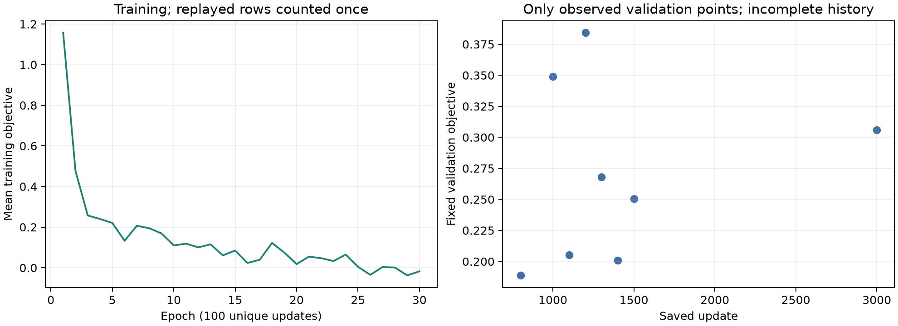{fig-alt="Evolución del objetivo de entrenamiento y puntos de validación observados de la réplica R1"}

</details>

<details><summary>Figura comparativa y tablas descargables</summary>

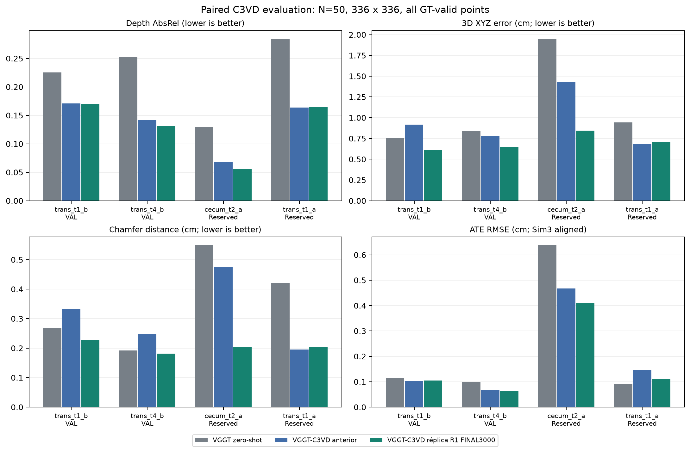{fig-alt="Comparación por secuencia entre VGGT zero-shot, VGGT-C3VD anterior y réplica R1: profundidad, XYZ, CD y ATE"}

- [Métricas principales por caso: 60 filas](contenido/vggt_reproduction_r1/all_cases.csv)
- [Promedios por split y contexto](contenido/vggt_reproduction_r1/macro_by_split_context.csv)
- [Cambios porcentuales por secuencia](contenido/vggt_reproduction_r1/changes_by_sequence.csv)
- [Cambios porcentuales por split](contenido/vggt_reproduction_r1/changes_by_split.csv)
- [Resumen verificable, protocolo y límites](contenido/vggt_reproduction_r1/analysis.json)

</details>

<details><summary>Receta histórica frente a réplica R1 y diagnóstico con componentes GT</summary>

| Aspecto | VGGT-C3VD anterior | Réplica R1 |
| --- | --- | --- |
| Inicialización | Oficial; hash histórico inicial no retenido | Oficial; hash identificado y verificado |
| Datos | Preprocesado legacy sin contrato geométrico certificado | geometry_v2 validado; mismas seis TRAIN y dos VAL |
| Módulos | Cámara/profundidad; agregador congelado según script, con 39 diferencias escalares observadas | Cámara/profundidad; 1.210 tensores del agregador iguales a los oficiales |
| Presupuesto | 30×100 pasos,4 vistas de 518×518 por paso | Mismos 30×100,4 vistas y resolución |
| Pérdidas/optimizador | Cámara×5/profundidad×1; AdamW LR1e-5 y WD0,05; sin scheduler/clipping | La misma receta de pérdidas y optimizador |
| Muestreo | Cuatro IDs aleatorios de toda la secuencia; semilla desconocida | Calendario almacenado con semilla 1234; sin introducir continuidad/orden nuevos |
| Validación | Registro 0 legacy con vistas variables | Dos ventanas fijas; BEST separado para diagnóstico |
| Checkpoint principal | Final de 30 épocas | FINAL3000; no se sustituye por BEST800 |
| Reanudación | Sin calendario ni RNG históricos completos | AdamW, RNG y cursor restaurados; 37 repeticiones verificadas |

**Control adicional de trans_t1_a:** se sustituyen componentes por GT manteniendo K calibrada y la escala original de cada predicción. Las traslaciones predichas se llevan a metros con esa misma escala; las componentes GT ya están en metros. Se usan todos los puntos válidos de las 50 vistas. Es un diagnóstico con información de referencia, no un resultado que pueda obtener el modelo sin GT.

| Modelo | D+pose predichas cm | Pose GT + D predicha cm | D GT + pose predicha cm | R GT solamente cm | t GT solamente cm |
| --- | --- | --- | --- | --- | --- |
| VGGT_FT | 0.6786 | 0.4960 | 0.4666 | 0.6611 | 0.5065 |
| VGGT_REPLICA | 0.7077 | 0.5147 | 0.4296 | 0.6941 | 0.5282 |

Con poses GT, el error atribuible a la profundidad predicha bajo este control pasa de 0.4960 a 0.5147 cm (+3.77%). Con profundidad GT, el error de la ruta de cámara pasa de 0.4666 a 0.4296 cm (-7.91%). En este caso, la profundidad controlada empeora y la cámara controlada mejora; combinar ambas predicciones todavía empeora el XYZ. Los efectos no son aditivos y no identifican qué cambio de entrenamiento produjo el resultado.

| Modelo | RMSE de centros con escala D y gauge común cm | ATE con Sim(3) separado cm |
| --- | --- | --- |
| VGGT_FT | 0.4850 | 0.1462 |
| VGGT_REPLICA | 0.4677 | 0.1097 |

Las reconstrucciones completas con D GT y pose GT dieron error interno 0 en los puntos válidos. Los controles reproducen el XYZ original con tolerancia1e-7cm. Los NaN fuera de la máscara GT se excluyen exactamente como en el evaluador primario; no se añade un filtro de confianza ni se reduce la nube. Ese 0 es un control interno de la sustitución, no una nueva certificación física del dataset.

- [Controles de componentes en las cuatro secuencias: 48 filas](contenido/vggt_reproduction_r1/oracle_components.csv)
- [Definición y limitaciones de los controles](contenido/vggt_reproduction_r1/oracle_components.json)

</details>

<!-- VGGT_R1_ANALYSIS_20261123_END -->

<!-- VGGT_REPRODUCTION_R1_END -->

</details>

<!-- VGGT_R1_CLOSURE_V1_BEGIN -->

<h4 id="detalle-vggt-r1-cierre">Cierre experimental de R1 · BEST800 y FINAL3000</h4>

<!-- VGGT_C3VD_R1_CLOUDS_BEGIN -->

<details><summary>VGGT-C3VD · R1 · métricas y nubes comparables</summary>

FINAL3000 es la referencia de R1 por validación conjunta; BEST800 se conserva como diagnóstico. Se reutilizan las inferencias ya evaluadas. No se incorpora la nube del VGGT anterior.

<button class="book-open-clouds" data-clouds="vggt-c3vd-r1-final-trans4,vggt-c3vd-r1-best-trans4">Comparar R1 FINAL y BEST · trans_t4_b</button>

<button class="book-open-clouds" data-clouds="vggt-c3vd-r1-final-trans1a,vggt-c3vd-r1-best-trans1a">Comparar el caso de regresión · trans_t1_a</button>

<button class="book-open-clouds" data-clouds="vggt-c3vd-r1-final-trans4,c3vd-v9,c3vd-vn19-a">Comparar visualmente VGGT R1 con VGG-T³ V9 y VN19-A</button>

| Secuencia | Checkpoint | AbsRel ↓ | δ1 ↑ | XYZ cm ↓ | CD cm ↓ | NC ↑ |
| --- | --- | --- | --- | --- | --- | --- |
| trans_t4_b | FINAL3000 | 0.1309 | 82.67 % | 0.6446 | 0.1809 | 0.7142 |
| trans_t4_b | BEST800 | 0.1454 | 80.83 % | 0.5533 | 0.1720 | 0.7228 |
| trans_t1_a | FINAL3000 | 0.1650 | 72.28 % | 0.7077 | 0.2049 | 0.6885 |
| trans_t1_a | BEST800 | 0.1748 | 70.72 % | 0.6362 | 0.1990 | 0.7186 |

Cada nube conserva 5.644.800 puntos, sin filtro ni submuestreo; las métricas excluyen únicamente GT inválido. Trayectoria predicha azul y GT verde, ambas en el gauge y escala del scoring, sin ajustar cada frame. Las vistas trans_t4_b coinciden con las exportaciones V9/VN19, pero las rutas P directo y D+cámara se identifican por separado. Las métricas R1 usan 50 GT; las tablas históricas de 16 objetivos mantienen otro protocolo.

[Verificación del visor: XYZ y RGB exactos en los 22.579.200 puntos](contenido/vggt_r1_closure_v1/cloud_decoder_validation.json).

</details>

<!-- VGGT_C3VD_R1_CLOUDS_END -->


<div class="protocol-strip"><strong>Protocolo común</strong> · C3VD geometry_v2 · 336×336 · N=1/4/8/16/50 · RGB como única entrada neuronal · D + K calibrada + pose predichas · una escala GT de profundidad por contexto, también para traslación · mismos puntos GT válidos · sin filtro de confianza, submuestreo ni ICP · VAL y reservadas separadas.</div>

**Validación N=50:** frente a FINAL, BEST cambia favorablemente AbsRel -11.61 %, XYZ +5.59 %, CD +3.39 % y RPEr +0.42 %. Una menor pérdida fija de cuatro vistas no garantiza una mejor reconstrucción conjunta de 50 vistas.

**Patrón en los cinco contextos de validación:** BEST mejora el promedio XYZ en 4/5 tamaños y AbsRel en 0/5. Estos tamaños son diagnósticos; la decisión predefinida utiliza N=50. No se interpreta esta cuenta como un umbral de capacidad ni una prueba estadística.


<details><summary>BEST/FINAL en validación · todas las longitudes y métricas</summary>

**N=1; media con igual peso de trans_t1_b y trans_t4_b**

| Métrica | FINAL3000 | BEST800 | Cambio favorable BEST/FINAL |
| --- | --- | --- | --- |
| AbsRel ↓ | 0.0959 | 0.1116 | -16.42 % |
| δ1 ↑ | 0.8894 | 0.8665 | -2.57 % |
| XYZ medio (cm) ↓ | 0.3406 | 0.3907 | -14.72 % |
| XYZ p95 (cm) ↓ | 1.3666 | 1.4424 | -5.55 % |
| CD (cm) ↓ | 0.1846 | 0.2188 | -18.55 % |
| NC ↑ | 0.8312 | 0.8349 | +0.45 % |
| ATE RMSE (cm) ↓ | N/D | N/D | N/D |
| RPEr RMSE (°) ↓ | N/D | N/D | N/D |
| RPEt RMSE (cm) ↓ | N/D | N/D | N/D |
| Error focal (%) ↓ | 13.9496 | 11.7314 | +15.90 % |
| mAA@30 (%) ↑ | N/D | N/D | N/D |

**N=4; media con igual peso de trans_t1_b y trans_t4_b**

| Métrica | FINAL3000 | BEST800 | Cambio favorable BEST/FINAL |
| --- | --- | --- | --- |
| AbsRel ↓ | 0.1146 | 0.1228 | -7.18 % |
| δ1 ↑ | 0.8756 | 0.8713 | -0.48 % |
| XYZ medio (cm) ↓ | 0.4999 | 0.4450 | +10.98 % |
| XYZ p95 (cm) ↓ | 1.0679 | 0.9571 | +10.37 % |
| CD (cm) ↓ | 0.1973 | 0.1933 | +2.03 % |
| NC ↑ | 0.8153 | 0.8297 | +1.77 % |
| ATE RMSE (cm) ↓ | 0.0926 | 0.0928 | -0.20 % |
| RPEr RMSE (°) ↓ | 2.7601 | 2.4058 | +12.84 % |
| RPEt RMSE (cm) ↓ | 0.2064 | 0.1847 | +10.52 % |
| Error focal (%) ↓ | 11.0259 | 10.3056 | +6.53 % |
| mAA@30 (%) ↑ | 28.8889 | 28.0556 | -2.88 % |

**N=8; media con igual peso de trans_t1_b y trans_t4_b**

| Métrica | FINAL3000 | BEST800 | Cambio favorable BEST/FINAL |
| --- | --- | --- | --- |
| AbsRel ↓ | 0.1254 | 0.1372 | -9.46 % |
| δ1 ↑ | 0.8545 | 0.8367 | -2.08 % |
| XYZ medio (cm) ↓ | 0.5433 | 0.4955 | +8.81 % |
| XYZ p95 (cm) ↓ | 1.1765 | 0.9976 | +15.21 % |
| CD (cm) ↓ | 0.2031 | 0.2036 | -0.26 % |
| NC ↑ | 0.7930 | 0.8111 | +2.28 % |
| ATE RMSE (cm) ↓ | 0.0869 | 0.0905 | -4.20 % |
| RPEr RMSE (°) ↓ | 1.6851 | 1.6412 | +2.61 % |
| RPEt RMSE (cm) ↓ | 0.1390 | 0.1225 | +11.85 % |
| Error focal (%) ↓ | 11.0507 | 10.3167 | +6.64 % |
| mAA@30 (%) ↑ | 28.9881 | 33.7500 | +16.43 % |

**N=16; media con igual peso de trans_t1_b y trans_t4_b**

| Métrica | FINAL3000 | BEST800 | Cambio favorable BEST/FINAL |
| --- | --- | --- | --- |
| AbsRel ↓ | 0.1391 | 0.1543 | -10.92 % |
| δ1 ↑ | 0.8128 | 0.7648 | -5.91 % |
| XYZ medio (cm) ↓ | 0.5839 | 0.5445 | +6.75 % |
| XYZ p95 (cm) ↓ | 1.2551 | 1.0990 | +12.43 % |
| CD (cm) ↓ | 0.1998 | 0.1966 | +1.61 % |
| NC ↑ | 0.7669 | 0.7797 | +1.67 % |
| ATE RMSE (cm) ↓ | 0.0872 | 0.0909 | -4.26 % |
| RPEr RMSE (°) ↓ | 1.0043 | 0.9796 | +2.46 % |
| RPEt RMSE (cm) ↓ | 0.0855 | 0.0782 | +8.52 % |
| Error focal (%) ↓ | 10.8452 | 10.0562 | +7.28 % |
| mAA@30 (%) ↑ | 26.2361 | 31.4167 | +19.75 % |

**N=50; media con igual peso de trans_t1_b y trans_t4_b**

| Métrica | FINAL3000 | BEST800 | Cambio favorable BEST/FINAL |
| --- | --- | --- | --- |
| AbsRel ↓ | 0.1506 | 0.1681 | -11.61 % |
| δ1 ↑ | 0.7839 | 0.7174 | -8.48 % |
| XYZ medio (cm) ↓ | 0.6261 | 0.5912 | +5.59 % |
| XYZ p95 (cm) ↓ | 1.4323 | 1.2539 | +12.45 % |
| CD (cm) ↓ | 0.2047 | 0.1977 | +3.39 % |
| NC ↑ | 0.7055 | 0.7100 | +0.63 % |
| ATE RMSE (cm) ↓ | 0.0835 | 0.0908 | -8.78 % |
| RPEr RMSE (°) ↓ | 0.5111 | 0.5090 | +0.42 % |
| RPEt RMSE (cm) ↓ | 0.0422 | 0.0403 | +4.66 % |
| Error focal (%) ↓ | 10.7675 | 9.8856 | +8.19 % |
| mAA@30 (%) ↑ | 24.8571 | 30.5224 | +22.79 % |

N=1 no define trayectoria ni pares de cámara. RPE usa vistas seleccionadas consecutivas, no un intervalo temporal original constante entre tamaños N. p95 es la media de los p95 por secuencia. CD/NC para BEST/FINAL a N<50 se añadieron usando la misma función de superficie, sin modificar las métricas originales almacenadas.

**Cámara por pares: métricas nativas adicionales en validación**

| N | Modelo | RRA@5 (%) ↑ | RRA@15 (%) ↑ | RRA@30 (%) ↑ | RTA@5 (%) ↑ | RTA@15 (%) ↑ | RTA@30 (%) ↑ |
| --- | --- | --- | --- | --- | --- | --- | --- |
| 1 | R1 FINAL3000 | N/D | N/D | N/D | N/D | N/D | N/D |
| 1 | R1 BEST800 | N/D | N/D | N/D | N/D | N/D | N/D |
| 4 | R1 FINAL3000 | 75.0000 | 100.0000 | 100.0000 | 0.0000 | 33.3333 | 66.6667 |
| 4 | R1 BEST800 | 83.3333 | 100.0000 | 100.0000 | 0.0000 | 33.3333 | 58.3333 |
| 8 | R1 FINAL3000 | 80.3571 | 100.0000 | 100.0000 | 1.7857 | 33.9286 | 51.7857 |
| 8 | R1 BEST800 | 83.9286 | 100.0000 | 100.0000 | 0.0000 | 30.3571 | 62.5000 |
| 16 | R1 FINAL3000 | 80.8333 | 100.0000 | 100.0000 | 0.0000 | 33.7500 | 46.2500 |
| 16 | R1 BEST800 | 83.3333 | 100.0000 | 100.0000 | 0.4167 | 31.2500 | 60.8333 |
| 50 | R1 FINAL3000 | 79.2245 | 100.0000 | 100.0000 | 0.4490 | 30.4490 | 44.1633 |
| 50 | R1 BEST800 | 82.9388 | 100.0000 | 100.0000 | 0.7755 | 32.3673 | 58.0816 |

RRA: proporción de pares cuyo error relativo de rotación cae bajo el umbral angular. RTA: proporción para la dirección de traslación, con la ambigüedad de signo de la fórmula nativa. mAA y RRA/RTA no son ATE ni RPE.

</details>

<details><summary>Zero-shot, histórico, FINAL y BEST · N=50 por split y por secuencia</summary>

**Validación: trans_t1_b + trans_t4_b**

| Métrica | Zero-shot | VGGT histórico | R1 FINAL3000 | R1 BEST800 |
| --- | --- | --- | --- | --- |
| AbsRel ↓ | 0.2391 | 0.1565 | 0.1506 | 0.1681 |
| δ1 ↑ | 0.5640 | 0.7629 | 0.7839 | 0.7174 |
| XYZ medio (cm) ↓ | 0.7961 | 0.8504 | 0.6261 | 0.5912 |
| XYZ p95 (cm) ↓ | 1.7639 | 1.6444 | 1.4323 | 1.2539 |
| CD (cm) ↓ | 0.2307 | 0.2904 | 0.2047 | 0.1977 |
| NC ↑ | 0.6683 | 0.6928 | 0.7055 | 0.7100 |
| ATE RMSE (cm) ↓ | 0.1083 | 0.0855 | 0.0835 | 0.0908 |
| RPEr RMSE (°) ↓ | 0.5298 | 0.4901 | 0.5111 | 0.5090 |
| RPEt RMSE (cm) ↓ | 0.0502 | 0.0429 | 0.0422 | 0.0403 |
| Error focal (%) ↓ | 50.1201 | 12.5171 | 10.7675 | 9.8856 |
| mAA@30 (%) ↑ | 25.6748 | 26.4150 | 24.8571 | 30.5224 |

**Reservadas: cecum_t2_a + trans_t1_a**

| Métrica | Zero-shot | VGGT histórico | R1 FINAL3000 | R1 BEST800 |
| --- | --- | --- | --- | --- |
| AbsRel ↓ | 0.2069 | 0.1160 | 0.1104 | 0.1271 |
| δ1 ↑ | 0.6468 | 0.8589 | 0.8522 | 0.8232 |
| XYZ medio (cm) ↓ | 1.4474 | 1.0533 | 0.7768 | 0.8325 |
| XYZ p95 (cm) ↓ | 2.7914 | 2.3909 | 1.6729 | 1.9181 |
| CD (cm) ↓ | 0.4850 | 0.3347 | 0.2042 | 0.2687 |
| NC ↑ | 0.6677 | 0.7144 | 0.6921 | 0.7085 |
| ATE RMSE (cm) ↓ | 0.3654 | 0.3070 | 0.2590 | 0.3376 |
| RPEr RMSE (°) ↓ | 0.6899 | 0.5514 | 0.5330 | 0.5721 |
| RPEt RMSE (cm) ↓ | 0.1704 | 0.1166 | 0.1222 | 0.1430 |
| Error focal (%) ↓ | 100.2419 | 14.3167 | 12.5142 | 11.3077 |
| mAA@30 (%) ↑ | 46.7524 | 47.7633 | 53.4639 | 54.7701 |

**trans_t1_b · VAL**

| Métrica | Zero-shot | VGGT histórico | R1 FINAL3000 | R1 BEST800 |
| --- | --- | --- | --- | --- |
| AbsRel ↓ | 0.2257 | 0.1712 | 0.1703 | 0.1909 |
| δ1 ↑ | 0.5715 | 0.7251 | 0.7411 | 0.6265 |
| XYZ medio (cm) ↓ | 0.7538 | 0.9173 | 0.6077 | 0.6291 |
| XYZ p95 (cm) ↓ | 1.5138 | 1.5139 | 1.2351 | 1.3923 |
| CD (cm) ↓ | 0.2692 | 0.3340 | 0.2285 | 0.2235 |
| NC ↑ | 0.6827 | 0.6865 | 0.6969 | 0.6972 |
| ATE RMSE (cm) ↓ | 0.1163 | 0.1036 | 0.1049 | 0.1030 |
| RPEr RMSE (°) ↓ | 0.4697 | 0.4413 | 0.4496 | 0.4624 |
| RPEt RMSE (cm) ↓ | 0.0461 | 0.0405 | 0.0407 | 0.0406 |
| Error focal (%) ↓ | 73.7080 | 14.1026 | 12.2572 | 10.8952 |

**trans_t4_b · VAL**

| Métrica | Zero-shot | VGGT histórico | R1 FINAL3000 | R1 BEST800 |
| --- | --- | --- | --- | --- |
| AbsRel ↓ | 0.2524 | 0.1419 | 0.1309 | 0.1454 |
| δ1 ↑ | 0.5565 | 0.8007 | 0.8267 | 0.8083 |
| XYZ medio (cm) ↓ | 0.8385 | 0.7835 | 0.6446 | 0.5533 |
| XYZ p95 (cm) ↓ | 2.0140 | 1.7749 | 1.6295 | 1.1155 |
| CD (cm) ↓ | 0.1923 | 0.2467 | 0.1809 | 0.1720 |
| NC ↑ | 0.6539 | 0.6992 | 0.7142 | 0.7228 |
| ATE RMSE (cm) ↓ | 0.1002 | 0.0674 | 0.0620 | 0.0786 |
| RPEr RMSE (°) ↓ | 0.5900 | 0.5389 | 0.5727 | 0.5556 |
| RPEt RMSE (cm) ↓ | 0.0542 | 0.0453 | 0.0437 | 0.0399 |
| Error focal (%) ↓ | 26.5322 | 10.9315 | 9.2779 | 8.8760 |

**cecum_t2_a · reservada**

| Métrica | Zero-shot | VGGT histórico | R1 FINAL3000 | R1 BEST800 |
| --- | --- | --- | --- | --- |
| AbsRel ↓ | 0.1292 | 0.0682 | 0.0559 | 0.0794 |
| δ1 ↑ | 0.8199 | 0.9755 | 0.9816 | 0.9392 |
| XYZ medio (cm) ↓ | 1.9505 | 1.4281 | 0.8458 | 1.0288 |
| XYZ p95 (cm) ↓ | 3.3343 | 3.0674 | 1.8832 | 2.5318 |
| CD (cm) ↓ | 0.5493 | 0.4743 | 0.2035 | 0.3383 |
| NC ↑ | 0.6949 | 0.7135 | 0.6957 | 0.6984 |
| ATE RMSE (cm) ↓ | 0.6382 | 0.4678 | 0.4083 | 0.5810 |
| RPEr RMSE (°) ↓ | 1.0117 | 0.7632 | 0.7425 | 0.7903 |
| RPEt RMSE (cm) ↓ | 0.2692 | 0.1713 | 0.1843 | 0.2105 |
| Error focal (%) ↓ | 102.8613 | 13.0340 | 11.1175 | 10.6700 |

**trans_t1_a · reservada**

| Métrica | Zero-shot | VGGT histórico | R1 FINAL3000 | R1 BEST800 |
| --- | --- | --- | --- | --- |
| AbsRel ↓ | 0.2846 | 0.1638 | 0.1650 | 0.1748 |
| δ1 ↑ | 0.4736 | 0.7423 | 0.7228 | 0.7072 |
| XYZ medio (cm) ↓ | 0.9443 | 0.6786 | 0.7077 | 0.6362 |
| XYZ p95 (cm) ↓ | 2.2486 | 1.7144 | 1.4625 | 1.3045 |
| CD (cm) ↓ | 0.4207 | 0.1952 | 0.2049 | 0.1990 |
| NC ↑ | 0.6405 | 0.7153 | 0.6885 | 0.7186 |
| ATE RMSE (cm) ↓ | 0.0927 | 0.1462 | 0.1097 | 0.0942 |
| RPEr RMSE (°) ↓ | 0.3682 | 0.3397 | 0.3235 | 0.3539 |
| RPEt RMSE (cm) ↓ | 0.0717 | 0.0618 | 0.0602 | 0.0754 |
| Error focal (%) ↓ | 97.6225 | 15.5995 | 13.9109 | 11.9455 |

Reservadas significa excluidas de este fine-tuning; ya se habían inspeccionado en el proyecto. No constituyen una nueva prueba externa ciega ni participan en la selección actual.

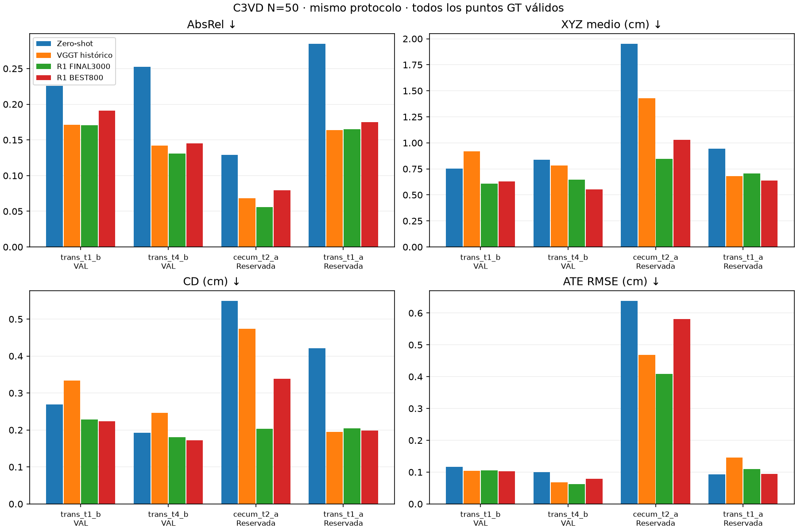{fig-alt="Resultados pareados por secuencia y checkpoint de VGGT"}

</details>


<details><summary>trans_t1_a · controles GT y mapas de error con escalas idénticas</summary>

| Modelo | D+pose predichas cm | Pose GT cm | D GT cm | Solo R GT cm | Solo t GT cm |
| --- | --- | --- | --- | --- | --- |
| VGGT histórico | 0.6786 | 0.4960 | 0.4666 | 0.6611 | 0.5065 |
| R1 FINAL3000 | 0.7077 | 0.5147 | 0.4296 | 0.6941 | 0.5282 |
| R1 BEST800 | 0.6362 | 0.5207 | 0.3445 | 0.6280 | 0.5268 |

**R1 FINAL3000 frente al histórico en trans_t1_a:** cambio favorable del XYZ combinado -4.29 %, con pose GT -3.77 % y con profundidad GT +7.91 %. Estas rutas muestran qué discrepancias persisten al corregir una componente, sin identificar por sí solas una causa de entrenamiento.

**R1 BEST800 frente al histórico en trans_t1_a:** cambio favorable del XYZ combinado +6.24 %, con pose GT -4.98 % y con profundidad GT +26.17 %. Estas rutas muestran qué discrepancias persisten al corregir una componente, sin identificar por sí solas una causa de entrenamiento.

Cada sustitución mantiene la escala original del modelo; K calibrada común, D/t GT en metros. No se reajusta una escala por ruta.

**XYZ primario sin Sim(3)/ICP**

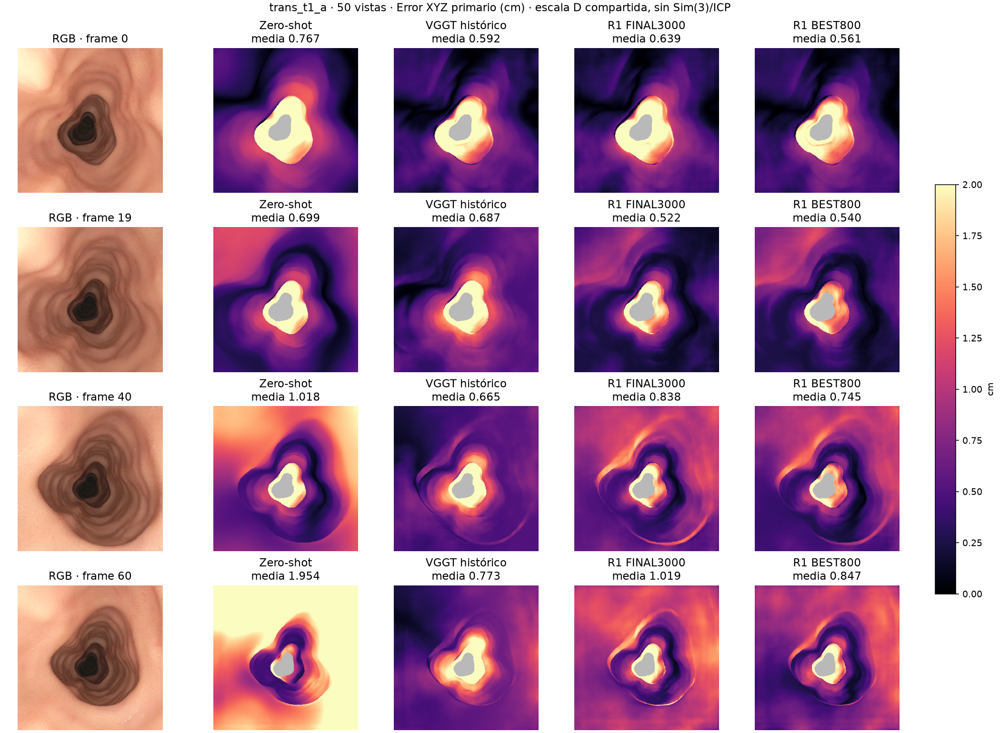{fig-alt="XYZ primario sin Sim(3)/ICP en trans_t1_a"}

**XYZ residual tras un Sim(3) global de la nube completa**

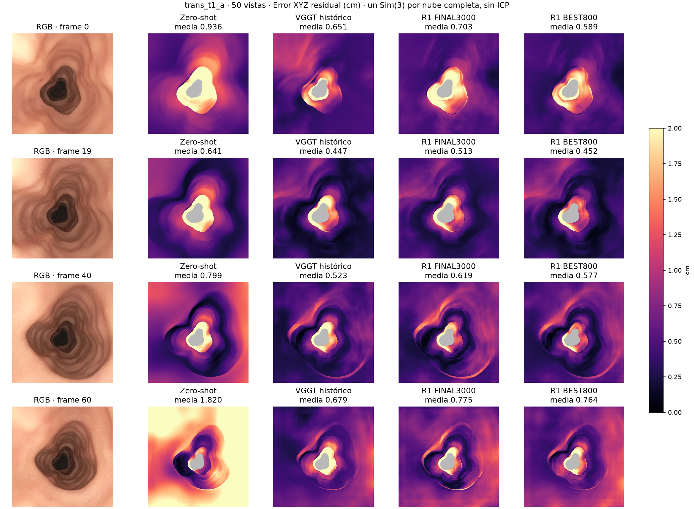{fig-alt="XYZ residual tras un Sim(3) global de la nube completa en trans_t1_a"}

**Error relativo absoluto de profundidad**

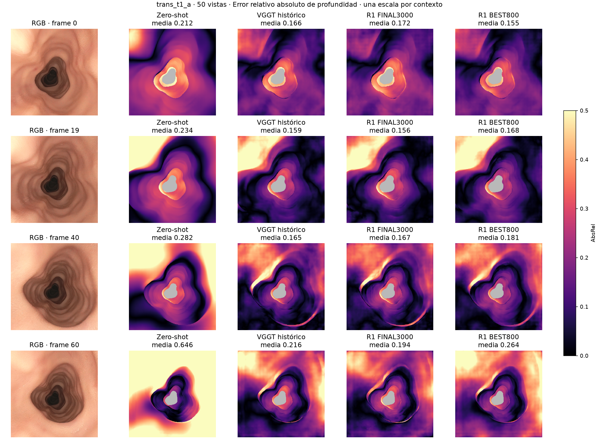{fig-alt="Error relativo absoluto de profundidad en trans_t1_a"}

**Perfiles por frame y error de centros de cámara con escala D común**

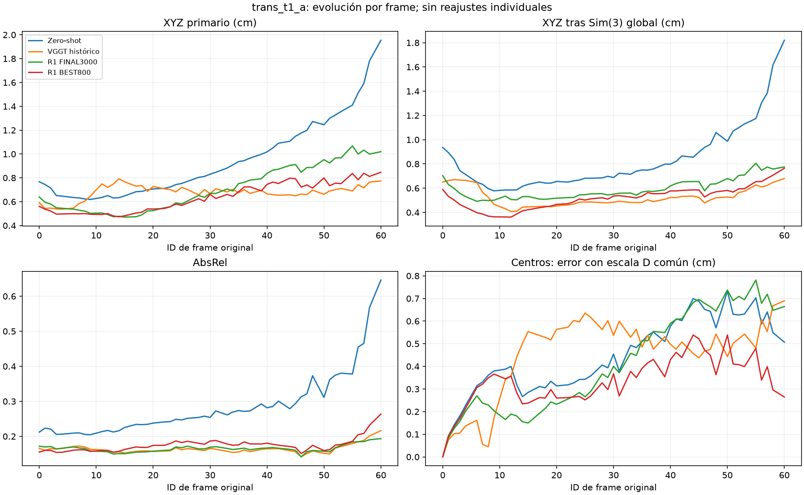{fig-alt="Perfiles por frame y error de centros de cámara con escala D común en trans_t1_a"}

Los mapas XYZ comparten rango 0–2 cm; AbsRel 0–0,5. Los valores mayores saturan el color, pero se conservan íntegros en las métricas; gris indica GT inválido.

</details>


<details><summary>XYZ primario y residual Sim(3) · N=50 por secuencia</summary>

La ruta primaria utiliza $X_i=s(R_i[D_iK_i^{-1}p]+t_i)$, con poses cámara→mundo expresadas respecto a la cámara canónica y una sola escala $s$ del contexto. El diagnóstico ajusta después $\widetilde X=aQX+b$ a toda la nube. Ambas rutas se puntúan contra los mismos puntos GT; no se corrige cada frame por separado.

| Secuencia | Modelo | XYZ cm | XYZ tras Sim(3) cm | p95 cm | p95 tras Sim(3) cm |
| --- | --- | --- | --- | --- | --- |
| trans_t1_b | Zero-shot | 0.7538 | 0.5602 | 1.5138 | 1.0503 |
| trans_t4_b | Zero-shot | 0.8385 | 0.6476 | 2.0140 | 1.6074 |
| cecum_t2_a | Zero-shot | 1.9505 | 1.0685 | 3.3343 | 1.9756 |
| trans_t1_a | Zero-shot | 0.9443 | 0.8326 | 2.2486 | 2.0295 |
| trans_t1_b | VGGT histórico | 0.9173 | 0.5221 | 1.5139 | 1.0181 |
| trans_t4_b | VGGT histórico | 0.7835 | 0.5694 | 1.7749 | 1.1531 |
| cecum_t2_a | VGGT histórico | 1.4281 | 0.6571 | 3.0674 | 1.2649 |
| trans_t1_a | VGGT histórico | 0.6786 | 0.5248 | 1.7144 | 1.1506 |
| trans_t1_b | R1 FINAL3000 | 0.6077 | 0.4482 | 1.2351 | 0.9035 |
| trans_t4_b | R1 FINAL3000 | 0.6446 | 0.4694 | 1.6295 | 1.0326 |
| cecum_t2_a | R1 FINAL3000 | 0.8458 | 0.5481 | 1.8832 | 1.0870 |
| trans_t1_a | R1 FINAL3000 | 0.7077 | 0.5931 | 1.4625 | 1.2096 |
| trans_t1_b | R1 BEST800 | 0.6291 | 0.4542 | 1.3923 | 0.8383 |
| trans_t4_b | R1 BEST800 | 0.5533 | 0.4313 | 1.1155 | 0.9577 |
| cecum_t2_a | R1 BEST800 | 1.0288 | 0.7085 | 2.5318 | 1.5797 |
| trans_t1_a | R1 BEST800 | 0.6362 | 0.5202 | 1.3045 | 1.1073 |


</details>

<details><summary>R1-04/R1-06 · Integridad, reanudación y diferencias frente al histórico</summary>

| Control | Resultado |
| --- | --- |
| Encoder/agregador | 1.210 tensores bit a bit oficiales; entrenamiento histórico conservado aparte |
| Carga | FINAL reproduce las cuatro salidas exactamente; BEST carga estricta y finita |
| Reanudación corta | Prueba R06 conservada: cabezas, AdamW, RNG y segundo paso idénticos bit a bit |
| Reanudaciones reales | 3.000 updates únicos; 37 repeticiones idénticas en muestra, batch y pérdidas |
| LAST3000 | 131 estados AdamW a paso 3000, RNG Python/NumPy/CPU/CUDA y hashes verificados |
| BEST/FINAL | Exportaciones sin AdamW; no permiten reanudar exactamente el entrenamiento, aunque guardan RNG |
| Firmas | Fuentes históricas, configuración, manifiesto y calendario originales intactos |

| Aspecto | VGGT histórico | R1 |
| --- | --- | --- |
| Inicialización | Oficial declarada; hash inicial histórico no retenido | Oficial SHA256 identificado; carga estricta |
| Datos | Legacy; calibración/preprocesado no certificados retrospectivamente | geometry_v2 validado, Z/t en metros, RGB y K rectificados |
| Split TRAIN | cecum_t1_b, cecum_t2_b, cecum_t3_a, desc_t4_a, sigmoid_t1_a, sigmoid_t3_a | Mismas seis secuencias |
| VAL / reservadas | trans_t1_b, trans_t4_b / cecum_t2_a, trans_t1_a | Mismas dos VAL y dos reservadas; estas últimas ya analizadas antes en el proyecto |
| Módulos | Cámara/profundidad; 39 escalares del encoder distintos del oficial conservado, origen no resuelto | Cámara/profundidad; 1.210 tensores del agregador iguales al oficial; sin cabeza de puntos/tracking |
| Presupuesto | 30×100 actualizaciones, cuatro vistas, 518×518, FP32 | Mismo presupuesto, vistas y resolución; no se añadió otro entrenamiento |
| Pérdidas / normalización | Cámara L1×5 + profundidad confianza/gradiente×1; normalización geométrica nativa | Mismas funciones/ponderaciones; RGB y normalización nativos; fuentes firmadas |
| Optimizador | AdamW LR1e-5, WD0,05; sin scheduler ni clipping | Igual; betas 0,9/0,999 y eps1e-8 registrados |
| Muestreo | Cuatro IDs aleatorios de toda la secuencia; semilla y orden originales desconocidos | Misma clase de muestreo; semilla 1234, calendario completo almacenado; no se impuso continuidad nueva |
| Validación / selección | Validación legacy variable; checkpoint final | FINAL3000 principal original; BEST800 por pérdida fija guardado aparte y comparado ahora con regla conjunta VAL |
| Reanudación | Sin RNG/calendario verificables completos | LAST3000 con 131 estados AdamW y RNG; prueba corta exacta y 37 repeticiones verificadas |

Las 39 discrepancias escalares históricas siguen sin origen demostrado. Esta evaluación no las atribuye a una conversión, escritura accidental o versión oficial concreta. La mejora R1 no se atribuye causalmente a una sola diferencia de receta.

| Checkpoint | Archivo | SHA256 |
| --- | --- | --- |
| Zero-shot | model.safetensors | `f164acf60724910d8fe1578bb499d800850c7bb0948db7555c413f9fbe60467e` |
| VGGT histórico | c3vd_baseline_heads_30ep.pt | `47676104810d39316e3b5f661a7e8e6796080cde5afba0d162d6ede3697f0bf7` |
| R1 FINAL3000 | final_heads.pt | `cf0bbc6f044fc7f23986b9d33112d20f46f1377d6b3c395a73a39be268fd1cf3` |
| R1 BEST800 | best_diagnostic_heads.pt | `b946a9bd9a57a2e1eff247117c4caa0eb263021d9474e2aa319a48e77c140cc6` |


</details>

<details><summary>R1-05/R1-07/R1-08 · Decisión, límites y evidencia descargable</summary>

**Referencia R1: R1 FINAL3000.** La regla exige no empeorar las 10 métricas macro de validación N50, mejorar al menos una y conservar seis guardas por secuencia. Es una decisión conservadora local, registrada antes de los resultados nuevos; no es un criterio original del paper.

| Soporte VAL | Métrica | FINAL | BEST | Cambio favorable |
| --- | --- | --- | --- | --- |
| VAL_N50_macro | AbsRel ↓ | 0.1506 | 0.1681 | -11.61 % |
| VAL_N50_macro | ATE RMSE (cm) ↓ | 0.0835 | 0.0908 | -8.78 % |
| VAL_N50_macro | δ1 ↑ | 0.7839 | 0.7174 | -8.48 % |
| trans_t1_b | AbsRel ↓ | 0.1703 | 0.1909 | -12.04 % |
| trans_t1_b | XYZ medio (cm) ↓ | 0.6077 | 0.6291 | -3.51 % |
| trans_t1_b | XYZ p95 (cm) ↓ | 1.2351 | 1.3923 | -12.73 % |
| trans_t4_b | AbsRel ↓ | 0.1309 | 0.1454 | -11.05 % |
| trans_t4_b | ATE RMSE (cm) ↓ | 0.0620 | 0.0786 | -26.71 % |

**Cierre:** la auditoría técnica está resuelta para R1; la caracterización no demuestra una mejora uniforme en todas las secuencias, métricas o contextos. Se conservan las regresiones y todos los checkpoints. Los promedios no reemplazan el análisis por secuencia.

**Preguntas que siguen abiertas:** por qué los mínimos de pérdida no coinciden con todos los mínimos geométricos; qué interacciones de D y pose mantienen el error residual de trans_t1_a; y cuánto de la variación entre contextos procede de composición de vistas frente a adaptación con cuatro vistas. Estos diagnósticos delimitan esas preguntas, pero no prueban una causa única.


**Límites:** una semilla, dos VAL y dos reservadas del mismo phantom; GT para escala/alineamiento; historia de validación incompleta; causas históricas confundidas; no se certifica tiempo real ni generalización clínica.

- [Resumen, protocolos, selección y métricas](contenido/vggt_r1_closure_v1/summary.json)
- [80 casos por secuencia/contexto](contenido/vggt_r1_closure_v1/all_cases.csv)
- [Promedios separados por split/contexto](contenido/vggt_r1_closure_v1/macro_by_split_context.csv)
- [Porcentajes de mejora o deterioro](contenido/vggt_r1_closure_v1/changes_by_sequence.csv)
- [Controles GT de trans_t1_a](contenido/vggt_r1_closure_v1/oracle_trans_t1_a.csv)
- [Perfiles de error por frame](contenido/vggt_r1_closure_v1/error_profiles.csv)
- [Comparación de recetas](contenido/vggt_r1_closure_v1/recipe_comparison.csv)
- [Integridad y reanudación](contenido/vggt_r1_closure_v1/technical_integrity.json)
- [Identidades y hashes de entradas/predicciones](contenido/vggt_r1_closure_v1/paired_identities.json)
- [Manifiesto de checkpoints conservados; pesos locales, no incluidos en la publicación](contenido/vggt_r1_closure_v1/checkpoint_manifest.json)
- [Manifiesto de configuración, semillas, calendario y código](contenido/vggt_r1_closure_v1/reproduction_manifest.json)

</details>

<!-- VGGT_R1_CLOSURE_V1_END -->

</details>

</details>

<details class="experiment-group"><summary>SCARED · 5 fichas</summary>

<details class="vggt-experiment-card" id="vggt-p03" data-vggt-phase1-card data-experiment data-model="VGGT" data-scope="SCARED"><summary><span class="card-status">Fase 1 completada</span><span class="card-id">P03</span>VGGT oficial zero-shot en SCARED</summary><div class="card-content">
<dl class="card-fields"><dt>Hipótesis / pregunta</dt><dd>¿Cuál es la calidad de referencia sin fine-tuning local SCARED, en las anclas medidas?</dd></dl>
<dl class="card-fields"><dt>Cómo se realizó</dt><dd>Se ejecutó el VGGT oficial sobre 35 anclas con una imagen por entrada; se guardaron profundidad, confianza, poses e intrínsecas predichas.</dd></dl>
<dl class="card-fields"><dt>Controles</dt><dd>Mismos 35 RGB medidos, protocolo N1 firmado, pesos congelados y GT separado del modelo. Sin ajustes de pesos, sin selección por resultados SCARED.</dd></dl>
<dl class="card-fields"><dt>Métricas</dt><dd>Profundidad y D+K con una escala común por ancla; CD/NC sin registro como principales. Sim(3)+ICP queda en una tabla secundaria.</dd></dl>
<dl class="card-fields"><dt>Resultados</dt><dd>35/35 casos completados, con controles de pesos intactos. Las tablas muestran 20 anclas TRAIN previstas,5 VAL y 10 reservadas por separado.</dd></dl>
<dl class="card-fields"><dt>Conclusión</dt><dd>Existe una referencia oficial emparejada para la fase 2 y el futuro ajuste SCARED.</dd></dl>
<dl class="card-fields"><dt>Limitaciones</dt><dd>GT ajusta la escala solo al evaluar. La geometría usa K calibrada; no se evaluó la point head directa ni una trayectoria.</dd></dl>
<dl class="card-fields"></dl>
<details class="trace-details"><summary>Trazabilidad y protocolo</summary><p><a href="tablas/vggt_fase1.json">Resumen reproducible de fase 1</a> · <a href="#vggt-fase1">Tablas de resultados</a>. Checkpoints y datos identificados por firma; archivos granulares y predicciones se conservan localmente.</p></details><dl class="card-fields verdict"><dt>Confirmación o negación de la hipótesis</dt><dd>Diagnóstico descriptivo: la conclusión conserva el resultado observado; no establece una confirmación causal binaria.</dd></dl></div></details>

<details class="vggt-experiment-card" id="vggt-phase34-p11" data-experiment data-model="VGGT" data-scope="SCARED"><summary><span class="card-status">Completado</span><span class="card-id">P11</span>Preflight GPU y reanudación</summary><div class="card-content"><dl class="card-fields"><dt>Hipótesis / pregunta</dt><dd>¿Los datos y estados de optimización permiten un entrenamiento reproducible?</dd></dl><dl class="card-fields"><dt>Cómo se realizó</dt><dd>Receta de profundidad sellada y evaluación pareada P11–P14; sin nuevas variantes de entrenamiento.</dd></dl><dl class="card-fields"><dt>Controles</dt><dd>Mismos RGB, máscarasGT, escala, layout, runtime y ventanas de evaluación de fase 2. Pesos oficiales congelados como referencia.</dd></dl><dl class="card-fields"><dt>Métricas</dt><dd>AbsRel,δ1,XYZ/p95,CD/NC y cámara solo con GT válido. Auditoría de AdamW, gradientes y reanudación.</dd></dl><dl class="card-fields"><dt>Resultados</dt><dd>35 ventanas CPU y pruebas GPU de gradientes, AdamW y reanudación superadas; diferencia 0 en el diagnóstico determinista, pico 4,296 GiB.</dd></dl><dl class="card-fields"><dt>Conclusión</dt><dd>El camino de datos/optimización es válido en los controles probados; la producción conserva su runtime original no determinista.</dd></dl><dl class="card-fields"><dt>Limitaciones</dt><dd>SCARED solo tiene GT certificado en anclas; encoder y cámara no se afinan; los presupuestos históricos difieren.</dd></dl><dl class="card-fields"></dl><p><a href="#vggt-fase34">Protocolo y tablas</a></p><dl class="card-fields verdict"><dt>Confirmación o negación de la hipótesis</dt><dd>Diagnóstico descriptivo: la conclusión conserva el resultado observado; no establece una confirmación causal binaria.</dd></dl></div></details>

<details class="vggt-experiment-card" id="vggt-phase34-p12" data-experiment data-model="VGGT" data-scope="SCARED"><summary><span class="card-status">Completado</span><span class="card-id">P12</span>Fine-tuning VGGT-SCARED</summary><div class="card-content"><dl class="card-fields"><dt>Hipótesis / pregunta</dt><dd>¿La adaptación de profundidad con GT medido mejora frente a pesos oficiales?</dd></dl><dl class="card-fields"><dt>Cómo se realizó</dt><dd>Receta de profundidad sellada y evaluación pareada P11–P14; sin nuevas variantes de entrenamiento.</dd></dl><dl class="card-fields"><dt>Controles</dt><dd>Mismos RGB, máscarasGT, escala, layout, runtime y ventanas de evaluación de fase 2. Pesos oficiales congelados como referencia.</dd></dl><dl class="card-fields"><dt>Métricas</dt><dd>AbsRel,δ1,XYZ/p95,CD/NC y cámara solo con GT válido. Auditoría de AdamW, gradientes y reanudación.</dd></dl><dl class="card-fields"><dt>Resultados</dt><dd>3.000 pasos completados,30 registros de validación; BEST paso 500 y FINAL paso 3000, ambos conservados y verificados.</dd></dl><dl class="card-fields"><dt>Conclusión</dt><dd>El checkpoint final no minimiza el criterio de validación fijado. Eso no establece una causa única ni selecciona pesos con los reservados.</dd></dl><dl class="card-fields"><dt>Limitaciones</dt><dd>SCARED solo tiene GT certificado en anclas; encoder y cámara no se afinan; los presupuestos históricos difieren.</dd></dl><dl class="card-fields"></dl><p><a href="#vggt-fase34">Protocolo y tablas</a></p><dl class="card-fields verdict"><dt>Confirmación o negación de la hipótesis</dt><dd>Diagnóstico descriptivo: la conclusión conserva el resultado observado; no establece una confirmación causal binaria.</dd></dl></div></details>

<details class="vggt-experiment-card" id="vggt-phase34-p13" data-experiment data-model="VGGT" data-scope="SCARED"><summary><span class="card-status">Completado</span><span class="card-id">P13</span>Evaluación SCARED pareada</summary><div class="card-content"><dl class="card-fields"><dt>Hipótesis / pregunta</dt><dd>¿BEST y FINAL mejoran en anclas y contextos comunes sin ocultar regresiones?</dd></dl><dl class="card-fields"><dt>Cómo se realizó</dt><dd>Receta de profundidad sellada y evaluación pareada P11–P14; sin nuevas variantes de entrenamiento.</dd></dl><dl class="card-fields"><dt>Controles</dt><dd>Mismos RGB, máscarasGT, escala, layout, runtime y ventanas de evaluación de fase 2. Pesos oficiales congelados como referencia.</dd></dl><dl class="card-fields"><dt>Métricas</dt><dd>AbsRel,δ1,XYZ/p95,CD/NC y cámara solo con GT válido. Auditoría de AdamW, gradientes y reanudación.</dd></dl><dl class="card-fields"><dt>Resultados</dt><dd>SCARED reservado N=50,8 anclas: BEST mejora AbsRel 42,45 % y XYZ 40,35 % frente a VGGT oficial; NC empeora 4,51 %.</dd></dl><dl class="card-fields"><dt>Conclusión</dt><dd>Hay mejora local de profundidad/forma en el ancla, con regresión de otras propiedades. No hay GT temporal para validar una trayectoria.</dd></dl><dl class="card-fields"><dt>Limitaciones</dt><dd>SCARED solo tiene GT certificado en anclas; encoder y cámara no se afinan; los presupuestos históricos difieren.</dd></dl><dl class="card-fields"></dl><p><a href="#vggt-fase34">Protocolo y tablas</a></p><dl class="card-fields verdict"><dt>Confirmación o negación de la hipótesis</dt><dd>Diagnóstico descriptivo: la conclusión conserva el resultado observado; no establece una confirmación causal binaria.</dd></dl></div></details>

<details class="vggt-experiment-card" id="vggt-scared-audit-real" data-experiment data-model="VGGT" data-scope="SCARED"><summary>Auditoría SCARED · geometría y supervisión real</summary><div class="card-content"><dl class="card-fields"><dt>Hipótesis / idea</dt><dd>¿Los datos y el entrenamiento existente permiten una evaluación trazable?</dd><dt>Cómo se realizó</dt><dd>Verificación de 35 anclas, siete reproducciones desde originales, checkpoints y reconstrucción del calendario de supervisión.</dd><dt>Resultados</dt><dd>Las 35 entradas coinciden con las cachés certificadas; el calendario reconstruido coincide con los 3.000 pasos y conteos. Solo profundidad fue afinada.</dd><dt>Conclusión</dt><dd>La ejecución es evaluable. Producción no plenamente determinista y ausencia de un hash final del encoder limitan su reproducción histórica.</dd><dt>Confirmación o negación de la hipótesis</dt><dd>El alcance y el veredicto son los indicados en la conclusión; las comprobaciones técnicas no prueban superioridad científica.</dd></dl></div></details>

<details class="evidence-archive"><summary>Tablas, figuras y protocolos detallados conservados</summary>

<h4 id="detalle-vggt-scared">SCARED · adaptación y transferencia</h4>

<!-- VGGT_SCARED_REVIEW_V1_BEGIN -->

<h4 id="detalle-vggt-scared-audit">Estado actual · VGGT-SCARED depth-v2</h4>

**Entrenamiento existente verificado: 3.000 pasos; no hace falta repetirlo para evaluarlo.** BEST500 se seleccionó por profundidad en VAL7 y FINAL3000 se conserva como diagnóstico. Esta receta empezó desde pesos oficiales: no es una continuación ni una réplica de R1-C3VD.

**Resultado principal en las 8 anclas reservadas con vídeo, N=50:** SCARED BEST500 cambia favorablemente AbsRel +42.45 %, XYZ local +40.35 % y NC -4.51 % frente al oficial. El último signo muestra que una mejora de profundidad no implica mejorar todas las propiedades.

**Qué se compara ahora:** oficial, SCARED BEST500, SCARED FINAL3000 y transferencia del C3VD R1 FINAL3000, con los mismos RGB/GT/máscaras por caso. Son 556 evaluaciones: 417 reutilizadas y 139 inferencias nuevas de transferencia, sin cambiar pesos. En SCARED, XYZ puntúa solo el ancla medida; no es una medición de la geometría global del vídeo.

**Transferencia C3VD R1→SCARED:** en las ocho anclas reservadas con vídeo, el cambio favorable respecto al oficial es -56.02 % en AbsRel y -66.47 % en XYZ local. Ambos signos indican deterioro. La adaptación a C3VD no se traslada automáticamente a SCARED; esta observación no identifica una causa única.

<button class="book-open-metrics" data-metrics="vggt-scared-review-context-validation-N50-VGGT_ZS,vggt-scared-review-context-validation-N50-VGGT_SCARED_BEST,vggt-scared-review-context-validation-N50-VGGT_SCARED_FINAL,vggt-scared-review-context-validation-N50-VGGT_C3VD_R1_FINAL">Comparar métricas · VAL7 · N=50</button>

<button class="book-open-metrics" data-metrics="vggt-scared-review-context-reserved-N50-VGGT_ZS,vggt-scared-review-context-reserved-N50-VGGT_SCARED_BEST,vggt-scared-review-context-reserved-N50-VGGT_SCARED_FINAL,vggt-scared-review-context-reserved-N50-VGGT_C3VD_R1_FINAL">Comparar métricas · reservados 8/9 · N=50</button>

<details class="research-reading-fold"><summary>Receta, ejecución real y controles · comparación clara con R1-C3VD</summary>

| Aspecto | VGGT-C3VD R1 | VGGT-SCARED depth-v2 |
| --- | --- | --- |
| Inicialización | Oficial facebook/VGGT-1B | Oficial facebook/VGGT-1B independiente |
| Módulos afinados | Cámara y profundidad | Solo profundidad; cámara oficial al inferir |
| Encoder | Congelado; 1.210 tensores verificados al cierre | Congelado por código; checkpoint solo de profundidad y referencia oficial |
| Datos | 6 secuencias TRAIN; 2 VAL; 2 reservadas | Datasets 1/2/3/6 TRAIN; 7 VAL; 8/9 reservados |
| Resolución de entrenamiento | 518×518 | 266×336; lado largo 336 |
| Ventanas / supervisión | 4 RGB; 4 vistas con GT por paso | N4 donde existe vídeo apto o N1;solo ancla 0 con GT |
| Presupuesto | 3.000 pasos; 12.000 exposiciones densas | 3.000 pasos; 3.000 exposiciones densas |
| Precisión de entrenamiento | FP32 | Encoder BF16 congelado;depth head FP32 |
| Pérdidas | Cámara×5 + profundidad×1 | Profundidad nativa×1;sin pérdida temporal de cámara |
| Optimizador | AdamW LR1e-5 / WD0,05;sin scheduler/clipping | Mismo AdamW/sin scheduler/clipping |
| Selección | FINAL3000 por regla conjunta VAL del cierre R1 | BEST500 por menor AbsRel de 5 anclas VAL en contextos de entrenamiento |
| Reproducibilidad | Calendario y RNG guardados;reanudaciones exactas verificadas | Semilla 1234;calendario reconstruido exactamente;prueba corta determinista;producción no plenamente determinista |

| Estado | Evidencia |
| --- | --- |
| V1 | Preparación antecedente;sin producción |
| V2 | 3.000 líneas de entrenamiento,30 validaciones,62 tensores de profundidad y 62 estados AdamW al paso 3000 |
| BEST / FINAL | BEST500 y FINAL3000 con firmas verificadas;exportaciones sin optimizador |
| LAST | AdamW + Generator NumPy + RNG Torch CPU/CUDA para reanudación |
| Limitación | No se retuvo un hash completo del encoder al final de producción;no se afirma retrospectivamente una identidad bit a bit |

</details>

<details class="research-reading-fold"><summary>Datos y geometría · anclas, unidades, calibración y exclusiones</summary>

| Uso | Datasets | Anclas | Contextos |
| --- | --- | --- | --- |
| TRAIN | 1,2,3,6 | 20 | 14 N4 +6 N1 |
| VAL | 7 | 5 | 4 N4 +1 N1 |
| Reservados | 8,9 | 10 | 8 con vídeo apto para evaluación; 2 solo N1 |
| Exclusión geométrica | 4,5 | 10 | No se usa hasta una corrección de calibración validada |
| Exclusión temporal | dataset 6/keyframe 1 | 1 | Se conserva la ancla medida;sin contexto temporal |

Se verificaron 35 batches contra las anclas certificadas y se reprodujeron RGB, Z, máscara y K directamente desde TIFF/calibración originales para un caso de cada uno de los siete datasets permitidos. Z procede del tercer canal XYZ, mm→m; no es distancia radial. La rectificación/remuestreo transforma K con el mismo convenio de centros de píxel. No se propagan etiquetas GT a los frames del vídeo.

Los IDs originales y processed se relacionan mediante el crosswalk conservado; no se supone que coincidan. Cada ancla conserva su gauge propio. La evaluación de 50 vistas incluye una ancla medida y 49 vistas de contexto; la supervisión del entrenamiento N4 usaba ancla+vídeo 0/5/10. La selección BEST y las tablas de contexto no se mezclan como si fueran el mismo soporte.

</details>

<details class="research-reading-fold"><summary>Todas las 35 anclas · N=1 · TRAIN/VAL/reservados separados</summary>

Una escala mediana GT de profundidad por ancla/contexto;D+K calibrada+pose canónica,sin Sim(3)/ICP. Sin filtro de confianza ni submuestreo. Primero se promedian anclas dentro de cada dataset,luego datasets con igual peso dentro del split.

**TRAIN · diagnóstico de ajuste**

| Modelo | Anclas | AbsRel ↓ | δ1 ↑ | XYZ local cm ↓ | p95 cm ↓ | CD cm ↓ | NC ↑ |
| --- | --- | --- | --- | --- | --- | --- | --- |
| VGGT oficial zero-shot | 20 | 0.1090 | 0.8807 | 0.7878 | 2.4578 | 0.5121 | 0.7795 |
| VGGT-SCARED depth-v2 BEST500 | 20 | 0.0501 | 0.9797 | 0.3724 | 1.1622 | 0.1866 | 0.7578 |
| VGGT-SCARED depth-v2 FINAL3000 | 20 | 0.0334 | 0.9952 | 0.2428 | 0.7093 | 0.1310 | 0.8134 |
| VGGT-C3VD R1 FINAL3000 → SCARED | 20 | 0.1343 | 0.8125 | 1.0242 | 3.0068 | 0.5814 | 0.6737 |

**VAL · dataset 7**

| Modelo | Anclas | AbsRel ↓ | δ1 ↑ | XYZ local cm ↓ | p95 cm ↓ | CD cm ↓ | NC ↑ |
| --- | --- | --- | --- | --- | --- | --- | --- |
| VGGT oficial zero-shot | 5 | 0.1860 | 0.6972 | 1.3161 | 3.0341 | 0.8251 | 0.6951 |
| VGGT-SCARED depth-v2 BEST500 | 5 | 0.1181 | 0.8146 | 0.9176 | 2.1210 | 0.4657 | 0.6815 |
| VGGT-SCARED depth-v2 FINAL3000 | 5 | 0.1186 | 0.8126 | 0.9047 | 2.0777 | 0.4693 | 0.6985 |
| VGGT-C3VD R1 FINAL3000 → SCARED | 5 | 0.1656 | 0.7017 | 1.2707 | 3.3978 | 0.6993 | 0.6380 |

**Reservados · datasets 8/9**

| Modelo | Anclas | AbsRel ↓ | δ1 ↑ | XYZ local cm ↓ | p95 cm ↓ | CD cm ↓ | NC ↑ |
| --- | --- | --- | --- | --- | --- | --- | --- |
| VGGT oficial zero-shot | 10 | 0.0911 | 0.9316 | 0.5719 | 1.4823 | 0.3801 | 0.7771 |
| VGGT-SCARED depth-v2 BEST500 | 10 | 0.0774 | 0.9534 | 0.5296 | 1.6032 | 0.2792 | 0.7185 |
| VGGT-SCARED depth-v2 FINAL3000 | 10 | 0.0698 | 0.9670 | 0.4771 | 1.4393 | 0.2660 | 0.7527 |
| VGGT-C3VD R1 FINAL3000 → SCARED | 10 | 0.1094 | 0.8785 | 0.7673 | 2.2435 | 0.4554 | 0.6652 |

XYZ/CD/NC describen la superficie del ancla, no toda la nube temporal. ATE/RPE no están disponibles sin GT temporal certificado. N=1 incluye nueve anclas sin vídeo y no debe compararse directamente con N=50 como si fuera la misma población.

</details>

<details class="research-reading-fold"><summary>Cohorte con vídeo · N=50 · TRAIN/VAL/reservados separados</summary>

Una escala mediana GT de profundidad por ancla/contexto;D+K calibrada+pose canónica,sin Sim(3)/ICP. Sin filtro de confianza ni submuestreo. Primero se promedian anclas dentro de cada dataset,luego datasets con igual peso dentro del split.

**TRAIN · diagnóstico de ajuste**

| Modelo | Anclas | AbsRel ↓ | δ1 ↑ | XYZ local cm ↓ | p95 cm ↓ | CD cm ↓ | NC ↑ |
| --- | --- | --- | --- | --- | --- | --- | --- |
| VGGT oficial zero-shot | 14 | 0.0851 | 0.9228 | 0.6751 | 2.2795 | 0.4396 | 0.8038 |
| VGGT-SCARED depth-v2 BEST500 | 14 | 0.0423 | 0.9847 | 0.3056 | 0.8901 | 0.1577 | 0.7833 |
| VGGT-SCARED depth-v2 FINAL3000 | 14 | 0.0306 | 0.9973 | 0.2248 | 0.6195 | 0.1220 | 0.8155 |
| VGGT-C3VD R1 FINAL3000 → SCARED | 14 | 0.1413 | 0.7784 | 1.0825 | 3.0477 | 0.6430 | 0.6440 |

**VAL · dataset 7**

| Modelo | Anclas | AbsRel ↓ | δ1 ↑ | XYZ local cm ↓ | p95 cm ↓ | CD cm ↓ | NC ↑ |
| --- | --- | --- | --- | --- | --- | --- | --- |
| VGGT oficial zero-shot | 4 | 0.1764 | 0.7096 | 1.2764 | 3.0840 | 0.7672 | 0.7166 |
| VGGT-SCARED depth-v2 BEST500 | 4 | 0.1202 | 0.8211 | 0.9918 | 2.5042 | 0.5143 | 0.6960 |
| VGGT-SCARED depth-v2 FINAL3000 | 4 | 0.1325 | 0.7771 | 1.0501 | 2.6079 | 0.5593 | 0.7004 |
| VGGT-C3VD R1 FINAL3000 → SCARED | 4 | 0.1833 | 0.6842 | 1.3777 | 3.6144 | 0.7592 | 0.6461 |

**Reservados · datasets 8/9**

| Modelo | Anclas | AbsRel ↓ | δ1 ↑ | XYZ local cm ↓ | p95 cm ↓ | CD cm ↓ | NC ↑ |
| --- | --- | --- | --- | --- | --- | --- | --- |
| VGGT oficial zero-shot | 8 | 0.0786 | 0.9390 | 0.5438 | 1.4253 | 0.3608 | 0.7810 |
| VGGT-SCARED depth-v2 BEST500 | 8 | 0.0452 | 0.9955 | 0.3244 | 0.9302 | 0.1718 | 0.7458 |
| VGGT-SCARED depth-v2 FINAL3000 | 8 | 0.0447 | 0.9950 | 0.3262 | 0.9382 | 0.1821 | 0.7690 |
| VGGT-C3VD R1 FINAL3000 → SCARED | 8 | 0.1226 | 0.8688 | 0.9053 | 2.4480 | 0.5249 | 0.6416 |

XYZ/CD/NC describen la superficie del ancla, no toda la nube temporal. ATE/RPE no están disponibles sin GT temporal certificado. N=1 incluye nueve anclas sin vídeo y no debe compararse directamente con N=50 como si fuera la misma población.

</details>

<details class="research-reading-fold"><summary>Contextos comparables · misma cohorte y límites de cámara/consistencia</summary>

La cohorte constante conserva 26 anclas: 14 TRAIN, 4 VAL y 8 reservadas. N=1/4/8/16/50 conserva la misma ancla para puntuar;solo cambia su contexto.

**VAL7**

| N | Modelo | AbsRel ↓ | XYZ local cm ↓ | Acuerdo multivista ↑ |
| --- | --- | --- | --- | --- |
| 1 | VGGT oficial zero-shot | 0.2106 | 1.4421 | N/D |
| 1 | VGGT-SCARED depth-v2 BEST500 | 0.1335 | 1.0172 | N/D |
| 1 | VGGT-SCARED depth-v2 FINAL3000 | 0.1348 | 1.0056 | N/D |
| 1 | VGGT-C3VD R1 FINAL3000 → SCARED | 0.1863 | 1.3940 | N/D |
| 4 | VGGT oficial zero-shot | 0.1950 | 1.3556 | 0.6433 |
| 4 | VGGT-SCARED depth-v2 BEST500 | 0.1281 | 1.0299 | 0.5086 |
| 4 | VGGT-SCARED depth-v2 FINAL3000 | 0.1338 | 1.0499 | 0.5551 |
| 4 | VGGT-C3VD R1 FINAL3000 → SCARED | 0.1863 | 1.4078 | 0.5690 |
| 8 | VGGT oficial zero-shot | 0.1737 | 1.2414 | 0.6949 |
| 8 | VGGT-SCARED depth-v2 BEST500 | 0.1219 | 0.9791 | 0.5888 |
| 8 | VGGT-SCARED depth-v2 FINAL3000 | 0.1285 | 1.0156 | 0.6489 |
| 8 | VGGT-C3VD R1 FINAL3000 → SCARED | 0.1841 | 1.3974 | 0.6917 |
| 16 | VGGT oficial zero-shot | 0.1688 | 1.2264 | 0.8097 |
| 16 | VGGT-SCARED depth-v2 BEST500 | 0.1169 | 0.9648 | 0.7221 |
| 16 | VGGT-SCARED depth-v2 FINAL3000 | 0.1279 | 1.0234 | 0.7915 |
| 16 | VGGT-C3VD R1 FINAL3000 → SCARED | 0.1814 | 1.3717 | 0.8123 |
| 50 | VGGT oficial zero-shot | 0.1764 | 1.2764 | 0.9048 |
| 50 | VGGT-SCARED depth-v2 BEST500 | 0.1202 | 0.9918 | 0.8670 |
| 50 | VGGT-SCARED depth-v2 FINAL3000 | 0.1325 | 1.0501 | 0.9236 |
| 50 | VGGT-C3VD R1 FINAL3000 → SCARED | 0.1833 | 1.3777 | 0.9153 |

**Reservados 8/9**

| N | Modelo | AbsRel ↓ | XYZ local cm ↓ | Acuerdo multivista ↑ |
| --- | --- | --- | --- | --- |
| 1 | VGGT oficial zero-shot | 0.0903 | 0.6022 | N/D |
| 1 | VGGT-SCARED depth-v2 BEST500 | 0.0752 | 0.5328 | N/D |
| 1 | VGGT-SCARED depth-v2 FINAL3000 | 0.0678 | 0.4795 | N/D |
| 1 | VGGT-C3VD R1 FINAL3000 → SCARED | 0.1111 | 0.8290 | N/D |
| 4 | VGGT oficial zero-shot | 0.0815 | 0.5661 | 0.7732 |
| 4 | VGGT-SCARED depth-v2 BEST500 | 0.0513 | 0.3667 | 0.5254 |
| 4 | VGGT-SCARED depth-v2 FINAL3000 | 0.0486 | 0.3543 | 0.6192 |
| 4 | VGGT-C3VD R1 FINAL3000 → SCARED | 0.1190 | 0.8869 | 0.5104 |
| 8 | VGGT oficial zero-shot | 0.0779 | 0.5384 | 0.8400 |
| 8 | VGGT-SCARED depth-v2 BEST500 | 0.0477 | 0.3398 | 0.6787 |
| 8 | VGGT-SCARED depth-v2 FINAL3000 | 0.0455 | 0.3309 | 0.7921 |
| 8 | VGGT-C3VD R1 FINAL3000 → SCARED | 0.1202 | 0.8933 | 0.7299 |
| 16 | VGGT oficial zero-shot | 0.0782 | 0.5405 | 0.8964 |
| 16 | VGGT-SCARED depth-v2 BEST500 | 0.0457 | 0.3279 | 0.8059 |
| 16 | VGGT-SCARED depth-v2 FINAL3000 | 0.0447 | 0.3263 | 0.8946 |
| 16 | VGGT-C3VD R1 FINAL3000 → SCARED | 0.1215 | 0.8993 | 0.8506 |
| 50 | VGGT oficial zero-shot | 0.0786 | 0.5438 | 0.9524 |
| 50 | VGGT-SCARED depth-v2 BEST500 | 0.0452 | 0.3244 | 0.9133 |
| 50 | VGGT-SCARED depth-v2 FINAL3000 | 0.0447 | 0.3262 | 0.9675 |
| 50 | VGGT-C3VD R1 FINAL3000 → SCARED | 0.1226 | 0.9053 | 0.9511 |

El acuerdo multivista se calcula entre predicciones;no demuestra exactitud anatómica global ni poses correctas. En el ancla canónica,XYZ con K conocida no mide el error de la cabeza de cámara.

</details>

<details class="research-reading-fold"><summary>Regresiones por caso y conclusiones · sin ocultarlas en el promedio</summary>

Regresiones descriptivas respecto a VGGT oficial; no son nuevos criterios para seleccionar pesos con reservados. Cada celda muestra número de anclas que empeoran.

| Split | N | Modelo | Anclas | AbsRel peor | XYZ peor | CD peor | NC peor |
| --- | --- | --- | --- | --- | --- | --- | --- |
| validation | 1 | VGGT-SCARED depth-v2 BEST500 | 5 | 0 | 0 | 0 | 3 |
| reserved | 1 | VGGT-SCARED depth-v2 BEST500 | 10 | 6 | 6 | 2 | 10 |
| validation | 1 | VGGT-SCARED depth-v2 FINAL3000 | 5 | 0 | 0 | 0 | 3 |
| reserved | 1 | VGGT-SCARED depth-v2 FINAL3000 | 10 | 6 | 6 | 1 | 6 |
| validation | 1 | VGGT-C3VD R1 FINAL3000 → SCARED | 5 | 2 | 2 | 2 | 4 |
| reserved | 1 | VGGT-C3VD R1 FINAL3000 → SCARED | 10 | 8 | 9 | 8 | 10 |
| validation | 50 | VGGT-SCARED depth-v2 BEST500 | 4 | 0 | 0 | 0 | 3 |
| reserved | 50 | VGGT-SCARED depth-v2 BEST500 | 8 | 1 | 1 | 0 | 7 |
| validation | 50 | VGGT-SCARED depth-v2 FINAL3000 | 4 | 0 | 0 | 0 | 3 |
| reserved | 50 | VGGT-SCARED depth-v2 FINAL3000 | 8 | 1 | 1 | 0 | 4 |
| validation | 50 | VGGT-C3VD R1 FINAL3000 → SCARED | 4 | 2 | 4 | 2 | 3 |
| reserved | 50 | VGGT-C3VD R1 FINAL3000 → SCARED | 8 | 7 | 7 | 7 | 8 |

<details class="research-reading-fold"><summary>Identificar las anclas con regresión</summary>

| Split | N | Modelo | AbsRel | XYZ | NC |
| --- | --- | --- | --- | --- | --- |
| validation | 1 | VGGT-SCARED depth-v2 BEST500 | Ninguna | Ninguna | d7_kf3; d7_kf4; d7_kf5 |
| reserved | 1 | VGGT-SCARED depth-v2 BEST500 | d8_kf0; d8_kf1; d8_kf2; d8_kf3; d8_kf4; d9_kf2 | d8_kf0; d8_kf1; d8_kf2; d8_kf3; d8_kf4; d9_kf2 | d8_kf0; d8_kf1; d8_kf2; d8_kf3; d8_kf4; d9_kf0; d9_kf1; d9_kf2; d9_kf3; d9_kf4 |
| validation | 1 | VGGT-SCARED depth-v2 FINAL3000 | Ninguna | Ninguna | d7_kf3; d7_kf4; d7_kf5 |
| reserved | 1 | VGGT-SCARED depth-v2 FINAL3000 | d8_kf0; d8_kf1; d8_kf2; d8_kf3; d8_kf4; d9_kf2 | d8_kf0; d8_kf1; d8_kf2; d8_kf3; d8_kf4; d9_kf2 | d8_kf0; d8_kf1; d8_kf2; d8_kf4; d9_kf0; d9_kf1 |
| validation | 1 | VGGT-C3VD R1 FINAL3000 → SCARED | d7_kf3; d7_kf4 | d7_kf3; d7_kf4 | d7_kf2; d7_kf3; d7_kf4; d7_kf5 |
| reserved | 1 | VGGT-C3VD R1 FINAL3000 → SCARED | d8_kf0; d8_kf1; d8_kf2; d8_kf3; d8_kf4; d9_kf1; d9_kf2; d9_kf4 | d8_kf0; d8_kf1; d8_kf2; d8_kf3; d8_kf4; d9_kf0; d9_kf1; d9_kf2; d9_kf4 | d8_kf0; d8_kf1; d8_kf2; d8_kf3; d8_kf4; d9_kf0; d9_kf1; d9_kf2; d9_kf3; d9_kf4 |
| validation | 50 | VGGT-SCARED depth-v2 BEST500 | Ninguna | Ninguna | d7_kf2; d7_kf3; d7_kf4 |
| reserved | 50 | VGGT-SCARED depth-v2 BEST500 | d8_kf2 | d8_kf2 | d8_kf0; d8_kf1; d8_kf2; d8_kf3; d9_kf0; d9_kf2; d9_kf3 |
| validation | 50 | VGGT-SCARED depth-v2 FINAL3000 | Ninguna | Ninguna | d7_kf2; d7_kf3; d7_kf4 |
| reserved | 50 | VGGT-SCARED depth-v2 FINAL3000 | d8_kf2 | d8_kf2 | d8_kf0; d8_kf1; d8_kf2; d9_kf2 |
| validation | 50 | VGGT-C3VD R1 FINAL3000 → SCARED | d7_kf3; d7_kf4 | d7_kf1; d7_kf2; d7_kf3; d7_kf4 | d7_kf2; d7_kf3; d7_kf4 |
| reserved | 50 | VGGT-C3VD R1 FINAL3000 → SCARED | d8_kf0; d8_kf1; d8_kf2; d8_kf3; d9_kf1; d9_kf2; d9_kf3 | d8_kf0; d8_kf1; d8_kf2; d8_kf3; d9_kf0; d9_kf1; d9_kf2 | d8_kf0; d8_kf1; d8_kf2; d8_kf3; d9_kf0; d9_kf1; d9_kf2; d9_kf3 |

</details>

**Lectura:** la receta de SCARED mejora medidas de profundidad/forma local en su dominio,pero sus mejoras no son uniformes por ancla o propiedad. La transferencia R1→SCARED usa pesos aprendidos en C3VD;no es un entrenamiento nuevo ni cambia la referencia de R1. Las diferencias entre recetas no aíslan causalmente el efecto de la arquitectura.

**Limitaciones técnicas conservadas:** producción no plenamente determinista;no existe snapshot final completo del encoder;la prueba exacta de reanudación fue un diagnóstico determinista separado. El estado y el sampler guardados sí son verificables. Estas restricciones no obligan por sí solas a repetir el entrenamiento para describir sus resultados.

</details>

<details class="research-reading-fold"><summary>Evidencia, checkpoints y decisión de no reentrenar</summary>

| Modelo/checkpoint | Archivo | SHA256 |
| --- | --- | --- |
| VGGT oficial zero-shot | model.safetensors | `f164acf60724910d8fe1578bb499d800850c7bb0948db7555c413f9fbe60467e` |
| VGGT-SCARED depth-v2 BEST500 | best_depth.pt | `3733885c17c84281e1cc035957d8e47be0e1d39cb01f51a6b432efeb79f05a7a` |
| VGGT-SCARED depth-v2 FINAL3000 | final_depth.pt | `c8b142f7fc2c982b3050547fd4b749ca75313afbd092cfd90eaafa30978b52ae` |
| VGGT-C3VD R1 FINAL3000 → SCARED | final_heads.pt | `cf0bbc6f044fc7f23986b9d33112d20f46f1377d6b3c395a73a39be268fd1cf3` |

BEST500 conserva el criterio de selección original de SCARED;FINAL3000-R1 conserva su elección previa con validación C3VD. No se selecciona un ganador usando reservados ni se presenta un baseline universal.

- [Auditoría,resumen,protocolos y regresiones](contenido/vggt_scared_review_v1/summary.json)
- [Manifiesto que distingue cada checkpoint](contenido/vggt_scared_review_v1/checkpoint_manifest.json)
- [Métricas por split/cohorte/contexto](contenido/vggt_scared_review_v1/macro_metrics.csv)
- [Métricas por dataset](contenido/vggt_scared_review_v1/dataset_macro_metrics.csv)
- [Porcentajes favorables frente a zero-shot](contenido/vggt_scared_review_v1/changes_vs_zero_shot.csv)

No se publican RGB,GT,NPZ ni pesos. Los registros completos por ancla permanecen locales. No se ejecutó entrenamiento ni se cambiaron las recetas selladas.

</details>

<!-- VGGT_SCARED_REVIEW_V1_END -->

<h4 id="vggt-fase1">Fase 1 · verificación y baselines</h4>

**35 anclas medidas × 2 checkpoints = 70 inferencias terminadas**, sin actualización de pesos. Se usaron los datasets 1, 2, 3, 6, 7, 8 y 9 y se mantuvieron excluidos 4/5 por calibración. Dataset 6/KF1 participa como imagen medida; su cuarentena afecta al vídeo, que aquí no se utiliza.

| Paso | Resultado comprobado | Alcance |
| --- | --- | --- |
| P01 · Auditoría | Checkpoint 30 ep con firma histórica idéntica; 131 estados de optimizador a paso 3.000 | Cabezas cámara/profundidad; limitaciones de semilla, procedencia histórica y 39 valores del encoder. |
| P02 · Equivalencia | 35 anclas y 7 ZIP certificados; 5 fixtures VGG-T³ idénticos; 6 pruebas matemáticas aprobadas | Equivalencia del protocolo común nuevo; no convierte todas las tablas históricas en un único protocolo. |
| P03 · VGGT oficial | 35 casos completados; pesos oficiales congelados | N=1 y geometría derivada de profundidad con K calibrada. |
| P04 · C3VD → SCARED | 35 casos completados; mismo RGB, GT, máscaras y protocolo | No hay fine-tuning SCARED ni evaluación de trayectoria temporal. |


Los rótulos TRAIN/VAL/reservados describen el **split previsto de SCARED**, no datos usados para ajustar estos checkpoints: ninguno recibió fine-tuning local con SCARED. El posible solapamiento con el preentrenamiento público no está certificado.

<div class="protocol-strip"><strong>Protocolo</strong> · SCARED · ancla izquierda medida · N=1 · lado largo 336, cuadrícula 266×336 · RGBfloat32 canónico común · Z en metros · todos los píxeles GT válidos · K rectificada calibrada · una escala mediana GT/pred por ancla · XYZ usa esa misma escala · sin registro/ICP en resultados principales</div>

<details class="metrics-fold"><summary>Fase 1 · verificación y baselines · ver tabla (3 filas)</summary>

| Split | Anclas | AbsRel oficial ↓ | AbsRel C3VD-FT ↓ | Cambio favorable | XYZ oficial cm ↓ | XYZ C3VD-FT cm ↓ |
| --- | --- | --- | --- | --- | --- | --- |
| TRAIN previsto SCARED · datasets 1/2/3/6 | 20 | 0.10903 | 0.12744 | -16.88 % | 0.7878 | 0.9749 |
| VAL · dataset 7 | 5 | 0.18597 | 0.15946 | +14.26 % | 1.3161 | 1.2364 |
| Reservados · datasets 8/9 | 10 | 0.09109 | 0.10457 | -14.81 % | 0.5719 | 0.7414 |

</details>


**Hallazgo:** en reservados, AbsRel empeora un **14,81 %** y XYZ medio un **29,63 %**. En VAL7, AbsRel mejora un **14,26 %**, pero p95 XYZ empeora un **8,66 %** y NC un **4,97 %**. No hay mejora conjunta uniforme. El checkpoint C3VD mejora AbsRel en 7/20 anclas TRAIN, 4/5 VAL y 4/10 reservadas.

Este deterioro ya existe en la ruta de profundidad de una sola imagen, con K conocida y escala ajustada. Por tanto, las trayectorias largas o una única escala global no bastan para explicar todos los errores. Esta prueba no identifica por sí sola una causa en iluminación, pérdidas, encoder o entrenamiento.

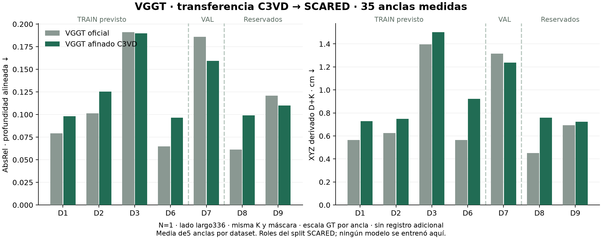

<details><summary>TRAIN previsto SCARED · datasets 1/2/3/6 · métricas principales y diagnóstico de registro</summary>


<details class="protocol-main" id="protocolo-vggt-fase1-agregacion"><summary>Protocolo principal · agregación por split</summary><p>Protocolo · Media de anclas dentro de cada dataset, luego igual peso por dataset dentro del split. p95 es la media de los p95 por ancla; no es el percentil de una nube fusionada. δ1 se expresa como fracción 0–1. No hay filtrado por confianza ni submuestreo.</p></details>

**Resultado principal · escala de profundidad compartida, sin Sim(3)/ICP**

| Métrica | VGGT oficial | VGGT-C3VD | Cambio favorable |
| --- | --- | --- | --- |
| AbsRel | 0.10903 | 0.12744 | -16.88 % |
| δ1 | 0.88075 | 0.82673 | -6.13 % |
| RMSE de profundidad (cm) | 1.05284 | 1.24297 | -18.06 % |
| XYZ medio · escala de profundidad (cm) | 0.78782 | 0.97491 | -23.75 % |
| p95 XYZ medio por ancla (cm) | 2.45777 | 2.84532 | -15.77 % |
| CD · sin registro (cm) | 0.51215 | 0.56096 | -9.53 % |
| NC · sin registro | 0.77949 | 0.68965 | -11.53 % |


**Diagnóstico secundario · registro ajustado con GT**

| Métrica | VGGT oficial | VGGT-C3VD | Cambio favorable |
| --- | --- | --- | --- |
| XYZ · Sim(3), sin ICP (cm) | 0.64047 | 0.81879 | -27.84 % |
| p95 XYZ · Sim(3), sin ICP (cm) | 1.61597 | 1.77365 | -9.76 % |
| CD · Sim(3)+ICP (cm) | 0.29636 | 0.36854 | -24.35 % |
| NC · Sim(3)+ICP | 0.78730 | 0.68360 | -13.17 % |


XYZ secundario usa solo Sim(3); CD/NC secundarios añaden ICP punto a punto con umbral 0,1 m y normales KNN30, igual a la fórmula nativa histórica. Son diagnósticos distintos del resultado principal y pueden absorber parte del error de registro.

</details>

<details><summary>VAL · dataset 7 · métricas principales y diagnóstico de registro</summary>


<p class="table-context"><a href="#protocolo-vggt-fase1-agregacion">Misma agregación por split</a></p>

**Resultado principal · escala de profundidad compartida, sin Sim(3)/ICP**

| Métrica | VGGT oficial | VGGT-C3VD | Cambio favorable |
| --- | --- | --- | --- |
| AbsRel | 0.18597 | 0.15946 | +14.26 % |
| δ1 | 0.69717 | 0.71367 | +2.37 % |
| RMSE de profundidad (cm) | 1.69629 | 1.71020 | -0.82 % |
| XYZ medio · escala de profundidad (cm) | 1.31609 | 1.23638 | +6.06 % |
| p95 XYZ medio por ancla (cm) | 3.03406 | 3.29671 | -8.66 % |
| CD · sin registro (cm) | 0.82514 | 0.68476 | +17.01 % |
| NC · sin registro | 0.69509 | 0.66054 | -4.97 % |


**Diagnóstico secundario · registro ajustado con GT**

| Métrica | VGGT oficial | VGGT-C3VD | Cambio favorable |
| --- | --- | --- | --- |
| XYZ · Sim(3), sin ICP (cm) | 0.92379 | 0.94812 | -2.63 % |
| p95 XYZ · Sim(3), sin ICP (cm) | 1.98475 | 2.02677 | -2.12 % |
| CD · Sim(3)+ICP (cm) | 0.33239 | 0.34241 | -3.01 % |
| NC · Sim(3)+ICP | 0.73885 | 0.67128 | -9.14 % |


XYZ secundario usa solo Sim(3); CD/NC secundarios añaden ICP punto a punto con umbral 0,1 m y normales KNN30, igual a la fórmula nativa histórica. Son diagnósticos distintos del resultado principal y pueden absorber parte del error de registro.

</details>

<details><summary>Reservados · datasets 8/9 · métricas principales y diagnóstico de registro</summary>


<p class="table-context"><a href="#protocolo-vggt-fase1-agregacion">Misma agregación por split</a></p>

**Resultado principal · escala de profundidad compartida, sin Sim(3)/ICP**

| Métrica | VGGT oficial | VGGT-C3VD | Cambio favorable |
| --- | --- | --- | --- |
| AbsRel | 0.09109 | 0.10457 | -14.81 % |
| δ1 | 0.93162 | 0.89703 | -3.71 % |
| RMSE de profundidad (cm) | 0.67862 | 0.90690 | -33.64 % |
| XYZ medio · escala de profundidad (cm) | 0.57189 | 0.74137 | -29.63 % |
| p95 XYZ medio por ancla (cm) | 1.48227 | 2.14567 | -44.76 % |
| CD · sin registro (cm) | 0.38011 | 0.44510 | -17.10 % |
| NC · sin registro | 0.77714 | 0.68451 | -11.92 % |


**Diagnóstico secundario · registro ajustado con GT**

| Métrica | VGGT oficial | VGGT-C3VD | Cambio favorable |
| --- | --- | --- | --- |
| XYZ · Sim(3), sin ICP (cm) | 0.46962 | 0.63158 | -34.49 % |
| p95 XYZ · Sim(3), sin ICP (cm) | 1.08061 | 1.36564 | -26.38 % |
| CD · Sim(3)+ICP (cm) | 0.24137 | 0.29089 | -20.51 % |
| NC · Sim(3)+ICP | 0.78591 | 0.67558 | -14.04 % |


XYZ secundario usa solo Sim(3); CD/NC secundarios añaden ICP punto a punto con umbral 0,1 m y normales KNN30, igual a la fórmula nativa histórica. Son diagnósticos distintos del resultado principal y pueden absorber parte del error de registro.

</details>

<details><summary>Desglose por dataset · variación que ocultan los promedios</summary>


| Dataset | Rol SCARED | AbsRel oficial | AbsRel C3VD-FT | Cambio favorable | XYZ oficial cm | XYZ C3VD-FT cm |
| --- | --- | --- | --- | --- | --- | --- |
| 1 | train | 0.07920 | 0.09824 | -24.04 % | 0.5658 | 0.7285 |
| 2 | train | 0.10124 | 0.12520 | -23.67 % | 0.6252 | 0.7479 |
| 3 | train | 0.19103 | 0.18992 | +0.58 % | 1.3965 | 1.5018 |
| 6 | train | 0.06466 | 0.09639 | -49.06 % | 0.5638 | 0.9214 |
| 7 | validation | 0.18597 | 0.15946 | +14.26 % | 1.3161 | 1.2364 |
| 8 | reserved | 0.06125 | 0.09904 | -61.71 % | 0.4518 | 0.7594 |
| 9 | reserved | 0.12093 | 0.11010 | +8.95 % | 0.6920 | 0.7233 |


El CSV local conserva los 70 registros por ancla/pesos: `G:/Kaust/VGGT/repo/artifacts/experiments/vggt_phase1_v1/cases.csv`. No se eligieron pesos ni hiperparámetros usando estos resultados.

</details>

**Límites:** XYZ procede de D+K y está relacionado con el error de profundidad; no es la point head directa. N=1 no evalúa coherencia multivista ni trayectorias. La escala se ajusta con GT para puntuar y no demuestra recuperación métrica autónoma. Los apartados siguientes conservan las fases 2–4 ya ejecutadas y el cierre P16.

<div class="book-actions"><button class="book-open-metrics" data-metrics="vggt-p1-reserved-VGGT_ZS,vggt-p1-reserved-VGGT_FT">Comparar baselines SCARED · reservadas</button><button class="book-open-metrics" data-metrics="vggt-p1-validation-VGGT_ZS,vggt-p1-validation-VGGT_FT">Comparar baselines SCARED · VAL7</button></div>

<details><summary>Resumen y verificaciones de fase 1</summary><p><a href="tablas/vggt_fase1.json">Descargar resultados agregados y protocolo</a>. Los ZIP GT, las cachés por píxel y las predicciones completas permanecen locales. La página comparte resúmenes y gráficos.</p></details>


<details class="research-archive-fold" id="vggt-p2-archivo"><summary>P05–P10 · caracterización ejecutada con los checkpoints históricos</summary>

<!-- VGGT_PHASE2_BEGIN -->
<h4 id="vggt-fase2">Fase 2 · contexto, geometría y eficiencia</h4>

**Estado: completada.** P05–P10 estudian los pesos congelados de VGGT; P10 añade VGG-T³ oficial como comparador de eficiencia. Esta fase solo evaluó pesos congelados; el entrenamiento posterior ya completado se documenta en las fases 3–4.

C3VD conserva las cuatro secuencias de evaluación documentadas: trans_t1_b, trans_t4_b (validación), cecum_t2_a y trans_t1_a (reservadas, mismo phantom). SCARED conserva 35 anclas N=1; el barrido de contexto utiliza siempre las mismas **26 anclas con vídeo apto**. Las otras nueve no se rellenan ni se mezclan en el promedio entre tamaños.

Los barridos N=1/4/8/16/50 separan extensión fija de prefijos con mayor densidad. Los controles de orden conservan exactamente las mismas imágenes. K calibrada y K predicha aparecen como rutas distintas; solo los pesos oficiales VGGT tienen point head. La escala GT se usa para puntuar, nunca como entrada neuronal.

**Compatibilidad corregida:** el protocolo fija ahora versiones del runtime y strides/formato de memoria del tensor, además de los valores RGB. Los C3VD históricos incompatibles se conservan como antecedentes y se recalculan en el entorno común; no se mezclan en los promedios nuevos.

El control del caso trans_t1_b de 50 vistas dio diferencias de 0 al añadir la lectura de puntos. En el entorno histórico, channels-last reprodujo su profundidad, pero quedó una diferencia de cámara sin causa única establecida. Por ello no se presupone un error de entrenamiento: se retira la reutilización incompatible y se recalcula. La revisión V2 del protocolo conserva los resultados válidos de V1; no es una nueva versión de pesos.

En SCARED se puntúa únicamente el ancla medida. La consistencia del vídeo no equivale a exactitud anatómica ni a una trayectoria con GT certificado. En C3VD sí se evalúan poses donde hay al menos dos vistas.

<details><summary>Protocolo visible y límites de comparación</summary>

| Elemento | Decisión |
| --- | --- |
| Pesos | Oficiales y VGGT-C3VD 30 épocas, firmados; ninguna actualización |
| Entrada | Solo RGB. Lado largo 336; C3VD336×336, SCARED266×336 |
| Máscaras | Todos los píxeles GT válidos; sin filtro de confianza ni submuestreo de puntos |
| Escala principal | Una escala mediana GT_Z/pred_Z, compartida por las rutas geométricas |
| Alineamiento principal | Referencia de cámara común; sin rotación/traslación ajustada o ICP |
| Cámara C3VD | ATE/RPE con Sim(3) de centros, separado de la geometría principal |
| Rendimiento | 3 calentamientos +5 mediciones; sincronización CUDA, salidas completas en CPU |
| Memoria | Offload de features VGGT y chunks explícitos; no se presenta como forward nativo solo-GPU |
| VGG-T³ | 2 pasos internos, chunk 3486, reinicio de memoria en cada repetición; sin ablación C09 |
| Interpretación | Descriptiva, por secuencia/split. Ningún umbral universal o causalidad se presume |

El tiempo medido incluye transferencias internas y salida a CPU; excluye carga del modelo, lectura, H2D inicial y escritura. Imágenes/s por lote no son FPS de un sistema streaming. El decoder VGGT procesa una vista por bloque; VGG-T³ conserva el tamaño adaptativo de minibatch de su inferencia nativa. Se documentan ambas políticas, sin afirmar igualdad de kernels ni de coste de transferencia.

</details>

<details><summary>Control C3VD: exactamente el mismo frame y GT en todos los tamaños</summary>

Este control mantiene el mismo RGB, profundidad, máscara y calibración del ancla de cada secuencia, y ajusta una escala solo en esa ancla. Se separa del resultado primario de toda la ventana, que incluye superficies distintas al cambiar N.

| Split | Modelo | Ventana | N | AbsRel ↓ | δ1 ↑ | XYZ ancla cm ↓ | P directo ancla cm ↓ |
| --- | --- | --- | --- | --- | --- | --- | --- |
| reserved | VGGT_FT | fixed_span | 1 | 0.10438 | 0.87493 | 0.38746 | N/D |
| reserved | VGGT_FT | fixed_span | 4 | 0.10104 | 0.88369 | 0.37454 | N/D |
| reserved | VGGT_FT | fixed_span | 8 | 0.09838 | 0.88486 | 0.34899 | N/D |
| reserved | VGGT_FT | fixed_span | 16 | 0.09427 | 0.88683 | 0.32770 | N/D |
| reserved | VGGT_FT | fixed_span | 50 | 0.08855 | 0.89164 | 0.30661 | N/D |
| reserved | VGGT_FT | prefix_density | 1 | 0.10438 | 0.87493 | 0.38746 | N/D |
| reserved | VGGT_FT | prefix_density | 4 | 0.09530 | 0.88525 | 0.34084 | N/D |
| reserved | VGGT_FT | prefix_density | 8 | 0.08858 | 0.88874 | 0.31693 | N/D |
| reserved | VGGT_FT | prefix_density | 16 | 0.08350 | 0.90467 | 0.29920 | N/D |
| reserved | VGGT_FT | prefix_density | 50 | 0.08855 | 0.89164 | 0.30661 | N/D |
| reserved | VGGT_ZS | fixed_span | 1 | 0.21497 | 0.63285 | 0.81785 | 1.49014 |
| reserved | VGGT_ZS | fixed_span | 4 | 0.18976 | 0.73868 | 0.67946 | 1.42367 |
| reserved | VGGT_ZS | fixed_span | 8 | 0.16582 | 0.78155 | 0.57319 | 1.34734 |
| reserved | VGGT_ZS | fixed_span | 16 | 0.14815 | 0.80322 | 0.51866 | 1.33242 |
| reserved | VGGT_ZS | fixed_span | 50 | 0.12408 | 0.84354 | 0.44835 | 1.32081 |
| reserved | VGGT_ZS | prefix_density | 1 | 0.21497 | 0.63285 | 0.81785 | 1.49014 |
| reserved | VGGT_ZS | prefix_density | 4 | 0.17705 | 0.72296 | 0.67655 | 1.38418 |
| reserved | VGGT_ZS | prefix_density | 8 | 0.13743 | 0.82263 | 0.54061 | 1.29554 |
| reserved | VGGT_ZS | prefix_density | 16 | 0.12134 | 0.83906 | 0.46051 | 1.25921 |
| reserved | VGGT_ZS | prefix_density | 50 | 0.12408 | 0.84354 | 0.44835 | 1.32081 |
| validation | VGGT_FT | fixed_span | 1 | 0.09468 | 0.89450 | 0.33630 | N/D |
| validation | VGGT_FT | fixed_span | 4 | 0.08313 | 0.97805 | 0.25919 | N/D |
| validation | VGGT_FT | fixed_span | 8 | 0.09120 | 0.96920 | 0.29250 | N/D |
| validation | VGGT_FT | fixed_span | 16 | 0.09954 | 0.93336 | 0.31728 | N/D |
| validation | VGGT_FT | fixed_span | 50 | 0.11166 | 0.87822 | 0.36796 | N/D |
| validation | VGGT_FT | prefix_density | 1 | 0.09468 | 0.89450 | 0.33630 | N/D |
| validation | VGGT_FT | prefix_density | 4 | 0.09423 | 0.89554 | 0.33302 | N/D |
| validation | VGGT_FT | prefix_density | 8 | 0.10893 | 0.87225 | 0.37016 | N/D |
| validation | VGGT_FT | prefix_density | 16 | 0.10607 | 0.88588 | 0.37078 | N/D |
| validation | VGGT_FT | prefix_density | 50 | 0.11166 | 0.87822 | 0.36796 | N/D |
| validation | VGGT_ZS | fixed_span | 1 | 0.22087 | 0.57250 | 0.73264 | 1.08417 |
| validation | VGGT_ZS | fixed_span | 4 | 0.14494 | 0.77266 | 0.40162 | 0.72348 |
| validation | VGGT_ZS | fixed_span | 8 | 0.14306 | 0.77821 | 0.39703 | 0.70921 |
| validation | VGGT_ZS | fixed_span | 16 | 0.16841 | 0.70044 | 0.47137 | 0.72857 |
| validation | VGGT_ZS | fixed_span | 50 | 0.17096 | 0.69926 | 0.49546 | 1.63294 |
| validation | VGGT_ZS | prefix_density | 1 | 0.22087 | 0.57250 | 0.73264 | 1.08417 |
| validation | VGGT_ZS | prefix_density | 4 | 0.19256 | 0.63149 | 0.63940 | 1.00659 |
| validation | VGGT_ZS | prefix_density | 8 | 0.15185 | 0.73675 | 0.52049 | 0.92402 |
| validation | VGGT_ZS | prefix_density | 16 | 0.15032 | 0.77642 | 0.46935 | 0.92104 |
| validation | VGGT_ZS | prefix_density | 50 | 0.17096 | 0.69926 | 0.49546 | 1.63294 |

</details>

<details><summary>Profundidad y geometría por tamaño de contexto y split</summary>

**C3VD · validation · extensión fija.** Misma población entre tamaños; XYZ usa D+K calibrada y cámara predicha.

| Modelo | N | Casos | AbsRel ↓ | δ1 ↑ | XYZ cm ↓ | p95 cm ↓ | Error focal ↓ |
| --- | --- | --- | --- | --- | --- | --- | --- |
| VGGT_FT | 1 | 2 | 0.09468 | 0.89450 | 0.33630 | 1.43017 | 0.16039 |
| VGGT_FT | 4 | 2 | 0.12069 | 0.85826 | 0.76574 | 1.43986 | 0.12554 |
| VGGT_FT | 8 | 2 | 0.13111 | 0.84594 | 0.85363 | 1.56606 | 0.12708 |
| VGGT_FT | 16 | 2 | 0.14363 | 0.80893 | 0.86386 | 1.60338 | 0.12493 |
| VGGT_FT | 50 | 2 | 0.15654 | 0.76286 | 0.85041 | 1.64439 | 0.12517 |
| VGGT_ZS | 1 | 2 | 0.22087 | 0.57250 | 0.73264 | 2.35091 | 0.82703 |
| VGGT_ZS | 4 | 2 | 0.19938 | 0.66393 | 0.69238 | 1.52480 | 0.45262 |
| VGGT_ZS | 8 | 2 | 0.21545 | 0.60523 | 0.72030 | 1.61987 | 0.48723 |
| VGGT_ZS | 16 | 2 | 0.22319 | 0.59400 | 0.74271 | 1.64682 | 0.47816 |
| VGGT_ZS | 50 | 2 | 0.23905 | 0.56402 | 0.79614 | 1.76390 | 0.50120 |

**C3VD · reserved · extensión fija.** Misma población entre tamaños; XYZ usa D+K calibrada y cámara predicha.

| Modelo | N | Casos | AbsRel ↓ | δ1 ↑ | XYZ cm ↓ | p95 cm ↓ | Error focal ↓ |
| --- | --- | --- | --- | --- | --- | --- | --- |
| VGGT_FT | 1 | 2 | 0.10438 | 0.87493 | 0.38746 | 1.17252 | 0.16011 |
| VGGT_FT | 4 | 2 | 0.11044 | 0.87930 | 0.87599 | 2.22752 | 0.13220 |
| VGGT_FT | 8 | 2 | 0.11575 | 0.86680 | 1.02859 | 2.31255 | 0.13792 |
| VGGT_FT | 16 | 2 | 0.11636 | 0.85941 | 1.03936 | 2.46142 | 0.13894 |
| VGGT_FT | 50 | 2 | 0.11598 | 0.85892 | 1.05335 | 2.39090 | 0.14317 |
| VGGT_ZS | 1 | 2 | 0.21497 | 0.63285 | 0.81785 | 2.18458 | 1.16792 |
| VGGT_ZS | 4 | 2 | 0.21447 | 0.59700 | 1.60205 | 3.16771 | 0.96016 |
| VGGT_ZS | 8 | 2 | 0.21840 | 0.61925 | 1.54832 | 3.02716 | 1.01805 |
| VGGT_ZS | 16 | 2 | 0.21264 | 0.63591 | 1.49360 | 2.93651 | 0.98379 |
| VGGT_ZS | 50 | 2 | 0.20688 | 0.64679 | 1.44742 | 2.79143 | 1.00242 |

**SCARED · train · extensión fija.** Misma población entre tamaños; XYZ usa D+K calibrada y cámara predicha.

| Modelo | N | Casos | AbsRel ↓ | δ1 ↑ | XYZ cm ↓ | p95 cm ↓ | Error focal ↓ |
| --- | --- | --- | --- | --- | --- | --- | --- |
| VGGT_FT | 1 | 14 | 0.12306 | 0.83036 | 0.95890 | 2.69970 | 0.19871 |
| VGGT_FT | 4 | 14 | 0.11819 | 0.83788 | 0.92134 | 2.65299 | 0.19274 |
| VGGT_FT | 8 | 14 | 0.12199 | 0.83348 | 0.94767 | 2.71868 | 0.19251 |
| VGGT_FT | 16 | 14 | 0.12640 | 0.82141 | 0.97726 | 2.79053 | 0.19231 |
| VGGT_FT | 50 | 14 | 0.13255 | 0.80301 | 1.01969 | 2.91496 | 0.19213 |
| VGGT_ZS | 1 | 14 | 0.09724 | 0.89479 | 0.74176 | 2.32726 | 0.54852 |
| VGGT_ZS | 4 | 14 | 0.08355 | 0.92778 | 0.65584 | 2.19943 | 0.81559 |
| VGGT_ZS | 8 | 14 | 0.08273 | 0.92801 | 0.65396 | 2.19815 | 0.80671 |
| VGGT_ZS | 16 | 14 | 0.08416 | 0.92559 | 0.66615 | 2.25020 | 0.79643 |
| VGGT_ZS | 50 | 14 | 0.08513 | 0.92275 | 0.67506 | 2.27952 | 0.79466 |

**SCARED · validation · extensión fija.** Misma población entre tamaños; XYZ usa D+K calibrada y cámara predicha.

| Modelo | N | Casos | AbsRel ↓ | δ1 ↑ | XYZ cm ↓ | p95 cm ↓ | Error focal ↓ |
| --- | --- | --- | --- | --- | --- | --- | --- |
| VGGT_FT | 1 | 4 | 0.18102 | 0.64942 | 1.37344 | 3.65508 | 0.24085 |
| VGGT_FT | 4 | 4 | 0.18697 | 0.68958 | 1.38302 | 3.42924 | 0.24433 |
| VGGT_FT | 8 | 4 | 0.18288 | 0.69934 | 1.36928 | 3.48493 | 0.23921 |
| VGGT_FT | 16 | 4 | 0.17824 | 0.71442 | 1.33323 | 3.44615 | 0.23702 |
| VGGT_FT | 50 | 4 | 0.17957 | 0.71076 | 1.34027 | 3.49712 | 0.23573 |
| VGGT_ZS | 1 | 4 | 0.21058 | 0.62541 | 1.44208 | 3.35395 | 1.16689 |
| VGGT_ZS | 4 | 4 | 0.19495 | 0.68184 | 1.35555 | 3.20473 | 0.72601 |
| VGGT_ZS | 8 | 4 | 0.17367 | 0.72014 | 1.24144 | 3.00429 | 0.58616 |
| VGGT_ZS | 16 | 4 | 0.16879 | 0.72924 | 1.22637 | 3.03598 | 0.54124 |
| VGGT_ZS | 50 | 4 | 0.17641 | 0.70961 | 1.27640 | 3.08400 | 0.51882 |

**SCARED · reserved · extensión fija.** Misma población entre tamaños; XYZ usa D+K calibrada y cámara predicha.

| Modelo | N | Casos | AbsRel ↓ | δ1 ↑ | XYZ cm ↓ | p95 cm ↓ | Error focal ↓ |
| --- | --- | --- | --- | --- | --- | --- | --- |
| VGGT_FT | 1 | 8 | 0.10476 | 0.89339 | 0.79112 | 2.20865 | 0.18552 |
| VGGT_FT | 4 | 8 | 0.10131 | 0.90231 | 0.75569 | 2.10290 | 0.18019 |
| VGGT_FT | 8 | 8 | 0.10191 | 0.90155 | 0.75842 | 2.10595 | 0.17822 |
| VGGT_FT | 16 | 8 | 0.10418 | 0.89985 | 0.77292 | 2.13201 | 0.17709 |
| VGGT_FT | 50 | 8 | 0.10775 | 0.89313 | 0.79935 | 2.19417 | 0.17514 |
| VGGT_ZS | 1 | 8 | 0.09028 | 0.93261 | 0.60225 | 1.47329 | 0.76295 |
| VGGT_ZS | 4 | 8 | 0.08149 | 0.93504 | 0.56606 | 1.49630 | 0.82650 |
| VGGT_ZS | 8 | 8 | 0.07788 | 0.94084 | 0.53842 | 1.40813 | 0.78571 |
| VGGT_ZS | 16 | 8 | 0.07819 | 0.93901 | 0.54054 | 1.42122 | 0.77612 |
| VGGT_ZS | 50 | 8 | 0.07861 | 0.93898 | 0.54383 | 1.42528 | 0.79658 |

</details>

<details><summary>Cámara C3VD y rutas geométricas · N=50</summary>

| Split | Modelo | P directo cm ↓ | D+K conocida cm ↓ | D+K predicha cm ↓ | ATE cm ↓ | RPEr ° ↓ | RPEt cm ↓ |
| --- | --- | --- | --- | --- | --- | --- | --- |
| validation | VGGT_ZS | 1.12673 | 0.79614 | 0.88886 | 0.10828 | 0.52984 | 0.05016 |
| reserved | VGGT_ZS | 1.79994 | 1.44742 | 1.66962 | 0.36543 | 0.68994 | 0.17044 |
| validation | VGGT_FT | N/D | 0.85041 | 0.87278 | 0.08546 | 0.49008 | 0.04292 |
| reserved | VGGT_FT | N/D | 1.05335 | 1.08610 | 0.30697 | 0.55142 | 0.11657 |

N/D en P del checkpoint afinado indica cabeza ausente; no se instaló una cabeza híbrida.

</details>

<details><summary>Eficiencia · mismo hardware, RGB, resolución y salidas</summary>

| Dataset | Modelo | N | Mediana s ↓ | Imágenes/s por lote | Pico GiB ↓ | AbsRel del ancla ↓ |
| --- | --- | --- | --- | --- | --- | --- |
| SCARED | VGGT_ZS | 8 | 0.77198 | 10.36290 | 4.68832 | 0.28026 |
| SCARED | VGGT_ZS | 1 | 0.18410 | 5.43195 | 4.68036 | 0.29893 |
| SCARED | VGGT_ZS | 50 | 7.45191 | 6.70969 | 5.50071 | 0.24483 |
| SCARED | VGGT_ZS | 16 | 1.71541 | 9.32723 | 4.79927 | 0.25257 |
| SCARED | VGGT_ZS | 4 | 0.38757 | 10.32078 | 4.68450 | 0.31099 |
| C3VD | VGGT_ZS | 1 | 0.20000 | 4.99996 | 4.73591 | 0.17621 |
| C3VD | VGGT_ZS | 8 | 0.97516 | 8.20379 | 4.74745 | 0.11709 |
| C3VD | VGGT_ZS | 16 | 2.22373 | 7.19513 | 4.88433 | 0.13626 |
| C3VD | VGGT_ZS | 50 | 10.26400 | 4.87139 | 5.76942 | 0.12378 |
| C3VD | VGGT_ZS | 4 | 0.47566 | 8.40945 | 4.74218 | 0.12086 |
| SCARED | TTT_ZS | 8 | 0.98191 | 8.14735 | 4.98571 | 0.18243 |
| SCARED | TTT_ZS | 1 | 0.42057 | 2.37773 | 4.69107 | 0.27743 |
| SCARED | TTT_ZS | 50 | 5.71723 | 8.74549 | 5.79864 | 0.17786 |
| SCARED | TTT_ZS | 16 | 1.88470 | 8.48940 | 5.16274 | 0.17576 |
| SCARED | TTT_ZS | 4 | 0.54864 | 7.29070 | 4.78022 | 0.19246 |
| C3VD | TTT_ZS | 1 | 0.43325 | 2.30815 | 4.72968 | 0.17857 |
| C3VD | TTT_ZS | 8 | 1.19951 | 6.66937 | 5.03240 | 0.17892 |
| C3VD | TTT_ZS | 16 | 2.34102 | 6.83462 | 5.24068 | 0.17662 |
| C3VD | TTT_ZS | 50 | 7.11652 | 7.02590 | 6.04059 | 0.17782 |
| C3VD | TTT_ZS | 4 | 0.63607 | 6.28860 | 4.83673 | 0.18537 |

Un OOM se conserva como no viable; no se reduce silenciosamente la entrada. Son mediciones repetidas de dos contextos de referencia, no una distribución de pacientes.

</details>

<details><summary>Resumen reproducible de fase 2</summary><p><a href="tablas/vggt_fase2.json">Descargar protocolo y resultados agregados</a>. Los RGB, GT, predicciones y registros individuales permanecen locales.</p></details>

<!-- VGGT_PHASE2_END -->

</details>

<!-- VGGT_P11_PREFLIGHT_BEGIN -->
<h4 id="vggt-p11-preflight">P11 · verificación completada</h4>

El control inicial de datos/gradientes y el posterior de AdamW/reanudación pasaron. Véase [fases 3–4](#vggt-fase34) para el estado actual y la receta autorizada.
<!-- VGGT_P11_PREFLIGHT_END -->

<details class="research-archive-fold" id="vggt-p34-archivo"><summary>P11–P16 · ejecución depth-v2 y evaluación original completas</summary>

<!-- VGGT_PHASE34_BEGIN -->
<h4 id="vggt-fase34">Fases 3 y 4 · VGGT-SCARED y comparación común</h4>

**Estado: completadas y verificadas.** Un único fine-tuning nuevo; se conservan los pesos y resultados históricos.

**P11 superado:** forward/backward nativo y AdamW real; restauración exacta de pesos, estado del optimizador y RNG. El paso repetido en el diagnóstico determinista dio diferencia 0. Pico: 4.296 GiB. El primer intento no determinista mostró 9,16×10⁻⁷ y se conserva en el registro; la receta de producción mantiene su runtime original.

<details><summary>Receta y particiones visibles</summary>

| Elemento | Configuración |
| --- | --- |
| Inicio | Pesos oficiales facebook/VGGT-1B; sin transferencia C3VD |
| Entrenable | Solo depth head; encoder congelado; cámara oficial al inferir; sin point head afinada |
| TRAIN | Datasets 1,2,3,6: 20 anclas; 14 contextos N4 y6N1 |
| VAL | Dataset 7: 5 anclas; 4N4 y1N1 |
| Reservados | Datasets 8/9: 10 anclas; no se usan para seleccionar pesos |
| Exclusiones | Datasets 4/5 por calibración; dataset 6/keyframe 1 conserva solo ancla medida |
| Ventanas | Ancla medida + vídeo 0/5/10 cuando hay vídeo apto; una ancla supervisada por paso |
| Presupuesto | 30 épocas ×100 actualizaciones =3.000 pasos /3.000 supervisiones densas |
| Pérdida | Nativa VGGT de profundidad con gradiente espacial; normalización nativa solo con el ancla medida |
| Optimizador | AdamW;LR1e-5,WD0,05,betas(0,9; 0,999),eps1e-8; sin clipping ni scheduler |
| Selección | Menor AbsRel de las 5 anclasVAL; se evalúan BEST y FINAL. No equivale a aceptación conjunta |
| Comparación | RGB/GT/layout/runtime compartidos con fase 2; N1/4/8/16/50; todos los píxeles GT válidos |
| Alineamiento | Escala de profundidad GT compartida; gauge de cámara común; sin Sim(3)/ICP en geometría principal |
| Disponibilidad GT | SCARED solo ancla medida; no hay ATE/RPE temporal certificado |

</details>

<details><summary>P13 · todas las 35 anclas certificadas SCARED, N=1</summary>

Incluye también las 9 anclas sin vídeo apto. No se mezcla este promedio con la población constante usada en el barrido de contexto.

| Split | Modelo | Anclas | AbsRel ↓ | δ1 ↑ | XYZ D+K cm ↓ |
| --- | --- | --- | --- | --- | --- |
| train | VGGT_ZS | 20 | 0.10903 | 0.88075 | 0.78782 |
| validation | VGGT_ZS | 5 | 0.18597 | 0.69717 | 1.31609 |
| reserved | VGGT_ZS | 10 | 0.09109 | 0.93162 | 0.57189 |
| train | VGGT_FT | 20 | 0.12744 | 0.82673 | 0.97491 |
| validation | VGGT_FT | 5 | 0.15946 | 0.71367 | 1.23638 |
| reserved | VGGT_FT | 10 | 0.10457 | 0.89703 | 0.74137 |
| train | VGGT_SCARED_BEST | 20 | 0.05011 | 0.97971 | 0.37239 |
| validation | VGGT_SCARED_BEST | 5 | 0.11812 | 0.81463 | 0.91759 |
| reserved | VGGT_SCARED_BEST | 10 | 0.07738 | 0.95339 | 0.52962 |
| train | VGGT_SCARED_FINAL | 20 | 0.03345 | 0.99524 | 0.24276 |
| validation | VGGT_SCARED_FINAL | 5 | 0.11863 | 0.81260 | 0.90469 |
| reserved | VGGT_SCARED_FINAL | 10 | 0.06984 | 0.96699 | 0.47709 |

</details>

<details><summary>P13/P14 · resultados frente a zero-shot y transferencia, N=50</summary>

Macro por secuencia C3VD o por dataset SCARED, con igual peso de anclas dentro de cada dataset. XYZ en cm, δ1 como fracción. El soporte SCARED es solo el ancla, no una evaluación global del vídeo.

| Dataset | Split | Modelo | Casos | AbsRel ↓ | δ1 ↑ | XYZ D+K cm ↓ | p95 cm ↓ | CD cm ↓ | NC ↑ |
| --- | --- | --- | --- | --- | --- | --- | --- | --- | --- |
| SCARED | train | VGGT_ZS | 14 | 0.08513 | 0.92275 | 0.67506 | 2.27952 | 0.43958 | 0.80385 |
| SCARED | validation | VGGT_ZS | 4 | 0.17641 | 0.70961 | 1.27640 | 3.08400 | 0.76719 | 0.71656 |
| SCARED | reserved | VGGT_ZS | 8 | 0.07861 | 0.93898 | 0.54383 | 1.42528 | 0.36084 | 0.78102 |
| C3VD | validation | VGGT_ZS | 2 | 0.23905 | 0.56402 | 0.79614 | 1.76390 | 0.23073 | 0.66829 |
| C3VD | reserved | VGGT_ZS | 2 | 0.20688 | 0.64679 | 1.44742 | 2.79143 | 0.48501 | 0.66770 |
| SCARED | train | VGGT_FT | 14 | 0.13255 | 0.80301 | 1.01969 | 2.91496 | 0.61715 | 0.66332 |
| SCARED | validation | VGGT_FT | 4 | 0.17957 | 0.71076 | 1.34027 | 3.49712 | 0.74830 | 0.66677 |
| SCARED | reserved | VGGT_FT | 8 | 0.10775 | 0.89313 | 0.79935 | 2.19417 | 0.47582 | 0.67670 |
| C3VD | validation | VGGT_FT | 2 | 0.15654 | 0.76286 | 0.85041 | 1.64439 | 0.29038 | 0.69284 |
| C3VD | reserved | VGGT_FT | 2 | 0.11598 | 0.85892 | 1.05335 | 2.39090 | 0.33473 | 0.71436 |
| SCARED | train | VGGT_SCARED_BEST | 14 | 0.04233 | 0.98467 | 0.30558 | 0.89005 | 0.15769 | 0.78328 |
| SCARED | validation | VGGT_SCARED_BEST | 4 | 0.12022 | 0.82114 | 0.99180 | 2.50419 | 0.51425 | 0.69599 |
| SCARED | reserved | VGGT_SCARED_BEST | 8 | 0.04524 | 0.99553 | 0.32439 | 0.93020 | 0.17176 | 0.74578 |
| C3VD | validation | VGGT_SCARED_BEST | 2 | 0.23743 | 0.60369 | 0.85167 | 2.02781 | 0.21789 | 0.64449 |
| C3VD | reserved | VGGT_SCARED_BEST | 2 | 0.21335 | 0.65587 | 1.55469 | 3.26662 | 0.36252 | 0.64780 |
| SCARED | train | VGGT_SCARED_FINAL | 14 | 0.03056 | 0.99730 | 0.22477 | 0.61952 | 0.12203 | 0.81550 |
| SCARED | validation | VGGT_SCARED_FINAL | 4 | 0.13249 | 0.77707 | 1.05005 | 2.60789 | 0.55928 | 0.70038 |
| SCARED | reserved | VGGT_SCARED_FINAL | 8 | 0.04466 | 0.99500 | 0.32622 | 0.93818 | 0.18213 | 0.76895 |
| C3VD | validation | VGGT_SCARED_FINAL | 2 | 0.19250 | 0.71762 | 0.70402 | 1.58661 | 0.18075 | 0.65208 |
| C3VD | reserved | VGGT_SCARED_FINAL | 2 | 0.21367 | 0.66076 | 1.45649 | 2.93379 | 0.37252 | 0.64964 |

</details>

<details><summary>Cambio favorable respecto a VGGT zero-shot · N50</summary>

| Dataset | Split | Pesos | AbsRel % | δ1 % | XYZ % | CD % | NC % |
| --- | --- | --- | --- | --- | --- | --- | --- |
| SCARED | train | VGGT_FT | -55.70424 | -12.97700 | -51.05156 | -40.39730 | -17.48252 |
| SCARED | validation | VGGT_FT | -1.78641 | 0.16175 | -5.00403 | 2.46240 | -6.94831 |
| SCARED | reserved | VGGT_FT | -37.07613 | -4.88288 | -46.98521 | -31.86382 | -13.35636 |
| C3VD | validation | VGGT_FT | 34.51717 | 35.25503 | -6.81580 | -25.85000 | 3.67292 |
| C3VD | reserved | VGGT_FT | 43.93957 | 32.79801 | 27.22599 | 30.98480 | 6.98853 |
| SCARED | train | VGGT_SCARED_BEST | 50.27686 | 6.70996 | 54.73263 | 64.12758 | -2.55899 |
| SCARED | validation | VGGT_SCARED_BEST | 31.85576 | 15.71692 | 22.29693 | 32.96969 | -2.87057 |
| SCARED | reserved | VGGT_SCARED_BEST | 42.44989 | 6.02254 | 40.35102 | 52.39982 | -4.51170 |
| C3VD | validation | VGGT_SCARED_BEST | 0.68061 | 7.03383 | -6.97422 | 5.56672 | -3.56174 |
| C3VD | reserved | VGGT_SCARED_BEST | -3.12597 | 1.40414 | -7.41107 | 25.25512 | -2.98030 |
| SCARED | train | VGGT_SCARED_FINAL | 64.10215 | 8.07842 | 66.70372 | 72.23951 | 1.44947 |
| SCARED | validation | VGGT_SCARED_FINAL | 24.90038 | 9.50735 | 17.73353 | 27.10033 | -2.25746 |
| SCARED | reserved | VGGT_SCARED_FINAL | 43.18162 | 5.96670 | 40.01441 | 49.52661 | -1.54497 |
| C3VD | validation | VGGT_SCARED_FINAL | 19.47302 | 27.23320 | 11.57093 | 21.66109 | -2.42640 |
| C3VD | reserved | VGGT_SCARED_FINAL | -3.27984 | 2.15991 | -0.62638 | 23.19477 | -2.70473 |

Signo positivo = cambio favorable relativo; negativo = regresión. No son puntos porcentuales ni una prueba estadística.

</details>

**Decisión:** conservar las referencias históricas. Se muestran BEST y FINAL sin elegir con los reservados. Mejorar profundidad en un ancla no demuestra que mejore la trayectoria; los resultados por contexto y los deterioros se conservan en las tablas.

<a href="tablas/vggt_fase34.json">Protocolo, auditoría y resultados agregados</a>. Los RGB, GT, checkpoints y predicciones individuales permanecen locales.

<!-- VGGT_PHASE34_END -->

</details>

<details class="research-archive-fold" id="vggt-p16-archivo"><summary>P16 · interpretación original y comparación histórica</summary>

<!-- VGGT_P16_READOUT_BEGIN -->
<h4 id="vggt-p16-cierre">P16 · lectura de los resultados y límites</h4>

**Hallazgo principal:** VGGT-SCARED mejora la profundidad y la geometría local del ancla en SCARED. Esa mejora no se transfiere de manera uniforme a C3VD y no demuestra una trayectoria temporal más precisa.

<details><summary>Resumen cuantitativo de cierre · protocolo y resultados</summary>

**Protocolo:** contextos de 50 RGB, pesos congelados durante evaluación, mismo RGB/GT/máscara/layout/runtime por comparación. C3VD336×336 y SCARED266×336. Una escala de profundidad GT por colección, compartida por las rutas; gauge de cámara común, sin Sim(3) ni ICP en estas cifras. XYZ usa D+K calibrada+pose y está en cm. Signo positivo significa cambio favorable relativo.

| Dataset | Casos reservados | AbsRel ZS ↓ | AbsRel BEST ↓ | Mejora AbsRel | XYZ ZS cm ↓ | XYZ BEST cm ↓ | Mejora XYZ |
| --- | --- | --- | --- | --- | --- | --- | --- |
| SCARED | 8 | 0.07861 | 0.04524 | +42.45 % | 0.54383 | 0.32439 | +40.35 % |
| C3VD | 2 | 0.20688 | 0.21335 | -3.13 % | 1.44742 | 1.55469 | -7.41 % |

En SCARED son 8 anclas con vídeo apto, de los datasets 8/9; en C3VD son 2 secuencias reservadas del mismo phantom. Los reservados se han inspeccionado históricamente: no se presentan como un test clínico intacto. Para las 10 anclas SCARED N=1, incluidas las 2 sin vídeo apto, se conserva la tabla separada de P13.

**1. BEST y FINAL responden al criterio de selección, no a una jerarquía universal.** El menor AbsRel de validación de la receta apareció en el paso 500 (0.12482). El paso 3000 dio 0.12946 (3.71 % peor en ese criterio). FINAL mejora algunas mediciones reservadas; eso no autoriza a elegirlo usando los reservados ni demuestra por sí solo sobreajuste.

**2. Mejorar profundidad no garantiza mejorar toda la reconstrucción.** En SCARED, BEST reduce AbsRel 42,45 % y XYZ 40,35 %, pero NC cae 4,51 % y el acuerdo multivista pasa de 0,95237 a 0,91331. FINAL logra 0,96753 de acuerdo. Son propiedades distintas: la exactitud del ancla, la orientación local estimada y la coherencia entre vistas no son intercambiables.

**3. La transferencia debe revisarse por secuencia.** En C3VD reservado, BEST empeora AbsRel 3,13 % y XYZ 7,41 %. FINAL queda casi igual en XYZ medio (0,63 % peor), pero combina mejoras en trans_t1_a con regresiones en cecum_t2_a. Un promedio próximo a cero no demuestra que ambos casos se comporten igual.

**4. La cámara no se entrenó en esta receta SCARED.** La auditoría de lectura de resultados compara 438 pares de colecciones: 438 tienen poses e intrínsecas exactamente iguales a VGGT oficial. Los restantes, si los hay, se mantienen dentro de los límites numéricos ya fijados. La comprobación solo lee NPZ existentes; no hace inferencias nuevas. Esta receta no puede reclamar una cámara afinada para SCARED.

**5. Las intrínsecas influyen en la ruta geométrica.** En el ancla SCARED, BEST obtiene XYZ 0.32439 cm con K calibrada y 1.10438 cm con K predicha, manteniendo D y pose. Es un diagnóstico controlado del uso de K. No demuestra un fallo del GT ni certifica poses temporales; ninguna K GT se introduce en el encoder.

**6. El contexto ayuda de manera condicionada.** Con las mismas 8 anclas reservadas, BEST pasa de AbsRel 0.07519 con N=1 a 0.04524 con N=50. VGG-T³-VN18-SCARED pasa de 0,06120 con N=4 a 0,06297 con N=50. No aparece un umbral universal de rotura; estas curvas no prueban calidad global del vídeo porque SCARED solo tiene GT certificado en el ancla.

**7. La comparación entre modelos exige conservar la ruta.** En C3VD reservado, VGGT-C3VD histórico tiene AbsRel 0.11598 y XYZ D+K+pose 1.05335 cm; VGG-T³-V9-C3VD tiene AbsRel 0.10457 y XYZ D+K+pose 1.66351 cm, mientras su P directo da 1.19412 cm. V9 mejora profundidad y P directo frente a su oficial, pero persisten errores de cámara y diferencias entre rutas; esta tabla no descompone causalmente su contribución. No se sustituye D+pose por P directo al comparar una misma columna.

**8. Las recetas no son una ablación causal de arquitectura.** En SCARED reservado, VGGT-SCARED BEST tiene AbsRel 0.04524 y el candidato VGG-T³-VN18-SCARED 0.06297. Cambian cabezas entrenables, pérdidas y presupuesto; este resultado descriptivo no demuestra que VGGT sea intrínsecamente superior ni que TTT cause la diferencia.

**9. Rapidez por lote no equivale a tiempo real clínico.** Los oficiales con 50 imágenes C3VD tardaron 10,264 s (VGGT) y 7,117 s (VGG-T³); con SCARED,7,452 s y 5,717 s. Son 3 warmups y 5 mediciones en la misma RTX5060, con offload/salidaCPU y políticas de memoria declaradas. No se extrapola a un sistema streaming ni a contextos mayores de 50.

**Decisión de cierre:** P11–P16 están ejecutados. Se conservan BEST/FINAL como candidatos documentados y las referencias históricas de cada dominio. No se sustituye V9 ni se lanza otra receta a partir de estas tablas. Antes de una nueva intervención conviene revisar visualmente las rutas con idénticos frames/K/escala y fijar una sola hipótesis comprobable.

<a href="tablas/vggt_cierre_fases.json">Resumen de evidencia y auditoría de cámara</a>. Las predicciones, RGB, GT y checkpoints permanecen locales.

</details>

<!-- VGGT_P16_READOUT_END -->

</details>

</details>

</details>

<details class="experiment-group"><summary>Experimentos globales y entre datasets · 9 fichas</summary>

<details class="vggt-experiment-card" id="vggt-p02" data-vggt-phase1-card data-experiment data-model="VGGT" data-scope="Global"><summary><span class="card-status">Fase 1 completada</span><span class="card-id">P02</span>Equivalencia de datos y métricas</summary><div class="card-content">
<dl class="card-fields"><dt>Hipótesis / pregunta</dt><dd>¿Se comparan el mismo RGB, Z-depth, K, máscara, coordenadas y reglas de alineamiento?</dd></dl>
<dl class="card-fields"><dt>Cómo se realizó</dt><dd>Se verificaron 7 ZIP certificados y 35 anclas, se contrastaron 5 fixtures N1 previos de VGG-T³ y se ejecutaron 6 pruebas matemáticas sintéticas.</dd></dl>
<dl class="card-fields"><dt>Controles</dt><dd>Sin clipping de profundidad, sin confianza como máscara y sin submuestreo. El redondeo float32 se acota explícitamente, sin modificar el GT.</dd></dl>
<dl class="card-fields"><dt>Métricas</dt><dd>Igualdad de tensores y GT, reproyección, ida/vuelta C2W/W2C, escala compartida, Sim(3) y fórmulas nativas CD/NC.</dd></dl>
<dl class="card-fields"><dt>Resultados</dt><dd>Cinco fixtures son idénticos bit a bit en RGB normalizado, profundidad, máscara, K y XYZ. Las 6 pruebas matemáticas pasan. La máxima diferencia al redondear K en la reproyección GT es 0.0002384 mm, dentro de la cota float32.</dd></dl>
<dl class="card-fields"><dt>Conclusión</dt><dd>El protocolo nuevo es común y verificable. La equivalencia no implica que todas las tablas históricas midieran lo mismo.</dd></dl>
<dl class="card-fields"><dt>Limitaciones</dt><dd>Las rutas P directo y D+K+pose son distintas. Las tablas con Sim(3)+ICP se separan de las de escala compartida sin registro. En C3VD histórico hubo además distinta aritmética float/255 frente a float32*(1/255). N1 no valida GT temporal.</dd></dl>
<dl class="card-fields"></dl>
<details class="trace-details"><summary>Trazabilidad y protocolo</summary><p><a href="tablas/vggt_fase1.json">Resumen reproducible de fase 1</a> · <a href="#vggt-fase1">Tablas de resultados</a>. Checkpoints y datos identificados por firma; archivos granulares y predicciones se conservan localmente.</p></details><dl class="card-fields verdict"><dt>Confirmación o negación de la hipótesis</dt><dd>Diagnóstico descriptivo: la conclusión conserva el resultado observado; no establece una confirmación causal binaria.</dd></dl></div></details>

<details class="vggt-experiment-card" id="vggt-p04" data-vggt-phase1-card data-experiment data-model="VGGT" data-scope="Global"><summary><span class="card-status">Fase 1 completada</span><span class="card-id">P04</span>Transferencia VGGT-C3VD → SCARED</summary><div class="card-content">
<dl class="card-fields"><dt>Hipótesis / pregunta</dt><dd>¿El ajuste C3VD mejora también el dominio SCARED sin cambiar pesos ni protocolo?</dd></dl>
<dl class="card-fields"><dt>Cómo se realizó</dt><dd>Se infirieron las mismas 35 anclas con el checkpoint 30 ep; no se entrenó ni recalibró el modelo con SCARED.</dd></dl>
<dl class="card-fields"><dt>Controles</dt><dd>Mismos 35 RGB medidos, protocolo N1 firmado, pesos congelados y GT separado del modelo. Sin ajustes de pesos, sin selección por resultados SCARED.</dd></dl>
<dl class="card-fields"><dt>Métricas</dt><dd>Profundidad y D+K con una escala común por ancla; CD/NC sin registro como principales. Sim(3)+ICP queda en una tabla secundaria.</dd></dl>
<dl class="card-fields"><dt>Resultados</dt><dd>En reservados empeoran AbsRel 14,81% y XYZ 29,63%; en VAL7 mejora AbsRel 14,26%, pero empeoran p95 y NC. Solo 4/10 anclas reservadas mejoran AbsRel.</dd></dl>
<dl class="card-fields"><dt>Conclusión</dt><dd>La transferencia es heterogénea y no mejora conjuntamente las métricas. El deterioro de la ruta de profundidad ya aparece sin trayectoria temporal y tras ajustar escala.</dd></dl>
<dl class="card-fields"><dt>Limitaciones</dt><dd>No identifica por sí solo el efecto causal de módulos, iluminación, pérdidas o los 39 valores distintos del encoder. No se generaliza a ventanas largas o rendimiento clínico.</dd></dl>
<dl class="card-fields"></dl>
<details class="trace-details"><summary>Trazabilidad y protocolo</summary><p><a href="tablas/vggt_fase1.json">Resumen reproducible de fase 1</a> · <a href="#vggt-fase1">Tablas de resultados</a>. Checkpoints y datos identificados por firma; archivos granulares y predicciones se conservan localmente.</p></details><dl class="card-fields verdict"><dt>Confirmación o negación de la hipótesis</dt><dd>Diagnóstico descriptivo: la conclusión conserva el resultado observado; no establece una confirmación causal binaria.</dd></dl></div></details>

<details class="vggt-experiment-card" id="vggt-p05" data-vggt-phase2-card data-experiment data-model="VGGT" data-scope="Global"><summary><span class="card-status">Fase 2 completada</span><span class="card-id">P05 · C02</span>Sensibilidad al contexto</summary><div class="card-content">
<dl class="card-fields"><dt>Hipótesis / pregunta</dt><dd>Cantidad, extensión y densidad pueden tener efectos distintos.</dd></dl>
<dl class="card-fields"><dt>Cómo se realizó</dt><dd>N=1/4/8/16/50 con mismas anclas; extensión fija y prefijos.</dd></dl>
<dl class="card-fields"><dt>Controles</dt><dd>Mismos pesos, RGB y soporte GT; firmas y semilla 1234. Sin entrenamiento ni selección de checkpoints.</dd></dl>
<dl class="card-fields"><dt>Métricas</dt><dd>AbsRel, δ1, XYZ/p95; cambios en frames comunes.</dd></dl>
<dl class="card-fields"><dt>Resultados</dt><dd>En las dos secuencias reservadas C3VD, con el mismo frame ancla y extensión fija, XYZ del ancla baja de 0.81785 a 0.44835 cm en zero-shot y de 0.38746 a 0.30661 cm en C3VD-FT al pasar de N=1 a N=50. En las ocho anclas reservadas SCARED, C3VD-FT pasa de AbsRel 0.10476 a 0.10775: más contexto no mejora todos los casos.</dd></dl>
<dl class="card-fields"><dt>Conclusión</dt><dd>El contexto beneficia estas anclas C3VD, pero el efecto no es universal ni monótono entre dominios. No se identifica un umbral fijo de rotura por cantidad de imágenes.</dd></dl>
<dl class="card-fields"><dt>Limitaciones</dt><dd>C3VD compara la misma ancla y GT; SCARED solo certifica el ancla medida. Estas curvas no validan la geometría completa de todo el vídeo.</dd></dl>
<dl class="card-fields"></dl>
<details class="trace-details"><summary>Trazabilidad y protocolo</summary><p><a href="tablas/vggt_fase2.json">Resumen de fase 2</a> · <a href="#vggt-fase2">Resultados y controles</a> · <a href="contenido/auditoria_vggt_20261120/fichas_evidencia.json">Registros que respaldan estas cifras</a>.</p></details><dl class="card-fields verdict"><dt>Confirmación o negación de la hipótesis</dt><dd>Diagnóstico descriptivo: la conclusión conserva el resultado observado; no establece una confirmación causal binaria.</dd></dl></div></details>

<details class="vggt-experiment-card" id="vggt-p07" data-vggt-phase2-card data-experiment data-model="VGGT" data-scope="Global"><summary><span class="card-status">Fase 2 completada</span><span class="card-id">P07 · C03</span>Puntos directos y D+K+pose</summary><div class="card-content">
<dl class="card-fields"><dt>Hipótesis / pregunta</dt><dd>Las rutas del mismo encoder pueden diferir.</dd></dl>
<dl class="card-fields"><dt>Cómo se realizó</dt><dd>Point head oficial frente a profundidad/cámara con K conocida o predicha.</dd></dl>
<dl class="card-fields"><dt>Controles</dt><dd>Mismos pesos, RGB y soporte GT; firmas y semilla 1234. Sin entrenamiento ni selección de checkpoints.</dd></dl>
<dl class="card-fields"><dt>Métricas</dt><dd>XYZ por ruta, desacuerdo D/P; FT sin P queda N/D.</dd></dl>
<dl class="card-fields"><dt>Resultados</dt><dd>En ocho anclas reservadas SCARED N=50 del VGGT oficial, XYZ es 0.54383 cm con D+K calibrada+pose, 1.21191 cm con K predicha y 1.45777 cm con puntos directos, bajo la misma escala de profundidad para puntuar.</dd></dl>
<dl class="card-fields"><dt>Conclusión</dt><dd>Las rutas no son intercambiables: la calibración conocida mejora aquí la geometría derivada frente a K predicha y P directo. El desacuerdo entre salidas no identifica por sí solo cuál componente es causal.</dd></dl>
<dl class="card-fields"><dt>Limitaciones</dt><dd>Solo VGGT oficial conserva P directo en esta comparación. El checkpoint C3VD no tiene point head; no se fabricó una cabeza híbrida ni se ajustó cada ruta con una escala independiente.</dd></dl>
<dl class="card-fields"></dl>
<details class="trace-details"><summary>Trazabilidad y protocolo</summary><p><a href="tablas/vggt_fase2.json">Resumen de fase 2</a> · <a href="#vggt-fase2">Resultados y controles</a> · <a href="contenido/auditoria_vggt_20261120/fichas_evidencia.json">Registros que respaldan estas cifras</a>.</p></details><dl class="card-fields verdict"><dt>Confirmación o negación de la hipótesis</dt><dd>Diagnóstico descriptivo: la conclusión conserva el resultado observado; no establece una confirmación causal binaria.</dd></dl></div></details>

<details class="vggt-experiment-card" id="vggt-p08" data-vggt-phase2-card data-experiment data-model="VGGT" data-scope="Global"><summary><span class="card-status">Fase 2 completada</span><span class="card-id">P08 · C05</span>Orden, primer frame y solapamiento</summary><div class="card-content">
<dl class="card-fields"><dt>Hipótesis / pregunta</dt><dd>El primer frame y el orden pueden afectar las mismas imágenes.</dd></dl>
<dl class="card-fields"><dt>Cómo se realizó</dt><dd>N16 identidad, shuffle conservando ancla, intercambio 0/1 y reverso; restaurar correspondencias/gauge.</dd></dl>
<dl class="card-fields"><dt>Controles</dt><dd>Mismos pesos, RGB y soporte GT; firmas y semilla 1234. Sin entrenamiento ni selección de checkpoints.</dd></dl>
<dl class="card-fields"><dt>Métricas</dt><dd>Variación de profundidad/puntos, error GT y proxies RGB de correspondencia.</dd></dl>
<dl class="card-fields"><dt>Resultados</dt><dd>Con las mismas 16 imágenes de trans_t4_b y VGGT oficial, barajar las vistas conservando la primera cambia la profundidad bruta un 0.2621%; intercambiar las dos primeras la cambia un 4.1427%. El cambio medio de puntos D+cámara es 0.00926 frente a 0.13847 cm, restaurando IDs y referencia de cámara.</dd></dl>
<dl class="card-fields"><dt>Conclusión</dt><dd>Este control es más sensible a cambiar la primera vista que a permutar las restantes. La cifra mide variación entre predicciones; no es el error contra GT ni prueba por sí sola la causa del fallo.</dd></dl>
<dl class="card-fields"><dt>Limitaciones</dt><dd>Ejemplo concreto de una secuencia de validación y N=16; no se generaliza a cualquier recorrido. Los proxies RGB de solapamiento no equivalen a GT de superficie.</dd></dl>
<dl class="card-fields"></dl>
<details class="trace-details"><summary>Trazabilidad y protocolo</summary><p><a href="tablas/vggt_fase2.json">Resumen de fase 2</a> · <a href="#vggt-fase2">Resultados y controles</a> · <a href="contenido/auditoria_vggt_20261120/fichas_evidencia.json">Registros que respaldan estas cifras</a>.</p></details><dl class="card-fields verdict"><dt>Confirmación o negación de la hipótesis</dt><dd>Diagnóstico descriptivo: la conclusión conserva el resultado observado; no establece una confirmación causal binaria.</dd></dl></div></details>

<details class="vggt-experiment-card" id="vggt-p09" data-vggt-phase2-card data-experiment data-model="VGGT" data-scope="Global"><summary><span class="card-status">Fase 2 completada</span><span class="card-id">P09 · C10</span>Coherencia y cobertura</summary><div class="card-content">
<dl class="card-fields"><dt>Hipótesis / pregunta</dt><dd>Una superficie consistente no tiene por qué ser anatómicamente correcta.</dd></dl>
<dl class="card-fields"><dt>Cómo se realizó</dt><dd>Proyección bidireccional de todos los píxeles; cobertura y error en soporte visible y proyectado separados.</dd></dl>
<dl class="card-fields"><dt>Controles</dt><dd>Mismos pesos, RGB y soporte GT; firmas y semilla 1234. Sin entrenamiento ni selección de checkpoints.</dd></dl>
<dl class="card-fields"><dt>Métricas</dt><dd>Acuerdo de profundidad, fracción proyectada, CD/NC y exactitud/completitud contra GT disponible.</dd></dl>
<dl class="card-fields"><dt>Resultados</dt><dd>En SCARED reservado N=50, C3VD-FT aumenta el acuerdo multivista de profundidad dentro del 5% de 95.24% a 96.68%, mientras XYZ del ancla empeora de 0.54383 a 0.79935 cm frente al VGGT oficial.</dd></dl>
<dl class="card-fields"><dt>Conclusión</dt><dd>Mayor consistencia entre vistas puede coexistir con menor exactitud frente al GT. Es necesario informar ambas propiedades por separado.</dd></dl>
<dl class="card-fields"><dt>Limitaciones</dt><dd>El acuerdo solo usa soporte proyectado y las predicciones, no GT temporal; XYZ se puntúa únicamente en las ocho anclas medidas. No se demuestra completitud de toda la anatomía.</dd></dl>
<dl class="card-fields"></dl>
<details class="trace-details"><summary>Trazabilidad y protocolo</summary><p><a href="tablas/vggt_fase2.json">Resumen de fase 2</a> · <a href="#vggt-fase2">Resultados y controles</a> · <a href="contenido/auditoria_vggt_20261120/fichas_evidencia.json">Registros que respaldan estas cifras</a>.</p></details><dl class="card-fields verdict"><dt>Confirmación o negación de la hipótesis</dt><dd>Diagnóstico descriptivo: la conclusión conserva el resultado observado; no establece una confirmación causal binaria.</dd></dl></div></details>

<details class="vggt-experiment-card" id="vggt-p10" data-vggt-phase2-card data-experiment data-model="VGGT" data-scope="Global"><summary><span class="card-status">Fase 2 completada</span><span class="card-id">P10 · C08</span>Eficiencia y escalabilidad</summary><div class="card-content">
<dl class="card-fields"><dt>Hipótesis / pregunta</dt><dd>Coste y calidad pueden variar con N; VRAM no certifica calidad.</dd></dl>
<dl class="card-fields"><dt>Cómo se realizó</dt><dd>Ambos oficiales en RTX5060,3 warmups y 5 mediciones por N y dos formas de imagen.</dd></dl>
<dl class="card-fields"><dt>Controles</dt><dd>Mismos pesos, RGB y soporte GT; firmas y semilla 1234. Sin entrenamiento ni selección de checkpoints.</dd></dl>
<dl class="card-fields"><dt>Métricas</dt><dd>Latencia con offload/D2H explícitos, VRAM, throughput de lote y calidad del ancla.</dd></dl>
<dl class="card-fields"><dt>Resultados</dt><dd>Con N=50, las medianas son VGGT 10.26400 s frente a VGG-T³ 7.11652 s en el contexto C3VD (336×336), y 7.45191 frente a 5.71723 s en SCARED (266×336). Pesos oficiales, RTX 5060, tres calentamientos y cinco mediciones por condición.</dd></dl>
<dl class="card-fields"><dt>Conclusión</dt><dd>VGG-T³ es más rápido en estos dos lotes de 50 vistas, pero esta medición offline no acredita un sistema clínico en tiempo real ni una ventaja a cualquier N.</dd></dl>
<dl class="card-fields"><dt>Limitaciones</dt><dd>Incluye offload de features y salida a CPU; excluye carga del modelo, lectura, H2D inicial y archivos. Son dos contextos de referencia, no una población; cada modelo conserva su política de chunks y decodificación.</dd></dl>
<dl class="card-fields"></dl>
<details class="trace-details"><summary>Trazabilidad y protocolo</summary><p><a href="tablas/vggt_fase2.json">Resumen de fase 2</a> · <a href="#vggt-fase2">Resultados y controles</a> · <a href="contenido/auditoria_vggt_20261120/fichas_evidencia.json">Registros que respaldan estas cifras</a>.</p></details><dl class="card-fields verdict"><dt>Confirmación o negación de la hipótesis</dt><dd>Diagnóstico descriptivo: la conclusión conserva el resultado observado; no establece una confirmación causal binaria.</dd></dl></div></details>

<details class="vggt-experiment-card" id="vggt-phase34-p14" data-experiment data-model="VGGT" data-scope="Global"><summary><span class="card-status">Completado</span><span class="card-id">P14</span>Transferencia SCARED a C3VD</summary><div class="card-content"><dl class="card-fields"><dt>Hipótesis / pregunta</dt><dd>¿La mejora se conserva fuera del dataset de entrenamiento?</dd></dl><dl class="card-fields"><dt>Cómo se realizó</dt><dd>Receta de profundidad sellada y evaluación pareada P11–P14; sin nuevas variantes de entrenamiento.</dd></dl><dl class="card-fields"><dt>Controles</dt><dd>Mismos RGB, máscarasGT, escala, layout, runtime y ventanas de evaluación de fase 2. Pesos oficiales congelados como referencia.</dd></dl><dl class="card-fields"><dt>Métricas</dt><dd>AbsRel,δ1,XYZ/p95,CD/NC y cámara solo con GT válido. Auditoría de AdamW, gradientes y reanudación.</dd></dl><dl class="card-fields"><dt>Resultados</dt><dd>C3VD reservado N=50,2 secuencias: BEST empeora AbsRel 3,13 % y XYZ 7,41 %. FINAL mejora algunos casos y empeora cecum_t2_a.</dd></dl><dl class="card-fields"><dt>Conclusión</dt><dd>La adaptación SCARED no produce transferencia uniforme. Se mantienen los resultados por secuencia y las referencias C3VD.</dd></dl><dl class="card-fields"><dt>Limitaciones</dt><dd>SCARED solo tiene GT certificado en anclas; encoder y cámara no se afinan; los presupuestos históricos difieren.</dd></dl><dl class="card-fields"></dl><p><a href="#vggt-fase34">Protocolo y tablas</a></p><dl class="card-fields verdict"><dt>Confirmación o negación de la hipótesis</dt><dd>Diagnóstico descriptivo: la conclusión conserva el resultado observado; no establece una confirmación causal binaria.</dd></dl></div></details>

<details class="vggt-experiment-card" id="vggt-transfer-r1-scared" data-experiment data-model="VGGT" data-scope="Global"><summary>Transferencia actual · R1-C3VD a SCARED</summary><div class="card-content"><dl class="card-fields"><dt>Hipótesis / idea</dt><dd>¿La adaptación R1-C3VD conserva su calidad al cambiar a SCARED?</dd><dt>Cómo se realizó</dt><dd>139 inferencias de transferencia con pesos fijos, incorporadas a 556 evaluaciones uniformes; mismas entradas y soporte por comparación.</dd><dt>Resultados</dt><dd>En ocho anclas reservadas N50, el cambio favorable frente al oficial es−56,02% en AbsRel y−66,47% en XYZ local.</dd><dt>Conclusión</dt><dd>La transferencia uniforme no está respaldada: el promedio empeora. Las diferencias de dominio y receta permanecen confundidas; no se atribuye una causa única.</dd><dt>Confirmación o negación de la hipótesis</dt><dd>El alcance y el veredicto son los indicados en la conclusión; las comprobaciones técnicas no prueban superioridad científica.</dd></dl></div></details>

</details>

</details>

<details class="experiment-model" id="vggt-vs-vgg-t3-experimentos"><summary>Comparaciones entre modelos</summary>

<details class="experiment-group"><summary>C3VD · 9 fichas</summary>

<details class="experiment-card" id="exp-d01" data-research-card data-order="0" data-primary="Geometría, cámara y datos" data-problems="Geometría, cámara y datos" data-datasets="C3VD" data-status="executed" data-negative="false" data-experiment data-model="Comparativo" data-scope="C3VD">
<summary><span class="card-status">Ejecutado</span><span class="card-id">D01</span>Verificar que el GT y las imágenes describen la misma cámara.<span class="card-teaser">Los pares auditados pasan rectificación/reproyección y correspondencia de unidades</span><span class="card-topics">C3VD · Geometría, cámara y datos</span></summary>

<div class="card-content">
<dl class="card-fields"><dt>Hipótesis / pregunta</dt><dd>Un contrato incoherente de unidades, poses o rectificación puede deformar la reconstrucción; corregirlo debería permitir reproyecciones GT coherentes.</dd>
<dt>Cómo se realizó</dt><dd>Se auditó el formato V2 con CRC/SHA, se contrastó la rectificación de RGB y D y se verificó reproyección GT en cuatro pares por secuencia, conservando las modalidades originales.</dd>
<dt>Controles</dt><dd>Se conservan los controles descritos en la intervención. Esta ficha no incorpora controles nuevos ni completa los ausentes.</dd>
<dt>Métricas</dt><dd>Las medidas y condiciones consignadas en el registro; si son cualitativas o de viabilidad, no se transforman en métricas geométricas.</dd></dl>
<div class="card-result"><strong>Resultados</strong><p>Los pares auditados pasan rectificación/reproyección y correspondencia de unidades. No se observa un contrato incorrecto en esos controles.</p></div>
<details class="protocol-details"><summary>Protocolo y alcance de la comparación</summary><dl class="protocol-fields"><div><dt>Dataset</dt><dd>C3VD</dd></div><div><dt>Partición</dt><dd>Según condiciones del registro</dd></div><div><dt>Checkpoint</dt><dd>Variantes indicadas en la intervención; no hay un único checkpoint</dd></div><div><dt>Frames y resolución</dt><dd>Variables según ensayo; ver intervención</dd></div><div><dt>Escala / alineamiento</dt><dd>Según condición; no asumir un registro común</dd></div><div><dt>Unidades</dt><dd>Las consignadas en resultados y tablas</dd></div><div><dt>GT disponible</dt><dd>El soporte indicado en el registro; no inferir GT donde falta</dd></div><div><dt>Modelos / ámbito</dt><dd>Ambos loaders / C3VD</dd></div></dl></details>

<dl class="card-fields"><dt>Conclusión</dt><dd><strong>Apoyada en los controles.</strong> Corregir la adquisición era necesario; que los controles pasen no demuestra que todo el error residual proceda del modelo.</dd><dt>Limitaciones</dt><dd>No atribuir toda diferencia residual a calibración ni certificar todos los frames por cuatro pares.</dd></dl>
<details class="trace-details"><summary>Trazabilidad · configuración, código y resultados</summary><p class="evidence-note"><strong>Registro:</strong> <a href="tablas/experimentos_c3vd.json">experimentos_c3vd.json</a> · ID D01. <strong>Código:</strong> Según la condición del registro histórico. Los archivos operativos, configuraciones y checkpoints completos se conservan localmente; no se publican datos GT ni mapas granulares por píxel.</p><p class="evidence-note"><strong>Checkpoint:</strong> Variantes indicadas en la intervención; no hay un único checkpoint · <strong>Datos:</strong> C3VD. <a href="tablas/menu_experimentos_unificado.json">Descargar índice estructurado</a> · <a href="#bibliografia">Papers y secciones de referencia</a></p></details>
<p class="evidence-note">Recetas principales y código para lectura: <a href="recursos/recetas/c3vd-v9.html" target="_blank" rel="noopener">V9 · C3VD</a> · <a href="recursos/recetas/c3vd-vn19.html" target="_blank" rel="noopener">VN19-A/B · C3VD</a>. Cada página indica el alcance de la firma conservada; no sustituye la configuración de un piloto diferente.</p>
<p class="evidence-note">Consulta metodológica: <a href="https://durrlab.github.io/C3VD/" target="_blank" rel="noopener">C3VD: datos y formato</a>. La evidencia del resultado es el registro local, no una afirmación atribuida al paper.</p>
<p class="book-cloud-note">Esta ficha no tiene una nube específica verificada asociada. Conserva sus mediciones; no se ha lanzado otra inferencia para crearla.</p>
<div class="book-actions"><button type="button" class="book-open-metrics" data-metrics="experiment-D01">Comparar datos de esta ficha</button></div>
<dl class="card-fields verdict"><dt>Confirmación o negación de la hipótesis</dt><dd>Apoyada en los controles. No atribuir toda diferencia residual a calibración ni certificar todos los frames por cuatro pares.</dd></dl><dl class="card-fields"><dt>Modelos evaluados / ámbito</dt><dd>Ambos loaders / C3VD</dd></dl></div>
</details>

<details class="experiment-card" id="exp-d02" data-research-card data-order="1" data-primary="Geometría, cámara y datos" data-problems="Geometría, cámara y datos" data-datasets="C3VD" data-status="executed" data-negative="true" data-experiment data-model="Comparativo" data-scope="C3VD">
<summary><span class="card-status">Ejecutado</span><span class="card-id">D02</span>Evitar atribuir al modelo diferencias creadas por resolución, frames o representación.<span class="card-teaser">Se completaron 84 inferencias y se registraron 32 OOM</span><span class="card-topics">C3VD · Geometría, cámara y datos</span></summary>

<div class="card-content">
<dl class="card-fields"><dt>Hipótesis / pregunta</dt><dd>Parte de las diferencias aparentes entre modelos puede venir de entradas, filtros o rutas de salida que no se estaban comparando en igualdad de condiciones.</dd>
<dt>Cómo se realizó</dt><dd>Se compararon VGGT zero-shot/afinada y TTT zero-shot/V9 sobre las mismas entradas de cada condición a 336 px, misma K y puntuación separada de puntos globales y D+cámara. Se conservaron también los OOM.</dd>
<dt>Controles</dt><dd>Se conservan los controles descritos en la intervención. Esta ficha no incorpora controles nuevos ni completa los ausentes.</dd>
<dt>Métricas</dt><dd>Las medidas y condiciones consignadas en el registro; si son cualitativas o de viabilidad, no se transforman en métricas geométricas.</dd></dl>
<div class="card-result"><strong>Resultados</strong><p>Se completaron 84 inferencias y se registraron 32 OOM. V9 mejora su salida global frente a su zero-shot en las diez secuencias cortas, sin superar uniformemente a VGGT afinado.</p></div>
<details class="protocol-details"><summary>Protocolo y alcance de la comparación</summary><dl class="protocol-fields"><div><dt>Dataset</dt><dd>C3VD</dd></div><div><dt>Partición</dt><dd>Según condiciones del registro</dd></div><div><dt>Checkpoint</dt><dd>Variantes indicadas en la intervención; no hay un único checkpoint</dd></div><div><dt>Frames y resolución</dt><dd>Variables según ensayo; ver intervención</dd></div><div><dt>Escala / alineamiento</dt><dd>Según condición; no asumir un registro común</dd></div><div><dt>Unidades</dt><dd>Las consignadas en resultados y tablas</dd></div><div><dt>GT disponible</dt><dd>El soporte indicado en el registro; no inferir GT donde falta</dd></div><div><dt>Modelos / ámbito</dt><dd>VGGT ZS/FT y TTT ZS/V9</dd></div></dl></details>

<dl class="card-fields"><dt>Conclusión</dt><dd><strong>Apoyada parcialmente.</strong> Una misma apariencia no garantiza el mismo protocolo. No es una ablación con presupuestos de entrenamiento idénticos.</dd><dt>Limitaciones</dt><dd>Las superficies y trayectorias no se reducen a una métrica; los fallos OOM se publican, no se eliminan.</dd></dl>
<details class="trace-details"><summary>Trazabilidad · configuración, código y resultados</summary><p class="evidence-note"><strong>Registro:</strong> <a href="tablas/experimentos_c3vd.json">experimentos_c3vd.json</a> · ID D02. <strong>Código:</strong> Según la condición del registro histórico. Los archivos operativos, configuraciones y checkpoints completos se conservan localmente; no se publican datos GT ni mapas granulares por píxel.</p><p class="evidence-note"><strong>Checkpoint:</strong> Variantes indicadas en la intervención; no hay un único checkpoint · <strong>Datos:</strong> C3VD. <a href="tablas/menu_experimentos_unificado.json">Descargar índice estructurado</a> · <a href="#bibliografia">Papers y secciones de referencia</a></p></details>
<p class="evidence-note">Recetas principales y código para lectura: <a href="recursos/recetas/c3vd-v9.html" target="_blank" rel="noopener">V9 · C3VD</a> · <a href="recursos/recetas/c3vd-vn19.html" target="_blank" rel="noopener">VN19-A/B · C3VD</a>. Cada página indica el alcance de la firma conservada; no sustituye la configuración de un piloto diferente.</p>
<p class="evidence-note">Consulta metodológica: <a href="https://arxiv.org/html/2602.23361v1#S3.SS2" target="_blank" rel="noopener">VGG-T³: contexto y TTT</a>. La evidencia del resultado es el registro local, no una afirmación atribuida al paper.</p>
<p class="book-cloud-note">Las nubes enlazadas son referencias o exportaciones relacionadas; consulta su caso y protocolo en el visor. No sustituyen todas las condiciones del ensayo.</p>
<div class="book-actions"><button type="button" class="book-open-clouds" data-clouds="c3vd-v9,c3vd-zero">Ver nubes relacionadas</button><button type="button" class="book-open-metrics" data-metrics="experiment-D02">Comparar datos de esta ficha</button></div>
<dl class="card-fields verdict"><dt>Confirmación o negación de la hipótesis</dt><dd>Apoyada parcialmente. Las superficies y trayectorias no se reducen a una métrica; los fallos OOM se publican, no se eliminan.</dd></dl><dl class="card-fields"><dt>Modelos evaluados / ámbito</dt><dd>VGGT ZS/FT y TTT ZS/V9</dd></dl></div>
</details>

<details class="experiment-card" id="exp-d03" data-research-card data-order="2" data-primary="Eficiencia y secuencias largas" data-problems="Eficiencia y secuencias largas" data-datasets="C3VD" data-status="executed" data-negative="false" data-experiment data-model="Comparativo" data-scope="C3VD">
<summary><span class="card-status">Ejecutado</span><span class="card-id">D03</span>Separar cantidad de imágenes, recorrido y densidad de muestreo.<span class="card-teaser">Hubo 70 casos completos, incluidos reutilizados y smoke; el plan de 304 ejecuciones no se completó</span><span class="card-topics">C3VD · Eficiencia y secuencias largas</span></summary>

<div class="card-content">
<dl class="card-fields"><dt>Hipótesis / pregunta</dt><dd>Podría existir un umbral estable por cantidad de imágenes, distinguible del recorrido y de los saltos entre vistas.</dd>
<dt>Cómo se realizó</dt><dd>Se diseñaron prefijos, saltos y densidades en Trans1b/Trans4b: 76 colecciones por cuatro variantes. Se registraron los casos completos y el soporte GT, sin sustituir silenciosamente los fallidos.</dd>
<dt>Controles</dt><dd>Se conservan los controles descritos en la intervención. Esta ficha no incorpora controles nuevos ni completa los ausentes.</dd>
<dt>Métricas</dt><dd>Las medidas y condiciones consignadas en el registro; si son cualitativas o de viabilidad, no se transforman en métricas geométricas.</dd></dl>
<div class="card-result"><strong>Resultados</strong><p>Hubo 70 casos completos, incluidos reutilizados y smoke; el plan de 304 ejecuciones no se completó. Los contrastes no fijaron un punto universal de ruptura.</p></div>
<details class="protocol-details"><summary>Protocolo y alcance de la comparación</summary><dl class="protocol-fields"><div><dt>Dataset</dt><dd>C3VD</dd></div><div><dt>Partición</dt><dd>Según condiciones del registro</dd></div><div><dt>Checkpoint</dt><dd>Variantes indicadas en la intervención; no hay un único checkpoint</dd></div><div><dt>Frames y resolución</dt><dd>Variables según ensayo; ver intervención</dd></div><div><dt>Escala / alineamiento</dt><dd>Según condición; no asumir un registro común</dd></div><div><dt>Unidades</dt><dd>Las consignadas en resultados y tablas</dd></div><div><dt>GT disponible</dt><dd>El soporte indicado en el registro; no inferir GT donde falta</dd></div><div><dt>Modelos / ámbito</dt><dd>Cuatro variantes; Trans1b y Trans4b</dd></div></dl></details>

<dl class="card-fields"><dt>Conclusión</dt><dd><strong>No concluyente para un umbral.</strong> La falta de un umbral en este plan parcial no prueba que el tamaño no importe.</dd><dt>Limitaciones</dt><dd>Plan parcial, no 304 resultados. VGGT/TTT FT18 casos cada uno; ZS17 cada uno.</dd></dl>
<details class="trace-details"><summary>Trazabilidad · configuración, código y resultados</summary><p class="evidence-note"><strong>Registro:</strong> <a href="tablas/experimentos_c3vd.json">experimentos_c3vd.json</a> · ID D03. <strong>Código:</strong> Según la condición del registro histórico. Los archivos operativos, configuraciones y checkpoints completos se conservan localmente; no se publican datos GT ni mapas granulares por píxel.</p><p class="evidence-note"><strong>Checkpoint:</strong> Variantes indicadas en la intervención; no hay un único checkpoint · <strong>Datos:</strong> C3VD. <a href="tablas/menu_experimentos_unificado.json">Descargar índice estructurado</a> · <a href="#bibliografia">Papers y secciones de referencia</a></p></details>
<p class="evidence-note">Recetas principales y código para lectura: <a href="recursos/recetas/c3vd-v9.html" target="_blank" rel="noopener">V9 · C3VD</a> · <a href="recursos/recetas/c3vd-vn19.html" target="_blank" rel="noopener">VN19-A/B · C3VD</a>. Cada página indica el alcance de la firma conservada; no sustituye la configuración de un piloto diferente.</p>
<p class="evidence-note">Consulta metodológica: <a href="https://arxiv.org/html/2602.23361v1#S4.SS4" target="_blank" rel="noopener">VGG-T³: escala y ablaciones</a> · <a href="https://arxiv.org/html/2503.11651v1#S5.SS0.SSS0.Px2" target="_blank" rel="noopener">VGGT: tiempo y memoria</a>. La evidencia del resultado es el registro local, no una afirmación atribuida al paper.</p>
<p class="book-cloud-note">Esta ficha no tiene una nube específica verificada asociada. Conserva sus mediciones; no se ha lanzado otra inferencia para crearla.</p>
<div class="book-actions"><button type="button" class="book-open-metrics" data-metrics="experiment-D03">Comparar datos de esta ficha</button></div>
<dl class="card-fields verdict"><dt>Confirmación o negación de la hipótesis</dt><dd>No concluyente para un umbral. Plan parcial, no 304 resultados. VGGT/TTT FT18 casos cada uno; ZS17 cada uno.</dd></dl><dl class="card-fields"><dt>Modelos evaluados / ámbito</dt><dd>Cuatro variantes; Trans1b y Trans4b</dd></dl></div>
</details>

<details class="experiment-card" id="exp-d05" data-research-card data-order="4" data-primary="Eficiencia y secuencias largas" data-problems="Eficiencia y secuencias largas" data-datasets="C3VD" data-status="executed" data-negative="false" data-experiment data-model="Comparativo" data-scope="C3VD">
<summary><span class="card-status">Ejecutado</span><span class="card-id">D05</span>Estudiar recorridos largos con prefijos y diferentes densidades.<span class="card-teaser">Se registraron 33 poblaciones, 132 ejecuciones y ocho bloques</span><span class="card-topics">C3VD · Eficiencia y secuencias largas</span></summary>

<div class="card-content">
<dl class="card-fields"><dt>Hipótesis / pregunta</dt><dd>Una secuencia más extensa o dispersa podría degradar la geometría; los prefijos largos permitirían localizar dónde empieza el deterioro.</dd>
<dt>Cómo se realizó</dt><dd>Se prepararon ocho bloques de screening con N8/16/32/50 e intervalos de 100/400/1.000 frames y el resto del recorrido; se añadieron 72 pares de auditoría RGB y controles de referencia temporal.</dd>
<dt>Controles</dt><dd>Se conservan los controles descritos en la intervención. Esta ficha no incorpora controles nuevos ni completa los ausentes.</dd>
<dt>Métricas</dt><dd>Las medidas y condiciones consignadas en el registro; si son cualitativas o de viabilidad, no se transforman en métricas geométricas.</dd></dl>
<div class="card-result"><strong>Resultados</strong><p>Se registraron 33 poblaciones, 132 ejecuciones y ocho bloques. Screening carece de profundidad GT local y su referencia temporal no quedó certificada.</p></div>
<details class="protocol-details"><summary>Protocolo y alcance de la comparación</summary><dl class="protocol-fields"><div><dt>Dataset</dt><dd>C3VD screening</dd></div><div><dt>Partición</dt><dd>Según condiciones del registro</dd></div><div><dt>Checkpoint</dt><dd>Variantes indicadas en la intervención; no hay un único checkpoint</dd></div><div><dt>Frames y resolución</dt><dd>Variables según ensayo; ver intervención</dd></div><div><dt>Escala / alineamiento</dt><dd>Según condición; no asumir un registro común</dd></div><div><dt>Unidades</dt><dd>Las consignadas en resultados y tablas</dd></div><div><dt>GT disponible</dt><dd>Sin profundidad GT local y sin certificación temporal completa; no puntuar exactitud como si existiera</dd></div><div><dt>Modelos / ámbito</dt><dd>Cuatro variantes</dd></div></dl></details>

<dl class="card-fields"><dt>Conclusión</dt><dd><strong>No concluyente para exactitud absoluta.</strong> Se puede comparar cómo cambian las salidas, pero no certificar un umbral de error 3D contra una referencia inexistente.</dd><dt>Limitaciones</dt><dd>RPE/ATE allí son provisionales; no usar para afirmar un umbral clínico exacto.</dd></dl>
<details class="trace-details"><summary>Trazabilidad · configuración, código y resultados</summary><p class="evidence-note"><strong>Registro:</strong> <a href="tablas/experimentos_c3vd.json">experimentos_c3vd.json</a> · ID D05. <strong>Código:</strong> Según la condición del registro histórico. Los archivos operativos, configuraciones y checkpoints completos se conservan localmente; no se publican datos GT ni mapas granulares por píxel.</p><p class="evidence-note"><strong>Checkpoint:</strong> Variantes indicadas en la intervención; no hay un único checkpoint · <strong>Datos:</strong> C3VD screening. <a href="tablas/menu_experimentos_unificado.json">Descargar índice estructurado</a> · <a href="#bibliografia">Papers y secciones de referencia</a></p></details>
<p class="evidence-note">Recetas principales y código para lectura: <a href="recursos/recetas/c3vd-v9.html" target="_blank" rel="noopener">V9 · C3VD</a> · <a href="recursos/recetas/c3vd-vn19.html" target="_blank" rel="noopener">VN19-A/B · C3VD</a>. Cada página indica el alcance de la firma conservada; no sustituye la configuración de un piloto diferente.</p>
<p class="evidence-note">Consulta metodológica: <a href="https://arxiv.org/html/2602.23361v1#S4.SS4" target="_blank" rel="noopener">VGG-T³: escala y ablaciones</a> · <a href="https://arxiv.org/html/2503.11651v1#S5.SS0.SSS0.Px2" target="_blank" rel="noopener">VGGT: tiempo y memoria</a>. La evidencia del resultado es el registro local, no una afirmación atribuida al paper.</p>
<p class="book-cloud-note">Esta ficha no tiene una nube específica verificada asociada. Conserva sus mediciones; no se ha lanzado otra inferencia para crearla.</p>
<div class="book-actions"><button type="button" class="book-open-metrics" data-metrics="experiment-D05">Comparar datos de esta ficha</button></div>
<dl class="card-fields verdict"><dt>Confirmación o negación de la hipótesis</dt><dd>No concluyente para exactitud absoluta. RPE/ATE allí son provisionales; no usar para afirmar un umbral clínico exacto.</dd></dl><dl class="card-fields"><dt>Modelos evaluados / ámbito</dt><dd>Cuatro variantes</dd></dl></div>
</details>

<details class="experiment-card" id="exp-d06" data-research-card data-order="5" data-primary="Eficiencia y secuencias largas" data-problems="Eficiencia y secuencias largas" data-datasets="C3VD" data-status="executed" data-negative="false" data-experiment data-model="Comparativo" data-scope="C3VD">
<summary><span class="card-status">Ejecutado</span><span class="card-id">D06</span>Cambiar las vistas acompañantes sin cambiar los frames que se puntúan.<span class="card-teaser">Las estimaciones de 32 frames compartidos cambiaron según las 18 vistas añadidas; hubo 32 inferencias nuevas y 96 evaluaciones.</span><span class="card-topics">C3VD · Eficiencia y secuencias largas</span></summary>

<div class="card-content">
<dl class="card-fields"><dt>Hipótesis / pregunta</dt><dd>Manteniendo los mismos frames objetivo, cambiar las imágenes que los acompañan puede alterar sus estimaciones.</dd>
<dt>Cómo se realizó</dt><dd>Se fijaron 32 frames objetivo. Se comparó su ejecución sola y con 18 RGB añadidos de contexto cercano o lejano; se puntuaron los mismos frames y 31 pares consecutivos comunes.</dd>
<dt>Controles</dt><dd>Se conservan los controles descritos en la intervención. Esta ficha no incorpora controles nuevos ni completa los ausentes.</dd>
<dt>Métricas</dt><dd>Las medidas y condiciones consignadas en el registro; si son cualitativas o de viabilidad, no se transforman en métricas geométricas.</dd></dl>
<div class="card-result"><strong>Resultados</strong><p>Las estimaciones de 32 frames compartidos cambiaron según las 18 vistas añadidas; hubo 32 inferencias nuevas y 96 evaluaciones.</p></div>
<details class="protocol-details"><summary>Protocolo y alcance de la comparación</summary><dl class="protocol-fields"><div><dt>Dataset</dt><dd>C3VD</dd></div><div><dt>Partición</dt><dd>Según condiciones del registro</dd></div><div><dt>Checkpoint</dt><dd>Variantes indicadas en la intervención; no hay un único checkpoint</dd></div><div><dt>Frames y resolución</dt><dd>Variables según ensayo; ver intervención</dd></div><div><dt>Escala / alineamiento</dt><dd>Según condición; no asumir un registro común</dd></div><div><dt>Unidades</dt><dd>Las consignadas en resultados y tablas</dd></div><div><dt>GT disponible</dt><dd>El soporte indicado en el registro; no inferir GT donde falta</dd></div><div><dt>Modelos / ámbito</dt><dd>Cuatro variantes / screening</dd></div></dl></details>

<dl class="card-fields"><dt>Conclusión</dt><dd><strong>Apoyada con factor de confusión.</strong> El primer frame también cambiaba en parte de este diseño. Eso motivó el aislamiento posterior del ancla.</dd><dt>Limitaciones</dt><dd>Esta primera prueba no controlaba el primer frame; motivó el aislamiento de ancla.</dd></dl>
<details class="trace-details"><summary>Trazabilidad · configuración, código y resultados</summary><p class="evidence-note"><strong>Registro:</strong> <a href="tablas/experimentos_c3vd.json">experimentos_c3vd.json</a> · ID D06. <strong>Código:</strong> Según la condición del registro histórico. Los archivos operativos, configuraciones y checkpoints completos se conservan localmente; no se publican datos GT ni mapas granulares por píxel.</p><p class="evidence-note"><strong>Checkpoint:</strong> Variantes indicadas en la intervención; no hay un único checkpoint · <strong>Datos:</strong> C3VD. <a href="tablas/menu_experimentos_unificado.json">Descargar índice estructurado</a> · <a href="#bibliografia">Papers y secciones de referencia</a></p></details>
<p class="evidence-note">Recetas principales y código para lectura: <a href="recursos/recetas/c3vd-v9.html" target="_blank" rel="noopener">V9 · C3VD</a> · <a href="recursos/recetas/c3vd-vn19.html" target="_blank" rel="noopener">VN19-A/B · C3VD</a>. Cada página indica el alcance de la firma conservada; no sustituye la configuración de un piloto diferente.</p>
<p class="evidence-note">Consulta metodológica: <a href="https://arxiv.org/html/2602.23361v1#S4.SS4" target="_blank" rel="noopener">VGG-T³: escala y ablaciones</a> · <a href="https://arxiv.org/html/2503.11651v1#S5.SS0.SSS0.Px2" target="_blank" rel="noopener">VGGT: tiempo y memoria</a>. La evidencia del resultado es el registro local, no una afirmación atribuida al paper.</p>
<p class="book-cloud-note">Esta ficha no tiene una nube específica verificada asociada. Conserva sus mediciones; no se ha lanzado otra inferencia para crearla.</p>
<div class="book-actions"><button type="button" class="book-open-metrics" data-metrics="experiment-D06">Comparar datos de esta ficha</button></div>
<dl class="card-fields verdict"><dt>Confirmación o negación de la hipótesis</dt><dd>Apoyada con factor de confusión. Esta primera prueba no controlaba el primer frame; motivó el aislamiento de ancla.</dd></dl><dl class="card-fields"><dt>Modelos evaluados / ámbito</dt><dd>Cuatro variantes / screening</dd></dl></div>
</details>

<details class="experiment-card" id="exp-d07" data-research-card data-order="6" data-primary="Eficiencia y secuencias largas" data-problems="Eficiencia y secuencias largas" data-datasets="C3VD" data-status="executed" data-negative="false" data-experiment data-model="Comparativo" data-scope="C3VD">
<summary><span class="card-status">Ejecutado</span><span class="card-id">D07</span>Separar el efecto del primer frame y de ampliar el contexto.<span class="card-teaser">128 inferencias nuevas, 32 reutilizadas y 168 evaluaciones mostraron cambios en vistas comunes al cambiar el ancla o la escalera 8/16/24/32/50.</span><span class="card-topics">C3VD · Eficiencia y secuencias largas</span></summary>

<div class="card-content">
<dl class="card-fields"><dt>Hipótesis / pregunta</dt><dd>Cambiar el ancla o ampliar el contexto puede alterar las estimaciones de vistas comunes, además de cambiar el marco de referencia.</dd>
<dt>Cómo se realizó</dt><dd>Se controló el primer frame y se construyeron dos escaleras 8→16→24→32→50 en ocho bloques, puntuando vistas compartidas. Se reutilizaron resultados verificados y recalcularon 52 errores de pares.</dd>
<dt>Controles</dt><dd>Se conservan los controles descritos en la intervención. Esta ficha no incorpora controles nuevos ni completa los ausentes.</dd>
<dt>Métricas</dt><dd>Las medidas y condiciones consignadas en el registro; si son cualitativas o de viabilidad, no se transforman en métricas geométricas.</dd></dl>
<div class="card-result"><strong>Resultados</strong><p>128 inferencias nuevas, 32 reutilizadas y 168 evaluaciones mostraron cambios en vistas comunes al cambiar el ancla o la escalera 8/16/24/32/50.</p></div>
<details class="protocol-details"><summary>Protocolo y alcance de la comparación</summary><dl class="protocol-fields"><div><dt>Dataset</dt><dd>C3VD</dd></div><div><dt>Partición</dt><dd>Según condiciones del registro</dd></div><div><dt>Checkpoint</dt><dd>Variantes indicadas en la intervención; no hay un único checkpoint</dd></div><div><dt>Frames y resolución</dt><dd>Variables según ensayo; ver intervención</dd></div><div><dt>Escala / alineamiento</dt><dd>Según condición; no asumir un registro común</dd></div><div><dt>Unidades</dt><dd>Las consignadas en resultados y tablas</dd></div><div><dt>GT disponible</dt><dd>El soporte indicado en el registro; no inferir GT donde falta</dd></div><div><dt>Modelos / ámbito</dt><dd>Cuatro variantes / screening</dd></div></dl></details>

<dl class="card-fields"><dt>Conclusión</dt><dd><strong>Apoyada para sensibilidad.</strong> No permite atribuir el efecto únicamente a un token: reordenar también cambia el condicionamiento y la partición interna TTT.</dd><dt>Limitaciones</dt><dd>Estabilidad no es exactitud; reordenar también cambia condicionamiento/particiónTTT, no solo un token aislado.</dd></dl>
<details class="trace-details"><summary>Trazabilidad · configuración, código y resultados</summary><p class="evidence-note"><strong>Registro:</strong> <a href="tablas/experimentos_c3vd.json">experimentos_c3vd.json</a> · ID D07. <strong>Código:</strong> Según la condición del registro histórico. Los archivos operativos, configuraciones y checkpoints completos se conservan localmente; no se publican datos GT ni mapas granulares por píxel.</p><p class="evidence-note"><strong>Checkpoint:</strong> Variantes indicadas en la intervención; no hay un único checkpoint · <strong>Datos:</strong> C3VD. <a href="tablas/menu_experimentos_unificado.json">Descargar índice estructurado</a> · <a href="#bibliografia">Papers y secciones de referencia</a></p></details>
<p class="evidence-note">Recetas principales y código para lectura: <a href="recursos/recetas/c3vd-v9.html" target="_blank" rel="noopener">V9 · C3VD</a> · <a href="recursos/recetas/c3vd-vn19.html" target="_blank" rel="noopener">VN19-A/B · C3VD</a>. Cada página indica el alcance de la firma conservada; no sustituye la configuración de un piloto diferente.</p>
<p class="evidence-note">Consulta metodológica: <a href="https://arxiv.org/html/2602.23361v1#S4.SS4" target="_blank" rel="noopener">VGG-T³: escala y ablaciones</a> · <a href="https://arxiv.org/html/2503.11651v1#S5.SS0.SSS0.Px2" target="_blank" rel="noopener">VGGT: tiempo y memoria</a>. La evidencia del resultado es el registro local, no una afirmación atribuida al paper.</p>
<p class="book-cloud-note">Esta ficha no tiene una nube específica verificada asociada. Conserva sus mediciones; no se ha lanzado otra inferencia para crearla.</p>
<div class="book-actions"><button type="button" class="book-open-metrics" data-metrics="experiment-D07">Comparar datos de esta ficha</button></div>
<dl class="card-fields verdict"><dt>Confirmación o negación de la hipótesis</dt><dd>Apoyada para sensibilidad. Estabilidad no es exactitud; reordenar también cambia condicionamiento/particiónTTT, no solo un token aislado.</dd></dl><dl class="card-fields"><dt>Modelos evaluados / ámbito</dt><dd>Cuatro variantes / screening</dd></dl></div>
</details>

<details class="experiment-card" id="exp-d15" data-research-card data-order="14" data-primary="Eficiencia y secuencias largas" data-problems="Eficiencia y secuencias largas" data-datasets="C3VD" data-status="executed" data-negative="true" data-experiment data-model="Comparativo" data-scope="C3VD">
<summary><span class="card-status">Ejecutado</span><span class="card-id">D15</span>Puntuar los mismos 16 objetivos al pasar de contexto 16 a 50.<span class="card-teaser">En TTT VN16, D+cámara empeoró 20,546% en Cecum 3 y 4,132% en Trans4; persistió con escala 50 fija: 14,351% y 3,916%.</span><span class="card-topics">C3VD · Eficiencia y secuencias largas</span></summary>

<div class="card-content">
<dl class="card-fields"><dt>Hipótesis / pregunta</dt><dd>Añadir contexto RGB siempre mejora los mismos objetivos GT cuando se mantienen su población y el control de escala.</dd>
<dt>Cómo se realizó</dt><dd>VN17 puntuó 16 objetivos idénticos con contextos 16/50: 10 lecturas nuevas y 20 contrastes pareados, con control de escala 50 fija y nubes constantes para comprobar que coherencia no basta.</dd>
<dt>Controles</dt><dd>Se conservan los controles descritos en la intervención. Esta ficha no incorpora controles nuevos ni completa los ausentes.</dd>
<dt>Métricas</dt><dd>Las medidas y condiciones consignadas en el registro; si son cualitativas o de viabilidad, no se transforman en métricas geométricas.</dd></dl>
<div class="card-result"><strong>Resultados</strong><p>En TTT VN16, D+cámara empeoró 20,546% en Cecum 3 y 4,132% en Trans4; persistió con escala 50 fija: 14,351% y 3,916%.</p></div>
<details class="protocol-details"><summary>Protocolo y alcance de la comparación</summary><dl class="protocol-fields"><div><dt>Dataset</dt><dd>C3VD</dd></div><div><dt>Partición</dt><dd>Según condiciones del registro</dd></div><div><dt>Checkpoint</dt><dd>Variantes indicadas en la intervención; no hay un único checkpoint</dd></div><div><dt>Frames y resolución</dt><dd>Variables según ensayo; ver intervención</dd></div><div><dt>Escala / alineamiento</dt><dd>Según condición; no asumir un registro común</dd></div><div><dt>Unidades</dt><dd>Las consignadas en resultados y tablas</dd></div><div><dt>GT disponible</dt><dd>El soporte indicado en el registro; no inferir GT donde falta</dd></div><div><dt>Modelos / ámbito</dt><dd>TTT ZS/V9/VN16 y VGGT ZS/VN16</dd></div></dl></details>

<dl class="card-fields"><dt>Conclusión</dt><dd><strong>Contradice una mejora garantizada.</strong> También es VN17. No demuestra que 50 sea una capacidad máxima ni identifica un mecanismo único.</dd><dt>Limitaciones</dt><dd>No demuestra una capacidadmax N50; entrenamiento/exposición/contexto sigue como hipótesis, no mecanismo único probado.</dd></dl>
<details class="trace-details"><summary>Trazabilidad · configuración, código y resultados</summary><p class="evidence-note"><strong>Registro:</strong> <a href="tablas/experimentos_c3vd.json">experimentos_c3vd.json</a> · ID D15. <strong>Código:</strong> Según la condición del registro histórico. Los archivos operativos, configuraciones y checkpoints completos se conservan localmente; no se publican datos GT ni mapas granulares por píxel.</p><p class="evidence-note"><strong>Checkpoint:</strong> Variantes indicadas en la intervención; no hay un único checkpoint · <strong>Datos:</strong> C3VD. <a href="tablas/menu_experimentos_unificado.json">Descargar índice estructurado</a> · <a href="#bibliografia">Papers y secciones de referencia</a></p></details>
<p class="evidence-note">Recetas principales y código para lectura: <a href="recursos/recetas/c3vd-v9.html" target="_blank" rel="noopener">V9 · C3VD</a> · <a href="recursos/recetas/c3vd-vn19.html" target="_blank" rel="noopener">VN19-A/B · C3VD</a>. Cada página indica el alcance de la firma conservada; no sustituye la configuración de un piloto diferente.</p>
<p class="evidence-note">Consulta metodológica: <a href="https://arxiv.org/html/2602.23361v1#S4.SS4" target="_blank" rel="noopener">VGG-T³: escala y ablaciones</a> · <a href="https://arxiv.org/html/2503.11651v1#S5.SS0.SSS0.Px2" target="_blank" rel="noopener">VGGT: tiempo y memoria</a>. La evidencia del resultado es el registro local, no una afirmación atribuida al paper.</p>
<p class="book-cloud-note">Esta ficha no tiene una nube específica verificada asociada. Conserva sus mediciones; no se ha lanzado otra inferencia para crearla.</p>
<div class="book-actions"><button type="button" class="book-open-metrics" data-metrics="experiment-D15">Comparar datos de esta ficha</button></div>
<dl class="card-fields verdict"><dt>Confirmación o negación de la hipótesis</dt><dd>Contradice una mejora garantizada. No demuestra una capacidadmax N50; entrenamiento/exposición/contexto sigue como hipótesis, no mecanismo único probado.</dd></dl><dl class="card-fields"><dt>Modelos evaluados / ámbito</dt><dd>TTT ZS/V9/VN16 y VGGT ZS/VN16</dd></dl></div>
</details>

<details class="experiment-card" id="exp-d20" data-research-card data-order="18" data-primary="Geometría, cámara y datos" data-problems="Geometría, cámara y datos" data-datasets="C3VD" data-status="executed" data-negative="true" data-experiment data-model="Comparativo" data-scope="C3VD">
<summary><span class="card-status">Ejecutado</span><span class="card-id">D20</span>Comprobar si mejores poses reparan automáticamente la geometría D+cámara.<span class="card-teaser">En V9 validación, PnP redujo rotación media a 4,36°, mientras D+pose pasó aproximadamente 6,12→6,33 mm; la salida global P no cambia.</span><span class="card-topics">C3VD · Geometría, cámara y datos</span></summary>

<div class="card-content">
<dl class="card-fields"><dt>Hipótesis / pregunta</dt><dd>Mejorar la rotación mediante poses recuperadas por PnP mejora necesariamente también la reconstrucción D+cámara.</dd>
<dt>Cómo se realizó</dt><dd>Se sustituyeron de forma separada D/R/t por GT como oráculos y se resolvió PnP desde XYZ predicho sin GT, en una rejilla diagnóstica de ocho secuencias TRAIN/VAL.</dd>
<dt>Controles</dt><dd>Se conservan los controles descritos en la intervención. Esta ficha no incorpora controles nuevos ni completa los ausentes.</dd>
<dt>Métricas</dt><dd>Las medidas y condiciones consignadas en el registro; si son cualitativas o de viabilidad, no se transforman en métricas geométricas.</dd></dl>
<div class="card-result"><strong>Resultados</strong><p>En V9 validación, PnP redujo rotación media a 4,36°, mientras D+pose pasó aproximadamente 6,12→6,33 mm; la salida global P no cambia.</p></div>
<details class="protocol-details"><summary>Protocolo y alcance de la comparación</summary><dl class="protocol-fields"><div><dt>Dataset</dt><dd>C3VD</dd></div><div><dt>Partición</dt><dd>Según condiciones del registro</dd></div><div><dt>Checkpoint</dt><dd>Variantes indicadas en la intervención; no hay un único checkpoint</dd></div><div><dt>Frames y resolución</dt><dd>Variables según ensayo; ver intervención</dd></div><div><dt>Escala / alineamiento</dt><dd>Según condición; no asumir un registro común</dd></div><div><dt>Unidades</dt><dd>Las consignadas en resultados y tablas</dd></div><div><dt>GT disponible</dt><dd>El soporte indicado en el registro; no inferir GT donde falta</dd></div><div><dt>Modelos / ámbito</dt><dd>VGGT ZS/FT y TTT ZS/V9</dd></div></dl></details>

<dl class="card-fields"><dt>Conclusión</dt><dd><strong>Contradice una mejora garantizada.</strong> Oráculos D/R/t y PnP ayudan a separar errores, pero no se promovieron como corrección automática ni son el evaluador completo.</dd><dt>Limitaciones</dt><dd>Oráculos no desplegables; diagnóstico en rejilla, no reemplazo del evaluador completo. PnP no se promovió como corrección automática.</dd></dl>
<details class="trace-details"><summary>Trazabilidad · configuración, código y resultados</summary><p class="evidence-note"><strong>Registro:</strong> <a href="tablas/experimentos_c3vd.json">experimentos_c3vd.json</a> · ID D20. <strong>Código:</strong> Según la condición del registro histórico. Los archivos operativos, configuraciones y checkpoints completos se conservan localmente; no se publican datos GT ni mapas granulares por píxel.</p><p class="evidence-note"><strong>Checkpoint:</strong> Variantes indicadas en la intervención; no hay un único checkpoint · <strong>Datos:</strong> C3VD. <a href="tablas/menu_experimentos_unificado.json">Descargar índice estructurado</a> · <a href="#bibliografia">Papers y secciones de referencia</a></p></details>
<p class="evidence-note">Recetas principales y código para lectura: <a href="recursos/recetas/c3vd-v9.html" target="_blank" rel="noopener">V9 · C3VD</a> · <a href="recursos/recetas/c3vd-vn19.html" target="_blank" rel="noopener">VN19-A/B · C3VD</a>. Cada página indica el alcance de la firma conservada; no sustituye la configuración de un piloto diferente.</p>
<p class="evidence-note">Consulta metodológica: <a href="https://arxiv.org/html/2602.23361v1#S3.SS2" target="_blank" rel="noopener">VGG-T³: contexto y TTT</a>. La evidencia del resultado es el registro local, no una afirmación atribuida al paper.</p>
<p class="book-cloud-note">Las nubes enlazadas son referencias o exportaciones relacionadas; consulta su caso y protocolo en el visor. No sustituyen todas las condiciones del ensayo.</p>
<div class="book-actions"><button type="button" class="book-open-metrics" data-metrics="experiment-D20">Comparar datos de esta ficha</button></div>
<dl class="card-fields verdict"><dt>Confirmación o negación de la hipótesis</dt><dd>Contradice una mejora garantizada. Oráculos no desplegables; diagnóstico en rejilla, no reemplazo del evaluador completo. PnP no se promovió como corrección automática.</dd></dl><dl class="card-fields"><dt>Modelos evaluados / ámbito</dt><dd>VGGT ZS/FT y TTT ZS/V9</dd></dl></div>
</details>

<details class="experiment-card" id="exp-vn16" data-research-card data-order="35" data-primary="Entrenamiento y generalización" data-problems="Entrenamiento y generalización" data-datasets="C3VD" data-status="executed" data-negative="false" data-experiment data-model="Comparativo" data-scope="C3VD">
<summary><span class="card-status">Ejecutado</span><span class="card-id">VN16</span>Probar la adaptación nativa de D/P en ambos modelos.<span class="card-teaser">TTT pasó la guarda larga</span><span class="card-topics">C3VD · Entrenamiento y generalización</span></summary>

<div class="card-content">
<dl class="card-fields"><dt>Hipótesis / pregunta</dt><dd>La adaptación nativa D/P con cámara fija puede mejorar validación larga.</dd>
<dt>Cómo se realizó</dt><dd>Desde inicializaciones frescas se ajustaron D/P con normalización y calidad GT;encoder y cámara fijos. Se ejecutaron 324 pasos por modelo y 40 readouts.</dd>
<dt>Controles</dt><dd>Se conservan los controles descritos en la intervención. Esta ficha no incorpora controles nuevos ni completa los ausentes.</dd>
<dt>Métricas</dt><dd>Las medidas y condiciones consignadas en el registro; si son cualitativas o de viabilidad, no se transforman en métricas geométricas.</dd></dl>
<div class="card-result"><strong>Resultados</strong><p>TTT pasó la guarda larga. VGGT falló por D+cámara en Trans4:−32,31% favorable. No se extendió la aceptación de un modelo al otro.</p></div>
<details class="protocol-details"><summary>Protocolo y alcance de la comparación</summary><dl class="protocol-fields"><div><dt>Dataset</dt><dd>C3VD</dd></div><div><dt>Partición</dt><dd>Según condiciones del registro</dd></div><div><dt>Checkpoint</dt><dd>Variantes indicadas en la intervención; no hay un único checkpoint</dd></div><div><dt>Frames y resolución</dt><dd>Variables según ensayo; ver intervención</dd></div><div><dt>Escala / alineamiento</dt><dd>Según condición; no asumir un registro común</dd></div><div><dt>Unidades</dt><dd>Las consignadas en resultados y tablas</dd></div><div><dt>GT disponible</dt><dd>El soporte indicado en el registro; no inferir GT donde falta</dd></div><div><dt>Modelos / ámbito</dt><dd>TTT y VGGT C3VD</dd></div></dl></details>

<dl class="card-fields"><dt>Conclusión</dt><dd><strong>Apoyada para TTT en ese piloto.</strong> TTT pasó la guarda larga; el control VGGT no. No se generaliza el resultado de un modelo al otro.</dd><dt>Limitaciones</dt><dd>Conclusión limitada a la receta, las ventanas y el presupuesto de este ensayo; no sustituye una evaluación independiente.</dd></dl>
<details class="trace-details"><summary>Trazabilidad · configuración, código y resultados</summary><p class="evidence-note"><strong>Registro:</strong> <a href="tablas/experimentos_c3vd.json">experimentos_c3vd.json</a> · ID VN16. <strong>Código:</strong> Según la condición del registro histórico. Los archivos operativos, configuraciones y checkpoints completos se conservan localmente; no se publican datos GT ni mapas granulares por píxel.</p><p class="evidence-note"><strong>Checkpoint:</strong> Variantes indicadas en la intervención; no hay un único checkpoint · <strong>Datos:</strong> C3VD. <a href="tablas/menu_experimentos_unificado.json">Descargar índice estructurado</a> · <a href="#bibliografia">Papers y secciones de referencia</a></p></details>
<p class="evidence-note">Recetas principales y código para lectura: <a href="recursos/recetas/c3vd-v9.html" target="_blank" rel="noopener">V9 · C3VD</a> · <a href="recursos/recetas/c3vd-vn19.html" target="_blank" rel="noopener">VN19-A/B · C3VD</a>. Cada página indica el alcance de la firma conservada; no sustituye la configuración de un piloto diferente.</p>
<p class="evidence-note">Consulta metodológica: <a href="https://arxiv.org/html/2503.11651v1#S3.SS4" target="_blank" rel="noopener">VGGT: entrenamiento y normalización</a> · <a href="https://arxiv.org/html/2602.23361v1#S1a" target="_blank" rel="noopener">VGG-T³: implementación</a>. La evidencia del resultado es el registro local, no una afirmación atribuida al paper.</p>
<p class="book-cloud-note">Esta ficha no tiene una nube específica verificada asociada. Conserva sus mediciones; no se ha lanzado otra inferencia para crearla.</p>
<div class="book-actions"><button type="button" class="book-open-metrics" data-metrics="experiment-VN16">Comparar datos de esta ficha</button></div>
<dl class="card-fields verdict"><dt>Confirmación o negación de la hipótesis</dt><dd>Apoyada para TTT en ese piloto. Conclusión limitada a la receta, las ventanas y el presupuesto de este ensayo; no sustituye una evaluación independiente.</dd></dl><dl class="card-fields"><dt>Modelos evaluados / ámbito</dt><dd>TTT y VGGT C3VD</dd></dl></div>
</details>

</details>

<details class="experiment-group"><summary>Experimentos globales y entre datasets · 2 fichas</summary>

<details class="vggt-experiment-card" id="comparison-p15" data-experiment data-model="Comparativo" data-scope="Global"><summary><span class="card-status">Completado</span><span class="card-id">P15</span>Comparación VGGT y VGG-T³</summary><div class="card-content"><dl class="card-fields"><dt>Hipótesis / pregunta</dt><dd>¿Qué mejoras y límites se sostienen al comparar datos y protocolos comunes?</dd></dl><dl class="card-fields"><dt>Cómo se realizó</dt><dd>Consolidar métricas y leer predicciones ya calculadas; sin nuevo entrenamiento ni inferencias.</dd></dl><dl class="card-fields"><dt>Controles</dt><dd>Mismos RGB/GT/máscaras/layout/runtime por caso; escala/alineamiento/ruta visibles; splits separados.</dd></dl><dl class="card-fields"><dt>Métricas</dt><dd>AbsRel,δ1,XYZ/p95,CD/NC,poses con GT certificado,consistencia y eficiencia medida.</dd></dl><dl class="card-fields"><dt>Resultados</dt><dd>1.208 casos consolidados: 438 reutilizados de fase 2 y 770 evaluaciones nuevas; N=1/4/8/16/50 y rutas D+K+pose/P separadas.</dd></dl><dl class="card-fields"><dt>Conclusión</dt><dd>Las diferencias dependen del dominio y de la ruta; las recetas históricas no igualan presupuestos, por lo que no son una ablación causal de TTT.</dd></dl><dl class="card-fields"><dt>Limitaciones</dt><dd>GT SCARED solo en anclas; 2 secuencias C3VD reservadas del mismo phantom;una semilla;reservados explorados históricamente.</dd></dl><dl class="card-fields"></dl><p><a href="#vggt-p16-cierre">Resultados e interpretación</a> · <a href="tablas/vggt_cierre_fases.json">Auditoría</a>.</p><dl class="card-fields verdict"><dt>Confirmación o negación de la hipótesis</dt><dd>Resultado parcial o dependiente del caso; no confirma una regla universal.</dd></dl></div></details>

<details class="vggt-experiment-card" id="comparison-p16" data-experiment data-model="Comparativo" data-scope="Global"><summary><span class="card-status">Completado</span><span class="card-id">P16</span>Conclusiones, resultados negativos y límites</summary><div class="card-content"><dl class="card-fields"><dt>Hipótesis / pregunta</dt><dd>¿Qué mejoras y límites se sostienen al comparar datos y protocolos comunes?</dd></dl><dl class="card-fields"><dt>Cómo se realizó</dt><dd>Consolidar métricas y leer predicciones ya calculadas; sin nuevo entrenamiento ni inferencias.</dd></dl><dl class="card-fields"><dt>Controles</dt><dd>Mismos RGB/GT/máscaras/layout/runtime por caso; escala/alineamiento/ruta visibles; splits separados.</dd></dl><dl class="card-fields"><dt>Métricas</dt><dd>AbsRel,δ1,XYZ/p95,CD/NC,poses con GT certificado,consistencia y eficiencia medida.</dd></dl><dl class="card-fields"><dt>Resultados</dt><dd>SCARED mejora localmente; transferencia C3VD irregular, NC/consistencia no siempre acompañan a AbsRel, cámaras congeladas y latencias offline documentadas.</dd></dl><dl class="card-fields"><dt>Conclusión</dt><dd>Conservar las referencias históricas. No hay prueba de un límite universal por número de vistas, poses SCARED temporalmente correctas o utilidad clínica en tiempo real.</dd></dl><dl class="card-fields"><dt>Limitaciones</dt><dd>GT SCARED solo en anclas; 2 secuencias C3VD reservadas del mismo phantom;una semilla;reservados explorados históricamente.</dd></dl><dl class="card-fields"></dl><p><a href="#vggt-p16-cierre">Resultados e interpretación</a> · <a href="tablas/vggt_cierre_fases.json">Auditoría</a>.</p><dl class="card-fields verdict"><dt>Confirmación o negación de la hipótesis</dt><dd>Diagnóstico descriptivo: la conclusión conserva el resultado observado; no establece una confirmación causal binaria.</dd></dl></div></details>

<details class="evidence-archive"><summary>Tablas, figuras y protocolos detallados conservados</summary>

<h4 id="detalle-vggt-vs-vgg-t3">VGGT vs VGG-T³</h4>

<p class="model-state">Comparación documentada bajo protocolos pareados; recetas y límites diferenciados</p>

<nav class="model-section-nav" aria-label="Apartados del modelo"><a href="#vggt-vs-vgg-t3-c3vd">C3VD</a><a href="#vggt-vs-vgg-t3-scared">SCARED</a><a href="#vggt-vs-vgg-t3-pipeline">Pipeline</a><a href="#vggt-vs-vgg-t3-experimentos">Experimentos</a><a href="#vggt-vs-vgg-t3-comparadores">Comparadores</a></nav>

Este apartado distingue las referencias actuales de las comparaciones anteriores. Cada enlace lleva a los resultados de su propio protocolo.

<h4 id="detalle-comparacion-referencias-actuales">Referencias actuales</h4>

| Dominio de entrenamiento | VGGT | VGG-T³ | Alcance de la comparación |
|---|---|---|---|
| C3VD | **R1 FINAL3000**, cámara y profundidad; BEST800 diagnóstico. [Resultados](#vggt-r1-cierre) | **V9, paso 850**, referencia conservada; VN19-A/B candidatos. [Resultados](#estado) | Resultados por referencia disponibles. El cierre R1 utiliza 50 GT; la comparación histórica inferior utiliza 16. No se mezclan sus cifras. |
| SCARED | **depth-v2 BEST500**, solo profundidad; FINAL3000 diagnóstico. [Resultados](#vggt-scared-audit) | **VN18-SCARED / V9-SCARED**, candidatos documentados, no sustitutos aceptados de V9-C3VD. [Resultados](#scared) | Hay evaluación pareada P15/P16 en anclas; las recetas y los presupuestos de supervisión son diferentes. |

Esta tabla identifica los pesos y su estado; no establece una clasificación entre arquitecturas. Las tablas numéricas requieren el mismo caso, soporte GT, contexto, ruta y alineamiento.


<h4 id="vggt-vs-vgg-t3-c3vd">C3VD · referencias y resultados</h4>

Las referencias actuales son **VGGT R1 FINAL3000** y **VGG-T³ V9**. Sus resultados completos están en [R1](#vggt-r1-cierre) y [V9](#comparaciones).

El contraste histórico de abajo utiliza VGGT-C3VD 30 ep y otro soporte GT. No representa una comparación actual pareada R1–V9.

<details class="comparison-history" id="comparaciones-anteriores-c3vd"><summary>Comparaciones anteriores</summary>

**Comparación histórica, sin R1.** Conserva la misma ruta D+K+pose y un soporte de 16 objetivos, distinto de los 50 GT del cierre R1. El VGGT-C3VD de esta tabla es el checkpoint histórico 30 ep.

<div class="protocol-strip"><strong>Protocolo</strong> · trans_t4_b · validación · 50 RGB a 336×336 · 16 objetivos GT comunes · misma K calibrada · una escala de profundidad por ventana · sin ICP · D y poses predichas; no point head directa</div>

<details class="metrics-fold"><summary>C3VD · referencias y resultados · ver tabla (4 filas)</summary>

| Modelo / pesos | AbsRel ↓ | δ1 % ↑ | XYZ D+K+pose cm ↓ | p95 cm ↓ | Rotación ° ↓ |
| --- | --- | --- | --- | --- | --- |
| VGGT zero-shot | 0.24231 | 57.80 | 0.8265 | 2.0024 | 7.700 |
| VGGT-C3VD histórico 30 ep | 0.14088 | 80.34 | 0.7638 | 1.7177 | 5.541 |
| VGG-T³ zero-shot | 0.18236 | 72.10 | 0.7711 | 2.0430 | 10.797 |
| VGG-T³ V9-C3VD | 0.14860 | 78.38 | 0.6000 | 1.9298 | 6.907 |

</details>


La normalización RGB histórica VGGT usa float/255 y la caché TTT usa float32(1/255); esta diferencia está registrada. La comparación no demuestra causalidad del TTT: también cambian arquitectura y entrenamiento.

<div class="book-actions"><button class="book-open-metrics" data-metrics="c3vd-vggt_zs-derived,c3vd-vggt_ft-derived,c3vd-zero-derived,c3vd-v9-derived">Abrir comparación de ruta común</button></div>

</details>

<h4 id="vggt-vs-vgg-t3-scared">SCARED · adaptación y transferencia</h4>

Las evaluaciones SCARED y la transferencia en ambas direcciones están completas. Se conservan las diferencias de receta y las limitaciones del GT.

<p>La auditoría actual de VGGT-SCARED y la transferencia desde R1 están en <a href="#vggt-scared-audit">depth-v2 · resultados actuales</a>. La campaña P15/P16 conserva sus pesos originales; sus filas VGGT_FT corresponden al C3VD histórico, no a R1.</p>

<details class="comparison-history" id="comparaciones-anteriores-fase34"><summary>Comparaciones anteriores · protocolo pareado P15/P16</summary>

<!-- VGGT_COMPARISON_PHASE34_BEGIN -->
<h4 id="comparacion-fase34">P15/P16 · comparación bajo protocolo común</h4>

**Estado: completadas y verificadas.** Se reutilizan 438 resultadosVGGT de fase 2. La evaluación adicional conserva N1/4/8/16/50 y las mismas entradas.

La comparación principal utiliza D+K calibrada+pose. P directo aparece separado: VGGT-C3VD y VGGT-SCARED no tienen point head afinada. V9-C3VD sigue como referencia TTT; VN18-SCARED y V9-SCARED se incluyen como candidatos finales históricos que no superaron sus criterios conjuntos.

<details><summary>Calidad pareada · validación y reservados · N50</summary>

| Dataset | Split | Modelo | AbsRel ↓ | δ1 ↑ | XYZ D+K cm ↓ | P directo cm ↓ | CD cm ↓ | NC ↑ | ATE cm ↓ | RPEr ° ↓ | RPEt cm ↓ |
| --- | --- | --- | --- | --- | --- | --- | --- | --- | --- | --- | --- |
| SCARED | validation | VGGT_ZS | 0.17641 | 0.70961 | 1.27640 | 1.78724 | 0.76719 | 0.71656 | N/D | N/D | N/D |
| SCARED | reserved | VGGT_ZS | 0.07861 | 0.93898 | 0.54383 | 1.45777 | 0.36084 | 0.78102 | N/D | N/D | N/D |
| C3VD | validation | VGGT_ZS | 0.23905 | 0.56402 | 0.79614 | 1.12673 | 0.23073 | 0.66829 | 0.10828 | 0.52984 | 0.05016 |
| C3VD | reserved | VGGT_ZS | 0.20688 | 0.64679 | 1.44742 | 1.79994 | 0.48501 | 0.66770 | 0.36543 | 0.68994 | 0.17044 |
| SCARED | validation | VGGT_FT | 0.17957 | 0.71076 | 1.34027 | N/D | 0.74830 | 0.66677 | N/D | N/D | N/D |
| SCARED | reserved | VGGT_FT | 0.10775 | 0.89313 | 0.79935 | N/D | 0.47582 | 0.67670 | N/D | N/D | N/D |
| C3VD | validation | VGGT_FT | 0.15654 | 0.76286 | 0.85041 | N/D | 0.29038 | 0.69284 | 0.08546 | 0.49008 | 0.04292 |
| C3VD | reserved | VGGT_FT | 0.11598 | 0.85892 | 1.05335 | N/D | 0.33473 | 0.71436 | 0.30697 | 0.55142 | 0.11657 |
| SCARED | validation | VGGT_SCARED_BEST | 0.12022 | 0.82114 | 0.99180 | N/D | 0.51425 | 0.69599 | N/D | N/D | N/D |
| SCARED | reserved | VGGT_SCARED_BEST | 0.04524 | 0.99553 | 0.32439 | N/D | 0.17176 | 0.74578 | N/D | N/D | N/D |
| C3VD | validation | VGGT_SCARED_BEST | 0.23743 | 0.60369 | 0.85167 | N/D | 0.21789 | 0.64449 | 0.10828 | 0.52984 | 0.05016 |
| C3VD | reserved | VGGT_SCARED_BEST | 0.21335 | 0.65587 | 1.55469 | N/D | 0.36252 | 0.64780 | 0.36543 | 0.68994 | 0.17044 |
| SCARED | validation | VGGT_SCARED_FINAL | 0.13249 | 0.77707 | 1.05005 | N/D | 0.55928 | 0.70038 | N/D | N/D | N/D |
| SCARED | reserved | VGGT_SCARED_FINAL | 0.04466 | 0.99500 | 0.32622 | N/D | 0.18213 | 0.76895 | N/D | N/D | N/D |
| C3VD | validation | VGGT_SCARED_FINAL | 0.19250 | 0.71762 | 0.70402 | N/D | 0.18075 | 0.65208 | 0.10828 | 0.52984 | 0.05016 |
| C3VD | reserved | VGGT_SCARED_FINAL | 0.21367 | 0.66076 | 1.45649 | N/D | 0.37252 | 0.64964 | 0.36543 | 0.68994 | 0.17044 |
| SCARED | validation | TTT_ZS | 0.15304 | 0.75661 | 1.12866 | 1.47496 | 0.67152 | 0.72174 | N/D | N/D | N/D |
| SCARED | reserved | TTT_ZS | 0.08210 | 0.93759 | 0.54665 | 1.34773 | 0.36112 | 0.77136 | N/D | N/D | N/D |
| C3VD | validation | TTT_ZS | 0.18407 | 0.69279 | 0.80222 | 0.89805 | 0.32237 | 0.65489 | 0.10686 | 0.98795 | 0.05506 |
| C3VD | reserved | TTT_ZS | 0.19221 | 0.68258 | 1.75755 | 1.83652 | 0.58869 | 0.65084 | 0.55062 | 0.99070 | 0.26446 |
| SCARED | validation | TTT_C3VD_V9 | 0.15081 | 0.72568 | 1.14057 | 1.75054 | 0.57994 | 0.64621 | N/D | N/D | N/D |
| SCARED | reserved | TTT_C3VD_V9 | 0.10119 | 0.88906 | 0.75629 | 1.78265 | 0.43237 | 0.63203 | N/D | N/D | N/D |
| C3VD | validation | TTT_C3VD_V9 | 0.15593 | 0.79500 | 0.61512 | 0.65883 | 0.22249 | 0.66586 | 0.10301 | 0.99989 | 0.05185 |
| C3VD | reserved | TTT_C3VD_V9 | 0.10457 | 0.88392 | 1.66351 | 1.19412 | 0.42433 | 0.61276 | 0.52142 | 1.17169 | 0.23640 |
| SCARED | validation | TTT_SCARED_VN18 | 0.09515 | 0.87824 | 0.76554 | 0.99064 | 0.38322 | 0.73200 | N/D | N/D | N/D |
| SCARED | reserved | TTT_SCARED_VN18 | 0.06297 | 0.98079 | 0.45122 | 0.59243 | 0.25646 | 0.74330 | N/D | N/D | N/D |
| C3VD | validation | TTT_SCARED_VN18 | 0.16224 | 0.73921 | 0.75461 | 0.84805 | 0.22578 | 0.64892 | 0.10686 | 0.98795 | 0.05506 |
| C3VD | reserved | TTT_SCARED_VN18 | 0.18117 | 0.71359 | 1.75606 | 1.59696 | 0.50089 | 0.63412 | 0.55062 | 0.99070 | 0.26446 |
| SCARED | validation | TTT_SCARED_V9 | 0.12385 | 0.83789 | 0.86245 | 0.92162 | 0.37197 | 0.63549 | N/D | N/D | N/D |
| SCARED | reserved | TTT_SCARED_V9 | 0.09799 | 0.91907 | 0.70387 | 0.82043 | 0.35810 | 0.61684 | N/D | N/D | N/D |
| C3VD | validation | TTT_SCARED_V9 | 0.14344 | 0.78874 | 0.90381 | 1.10108 | 0.26823 | 0.58090 | 0.10686 | 0.98795 | 0.05506 |
| C3VD | reserved | TTT_SCARED_V9 | 0.18053 | 0.69815 | 2.07200 | 1.74633 | 0.54261 | 0.55789 | 0.55062 | 0.99070 | 0.26446 |

</details>

<details><summary>Contexto · N1/4/8/16/50 · reservados</summary>

| Dataset | Modelo | N | Casos | AbsRel ↓ | XYZ D+K cm ↓ | P directo cm ↓ | Acuerdo multivista ↑ |
| --- | --- | --- | --- | --- | --- | --- | --- |
| SCARED | VGGT_ZS | 1 | 8 | 0.09028 | 0.60225 | 1.53463 | N/D |
| SCARED | VGGT_ZS | 4 | 8 | 0.08149 | 0.56606 | 1.53955 | 0.77317 |
| SCARED | VGGT_ZS | 8 | 8 | 0.07788 | 0.53842 | 1.48466 | 0.83997 |
| SCARED | VGGT_ZS | 16 | 8 | 0.07819 | 0.54054 | 1.46355 | 0.89641 |
| SCARED | VGGT_ZS | 50 | 8 | 0.07861 | 0.54383 | 1.45777 | 0.95237 |
| C3VD | VGGT_ZS | 1 | 2 | 0.21497 | 0.81785 | 1.49014 | N/D |
| C3VD | VGGT_ZS | 4 | 2 | 0.21447 | 1.60205 | 1.96768 | 0.34857 |
| C3VD | VGGT_ZS | 8 | 2 | 0.21840 | 1.54832 | 1.81933 | 0.48310 |
| C3VD | VGGT_ZS | 16 | 2 | 0.21264 | 1.49360 | 1.80274 | 0.68304 |
| C3VD | VGGT_ZS | 50 | 2 | 0.20688 | 1.44742 | 1.79994 | 0.79051 |
| SCARED | VGGT_FT | 1 | 8 | 0.10476 | 0.79112 | N/D | N/D |
| SCARED | VGGT_FT | 4 | 8 | 0.10131 | 0.75569 | N/D | 0.44359 |
| SCARED | VGGT_FT | 8 | 8 | 0.10191 | 0.75842 | N/D | 0.75892 |
| SCARED | VGGT_FT | 16 | 8 | 0.10418 | 0.77292 | N/D | 0.90049 |
| SCARED | VGGT_FT | 50 | 8 | 0.10775 | 0.79935 | N/D | 0.96678 |
| C3VD | VGGT_FT | 1 | 2 | 0.10438 | 0.38746 | N/D | N/D |
| C3VD | VGGT_FT | 4 | 2 | 0.11044 | 0.87599 | N/D | 0.38020 |
| C3VD | VGGT_FT | 8 | 2 | 0.11575 | 1.02859 | N/D | 0.44125 |
| C3VD | VGGT_FT | 16 | 2 | 0.11636 | 1.03936 | N/D | 0.70923 |
| C3VD | VGGT_FT | 50 | 2 | 0.11598 | 1.05335 | N/D | 0.86502 |
| SCARED | VGGT_SCARED_BEST | 1 | 8 | 0.07519 | 0.53276 | N/D | N/D |
| SCARED | VGGT_SCARED_BEST | 4 | 8 | 0.05130 | 0.36668 | N/D | 0.52543 |
| SCARED | VGGT_SCARED_BEST | 8 | 8 | 0.04767 | 0.33976 | N/D | 0.67873 |
| SCARED | VGGT_SCARED_BEST | 16 | 8 | 0.04574 | 0.32788 | N/D | 0.80588 |
| SCARED | VGGT_SCARED_BEST | 50 | 8 | 0.04524 | 0.32439 | N/D | 0.91331 |
| C3VD | VGGT_SCARED_BEST | 1 | 2 | 0.13978 | 0.55097 | N/D | N/D |
| C3VD | VGGT_SCARED_BEST | 4 | 2 | 0.21192 | 1.60946 | N/D | 0.39907 |
| C3VD | VGGT_SCARED_BEST | 8 | 2 | 0.19782 | 1.54458 | N/D | 0.35099 |
| C3VD | VGGT_SCARED_BEST | 16 | 2 | 0.20775 | 1.55366 | N/D | 0.61018 |
| C3VD | VGGT_SCARED_BEST | 50 | 2 | 0.21335 | 1.55469 | N/D | 0.75791 |
| SCARED | VGGT_SCARED_FINAL | 1 | 8 | 0.06780 | 0.47954 | N/D | N/D |
| SCARED | VGGT_SCARED_FINAL | 4 | 8 | 0.04862 | 0.35430 | N/D | 0.61916 |
| SCARED | VGGT_SCARED_FINAL | 8 | 8 | 0.04553 | 0.33090 | N/D | 0.79211 |
| SCARED | VGGT_SCARED_FINAL | 16 | 8 | 0.04471 | 0.32634 | N/D | 0.89460 |
| SCARED | VGGT_SCARED_FINAL | 50 | 8 | 0.04466 | 0.32622 | N/D | 0.96753 |
| C3VD | VGGT_SCARED_FINAL | 1 | 2 | 0.15383 | 0.61098 | N/D | N/D |
| C3VD | VGGT_SCARED_FINAL | 4 | 2 | 0.21814 | 1.59475 | N/D | 0.40613 |
| C3VD | VGGT_SCARED_FINAL | 8 | 2 | 0.20335 | 1.49908 | N/D | 0.48563 |
| C3VD | VGGT_SCARED_FINAL | 16 | 2 | 0.21045 | 1.48147 | N/D | 0.74088 |
| C3VD | VGGT_SCARED_FINAL | 50 | 2 | 0.21367 | 1.45649 | N/D | 0.85247 |
| SCARED | TTT_ZS | 1 | 8 | 0.09640 | 0.64632 | 1.36003 | N/D |
| SCARED | TTT_ZS | 4 | 8 | 0.08267 | 0.54905 | 1.32454 | 0.83255 |
| SCARED | TTT_ZS | 8 | 8 | 0.08229 | 0.54414 | 1.31775 | 0.92910 |
| SCARED | TTT_ZS | 16 | 8 | 0.08175 | 0.54222 | 1.32434 | 0.95466 |
| SCARED | TTT_ZS | 50 | 8 | 0.08210 | 0.54665 | 1.34773 | 0.98406 |
| C3VD | TTT_ZS | 1 | 2 | 0.18381 | 0.68947 | 1.36351 | N/D |
| C3VD | TTT_ZS | 4 | 2 | 0.19245 | 1.92175 | 2.11051 | 0.39688 |
| C3VD | TTT_ZS | 8 | 2 | 0.18473 | 1.73580 | 1.93601 | 0.62132 |
| C3VD | TTT_ZS | 16 | 2 | 0.18967 | 1.70310 | 1.86286 | 0.77335 |
| C3VD | TTT_ZS | 50 | 2 | 0.19221 | 1.75755 | 1.83652 | 0.87958 |
| SCARED | TTT_C3VD_V9 | 1 | 8 | 0.10585 | 0.80004 | 1.59452 | N/D |
| SCARED | TTT_C3VD_V9 | 4 | 8 | 0.10120 | 0.75581 | 1.75612 | 0.58187 |
| SCARED | TTT_C3VD_V9 | 8 | 8 | 0.10041 | 0.74609 | 1.81127 | 0.79630 |
| SCARED | TTT_C3VD_V9 | 16 | 8 | 0.10029 | 0.74702 | 1.79364 | 0.89007 |
| SCARED | TTT_C3VD_V9 | 50 | 8 | 0.10119 | 0.75629 | 1.78265 | 0.95712 |
| C3VD | TTT_C3VD_V9 | 1 | 2 | 0.09175 | 0.37082 | 0.60040 | N/D |
| C3VD | TTT_C3VD_V9 | 4 | 2 | 0.12342 | 1.79604 | 1.62323 | 0.25740 |
| C3VD | TTT_C3VD_V9 | 8 | 2 | 0.10200 | 1.68512 | 1.21508 | 0.46763 |
| C3VD | TTT_C3VD_V9 | 16 | 2 | 0.10679 | 1.66086 | 1.20639 | 0.62747 |
| C3VD | TTT_C3VD_V9 | 50 | 2 | 0.10457 | 1.66351 | 1.19412 | 0.80983 |
| SCARED | TTT_SCARED_VN18 | 1 | 8 | 0.08050 | 0.58437 | 0.82091 | N/D |
| SCARED | TTT_SCARED_VN18 | 4 | 8 | 0.06120 | 0.44676 | 0.59105 | 0.67142 |
| SCARED | TTT_SCARED_VN18 | 8 | 8 | 0.06150 | 0.44116 | 0.58570 | 0.85742 |
| SCARED | TTT_SCARED_VN18 | 16 | 8 | 0.06163 | 0.44023 | 0.58433 | 0.92842 |
| SCARED | TTT_SCARED_VN18 | 50 | 8 | 0.06297 | 0.45122 | 0.59243 | 0.97348 |
| C3VD | TTT_SCARED_VN18 | 1 | 2 | 0.14121 | 0.58541 | 0.81965 | N/D |
| C3VD | TTT_SCARED_VN18 | 4 | 2 | 0.18875 | 1.91389 | 1.87461 | 0.36069 |
| C3VD | TTT_SCARED_VN18 | 8 | 2 | 0.17336 | 1.74912 | 1.71608 | 0.56645 |
| C3VD | TTT_SCARED_VN18 | 16 | 2 | 0.17989 | 1.71308 | 1.64701 | 0.69242 |
| C3VD | TTT_SCARED_VN18 | 50 | 2 | 0.18117 | 1.75606 | 1.59696 | 0.81722 |
| SCARED | TTT_SCARED_V9 | 1 | 8 | 0.10137 | 0.75117 | 1.08940 | N/D |
| SCARED | TTT_SCARED_V9 | 4 | 8 | 0.09997 | 0.72684 | 0.85228 | 0.34622 |
| SCARED | TTT_SCARED_V9 | 8 | 8 | 0.09746 | 0.70351 | 0.84809 | 0.50709 |
| SCARED | TTT_SCARED_V9 | 16 | 8 | 0.09767 | 0.70179 | 0.83103 | 0.63926 |
| SCARED | TTT_SCARED_V9 | 50 | 8 | 0.09799 | 0.70387 | 0.82043 | 0.79673 |
| C3VD | TTT_SCARED_V9 | 1 | 2 | 0.16531 | 0.68022 | 0.81997 | N/D |
| C3VD | TTT_SCARED_V9 | 4 | 2 | 0.20282 | 2.10622 | 2.00853 | 0.19673 |
| C3VD | TTT_SCARED_V9 | 8 | 2 | 0.18603 | 2.07611 | 1.80817 | 0.38106 |
| C3VD | TTT_SCARED_V9 | 16 | 2 | 0.17830 | 2.05004 | 1.77199 | 0.50097 |
| C3VD | TTT_SCARED_V9 | 50 | 2 | 0.18053 | 2.07200 | 1.74633 | 0.64806 |

</details>

**Conclusiones y límites:** las diferencias se describen por dominio, split, contexto y ruta. No se atribuyen causalmente al TTT porque las recetas y presupuestos de fine-tuning históricos no están igualados. En SCARED, exactitud del ancla y consistencia multivista no certifican una trayectoria verdadera. Las regresiones se mantienen visibles; no se promueve ningún candidato automáticamente.

La eficiencia oficial ya se midió en fase 2: se reutiliza, sin repetir sus 20 casos. El throughput por lote no representa FPS de un sistema clínico. Las latencias operativas de los pesos afinados no se presentan como benchmarks repetidos.

**Relación con los papers:** ATE/RPE,CD/NC y profundidad comparten nombres y definiciones útiles; nuestros valores C3VD/SCARED no son una réplica de ScanNet,DTU o TUM ni permiten una clasificación directa contra sus cifras.

<details><summary>Reproducibilidad y resultados negativos</summary>

- VGGT-SCARED adapts depth only; camera remains official, no trained point head.
- Historical TTT recipes do not have matched supervision budgets or identical historical C3VD splits.
- SCARED temporal pose GT not certified; anchor accuracy and multiview consistency are different.
- Reserved cases were explored historically; no untouched clinical or patient-level test claim.
- V9/VN18 SCARED final candidates failed historical joint guards; not promoted as selected baselines.
- Efficiency reuses already verified phase 2 official timing; new operational forward timings are not repeated benchmarks.
- Common runtime and logical RGB do not imply identical decoder kernels across architectures.

<a href="tablas/vggt_fase34.json">Resultados agregados, protocolo y firmas</a>. Las fichasP11–P14 y las pruebasP05–P10 conservan el método y sus límites.

</details>

<!-- VGGT_COMPARISON_PHASE34_END -->

</details>

<h4 id="vggt-vs-vgg-t3-pipeline">Pipeline y puntos de control</h4>

Mismos RGB rectificados y ventanas por comparación → VGGT o VGG-T³ con pesos congelados → D+pose y P directo cuando exista → evaluación con GT válido, escala y gauge comunes → tablas separadas por split, ruta y contexto. K calibrada y GT se usan fuera del encoder; no son entradas neuronales.

<h4 id="detalle-vggt-vs-vgg-t3-experimentos">Experimentos: hipótesis, método, resultados y conclusión</h4>

P15/P16 consolidan las pruebas ya ejecutadas; no añaden entrenamientos ni convierten una diferencia descriptiva en causalidad.

<!-- VGGT_CLOSEOUT_CARDS_BEGIN -->


<!-- VGGT_CLOSEOUT_CARDS_END -->

<h4 id="vggt-vs-vgg-t3-comparadores">Comparadores interactivos</h4>

</details>

</details>

</details>

<span id="vggt-c01" data-alias-target="vggt-p03" class="anchor-alias"></span>
<span id="vggt-c02" data-alias-target="vggt-p05" class="anchor-alias"></span>
<span id="vggt-c03" data-alias-target="vggt-p07" class="anchor-alias"></span>
<span id="vggt-c04" data-alias-target="vggt-p06" class="anchor-alias"></span>
<span id="vggt-c05" data-alias-target="vggt-p08" class="anchor-alias"></span>
<span id="vggt-c06" data-alias-target="vggt-phase34-p12" class="anchor-alias"></span>
<span id="vggt-c07" data-alias-target="vggt-phase34-p14" class="anchor-alias"></span>
<span id="vggt-c08" data-alias-target="vggt-p10" class="anchor-alias"></span>
<span id="vggt-c10" data-alias-target="vggt-p09" class="anchor-alias"></span>

</details>

## Fundamentos y propuesta {#fundamentos-propuesta}

```{=html}
<details class="research-draft" id="research-document">
<summary>Documento de investigación · título, introducción, problema e hipótesis</summary>


<div class="card-content">

<h3 class="draft-heading">Project Title</h3><p>Neural 3D Scene Reconstruction for Clinical Environments</p>
<h3 class="draft-heading">1. Introduction</h3><p></p><h4>1.1 The Clinical Burden and the Imperative for Early Detection</h4><p> Colorectal cancer (CRC) represents a profound global health challenge, currently ranking as the third most commonly diagnosed malignancy and the second leading cause of cancer-related mortality worldwide, accounting for approximately 935,000 deaths annually <a href="#research-ref-1">[1]</a>. The survival rate of CRC is highly dependent on the stage at diagnosis; when localized polyps are identified and resected early, the 5-year survival rate exceeds 90% <a href="#research-ref-2">[2]</a>. Consequently, endoscopic screening (colonoscopy) remains the gold standard for CRC prevention. However, this procedure is fundamentally limited by human visual perception and hardware constraints. Clinical studies reveal a staggering Adenoma Miss Rate (AMR) of 22% to 28% during standard colonoscopies <a href="#research-ref-3">[3]</a>. Furthermore, research indicates that up to 85% of &quot;interval colorectal cancers&quot;—malignancies that develop between scheduled screenings—are directly attributed to lesions that were missed during previous endoscopic examinations due to limited visibility or human error <a href="#research-ref-4">[4]</a>. </p><h4>1.2 The Limitations of Conventional 2D Endoscopy</h4><p> The high miss rate in endoscopic interventions is intrinsically linked to the reliance on two-dimensional (2D) monocular video feeds. The gastrointestinal tract is a highly complex, tubular environment characterized by overlapping tissue folds (haustra) and sharp anatomical turns. The lack of depth perception in 2D screens severely restricts the physician&#x27;s spatial awareness, allowing critical lesions to remain hidden in anatomical blind spots <a href="#research-ref-5">[5]</a>. Additionally, estimating the true morphological dimensions of a polyp—a vital metric for determining the resection strategy—relies heavily on the physician&#x27;s subjective judgment, which is often distorted by optical illusions and camera angles <a href="#research-ref-6">[6]</a>. </p><h4>1.3 The Transformative Potential of 3D Scene Reconstruction</h4><p> Transitioning from 2D video interpretation to real-time, three-dimensional (3D) scene reconstruction has the potential to fundamentally disrupt surgical workflows. Providing endoscopists with a dense, 3D topographical map of the luminal environment would enable enhanced spatial navigation, precise volumetric measurements of lesions, and retrospective virtual inspection of blind spots through digital twins. Most importantly, robust 3D geometry is the foundational prerequisite for intraoperative Augmented Reality (AR), which could computationally highlight hidden structures and guide surgical instruments in real time <a href="#research-ref-7">[7]</a>. </p><h4>1.4 The State of 3D Reconstruction and the Need for Instantaneous Inference</h4><p> In the broader field of computer vision, 3D scene representation has experienced a paradigm shift. Traditional feature-matching algorithms, such as Structure-from-Motion (SfM) and SLAM, struggle significantly in endoscopic environments due to the lack of distinct textures and the prevalence of featureless tissues <a href="#research-ref-8">[8]</a>. Recently, neural representations like Neural Radiance Fields (NeRF) <a href="#research-ref-9">[9]</a> and 3D Gaussian Splatting (3DGS) <a href="#research-ref-10">[10]</a> have become the gold standard for achieving photorealistic 3D environments. However, applying these methods to clinical endoscopy reveals a critical bottleneck: they rely on iterative, per-scene optimization. Reconstructing a single surgical sequence can take from several minutes to hours of computation, rendering them completely unviable for intraoperative assistance where surgeons require zero-latency feedback <a href="#research-ref-11">[11]</a>. Consequently, the field is actively seeking zero-shot, feed-forward neural architectures capable of inferring geometry instantaneously without requiring per-scene retraining. </p><h4>1.5 The Endoscopic Domain Gap (Core Challenges)</h4><p> While rapid, feed-forward foundation models show promise in general natural environments, their direct deployment to clinical endoscopy introduces severe domain-shift challenges. These systems are predominantly trained on rigid datasets under stable, ambient illumination. When applied to the gastrointestinal tract, their static assumptions are aggressively tested by three specific clinical domain factors: </p><p>•  Intrinsic Non-Rigidity: Soft-tissue structures undergo continuous physiological deformation caused by peristalsis, respiration, and mechanical interaction. These time-varying geometries confound static neural representations, leading to severe geometric blurring over time. </p><p>•  Dynamic Instrument Occlusion: The frequent introduction of surgical tools actively obstructs the organ surface. Neural networks attempting to map the scene often fuse these moving foreground objects with the background tissue, causing topological disruptions. </p><p>•  Photometric Inconsistency &amp; Specularities: Camera-mounted light sources cause proximity-dependent illumination falloff. Furthermore, the wet mucosal surfaces generate transient, moving specular highlights that standard neural networks consistently misinterpret as physical 3D structures. </p><h4>1.6 Proposed Research Direction</h4><p> To bridge this gap and address the aforementioned domain challenges, this project proposes investigating an adaptive neural 3D representation framework—building upon the principles of rapid, geometry-grounded visual Transformers. By integrating a temporal non-rigid deformation field and an appearance-and-occlusion decoupling module, this research aims to produce a robust, feed-forward software foundation layer. Ultimately, this architecture is designed to run locally on modern edge-computing endoscopy equipment, delivering resilient, real-time 3D geometry to mitigate the clinical blind spots that currently compromise patient outcomes.</p>
<h3 class="draft-heading">2. Problem Statement</h3><p>Current state-of-the-art architectures for 3D scene reconstruction are fundamentally predicated on geometric and photometric assumptions that hold true in natural, rigid environments. However, the gastrointestinal tract presents a highly unstructured, dynamic, and visually adverse environment. Deploying real-time 3D reconstruction algorithms in clinical endoscopy systematically violates these foundational mathematical premises, leading to optimization collapse, trajectory drift, and severe geometric artifacts. These failures are driven by four distinct domain-specific bottlenecks: </p><h4>2.1 The Assumption of Static Geometry (Intrinsic Non-Rigidity)</h4><p> Most unsupervised 3D reconstruction and Visual Odometry (VO) algorithms operate under the &quot;static world assumption,&quot; which posits that the 3D coordinates of a scene remain fixed while only the camera moves <a href="#research-ref-12">[12]</a>. In colorectal endoscopy, this assumption is continuously violated. Soft-tissue structures undergo constant physiological deformation driven by peristalsis, patient respiration, and direct mechanical interaction with the endoscope tip. When an algorithm attempts to map these time-varying geometries into a single, global 3D coordinate space, it is forced to reconcile contradictory spatial data. Over a continuous sequence, this spatial entanglement results in &quot;geometric blurring,&quot; catastrophic tracking failure, and the inability to establish reliable loop closures when revisiting a previously observed anatomical landmark <a href="#research-ref-13">[13]</a>. </p><h4>2.2 The Violation of Photometric Constancy (Dynamic Illumination and Specularities)</h4><p> Neural reconstruction networks heavily rely on the &quot;brightness constancy assumption&quot;—the principle that a physical point in space maintains a consistent pixel intensity regardless of the camera&#x27;s viewing angle <a href="#research-ref-14">[14]</a>. Endoscopy actively breaks this rule. The light source is co-located with the camera lens, resulting in proximity-dependent illumination where tissue brightness changes drastically as the endoscope moves forward (light falloff). Furthermore, the mucosal surface of the colon is highly reflective and coated in fluids. This generates saturated, moving specular highlights that shift across the tissue surface depending on the camera&#x27;s pose. Standard depth-estimation algorithms and optimization networks consistently misinterpret these moving reflections and shadows as shifting physical structures, generating false geometry, &quot;floating&quot; artifacts, and corrupting the depth maps <a href="#research-ref-15">[15]</a>. </p><h4>2.3 Spatial Corruption via Dynamic Occlusions</h4><p> Clinical interventions require the frequent introduction of surgical instruments (e.g., biopsy forceps, snares) into the camera&#x27;s field of view. Standard continuous reconstruction pipelines process the entire visual frame, assuming all visible pixels belong to the background anatomy <a href="#research-ref-16">[16]</a>. When moving instruments obstruct the organ surface, the network attempts to fuse these independent foreground trajectories with the static background map. This spatial conflict causes severe topological disruptions, fragmentation of the reconstructed mucosal wall, and forces the camera tracking module to calculate erroneous trajectories by tracking the tool instead of the tissue <a href="#research-ref-17">[17]</a>. </p><h4>2.4 The Computational Bottleneck of Continuous Sequences</h4><p> Beyond the physical characteristics of the tissue, endoscopic procedures present a severe computational scale problem. A standard colonoscopy yields tens of thousands of continuous high-resolution frames. Maintaining global geometric consistency across such long sequences typically requires algorithms to store explicit spatial memories (such as keyframe buffers, global point clouds, or large KV-caches in Transformer models). As the sequence lengthens, the memory constraints and computational overhead grow quadratically or linearly, inevitably exceeding the VRAM limits of edge-computing hardware <a href="#research-ref-18">[18]</a>. Consequently, maintaining stable, long-sequence 3D geometry under fixed GPU-memory constraints remains an unresolved bottleneck for real-time surgical deployment. </p><h4>Summary of the Problem:</h4><p> Therefore, before any advanced neural representation can be safely deployed for clinical 3D navigation, it must first be mathematically decoupled from the assumptions of static tissue, constant illumination, unobstructed views, and infinite memory capacity.</p>
<h3 class="draft-heading">3. Hypothesis</h3><p>We hypothesize that the optimization bottlenecks observed when applying rigid-scene LRMs to endoscopic video stem from the spatial-temporal entanglement of camera motion, tissue deformation, and foreground occlusions within a static neural representation. Therefore, we hypothesize that:</p>

<details><summary>References del borrador · numeración original</summary><p class="evidence-note">Se conserva la bibliografía aportada. Su verificación bibliográfica es independiente de la evidencia de los experimentos; no se corrigieron ni completaron citas del documento.</p><p class="draft-reference" id="research-ref-1"><strong>[1]</strong> H. Sung et al., &quot;Global Cancer Statistics 2020: GLOBOCAN Estimates of Incidence and Mortality Worldwide for 36 Cancers in 185 Countries,&quot; CA: A Cancer Journal for Clinicians, vol. 71, no. 3, pp. 209-249, 2021.</p>
<p class="draft-reference" id="research-ref-2"><strong>[2]</strong> R. L. Siegel et al., &quot;Colorectal cancer statistics, 2020,&quot; CA: A Cancer Journal for Clinicians, vol. 70, no. 3, pp. 145-164, 2020.</p>
<p class="draft-reference" id="research-ref-3"><strong>[3]</strong> S. Zhao et al., &quot;Magnitude, risk factors, and factors associated with adenoma miss rate of tandem colonoscopy: a systematic review and meta-analysis,&quot; Gastroenterology, vol. 156, no. 6, pp. 1661-1674, 2019.</p>
<p class="draft-reference" id="research-ref-4"><strong>[4]</strong> D. J. Robertson et al., &quot;Colorectal cancers soon after colonoscopy: a pooled multicohort analysis,&quot; Gut, vol. 63, no. 6, pp. 949-956, 2014.</p>
<p class="draft-reference" id="research-ref-5"><strong>[5]</strong> S. B. Ahn et al., &quot;The miss rate for colorectal adenoma determined by quality-adjusted, back-to-back colonoscopies,&quot; Gut and Liver, vol. 6, no. 1, p. 64, 2012.</p>
<p class="draft-reference" id="research-ref-6"><strong>[6]</strong> P. J. Eichenseer et al., &quot;Endoscopy time and its relationship to the detection of colorectal adenomas,&quot; Gastrointestinal Endoscopy, vol. 78, no. 3, pp. 502-508, 2013.</p>
<p class="draft-reference" id="research-ref-7"><strong>[7]</strong> S. Bernhardt, S. A. Nicolau, L. Soler, and C. Doignon, &quot;The status of augmented reality in laparoscopic surgery as of 2016,&quot; Medical Image Analysis, vol. 37, pp. 66-90, 2017.</p>
<p class="draft-reference" id="research-ref-8"><strong>[8]</strong> K. B. Ozyoruk et al., &quot;EndoSLAM dataset and an unsupervised monocular visual odometry and depth estimation approach for endoscopic videos,&quot; Medical Image Analysis, vol. 71, p. 102058, 2021.</p>
<p class="draft-reference" id="research-ref-9"><strong>[9]</strong> B. Mildenhall et al., &quot;NeRF: Representing scenes as neural radiance fields for view synthesis,&quot; Communications of the ACM, vol. 65, no. 1, pp. 99-106, 2021.</p>
<p class="draft-reference" id="research-ref-10"><strong>[10]</strong> B. Kerbl, G. Kopanas, T. Leimkühler, and G. Drettakis, &quot; 3D Gaussian Splatting for Real-Time Radiance Field Rendering,&quot; ACM Transactions on Graphics, vol. 42, no. 4, 2023.</p>
<p class="draft-reference" id="research-ref-11"><strong>[11]</strong> Z. Yang et al., &quot;Neural Volumetric Reconstruction for Endoscopic Surgery,&quot; IEEE Transactions on Medical Imaging, vol. 43, no. 1, pp. 315-326, 2023.</p>
<p class="draft-reference" id="research-ref-12"><strong>[12]</strong> E. Turan, J. Almhdie-Imjabbar, and P. Rougier, &quot;A review of monocular visual odometry and SLAM for minimally invasive surgery,&quot; Minimally Invasive Therapy &amp; Allied Technologies, vol. 27, no. 5, pp. 247-259, 2018.</p>
<p class="draft-reference" id="research-ref-13"><strong>[13]</strong> N. Mahmoud et al., &quot;Live tracking of moving tissue in 3D from monocular endoscopic videos,&quot; Medical Image Analysis, vol. 53, pp. 14-27, 2019.</p>
<p class="draft-reference" id="research-ref-14"><strong>[14]</strong> L. Maier-Hein et al., &quot;Surgical data science for next-generation interventions,&quot; Nature Biomedical Engineering, vol. 1, no. 9, pp. 691-696, 2017.</p>
<p class="draft-reference" id="research-ref-15"><strong>[15]</strong> C. Wang, M. Macenko, J. M. Abizaid, and A. P. Bradley, &quot;Endoscopic image specular highlight removal using a robust generative adversarial network,&quot; IEEE Transactions on Medical Imaging, vol. 39, no. 11, pp. 3632-3642, 2020.</p>
<p class="draft-reference" id="research-ref-16"><strong>[16]</strong> M. Allan et al., &quot; 2017 Robotic Instrument Segmentation Challenge,&quot; arXiv preprint arXiv: 1902.04625, 2019.</p>
<p class="draft-reference" id="research-ref-17"><strong>[17]</strong> J. Lazo et al., &quot;Real-time instrument segmentation for safe and robust monocular SLAM in laparoscopy,&quot; International Journal of Computer Assisted Radiology and Surgery, vol. 15, pp. 1083-1092, 2020.</p>
<p class="draft-reference" id="research-ref-18"><strong>[18]</strong> K. B. Ozyoruk et al., &quot;EndoSLAM dataset and an unsupervised monocular visual odometry and depth estimation approach for endoscopic videos,&quot; Medical Image Analysis, vol. 71, p. 102058, 2021.</p>
</details>
<p><a href="contenido/Research_document.pdf" target="_blank" rel="noopener">Abrir el PDF original</a> · <a href="#bibliografia">Papers y enlaces de consulta experimental</a></p>

</div>
</details>
```

## Papers y enlaces de consulta {#bibliografia}

<details id="links-consulta"><summary>Enlaces · modelos, datasets y secciones citadas</summary>


<h3>Modelos y comparaciones</h3>
<article class="research-link-card" id="ref-vggttt"><strong>VGG-T³ · Offline Feed-Forward 3D Reconstruction at Scale</strong><p>Arquitectura, TTT, contexto y familias de métricas. Sus benchmarks y hardware son distintos de C3VD/SCARED; los números publicados se conservan como referencia, sin ranking directo.</p><div class="bibliography-links"><a href="https://research.nvidia.com/labs/dvl/projects/vgg-ttt/" target="_blank" rel="noopener">Proyecto</a> · <a href="https://arxiv.org/html/2602.23361v1" target="_blank" rel="noopener">Paper v1</a> · <a href="https://arxiv.org/pdf/2602.23361v1" target="_blank" rel="noopener">PDF</a> · <a href="https://github.com/nv-dvl/vgg-ttt" target="_blank" rel="noopener">Código</a></div><p class="link-meta">Dónde mirar: <a href="https://arxiv.org/html/2602.23361v1#S3.SS2" target="_blank" rel="noopener">§3.2 · representación y TTT</a> · <a href="https://arxiv.org/html/2602.23361v1#S3.SS3" target="_blank" rel="noopener">§3.3 · secuencias grandes</a> · <a href="https://arxiv.org/html/2602.23361v1#S4.SS1" target="_blank" rel="noopener">§4.1 · métricas</a> · <a href="https://arxiv.org/html/2602.23361v1#S4.SS4" target="_blank" rel="noopener">§4.4 · ablaciones</a> · <a href="https://arxiv.org/html/2602.23361v1#S1a" target="_blank" rel="noopener">Apéndice A · implementación</a></p></article>
<article class="research-link-card" id="ref-vggt"><strong>VGGT · Visual Geometry Grounded Transformer</strong><p>Salidas de cámara, profundidad y puntos; normalización, pérdidas y tablas del modelo original.</p><div class="bibliography-links"><a href="https://vgg-t.github.io/" target="_blank" rel="noopener">Proyecto</a> · <a href="https://arxiv.org/html/2503.11651v1" target="_blank" rel="noopener">Paper v1</a> · <a href="https://arxiv.org/pdf/2503.11651v1" target="_blank" rel="noopener">PDF</a> · <a href="https://github.com/facebookresearch/vggt" target="_blank" rel="noopener">Código</a></div><p class="link-meta">Dónde mirar: <a href="https://arxiv.org/html/2503.11651v1#S3.SS3" target="_blank" rel="noopener">§3.3 · cabezas</a> · <a href="https://arxiv.org/html/2503.11651v1#S3.SS4" target="_blank" rel="noopener">§3.4 · entrenamiento</a> · <a href="https://arxiv.org/html/2503.11651v1#S3.SS4.SSS0.Px2" target="_blank" rel="noopener">Normalización GT</a> · <a href="https://arxiv.org/html/2503.11651v1#S5.SS0.SSS0.Px2" target="_blank" rel="noopener">Tiempo y memoria</a></p></article>
<article class="research-link-card" id="ref-endosurf"><strong>EndoSurf · Neural Surface Reconstruction of Deformable Tissues with Stereo Endoscope Videos</strong><p>Reconstrucción mediante campos neuronales y optimización de la escena. Referencia para distinguir ese régimen del feed-forward.</p><div class="bibliography-links"><a href="https://arxiv.org/abs/2307.11307" target="_blank" rel="noopener">Paper</a> · <a href="https://arxiv.org/pdf/2307.11307v2" target="_blank" rel="noopener">PDF v2</a> · <a href="https://github.com/Ruyi-Zha/endosurf" target="_blank" rel="noopener">Código</a></div></article>
<article class="research-link-card" id="ref-endo4dgs"><strong>Endo-4DGS · Endoscopic Monocular Scene Reconstruction with 4D Gaussian Splatting</strong><p>Representación con Gaussian Splatting y deformación. El rendimiento de renderizado no equivale a latencia de reconstrucción desde RGB.</p><div class="bibliography-links"><a href="https://arxiv.org/abs/2401.16416" target="_blank" rel="noopener">Paper</a> · <a href="https://arxiv.org/pdf/2401.16416v4" target="_blank" rel="noopener">PDF v4</a></div></article>
<article class="research-link-card" id="ref-endovggt"><strong>EndoVGGT · GNN-Enhanced Depth Estimation for Surgical 3D Reconstruction</strong> <span class="card-status pending">Retirado · conservar contexto de v1</span><p>Antecedente histórico de las comparaciones. arXiv indica retirada por los autores: sus cifras no se presentan como un benchmark validado.</p><div class="bibliography-links"><a href="https://arxiv.org/html/2603.24577v1" target="_blank" rel="noopener">Versión v1 consultada</a> · <a href="https://arxiv.org/abs/2603.24577" target="_blank" rel="noopener">Estado de la publicación</a></div></article>
<article class="research-link-card" id="ref-endodac"><strong>EndoDAC · Efficient Adapting Foundation Model for Self-Supervised Depth Estimation from Any Endoscopic Camera</strong><p>Enlace incluido en el documento de investigación; referencia sobre adaptación de profundidad endoscópica, sin atribuir sus resultados a nuestros entrenamientos.</p><div class="bibliography-links"><a href="https://arxiv.org/abs/2405.08672" target="_blank" rel="noopener">Paper</a> · <a href="https://arxiv.org/pdf/2405.08672" target="_blank" rel="noopener">PDF</a></div></article>
<h3>Datasets y geometría GT</h3>
<article class="research-link-card" id="ref-c3vd"><strong>C3VD · Colonoscopy 3D Video Dataset with Paired Depth from 2D–3D Registration</strong><p>Contrato de adquisición, cámara omnidireccional y modalidades GT del C3VD original. No confundir nuestros archivos geometry_v2 con el dataset externo C3VDv2.</p><div class="bibliography-links"><a href="https://durrlab.github.io/C3VD/" target="_blank" rel="noopener">Dataset original</a> · <a href="https://pmc.ncbi.nlm.nih.gov/articles/PMC10591895/" target="_blank" rel="noopener">Artículo</a> · <a href="https://arxiv.org/abs/2206.08903" target="_blank" rel="noopener">Paper arXiv</a> · <a href="https://github.com/DurrLab/C3VD" target="_blank" rel="noopener">Código y formato</a></div><p class="link-meta">Dónde mirar: <a href="https://durrlab.github.io/C3VD/#dataset" target="_blank" rel="noopener">Modalidades y codificación</a></p></article>
<article class="research-link-card" id="ref-scared"><strong>SCARED · Stereo Correspondence and Reconstruction of Endoscopic Data Challenge</strong><p>Luz estructurada y limitaciones de la referencia; suplemento de inexactitudes. La revisión del challenge devolvió HTTP403: el artículo sí fue accesible.</p><div class="bibliography-links"><a href="https://arxiv.org/html/2101.01133v1" target="_blank" rel="noopener">Paper</a> · <a href="https://arxiv.org/pdf/2101.01133v1" target="_blank" rel="noopener">PDF</a> · <a href="https://endovissub2019-scared.grand-challenge.org/" target="_blank" rel="noopener">Challenge</a></div><p class="link-meta">Dónde mirar: <a href="https://arxiv.org/html/2101.01133v1#S2" target="_blank" rel="noopener">§II · adquisición de datos</a> · <a href="https://arxiv.org/html/2101.01133v1#S6.SS2.SSS1" target="_blank" rel="noopener">§VI-B1 · errores de calibración</a> · <a href="https://arxiv.org/html/2101.01133v1#S6.SS2.SSS2" target="_blank" rel="noopener">§VI-B2 · offsets vídeo/cinemática</a> · <a href="https://arxiv.org/html/2101.01133v1#S6.SS2.SSS3" target="_blank" rel="noopener">§VI-B3 · alineación GT/RGB</a></p></article>
<h3>Otros antecedentes del documento</h3>
<article class="research-link-card" id="ref-endonerf"><strong>EndoNeRF · repositorio original</strong><p>Enlace conservado del Research document. No se añaden experimentos ni resultados locales de este método.</p><div class="bibliography-links"><a href="https://github.com/med-air/EndoNeRF" target="_blank" rel="noopener">Código y proyecto</a></div></article>
<article class="research-link-card" id="ref-robustpose"><strong>Robust pose estimator · repositorio citado en el documento</strong><p>Referencia de consulta del documento aportado; no se confunde con un modelo evaluado en esta bitácora.</p><div class="bibliography-links"><a href="https://github.com/aimi-lab/robust-pose-estimator" target="_blank" rel="noopener">Código</a></div></article>
<article class="research-link-card" id="ref-hamlyn"><strong>Hamlyn · enlace de datos del documento</strong><p>Catálogo enlazado por el Research document; no forma parte de los splits C3VD/SCARED registrados aquí.</p><div class="bibliography-links"><a href="https://github.com/openmedlab/Awesome-Medical-Dataset/blob/main/resources/Hamlyn.md" target="_blank" rel="noopener">Ficha enlazada</a></div></article>
<h3>Representaciones y adaptación</h3>
<article class="research-link-card" id="ref-nerf"><strong>NeRF · Representing Scenes as Neural Radiance Fields for View Synthesis</strong><p>Referencia de representación neuronal y optimización por escena citada en el borrador.</p><div class="bibliography-links"><a href="https://www.matthewtancik.com/nerf" target="_blank" rel="noopener">Proyecto</a> · <a href="https://arxiv.org/abs/2003.08934" target="_blank" rel="noopener">Paper</a></div></article>
<article class="research-link-card" id="ref-3dgs"><strong>3D Gaussian Splatting for Real-Time Radiance Field Rendering</strong><p>Referencia de representación y renderizado; distinguir renderizar una escena ya ajustada de reconstruirla.</p><div class="bibliography-links"><a href="https://repo-sam.inria.fr/fungraph/3d-gaussian-splatting/" target="_blank" rel="noopener">Proyecto y paper</a></div></article>
<article class="research-link-card" id="ref-ttt"><strong>Learning to (Learn at Test Time): RNNs with Expressive Hidden States</strong><p>Antecedente de TTT citado en el proyecto oficial de VGG-T³.</p><div class="bibliography-links"><a href="https://arxiv.org/abs/2407.04620" target="_blank" rel="noopener">Paper</a></div></article>
<article class="research-link-card" id="ref-tttright"><strong>Test-Time Training Done Right</strong><p>Antecedente de implementación citado en el proyecto oficial de VGG-T³.</p><div class="bibliography-links"><a href="https://arxiv.org/abs/2505.23884" target="_blank" rel="noopener">Paper</a></div></article>
<article class="research-link-card" id="ref-lora"><strong>LoRA · Low-Rank Adaptation of Large Language Models</strong><p>Referencia terminológica de adaptación; nuestros ajustes de cabezas no se etiquetan como LoRA.</p><div class="bibliography-links"><a href="https://arxiv.org/abs/2106.09685" target="_blank" rel="noopener">Paper</a></div></article>

</details>


```{=html}
<dialog id="book-comparison-dialog"><div class="book-dialog-header"><strong id="book-dialog-title">Comparación de reconstrucciones y métricas</strong><a id="book-dialog-external" href="reconstrucciones/interactivo/comparador.html" target="_blank" rel="noopener">Abrir en otra pestaña</a><button type="button" id="maximize-book-dialog">Ampliar</button><button type="button" id="close-book-dialog">Cerrar y liberar 3D</button></div><div id="book-dialog-mount"></div></dialog>
```


## Glosario {#glosario}

<input id="glossary-search" type="search" placeholder="Buscar un término…" aria-label="Buscar en el glosario">

<details class="reading-fold"><summary>Datos y entrenamiento</summary>

<details class="glossary-term" data-term="Zero-shot"><summary>Zero-shot</summary><p>Evaluación de los pesos oficiales sin fine-tuning local sobre el dataset de interés.</p></details>
<details class="glossary-term" data-term="Fine-tuning"><summary>Fine-tuning</summary><p>Ajuste de módulos seleccionados a partir de pesos preentrenados; no equivale a entrenar desde cero.</p></details>
<details class="glossary-term" data-term="Baseline / referencia"><summary>Baseline / referencia</summary><p>Versión conservada como punto de comparación. Una mejora aislada no basta para sustituirla si falla el criterio conjunto acordado.</p></details>
<details class="glossary-term" data-term="Checkpoint · BEST / FINAL"><summary>Checkpoint · BEST / FINAL</summary><p>Estado guardado del entrenamiento. BEST se elige mediante validación y FINAL corresponde al último paso; pueden ser distintos y BEST no significa mejor en cada métrica.</p></details>
<details class="glossary-term" data-term="Encoder / agregador"><summary>Encoder / agregador</summary><p>El encoder extrae características visuales; el agregador combina información de las vistas. Son módulos diferentes de los cabezales de salida.</p></details>
<details class="glossary-term" data-term="Head / cabezal"><summary>Head / cabezal</summary><p>Módulo de salida que predice una variable, por ejemplo cámara, profundidad o puntos globales. Sus salidas pueden tener errores distintos.</p></details>
<details class="glossary-term" data-term="Congelamiento"><summary>Congelamiento</summary><p>Los parámetros congelados no se actualizan mediante el optimizador. La integridad de pesos, buffers y estado de ejecución se comprueba por separado.</p></details>
<details class="glossary-term" data-term="LoRA"><summary>LoRA</summary><p>Adaptadores de bajo rango que permiten ajustar algunas transformaciones con pocos parámetros entrenables; no implican descongelar todo el modelo.</p></details>
<details class="glossary-term" data-term="TTT / pasos internos"><summary>TTT / pasos internos</summary><p>Mecanismo interno de adaptación en la inferencia de VGG-T³. Sus pasos no equivalen a actualizaciones supervisadas del fine-tuning ni a épocas del dataset.</p></details>
<details class="glossary-term" data-term="Ventana / contexto"><summary>Ventana / contexto</summary><p>Conjunto de imágenes procesadas conjuntamente. El número de vistas no describe por sí solo la distancia recorrida, el giro ni el solapamiento.</p></details>
<details class="glossary-term" data-term="Vista supervisada"><summary>Vista supervisada</summary><p>Imagen cuya predicción entra en una pérdida contra GT. Todas las imágenes de un contexto pueden influir en el forward aunque solo algunas reciban supervisión densa.</p></details>
<details class="glossary-term" data-term="Ancla medida"><summary>Ancla medida</summary><p>Frame con geometría GT medida y validada. En SCARED, disponer de un ancla no certifica profundidad ni poses GT para todo su vídeo.</p></details>
<details class="glossary-term" data-term="Split · TRAIN / VAL / reservados"><summary>Split · TRAIN / VAL / reservados</summary><p>TRAIN actualiza pesos; VAL selecciona decisiones o checkpoints; los reservados permiten evaluación aparte. Si ya se inspeccionaron, no constituyen un test completamente ciego.</p></details>
<details class="glossary-term" data-term="Semilla / calendario"><summary>Semilla / calendario</summary><p>La semilla inicializa generadores aleatorios; el calendario registra qué ventanas y vistas se usan en cada paso. Guardar ambos ayuda a reproducir una ejecución.</p></details>
<details class="glossary-term" data-term="Paso / época"><summary>Paso / época</summary><p>Un paso actualiza el optimizador. Una época recorre el calendario definido para los datos; el mismo número de pasos no garantiza igual exposición o supervisión entre recetas.</p></details>
<details class="glossary-term" data-term="LR / clipping"><summary>LR / clipping</summary><p>LR es la tasa de aprendizaje. Clipping limita la norma del gradiente; aplicarlo globalmente o por cabezal produce controles diferentes y no demuestra por sí solo una causa del error.</p></details>

</details>

<details class="reading-fold"><summary>Geometría y cámaras</summary>

<details class="glossary-term" data-term="GT / ground truth"><summary>GT / ground truth</summary><p>Datos de referencia empleados para supervisar o evaluar. No se consideran una salida predicha del modelo.</p></details>
<details class="glossary-term" data-term="D · profundidad"><summary>D · profundidad</summary><p>Distancia definida por el mapa de profundidad y la convención de cámara del dataset. Debe distinguirse profundidad axial de distancia radial y comprobar sus unidades.</p></details>
<details class="glossary-term" data-term="K · intrínsecas"><summary>K · intrínsecas</summary><p>Matriz con focales y punto principal. Debe ajustarse coherentemente al redimensionado, recorte y rectificación de las imágenes.</p></details>
<details class="glossary-term" data-term="R, t · pose / extrínsecas"><summary>R, t · pose / extrínsecas</summary><p>Rotación y traslación que relacionan sistemas de coordenadas. Hay que distinguir cámara→mundo de mundo→cámara; la traslación de una matriz no siempre es directamente el centro de cámara.</p></details>
<details class="glossary-term" data-term="P directo / D+K+pose"><summary>P directo / D+K+pose</summary><p>P directo es la salida del cabezal global de puntos. D+K+pose desproyecta profundidad y la coloca con las cámaras. Que ambas rutas concuerden no demuestra que sean correctas frente al GT.</p></details>
<details class="glossary-term" data-term="Pointmap / nube / malla"><summary>Pointmap / nube / malla</summary><p>Un pointmap asocia coordenadas 3D a píxeles. Una nube reúne puntos; una malla añade conectividad de superficies. El tamaño de los puntos del visor no cambia la geometría guardada.</p></details>
<details class="glossary-term" data-term="Escala métrica"><summary>Escala métrica</summary><p>Correspondencia entre las coordenadas y unidades físicas. Ajustar una escala con GT facilita evaluar forma, pero no demuestra que el modelo recupere esa escala autónomamente.</p></details>
<details class="glossary-term" data-term="Sim(3)"><summary>Sim(3)</summary><p>Transformación global con una escala, una rotación y una traslación: siete grados de libertad. Alinea sistemas globales, pero no corrige deformaciones locales.</p></details>
<details class="glossary-term" data-term="ICP"><summary>ICP</summary><p>Registro iterativo de superficies mediante correspondencias de puntos cercanos. Su uso debe declararse: las métricas tras ICP no son equivalentes a evaluar la salida sin ese registro.</p></details>
<details class="glossary-term" data-term="PnP"><summary>PnP</summary><p>Estimación de pose a partir de correspondencias 3D–2D e intrínsecas. Mejorar esa pose no garantiza que una profundidad incompatible produzca mejor geometría conjunta.</p></details>
<details class="glossary-term" data-term="Rectificación / calibración"><summary>Rectificación / calibración</summary><p>La calibración estima el modelo óptico; la rectificación transforma imágenes y geometría a una cámara compatible. RGB, GT y K deben describir esa misma cámara.</p></details>
<details class="glossary-term" data-term="Solapamiento / paralaje"><summary>Solapamiento / paralaje</summary><p>Solapamiento es la superficie compartida entre vistas; paralaje es el desplazamiento aparente por cambio de posición. Más imágenes no garantizan más información geométrica útil.</p></details>
<details class="glossary-term" data-term="Oclusión / especularidad"><summary>Oclusión / especularidad</summary><p>Una oclusión oculta parte de la superficie. Una especularidad cambia de apariencia con luz y vista y puede violar la constancia fotométrica. Los ensayos controlados de estas condiciones se distinguen de hallazgos ya medidos.</p></details>

</details>

<details class="reading-fold"><summary>Métricas y evaluación</summary>

<details class="glossary-term" data-term="AbsRel"><summary>AbsRel</summary><p>Media de |D predicha − D GT| / D GT en los píxeles válidos. Menor es mejor; se declara si se ajustó escala con GT.</p></details>
<details class="glossary-term" data-term="δ1 / δ &lt; 1,25"><summary>δ1 / δ &lt; 1,25</summary><p>Fracción de píxeles donde max(D predicha/D GT, D GT/D predicha) &lt; 1,25. Mayor es mejor; no equivale a error absoluto en mm.</p></details>
<details class="glossary-term" data-term="XYZ / p95"><summary>XYZ / p95</summary><p>XYZ mide distancia entre puntos predichos y GT correspondientes. p95 es el percentil 95: el 95 % de los errores queda por debajo. Se distingue de promediar los p95 de varias secuencias.</p></details>
<details class="glossary-term" data-term="CD / NC"><summary>CD / NC</summary><p>CD resume distancias de proximidad entre superficies en ambos sentidos; la fórmula y alineamiento concretos deben declararse. NC compara orientaciones de normales. Una CD menor no obliga a mejorar NC.</p></details>
<details class="glossary-term" data-term="ATE / RPEr / RPEt"><summary>ATE / RPEr / RPEt</summary><p>ATE resume el error de centros de cámara tras el alineamiento declarado. RPEr y RPEt miden error del movimiento relativo entre vistas seleccionadas. Se indican RMSE, unidades y separación entre frames.</p></details>
<details class="glossary-term" data-term="AUC@30 / mAA"><summary>AUC@30 / mAA</summary><p>AUC@30 integra la curva de aciertos angulares hasta 30 grados bajo el protocolo de pose definido. mAA promedia aciertos sobre sus umbrales. No son un porcentaje universal de calidad 3D.</p></details>
<details class="glossary-term" data-term="Acierto posicional @2 mm"><summary>Acierto posicional @2 mm</summary><p>Diagnóstico añadido: porcentaje de centros de cámara cuyo error es como máximo 2 mm, con el alineamiento indicado. No puntúa orientación, no es una métrica original del paper ni un criterio clínico. Sin GT temporal no se calcula.</p></details>
<details class="glossary-term" data-term="Confianza / cobertura / consistencia"><summary>Confianza / cobertura / consistencia</summary><p>La confianza es una salida del modelo y no necesariamente una probabilidad calibrada. Cobertura mide cuánto se conserva o reconstruye; consistencia mide acuerdo entre vistas. Ninguna sustituye por sí sola la exactitud contra GT.</p></details>
<details class="glossary-term" data-term="Métrica nativa / añadida"><summary>Métrica nativa / añadida</summary><p>Las redes predicen variables; los evaluadores calculan métricas contra referencias. Una métrica usada en el paper puede recalcularse localmente con un protocolo distinto. Las métricas añadidas se identifican por separado.</p></details>

</details>

<details class="reading-fold"><summary>Recursos y visualización</summary>

<details class="glossary-term" data-term="Latencia / throughput"><summary>Latencia / throughput</summary><p>Latencia es el tiempo hasta la salida; throughput es la cantidad procesada por unidad de tiempo. Dividir frames por tiempo de un lote offline no demuestra procesamiento causal en tiempo real.</p></details>
<details class="glossary-term" data-term="VRAM / RAM / memoria comprometida / OOM"><summary>VRAM / RAM / memoria comprometida / OOM</summary><p>VRAM es memoria de GPU; RAM es memoria física del sistema. Windows limita también la memoria comprometida con respaldo de RAM/paginación. OOM indica que una asignación excede un recurso disponible; tener VRAM libre no garantiza RAM suficiente.</p></details>
<details class="glossary-term" data-term="Offloading / submuestreo"><summary>Offloading / submuestreo</summary><p>Offloading traslada tensores entre GPU y CPU para reducir presión de VRAM. Submuestreo conserva solo parte de los datos. Los visores de esta bitácora cargan todos los puntos guardados; el encuadre solo cambia la presentación.</p></details>

</details>

