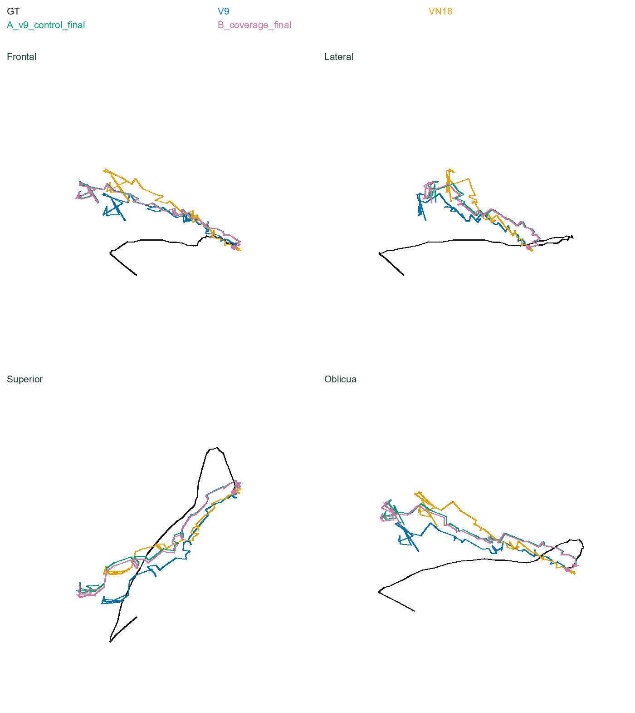
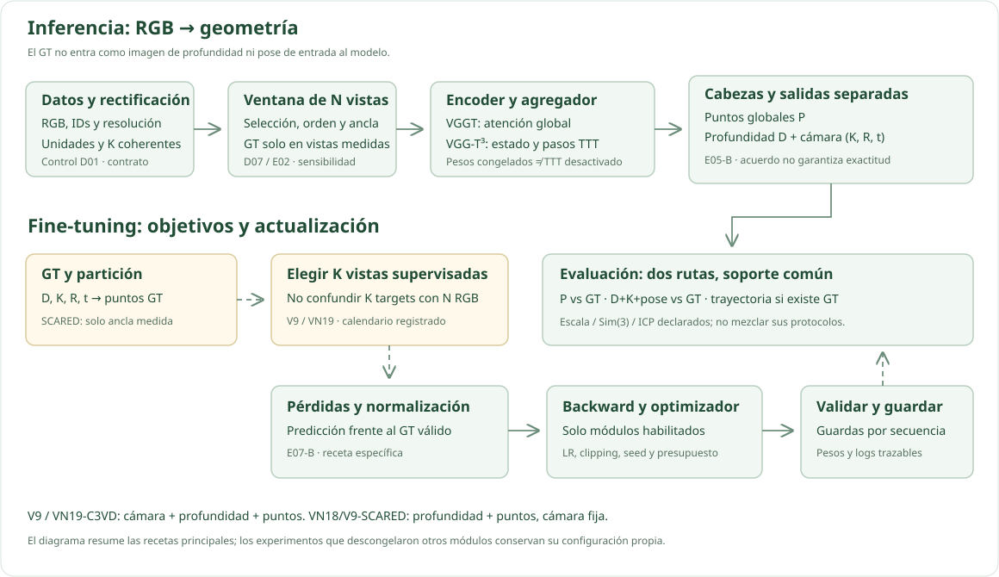
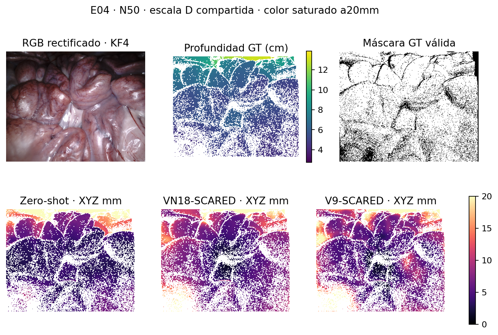
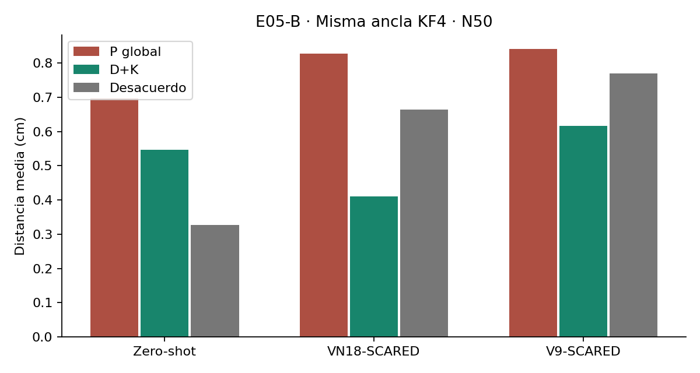
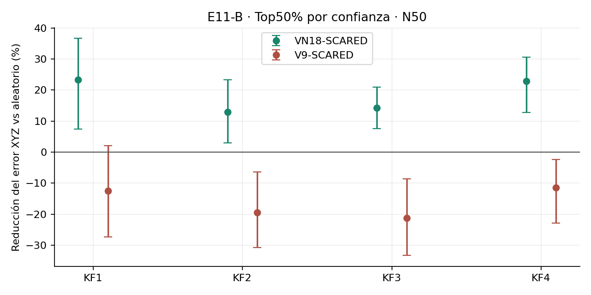

```{=html}
<section class="research-cover" aria-label="Portada de investigación">
<div class="cover-top"><div class="cover-institutions">Universidad Panamericana<br>&amp; King Abdullah<br>University of Science and Technology</div></div>
<div class="cover-main"><p class="cover-kicker">Research · Bitácora experimental</p><h1 class="cover-title">Neural 3D Scene Reconstruction<br>for Clinical Environments</h1><div class="cover-people"><strong>Santiago Hernández Chávez</strong><br>Advisors: Ivan Viola · Ricardo Abel Espinosa Loera</div></div>
<div class="cover-bottom"><div class="cover-place">Aguascalientes, Aguascalientes · 2026<br><span class="cover-note">C3VD y SCARED · actualizado el 19/11/2026</span></div></div>
</section>

<details class="research-draft" id="research-document">
<summary>Research document · título, introducción, problema e hipótesis</summary>

<div class="scope-note">Texto conservado del documento aportado, <em>Research.docx.pdf</em>. Es un borrador de la propuesta: sus objetivos y afirmaciones no se presentan como hallazgos demostrados por los experimentos. La hipótesis termina incompleta en el original.</div>

<div class="card-content">

<h3 class="draft-heading">Project Title</h3><p>Neural 3D Scene Reconstruction for Clinical Environments</p>
<h3 class="draft-heading">1. Introduction</h3><p></p><h4>1.1 The Clinical Burden and the Imperative for Early Detection</h4><p> Colorectal cancer (CRC) represents a profound global health challenge, currently ranking as the third most commonly diagnosed malignancy and the second leading cause of cancer-related mortality worldwide, accounting for approximately 935,000 deaths annually <a href="#research-ref-1">[1]</a>. The survival rate of CRC is highly dependent on the stage at diagnosis; when localized polyps are identified and resected early, the 5-year survival rate exceeds 90% <a href="#research-ref-2">[2]</a>. Consequently, endoscopic screening (colonoscopy) remains the gold standard for CRC prevention. However, this procedure is fundamentally limited by human visual perception and hardware constraints. Clinical studies reveal a staggering Adenoma Miss Rate (AMR) of 22% to 28% during standard colonoscopies <a href="#research-ref-3">[3]</a>. Furthermore, research indicates that up to 85% of &quot;interval colorectal cancers&quot;—malignancies that develop between scheduled screenings—are directly attributed to lesions that were missed during previous endoscopic examinations due to limited visibility or human error <a href="#research-ref-4">[4]</a>. </p><h4>1.2 The Limitations of Conventional 2D Endoscopy</h4><p> The high miss rate in endoscopic interventions is intrinsically linked to the reliance on two-dimensional (2D) monocular video feeds. The gastrointestinal tract is a highly complex, tubular environment characterized by overlapping tissue folds (haustra) and sharp anatomical turns. The lack of depth perception in 2D screens severely restricts the physician&#x27;s spatial awareness, allowing critical lesions to remain hidden in anatomical blind spots <a href="#research-ref-5">[5]</a>. Additionally, estimating the true morphological dimensions of a polyp—a vital metric for determining the resection strategy—relies heavily on the physician&#x27;s subjective judgment, which is often distorted by optical illusions and camera angles <a href="#research-ref-6">[6]</a>. </p><h4>1.3 The Transformative Potential of 3D Scene Reconstruction</h4><p> Transitioning from 2D video interpretation to real-time, three-dimensional (3D) scene reconstruction has the potential to fundamentally disrupt surgical workflows. Providing endoscopists with a dense, 3D topographical map of the luminal environment would enable enhanced spatial navigation, precise volumetric measurements of lesions, and retrospective virtual inspection of blind spots through digital twins. Most importantly, robust 3D geometry is the foundational prerequisite for intraoperative Augmented Reality (AR), which could computationally highlight hidden structures and guide surgical instruments in real time <a href="#research-ref-7">[7]</a>. </p><h4>1.4 The State of 3D Reconstruction and the Need for Instantaneous Inference</h4><p> In the broader field of computer vision, 3D scene representation has experienced a paradigm shift. Traditional feature-matching algorithms, such as Structure-from-Motion (SfM) and SLAM, struggle significantly in endoscopic environments due to the lack of distinct textures and the prevalence of featureless tissues <a href="#research-ref-8">[8]</a>. Recently, neural representations like Neural Radiance Fields (NeRF) <a href="#research-ref-9">[9]</a> and 3D Gaussian Splatting (3DGS) <a href="#research-ref-10">[10]</a> have become the gold standard for achieving photorealistic 3D environments. However, applying these methods to clinical endoscopy reveals a critical bottleneck: they rely on iterative, per-scene optimization. Reconstructing a single surgical sequence can take from several minutes to hours of computation, rendering them completely unviable for intraoperative assistance where surgeons require zero-latency feedback <a href="#research-ref-11">[11]</a>. Consequently, the field is actively seeking zero-shot, feed-forward neural architectures capable of inferring geometry instantaneously without requiring per-scene retraining. </p><h4>1.5 The Endoscopic Domain Gap (Core Challenges)</h4><p> While rapid, feed-forward foundation models show promise in general natural environments, their direct deployment to clinical endoscopy introduces severe domain-shift challenges. These systems are predominantly trained on rigid datasets under stable, ambient illumination. When applied to the gastrointestinal tract, their static assumptions are aggressively tested by three specific clinical domain factors: </p><p>•  Intrinsic Non-Rigidity: Soft-tissue structures undergo continuous physiological deformation caused by peristalsis, respiration, and mechanical interaction. These time-varying geometries confound static neural representations, leading to severe geometric blurring over time. </p><p>•  Dynamic Instrument Occlusion: The frequent introduction of surgical tools actively obstructs the organ surface. Neural networks attempting to map the scene often fuse these moving foreground objects with the background tissue, causing topological disruptions. </p><p>•  Photometric Inconsistency &amp; Specularities: Camera-mounted light sources cause proximity-dependent illumination falloff. Furthermore, the wet mucosal surfaces generate transient, moving specular highlights that standard neural networks consistently misinterpret as physical 3D structures. </p><h4>1.6 Proposed Research Direction</h4><p> To bridge this gap and address the aforementioned domain challenges, this project proposes investigating an adaptive neural 3D representation framework—building upon the principles of rapid, geometry-grounded visual Transformers. By integrating a temporal non-rigid deformation field and an appearance-and-occlusion decoupling module, this research aims to produce a robust, feed-forward software foundation layer. Ultimately, this architecture is designed to run locally on modern edge-computing endoscopy equipment, delivering resilient, real-time 3D geometry to mitigate the clinical blind spots that currently compromise patient outcomes.</p>
<h3 class="draft-heading">2. Problem Statement</h3><p>Current state-of-the-art architectures for 3D scene reconstruction are fundamentally predicated on geometric and photometric assumptions that hold true in natural, rigid environments. However, the gastrointestinal tract presents a highly unstructured, dynamic, and visually adverse environment. Deploying real-time 3D reconstruction algorithms in clinical endoscopy systematically violates these foundational mathematical premises, leading to optimization collapse, trajectory drift, and severe geometric artifacts. These failures are driven by four distinct domain-specific bottlenecks: </p><h4>2.1 The Assumption of Static Geometry (Intrinsic Non-Rigidity)</h4><p> Most unsupervised 3D reconstruction and Visual Odometry (VO) algorithms operate under the &quot;static world assumption,&quot; which posits that the 3D coordinates of a scene remain fixed while only the camera moves <a href="#research-ref-12">[12]</a>. In colorectal endoscopy, this assumption is continuously violated. Soft-tissue structures undergo constant physiological deformation driven by peristalsis, patient respiration, and direct mechanical interaction with the endoscope tip. When an algorithm attempts to map these time-varying geometries into a single, global 3D coordinate space, it is forced to reconcile contradictory spatial data. Over a continuous sequence, this spatial entanglement results in &quot;geometric blurring,&quot; catastrophic tracking failure, and the inability to establish reliable loop closures when revisiting a previously observed anatomical landmark <a href="#research-ref-13">[13]</a>. </p><h4>2.2 The Violation of Photometric Constancy (Dynamic Illumination and Specularities)</h4><p> Neural reconstruction networks heavily rely on the &quot;brightness constancy assumption&quot;—the principle that a physical point in space maintains a consistent pixel intensity regardless of the camera&#x27;s viewing angle <a href="#research-ref-14">[14]</a>. Endoscopy actively breaks this rule. The light source is co-located with the camera lens, resulting in proximity-dependent illumination where tissue brightness changes drastically as the endoscope moves forward (light falloff). Furthermore, the mucosal surface of the colon is highly reflective and coated in fluids. This generates saturated, moving specular highlights that shift across the tissue surface depending on the camera&#x27;s pose. Standard depth-estimation algorithms and optimization networks consistently misinterpret these moving reflections and shadows as shifting physical structures, generating false geometry, &quot;floating&quot; artifacts, and corrupting the depth maps <a href="#research-ref-15">[15]</a>. </p><h4>2.3 Spatial Corruption via Dynamic Occlusions</h4><p> Clinical interventions require the frequent introduction of surgical instruments (e.g., biopsy forceps, snares) into the camera&#x27;s field of view. Standard continuous reconstruction pipelines process the entire visual frame, assuming all visible pixels belong to the background anatomy <a href="#research-ref-16">[16]</a>. When moving instruments obstruct the organ surface, the network attempts to fuse these independent foreground trajectories with the static background map. This spatial conflict causes severe topological disruptions, fragmentation of the reconstructed mucosal wall, and forces the camera tracking module to calculate erroneous trajectories by tracking the tool instead of the tissue <a href="#research-ref-17">[17]</a>. </p><h4>2.4 The Computational Bottleneck of Continuous Sequences</h4><p> Beyond the physical characteristics of the tissue, endoscopic procedures present a severe computational scale problem. A standard colonoscopy yields tens of thousands of continuous high-resolution frames. Maintaining global geometric consistency across such long sequences typically requires algorithms to store explicit spatial memories (such as keyframe buffers, global point clouds, or large KV-caches in Transformer models). As the sequence lengthens, the memory constraints and computational overhead grow quadratically or linearly, inevitably exceeding the VRAM limits of edge-computing hardware <a href="#research-ref-18">[18]</a>. Consequently, maintaining stable, long-sequence 3D geometry under fixed GPU-memory constraints remains an unresolved bottleneck for real-time surgical deployment. </p><h4>Summary of the Problem:</h4><p> Therefore, before any advanced neural representation can be safely deployed for clinical 3D navigation, it must first be mathematically decoupled from the assumptions of static tissue, constant illumination, unobstructed views, and infinite memory capacity.</p>
<h3 class="draft-heading">3. Hypothesis</h3><p>We hypothesize that the optimization bottlenecks observed when applying rigid-scene LRMs to endoscopic video stem from the spatial-temporal entanglement of camera motion, tissue deformation, and foreground occlusions within a static neural representation. Therefore, we hypothesize that:</p>

<details><summary>References del borrador · numeración original</summary><p class="evidence-note">Se conserva la bibliografía aportada. Su verificación bibliográfica es independiente de la evidencia de los experimentos; no se corrigieron ni completaron citas del documento.</p><p class="draft-reference" id="research-ref-1"><strong>[1]</strong> H. Sung et al., &quot;Global Cancer Statistics 2020: GLOBOCAN Estimates of Incidence and Mortality Worldwide for 36 Cancers in 185 Countries,&quot; CA: A Cancer Journal for Clinicians, vol. 71, no. 3, pp. 209-249, 2021.</p>
<p class="draft-reference" id="research-ref-2"><strong>[2]</strong> R. L. Siegel et al., &quot;Colorectal cancer statistics, 2020,&quot; CA: A Cancer Journal for Clinicians, vol. 70, no. 3, pp. 145-164, 2020.</p>
<p class="draft-reference" id="research-ref-3"><strong>[3]</strong> S. Zhao et al., &quot;Magnitude, risk factors, and factors associated with adenoma miss rate of tandem colonoscopy: a systematic review and meta-analysis,&quot; Gastroenterology, vol. 156, no. 6, pp. 1661-1674, 2019.</p>
<p class="draft-reference" id="research-ref-4"><strong>[4]</strong> D. J. Robertson et al., &quot;Colorectal cancers soon after colonoscopy: a pooled multicohort analysis,&quot; Gut, vol. 63, no. 6, pp. 949-956, 2014.</p>
<p class="draft-reference" id="research-ref-5"><strong>[5]</strong> S. B. Ahn et al., &quot;The miss rate for colorectal adenoma determined by quality-adjusted, back-to-back colonoscopies,&quot; Gut and Liver, vol. 6, no. 1, p. 64, 2012.</p>
<p class="draft-reference" id="research-ref-6"><strong>[6]</strong> P. J. Eichenseer et al., &quot;Endoscopy time and its relationship to the detection of colorectal adenomas,&quot; Gastrointestinal Endoscopy, vol. 78, no. 3, pp. 502-508, 2013.</p>
<p class="draft-reference" id="research-ref-7"><strong>[7]</strong> S. Bernhardt, S. A. Nicolau, L. Soler, and C. Doignon, &quot;The status of augmented reality in laparoscopic surgery as of 2016,&quot; Medical Image Analysis, vol. 37, pp. 66-90, 2017.</p>
<p class="draft-reference" id="research-ref-8"><strong>[8]</strong> K. B. Ozyoruk et al., &quot;EndoSLAM dataset and an unsupervised monocular visual odometry and depth estimation approach for endoscopic videos,&quot; Medical Image Analysis, vol. 71, p. 102058, 2021.</p>
<p class="draft-reference" id="research-ref-9"><strong>[9]</strong> B. Mildenhall et al., &quot;NeRF: Representing scenes as neural radiance fields for view synthesis,&quot; Communications of the ACM, vol. 65, no. 1, pp. 99-106, 2021.</p>
<p class="draft-reference" id="research-ref-10"><strong>[10]</strong> B. Kerbl, G. Kopanas, T. Leimkühler, and G. Drettakis, &quot;3D Gaussian Splatting for Real-Time Radiance Field Rendering,&quot; ACM Transactions on Graphics, vol. 42, no. 4, 2023.</p>
<p class="draft-reference" id="research-ref-11"><strong>[11]</strong> Z. Yang et al., &quot;Neural Volumetric Reconstruction for Endoscopic Surgery,&quot; IEEE Transactions on Medical Imaging, vol. 43, no. 1, pp. 315-326, 2023.</p>
<p class="draft-reference" id="research-ref-12"><strong>[12]</strong> E. Turan, J. Almhdie-Imjabbar, and P. Rougier, &quot;A review of monocular visual odometry and SLAM for minimally invasive surgery,&quot; Minimally Invasive Therapy &amp; Allied Technologies, vol. 27, no. 5, pp. 247-259, 2018.</p>
<p class="draft-reference" id="research-ref-13"><strong>[13]</strong> N. Mahmoud et al., &quot;Live tracking of moving tissue in 3D from monocular endoscopic videos,&quot; Medical Image Analysis, vol. 53, pp. 14-27, 2019.</p>
<p class="draft-reference" id="research-ref-14"><strong>[14]</strong> L. Maier-Hein et al., &quot;Surgical data science for next-generation interventions,&quot; Nature Biomedical Engineering, vol. 1, no. 9, pp. 691-696, 2017.</p>
<p class="draft-reference" id="research-ref-15"><strong>[15]</strong> C. Wang, M. Macenko, J. M. Abizaid, and A. P. Bradley, &quot;Endoscopic image specular highlight removal using a robust generative adversarial network,&quot; IEEE Transactions on Medical Imaging, vol. 39, no. 11, pp. 3632-3642, 2020.</p>
<p class="draft-reference" id="research-ref-16"><strong>[16]</strong> M. Allan et al., &quot;2017 Robotic Instrument Segmentation Challenge,&quot; arXiv preprint arXiv:1902.04625, 2019.</p>
<p class="draft-reference" id="research-ref-17"><strong>[17]</strong> J. Lazo et al., &quot;Real-time instrument segmentation for safe and robust monocular SLAM in laparoscopy,&quot; International Journal of Computer Assisted Radiology and Surgery, vol. 15, pp. 1083-1092, 2020.</p>
<p class="draft-reference" id="research-ref-18"><strong>[18]</strong> K. B. Ozyoruk et al., &quot;EndoSLAM dataset and an unsupervised monocular visual odometry and depth estimation approach for endoscopic videos,&quot; Medical Image Analysis, vol. 71, p. 102058, 2021.</p>
</details>
<p><a href="contenido/Research_document.pdf" target="_blank" rel="noopener">Abrir el PDF original</a> · <a href="#bibliografia">Papers y enlaces de consulta experimental</a></p>

</div>
</details>


```

<nav class="reading-map model-map" aria-label="Elegir modelo"><a href="#vgg-t3"><strong>VGG-T³</strong><small>C3VD, SCARED y las 63 fichas actuales.</small></a><a href="#vggt"><strong>VGGT</strong><small>La misma estructura, lista para completar.</small></a><a href="#vggt-vs-vgg-t3"><strong>VGGT vs VGG-T³</strong><small>Espacio para las comparaciones entre modelos.</small></a></nav>

<p class="scope-note">Esta edición reorganiza resultados existentes. No cambia entrenamientos, métricas ni geometría. Las nubes se cargan bajo demanda con el 100 % de sus puntos guardados.</p>

## VGG-T³ {#vgg-t3 .model-workspace}

<p class="model-state">Registro actual · C3VD y SCARED</p>

<nav class="model-section-nav" aria-label="Apartados del modelo"><a href="#c3vd">C3VD</a><a href="#scared">SCARED</a><a href="#pipeline">Pipeline</a><a href="#experimentos">Experimentos</a><a href="#comparadores">Comparadores</a></nav>

Los resultados y las 63 fichas actuales se reúnen aquí. Las pruebas históricas que incluyeron VGGT como control conservan su ámbito original; la nueva organización no cambia el modelo al que corresponde cada medición.

### C3VD · referencias y resultados {#c3vd}

#### Resumen de C3VD {#estado}

<div class="protocol-strip" id="tabla-protocolo-01"><strong>Documentación</strong> · C3VD · Según versión y filas</div>

<details class="table-protocol"><summary>Protocolo de esta tabla · frames, pesos, escala, GT y unidades</summary><dl class="protocol-fields"><div><dt>Dataset</dt><dd>C3VD</dd></div><div><dt>Partición</dt><dd>Según versión y filas</dd></div><div><dt>Checkpoint</dt><dd>V9 / VN19-A/B, según columna</dd></div><div><dt>Frames</dt><dd>No aplica: tabla de documentación</dd></div><div><dt>Escala y alineamiento</dt><dd>No aplica: no es una medición geométrica</dd></div><div><dt>Unidades</dt><dd>Las explícitas en el registro</dd></div><div><dt>GT</dt><dd>No aplica a esta tabla de documentación</dd></div></dl><p class="evidence-note"><a href="#ref-vggttt">Artículo y secciones de referencia</a> · <a href="tablas/protocolos_tablas.json">Índice de protocolos y hashes de tablas</a></p></details>

| Versión | Qué representa | Entrenamiento y selección | Estado |
|---|---|---|---|
| **V9** | Referencia de adaptación de las tres cabezas nativas de VGG-T³ | 1.000 pasos; seleccionado **850** | Referencia conservada. |
| **VN19-A** | Receta V9 sobre split y calendario actuales; selección densa aleatoria | 3.240 pasos; se examina el **final 3240** | Ningún candidato entrenado pasó todas las guardas. |
| **VN19-B** | Mismo control A, cambiando la selección densa a cobertura y repeticiones profundas | 3.240 pasos; se examina el **final 3240** | Ningún candidato entrenado pasó todas las guardas. |

**Conclusión actual:** VN19 mejora algunas métricas y ejemplos, pero no constituye una mejora conjunta demostrada sobre V9. A/B es una comparación controlada de una política compuesta; V9 frente a VN19 también cambia datos y presupuesto. Una reconstrucción visualmente favorable no sustituye las comprobaciones por secuencia.


#### Datos y protocolo de comparación {#datos}

Las tablas y vistas principales usan **trans_t4_b**, los mismos **50 RGB a 336×336**, seleccionados entre IDs **0–596**. Las métricas puntúan los mismos **16 frames GT**, con **1.771.907 píxeles válidos**. Para esta comparación se utiliza una escala de profundidad compartida por contexto, **sin ICP**.

La nube de VGG-T³ procede de su **cabeza global de puntos**. La trayectoria procede de una **cabeza de cámara separada**. También se evalúa la ruta derivada D+K+pose: una mejora en una ruta no garantiza mejorar la otra.

<div class="protocol-strip" id="tabla-protocolo-02"><strong>Documentación</strong> · C3VD · Según versión y filas</div>

<details class="table-protocol"><summary>Protocolo de esta tabla · frames, pesos, escala, GT y unidades</summary><dl class="protocol-fields"><div><dt>Dataset</dt><dd>C3VD</dd></div><div><dt>Partición</dt><dd>Según versión y filas</dd></div><div><dt>Checkpoint</dt><dd>V9 / VN19-A/B, según columna</dd></div><div><dt>Frames</dt><dd>No aplica: tabla de documentación</dd></div><div><dt>Escala y alineamiento</dt><dd>No aplica: no es una medición geométrica</dd></div><div><dt>Unidades</dt><dd>Las explícitas en el registro</dd></div><div><dt>GT</dt><dd>No aplica a esta tabla de documentación</dd></div></dl><p class="evidence-note"><a href="#ref-vggttt">Artículo y secciones de referencia</a> · <a href="tablas/protocolos_tablas.json">Índice de protocolos y hashes de tablas</a></p></details>

| Contrato | Qué se verificó / se usa |
|---|---|
| RGB y GT | Rectificación ocam→pinhole coherente y correspondencia de frames. |
| Profundidad | Z axial en metros, separada de distancia radial y de unidades de visualización. |
| Intrínsecas | K ajustada con el mismo resize; a336: fx=fy≈214,054; cx=cy=168. |
| Poses y puntos | Convención C2W, traslación en SI y referencia del primer frame; puntos GT desde D/K/C2W coherentes. |
| Inferencia | RGB; no se suministran profundidad ni poses GT. K conocida solo en las rutas que lo declaran. |
| Evaluación y figuras | El ajuste de escala con GT está declarado; no equivale a recuperar escala absoluta sin GT. |


<details>
<summary>C3VD: secuencias disponibles y roles por versión</summary>


<div class="protocol-strip" id="tabla-protocolo-03"><strong>Documentación</strong> · C3VD · Según versión y filas</div>

<details class="table-protocol"><summary>Protocolo de esta tabla · frames, pesos, escala, GT y unidades</summary><dl class="protocol-fields"><div><dt>Dataset</dt><dd>C3VD</dd></div><div><dt>Partición</dt><dd>Según versión y filas</dd></div><div><dt>Checkpoint</dt><dd>V9 / VN19-A/B, según columna</dd></div><div><dt>Frames</dt><dd>No aplica: tabla de documentación</dd></div><div><dt>Escala y alineamiento</dt><dd>No aplica: no es una medición geométrica</dd></div><div><dt>Unidades</dt><dd>Las explícitas en el registro</dd></div><div><dt>GT</dt><dd>No aplica a esta tabla de documentación</dd></div></dl><p class="evidence-note"><a href="#ref-vggttt">Artículo y secciones de referencia</a> · <a href="tablas/protocolos_tablas.json">Índice de protocolos y hashes de tablas</a></p></details>

| Secuencia | Frames disponibles | IDs fuente | Referencia disponible |
| --- | --- | --- | --- |
| cecum_t1_b | 765 | 0--764 | Profundidad, calibración y poses por frame. |
| cecum_t2_b | 1142 | 0--1141 | Profundidad, calibración y poses por frame. |
| cecum_t3_a | 730 | 0--729 | Profundidad, calibración y poses por frame. |
| desc_t4_a | 148 | 0--147 | Profundidad, calibración y poses por frame. |
| sigmoid_t1_a | 700 | 0--699 | Profundidad, calibración y poses por frame. |
| sigmoid_t3_a | 613 | 0--612 | Profundidad, calibración y poses por frame. |
| trans_t1_b | 700 | 0--699 | Profundidad, calibración y poses por frame. |
| trans_t4_b | 597 | 0--596 | Profundidad, calibración y poses por frame. |
| cecum_t2_a | 370 | 0--369 | Profundidad, calibración y poses por frame. |
| trans_t1_a | 61 | 0--60 | Profundidad, calibración y poses por frame. |
| screening_t1 | 5458 | 0--5457 | RGB y calibración; poses provisionales. Sin profundidad GT local. |


<div class="protocol-strip" id="tabla-protocolo-04"><strong>Documentación</strong> · C3VD · Según versión y filas</div>

<details class="table-protocol"><summary>Protocolo de esta tabla · frames, pesos, escala, GT y unidades</summary><dl class="protocol-fields"><div><dt>Dataset</dt><dd>C3VD</dd></div><div><dt>Partición</dt><dd>Según versión y filas</dd></div><div><dt>Checkpoint</dt><dd>V9 / VN19-A/B, según columna</dd></div><div><dt>Frames</dt><dd>No aplica: tabla de documentación</dd></div><div><dt>Escala y alineamiento</dt><dd>No aplica: no es una medición geométrica</dd></div><div><dt>Unidades</dt><dd>Las explícitas en el registro</dd></div><div><dt>GT</dt><dd>No aplica a esta tabla de documentación</dd></div></dl><p class="evidence-note"><a href="#ref-vggttt">Artículo y secciones de referencia</a> · <a href="tablas/protocolos_tablas.json">Índice de protocolos y hashes de tablas</a></p></details>

| Secuencia | VGGT histórico / TTT V9 y V11 histórico | TTT VN18 / preparación VN19 |
| --- | --- | --- |
| cecum_t1_b | Entrenamiento | Entrenamiento |
| cecum_t2_b | Entrenamiento | Entrenamiento |
| cecum_t3_a | Entrenamiento | Validación |
| desc_t4_a | Entrenamiento | Entrenamiento |
| sigmoid_t1_a | Entrenamiento | Entrenamiento |
| sigmoid_t3_a | Entrenamiento | Entrenamiento |
| trans_t1_b | Validación | Entrenamiento |
| trans_t4_b | Validación | Validación |
| cecum_t2_a | Reserva del mismo phantom | Reserva del mismo phantom |
| trans_t1_a | Reserva del mismo phantom | Reserva del mismo phantom |
| screening_t1 | Reserva larga; sin profundidad GT local | Reserva larga; sin profundidad GT local |


El split cambió: `cecum_t3_a` pasó de TRAIN en V9 a VAL en VN19; `trans_t1_b` pasó de VAL a TRAIN. Por ello, comparar promedios sin declarar el rol de cada secuencia no es una comparación de generalización homogénea. Las reservas son del mismo phantom y ya han sido inspeccionadas; no son pacientes nuevos ni un test clínico ciego.

El inventario contiene diez secuencias cortas con D/K/poses y una screening larga. “Todos los ZIP disponibles” incluye versiones originales/derivadas y no equivale a secuencias independientes.


</details>

<details>
<summary>Por qué los splits importan al comparar V9 y VN19</summary>

V9 entrena con cecum_t1_b, cecum_t2_b, cecum_t3_a, desc_t4_a, sigmoid_t1_a y sigmoid_t3_a; valida con trans_t1_b y trans_t4_b.

VN19 sustituye cecum_t3_a por trans_t1_b en TRAIN y valida con cecum_t3_a/trans_t4_b. Cecum_t2_a y trans_t1_a permanecen como reservas del mismo phantom, ya inspeccionadas en el desarrollo. No son pacientes nuevos ni un test clínico ciego.

Por eso las diferencias V9/VN19 no aíslan solo el muestreo. Entre A/B sí se mantuvieron los contextos y su orden; cambiar únicamente ese muestreo tampoco separa los dos componentes internos de B.

</details>


#### Cómo se entrenaron V9, VN19-A y VN19-B {#entrenamientos}

Son **fine-tunings desde pesos oficiales preentrenados**, no entrenamientos desde cero. Ejecutar primero zero-shot es una evaluación; no cambia esos pesos iniciales.

<div class="protocol-strip" id="tabla-protocolo-05"><strong>Documentación</strong> · C3VD · Según versión y filas</div>

<details class="table-protocol"><summary>Protocolo de esta tabla · frames, pesos, escala, GT y unidades</summary><dl class="protocol-fields"><div><dt>Dataset</dt><dd>C3VD</dd></div><div><dt>Partición</dt><dd>Según versión y filas</dd></div><div><dt>Checkpoint</dt><dd>V9 / VN19-A/B, según columna</dd></div><div><dt>Frames</dt><dd>No aplica: tabla de documentación</dd></div><div><dt>Escala y alineamiento</dt><dd>No aplica: no es una medición geométrica</dd></div><div><dt>Unidades</dt><dd>Las explícitas en el registro</dd></div><div><dt>GT</dt><dd>No aplica a esta tabla de documentación</dd></div></dl><p class="evidence-note"><a href="#ref-vggttt">Artículo y secciones de referencia</a> · <a href="tablas/protocolos_tablas.json">Índice de protocolos y hashes de tablas</a></p></details>

| Elemento | V9 | VN19-A | VN19-B |
|---|---|---|---|
| Inicialización | Pesos oficiales; no hereda las cabezas V7 incompatibles con TTT2 | Pesos oficiales frescos | La misma fuente y firma inicial que A |
| Módulos actualizados | Cabezas nativas de cámara, profundidad y puntos | Las mismas tres cabezas | Las mismas tres cabezas |
| Módulos congelados | Encoder/agregador y parámetros externos de TTT | Igual | Igual |
| TTT interno | Dos actualizaciones durante el forward | Dos | Dos |
| Resolución | 336×336 | 336×336 | 336×336 |
| Contextos RGB | 3 / 6 / 12 / 50 vistas; 56 ventanas | 3 / 6 / 12 / 50; 78 ventanas auditadas | Las mismas ventanas y orden que A |
| Selección densa | Dos vistas aleatorias por actualización | Dos vistas aleatorias independientes por actualización | Dos vistas con calendario de cobertura y repeticiones profundas |
| Actualizaciones | 1.000 | 3.240 | 3.240 |
| Targets densos, contando repeticiones | 2.000 | 6.480 | 6.480 |
| Frames originales con pérdida densa al finalizar | 430 | 919 de1.020 en el pool actual | 1.020 de1.020 en el pool actual |
| Checkpoint mostrado | Paso850 seleccionado en su validación | Final3240, diagnóstico | Final3240, diagnóstico |
| Aceptación | Selección mediante score conjunto V9 | Ningún afinado admisible por todas las guardas VN19 | Ningún afinado admisible por todas las guardas VN19 |

Los conteos de frames únicos se refieren a pérdida densa completa y a pools distintos. No significa que los demás frames no tengan contexto o supervisión de cámara. **Congelar TTT en el optimizador externo no desactiva su adaptación interna.** No se utilizó LoRA.


<details>
<summary>Pérdidas, hiperparámetros y módulos: detalle técnico</summary>


<div class="protocol-strip" id="tabla-protocolo-06"><strong>Documentación</strong> · C3VD · Según versión y filas</div>

<details class="table-protocol"><summary>Protocolo de esta tabla · frames, pesos, escala, GT y unidades</summary><dl class="protocol-fields"><div><dt>Dataset</dt><dd>C3VD</dd></div><div><dt>Partición</dt><dd>Según versión y filas</dd></div><div><dt>Checkpoint</dt><dd>V9 / VN19-A/B, según columna</dd></div><div><dt>Frames</dt><dd>No aplica: tabla de documentación</dd></div><div><dt>Escala y alineamiento</dt><dd>No aplica: no es una medición geométrica</dd></div><div><dt>Unidades</dt><dd>Las explícitas en el registro</dd></div><div><dt>GT</dt><dd>No aplica a esta tabla de documentación</dd></div></dl><p class="evidence-note"><a href="#ref-vggttt">Artículo y secciones de referencia</a> · <a href="tablas/protocolos_tablas.json">Índice de protocolos y hashes de tablas</a></p></details>

| Parámetro | V9 | VN19-A y VN19-B |
|---|---|---|
| Pérdida | $3L_{XYZ}+L_{\log D}+0.2L_{\nabla XYZ}+0.2L_{camera}$ | Se reutiliza la misma receta V9. |
| Referencia geométrica | 0,03m para parametrizar puntos, profundidad y traslación | Igual; no es una escala GT por secuencia durante inferencia. |
| Optimizador | AdamW | AdamW |
| LR máximo | 1e-5 | 1e-5 |
| Betas / eps | (0,9;0,95) / 1e-6 | Igual |
| Weight decay | 0,01 | 0,01 |
| LR temporal | Warmup25 y coseno, ligado al presupuesto total | Mismo esquema, sobre3.240 actualizaciones. |
| Clipping | Norma global1 de las cabezas | Igual; introduce acoplamiento entre gradientes. |
| Semilla | 1234 | 1234; A/B comparte firma inicial, no es una repetición con varias semillas. |
| Pérdidas densas | Dos imágenes; solo GT válido y vecinos válidos para gradientes | Igual; cambia cuáles se seleccionan. |
| Cámara | GT del contexto, cuatro refinamientos y geometría de cámara | Igual; geometría GT en rejilla cada12 píxeles y K comprobada. |
| Features congeladas | Caché comprobada contra forward nativo | Igual; no se interpreta como latencia de inferencia RGB. |

Las cabezas son los módulos entrenables; no se descongela el backbone completo. La disponibilidad de parámetros entrenables no garantiza gradiente directo útil en cada canal: por ejemplo, la confianza final no tenía pérdida directa en V9.


</details>


<details>
<summary>Calendarios, exposición real y límites de la comparación</summary>


<div class="protocol-strip" id="tabla-protocolo-07"><strong>Documentación</strong> · C3VD · Según versión y filas</div>

<details class="table-protocol"><summary>Protocolo de esta tabla · frames, pesos, escala, GT y unidades</summary><dl class="protocol-fields"><div><dt>Dataset</dt><dd>C3VD</dd></div><div><dt>Partición</dt><dd>Según versión y filas</dd></div><div><dt>Checkpoint</dt><dd>V9 / VN19-A/B, según columna</dd></div><div><dt>Frames</dt><dd>No aplica: tabla de documentación</dd></div><div><dt>Escala y alineamiento</dt><dd>No aplica: no es una medición geométrica</dd></div><div><dt>Unidades</dt><dd>Las explícitas en el registro</dd></div><div><dt>GT</dt><dd>No aplica a esta tabla de documentación</dd></div></dl><p class="evidence-note"><a href="#ref-vggttt">Artículo y secciones de referencia</a> · <a href="tablas/protocolos_tablas.json">Índice de protocolos y hashes de tablas</a></p></details>

| Vistas del contexto N | Pasos observados V9 | Pasos por brazo VN19 |
| --- | --- | --- |
| 3 | 131 | 720 |
| 6 | 356 | 720 |
| 12 | 183 | 720 |
| 50 | 330 | 1080 |


En VN19 se igualó el presupuesto de secuencia y cuartos de movimiento angular, con solapamiento GT auditado en TRAIN. Los dos targets son **imágenes dentro del contexto**, no dos ventanas ni las únicas poses supervisadas.

B recorre posiciones de las ventanas para asegurar cobertura densa y añade selecciones de vistas con una fracción profunda suficiente. Las repeticiones profundas no amplían el total de6.480 targets: cambian su distribución. La auditoría encontró514 selecciones de repetición adicional y cobertura completa en el paso3193.

Los pasos de V9 son los1.000 registrados; se muestra su checkpoint850. Las cifras totales de exposición no se atribuyen retrospectivamente todas al checkpoint850. Los tamaños3/6/12/50 son la receta estudiada, no capacidades óptimas demostradas.


</details>


#### Comparaciones cuantitativas {#comparaciones}

**Mismos RGB y GT dentro de cada tabla.** Δ favorable>0 significa mejora; Δ<0, deterioro. Los porcentajes de A/B se calculan respecto a **V9**, mientras la tabla de zero-shot indica explícitamente esa otra referencia. Las distancias se muestran en **cm**, las rotaciones en **grados**.

##### Profundidad y geometría


<div class="protocol-strip" id="tabla-protocolo-08"><strong>Evaluación local</strong> · C3VD trans_t4_b · Validación de los modelos C3VD; lectura de transferencia para pesos SCARED</div>

<details class="table-protocol"><summary>Protocolo de esta tabla · frames, pesos, escala, GT y unidades</summary><dl class="protocol-fields"><div><dt>Dataset</dt><dd>C3VD trans_t4_b</dd></div><div><dt>Partición</dt><dd>Validación de los modelos C3VD; lectura de transferencia para pesos SCARED</dd></div><div><dt>Checkpoint</dt><dd>V9 / VN19-A/B, según columna</dd></div><div><dt>Frames</dt><dd>50 RGB 336²; 16 objetivos GT comunes</dd></div><div><dt>Escala y alineamiento</dt><dd>Una escala positiva GT compartida por contexto; sin ICP</dd></div><div><dt>Unidades</dt><dd>cm, grados, porcentajes; AbsRel sin unidad</dd></div><div><dt>GT</dt><dd>Profundidad, K y poses de los 16 objetivos; 1.771.907 píxeles válidos</dd></div></dl><p class="evidence-note"><a href="#ref-vggttt">Artículo y secciones de referencia</a> · <a href="tablas/protocolos_tablas.json">Índice de protocolos y hashes de tablas</a></p></details>

| Métrica | Zero-shot | V9 | VN19-A | VN19-B | Δ A/V9 favorable | Δ B/V9 favorable |
| --- | --- | --- | --- | --- | --- | --- |
| AbsRel ↓ | 0,1824 | 0,1486 | 0,1721 | 0,1722 | -15,84 % | -15,85 % |
| δ1 (%) ↑ | 72,10 | 78,38 | 74,87 | 73,03 | -4,48 % | -6,84 % |
| RMSE profundidad (cm) ↓ | 0,725 | 0,698 | 0,592 | 0,592 | +15,14 % | +15,12 % |
| XYZ medio (cm) ↓ | 0,724 | 0,476 | 0,568 | 0,575 | -19,47 % | -20,91 % |
| XYZ p95 (cm) ↓ | 2,131 | 1,305 | 1,301 | 1,337 | +0,27 % | -2,47 % |
| D + K calibrada + pose (cm) ↓ | 0,771 | 0,600 | 0,579 | 0,573 | +3,51 % | +4,49 % |

##### Cámara y movimiento


<div class="protocol-strip" id="tabla-protocolo-09"><strong>Evaluación local</strong> · C3VD trans_t4_b · Validación de los modelos C3VD; lectura de transferencia para pesos SCARED</div>

<details class="table-protocol"><summary>Protocolo de esta tabla · frames, pesos, escala, GT y unidades</summary><dl class="protocol-fields"><div><dt>Dataset</dt><dd>C3VD trans_t4_b</dd></div><div><dt>Partición</dt><dd>Validación de los modelos C3VD; lectura de transferencia para pesos SCARED</dd></div><div><dt>Checkpoint</dt><dd>V9 / VN19-A/B, según columna</dd></div><div><dt>Frames</dt><dd>50 RGB 336²; 16 objetivos GT comunes</dd></div><div><dt>Escala y alineamiento</dt><dd>Una escala positiva GT compartida por contexto; sin ICP</dd></div><div><dt>Unidades</dt><dd>cm, grados, porcentajes; AbsRel sin unidad</dd></div><div><dt>GT</dt><dd>Profundidad, K y poses de los 16 objetivos; 1.771.907 píxeles válidos</dd></div></dl><p class="evidence-note"><a href="#ref-vggttt">Artículo y secciones de referencia</a> · <a href="tablas/protocolos_tablas.json">Índice de protocolos y hashes de tablas</a></p></details>

| Métrica | Zero-shot | V9 | VN19-A | VN19-B | Δ A/V9 favorable | Δ B/V9 favorable |
| --- | --- | --- | --- | --- | --- | --- |
| Rotación media (°) ↓ | 10,797 | 6,907 | 6,340 | 6,169 | +8,20 % | +10,68 % |
| Centros anclados RMSE (cm) ↓ | 0,195 | 0,181 | 0,199 | 0,199 | -10,16 % | -10,40 % |
| RPEr histórico (°) ↓ | 1,759 | 1,476 | 1,261 | 1,250 | +14,57 % | +15,31 % |
| RPEt histórico (cm) ↓ | 0,065 | 0,065 | 0,062 | 0,062 | +4,46 % | +4,33 % |
| Error focal relativo (%) ↓ | 20,48 | 3,63 | 1,28 | 1,31 | +64,72 % | +63,79 % |


En Trans4, A/B mejoran focal, rotación y algunas medidas de D+cámara respecto a V9, pero empeoran AbsRel y XYZ global medio. Esa compensación impide describirlos como una mejora general.


<details>
<summary>Respecto a los pesos oficiales zero-shot</summary>


<div class="protocol-strip" id="tabla-protocolo-10"><strong>Evaluación local</strong> · C3VD trans_t4_b · Validación de los modelos C3VD; lectura de transferencia para pesos SCARED</div>

<details class="table-protocol"><summary>Protocolo de esta tabla · frames, pesos, escala, GT y unidades</summary><dl class="protocol-fields"><div><dt>Dataset</dt><dd>C3VD trans_t4_b</dd></div><div><dt>Partición</dt><dd>Validación de los modelos C3VD; lectura de transferencia para pesos SCARED</dd></div><div><dt>Checkpoint</dt><dd>V9 / VN19-A/B, según columna</dd></div><div><dt>Frames</dt><dd>50 RGB 336²; 16 objetivos GT comunes</dd></div><div><dt>Escala y alineamiento</dt><dd>Una escala positiva GT compartida por contexto; sin ICP</dd></div><div><dt>Unidades</dt><dd>cm, grados, porcentajes; AbsRel sin unidad</dd></div><div><dt>GT</dt><dd>Profundidad, K y poses de los 16 objetivos; 1.771.907 píxeles válidos</dd></div></dl><p class="evidence-note"><a href="#ref-vggttt">Artículo y secciones de referencia</a> · <a href="tablas/protocolos_tablas.json">Índice de protocolos y hashes de tablas</a></p></details>

| Pesos | AbsRel ↓ | δ1 (%) ↑ | XYZ medio (cm) ↓ | Δ XYZ favorable/ZS | RPEr histórico (°) ↓ |
| --- | --- | --- | --- | --- | --- |
| Zero-shot | 0,1824 | 72,10 | 0,724 | 0,00 % | 1,759 |
| V9 | 0,1486 | 78,38 | 0,476 | +34,32 % | 1,476 |
| VN19-A | 0,1721 | 74,87 | 0,568 | +21,53 % | 1,261 |
| VN19-B | 0,1722 | 73,03 | 0,575 | +20,59 % | 1,250 |


Mismos50 RGB y mismos16 objetivos. Es una comparación de desarrollo. V9 es seleccionado850; VN19-A/B son finales3240, no aceptados por todas las guardas.
Los cuatro modelos se evalúan sobre los mismos50 RGB y16 objetivos GT. No usar el porcentaje frente a zero-shot como si fuera porcentaje frente aV9.

</details>


<details>
<summary>Ampliación a diez secuencias: TRAIN, VAL y reservas</summary>


<div class="protocol-strip" id="tabla-protocolo-11"><strong>Evaluación local</strong> · C3VD · diez secuencias · TRAIN, VAL y reservas según las filas; roles V9/VN19 visibles</div>

<details class="table-protocol"><summary>Protocolo de esta tabla · frames, pesos, escala, GT y unidades</summary><dl class="protocol-fields"><div><dt>Dataset</dt><dd>C3VD · diez secuencias</dd></div><div><dt>Partición</dt><dd>TRAIN, VAL y reservas según las filas; roles V9/VN19 visibles</dd></div><div><dt>Checkpoint</dt><dd>V9 / VN19-A/B, según columna</dd></div><div><dt>Frames</dt><dd>50 RGB 336²; 16 objetivos GT comunes</dd></div><div><dt>Escala y alineamiento</dt><dd>Una escala positiva GT compartida por contexto; sin ICP</dd></div><div><dt>Unidades</dt><dd>cm, grados, porcentajes; AbsRel sin unidad</dd></div><div><dt>GT</dt><dd>16 objetivos GT por contexto; soporte válido por secuencia</dd></div></dl><p class="evidence-note"><a href="#ref-vggttt">Artículo y secciones de referencia</a> · <a href="tablas/protocolos_tablas.json">Índice de protocolos y hashes de tablas</a></p></details>

| Grupo según VN19 | Secuencias | V9 XYZ(cm) | A XYZ(cm) | B XYZ(cm) | Δ B/A favorable |
| --- | --- | --- | --- | --- | --- |
| validation | 2 | 0,387 | 0,593 | 0,615 | -3,64 % |
| reserved | 2 | 1,208 | 0,995 | 0,997 | -0,12 % |
| train | 6 | 0,660 | 0,345 | 0,331 | 3,79 % |


La tabla utiliza escala compartida de profundidad por contexto, no ICP. La población VAL deVN19 incluye Cecum3, que fue TRAIN deV9; por eso el rol por modelo debe acompañar los valores. El análisis de las reservas es del mismo phantom y ya fue inspeccionado.


<div class="protocol-strip" id="tabla-protocolo-12"><strong>Evaluación local</strong> · C3VD · diez secuencias · TRAIN, VAL y reservas según las filas; roles V9/VN19 visibles</div>

<details class="table-protocol"><summary>Protocolo de esta tabla · frames, pesos, escala, GT y unidades</summary><dl class="protocol-fields"><div><dt>Dataset</dt><dd>C3VD · diez secuencias</dd></div><div><dt>Partición</dt><dd>TRAIN, VAL y reservas según las filas; roles V9/VN19 visibles</dd></div><div><dt>Checkpoint</dt><dd>V9 / VN19-A/B, según columna</dd></div><div><dt>Frames</dt><dd>50 RGB 336²; 16 objetivos GT comunes</dd></div><div><dt>Escala y alineamiento</dt><dd>Una escala positiva GT compartida por contexto; sin ICP</dd></div><div><dt>Unidades</dt><dd>cm, grados, porcentajes; AbsRel sin unidad</dd></div><div><dt>GT</dt><dd>16 objetivos GT por contexto; soporte válido por secuencia</dd></div></dl><p class="evidence-note"><a href="#ref-vggttt">Artículo y secciones de referencia</a> · <a href="tablas/protocolos_tablas.json">Índice de protocolos y hashes de tablas</a></p></details>

| Secuencia | Rol V9 / VN19 | V9 XYZ(cm) | A XYZ(cm) | B XYZ(cm) |
| --- | --- | --- | --- | --- |
| cecum_t1_b | train / train | 0,575 | 0,325 | 0,357 |
| cecum_t2_b | train / train | 0,798 | 0,949 | 0,846 |
| desc_t4_a | train / train | 0,596 | 0,159 | 0,157 |
| sigmoid_t1_a | train / train | 0,669 | 0,332 | 0,337 |
| sigmoid_t3_a | train / train | 0,553 | 0,180 | 0,176 |
| trans_t1_b | validation / train | 0,770 | 0,123 | 0,117 |
| cecum_t3_a | train / validation | 0,299 | 0,618 | 0,654 |
| trans_t4_b | validation / validation | 0,476 | 0,568 | 0,575 |
| cecum_t2_a | reserved / reserved | 1,014 | 0,895 | 0,937 |
| trans_t1_a | reserved / reserved | 1,401 | 1,095 | 1,056 |


</details>


<details>
<summary>Checkpoints: finales, intermedios y guardas</summary>

Se revisaron30 validaciones de cada brazo y se reprodujeron las60 decisiones. El final3240 tuvo el menor score conjunto A/B, pero ningún afinado pasó todas las guardas frente a la inicialización oficial. Eso no significa que los parámetros no se actualizaran ni que ninguna métrica mejorara.

Los intermedios deA tienen métricas registradas, pero no todos sus pesos conservados. DeB se reevaluó3132: mejoróXYZ2,44% enTrans4 frente aBfinal, pero empeoró5,88% enCecum2a. No se encontró un intermedio aceptable de forma conjunta.

Las guardas son criterios locales, no criterios del paper. V9 utilizó otra selección y otro split; comparar checkpoints finales con uno previamente seleccionado debe declararse.

[Inventario de pesos disponibles](tablas/diagnosticos/checkpoint_inventory.json) · [B3132 frente a final](tablas/diagnosticos/retained_intermediate_comparisons.csv)

{loading="lazy"}

</details>


#### Vistas de las reconstrucciones {#vistas}

**Trans4 · 50 imágenes · 336² · 5.644.800 puntos por modelo.** La figura fuente procesó todos los puntos finitos; no se elimina geometría para esta presentación. Se mantienen centro y extensión comunes de visualización, con la escala GT compartida declarada, sin ICP ni ajuste rígido.

Cada fila presenta **frontal, lateral, superior y oblicua**. Se muestran las filas V9/A/B de la figura existente; no se ha recalculado ni editado la nube. [Abrir figura fuente completa a tamaño original](imagenes/C3VD_V9_VN18_VN19_cuatro_vistas.png), que también conserva la fila histórica VN18.


<figure class="c3vd-view-row">
<figcaption><strong>V9</strong> · Checkpoint seleccionado 850</figcaption>
<div class="c3vd-sprite" style="--row:0"></div>
</figure>
<div class="book-actions"><button type="button" class="book-open-clouds" data-clouds="c3vd-v9">Cargar nube 3D</button><button type="button" class="book-open-metrics" data-metrics="c3vd-v9">Comparar métricas</button></div>


<figure class="c3vd-view-row">
<figcaption><strong>VN19-A</strong> · Final 3240 · selección densa aleatoria</figcaption>
<div class="c3vd-sprite" style="--row:2"></div>
</figure>
<div class="book-actions"><button type="button" class="book-open-clouds" data-clouds="c3vd-vn19-a">Cargar nube 3D</button><button type="button" class="book-open-metrics" data-metrics="c3vd-vn19-a">Comparar métricas</button></div>


<figure class="c3vd-view-row">
<figcaption><strong>VN19-B</strong> · Final 3240 · cobertura y repetición profunda</figcaption>
<div class="c3vd-sprite" style="--row:3"></div>
</figure>
<div class="book-actions"><button type="button" class="book-open-clouds" data-clouds="c3vd-vn19-b">Cargar nube 3D</button><button type="button" class="book-open-metrics" data-metrics="c3vd-vn19-b">Comparar métricas</button></div>


La trayectoria predicha es una salida distinta de la cabeza global de puntos. Una nube más compacta no demuestra una trayectoria más exacta.

{loading="lazy"}


<details>
<summary>Referencia visual adicional: VGGT y V9</summary>

{loading="lazy"}

La referencia VGGT es útil para examinar forma y apariencia, pero su entrenamiento histórico no tuvo el mismo presupuesto y módulos queV9/VN19. El visor portable histórico80/50 vistas y518/336² tampoco es una comparación igualada de arquitectura.

</details>

<div class="book-actions"><button type="button" class="book-open-clouds" data-clouds="c3vd-v9,c3vd-vn19-a,c3vd-vn19-b">Comparar estas tres nubes en 3D</button><button type="button" class="book-open-metrics" data-metrics="c3vd-v9,c3vd-vn19-a,c3vd-vn19-b">Comparar tablas V9/A/B</button></div>


#### Interpretación y límites {#interpretacion}

<div class="protocol-strip" id="tabla-protocolo-13"><strong>Documentación</strong> · C3VD · Según versión y filas</div>

<details class="table-protocol"><summary>Protocolo de esta tabla · frames, pesos, escala, GT y unidades</summary><dl class="protocol-fields"><div><dt>Dataset</dt><dd>C3VD</dd></div><div><dt>Partición</dt><dd>Según versión y filas</dd></div><div><dt>Checkpoint</dt><dd>V9 / VN19-A/B, según columna</dd></div><div><dt>Frames</dt><dd>No aplica: tabla de documentación</dd></div><div><dt>Escala y alineamiento</dt><dd>No aplica: no es una medición geométrica</dd></div><div><dt>Unidades</dt><dd>Las explícitas en el registro</dd></div><div><dt>GT</dt><dd>No aplica a esta tabla de documentación</dd></div></dl><p class="evidence-note"><a href="#ref-vggttt">Artículo y secciones de referencia</a> · <a href="tablas/protocolos_tablas.json">Índice de protocolos y hashes de tablas</a></p></details>

| Conclusión respaldada | Lo que no demuestra |
|---|---|
| Calibración, unidades y referencia geométrica debían ser coherentes; los controles auditados pasan. | Que todos los errores residuales del dataset o del modelo estén descartados. |
| Las mismas imágenes pueden cambiar de estimación al cambiar sus acompañantes o el primer frame. | Un máximo universal de50 vistas o saturación de atención como causa única. |
| Profundidad, cámara y puntos globales pueden mejorar de forma diferente. | Que mejorar un componente garantice mejorar toda la reconstrucción. |
| VN19-B alcanzó más cobertura densa; no mejoró conjuntamente VAL y reservas. | Si cobertura, profundidad o su interacción causaron cada regresión. |
| K1/K2/K10 tienen compensaciones; K16 fue viable en el staging probado. | Que K2 sea óptimo o que K16 sea el límite exacto del modelo/GPU. |
| V9 sigue siendo la referencia conservada; A/B son candidatos útiles para diagnóstico. | Superioridad universal deV9, utilidad clínica o generalización a pacientes. |

Los experimentos propuestos pero **no realizados** —como el factorial cobertura×prioridad profunda con varias semillas— se mantienen fuera de la lista de resultados ejecutados. No se lanza un entrenamiento por reorganizar este documento.


<details>
<summary>Glosario: significado, cálculo y límites de las métricas</summary>


<div class="protocol-strip" id="tabla-protocolo-14"><strong>Documentación</strong> · C3VD · Según versión y filas</div>

<details class="table-protocol"><summary>Protocolo de esta tabla · frames, pesos, escala, GT y unidades</summary><dl class="protocol-fields"><div><dt>Dataset</dt><dd>C3VD</dd></div><div><dt>Partición</dt><dd>Según versión y filas</dd></div><div><dt>Checkpoint</dt><dd>V9 / VN19-A/B, según columna</dd></div><div><dt>Frames</dt><dd>No aplica: tabla de documentación</dd></div><div><dt>Escala y alineamiento</dt><dd>No aplica: no es una medición geométrica</dd></div><div><dt>Unidades</dt><dd>Las explícitas en el registro</dd></div><div><dt>GT</dt><dd>No aplica a esta tabla de documentación</dd></div></dl><p class="evidence-note"><a href="#ref-vggttt">Artículo y secciones de referencia</a> · <a href="tablas/protocolos_tablas.json">Índice de protocolos y hashes de tablas</a></p></details>

| Métrica | Cálculo / significado | Precaución |
|---|---|---|
| AbsRel↓ | Media de $|D_p-D_g|/D_g$ sobre GT válido | Declarar escala y soporte; no mide directamente poses. |
| RMSE D↓ | Raíz de la media de $(D_p-D_g)^2$ | Depende de unidades y penaliza errores grandes. |
| δ1↑ | Fracción con $\max(D_p/D_g,D_g/D_p)<1.25$ | δ2/δ3 usan1,25²/1,25³; no son metros. |
| XYZ medio / p95↓ | Media / percentil95 de distancia euclídea entre puntos correspondientes | No es CD; depende del marco y alineamiento. |
| CD↓ | Distancias de vecinos más próximos en ambos sentidos | Declarar suma/media, sin cuadrado y registro; Sim(3)+ICP puede ocultar parte de los errores originales. |
| NC↑ | Consistencia de normales en correspondencias de superficie | Depende de cómo se estiman normales; reducir CD no garantiza subir NC. |
| Accuracy / Completeness↓ | Predicción→GT / GT→predicción; Overall combina ambas | Se mide la superficie GT observada, no el colon anatómico completo. |
| ATE↓ | RMSE de centros tras el alineamiento global declarado | Sim(3) elimina escala global y marco; no demuestra escala métrica absoluta. |
| RPEr/RPEt↓ | Error del movimiento relativo entre pares de poses | Declarar intervalo de pares, agregación y unidades; pares seleccionados no son todos los frames originales. |
| AUC@θ↑ | Área normalizada bajo la curva de aciertos de error relativo de pose hasta θ | Error angular y parejas según protocolo; no intercambiable con ATE ni mAA. |
| RRA/RTA/mAA↑ | Aciertos angulares de rotación/dirección de traslación y agregado multiumbral del repo | No equivalen a traslación en cm ni a RPE consecutivo. |
| Error focal↓ | Diferencia relativa de focal predicha frente a K GT | No puntuar K suministrada como si hubiera sido aprendida. |
| Coherencia entre cabezas↓ | Distancia entre XYZ directo y desproyección D+K+pose | Una nube equivocada puede ser internamente coherente. |
| Cobertura@2mm↑ | Proporción de superficie GT observada cerca de una predicción bajo ese umbral | Métrica añadida; no es cobertura del órgano completo ni criterio nativo del paper. |
| Latencia / memoria↓ | Intervalos temporales / pico de memoria del proceso medido | Separar carga, preparación, inferencia, TTT, copiaCPU y exportación; GPU/software/resolución importan. |

**Sim(3):** transformación global $X'=sRX+t$ (escala, rotación y traslación). **ICP:** refinamiento iterativo del registro por correspondencias cercanas. Son herramientas de evaluación, no datos suministrados al encoder ni arreglos del modelo. Las tablas con escala de profundidad única y sinICP se mantienen separadas de las tablas conSim(3)+ICP.

**Porcentaje favorable:** para menor-es-mejor, $100(b-n)/b$; para mayor-es-mejor, $100(n-b)/b$. Bases cercanas a cero pueden producir porcentajes enormes; mirar también el valor absoluto. El cambio relativo deδ no son puntos porcentuales.

La profundidad/puntos y pose usan evaluadores, no salen como “calidad conocida” al llamar al modelo: requieren GT y un protocolo. Las métricas añadidas no se presentan como resultados nativos de los artículos.

</details>

<details>
<summary>Métricas del paper VGG-T³: referencia metodológica y C3VD</summary>

**Paper · Table1. Pointmap estimation**


<div class="protocol-strip" id="tabla-protocolo-15"><strong>Referencia publicada</strong> · Benchmarks del artículo, según filas · Protocolo original del paper; distinto del local</div>

<details class="table-protocol"><summary>Protocolo de esta tabla · frames, pesos, escala, GT y unidades</summary><dl class="protocol-fields"><div><dt>Dataset</dt><dd>Benchmarks del artículo, según filas</dd></div><div><dt>Partición</dt><dd>Protocolo original del paper; distinto del local</dd></div><div><dt>Checkpoint</dt><dd>VGG-T³ publicado</dd></div><div><dt>Frames</dt><dd>Los del benchmark; no equivalen a nuestra selección C3VD</dd></div><div><dt>Escala y alineamiento</dt><dd>Protocolo original; no transferir ajustes entre benchmarks</dd></div><div><dt>Unidades</dt><dd>Unidades publicadas, según benchmark/columna</dd></div><div><dt>GT</dt><dd>Referencia original de cada benchmark; no nuestro GT local</dd></div></dl><p class="evidence-note"><a href="#ref-vggttt">Artículo y secciones de referencia</a> · <a href="tablas/protocolos_tablas.json">Índice de protocolos y hashes de tablas</a></p></details>

| Dataset | CD ↓ | NC ↑ |
| --- | --- | --- |
| 7Scenes-D | 0.030 | 0.679 |
| 7Scenes-S | 0.107 | 0.716 |
| DTU | 1.654 | 0.685 |
| ETH3D | 0.480 | 0.789 |
| NRGBD-D | 0.029 | 0.867 |
| NRGBD-S | 0.056 | 0.893 |


CD conserva las unidades publicadas de cada benchmark. Dense/sparse no equivale a TRAIN/VAL ni a reducir puntos del visor. Resultados publicados en otros benchmarks; referencia metodológica, sin ranking ni porcentaje directo frente a C3VD/SCARED.

**Nuestras mediciones · familia de Table1**


<div class="protocol-strip" id="tabla-protocolo-16"><strong>Evaluación local</strong> · C3VD trans_t4_b · Validación de los modelos C3VD; lectura de transferencia para pesos SCARED</div>

<details class="table-protocol"><summary>Protocolo de esta tabla · frames, pesos, escala, GT y unidades</summary><dl class="protocol-fields"><div><dt>Dataset</dt><dd>C3VD trans_t4_b</dd></div><div><dt>Partición</dt><dd>Validación de los modelos C3VD; lectura de transferencia para pesos SCARED</dd></div><div><dt>Checkpoint</dt><dd>V9 / VN19-A/B, según columna</dd></div><div><dt>Frames</dt><dd>50 RGB 336²; 16 objetivos GT comunes</dd></div><div><dt>Escala y alineamiento</dt><dd>CD: Sim(3)+ICP; NC: normales KNN30. No mezclar con XYZ sin ICP</dd></div><div><dt>Unidades</dt><dd>cm, grados, porcentajes; AbsRel sin unidad</dd></div><div><dt>GT</dt><dd>Profundidad, K y poses de los 16 objetivos; 1.771.907 píxeles válidos</dd></div></dl><p class="evidence-note"><a href="#ref-vggttt">Artículo y secciones de referencia</a> · <a href="tablas/protocolos_tablas.json">Índice de protocolos y hashes de tablas</a></p></details>

| Dataset | Contexto | Pesos | Vistas GT | CD (cm) ↓ | NC ↑ |
| --- | --- | --- | --- | --- | --- |
| C3VD | trans_t4_b | V9 | 16 | 0,14720 | 0,70143 |
| C3VD | trans_t4_b | VN19-A | 16 | 0,17493 | 0,68614 |
| C3VD | trans_t4_b | VN19-B | 16 | 0,17588 | 0,70010 |


CD: Chamfer bidireccional medio sin cuadrado, tras Sim(3)+ICP. NC: normales KNN30. Se utilizan todos los píxeles GT válidos, sin submuestreo ni filtro de confianza. En SCARED solo es una superficie de un keyframe; no se puntúa la nube temporal completa.

**Paper · Table2. Video depth estimation**


<div class="protocol-strip" id="tabla-protocolo-17"><strong>Referencia publicada</strong> · Benchmarks del artículo, según filas · Protocolo original del paper; distinto del local</div>

<details class="table-protocol"><summary>Protocolo de esta tabla · frames, pesos, escala, GT y unidades</summary><dl class="protocol-fields"><div><dt>Dataset</dt><dd>Benchmarks del artículo, según filas</dd></div><div><dt>Partición</dt><dd>Protocolo original del paper; distinto del local</dd></div><div><dt>Checkpoint</dt><dd>VGG-T³ publicado</dd></div><div><dt>Frames</dt><dd>Los del benchmark; no equivalen a nuestra selección C3VD</dd></div><div><dt>Escala y alineamiento</dt><dd>Protocolo original; no transferir ajustes entre benchmarks</dd></div><div><dt>Unidades</dt><dd>Unidades publicadas, según benchmark/columna</dd></div><div><dt>GT</dt><dd>Referencia original de cada benchmark; no nuestro GT local</dd></div></dl><p class="evidence-note"><a href="#ref-vggttt">Artículo y secciones de referencia</a> · <a href="tablas/protocolos_tablas.json">Índice de protocolos y hashes de tablas</a></p></details>

| Dataset | δ < 1.25 ↑ | Abs Rel ↓ |
| --- | --- | --- |
| Bonn | 0.963 | 0.063 |
| KITTI | 0.967 | 0.076 |
| Sintel | 0.581 | 0.345 |


Resultados publicados en otros benchmarks; referencia metodológica, sin ranking ni porcentaje directo frente a C3VD/SCARED.

**Nuestras mediciones · familia de Table2**


<div class="protocol-strip" id="tabla-protocolo-18"><strong>Evaluación local</strong> · C3VD trans_t4_b · Validación de los modelos C3VD; lectura de transferencia para pesos SCARED</div>

<details class="table-protocol"><summary>Protocolo de esta tabla · frames, pesos, escala, GT y unidades</summary><dl class="protocol-fields"><div><dt>Dataset</dt><dd>C3VD trans_t4_b</dd></div><div><dt>Partición</dt><dd>Validación de los modelos C3VD; lectura de transferencia para pesos SCARED</dd></div><div><dt>Checkpoint</dt><dd>V9 / VN19-A/B, según columna</dd></div><div><dt>Frames</dt><dd>50 RGB 336²; 16 objetivos GT comunes</dd></div><div><dt>Escala y alineamiento</dt><dd>Una escala positiva GT compartida por contexto; sin ICP</dd></div><div><dt>Unidades</dt><dd>cm, grados, porcentajes; AbsRel sin unidad</dd></div><div><dt>GT</dt><dd>Profundidad, K y poses de los 16 objetivos; 1.771.907 píxeles válidos</dd></div></dl><p class="evidence-note"><a href="#ref-vggttt">Artículo y secciones de referencia</a> · <a href="tablas/protocolos_tablas.json">Índice de protocolos y hashes de tablas</a></p></details>

| Dataset | Contexto | Pesos | Vistas GT | δ < 1,25 ↑ | Abs Rel ↓ |
| --- | --- | --- | --- | --- | --- |
| C3VD | trans_t4_b | V9 | 16 | 0,78385 | 0,14860 |
| C3VD | trans_t4_b | VN19-A | 16 | 0,74870 | 0,17214 |
| C3VD | trans_t4_b | VN19-B | 16 | 0,73026 | 0,17216 |


Misma familia de métricas y una escala positiva por contexto. C3VD se evalúa en16 frames; SCARED solo en un ancla, por lo que no constituye un benchmark de profundidad de vídeo completo.

**Paper · Table3. Camera pose estimation**


<div class="protocol-strip" id="tabla-protocolo-19"><strong>Referencia publicada</strong> · Benchmarks del artículo, según filas · Protocolo original del paper; distinto del local</div>

<details class="table-protocol"><summary>Protocolo de esta tabla · frames, pesos, escala, GT y unidades</summary><dl class="protocol-fields"><div><dt>Dataset</dt><dd>Benchmarks del artículo, según filas</dd></div><div><dt>Partición</dt><dd>Protocolo original del paper; distinto del local</dd></div><div><dt>Checkpoint</dt><dd>VGG-T³ publicado</dd></div><div><dt>Frames</dt><dd>Los del benchmark; no equivalen a nuestra selección C3VD</dd></div><div><dt>Escala y alineamiento</dt><dd>Protocolo original; no transferir ajustes entre benchmarks</dd></div><div><dt>Unidades</dt><dd>Unidades publicadas, según benchmark/columna</dd></div><div><dt>GT</dt><dd>Referencia original de cada benchmark; no nuestro GT local</dd></div></dl><p class="evidence-note"><a href="#ref-vggttt">Artículo y secciones de referencia</a> · <a href="tablas/protocolos_tablas.json">Índice de protocolos y hashes de tablas</a></p></details>

| Dataset | ATE ↓ | RPEr ↓ (°) | RPEt ↓ |
| --- | --- | --- | --- |
| ScanNet | 0.070 | 0.878 | 0.034 |
| Sintel | 0.234 | 1.553 | 0.117 |
| TUM | 0.037 | 0.533 | 0.028 |


ATE y RPEt se mantienen en las unidades originales del artículo. Nuestros valores C3VD aparecen explícitamente en cm. Resultados publicados en otros benchmarks; referencia metodológica, sin ranking ni porcentaje directo frente a C3VD/SCARED.

**Nuestras mediciones · familia de Table3**


<div class="protocol-strip" id="tabla-protocolo-20"><strong>Evaluación local</strong> · C3VD trans_t4_b · Validación de los modelos C3VD; lectura de transferencia para pesos SCARED</div>

<details class="table-protocol"><summary>Protocolo de esta tabla · frames, pesos, escala, GT y unidades</summary><dl class="protocol-fields"><div><dt>Dataset</dt><dd>C3VD trans_t4_b</dd></div><div><dt>Partición</dt><dd>Validación de los modelos C3VD; lectura de transferencia para pesos SCARED</dd></div><div><dt>Checkpoint</dt><dd>V9 / VN19-A/B, según columna</dd></div><div><dt>Frames</dt><dd>50 RGB 336²; 16 objetivos GT comunes</dd></div><div><dt>Escala y alineamiento</dt><dd>Sim(3) global de centros mediante evo; RPE entre poses seleccionadas consecutivas</dd></div><div><dt>Unidades</dt><dd>cm, grados, porcentajes; AbsRel sin unidad</dd></div><div><dt>GT</dt><dd>Poses GT de los objetivos C3VD; SCARED temporal se omite</dd></div></dl><p class="evidence-note"><a href="#ref-vggttt">Artículo y secciones de referencia</a> · <a href="tablas/protocolos_tablas.json">Índice de protocolos y hashes de tablas</a></p></details>

| Dataset | Contexto | Pesos | ATE RMSE (cm) ↓ | RPEr RMSE (°) ↓ | RPEt RMSE (cm) ↓ |
| --- | --- | --- | --- | --- | --- |
| C3VD | trans_t4_b | V9 | 0,10172 | 1,47466 | 0,06841 |
| C3VD | trans_t4_b | VN19-A | 0,09598 | 1,25928 | 0,06262 |
| C3VD | trans_t4_b | VN19-B | 0,09659 | 1,24846 | 0,06250 |


Alineamiento global Sim(3) de centros mediante evo; RPE entre poses seleccionadas consecutivas, no entre todos los frames originales. SCARED se omite: no hay GT temporal independiente validada para estas ventanas. Estos valores difieren del control histórico anclado a escala de profundidad.

**Paper · Table4. Reconstruction latency**


<div class="protocol-strip" id="tabla-protocolo-21"><strong>Referencia publicada</strong> · Colecciones grandes del paper · Protocolo original del paper; distinto del local</div>

<details class="table-protocol"><summary>Protocolo de esta tabla · frames, pesos, escala, GT y unidades</summary><dl class="protocol-fields"><div><dt>Dataset</dt><dd>Colecciones grandes del paper</dd></div><div><dt>Partición</dt><dd>Protocolo original del paper; distinto del local</dd></div><div><dt>Checkpoint</dt><dd>VGG-T³ publicado</dd></div><div><dt>Frames</dt><dd>1500/2000 imágenes; 1/2/4 A100 de 80 GB</dd></div><div><dt>Escala y alineamiento</dt><dd>Protocolo original; no transferir ajustes entre benchmarks</dd></div><div><dt>Unidades</dt><dd>Segundos; no mismo hardware ni resolución local</dd></div><div><dt>GT</dt><dd>Referencia original de cada benchmark; no nuestro GT local</dd></div></dl><p class="evidence-note"><a href="#ref-vggttt">Artículo y secciones de referencia</a> · <a href="tablas/protocolos_tablas.json">Índice de protocolos y hashes de tablas</a></p></details>

| Imágenes | 1 GPU (s) | 2 GPU (s) | 4 GPU (s) |
| --- | --- | --- | --- |
| 1500 | 173.1 | 56.8 | 29.7 |
| 2000 | 230.7 | 74.8 | 48.5 |


A100 de 80 GB. No es el mismo hardware ni el mismo tamaño de colección que C3VD.

Las cifras publicadas proceden de otros datasets y hardware. No calcular un ranking o porcentaje directo C3VD/paper como si fueran el mismo benchmark.

</details>

<details>
<summary>Archivo cuantitativo VGGT y V9: reservas C3VD y protocolo histórico</summary>

**Reservas comunes:** cecum_t2_a y trans_t1_a;50 vistas336². Estas tablas pertenecen al protocolo congelado de octubre; no son las métricas del contexto Trans4 de16 objetivos de noviembre.

**VGG-T³ zero-shot / V9**

<div class="protocol-strip" id="tabla-protocolo-22"><strong>Evaluación histórica local</strong> · C3VD cecum_t2_a + trans_t1_a · Reservas del protocolo histórico de octubre; mismo phantom</div>

<details class="table-protocol"><summary>Protocolo de esta tabla · frames, pesos, escala, GT y unidades</summary><dl class="protocol-fields"><div><dt>Dataset</dt><dd>C3VD cecum_t2_a + trans_t1_a</dd></div><div><dt>Partición</dt><dd>Reservas del protocolo histórico de octubre; mismo phantom</dd></div><div><dt>Checkpoint</dt><dd>Zero-shot y fine-tuning histórico VGG-T³ V9</dd></div><div><dt>Frames</dt><dd>50 vistas a336²; protocolo histórico, distinto de Trans4/16 objetivos</dd></div><div><dt>Escala y alineamiento</dt><dd>Lo indicado en cada fila: Sim(3), ICP o escala de secuencia</dd></div><div><dt>Unidades</dt><dd>cm, grados, %, segundos y GiB según fila</dd></div><div><dt>GT</dt><dd>GT de las secuencias reservadas y soporte histórico</dd></div></dl><p class="evidence-note"><a href="#ref-vggttt">Artículo y secciones de referencia</a> · <a href="tablas/protocolos_tablas.json">Índice de protocolos y hashes de tablas</a></p></details>

| Métrica / protocolo | Zero-shot | Afinado | Cambio favorable |
| --- | --- | --- | --- |
| CD(cm),Sim(3)+ICP | 0,22377 | 0,14711 | +34,26% |
| NC,después de registro | 0,71698 | 0,62603 | −12,68% |
| δ1,escala única de secuencia | 0,68468 | 0,88522 | +29,29% |
| AbsRel,escala única de secuencia | 0,19141 | 0,10427 | +45,53% |
| ATE RMSE(cm),Sim(3) | 0,55621 | 0,52393 | +5,80% |
| RPEr RMSE(°) | 1,01695 | 1,18046 | −16,08% |
| RPEt RMSE(cm) | 0,26458 | 0,23721 | +10,34% |

**VGGT zero-shot / fine-tuning histórico**

<div class="protocol-strip" id="tabla-protocolo-23"><strong>Evaluación histórica local</strong> · C3VD cecum_t2_a + trans_t1_a · Reservas del protocolo histórico de octubre; mismo phantom</div>

<details class="table-protocol"><summary>Protocolo de esta tabla · frames, pesos, escala, GT y unidades</summary><dl class="protocol-fields"><div><dt>Dataset</dt><dd>C3VD cecum_t2_a + trans_t1_a</dd></div><div><dt>Partición</dt><dd>Reservas del protocolo histórico de octubre; mismo phantom</dd></div><div><dt>Checkpoint</dt><dd>Zero-shot y fine-tuning histórico VGGT</dd></div><div><dt>Frames</dt><dd>50 vistas a336²; protocolo histórico, distinto de Trans4/16 objetivos</dd></div><div><dt>Escala y alineamiento</dt><dd>Lo indicado en cada fila: Sim(3), ICP o escala de secuencia</dd></div><div><dt>Unidades</dt><dd>cm, grados, %, segundos y GiB según fila</dd></div><div><dt>GT</dt><dd>GT de las secuencias reservadas y soporte histórico</dd></div></dl><p class="evidence-note"><a href="#ref-vggt">Artículo y secciones de referencia</a> · <a href="tablas/protocolos_tablas.json">Índice de protocolos y hashes de tablas</a></p></details>

| Métrica / protocolo | Zero-shot | Afinado | Cambio favorable |
| --- | --- | --- | --- |
| Pose AUC@30(%) | 42,96190 | 46,01088 | +7,10% |
| Accuracy(cm),Sim(3),sinICP | 0,42109 | 0,25879 | +38,54% |
| Completeness(cm) | 0,25480 | 0,08506 | +66,62% |
| Overall(cm) | 0,33795 | 0,17192 | +49,13% |
| Inferencia histórica wrapper(s) | 11,600 | 11,747 | −1,26% |
| Pico CUDA asignado(GiB) | 5,620 | 5,620 | 0,00% |


Se conservan también los resultados de validación, las cifras publicadas Re10K/CO3Dv2, DTU y ETH3D, la curva memoria/tiempo y las tablas extendidas en el documento original. AUC es una métrica; Re10K, CO3Dv2 y ETH3D son datasets. Las superficies locales D+pose+K y puntos globales no son la misma ruta de salida.

[Tablas completas en LaTeX](tablas/tablas_papers_c3vd.tex) · [Informe completo de métricas/papers](tablas/index.html) · [Paper VGGT](https://arxiv.org/abs/2503.11651)

</details>

#### Continuidad y consulta del archivo {#archivo}

La lectura principal está dedicada a C3VD. Los originales y ediciones anteriores se conservan en el archivo local. Esta edición web comparte la documentación, las tablas y una selección de reconstrucciones completas.

[Contenido de la edición web](catalogo/index.html){.pill} [Biblioteca de tablas](tablas/index.html){.pill} [Fichas de experimentos](tablas/experimentos_c3vd.csv){.pill}


### SCARED · adaptación y transferencia {#scared}

#### SCARED · entrenamiento VN18 {#scared-vn18}

Este bloque documenta **VN18 entrenado con SCARED**, separado de VN18-C3VD y de VN19-A/B. Partió de pesos oficiales frescos; no heredó el fine-tuning C3VD. Terminó **3.240 actualizaciones**. El final se conserva como **candidato diagnóstico**: mejoró medias, pero no pasó todas las guardas de validación.

##### Cómo se entrenó


<div class="protocol-strip" id="tabla-protocolo-24"><strong>Documentación</strong> · SCARED · TRAIN1/2/3/6; VAL7; reservas8/9, según bloque</div>

<details class="table-protocol"><summary>Protocolo de esta tabla · frames, pesos, escala, GT y unidades</summary><dl class="protocol-fields"><div><dt>Dataset</dt><dd>SCARED</dd></div><div><dt>Partición</dt><dd>TRAIN1/2/3/6; VAL7; reservas8/9, según bloque</dd></div><div><dt>Checkpoint</dt><dd>VN18-SCARED3240 y/o V9-SCARED1000, según filas</dd></div><div><dt>Frames</dt><dd>No aplica: tabla de documentación</dd></div><div><dt>Escala y alineamiento</dt><dd>No aplica: no es una medición geométrica</dd></div><div><dt>Unidades</dt><dd>Las explícitas en el registro</dd></div><div><dt>GT</dt><dd>Un keyframe medido por contexto; sin GT temporal validada</dd></div></dl><p class="evidence-note"><a href="#ref-scared">Artículo y secciones de referencia</a> · <a href="tablas/protocolos_tablas.json">Índice de protocolos y hashes de tablas</a></p></details>

| Aspecto | VN18-SCARED | Diferencia respecto a V9 / VN19 |
| --- | --- | --- |
| Pesos iniciales | Pesos oficiales publicados, inicialización fresca. | También oficiales; no significa entrenamiento desde cero. |
| Módulos actualizados | Depth head y point head. | V9/VN19 también ajustan camera head. |
| Módulos congelados | Encoder, agregador/TTT externo y camera head. | No se supervisa cámara temporal en SCARED. |
| Adaptación interna TTT | Dos actualizaciones durante el forward. | Congelar sus parámetros externos no desactiva este mecanismo. |
| TRAIN | Datasets 1, 2, 3 y 6: 20 keyframes medidos; 48 ventanas. | Contextos con solo un ancla densa GT validada. |
| VAL / reservas | Dataset 7: 5 anclas. Datasets 8/9 fuera del ajuste; inspeccionados después. | No mezclar validación con un test clínico independiente. |
| Cuarentena | Datasets 4/5 fuera del ajuste geométrico; dataset 6/KF1 excluido del análisis temporal, ancla medida conservada. | Problemas documentados de calibración y tiempos; no se borraron los datos. |
| Entrada | Contextos de 1/4/8/16 vistas; RGB 336×266 (ancho×alto). | V9/VN19-C3VD usa 336² y 3/6/12/50 vistas. |
| GT de entrenamiento | XYZ medido del keyframe;Z axial mm→m, RGB/D rectificados y K con el mismo resize. | No se fabricaron etiquetas temporales para los RGB adicionales. |
| Supervisión | Un ancla medida por contexto y actualización; 3.240 exposiciones densas, incluyendo repeticiones. | V9/VN19 utiliza dos targets densos por actualización. |
| Normalización | D y XYZ divididos por la norma media de puntos GT válidos del ancla. | No se aplica directamente la referencia fija de 0,03 m de la receta V9. |
| Pérdida | Regresión nativa normalizada y confianza para D/P; auxiliar de calidad; pesos D=1, P=1. | La contribución de calidad no está demostrada como mejora causal por sí sola. |
| Optimizador | AdamW; LR 1e-5; betas (0,9; 0,95); eps 1e-6; weight decay 0,01. | Comparte varios hiperparámetros, pero la receta no es idéntica. |
| Clipping y LR | Norma 1 por cabeza; warmup 5%; coseno hasta 0,1×LR inicial. | V9/VN19 usa clipping global y warmup de 25 pasos. |
| Presupuesto / semilla | 3.240 pasos; semilla 1234. | Igual techo de pasos no implica igual cantidad de GT. |
| Selección | Mejora conjunta exigida 1%, máxima regresión 2%; ningún afinado admitido. | best_heads conserva paso 0; last.pt contiene el final 3240. |


<details>
<summary>Calendario real y alcance de la supervisión</summary>


<div class="protocol-strip" id="tabla-protocolo-25"><strong>Documentación</strong> · SCARED · TRAIN1/2/3/6; VAL7; reservas8/9, según bloque</div>

<details class="table-protocol"><summary>Protocolo de esta tabla · frames, pesos, escala, GT y unidades</summary><dl class="protocol-fields"><div><dt>Dataset</dt><dd>SCARED</dd></div><div><dt>Partición</dt><dd>TRAIN1/2/3/6; VAL7; reservas8/9, según bloque</dd></div><div><dt>Checkpoint</dt><dd>VN18-SCARED3240 y/o V9-SCARED1000, según filas</dd></div><div><dt>Frames</dt><dd>No aplica: tabla de documentación</dd></div><div><dt>Escala y alineamiento</dt><dd>No aplica: no es una medición geométrica</dd></div><div><dt>Unidades</dt><dd>Las explícitas en el registro</dd></div><div><dt>GT</dt><dd>Un keyframe medido por contexto; sin GT temporal validada</dd></div></dl><p class="evidence-note"><a href="#ref-scared">Artículo y secciones de referencia</a> · <a href="tablas/protocolos_tablas.json">Índice de protocolos y hashes de tablas</a></p></details>

| Distribución | Actualizaciones |
| --- | --- |
| Contexto 4 vistas | 750 |
| Contexto 1 vistas | 990 |
| Contexto 16 vistas | 750 |
| Contexto 8 vistas | 750 |
| dataset2 | 810 |
| dataset1 | 810 |
| dataset6 | 810 |
| dataset3 | 810 |


3.000 selecciones corresponden a cobertura equilibrada de anclas medidas y 240 a repetición de anclas profundas de TRAIN, con umbral de 0,10 m. Se mantienen 20 frames con supervisión densa GT distinta; los RGB de vídeo aportan contexto. Estos conteos no equivalen a 3.240 anclas independientes.

La escala de salida es normalizada por escena. Un único factor positivo GT usado al evaluar o visualizar no demuestra profundidad métrica absoluta a partir de RGB.

</details>

##### Validación: la media y cada keyframe


<div class="protocol-strip" id="tabla-protocolo-26"><strong>Validación local</strong> · SCARED dataset7 · Validación; no test8/9</div>

<details class="table-protocol"><summary>Protocolo de esta tabla · frames, pesos, escala, GT y unidades</summary><dl class="protocol-fields"><div><dt>Dataset</dt><dd>SCARED dataset7</dd></div><div><dt>Partición</dt><dd>Validación; no test8/9</dd></div><div><dt>Checkpoint</dt><dd>VN18-SCARED3240 y/o V9-SCARED1000, según filas</dd></div><div><dt>Frames</dt><dd>17 contextos largos: KF1–4 con N=4/8/16/50; KF5 solo N=1. RGB336×266; agregado por KF según tabla</dd></div><div><dt>Escala y alineamiento</dt><dd>Una escala GT de profundidad compartida con puntos por contexto; sin ICP</dd></div><div><dt>Unidades</dt><dd>XYZ/p95 en cm; AbsRel sin unidad; δ/Δ en %</dd></div><div><dt>GT</dt><dd>Un keyframe medido por contexto; sin GT temporal validada</dd></div></dl><p class="evidence-note"><a href="#ref-scared">Artículo y secciones de referencia</a> · <a href="tablas/protocolos_tablas.json">Índice de protocolos y hashes de tablas</a></p></details>

| Validación | AbsRel ZS | AbsRel VN18 | Δ favorable | XYZ ZS (cm) | XYZ VN18 (cm) | Δ favorable |
| --- | --- | --- | --- | --- | --- | --- |
| KF1 | 0,2796 | 0,1731 | +38,08 % | 2,726 | 1,610 | +40,95 % |
| KF2 | 0,1836 | 0,1091 | +40,60 % | 1,521 | 0,915 | +39,83 % |
| KF3 | 0,0702 | 0,0490 | +30,29 % | 0,875 | 0,579 | +33,78 % |
| KF4 | 0,0689 | 0,0609 | +11,69 % | 0,670 | 0,861 | -28,52 % |
| KF5 | 0,0933 | 0,0491 | +47,32 % | 1,769 | 0,417 | +76,44 % |
| Promedio igual por KF | 0,1391 | 0,0882 | +36,59 % | 1,512 | 0,876 | +42,04 % |


Dataset7. Primero se promedian los contextos de cada keyframe; después los cinco keyframes reciben el mismo peso. KF4 empeora en XYZ aunque mejora el promedio. Esta es evidencia de validación, no de test.

La mejora media no anula la regresión XYZ de KF4. Por eso no se presenta `last.pt` como un checkpoint aceptado, aunque se utilice para estudiar sus reconstrucciones.

##### SCARED8 y SCARED9: vistas y métricas reservadas

Cada caso utiliza el keyframe medido y 49 RGB de vídeo, 50 imágenes en total, 336×266. La reconstrucción guarda **4.468.800 puntos**. Las métricas describen **solo el ancla con GT**, no toda la superficie temporal ni la trayectoria. Se comparan los mismos RGB/GT entre pesos.


**SCARED8 · keyframe original 0**

<div class="protocol-strip" id="tabla-protocolo-27"><strong>Reconstrucción reservada</strong> · SCARED dataset8 · Reservado durante entrenamiento; ya inspeccionado históricamente</div>

<details class="table-protocol"><summary>Protocolo de esta tabla · frames, pesos, escala, GT y unidades</summary><dl class="protocol-fields"><div><dt>Dataset</dt><dd>SCARED dataset8</dd></div><div><dt>Partición</dt><dd>Reservado durante entrenamiento; ya inspeccionado históricamente</dd></div><div><dt>Checkpoint</dt><dd>Los pesos indicados en cada columna/fila; no todos fueron entrenados con SCARED</dd></div><div><dt>Frames</dt><dd>50 RGB336×266; ventana indicada en la sección</dd></div><div><dt>Escala y alineamiento</dt><dd>Una escala GT compartida de profundidad/puntos; sin ICP</dd></div><div><dt>Unidades</dt><dd>cm y %, AbsRel sin unidad</dd></div><div><dt>GT</dt><dd>Solo el keyframe de referencia; no toda la nube ni la trayectoria</dd></div></dl><p class="evidence-note"><a href="#ref-scared">Artículo y secciones de referencia</a> · <a href="tablas/protocolos_tablas.json">Índice de protocolos y hashes de tablas</a></p></details>

| Métrica | V9 · C3VD | VN19-A · C3VD | VN18 · SCARED | Δ favorable VN18/V9 |
| --- | --- | --- | --- | --- |
| AbsRel ↓ | 0,0770 | 0,0964 | 0,0538 | +30,14 % |
| δ < 1,25 ↑ (%) | 94,38 | 92,07 | 99,12 | +5,03 % |
| RMSE profundidad ↓ (cm) | 1,202 | 1,377 | 0,841 | +30,01 % |
| Error XYZ medio ↓ (cm) | 2,510 | 4,231 | 0,910 | +63,75 % |
| Error XYZ p95 ↓ (cm) | 7,229 | 9,611 | 2,475 | +65,77 % |


Mismos50 RGB. Las métricas describen el único keyframe medido tras una escala positiva por contexto. No demuestran exactitud de toda la trayectoria. La comparación no aísla el efecto del dataset porque las recetas también difieren.

{loading="lazy"}
<div class="book-actions"><button type="button" class="book-open-clouds" data-clouds="scared8-vn18,scared8-v9,scared8-vn19-a">Cargar las tres nubes SCARED8</button><button type="button" class="book-open-metrics" data-metrics="scared8-vn18,scared8-v9,scared8-vn19-a">Comparar métricas SCARED8</button></div>

**SCARED9 · keyframe original 0**

<div class="protocol-strip" id="tabla-protocolo-28"><strong>Reconstrucción reservada</strong> · SCARED dataset9 · Reservado durante entrenamiento; ya inspeccionado históricamente</div>

<details class="table-protocol"><summary>Protocolo de esta tabla · frames, pesos, escala, GT y unidades</summary><dl class="protocol-fields"><div><dt>Dataset</dt><dd>SCARED dataset9</dd></div><div><dt>Partición</dt><dd>Reservado durante entrenamiento; ya inspeccionado históricamente</dd></div><div><dt>Checkpoint</dt><dd>Los pesos indicados en cada columna/fila; no todos fueron entrenados con SCARED</dd></div><div><dt>Frames</dt><dd>50 RGB336×266; ventana indicada en la sección</dd></div><div><dt>Escala y alineamiento</dt><dd>Una escala GT compartida de profundidad/puntos; sin ICP</dd></div><div><dt>Unidades</dt><dd>cm y %, AbsRel sin unidad</dd></div><div><dt>GT</dt><dd>Solo el keyframe de referencia; no toda la nube ni la trayectoria</dd></div></dl><p class="evidence-note"><a href="#ref-scared">Artículo y secciones de referencia</a> · <a href="tablas/protocolos_tablas.json">Índice de protocolos y hashes de tablas</a></p></details>

| Métrica | V9 · C3VD | VN19-A · C3VD | VN18 · SCARED | Δ favorable VN18/V9 |
| --- | --- | --- | --- | --- |
| AbsRel ↓ | 0,1277 | 0,1229 | 0,0610 | +52,21 % |
| δ < 1,25 ↑ (%) | 82,19 | 80,38 | 98,42 | +19,74 % |
| RMSE profundidad ↓ (cm) | 1,468 | 1,541 | 0,760 | +48,23 % |
| Error XYZ medio ↓ (cm) | 2,796 | 2,773 | 0,652 | +76,69 % |
| Error XYZ p95 ↓ (cm) | 5,321 | 5,603 | 1,714 | +67,80 % |


Mismos50 RGB. Las métricas describen el único keyframe medido tras una escala positiva por contexto. No demuestran exactitud de toda la trayectoria. La comparación no aísla el efecto del dataset porque las recetas también difieren.

{loading="lazy"}
<div class="book-actions"><button type="button" class="book-open-clouds" data-clouds="scared9-vn18,scared9-v9,scared9-vn19-a">Cargar las tres nubes SCARED9</button><button type="button" class="book-open-metrics" data-metrics="scared9-vn18,scared9-v9,scared9-vn19-a">Comparar métricas SCARED9</button></div>


La transferencia VN18-SCARED → C3VD está integrada en la [comparación ampliada con V9-SCARED y las referencias C3VD](#scared-c3vd-trans4).


**Límite:** SCARED no aporta GT temporal independiente validada para estas ventanas. El visor distingue la trayectoria predicha y no inventa una trayectoria GT. VN19-SCARED A/B sigue en espera.


<!-- SCARED_V9_RESULTS_START -->


#### SCARED · V9 adaptado {#scared-v9}

Entrenamiento completado: **1.000 actualizaciones**, 2.000 exposiciones densas de 20 anclas medidas distintas. Reconstrucciones mostradas: **paso 1000**, V9-SCARED · candidato diagnóstico. **Ningún checkpoint afinado pasó todas las guardas**: se muestra un candidato diagnóstico elegido por VAL; el selector conserva los pesos oficiales de paso0.

La mejora conjunta media alineada fue **37.67 %**, pero hubo regresiones superiores al 2 % en los keyframes **4**. Esta guarda añadida de investigación impide promocionar una mejora media que perjudica casos particulares; no es un criterio de aceptación del paper.

La cámara permanece congelada. Estas métricas describen profundidad/puntos en las anclas, no certifican la trayectoria o toda la reconstrucción temporal. La compatibilidad de ejecución y gradientes se comprobó; el registro físico RGB/XYZ independiente sigue siendo una limitación, distinta del chequeo algebraico D/K.

<details>
<summary>Receta, adaptación y split</summary>


<div class="protocol-strip" id="tabla-protocolo-29"><strong>Documentación</strong> · SCARED · TRAIN1/2/3/6; VAL7; reservas8/9, según bloque</div>

<details class="table-protocol"><summary>Protocolo de esta tabla · frames, pesos, escala, GT y unidades</summary><dl class="protocol-fields"><div><dt>Dataset</dt><dd>SCARED</dd></div><div><dt>Partición</dt><dd>TRAIN1/2/3/6; VAL7; reservas8/9, según bloque</dd></div><div><dt>Checkpoint</dt><dd>VN18-SCARED3240 y/o V9-SCARED1000, según filas</dd></div><div><dt>Frames</dt><dd>No aplica: tabla de documentación</dd></div><div><dt>Escala y alineamiento</dt><dd>No aplica: no es una medición geométrica</dd></div><div><dt>Unidades</dt><dd>Las explícitas en el registro</dd></div><div><dt>GT</dt><dd>Un keyframe medido por contexto; sin GT temporal validada</dd></div></dl><p class="evidence-note"><a href="#ref-scared">Artículo y secciones de referencia</a> · <a href="tablas/protocolos_tablas.json">Índice de protocolos y hashes de tablas</a></p></details>

| Elemento | V9-C3VD de referencia | V9 adaptado a SCARED |
| --- | --- | --- |
| Inicio | Pesos oficiales frescos | Pesos oficiales frescos; no continúa C3VD ni VN18 |
| Actualizar | Cámara + profundidad + puntos | Profundidad + puntos; cámara congelada por falta de GT temporal validada |
| Congelar | Encoder / TTT externo | Encoder / TTT externo; TTT interno de 2 pasos conservado |
| Pérdida | 3 L_XYZ + L_logD + 0,2 L_gradXYZ + 0,2 L_camera | Misma parte densa, omitiendo L_camera |
| Unidades | Referencia fija 0,03 m | Referencia fija 0,03 m; sin escala GT ajustada en TRAIN |
| Resolución / ventanas | 336²; 3/6/12/50 | 336×266; 3/6/12/50 + seis excepciones N=1 |
| Presupuesto | 1.000 pasos / 2.000 exposiciones densas | 1.000 pasos / 2.000 exposiciones; dos anclas en contextos independientes por paso |
| Optimizador | AdamW LR1e-5, WD0,01; clipping global1 | Igual; betas0,9/0,95, eps1e-6, warmup25 + coseno |
| Muestreo | Equilibrio por secuencia y giro | Rotación de datasets1/2/3/6; dos anclas distintas aleatorias; semilla1234 |
| TRAIN / VAL / reserva | Split histórico C3VD | 1/2/3/6:20 anclas y62 ventanas; VAL7:5 anclas; reserva8/9 |
| Exclusiones | Según geometría C3VD | 4/5 en cuarentena; vídeo6/KF1 excluido, ancla medida conservada |
| Comparación | Referencia histórica | Adaptación de receta; no reproducción literal ni ablación causal de un único factor |


Frente a VN18-SCARED cambian pérdidas, unidades, clipping, contextos, muestreo y presupuesto. Se comparan recetas completas bajo evaluación común; este contraste no identifica causalmente el efecto de una sola modificación.

</details>

<details>
<summary>Métricas de validación: zero-shot, VN18 y V9; medias y keyframes</summary>

Las columnas alineadas usan una escala positiva del ancla compartida por profundidad y puntos, sin ICP. No se comparan directamente las unidades raw normalizadas de VN18 con la referencia fija de V9.

**Ancla aislada · N=1**

<div class="protocol-strip" id="tabla-protocolo-30"><strong>Validación local</strong> · SCARED dataset7 · Validación; no test8/9</div>

<details class="table-protocol"><summary>Protocolo de esta tabla · frames, pesos, escala, GT y unidades</summary><dl class="protocol-fields"><div><dt>Dataset</dt><dd>SCARED dataset7</dd></div><div><dt>Partición</dt><dd>Validación; no test8/9</dd></div><div><dt>Checkpoint</dt><dd>VN18-SCARED3240 y/o V9-SCARED1000, según filas</dd></div><div><dt>Frames</dt><dd>N=1; KF1–5; RGB336×266</dd></div><div><dt>Escala y alineamiento</dt><dd>Una escala GT de profundidad compartida con puntos por contexto; sin ICP</dd></div><div><dt>Unidades</dt><dd>XYZ/p95 en cm; AbsRel sin unidad; δ/Δ en %</dd></div><div><dt>GT</dt><dd>Un keyframe medido por contexto; sin GT temporal validada</dd></div></dl><p class="evidence-note"><a href="#ref-scared">Artículo y secciones de referencia</a> · <a href="tablas/protocolos_tablas.json">Índice de protocolos y hashes de tablas</a></p></details>

| Pesos | AbsRel ↓ | δ1 (%) ↑ | XYZ (cm) ↓ | p95 (cm) ↓ | Δ AbsRel / ZS | Δ XYZ / ZS |
| --- | --- | --- | --- | --- | --- | --- |
| zero_shot | 0.15528 | 74.03142 | 1.62304 | 3.50388 | +0.00 % | +0.00 % |
| VN18_final | 0.10636 | 84.76748 | 0.92969 | 2.29237 | +31.50 % | +42.72 % |
| V9_best_candidate | 0.09711 | 90.98480 | 0.82205 | 1.87885 | +37.46 % | +49.35 % |
| V9_selected | 0.15528 | 74.03142 | 1.62304 | 3.50388 | +0.00 % | +0.00 % |
| V9_final | 0.09711 | 90.98480 | 0.82205 | 1.87885 | +37.46 % | +49.35 % |


**Contextos largos · mismas ventanas VN18**

<div class="protocol-strip" id="tabla-protocolo-31"><strong>Validación local</strong> · SCARED dataset7 · Validación; no test8/9</div>

<details class="table-protocol"><summary>Protocolo de esta tabla · frames, pesos, escala, GT y unidades</summary><dl class="protocol-fields"><div><dt>Dataset</dt><dd>SCARED dataset7</dd></div><div><dt>Partición</dt><dd>Validación; no test8/9</dd></div><div><dt>Checkpoint</dt><dd>VN18-SCARED3240 y/o V9-SCARED1000, según filas</dd></div><div><dt>Frames</dt><dd>17 contextos largos: KF1–4 con N=4/8/16/50; KF5 solo N=1. RGB336×266; agregado por KF según tabla</dd></div><div><dt>Escala y alineamiento</dt><dd>Una escala GT de profundidad compartida con puntos por contexto; sin ICP</dd></div><div><dt>Unidades</dt><dd>XYZ/p95 en cm; AbsRel sin unidad; δ/Δ en %</dd></div><div><dt>GT</dt><dd>Un keyframe medido por contexto; sin GT temporal validada</dd></div></dl><p class="evidence-note"><a href="#ref-scared">Artículo y secciones de referencia</a> · <a href="tablas/protocolos_tablas.json">Índice de protocolos y hashes de tablas</a></p></details>

| Pesos | AbsRel ↓ | δ1 (%) ↑ | XYZ (cm) ↓ | p95 (cm) ↓ | Δ AbsRel / ZS | Δ XYZ / ZS |
| --- | --- | --- | --- | --- | --- | --- |
| zero_shot | 0.13913 | 79.99277 | 1.51221 | 3.47420 | +0.00 % | +0.00 % |
| VN18_final | 0.08823 | 90.15824 | 0.87642 | 2.13812 | +36.59 % | +42.04 % |
| V9_best_candidate | 0.10835 | 87.15597 | 0.88095 | 2.16914 | +22.13 % | +41.74 % |
| V9_selected | 0.13913 | 79.99277 | 1.51221 | 3.47420 | +0.00 % | +0.00 % |
| V9_final | 0.10835 | 87.15597 | 0.88095 | 2.16914 | +22.13 % | +41.74 % |


**Por keyframe, contextos largos (peso igual por keyframe)**

<div class="protocol-strip" id="tabla-protocolo-32"><strong>Validación local</strong> · SCARED dataset7 · Validación; no test8/9</div>

<details class="table-protocol"><summary>Protocolo de esta tabla · frames, pesos, escala, GT y unidades</summary><dl class="protocol-fields"><div><dt>Dataset</dt><dd>SCARED dataset7</dd></div><div><dt>Partición</dt><dd>Validación; no test8/9</dd></div><div><dt>Checkpoint</dt><dd>VN18-SCARED3240 y/o V9-SCARED1000, según filas</dd></div><div><dt>Frames</dt><dd>17 contextos largos: KF1–4 con N=4/8/16/50; KF5 solo N=1. RGB336×266; agregado por KF según tabla</dd></div><div><dt>Escala y alineamiento</dt><dd>Una escala GT de profundidad compartida con puntos por contexto; sin ICP</dd></div><div><dt>Unidades</dt><dd>XYZ/p95 en cm; AbsRel sin unidad; δ/Δ en %</dd></div><div><dt>GT</dt><dd>Un keyframe medido por contexto; sin GT temporal validada</dd></div></dl><p class="evidence-note"><a href="#ref-scared">Artículo y secciones de referencia</a> · <a href="tablas/protocolos_tablas.json">Índice de protocolos y hashes de tablas</a></p></details>

| KF | AbsRel ZS | AbsRel candidato | Δ favorable | XYZ ZS (cm) | XYZ candidato (cm) | Δ favorable |
| --- | --- | --- | --- | --- | --- | --- |
| 1 | 0.27962 | 0.18234 | +34.79 % | 2.72642 | 1.33575 | +51.01 % |
| 2 | 0.18365 | 0.14046 | +23.52 % | 1.52107 | 1.03459 | +31.98 % |
| 3 | 0.07023 | 0.06417 | +8.63 % | 0.87451 | 0.45715 | +47.72 % |
| 4 | 0.06891 | 0.09620 | -39.59 % | 0.67004 | 0.85901 | -28.20 % |
| 5 | 0.09325 | 0.05856 | +37.20 % | 1.76900 | 0.71827 | +59.40 % |


{loading="lazy"}

</details>

<details>
<summary>SCARED8: reconstrucción reservada, cuatro vistas y comparación interactiva</summary>

Mismos 50 RGB y soporte GT histórico. El keyframe original0 es el único medido; los otros49 frames aportan contexto. Escala positiva del ancla solo al evaluar/visualizar, sin ICP. **4.468.800 puntos por nube, sin submuestreo**. Reservas ya inspeccionadas históricamente; no son test clínico ciego nuevo.

<div class="protocol-strip" id="tabla-protocolo-33"><strong>Reconstrucción reservada</strong> · SCARED dataset8 · Reservado durante entrenamiento; ya inspeccionado históricamente</div>

<details class="table-protocol"><summary>Protocolo de esta tabla · frames, pesos, escala, GT y unidades</summary><dl class="protocol-fields"><div><dt>Dataset</dt><dd>SCARED dataset8</dd></div><div><dt>Partición</dt><dd>Reservado durante entrenamiento; ya inspeccionado históricamente</dd></div><div><dt>Checkpoint</dt><dd>Los pesos indicados en cada columna/fila; no todos fueron entrenados con SCARED</dd></div><div><dt>Frames</dt><dd>50 RGB336×266; ventana indicada en la sección</dd></div><div><dt>Escala y alineamiento</dt><dd>Una escala GT compartida de profundidad/puntos; sin ICP</dd></div><div><dt>Unidades</dt><dd>cm y %, AbsRel sin unidad</dd></div><div><dt>GT</dt><dd>Solo el keyframe de referencia; no toda la nube ni la trayectoria</dd></div></dl><p class="evidence-note"><a href="#ref-scared">Artículo y secciones de referencia</a> · <a href="tablas/protocolos_tablas.json">Índice de protocolos y hashes de tablas</a></p></details>

| Pesos | AbsRel ↓ | δ1 (%) ↑ | XYZ (cm) ↓ | p95 (cm) ↓ | Δ AbsRel / ZS | Δ XYZ / ZS |
| --- | --- | --- | --- | --- | --- | --- |
| VGG-T³ · zero-shot | 0.03890 | 99.95325 | 1.87279 | 2.74452 | +0.00 % | +0.00 % |
| VN18 · entrenado con SCARED | 0.05378 | 99.12174 | 0.91006 | 2.47462 | -38.26 % | +51.41 % |
| V9 · entrenado con C3VD | 0.07698 | 94.37771 | 2.51041 | 7.22945 | -97.91 % | -34.05 % |
| VN19-A · entrenado con C3VD | 0.09638 | 92.07015 | 4.23054 | 9.61134 | -147.81 % | -125.89 % |
| V9-SCARED · candidato diagnóstico | 0.08300 | 94.95566 | 0.93464 | 2.42242 | -113.39 % | +50.09 % |


{loading="lazy"}
<div class="book-actions"><button type="button" class="book-open-clouds" data-clouds="scared8-vn18,scared8-scared-v9,scared8-v9,scared8-vn19-a">Comparar nubes y trayectorias predichas</button><button type="button" class="book-open-metrics" data-metrics="scared8-vn18,scared8-scared-v9,scared8-v9,scared8-vn19-a">Comparar métricas</button></div>

</details>

<details>
<summary>SCARED9: reconstrucción reservada, cuatro vistas y comparación interactiva</summary>

Mismos 50 RGB y soporte GT histórico. El keyframe original0 es el único medido; los otros49 frames aportan contexto. Escala positiva del ancla solo al evaluar/visualizar, sin ICP. **4.468.800 puntos por nube, sin submuestreo**. Reservas ya inspeccionadas históricamente; no son test clínico ciego nuevo.

<div class="protocol-strip" id="tabla-protocolo-34"><strong>Reconstrucción reservada</strong> · SCARED dataset9 · Reservado durante entrenamiento; ya inspeccionado históricamente</div>

<details class="table-protocol"><summary>Protocolo de esta tabla · frames, pesos, escala, GT y unidades</summary><dl class="protocol-fields"><div><dt>Dataset</dt><dd>SCARED dataset9</dd></div><div><dt>Partición</dt><dd>Reservado durante entrenamiento; ya inspeccionado históricamente</dd></div><div><dt>Checkpoint</dt><dd>Los pesos indicados en cada columna/fila; no todos fueron entrenados con SCARED</dd></div><div><dt>Frames</dt><dd>50 RGB336×266; ventana indicada en la sección</dd></div><div><dt>Escala y alineamiento</dt><dd>Una escala GT compartida de profundidad/puntos; sin ICP</dd></div><div><dt>Unidades</dt><dd>cm y %, AbsRel sin unidad</dd></div><div><dt>GT</dt><dd>Solo el keyframe de referencia; no toda la nube ni la trayectoria</dd></div></dl><p class="evidence-note"><a href="#ref-scared">Artículo y secciones de referencia</a> · <a href="tablas/protocolos_tablas.json">Índice de protocolos y hashes de tablas</a></p></details>

| Pesos | AbsRel ↓ | δ1 (%) ↑ | XYZ (cm) ↓ | p95 (cm) ↓ | Δ AbsRel / ZS | Δ XYZ / ZS |
| --- | --- | --- | --- | --- | --- | --- |
| VGG-T³ · zero-shot | 0.13738 | 79.09464 | 2.34485 | 5.21760 | +0.00 % | +0.00 % |
| VN18 · entrenado con SCARED | 0.06105 | 98.41720 | 0.65165 | 1.71356 | +55.56 % | +72.21 % |
| V9 · entrenado con C3VD | 0.12774 | 82.19280 | 2.79592 | 5.32090 | +7.02 % | -19.24 % |
| VN19-A · entrenado con C3VD | 0.12288 | 80.37739 | 2.77307 | 5.60324 | +10.56 % | -18.26 % |
| V9-SCARED · candidato diagnóstico | 0.07533 | 97.38356 | 1.31196 | 2.39606 | +45.17 % | +44.05 % |


{loading="lazy"}
<div class="book-actions"><button type="button" class="book-open-clouds" data-clouds="scared9-vn18,scared9-scared-v9,scared9-v9,scared9-vn19-a">Comparar nubes y trayectorias predichas</button><button type="button" class="book-open-metrics" data-metrics="scared9-vn18,scared9-scared-v9,scared9-v9,scared9-vn19-a">Comparar métricas</button></div>

</details>

[Descargar métricas de validación](tablas/scared_v9_validation.csv) · [Datos del resultado](tablas/scared_v9_resultados.json)

<!-- SCARED_V9_RESULTS_END -->

<!-- SCARED_C3VD_TRANSFER_V1_START -->

##### Transferencia SCARED → C3VD · trans_t4_b {#scared-c3vd-trans4}

Se aplicaron **V9-SCARED (paso1000)** y **VN18-SCARED (paso3240)** al mismo recorrido C3VD: **50 RGB a336×336, IDs0–596**. VN18-SCARED ya estaba inferido y se verificó/reutilizó; se generó únicamente la nueva inferencia V9-SCARED. Se conservan **5.644.800 puntos por nube**, sin filtro de confianza, máscara GT ni submuestreo de la exportación.

Frente a VN18-SCARED, V9-SCARED reduce AbsRel un **8.35 %**, pero aumenta el error XYZ un **8.18 %** y p95 un **17.98 %**. No hay mejora conjunta demostrada. Ambos siguen siendo candidatos diagnósticos; no se eligen pesos usando este recorrido.
<div class="book-actions"><button type="button" class="book-open-clouds" data-clouds="c3vd-v9,c3vd-scared-vn18,c3vd-scared-v9">Comparar nubes y trayectorias</button><button type="button" class="book-open-metrics" data-metrics="c3vd-v9,c3vd-scared-vn18,c3vd-scared-v9">Comparar métricas</button></div>

<details>
<summary>Métricas comparables: profundidad y cabeza global de puntos · siete variantes</summary>

Se puntúan exactamente16 frames GT y1.771.907 píxeles válidos. Profundidad, puntos y traslación comparten una escala positiva ajustada únicamente al evaluar; sin ICP ni registro rígido. Errores en cm.

<div class="protocol-strip" id="tabla-protocolo-35"><strong>Evaluación local</strong> · C3VD trans_t4_b · Validación de los modelos C3VD; lectura de transferencia para pesos SCARED</div>

<details class="table-protocol"><summary>Protocolo de esta tabla · frames, pesos, escala, GT y unidades</summary><dl class="protocol-fields"><div><dt>Dataset</dt><dd>C3VD trans_t4_b</dd></div><div><dt>Partición</dt><dd>Validación de los modelos C3VD; lectura de transferencia para pesos SCARED</dd></div><div><dt>Checkpoint</dt><dd>Los siete pesos y pasos consignados en las filas (VGGT y VGG-T³; C3VD/SCARED)</dd></div><div><dt>Frames</dt><dd>50 RGB 336²; 16 objetivos GT comunes</dd></div><div><dt>Escala y alineamiento</dt><dd>Una escala positiva GT compartida por contexto; sin ICP</dd></div><div><dt>Unidades</dt><dd>cm, grados, porcentajes; AbsRel sin unidad</dd></div><div><dt>GT</dt><dd>Profundidad, K y poses de los 16 objetivos; 1.771.907 píxeles válidos</dd></div></dl><p class="evidence-note"><a href="#ref-vggttt">Artículo y secciones de referencia</a> · <a href="tablas/protocolos_tablas.json">Índice de protocolos y hashes de tablas</a></p></details>

| Pesos | Paso | AbsRel ↓ | δ1 (%) ↑ | RMSE D ↓ | XYZ medio ↓ | XYZ p95 ↓ |
| --- | --- | --- | --- | --- | --- | --- |
| Zero-shot · VGG-T³ | 0 | 0.1824 | 72.0958 | 0.7252 | 0.7242 | 2.1306 |
| V9-C3VD · referencia | 850 | 0.1486 | 78.3849 | 0.6978 | 0.4756 | 1.3048 |
| VN18-C3VD · seleccionado | 3240 | 0.1305 | 82.8774 | 0.4759 | 0.4656 | 1.1263 |
| VN19-A-C3VD · final diagnóstico | 3240 | 0.1721 | 74.8697 | 0.5922 | 0.5683 | 1.3013 |
| VN19-B-C3VD · final diagnóstico | 3240 | 0.1722 | 73.0258 | 0.5923 | 0.5751 | 1.3370 |
| VN18-SCARED · final diagnóstico | 3240 | 0.1942 | 61.4292 | 0.5725 | 0.7986 | 1.7163 |
| V9-SCARED · candidato diagnóstico | 1000 | 0.1780 | 66.5609 | 0.5999 | 0.8639 | 2.0248 |


</details>

<details>
<summary>Ruta D+K+pose y cámaras · comparación adicional con VGGT</summary>


<div class="protocol-strip" id="tabla-protocolo-36"><strong>Evaluación local</strong> · C3VD trans_t4_b · Validación de los modelos C3VD; lectura de transferencia para pesos SCARED</div>

<details class="table-protocol"><summary>Protocolo de esta tabla · frames, pesos, escala, GT y unidades</summary><dl class="protocol-fields"><div><dt>Dataset</dt><dd>C3VD trans_t4_b</dd></div><div><dt>Partición</dt><dd>Validación de los modelos C3VD; lectura de transferencia para pesos SCARED</dd></div><div><dt>Checkpoint</dt><dd>Los siete pesos y pasos consignados en las filas (VGGT y VGG-T³; C3VD/SCARED)</dd></div><div><dt>Frames</dt><dd>50 RGB 336²; 16 objetivos GT comunes</dd></div><div><dt>Escala y alineamiento</dt><dd>Una escala positiva GT compartida por contexto; sin ICP</dd></div><div><dt>Unidades</dt><dd>cm, grados, porcentajes; AbsRel sin unidad</dd></div><div><dt>GT</dt><dd>Profundidad, K y poses de los 16 objetivos; 1.771.907 píxeles válidos</dd></div></dl><p class="evidence-note"><a href="#ref-vggttt">Artículo y secciones de referencia</a> · <a href="tablas/protocolos_tablas.json">Índice de protocolos y hashes de tablas</a></p></details>

| Pesos | D+K+pose (cm) ↓ | p95 (cm) ↓ | Rotación (°) ↓ | RMSE centros (cm) ↓ | Error focal (%) ↓ |
| --- | --- | --- | --- | --- | --- |
| Zero-shot · VGG-T³ | 0.7711 | 2.0430 | 10.7966 | 0.1950 | 20.4771 |
| V9-C3VD · referencia | 0.6000 | 1.9298 | 6.9067 | 0.1807 | 3.6312 |
| VN18-C3VD · seleccionado | 0.6420 | 1.6295 | 10.7966 | 0.2004 | 20.4771 |
| VN19-A-C3VD · final diagnóstico | 0.5789 | 1.5579 | 6.3401 | 0.1990 | 1.2811 |
| VN19-B-C3VD · final diagnóstico | 0.5730 | 1.5336 | 6.1691 | 0.1994 | 1.3149 |
| VN18-SCARED · final diagnóstico | 0.7705 | 1.6294 | 10.7966 | 0.1961 | 20.4771 |
| V9-SCARED · candidato diagnóstico | 0.8377 | 1.9059 | 10.7966 | 0.2485 | 20.4771 |
| VGGT · zero-shot | 0.8265 | 2.0024 | 7.7004 | 0.2073 | 26.4429 |
| VGGT · fine-tuning C3VD | 0.7638 | 1.7177 | 5.5409 | 0.6945 | 10.9758 |


Aquí se compara la misma ruta: profundidad predicha + pose predicha + K calibrada conocida, para VGGT y VGG-T³. La calibración entra en la desproyección, no como profundidad/pose GT en el encoder. Los valores de VGGT son la referencia igualada de50 vistas/336², no la demo histórica de80 vistas/518².

Los modelos SCARED mantienen exactamente los pesos oficiales de cámara: coinciden sus rotaciones e intrínsecas predichas con zero-shot. Las diferencias de traslación tras alinear dependen también de la escala de profundidad; no se presentan como aprendizaje nuevo de poses. El RMSE de centros anclados no es ATE con Sim(3).

</details>

<details>
<summary>Cuatro vistas con orientación y encuadre comunes</summary>

Se proyectan todos los puntos guardados. Las oclusiones del z-buffer pertenecen a la imagen estática; el visor conserva el100 % de los vértices.

{loading="lazy"}
<div class="book-actions"><button type="button" class="book-open-clouds" data-clouds="c3vd-v9,c3vd-scared-vn18,c3vd-scared-v9">Comparar nubes y trayectorias</button><button type="button" class="book-open-metrics" data-metrics="c3vd-v9,c3vd-scared-vn18,c3vd-scared-v9">Comparar métricas</button></div>

</details>

<details>
<summary>Índice relativo D/P propuesto · lectura rápida, no métrica del paper</summary>

Zero-shot=50. Se usa S=100/(1+R), con R=(AbsRel/AbsRel_ZS)^0,5×(XYZ/XYZ_ZS)^0,25×(p95/p95_ZS)^0,25. Los pesos son una convención exploratoria. No mide calidad clínica, trayectoria ni porcentaje de superficie correcta; no intervino en la selección.

<div class="protocol-strip" id="tabla-protocolo-37"><strong>Índice exploratorio</strong> · C3VD trans_t4_b · Validación de los modelos C3VD; lectura de transferencia para pesos SCARED</div>

<details class="table-protocol"><summary>Protocolo de esta tabla · frames, pesos, escala, GT y unidades</summary><dl class="protocol-fields"><div><dt>Dataset</dt><dd>C3VD trans_t4_b</dd></div><div><dt>Partición</dt><dd>Validación de los modelos C3VD; lectura de transferencia para pesos SCARED</dd></div><div><dt>Checkpoint</dt><dd>Los siete pesos y pasos consignados en las filas (VGGT y VGG-T³; C3VD/SCARED)</dd></div><div><dt>Frames</dt><dd>50 RGB 336²; 16 objetivos GT comunes</dd></div><div><dt>Escala y alineamiento</dt><dd>Una escala positiva GT compartida por contexto; sin ICP</dd></div><div><dt>Unidades</dt><dd>Índice relativo /100; no es una métrica original ni una puntuación clínica</dd></div><div><dt>GT</dt><dd>Profundidad, K y poses de los 16 objetivos; 1.771.907 píxeles válidos</dd></div></dl><p class="evidence-note"><a href="#ref-vggttt">Artículo y secciones de referencia</a> · <a href="tablas/protocolos_tablas.json">Índice de protocolos y hashes de tablas</a></p></details>

| Pesos | Índice relativo /100 |
| --- | --- |
| Zero-shot · VGG-T³ | 50.0 |
| V9-C3VD · referencia | 58.2 |
| VN18-C3VD · seleccionado | 60.8 |
| VN19-A-C3VD · final diagnóstico | 55.3 |
| VN19-B-C3VD · final diagnóstico | 55.1 |
| VN18-SCARED · final diagnóstico | 50.0 |
| V9-SCARED · candidato diagnóstico | 49.5 |


</details>

Para las variantes VGG-T³ de esta tabla, la secuencia quedó fuera de sus ajustes locales, pero se ha inspeccionado repetidamente durante el desarrollo. No se presupone que el entrenamiento histórico de VGGT tuviera el mismo split y presupuesto. Las recetas C3VD/SCARED difieren en GT, pérdidas, normalización y presupuesto; esta transferencia no aísla causalmente el efecto del dataset.

[Descargar tabla de métricas](tablas/c3vd_scared_transfer_v1.csv) · [Datos de la comparación](tablas/c3vd_scared_transfer_v1.json)

<!-- SCARED_C3VD_TRANSFER_V1_END -->

<!-- SCARED_E01_E12_START -->


### Pipeline y puntos de control {#pipeline}

El GT sirve para preparar objetivos y evaluar; durante la inferencia entran RGB. La ruta de puntos globales y la ruta D+K+pose se miden por separado. Los módulos entrenables dependen de la receta.

<div class="pipeline-wrap">

</div>

<p class="pipeline-key">Contrato de datos: <a href="#exp-d01">D01</a> · Contexto/ancla: <a href="#exp-d07">D07</a>, <a href="#scared-e02">E02</a> · Coherencia D/P: <a href="#scared-e05-b">E05-B</a> · Recetas: <a href="#scared-e07-b">E07-B</a> · <a href="#ref-vggttt">Arquitectura original VGG-T³</a> · <a href="#ref-vggt">VGGT</a></p>

### Experimentos: hipótesis, método, resultados y conclusión {#experimentos}

Un solo catálogo de **63 fichas**: 44 de C3VD y 19 seguimientos/protocolos de SCARED y controles C3VD. **Ejecutado no significa hipótesis confirmada**. E13–E15 están preparados y todavía no tienen resultados GPU. Las preguntas históricas son una reformulación para lectura, no un prerregistro.

<div class="problem-menu"><button type="button" data-filter-problem="Iluminación y reflejos">Iluminación y reflejos</button><button type="button" data-filter-problem="Oclusiones">Oclusiones</button><button type="button" data-filter-problem="Eficiencia y secuencias largas">Eficiencia y secuencias largas</button><button type="button" data-filter-problem="Geometría, cámara y datos">Geometría, cámara y datos</button><button type="button" data-filter-problem="Entrenamiento y generalización">Entrenamiento y generalización</button></div>
<div class="research-controls" id="experiment-controls"><label>Buscar<input id="experiment-search" type="search" placeholder="VN19, KF4, PnP, profundidad…"></label><label>Problema<select id="experiment-problem"><option value="">Todos</option><option>Iluminación y reflejos</option><option>Oclusiones</option><option>Eficiencia y secuencias largas</option><option>Geometría, cámara y datos</option><option>Entrenamiento y generalización</option></select></label><label>Dataset<select id="experiment-dataset"><option value="">Todos</option><option>C3VD</option><option>SCARED</option></select></label><label>Estado<select id="experiment-status"><option value="">Todos</option><option value="executed">Ejecutados</option><option value="prepared">Preparados</option></select></label><label>Resultados<select id="experiment-result"><option value="">Todos</option><option value="negative">Regresiones, límites y resultados negativos</option></select></label><label>Orden<select id="experiment-order"><option value="series">Secuencia del registro · D / VN / K / E</option><option value="problem">Problema de investigación</option></select></label></div>
<div class="research-toolbar"><span id="experiment-count" role="status" aria-live="polite"></span><button id="experiment-reset" type="button">Limpiar filtros</button><button id="experiment-collapse" type="button">Cerrar fichas</button></div>
<p class="evidence-note">La secuencia D/VN/K/E conserva las series históricas; no inventa fechas para registros que no las consignan. D14/VN12 y D15/VN17 se documentan una sola vez. Puede haber más de un tema por ficha.</p>
<p id="experiment-empty" hidden>No hay experimentos con estos filtros. Pulsa «Limpiar filtros».</p>
<span id="scared-experimentos"></span><span id="scared-seguimiento-b"></span><span id="scared-protocolos-preparados"></span><div id="all-experiment-cards">

<details class="experiment-card" id="exp-d01" data-research-card data-order="0" data-primary="Geometría, cámara y datos" data-problems="Geometría, cámara y datos" data-datasets="C3VD" data-status="executed" data-negative="false">
<summary><span class="card-status">Ejecutado</span><span class="card-id">D01</span>Verificar que el GT y las imágenes describen la misma cámara.<span class="card-teaser">Los pares auditados pasan rectificación/reproyección y correspondencia de unidades</span><span class="card-topics">C3VD · Geometría, cámara y datos</span></summary>

<div class="card-content">
<dl class="card-fields"><dt>Hipótesis / pregunta</dt><dd>Un contrato incoherente de unidades, poses o rectificación puede deformar la reconstrucción; corregirlo debería permitir reproyecciones GT coherentes.</dd>
<dt>Intervención</dt><dd>Se auditó el formato V2 con CRC/SHA, se contrastó la rectificación de RGB y D y se verificó reproyección GT en cuatro pares por secuencia, conservando las modalidades originales.</dd>
<dt>Controles</dt><dd>Se conservan los controles descritos en la intervención. Esta ficha no incorpora controles nuevos ni completa los ausentes.</dd>
<dt>Métricas</dt><dd>Las medidas y condiciones consignadas en el registro; si son cualitativas o de viabilidad, no se transforman en métricas geométricas.</dd></dl>
<div class="card-result"><strong>Resultados</strong><p>Los pares auditados pasan rectificación/reproyección y correspondencia de unidades. No se observa un contrato incorrecto en esos controles.</p></div>
<details class="protocol-details"><summary>Protocolo y alcance de la comparación</summary><dl class="protocol-fields"><div><dt>Dataset</dt><dd>C3VD</dd></div><div><dt>Partición</dt><dd>Según condiciones del registro</dd></div><div><dt>Checkpoint</dt><dd>Variantes indicadas en la intervención; no hay un único checkpoint</dd></div><div><dt>Frames y resolución</dt><dd>Variables según ensayo; ver intervención</dd></div><div><dt>Escala / alineamiento</dt><dd>Según condición; no asumir un registro común</dd></div><div><dt>Unidades</dt><dd>Las consignadas en resultados y tablas</dd></div><div><dt>GT disponible</dt><dd>El soporte indicado en el registro; no inferir GT donde falta</dd></div><div><dt>Modelos / ámbito</dt><dd>Ambos loaders / C3VD</dd></div></dl></details>

<dl class="card-fields"><dt>Conclusión</dt><dd><strong>Apoyada en los controles.</strong> Corregir la adquisición era necesario; que los controles pasen no demuestra que todo el error residual proceda del modelo.</dd><dt>Limitaciones</dt><dd>No atribuir toda diferencia residual a calibración ni certificar todos los frames por cuatro pares.</dd><dt>Siguiente decisión</dt><dd>Conservar el hallazgo con sus límites. La siguiente comparación debe mantener el mismo caso y soporte GT; esta orientación no es un resultado nuevo.</dd></dl>
<details class="trace-details"><summary>Trazabilidad · configuración, código y resultados</summary><p class="evidence-note"><strong>Registro:</strong> <a href="tablas/experimentos_c3vd.json">experimentos_c3vd.json</a> · ID D01. <strong>Código:</strong> Según la condición del registro histórico. Los archivos operativos, configuraciones y checkpoints completos se conservan localmente; no se publican datos GT ni mapas granulares por píxel.</p><p class="evidence-note"><strong>Checkpoint:</strong> Variantes indicadas en la intervención; no hay un único checkpoint · <strong>Datos:</strong> C3VD. <a href="tablas/menu_experimentos_unificado.json">Descargar índice estructurado</a> · <a href="#bibliografia">Papers y secciones de referencia</a></p></details>
<p class="evidence-note">Recetas principales y código para lectura: <a href="recursos/recetas/c3vd-v9.html" target="_blank" rel="noopener">V9 · C3VD</a> · <a href="recursos/recetas/c3vd-vn19.html" target="_blank" rel="noopener">VN19-A/B · C3VD</a>. Cada página indica el alcance de la firma conservada; no sustituye la configuración de un piloto diferente.</p>
<p class="evidence-note">Consulta metodológica: <a href="https://durrlab.github.io/C3VD/" target="_blank" rel="noopener">C3VD: datos y formato</a>. La evidencia del resultado es el registro local, no una afirmación atribuida al paper.</p>
<p class="book-cloud-note">Esta ficha no tiene una nube específica verificada asociada. Conserva sus mediciones; no se ha lanzado otra inferencia para crearla.</p>
<div class="book-actions"><button type="button" class="book-open-metrics" data-metrics="experiment-D01">Comparar datos de esta ficha</button></div>
</div>
</details>

<details class="experiment-card" id="exp-d02" data-research-card data-order="1" data-primary="Geometría, cámara y datos" data-problems="Geometría, cámara y datos" data-datasets="C3VD" data-status="executed" data-negative="true">
<summary><span class="card-status">Ejecutado</span><span class="card-id">D02</span>Evitar atribuir al modelo diferencias creadas por resolución, frames o representación.<span class="card-teaser">Se completaron 84 inferencias y se registraron 32 OOM</span><span class="card-topics">C3VD · Geometría, cámara y datos</span></summary>

<div class="card-content">
<dl class="card-fields"><dt>Hipótesis / pregunta</dt><dd>Parte de las diferencias aparentes entre modelos puede venir de entradas, filtros o rutas de salida que no se estaban comparando en igualdad de condiciones.</dd>
<dt>Intervención</dt><dd>Se compararon VGGT zero-shot/afinada y TTT zero-shot/V9 sobre las mismas entradas de cada condición a 336px, misma K y puntuación separada de puntos globales y D+cámara. Se conservaron también los OOM.</dd>
<dt>Controles</dt><dd>Se conservan los controles descritos en la intervención. Esta ficha no incorpora controles nuevos ni completa los ausentes.</dd>
<dt>Métricas</dt><dd>Las medidas y condiciones consignadas en el registro; si son cualitativas o de viabilidad, no se transforman en métricas geométricas.</dd></dl>
<div class="card-result"><strong>Resultados</strong><p>Se completaron 84 inferencias y se registraron 32 OOM. V9 mejora su salida global frente a su zero-shot en las diez secuencias cortas, sin superar uniformemente a VGGT afinado.</p></div>
<details class="protocol-details"><summary>Protocolo y alcance de la comparación</summary><dl class="protocol-fields"><div><dt>Dataset</dt><dd>C3VD</dd></div><div><dt>Partición</dt><dd>Según condiciones del registro</dd></div><div><dt>Checkpoint</dt><dd>Variantes indicadas en la intervención; no hay un único checkpoint</dd></div><div><dt>Frames y resolución</dt><dd>Variables según ensayo; ver intervención</dd></div><div><dt>Escala / alineamiento</dt><dd>Según condición; no asumir un registro común</dd></div><div><dt>Unidades</dt><dd>Las consignadas en resultados y tablas</dd></div><div><dt>GT disponible</dt><dd>El soporte indicado en el registro; no inferir GT donde falta</dd></div><div><dt>Modelos / ámbito</dt><dd>VGGT ZS/FT y TTT ZS/V9</dd></div></dl></details>

<dl class="card-fields"><dt>Conclusión</dt><dd><strong>Apoyada parcialmente.</strong> Una misma apariencia no garantiza el mismo protocolo. No es una ablación con presupuestos de entrenamiento idénticos.</dd><dt>Limitaciones</dt><dd>Las superficies y trayectorias no se reducen a una métrica; los fallos OOM se publican, no se eliminan.</dd><dt>Siguiente decisión</dt><dd>Conservar el hallazgo con sus límites. La siguiente comparación debe mantener el mismo caso y soporte GT; esta orientación no es un resultado nuevo.</dd></dl>
<details class="trace-details"><summary>Trazabilidad · configuración, código y resultados</summary><p class="evidence-note"><strong>Registro:</strong> <a href="tablas/experimentos_c3vd.json">experimentos_c3vd.json</a> · ID D02. <strong>Código:</strong> Según la condición del registro histórico. Los archivos operativos, configuraciones y checkpoints completos se conservan localmente; no se publican datos GT ni mapas granulares por píxel.</p><p class="evidence-note"><strong>Checkpoint:</strong> Variantes indicadas en la intervención; no hay un único checkpoint · <strong>Datos:</strong> C3VD. <a href="tablas/menu_experimentos_unificado.json">Descargar índice estructurado</a> · <a href="#bibliografia">Papers y secciones de referencia</a></p></details>
<p class="evidence-note">Recetas principales y código para lectura: <a href="recursos/recetas/c3vd-v9.html" target="_blank" rel="noopener">V9 · C3VD</a> · <a href="recursos/recetas/c3vd-vn19.html" target="_blank" rel="noopener">VN19-A/B · C3VD</a>. Cada página indica el alcance de la firma conservada; no sustituye la configuración de un piloto diferente.</p>
<p class="evidence-note">Consulta metodológica: <a href="https://arxiv.org/html/2602.23361v1#S3.SS2" target="_blank" rel="noopener">VGG-T³: contexto y TTT</a>. La evidencia del resultado es el registro local, no una afirmación atribuida al paper.</p>
<p class="book-cloud-note">Las nubes enlazadas son referencias o exportaciones relacionadas; consulta su caso y protocolo en el visor. No sustituyen todas las condiciones del ensayo.</p>
<div class="book-actions"><button type="button" class="book-open-clouds" data-clouds="c3vd-v9,c3vd-zero">Ver nubes relacionadas</button><button type="button" class="book-open-metrics" data-metrics="experiment-D02">Comparar datos de esta ficha</button></div>
</div>
</details>

<details class="experiment-card" id="exp-d03" data-research-card data-order="2" data-primary="Eficiencia y secuencias largas" data-problems="Eficiencia y secuencias largas" data-datasets="C3VD" data-status="executed" data-negative="false">
<summary><span class="card-status">Ejecutado</span><span class="card-id">D03</span>Separar cantidad de imágenes, recorrido y densidad de muestreo.<span class="card-teaser">Hubo 70 casos completos, incluidos reutilizados y smoke; el plan de 304 ejecuciones no se completó</span><span class="card-topics">C3VD · Eficiencia y secuencias largas</span></summary>

<div class="card-content">
<dl class="card-fields"><dt>Hipótesis / pregunta</dt><dd>Podría existir un umbral estable por cantidad de imágenes, distinguible del recorrido y de los saltos entre vistas.</dd>
<dt>Intervención</dt><dd>Se diseñaron prefijos, saltos y densidades en Trans1b/Trans4b:76 colecciones por cuatro variantes. Se registraron los casos completos y el soporte GT, sin sustituir silenciosamente los fallidos.</dd>
<dt>Controles</dt><dd>Se conservan los controles descritos en la intervención. Esta ficha no incorpora controles nuevos ni completa los ausentes.</dd>
<dt>Métricas</dt><dd>Las medidas y condiciones consignadas en el registro; si son cualitativas o de viabilidad, no se transforman en métricas geométricas.</dd></dl>
<div class="card-result"><strong>Resultados</strong><p>Hubo 70 casos completos, incluidos reutilizados y smoke; el plan de 304 ejecuciones no se completó. Los contrastes no fijaron un punto universal de ruptura.</p></div>
<details class="protocol-details"><summary>Protocolo y alcance de la comparación</summary><dl class="protocol-fields"><div><dt>Dataset</dt><dd>C3VD</dd></div><div><dt>Partición</dt><dd>Según condiciones del registro</dd></div><div><dt>Checkpoint</dt><dd>Variantes indicadas en la intervención; no hay un único checkpoint</dd></div><div><dt>Frames y resolución</dt><dd>Variables según ensayo; ver intervención</dd></div><div><dt>Escala / alineamiento</dt><dd>Según condición; no asumir un registro común</dd></div><div><dt>Unidades</dt><dd>Las consignadas en resultados y tablas</dd></div><div><dt>GT disponible</dt><dd>El soporte indicado en el registro; no inferir GT donde falta</dd></div><div><dt>Modelos / ámbito</dt><dd>Cuatro variantes; Trans1b y Trans4b</dd></div></dl></details>

<dl class="card-fields"><dt>Conclusión</dt><dd><strong>No concluyente para un umbral.</strong> La falta de un umbral en este plan parcial no prueba que el tamaño no importe.</dd><dt>Limitaciones</dt><dd>Plan parcial, no304 resultados. VGGT/TTT FT18 casos cada uno; ZS17 cada uno.</dd><dt>Siguiente decisión</dt><dd>Conservar el hallazgo con sus límites. La siguiente comparación debe mantener el mismo caso y soporte GT; esta orientación no es un resultado nuevo.</dd></dl>
<details class="trace-details"><summary>Trazabilidad · configuración, código y resultados</summary><p class="evidence-note"><strong>Registro:</strong> <a href="tablas/experimentos_c3vd.json">experimentos_c3vd.json</a> · ID D03. <strong>Código:</strong> Según la condición del registro histórico. Los archivos operativos, configuraciones y checkpoints completos se conservan localmente; no se publican datos GT ni mapas granulares por píxel.</p><p class="evidence-note"><strong>Checkpoint:</strong> Variantes indicadas en la intervención; no hay un único checkpoint · <strong>Datos:</strong> C3VD. <a href="tablas/menu_experimentos_unificado.json">Descargar índice estructurado</a> · <a href="#bibliografia">Papers y secciones de referencia</a></p></details>
<p class="evidence-note">Recetas principales y código para lectura: <a href="recursos/recetas/c3vd-v9.html" target="_blank" rel="noopener">V9 · C3VD</a> · <a href="recursos/recetas/c3vd-vn19.html" target="_blank" rel="noopener">VN19-A/B · C3VD</a>. Cada página indica el alcance de la firma conservada; no sustituye la configuración de un piloto diferente.</p>
<p class="evidence-note">Consulta metodológica: <a href="https://arxiv.org/html/2602.23361v1#S4.SS4" target="_blank" rel="noopener">VGG-T³: escala y ablaciones</a> · <a href="https://arxiv.org/html/2503.11651v1#S5.SS0.SSS0.Px2" target="_blank" rel="noopener">VGGT: tiempo y memoria</a>. La evidencia del resultado es el registro local, no una afirmación atribuida al paper.</p>
<p class="book-cloud-note">Esta ficha no tiene una nube específica verificada asociada. Conserva sus mediciones; no se ha lanzado otra inferencia para crearla.</p>
<div class="book-actions"><button type="button" class="book-open-metrics" data-metrics="experiment-D03">Comparar datos de esta ficha</button></div>
</div>
</details>

<details class="experiment-card" id="exp-d04" data-research-card data-order="3" data-primary="Eficiencia y secuencias largas" data-problems="Eficiencia y secuencias largas" data-datasets="C3VD" data-status="executed" data-negative="true">
<summary><span class="card-status">Ejecutado</span><span class="card-id">D04</span>Comprobar si eliminar los saltos procesando toda Trans4 mejora la nube.<span class="card-teaser">El intento con 597 imágenes a 336² terminó en OOM durante normalización RGB, antes de una reconstrucción completa.</span><span class="card-topics">C3VD · Eficiencia y secuencias largas</span></summary>

<div class="card-content">
<dl class="card-fields"><dt>Hipótesis / pregunta</dt><dd>Procesar todos los frames de Trans4, eliminando los saltos, podría mejorar su geometría respecto a las selecciones parciales.</dd>
<dt>Intervención</dt><dd>Se intentó un forward con los 597 frames de Trans4, stride1 y resolución336², sin reducir cantidad ni resolución tras detectar falta de memoria.</dd>
<dt>Controles</dt><dd>Se conservan los controles descritos en la intervención. Esta ficha no incorpora controles nuevos ni completa los ausentes.</dd>
<dt>Métricas</dt><dd>Las medidas y condiciones consignadas en el registro; si son cualitativas o de viabilidad, no se transforman en métricas geométricas.</dd></dl>
<div class="card-result"><strong>Resultados</strong><p>El intento con 597 imágenes a 336² terminó en OOM durante normalización RGB, antes de una reconstrucción completa.</p></div>
<details class="protocol-details"><summary>Protocolo y alcance de la comparación</summary><dl class="protocol-fields"><div><dt>Dataset</dt><dd>C3VD trans_t4_b</dd></div><div><dt>Partición</dt><dd>Según condiciones del registro</dd></div><div><dt>Checkpoint</dt><dd>Variantes indicadas en la intervención; no hay un único checkpoint</dd></div><div><dt>Frames y resolución</dt><dd>597 RGB; stride1; 336²</dd></div><div><dt>Escala / alineamiento</dt><dd>Según condición; no asumir un registro común</dd></div><div><dt>Unidades</dt><dd>Las consignadas en resultados y tablas</dd></div><div><dt>GT disponible</dt><dd>No se produjo reconstrucción completa; calidad no evaluada</dd></div><div><dt>Modelos / ámbito</dt><dd>TTT V9 / Trans4</dd></div></dl></details>

<dl class="card-fields"><dt>Conclusión</dt><dd><strong>No evaluable por OOM.</strong> Es evidencia de viabilidad en ese equipo y ejecución, no de colapso geométrico del modelo a 597 vistas.</dd><dt>Limitaciones</dt><dd>Límite de recursos de esta ejecución; no prueba de incapacidad geométrica a597 ni autorización para reducir N silenciosamente.</dd><dt>Siguiente decisión</dt><dd>No usar esta condición para concluir calidad geométrica: falló por recursos antes de reconstruir.</dd></dl>
<details class="trace-details"><summary>Trazabilidad · configuración, código y resultados</summary><p class="evidence-note"><strong>Registro:</strong> <a href="tablas/experimentos_c3vd.json">experimentos_c3vd.json</a> · ID D04. <strong>Código:</strong> Según la condición del registro histórico. Los archivos operativos, configuraciones y checkpoints completos se conservan localmente; no se publican datos GT ni mapas granulares por píxel.</p><p class="evidence-note"><strong>Checkpoint:</strong> Variantes indicadas en la intervención; no hay un único checkpoint · <strong>Datos:</strong> C3VD trans_t4_b. <a href="tablas/menu_experimentos_unificado.json">Descargar índice estructurado</a> · <a href="#bibliografia">Papers y secciones de referencia</a></p></details>
<p class="evidence-note">Recetas principales y código para lectura: <a href="recursos/recetas/c3vd-v9.html" target="_blank" rel="noopener">V9 · C3VD</a> · <a href="recursos/recetas/c3vd-vn19.html" target="_blank" rel="noopener">VN19-A/B · C3VD</a>. Cada página indica el alcance de la firma conservada; no sustituye la configuración de un piloto diferente.</p>
<p class="evidence-note">Consulta metodológica: <a href="https://arxiv.org/html/2602.23361v1#S4.SS4" target="_blank" rel="noopener">VGG-T³: escala y ablaciones</a> · <a href="https://arxiv.org/html/2503.11651v1#S5.SS0.SSS0.Px2" target="_blank" rel="noopener">VGGT: tiempo y memoria</a>. La evidencia del resultado es el registro local, no una afirmación atribuida al paper.</p>
<p class="book-cloud-note">Esta ficha no tiene una nube específica verificada asociada. Conserva sus mediciones; no se ha lanzado otra inferencia para crearla.</p>
<div class="book-actions"><button type="button" class="book-open-metrics" data-metrics="experiment-D04">Comparar datos de esta ficha</button></div>
</div>
</details>

<details class="experiment-card" id="exp-d05" data-research-card data-order="4" data-primary="Eficiencia y secuencias largas" data-problems="Eficiencia y secuencias largas" data-datasets="C3VD" data-status="executed" data-negative="false">
<summary><span class="card-status">Ejecutado</span><span class="card-id">D05</span>Estudiar recorridos largos con prefijos y diferentes densidades.<span class="card-teaser">Se registraron 33 poblaciones, 132 ejecuciones y ocho bloques</span><span class="card-topics">C3VD · Eficiencia y secuencias largas</span></summary>

<div class="card-content">
<dl class="card-fields"><dt>Hipótesis / pregunta</dt><dd>Una secuencia más extensa o dispersa podría degradar la geometría; los prefijos largos permitirían localizar dónde empieza el deterioro.</dd>
<dt>Intervención</dt><dd>Se prepararon ocho bloques de screening con N8/16/32/50 e intervalos de100/400/1.000 frames y el resto del recorrido; se añadieron72 pares de auditoría RGB y controles de referencia temporal.</dd>
<dt>Controles</dt><dd>Se conservan los controles descritos en la intervención. Esta ficha no incorpora controles nuevos ni completa los ausentes.</dd>
<dt>Métricas</dt><dd>Las medidas y condiciones consignadas en el registro; si son cualitativas o de viabilidad, no se transforman en métricas geométricas.</dd></dl>
<div class="card-result"><strong>Resultados</strong><p>Se registraron 33 poblaciones, 132 ejecuciones y ocho bloques. Screening carece de profundidad GT local y su referencia temporal no quedó certificada.</p></div>
<details class="protocol-details"><summary>Protocolo y alcance de la comparación</summary><dl class="protocol-fields"><div><dt>Dataset</dt><dd>C3VD screening</dd></div><div><dt>Partición</dt><dd>Según condiciones del registro</dd></div><div><dt>Checkpoint</dt><dd>Variantes indicadas en la intervención; no hay un único checkpoint</dd></div><div><dt>Frames y resolución</dt><dd>Variables según ensayo; ver intervención</dd></div><div><dt>Escala / alineamiento</dt><dd>Según condición; no asumir un registro común</dd></div><div><dt>Unidades</dt><dd>Las consignadas en resultados y tablas</dd></div><div><dt>GT disponible</dt><dd>Sin profundidad GT local y sin certificación temporal completa; no puntuar exactitud como si existiera</dd></div><div><dt>Modelos / ámbito</dt><dd>Cuatro variantes</dd></div></dl></details>

<dl class="card-fields"><dt>Conclusión</dt><dd><strong>No concluyente para exactitud absoluta.</strong> Se puede comparar cómo cambian las salidas, pero no certificar un umbral de error 3D contra una referencia inexistente.</dd><dt>Limitaciones</dt><dd>RPE/ATE allí son provisionales; no usar para afirmar un umbral clínico exacto.</dd><dt>Siguiente decisión</dt><dd>Conservar el hallazgo con sus límites. La siguiente comparación debe mantener el mismo caso y soporte GT; esta orientación no es un resultado nuevo.</dd></dl>
<details class="trace-details"><summary>Trazabilidad · configuración, código y resultados</summary><p class="evidence-note"><strong>Registro:</strong> <a href="tablas/experimentos_c3vd.json">experimentos_c3vd.json</a> · ID D05. <strong>Código:</strong> Según la condición del registro histórico. Los archivos operativos, configuraciones y checkpoints completos se conservan localmente; no se publican datos GT ni mapas granulares por píxel.</p><p class="evidence-note"><strong>Checkpoint:</strong> Variantes indicadas en la intervención; no hay un único checkpoint · <strong>Datos:</strong> C3VD screening. <a href="tablas/menu_experimentos_unificado.json">Descargar índice estructurado</a> · <a href="#bibliografia">Papers y secciones de referencia</a></p></details>
<p class="evidence-note">Recetas principales y código para lectura: <a href="recursos/recetas/c3vd-v9.html" target="_blank" rel="noopener">V9 · C3VD</a> · <a href="recursos/recetas/c3vd-vn19.html" target="_blank" rel="noopener">VN19-A/B · C3VD</a>. Cada página indica el alcance de la firma conservada; no sustituye la configuración de un piloto diferente.</p>
<p class="evidence-note">Consulta metodológica: <a href="https://arxiv.org/html/2602.23361v1#S4.SS4" target="_blank" rel="noopener">VGG-T³: escala y ablaciones</a> · <a href="https://arxiv.org/html/2503.11651v1#S5.SS0.SSS0.Px2" target="_blank" rel="noopener">VGGT: tiempo y memoria</a>. La evidencia del resultado es el registro local, no una afirmación atribuida al paper.</p>
<p class="book-cloud-note">Esta ficha no tiene una nube específica verificada asociada. Conserva sus mediciones; no se ha lanzado otra inferencia para crearla.</p>
<div class="book-actions"><button type="button" class="book-open-metrics" data-metrics="experiment-D05">Comparar datos de esta ficha</button></div>
</div>
</details>

<details class="experiment-card" id="exp-d06" data-research-card data-order="5" data-primary="Eficiencia y secuencias largas" data-problems="Eficiencia y secuencias largas" data-datasets="C3VD" data-status="executed" data-negative="false">
<summary><span class="card-status">Ejecutado</span><span class="card-id">D06</span>Cambiar las vistas acompañantes sin cambiar los frames que se puntúan.<span class="card-teaser">Las estimaciones de 32 frames compartidos cambiaron según las 18 vistas añadidas; hubo 32 inferencias nuevas y 96 evaluaciones.</span><span class="card-topics">C3VD · Eficiencia y secuencias largas</span></summary>

<div class="card-content">
<dl class="card-fields"><dt>Hipótesis / pregunta</dt><dd>Manteniendo los mismos frames objetivo, cambiar las imágenes que los acompañan puede alterar sus estimaciones.</dd>
<dt>Intervención</dt><dd>Se fijaron32 frames objetivo. Se comparó su ejecución sola y con18 RGB añadidos de contexto cercano o lejano; se puntuaron los mismos frames y31 pares consecutivos comunes.</dd>
<dt>Controles</dt><dd>Se conservan los controles descritos en la intervención. Esta ficha no incorpora controles nuevos ni completa los ausentes.</dd>
<dt>Métricas</dt><dd>Las medidas y condiciones consignadas en el registro; si son cualitativas o de viabilidad, no se transforman en métricas geométricas.</dd></dl>
<div class="card-result"><strong>Resultados</strong><p>Las estimaciones de 32 frames compartidos cambiaron según las 18 vistas añadidas; hubo 32 inferencias nuevas y 96 evaluaciones.</p></div>
<details class="protocol-details"><summary>Protocolo y alcance de la comparación</summary><dl class="protocol-fields"><div><dt>Dataset</dt><dd>C3VD</dd></div><div><dt>Partición</dt><dd>Según condiciones del registro</dd></div><div><dt>Checkpoint</dt><dd>Variantes indicadas en la intervención; no hay un único checkpoint</dd></div><div><dt>Frames y resolución</dt><dd>Variables según ensayo; ver intervención</dd></div><div><dt>Escala / alineamiento</dt><dd>Según condición; no asumir un registro común</dd></div><div><dt>Unidades</dt><dd>Las consignadas en resultados y tablas</dd></div><div><dt>GT disponible</dt><dd>El soporte indicado en el registro; no inferir GT donde falta</dd></div><div><dt>Modelos / ámbito</dt><dd>Cuatro variantes / screening</dd></div></dl></details>

<dl class="card-fields"><dt>Conclusión</dt><dd><strong>Apoyada con factor de confusión.</strong> El primer frame también cambiaba en parte de este diseño. Eso motivó el aislamiento posterior del ancla.</dd><dt>Limitaciones</dt><dd>Esta primera prueba no controlaba el primer frame; motivó el aislamiento de ancla.</dd><dt>Siguiente decisión</dt><dd>Conservar el hallazgo con sus límites. La siguiente comparación debe mantener el mismo caso y soporte GT; esta orientación no es un resultado nuevo.</dd></dl>
<details class="trace-details"><summary>Trazabilidad · configuración, código y resultados</summary><p class="evidence-note"><strong>Registro:</strong> <a href="tablas/experimentos_c3vd.json">experimentos_c3vd.json</a> · ID D06. <strong>Código:</strong> Según la condición del registro histórico. Los archivos operativos, configuraciones y checkpoints completos se conservan localmente; no se publican datos GT ni mapas granulares por píxel.</p><p class="evidence-note"><strong>Checkpoint:</strong> Variantes indicadas en la intervención; no hay un único checkpoint · <strong>Datos:</strong> C3VD. <a href="tablas/menu_experimentos_unificado.json">Descargar índice estructurado</a> · <a href="#bibliografia">Papers y secciones de referencia</a></p></details>
<p class="evidence-note">Recetas principales y código para lectura: <a href="recursos/recetas/c3vd-v9.html" target="_blank" rel="noopener">V9 · C3VD</a> · <a href="recursos/recetas/c3vd-vn19.html" target="_blank" rel="noopener">VN19-A/B · C3VD</a>. Cada página indica el alcance de la firma conservada; no sustituye la configuración de un piloto diferente.</p>
<p class="evidence-note">Consulta metodológica: <a href="https://arxiv.org/html/2602.23361v1#S4.SS4" target="_blank" rel="noopener">VGG-T³: escala y ablaciones</a> · <a href="https://arxiv.org/html/2503.11651v1#S5.SS0.SSS0.Px2" target="_blank" rel="noopener">VGGT: tiempo y memoria</a>. La evidencia del resultado es el registro local, no una afirmación atribuida al paper.</p>
<p class="book-cloud-note">Esta ficha no tiene una nube específica verificada asociada. Conserva sus mediciones; no se ha lanzado otra inferencia para crearla.</p>
<div class="book-actions"><button type="button" class="book-open-metrics" data-metrics="experiment-D06">Comparar datos de esta ficha</button></div>
</div>
</details>

<details class="experiment-card" id="exp-d07" data-research-card data-order="6" data-primary="Eficiencia y secuencias largas" data-problems="Eficiencia y secuencias largas" data-datasets="C3VD" data-status="executed" data-negative="false">
<summary><span class="card-status">Ejecutado</span><span class="card-id">D07</span>Separar el efecto del primer frame y de ampliar el contexto.<span class="card-teaser">128 inferencias nuevas, 32 reutilizadas y 168 evaluaciones mostraron cambios en vistas comunes al cambiar el ancla o la escalera 8/16/24/32/50.</span><span class="card-topics">C3VD · Eficiencia y secuencias largas</span></summary>

<div class="card-content">
<dl class="card-fields"><dt>Hipótesis / pregunta</dt><dd>Cambiar el ancla o ampliar el contexto puede alterar las estimaciones de vistas comunes, además de cambiar el marco de referencia.</dd>
<dt>Intervención</dt><dd>Se controló el primer frame y se construyeron dos escaleras8→16→24→32→50 en ocho bloques, puntuando vistas compartidas. Se reutilizaron resultados verificados y recalcularon52 errores de pares.</dd>
<dt>Controles</dt><dd>Se conservan los controles descritos en la intervención. Esta ficha no incorpora controles nuevos ni completa los ausentes.</dd>
<dt>Métricas</dt><dd>Las medidas y condiciones consignadas en el registro; si son cualitativas o de viabilidad, no se transforman en métricas geométricas.</dd></dl>
<div class="card-result"><strong>Resultados</strong><p>128 inferencias nuevas, 32 reutilizadas y 168 evaluaciones mostraron cambios en vistas comunes al cambiar el ancla o la escalera 8/16/24/32/50.</p></div>
<details class="protocol-details"><summary>Protocolo y alcance de la comparación</summary><dl class="protocol-fields"><div><dt>Dataset</dt><dd>C3VD</dd></div><div><dt>Partición</dt><dd>Según condiciones del registro</dd></div><div><dt>Checkpoint</dt><dd>Variantes indicadas en la intervención; no hay un único checkpoint</dd></div><div><dt>Frames y resolución</dt><dd>Variables según ensayo; ver intervención</dd></div><div><dt>Escala / alineamiento</dt><dd>Según condición; no asumir un registro común</dd></div><div><dt>Unidades</dt><dd>Las consignadas en resultados y tablas</dd></div><div><dt>GT disponible</dt><dd>El soporte indicado en el registro; no inferir GT donde falta</dd></div><div><dt>Modelos / ámbito</dt><dd>Cuatro variantes / screening</dd></div></dl></details>

<dl class="card-fields"><dt>Conclusión</dt><dd><strong>Apoyada para sensibilidad.</strong> No permite atribuir el efecto únicamente a un token: reordenar también cambia el condicionamiento y la partición interna TTT.</dd><dt>Limitaciones</dt><dd>Estabilidad no es exactitud; reordenar también cambia condicionamiento/particiónTTT, no solo un token aislado.</dd><dt>Siguiente decisión</dt><dd>Conservar el hallazgo con sus límites. La siguiente comparación debe mantener el mismo caso y soporte GT; esta orientación no es un resultado nuevo.</dd></dl>
<details class="trace-details"><summary>Trazabilidad · configuración, código y resultados</summary><p class="evidence-note"><strong>Registro:</strong> <a href="tablas/experimentos_c3vd.json">experimentos_c3vd.json</a> · ID D07. <strong>Código:</strong> Según la condición del registro histórico. Los archivos operativos, configuraciones y checkpoints completos se conservan localmente; no se publican datos GT ni mapas granulares por píxel.</p><p class="evidence-note"><strong>Checkpoint:</strong> Variantes indicadas en la intervención; no hay un único checkpoint · <strong>Datos:</strong> C3VD. <a href="tablas/menu_experimentos_unificado.json">Descargar índice estructurado</a> · <a href="#bibliografia">Papers y secciones de referencia</a></p></details>
<p class="evidence-note">Recetas principales y código para lectura: <a href="recursos/recetas/c3vd-v9.html" target="_blank" rel="noopener">V9 · C3VD</a> · <a href="recursos/recetas/c3vd-vn19.html" target="_blank" rel="noopener">VN19-A/B · C3VD</a>. Cada página indica el alcance de la firma conservada; no sustituye la configuración de un piloto diferente.</p>
<p class="evidence-note">Consulta metodológica: <a href="https://arxiv.org/html/2602.23361v1#S4.SS4" target="_blank" rel="noopener">VGG-T³: escala y ablaciones</a> · <a href="https://arxiv.org/html/2503.11651v1#S5.SS0.SSS0.Px2" target="_blank" rel="noopener">VGGT: tiempo y memoria</a>. La evidencia del resultado es el registro local, no una afirmación atribuida al paper.</p>
<p class="book-cloud-note">Esta ficha no tiene una nube específica verificada asociada. Conserva sus mediciones; no se ha lanzado otra inferencia para crearla.</p>
<div class="book-actions"><button type="button" class="book-open-metrics" data-metrics="experiment-D07">Comparar datos de esta ficha</button></div>
</div>
</details>

<details class="experiment-card" id="exp-d08" data-research-card data-order="7" data-primary="Geometría, cámara y datos" data-problems="Geometría, cámara y datos" data-datasets="C3VD" data-status="executed" data-negative="true">
<summary><span class="card-status">Ejecutado</span><span class="card-id">D08</span>Comprobar si el comportamiento desaparece con el forward original.<span class="card-teaser">Los 12 forwards originales y controles igualados de poses, profundidad y puntos conservan el comportamiento observado.</span><span class="card-topics">C3VD · Geometría, cámara y datos</span></summary>

<div class="card-content">
<dl class="card-fields"><dt>Hipótesis / pregunta</dt><dd>El fallo podría proceder exclusivamente del wrapper y desaparecer al usar el forward original con condiciones igualadas.</dd>
<dt>Intervención</dt><dd>Se ejecutó el forward original con pesos y operadores comprobados y se compararon salidas igualadas de cámara, profundidad y puntos contra el wrapper, declarando el chunk utilizado.</dd>
<dt>Controles</dt><dd>Se conservan los controles descritos en la intervención. Esta ficha no incorpora controles nuevos ni completa los ausentes.</dd>
<dt>Métricas</dt><dd>Las medidas y condiciones consignadas en el registro; si son cualitativas o de viabilidad, no se transforman en métricas geométricas.</dd></dl>
<div class="card-result"><strong>Resultados</strong><p>Los 12 forwards originales y controles igualados de poses, profundidad y puntos conservan el comportamiento observado.</p></div>
<details class="protocol-details"><summary>Protocolo y alcance de la comparación</summary><dl class="protocol-fields"><div><dt>Dataset</dt><dd>C3VD</dd></div><div><dt>Partición</dt><dd>Según condiciones del registro</dd></div><div><dt>Checkpoint</dt><dd>Variantes indicadas en la intervención; no hay un único checkpoint</dd></div><div><dt>Frames y resolución</dt><dd>Variables según ensayo; ver intervención</dd></div><div><dt>Escala / alineamiento</dt><dd>Según condición; no asumir un registro común</dd></div><div><dt>Unidades</dt><dd>Las consignadas en resultados y tablas</dd></div><div><dt>GT disponible</dt><dd>El soporte indicado en el registro; no inferir GT donde falta</dd></div><div><dt>Modelos / ámbito</dt><dd>TTT ZS/V9</dd></div></dl></details>

<dl class="card-fields"><dt>Conclusión</dt><dd><strong>No respaldada como explicación única.</strong> El wrapper no explica por sí solo el fallo; la prueba tampoco reproduce todos los benchmarks del paper.</dd><dt>Limitaciones</dt><dd>No establece equivalencia de dominio ni de benchmark con el paper; la variante dechunk debe nombrarse.</dd><dt>Siguiente decisión</dt><dd>Conservar el hallazgo con sus límites. La siguiente comparación debe mantener el mismo caso y soporte GT; esta orientación no es un resultado nuevo.</dd></dl>
<details class="trace-details"><summary>Trazabilidad · configuración, código y resultados</summary><p class="evidence-note"><strong>Registro:</strong> <a href="tablas/experimentos_c3vd.json">experimentos_c3vd.json</a> · ID D08. <strong>Código:</strong> Según la condición del registro histórico. Los archivos operativos, configuraciones y checkpoints completos se conservan localmente; no se publican datos GT ni mapas granulares por píxel.</p><p class="evidence-note"><strong>Checkpoint:</strong> Variantes indicadas en la intervención; no hay un único checkpoint · <strong>Datos:</strong> C3VD. <a href="tablas/menu_experimentos_unificado.json">Descargar índice estructurado</a> · <a href="#bibliografia">Papers y secciones de referencia</a></p></details>
<p class="evidence-note">Recetas principales y código para lectura: <a href="recursos/recetas/c3vd-v9.html" target="_blank" rel="noopener">V9 · C3VD</a> · <a href="recursos/recetas/c3vd-vn19.html" target="_blank" rel="noopener">VN19-A/B · C3VD</a>. Cada página indica el alcance de la firma conservada; no sustituye la configuración de un piloto diferente.</p>
<p class="evidence-note">Consulta metodológica: <a href="https://arxiv.org/html/2602.23361v1#S3.SS2" target="_blank" rel="noopener">VGG-T³: contexto y TTT</a>. La evidencia del resultado es el registro local, no una afirmación atribuida al paper.</p>
<p class="book-cloud-note">Las nubes enlazadas son referencias o exportaciones relacionadas; consulta su caso y protocolo en el visor. No sustituyen todas las condiciones del ensayo.</p>
<div class="book-actions"><button type="button" class="book-open-clouds" data-clouds="c3vd-v9,c3vd-zero">Ver nubes relacionadas</button><button type="button" class="book-open-metrics" data-metrics="experiment-D08">Comparar datos de esta ficha</button></div>
</div>
</details>

<details class="experiment-card" id="exp-d09" data-research-card data-order="8" data-primary="Geometría, cámara y datos" data-problems="Geometría, cámara y datos" data-datasets="C3VD" data-status="executed" data-negative="true">
<summary><span class="card-status">Ejecutado</span><span class="card-id">D09</span>Localizar si los cambios se producen solamente dentro de la cabeza de cámara.<span class="card-teaser">88 salidas separaron contexto del agregador y contexto de la cabeza</span><span class="card-topics">C3VD · Geometría, cámara y datos</span></summary>

<div class="card-content">
<dl class="card-fields"><dt>Hipótesis / pregunta</dt><dd>El deterioro de poses podría originarse únicamente dentro de la cabeza de cámara, sin un cambio relevante previo de los tokens.</dd>
<dt>Intervención</dt><dd>Se separaron los tokens del agregador y las vistas que lee la cabeza:8/8,16/8 y16/16. Se inspeccionaron cuatro refinamientos y controles GT frescos, sin cambiar los pesos.</dd>
<dt>Controles</dt><dd>Se conservan los controles descritos en la intervención. Esta ficha no incorpora controles nuevos ni completa los ausentes.</dd>
<dt>Métricas</dt><dd>Las medidas y condiciones consignadas en el registro; si son cualitativas o de viabilidad, no se transforman en métricas geométricas.</dd></dl>
<div class="card-result"><strong>Resultados</strong><p>88 salidas separaron contexto del agregador y contexto de la cabeza. En el caso de screening, RPEr de V9 fue 15,272→40,857→41,000° en los controles 8/8,16/8,16/16.</p></div>
<details class="protocol-details"><summary>Protocolo y alcance de la comparación</summary><dl class="protocol-fields"><div><dt>Dataset</dt><dd>C3VD</dd></div><div><dt>Partición</dt><dd>Según condiciones del registro</dd></div><div><dt>Checkpoint</dt><dd>Variantes indicadas en la intervención; no hay un único checkpoint</dd></div><div><dt>Frames y resolución</dt><dd>Variables según ensayo; ver intervención</dd></div><div><dt>Escala / alineamiento</dt><dd>Según condición; no asumir un registro común</dd></div><div><dt>Unidades</dt><dd>Las consignadas en resultados y tablas</dd></div><div><dt>GT disponible</dt><dd>El soporte indicado en el registro; no inferir GT donde falta</dd></div><div><dt>Modelos / ámbito</dt><dd>TTT ZS/V9</dd></div></dl></details>

<dl class="card-fields"><dt>Conclusión</dt><dd><strong>No respaldada en su forma exclusiva.</strong> Intervenir solo la cabeza puede no reparar una representación contextual ya alterada. La referencia screening sigue siendo provisional.</dd><dt>Limitaciones</dt><dd>Head-subsets/leave-one-out son intervenciones diagnósticas; screening sigueprovisional. Referencias antiguas no exactas se conservaron.</dd><dt>Siguiente decisión</dt><dd>Conservar el hallazgo con sus límites. La siguiente comparación debe mantener el mismo caso y soporte GT; esta orientación no es un resultado nuevo.</dd></dl>
<details class="trace-details"><summary>Trazabilidad · configuración, código y resultados</summary><p class="evidence-note"><strong>Registro:</strong> <a href="tablas/experimentos_c3vd.json">experimentos_c3vd.json</a> · ID D09. <strong>Código:</strong> Según la condición del registro histórico. Los archivos operativos, configuraciones y checkpoints completos se conservan localmente; no se publican datos GT ni mapas granulares por píxel.</p><p class="evidence-note"><strong>Checkpoint:</strong> Variantes indicadas en la intervención; no hay un único checkpoint · <strong>Datos:</strong> C3VD. <a href="tablas/menu_experimentos_unificado.json">Descargar índice estructurado</a> · <a href="#bibliografia">Papers y secciones de referencia</a></p></details>
<p class="evidence-note">Recetas principales y código para lectura: <a href="recursos/recetas/c3vd-v9.html" target="_blank" rel="noopener">V9 · C3VD</a> · <a href="recursos/recetas/c3vd-vn19.html" target="_blank" rel="noopener">VN19-A/B · C3VD</a>. Cada página indica el alcance de la firma conservada; no sustituye la configuración de un piloto diferente.</p>
<p class="evidence-note">Consulta metodológica: <a href="https://arxiv.org/html/2602.23361v1#S3.SS2" target="_blank" rel="noopener">VGG-T³: contexto y TTT</a>. La evidencia del resultado es el registro local, no una afirmación atribuida al paper.</p>
<p class="book-cloud-note">Esta ficha no tiene una nube específica verificada asociada. Conserva sus mediciones; no se ha lanzado otra inferencia para crearla.</p>
<div class="book-actions"><button type="button" class="book-open-metrics" data-metrics="experiment-D09">Comparar datos de esta ficha</button></div>
</div>
</details>

<details class="experiment-card" id="exp-d10" data-research-card data-order="9" data-primary="Geometría, cámara y datos" data-problems="Geometría, cámara y datos" data-datasets="C3VD" data-status="executed" data-negative="false">
<summary><span class="card-status">Ejecutado</span><span class="card-id">D10</span>Localizar capas o tipos de estado sensibles antes del decoder.<span class="card-teaser">Se hicieron 204 condiciones, 764 lecturas de cabeza y 3.056 refinamientos, incluyendo intervenciones en 24 capas y trasplantes de estado.</span><span class="card-topics">C3VD · Geometría, cámara y datos</span></summary>

<div class="card-content">
<dl class="card-fields"><dt>Hipótesis / pregunta</dt><dd>El estado de ciertas capas y tipos de tokens del agregador influye en la sensibilidad al contexto antes del decoder.</dd>
<dt>Intervención</dt><dd>Se intervinieron24 capas y se trasplantaron estados de cámara, patches y contexto8↔16 en cuatro grupos; se verificaron controles identidad y que los pesos permanecieran inmutables.</dd>
<dt>Controles</dt><dd>Se conservan los controles descritos en la intervención. Esta ficha no incorpora controles nuevos ni completa los ausentes.</dd>
<dt>Métricas</dt><dd>Las medidas y condiciones consignadas en el registro; si son cualitativas o de viabilidad, no se transforman en métricas geométricas.</dd></dl>
<div class="card-result"><strong>Resultados</strong><p>Se hicieron 204 condiciones, 764 lecturas de cabeza y 3.056 refinamientos, incluyendo intervenciones en 24 capas y trasplantes de estado.</p></div>
<details class="protocol-details"><summary>Protocolo y alcance de la comparación</summary><dl class="protocol-fields"><div><dt>Dataset</dt><dd>C3VD</dd></div><div><dt>Partición</dt><dd>Según condiciones del registro</dd></div><div><dt>Checkpoint</dt><dd>Variantes indicadas en la intervención; no hay un único checkpoint</dd></div><div><dt>Frames y resolución</dt><dd>Variables según ensayo; ver intervención</dd></div><div><dt>Escala / alineamiento</dt><dd>Según condición; no asumir un registro común</dd></div><div><dt>Unidades</dt><dd>Las consignadas en resultados y tablas</dd></div><div><dt>GT disponible</dt><dd>El soporte indicado en el registro; no inferir GT donde falta</dd></div><div><dt>Modelos / ámbito</dt><dd>TTT ZS/V9</dd></div></dl></details>

<dl class="card-fields"><dt>Conclusión</dt><dd><strong>Apoyada para sensibilidad.</strong> Las capas más favorables se encontraron explorando las mismas ventanas; no son una nueva arquitectura validada.</dd><dt>Limitaciones</dt><dd>Mejores/peores capas se escogieron explorando las mismas ventanas; no son arquitectura validada ni checkpoint desplegable.</dd><dt>Siguiente decisión</dt><dd>Conservar el hallazgo con sus límites. La siguiente comparación debe mantener el mismo caso y soporte GT; esta orientación no es un resultado nuevo.</dd></dl>
<details class="trace-details"><summary>Trazabilidad · configuración, código y resultados</summary><p class="evidence-note"><strong>Registro:</strong> <a href="tablas/experimentos_c3vd.json">experimentos_c3vd.json</a> · ID D10. <strong>Código:</strong> Según la condición del registro histórico. Los archivos operativos, configuraciones y checkpoints completos se conservan localmente; no se publican datos GT ni mapas granulares por píxel.</p><p class="evidence-note"><strong>Checkpoint:</strong> Variantes indicadas en la intervención; no hay un único checkpoint · <strong>Datos:</strong> C3VD. <a href="tablas/menu_experimentos_unificado.json">Descargar índice estructurado</a> · <a href="#bibliografia">Papers y secciones de referencia</a></p></details>
<p class="evidence-note">Recetas principales y código para lectura: <a href="recursos/recetas/c3vd-v9.html" target="_blank" rel="noopener">V9 · C3VD</a> · <a href="recursos/recetas/c3vd-vn19.html" target="_blank" rel="noopener">VN19-A/B · C3VD</a>. Cada página indica el alcance de la firma conservada; no sustituye la configuración de un piloto diferente.</p>
<p class="evidence-note">Consulta metodológica: <a href="https://arxiv.org/html/2602.23361v1#S3.SS2" target="_blank" rel="noopener">VGG-T³: contexto y TTT</a>. La evidencia del resultado es el registro local, no una afirmación atribuida al paper.</p>
<p class="book-cloud-note">Esta ficha no tiene una nube específica verificada asociada. Conserva sus mediciones; no se ha lanzado otra inferencia para crearla.</p>
<div class="book-actions"><button type="button" class="book-open-metrics" data-metrics="experiment-D10">Comparar datos de esta ficha</button></div>
</div>
</details>

<details class="experiment-card" id="exp-d11" data-research-card data-order="10" data-primary="Geometría, cámara y datos" data-problems="Geometría, cámara y datos" data-datasets="C3VD" data-status="executed" data-negative="true">
<summary><span class="card-status">Ejecutado</span><span class="card-id">D11</span>Separar discrepancia entre cabezas, escala y error contra GT.<span class="card-teaser">58 comparaciones de V9/VN2/VN3, controles GT y cambios de gauge muestran que reducir la discrepancia entre P y D+cámara no garantiza menor error externo.</span><span class="card-topics">C3VD · Geometría, cámara y datos</span></summary>

<div class="card-content">
<dl class="card-fields"><dt>Hipótesis / pregunta</dt><dd>Reducir el desacuerdo entre puntos globales y D+cámara sería suficiente para reducir el error geométrico contra GT.</dd>
<dt>Intervención</dt><dd>Se contrastaron P y D+cámara en seis pares modelo/secuencia, con controles GT, cambios de coordenadas y tolerancias0,5/1/2mm. Se separó el efecto del registro del error local.</dd>
<dt>Controles</dt><dd>Se conservan los controles descritos en la intervención. Esta ficha no incorpora controles nuevos ni completa los ausentes.</dd>
<dt>Métricas</dt><dd>Las medidas y condiciones consignadas en el registro; si son cualitativas o de viabilidad, no se transforman en métricas geométricas.</dd></dl>
<div class="card-result"><strong>Resultados</strong><p>58 comparaciones de V9/VN2/VN3, controles GT y cambios de gauge muestran que reducir la discrepancia entre P y D+cámara no garantiza menor error externo.</p></div>
<details class="protocol-details"><summary>Protocolo y alcance de la comparación</summary><dl class="protocol-fields"><div><dt>Dataset</dt><dd>C3VD</dd></div><div><dt>Partición</dt><dd>Según condiciones del registro</dd></div><div><dt>Checkpoint</dt><dd>Variantes indicadas en la intervención; no hay un único checkpoint</dd></div><div><dt>Frames y resolución</dt><dd>Variables según ensayo; ver intervención</dd></div><div><dt>Escala / alineamiento</dt><dd>Según condición; no asumir un registro común</dd></div><div><dt>Unidades</dt><dd>Las consignadas en resultados y tablas</dd></div><div><dt>GT disponible</dt><dd>El soporte indicado en el registro; no inferir GT donde falta</dd></div><div><dt>Modelos / ámbito</dt><dd>TTT V9 / VN2 / VN3</dd></div></dl></details>

<dl class="card-fields"><dt>Conclusión</dt><dd><strong>No respaldada como explicación suficiente.</strong> El alineamiento Sim(3)/ICP de evaluación no corrige por sí solo deformaciones espaciales locales ni está disponible sin GT.</dd><dt>Limitaciones</dt><dd>Sim3/ICP de scoring no son datos que el modelo tenga en despliegue; no corrigen deformación espacial local.</dd><dt>Siguiente decisión</dt><dd>Conservar el hallazgo con sus límites. La siguiente comparación debe mantener el mismo caso y soporte GT; esta orientación no es un resultado nuevo.</dd></dl>
<details class="trace-details"><summary>Trazabilidad · configuración, código y resultados</summary><p class="evidence-note"><strong>Registro:</strong> <a href="tablas/experimentos_c3vd.json">experimentos_c3vd.json</a> · ID D11. <strong>Código:</strong> Según la condición del registro histórico. Los archivos operativos, configuraciones y checkpoints completos se conservan localmente; no se publican datos GT ni mapas granulares por píxel.</p><p class="evidence-note"><strong>Checkpoint:</strong> Variantes indicadas en la intervención; no hay un único checkpoint · <strong>Datos:</strong> C3VD. <a href="tablas/menu_experimentos_unificado.json">Descargar índice estructurado</a> · <a href="#bibliografia">Papers y secciones de referencia</a></p></details>
<p class="evidence-note">Recetas principales y código para lectura: <a href="recursos/recetas/c3vd-v9.html" target="_blank" rel="noopener">V9 · C3VD</a> · <a href="recursos/recetas/c3vd-vn19.html" target="_blank" rel="noopener">VN19-A/B · C3VD</a>. Cada página indica el alcance de la firma conservada; no sustituye la configuración de un piloto diferente.</p>
<p class="evidence-note">Consulta metodológica: <a href="https://arxiv.org/html/2602.23361v1#S3.SS2" target="_blank" rel="noopener">VGG-T³: contexto y TTT</a>. La evidencia del resultado es el registro local, no una afirmación atribuida al paper.</p>
<p class="book-cloud-note">Las nubes enlazadas son referencias o exportaciones relacionadas; consulta su caso y protocolo en el visor. No sustituyen todas las condiciones del ensayo.</p>
<div class="book-actions"><button type="button" class="book-open-metrics" data-metrics="experiment-D11">Comparar datos de esta ficha</button></div>
</div>
</details>

<details class="experiment-card" id="exp-d12" data-research-card data-order="11" data-primary="Geometría, cámara y datos" data-problems="Geometría, cámara y datos" data-datasets="C3VD" data-status="executed" data-negative="true">
<summary><span class="card-status">Ejecutado</span><span class="card-id">D12</span>Comprobar si el deterioro de VN6 era solamente escala.<span class="card-teaser">P raw de VN6 empeora 4,247%; una escala única cambia esa comparación a +0,221%, mientras Sim(3) sigue en −0,458% favorable.</span><span class="card-topics">C3VD · Geometría, cámara y datos</span></summary>

<div class="card-content">
<dl class="card-fields"><dt>Hipótesis / pregunta</dt><dd>Una diferencia de escala podría explicar una parte importante del deterioro observado y cambiar la lectura al alinear las salidas.</dd>
<dt>Intervención</dt><dd>Se revisaron146 contextos GT y2.095 frames; se hicieron2.352 lecturas densas de VN3/VN5/VN6 y controles con escala de secuencia, escala por frame y Sim(3), todos etiquetados como diagnósticos GT.</dd>
<dt>Controles</dt><dd>Se conservan los controles descritos en la intervención. Esta ficha no incorpora controles nuevos ni completa los ausentes.</dd>
<dt>Métricas</dt><dd>Las medidas y condiciones consignadas en el registro; si son cualitativas o de viabilidad, no se transforman en métricas geométricas.</dd></dl>
<div class="card-result"><strong>Resultados</strong><p>P raw de VN6 empeora 4,247%; una escala única cambia esa comparación a +0,221%, mientras Sim(3) sigue en −0,458% favorable.</p></div>
<details class="protocol-details"><summary>Protocolo y alcance de la comparación</summary><dl class="protocol-fields"><div><dt>Dataset</dt><dd>C3VD</dd></div><div><dt>Partición</dt><dd>Según condiciones del registro</dd></div><div><dt>Checkpoint</dt><dd>Variantes indicadas en la intervención; no hay un único checkpoint</dd></div><div><dt>Frames y resolución</dt><dd>Variables según ensayo; ver intervención</dd></div><div><dt>Escala / alineamiento</dt><dd>Según condición; no asumir un registro común</dd></div><div><dt>Unidades</dt><dd>Las consignadas en resultados y tablas</dd></div><div><dt>GT disponible</dt><dd>El soporte indicado en el registro; no inferir GT donde falta</dd></div><div><dt>Modelos / ámbito</dt><dd>TTT VN3/VN5/VN6</dd></div></dl></details>

<dl class="card-fields"><dt>Conclusión</dt><dd><strong>Apoyada parcialmente.</strong> Cambiar m a cm solo cambia unidades. Los ajustes GT son oráculos de diagnóstico, no una reparación desplegable.</dd><dt>Limitaciones</dt><dd>OráculosGT son diagnósticos;2secuencias,una semilla,24actualizaciones. No causan prueba de generalización.</dd><dt>Siguiente decisión</dt><dd>Conservar el hallazgo con sus límites. La siguiente comparación debe mantener el mismo caso y soporte GT; esta orientación no es un resultado nuevo.</dd></dl>
<details class="trace-details"><summary>Trazabilidad · configuración, código y resultados</summary><p class="evidence-note"><strong>Registro:</strong> <a href="tablas/experimentos_c3vd.json">experimentos_c3vd.json</a> · ID D12. <strong>Código:</strong> Según la condición del registro histórico. Los archivos operativos, configuraciones y checkpoints completos se conservan localmente; no se publican datos GT ni mapas granulares por píxel.</p><p class="evidence-note"><strong>Checkpoint:</strong> Variantes indicadas en la intervención; no hay un único checkpoint · <strong>Datos:</strong> C3VD. <a href="tablas/menu_experimentos_unificado.json">Descargar índice estructurado</a> · <a href="#bibliografia">Papers y secciones de referencia</a></p></details>
<p class="evidence-note">Recetas principales y código para lectura: <a href="recursos/recetas/c3vd-v9.html" target="_blank" rel="noopener">V9 · C3VD</a> · <a href="recursos/recetas/c3vd-vn19.html" target="_blank" rel="noopener">VN19-A/B · C3VD</a>. Cada página indica el alcance de la firma conservada; no sustituye la configuración de un piloto diferente.</p>
<p class="evidence-note">Consulta metodológica: <a href="https://arxiv.org/html/2602.23361v1#S3.SS2" target="_blank" rel="noopener">VGG-T³: contexto y TTT</a>. La evidencia del resultado es el registro local, no una afirmación atribuida al paper.</p>
<p class="book-cloud-note">Esta ficha no tiene una nube específica verificada asociada. Conserva sus mediciones; no se ha lanzado otra inferencia para crearla.</p>
<div class="book-actions"><button type="button" class="book-open-metrics" data-metrics="experiment-D12">Comparar datos de esta ficha</button></div>
</div>
</details>

<details class="experiment-card" id="exp-d13" data-research-card data-order="12" data-primary="Entrenamiento y generalización" data-problems="Entrenamiento y generalización" data-datasets="C3VD" data-status="executed" data-negative="true">
<summary><span class="card-status">Ejecutado</span><span class="card-id">D13</span>Verificar si train y validación pueden favorecer direcciones diferentes y si las ramas son separables.<span class="card-teaser">Se midieron gradientes de 24 contextos y seis objetivos de validación; al restaurar cabezas se conservaron 100 salidas P nativas exactas.</span><span class="card-topics">C3VD · Entrenamiento y generalización</span></summary>

<div class="card-content">
<dl class="card-fields"><dt>Hipótesis / pregunta</dt><dd>El descenso de la pérdida TRAIN puede tener direcciones desfavorables para VAL; cambiar D/cámara puede afectar rutas derivadas sin modificar P.</dd>
<dt>Intervención</dt><dd>Se midieron gradientes de24 contextos TRAIN y seis objetivos VAL, con clipping; después se restauraron de forma independiente profundidad y cámara, manteniendo encoder y puntos fijos.</dd>
<dt>Controles</dt><dd>Se conservan los controles descritos en la intervención. Esta ficha no incorpora controles nuevos ni completa los ausentes.</dd>
<dt>Métricas</dt><dd>Las medidas y condiciones consignadas en el registro; si son cualitativas o de viabilidad, no se transforman en métricas geométricas.</dd></dl>
<div class="card-result"><strong>Resultados</strong><p>Se midieron gradientes de 24 contextos y seis objetivos de validación; al restaurar cabezas se conservaron 100 salidas P nativas exactas.</p></div>
<details class="protocol-details"><summary>Protocolo y alcance de la comparación</summary><dl class="protocol-fields"><div><dt>Dataset</dt><dd>C3VD</dd></div><div><dt>Partición</dt><dd>Según condiciones del registro</dd></div><div><dt>Checkpoint</dt><dd>Variantes indicadas en la intervención; no hay un único checkpoint</dd></div><div><dt>Frames y resolución</dt><dd>Variables según ensayo; ver intervención</dd></div><div><dt>Escala / alineamiento</dt><dd>Según condición; no asumir un registro común</dd></div><div><dt>Unidades</dt><dd>Las consignadas en resultados y tablas</dd></div><div><dt>GT disponible</dt><dd>El soporte indicado en el registro; no inferir GT donde falta</dd></div><div><dt>Modelos / ámbito</dt><dd>TTT VN7</dd></div></dl></details>

<dl class="card-fields"><dt>Conclusión</dt><dd><strong>Compatible, sin prueba causal.</strong> El coseno de gradientes no reproduce el precondicionamiento de Adam y no demuestra qué término causó el resultado final.</dd><dt>Limitaciones</dt><dd>Coseno de gradientes sin precondicionamiento no predice por sí solo Adam ni atribuye causalmente una métrica.</dd><dt>Siguiente decisión</dt><dd>Conservar el hallazgo con sus límites. La siguiente comparación debe mantener el mismo caso y soporte GT; esta orientación no es un resultado nuevo.</dd></dl>
<details class="trace-details"><summary>Trazabilidad · configuración, código y resultados</summary><p class="evidence-note"><strong>Registro:</strong> <a href="tablas/experimentos_c3vd.json">experimentos_c3vd.json</a> · ID D13. <strong>Código:</strong> Según la condición del registro histórico. Los archivos operativos, configuraciones y checkpoints completos se conservan localmente; no se publican datos GT ni mapas granulares por píxel.</p><p class="evidence-note"><strong>Checkpoint:</strong> Variantes indicadas en la intervención; no hay un único checkpoint · <strong>Datos:</strong> C3VD. <a href="tablas/menu_experimentos_unificado.json">Descargar índice estructurado</a> · <a href="#bibliografia">Papers y secciones de referencia</a></p></details>
<p class="evidence-note">Recetas principales y código para lectura: <a href="recursos/recetas/c3vd-v9.html" target="_blank" rel="noopener">V9 · C3VD</a> · <a href="recursos/recetas/c3vd-vn19.html" target="_blank" rel="noopener">VN19-A/B · C3VD</a>. Cada página indica el alcance de la firma conservada; no sustituye la configuración de un piloto diferente.</p>
<p class="evidence-note">Consulta metodológica: <a href="https://arxiv.org/html/2602.23361v1#S3.SS2" target="_blank" rel="noopener">VGG-T³: contexto y TTT</a>. La evidencia del resultado es el registro local, no una afirmación atribuida al paper.</p>
<p class="book-cloud-note">Esta ficha no tiene una nube específica verificada asociada. Conserva sus mediciones; no se ha lanzado otra inferencia para crearla.</p>
<div class="book-actions"><button type="button" class="book-open-metrics" data-metrics="experiment-D13">Comparar datos de esta ficha</button></div>
</div>
</details>

<details class="experiment-card" id="exp-d14" data-research-card data-order="13" data-primary="Iluminación y reflejos" data-problems="Iluminación y reflejos|Geometría, cámara y datos" data-datasets="C3VD" data-status="executed" data-negative="false">
<summary><span class="card-status">Ejecutado</span><span class="card-id">D14</span>Revisar cache, luz, profundidad y paralaje sin adjudicar una causa de antemano.<span class="card-teaser">La ruta RGB/cache/export pasó tras corregir tolerancia numérica del preflight</span><span class="card-topics">C3VD · Iluminación y reflejos / Geometría, cámara y datos</span></summary>

<div class="card-content">
<dl class="card-fields"><dt>Hipótesis / pregunta</dt><dd>Las discrepancias de caché, la iluminación, la profundidad o la falta de paralaje podrían explicar parte de los errores; es necesario separar estas alternativas.</dd>
<dt>Intervención</dt><dd>Se contrastaron RGB, caché y exportación; se analizaron estratos GT de profundidad/brillo, paralaje, solapamiento, conectividad de pérdidas y normas de gradiente. No se manipuló causalmente la iluminación.</dd>
<dt>Controles</dt><dd>Se conservan los controles descritos en la intervención. Esta ficha no incorpora controles nuevos ni completa los ausentes.</dd>
<dt>Métricas</dt><dd>Las medidas y condiciones consignadas en el registro; si son cualitativas o de viabilidad, no se transforman en métricas geométricas.</dd></dl>
<div class="card-result"><strong>Resultados</strong><p>La ruta RGB/cache/export pasó tras corregir tolerancia numérica del preflight. Se observaron giros de entrenamiento y asociaciones entre profundidad, brillo y error.</p></div>
<details class="protocol-details"><summary>Protocolo y alcance de la comparación</summary><dl class="protocol-fields"><div><dt>Dataset</dt><dd>C3VD</dd></div><div><dt>Partición</dt><dd>Según condiciones del registro</dd></div><div><dt>Checkpoint</dt><dd>Variantes indicadas en la intervención; no hay un único checkpoint</dd></div><div><dt>Frames y resolución</dt><dd>Variables según ensayo; ver intervención</dd></div><div><dt>Escala / alineamiento</dt><dd>Según condición; no asumir un registro común</dd></div><div><dt>Unidades</dt><dd>Las consignadas en resultados y tablas</dd></div><div><dt>GT disponible</dt><dd>El soporte indicado en el registro; no inferir GT donde falta</dd></div><div><dt>Modelos / ámbito</dt><dd>TTT VN12</dd></div></dl></details>

<dl class="card-fields"><dt>Conclusión</dt><dd><strong>Compatible, sin prueba causal.</strong> También es el diagnóstico VN12. No prueba que todo se deba a reflejos, instrumentos, falta de giro o saturación.</dd><dt>Limitaciones</dt><dd>No se demostró que toda la causa sean reflejos, instrumentos, falta absoluta de giros ni saturación global.</dd><dt>Siguiente decisión</dt><dd>Conservar el hallazgo con sus límites. La siguiente comparación debe mantener el mismo caso y soporte GT; esta orientación no es un resultado nuevo.</dd></dl>
<details class="trace-details"><summary>Trazabilidad · configuración, código y resultados</summary><p class="evidence-note"><strong>Registro:</strong> <a href="tablas/experimentos_c3vd.json">experimentos_c3vd.json</a> · ID D14. <strong>Código:</strong> Según la condición del registro histórico. Los archivos operativos, configuraciones y checkpoints completos se conservan localmente; no se publican datos GT ni mapas granulares por píxel.</p><p class="evidence-note"><strong>Checkpoint:</strong> Variantes indicadas en la intervención; no hay un único checkpoint · <strong>Datos:</strong> C3VD. <a href="tablas/menu_experimentos_unificado.json">Descargar índice estructurado</a> · <a href="#bibliografia">Papers y secciones de referencia</a></p></details>
<p class="evidence-note">Recetas principales y código para lectura: <a href="recursos/recetas/c3vd-v9.html" target="_blank" rel="noopener">V9 · C3VD</a> · <a href="recursos/recetas/c3vd-vn19.html" target="_blank" rel="noopener">VN19-A/B · C3VD</a>. Cada página indica el alcance de la firma conservada; no sustituye la configuración de un piloto diferente.</p>
<p class="evidence-note">Consulta metodológica: <a href="https://arxiv.org/html/2602.23361v1#S3.SS2" target="_blank" rel="noopener">VGG-T³: contexto y TTT</a>. La evidencia del resultado es el registro local, no una afirmación atribuida al paper.</p>
<p class="book-cloud-note">Las nubes enlazadas son referencias o exportaciones relacionadas; consulta su caso y protocolo en el visor. No sustituyen todas las condiciones del ensayo.</p>
<div class="book-actions"><button type="button" class="book-open-metrics" data-metrics="experiment-D14">Comparar datos de esta ficha</button></div>
</div>
</details>

<details class="experiment-card" id="exp-d15" data-research-card data-order="14" data-primary="Eficiencia y secuencias largas" data-problems="Eficiencia y secuencias largas" data-datasets="C3VD" data-status="executed" data-negative="true">
<summary><span class="card-status">Ejecutado</span><span class="card-id">D15</span>Puntuar los mismos 16 objetivos al pasar de contexto16 a50.<span class="card-teaser">En TTT VN16, D+cámara empeoró 20,546% en Cecum3 y 4,132% en Trans4; persistió con escala50 fija:14,351% y3,916%.</span><span class="card-topics">C3VD · Eficiencia y secuencias largas</span></summary>

<div class="card-content">
<dl class="card-fields"><dt>Hipótesis / pregunta</dt><dd>Añadir contexto RGB siempre mejora los mismos objetivos GT cuando se mantienen su población y el control de escala.</dd>
<dt>Intervención</dt><dd>VN17 puntuó16 objetivos idénticos con contextos16/50:10 lecturas nuevas y20 contrastes pareados, con control de escala50 fija y nubes constantes para comprobar que coherencia no basta.</dd>
<dt>Controles</dt><dd>Se conservan los controles descritos en la intervención. Esta ficha no incorpora controles nuevos ni completa los ausentes.</dd>
<dt>Métricas</dt><dd>Las medidas y condiciones consignadas en el registro; si son cualitativas o de viabilidad, no se transforman en métricas geométricas.</dd></dl>
<div class="card-result"><strong>Resultados</strong><p>En TTT VN16, D+cámara empeoró 20,546% en Cecum3 y 4,132% en Trans4; persistió con escala50 fija:14,351% y3,916%.</p></div>
<details class="protocol-details"><summary>Protocolo y alcance de la comparación</summary><dl class="protocol-fields"><div><dt>Dataset</dt><dd>C3VD</dd></div><div><dt>Partición</dt><dd>Según condiciones del registro</dd></div><div><dt>Checkpoint</dt><dd>Variantes indicadas en la intervención; no hay un único checkpoint</dd></div><div><dt>Frames y resolución</dt><dd>Variables según ensayo; ver intervención</dd></div><div><dt>Escala / alineamiento</dt><dd>Según condición; no asumir un registro común</dd></div><div><dt>Unidades</dt><dd>Las consignadas en resultados y tablas</dd></div><div><dt>GT disponible</dt><dd>El soporte indicado en el registro; no inferir GT donde falta</dd></div><div><dt>Modelos / ámbito</dt><dd>TTT ZS/V9/VN16 y VGGT ZS/VN16</dd></div></dl></details>

<dl class="card-fields"><dt>Conclusión</dt><dd><strong>Contradice una mejora garantizada.</strong> También es VN17. No demuestra que 50 sea una capacidad máxima ni identifica un mecanismo único.</dd><dt>Limitaciones</dt><dd>No demuestra una capacidadmaxN50; entrenamiento/exposición/contexto sigue como hipótesis, no mecanismo único probado.</dd><dt>Siguiente decisión</dt><dd>Conservar el hallazgo con sus límites. La siguiente comparación debe mantener el mismo caso y soporte GT; esta orientación no es un resultado nuevo.</dd></dl>
<details class="trace-details"><summary>Trazabilidad · configuración, código y resultados</summary><p class="evidence-note"><strong>Registro:</strong> <a href="tablas/experimentos_c3vd.json">experimentos_c3vd.json</a> · ID D15. <strong>Código:</strong> Según la condición del registro histórico. Los archivos operativos, configuraciones y checkpoints completos se conservan localmente; no se publican datos GT ni mapas granulares por píxel.</p><p class="evidence-note"><strong>Checkpoint:</strong> Variantes indicadas en la intervención; no hay un único checkpoint · <strong>Datos:</strong> C3VD. <a href="tablas/menu_experimentos_unificado.json">Descargar índice estructurado</a> · <a href="#bibliografia">Papers y secciones de referencia</a></p></details>
<p class="evidence-note">Recetas principales y código para lectura: <a href="recursos/recetas/c3vd-v9.html" target="_blank" rel="noopener">V9 · C3VD</a> · <a href="recursos/recetas/c3vd-vn19.html" target="_blank" rel="noopener">VN19-A/B · C3VD</a>. Cada página indica el alcance de la firma conservada; no sustituye la configuración de un piloto diferente.</p>
<p class="evidence-note">Consulta metodológica: <a href="https://arxiv.org/html/2602.23361v1#S4.SS4" target="_blank" rel="noopener">VGG-T³: escala y ablaciones</a> · <a href="https://arxiv.org/html/2503.11651v1#S5.SS0.SSS0.Px2" target="_blank" rel="noopener">VGGT: tiempo y memoria</a>. La evidencia del resultado es el registro local, no una afirmación atribuida al paper.</p>
<p class="book-cloud-note">Esta ficha no tiene una nube específica verificada asociada. Conserva sus mediciones; no se ha lanzado otra inferencia para crearla.</p>
<div class="book-actions"><button type="button" class="book-open-metrics" data-metrics="experiment-D15">Comparar datos de esta ficha</button></div>
</div>
</details>

<details class="experiment-card" id="exp-d17" data-research-card data-order="15" data-primary="Entrenamiento y generalización" data-problems="Entrenamiento y generalización" data-datasets="C3VD" data-status="executed" data-negative="true">
<summary><span class="card-status">Ejecutado</span><span class="card-id">D17</span>Comprobar aprendizaje e integración antes de un entrenamiento largo.<span class="card-teaser">16 regresiones, ocho ZIP auditados, 80 pasos de muestra pequeña y dos de integración</span><span class="card-topics">C3VD · Entrenamiento y generalización</span></summary>

<div class="card-content">
<dl class="card-fields"><dt>Hipótesis / pregunta</dt><dd>Con un contrato geométrico coherente, la tubería puede completar forward/backward, actualizar pesos y aprender una muestra pequeña.</dd>
<dt>Intervención</dt><dd>Se ejecutaron16 regresiones, auditoría de ocho ZIP,80 pasos sobre una muestra pequeña y dos pasos descartables de integración, comparando las predicciones con GT.</dd>
<dt>Controles</dt><dd>Se conservan los controles descritos en la intervención. Esta ficha no incorpora controles nuevos ni completa los ausentes.</dd>
<dt>Métricas</dt><dd>Las medidas y condiciones consignadas en el registro; si son cualitativas o de viabilidad, no se transforman en métricas geométricas.</dd></dl>
<div class="card-result"><strong>Resultados</strong><p>16 regresiones, ocho ZIP auditados, 80 pasos de muestra pequeña y dos de integración. AbsRel de la muestra:8,73484→0,08522; XYZ:339,857→6,592mm.</p></div>
<details class="protocol-details"><summary>Protocolo y alcance de la comparación</summary><dl class="protocol-fields"><div><dt>Dataset</dt><dd>C3VD</dd></div><div><dt>Partición</dt><dd>Según condiciones del registro</dd></div><div><dt>Checkpoint</dt><dd>Variantes indicadas en la intervención; no hay un único checkpoint</dd></div><div><dt>Frames y resolución</dt><dd>Variables según ensayo; ver intervención</dd></div><div><dt>Escala / alineamiento</dt><dd>Según condición; no asumir un registro común</dd></div><div><dt>Unidades</dt><dd>Las consignadas en resultados y tablas</dd></div><div><dt>GT disponible</dt><dd>El soporte indicado en el registro; no inferir GT donde falta</dd></div><div><dt>Modelos / ámbito</dt><dd>TTT C3VD, cámara/profundidad</dd></div></dl></details>

<dl class="card-fields"><dt>Conclusión</dt><dd><strong>Apoyada para viabilidad.</strong> Memorizar una muestra no demuestra generalización ni calidad final de la corrida larga.</dd><dt>Limitaciones</dt><dd>Es memorización de una muestra y prueba de integración, no resultado de generalización ni calidad final del entrenamiento largo.</dd><dt>Siguiente decisión</dt><dd>Conservar el hallazgo con sus límites. La siguiente comparación debe mantener el mismo caso y soporte GT; esta orientación no es un resultado nuevo.</dd></dl>
<details class="trace-details"><summary>Trazabilidad · configuración, código y resultados</summary><p class="evidence-note"><strong>Registro:</strong> <a href="tablas/experimentos_c3vd.json">experimentos_c3vd.json</a> · ID D17. <strong>Código:</strong> Según la condición del registro histórico. Los archivos operativos, configuraciones y checkpoints completos se conservan localmente; no se publican datos GT ni mapas granulares por píxel.</p><p class="evidence-note"><strong>Checkpoint:</strong> Variantes indicadas en la intervención; no hay un único checkpoint · <strong>Datos:</strong> C3VD. <a href="tablas/menu_experimentos_unificado.json">Descargar índice estructurado</a> · <a href="#bibliografia">Papers y secciones de referencia</a></p></details>
<p class="evidence-note">Recetas principales y código para lectura: <a href="recursos/recetas/c3vd-v9.html" target="_blank" rel="noopener">V9 · C3VD</a> · <a href="recursos/recetas/c3vd-vn19.html" target="_blank" rel="noopener">VN19-A/B · C3VD</a>. Cada página indica el alcance de la firma conservada; no sustituye la configuración de un piloto diferente.</p>
<p class="evidence-note">Consulta metodológica: <a href="https://arxiv.org/html/2602.23361v1#S3.SS2" target="_blank" rel="noopener">VGG-T³: contexto y TTT</a>. La evidencia del resultado es el registro local, no una afirmación atribuida al paper.</p>
<p class="book-cloud-note">Esta ficha no tiene una nube específica verificada asociada. Conserva sus mediciones; no se ha lanzado otra inferencia para crearla.</p>
<div class="book-actions"><button type="button" class="book-open-metrics" data-metrics="experiment-D17">Comparar datos de esta ficha</button></div>
</div>
</details>

<details class="experiment-card" id="exp-d18" data-research-card data-order="16" data-primary="Entrenamiento y generalización" data-problems="Entrenamiento y generalización" data-datasets="C3VD" data-status="executed" data-negative="false">
<summary><span class="card-status">Ejecutado</span><span class="card-id">D18</span>Comprobar una adaptación con más exposición y encoder fijo.<span class="card-teaser">V11 histórico completó 18.000 pasos y seleccionó13.200; el readout de selección registró P raw4,76914mm y AbsRel0,142286, con exportación y paridad verificadas.</span><span class="card-topics">C3VD · Entrenamiento y generalización</span></summary>

<div class="card-content">
<dl class="card-fields"><dt>Hipótesis / pregunta</dt><dd>Aumentar la exposición con encoder fijo podría producir una adaptación globalmente superior a los candidatos anteriores.</dd>
<dt>Intervención</dt><dd>Se descartó una prueba de100 pasos y se ejecutaron18.000 pasos reales. Se verificó la exportación de193 tensores de cabezas y1.281 congelados y cuatro inferencias comunes en Trans1b/Trans4b.</dd>
<dt>Controles</dt><dd>Se conservan los controles descritos en la intervención. Esta ficha no incorpora controles nuevos ni completa los ausentes.</dd>
<dt>Métricas</dt><dd>Las medidas y condiciones consignadas en el registro; si son cualitativas o de viabilidad, no se transforman en métricas geométricas.</dd></dl>
<div class="card-result"><strong>Resultados</strong><p>V11 histórico completó 18.000 pasos y seleccionó13.200; el readout de selección registró P raw4,76914mm y AbsRel0,142286, con exportación y paridad verificadas.</p></div>
<details class="protocol-details"><summary>Protocolo y alcance de la comparación</summary><dl class="protocol-fields"><div><dt>Dataset</dt><dd>C3VD</dd></div><div><dt>Partición</dt><dd>Según condiciones del registro</dd></div><div><dt>Checkpoint</dt><dd>Variantes indicadas en la intervención; no hay un único checkpoint</dd></div><div><dt>Frames y resolución</dt><dd>Variables según ensayo; ver intervención</dd></div><div><dt>Escala / alineamiento</dt><dd>Según condición; no asumir un registro común</dd></div><div><dt>Unidades</dt><dd>Las consignadas en resultados y tablas</dd></div><div><dt>GT disponible</dt><dd>El soporte indicado en el registro; no inferir GT donde falta</dd></div><div><dt>Modelos / ámbito</dt><dd>TTT C3VD; no es VN11</dd></div></dl></details>

<dl class="card-fields"><dt>Conclusión</dt><dd><strong>No concluyente para superioridad general.</strong> No es VN11. Las métricas de selección no son el mismo protocolo que el readout final común de16 objetivos.</dd><dt>Limitaciones</dt><dd>Validación usada para seleccionar pesos; métricas de selección no son equivalentes a la comparación final de 50 vistas ni prueban superioridad visual o generalización.</dd><dt>Siguiente decisión</dt><dd>Conservar el hallazgo con sus límites. La siguiente comparación debe mantener el mismo caso y soporte GT; esta orientación no es un resultado nuevo.</dd></dl>
<details class="trace-details"><summary>Trazabilidad · configuración, código y resultados</summary><p class="evidence-note"><strong>Registro:</strong> <a href="tablas/experimentos_c3vd.json">experimentos_c3vd.json</a> · ID D18. <strong>Código:</strong> Según la condición del registro histórico. Los archivos operativos, configuraciones y checkpoints completos se conservan localmente; no se publican datos GT ni mapas granulares por píxel.</p><p class="evidence-note"><strong>Checkpoint:</strong> Variantes indicadas en la intervención; no hay un único checkpoint · <strong>Datos:</strong> C3VD. <a href="tablas/menu_experimentos_unificado.json">Descargar índice estructurado</a> · <a href="#bibliografia">Papers y secciones de referencia</a></p></details>
<p class="evidence-note">Recetas principales y código para lectura: <a href="recursos/recetas/c3vd-v9.html" target="_blank" rel="noopener">V9 · C3VD</a> · <a href="recursos/recetas/c3vd-vn19.html" target="_blank" rel="noopener">VN19-A/B · C3VD</a>. Cada página indica el alcance de la firma conservada; no sustituye la configuración de un piloto diferente.</p>
<p class="evidence-note">Consulta metodológica: <a href="https://arxiv.org/html/2602.23361v1#S3.SS2" target="_blank" rel="noopener">VGG-T³: contexto y TTT</a>. La evidencia del resultado es el registro local, no una afirmación atribuida al paper.</p>
<p class="book-cloud-note">Esta ficha no tiene una nube específica verificada asociada. Conserva sus mediciones; no se ha lanzado otra inferencia para crearla.</p>
<div class="book-actions"><button type="button" class="book-open-metrics" data-metrics="experiment-D18">Comparar datos de esta ficha</button></div>
</div>
</details>

<details class="experiment-card" id="exp-d19" data-research-card data-order="17" data-primary="Eficiencia y secuencias largas" data-problems="Eficiencia y secuencias largas" data-datasets="C3VD" data-status="executed" data-negative="true">
<summary><span class="card-status">Ejecutado</span><span class="card-id">D19</span>Evaluar si más pasos internos TTT mejoran siempre la calidad.<span class="card-teaser">De20 condiciones,16 terminaron y4 dieron OOM</span><span class="card-topics">C3VD · Eficiencia y secuencias largas</span></summary>

<div class="card-content">
<dl class="card-fields"><dt>Hipótesis / pregunta</dt><dd>Aumentar los pasos internos TTT, manteniendo los pesos, mejora siempre la reconstrucción XYZ.</dd>
<dt>Intervención</dt><dd>Se probaron pesos fijos ZS/V9 en Trans1b/Trans4b con0/1/2/3 pasos TTT y chunks3486/27380; se comprobaron las salidas congeladas y se registró cada OOM.</dd>
<dt>Controles</dt><dd>Se conservan los controles descritos en la intervención. Esta ficha no incorpora controles nuevos ni completa los ausentes.</dd>
<dt>Métricas</dt><dd>Las medidas y condiciones consignadas en el registro; si son cualitativas o de viabilidad, no se transforman en métricas geométricas.</dd></dl>
<div class="card-result"><strong>Resultados</strong><p>De20 condiciones,16 terminaron y4 dieron OOM. Con pesos fijos, TTT2 tuvo menor XYZ que1 o3 en las dos secuencias;3 mejoró rotación y empeoró XYZ.</p></div>
<details class="protocol-details"><summary>Protocolo y alcance de la comparación</summary><dl class="protocol-fields"><div><dt>Dataset</dt><dd>C3VD</dd></div><div><dt>Partición</dt><dd>Según condiciones del registro</dd></div><div><dt>Checkpoint</dt><dd>Variantes indicadas en la intervención; no hay un único checkpoint</dd></div><div><dt>Frames y resolución</dt><dd>Variables según ensayo; ver intervención</dd></div><div><dt>Escala / alineamiento</dt><dd>Según condición; no asumir un registro común</dd></div><div><dt>Unidades</dt><dd>Las consignadas en resultados y tablas</dd></div><div><dt>GT disponible</dt><dd>El soporte indicado en el registro; no inferir GT donde falta</dd></div><div><dt>Modelos / ámbito</dt><dd>TTT ZS/V9, Trans1b/Trans4b</dd></div></dl></details>

<dl class="card-fields"><dt>Conclusión</dt><dd><strong>Contradice una mejora garantizada.</strong> Se mantuvo TTT2. TTT0 usa memoria inicial y no equivale a entrenar de nuevo una arquitectura sin TTT.</dd><dt>Limitaciones</dt><dd>Paso0 usa memoria inicial; no equivale a reentrenar un modelo sin TTT. No se usa el conjunto reservado para ajustar.</dd><dt>Siguiente decisión</dt><dd>Conservar el hallazgo con sus límites. La siguiente comparación debe mantener el mismo caso y soporte GT; esta orientación no es un resultado nuevo.</dd></dl>
<details class="trace-details"><summary>Trazabilidad · configuración, código y resultados</summary><p class="evidence-note"><strong>Registro:</strong> <a href="tablas/experimentos_c3vd.json">experimentos_c3vd.json</a> · ID D19. <strong>Código:</strong> Según la condición del registro histórico. Los archivos operativos, configuraciones y checkpoints completos se conservan localmente; no se publican datos GT ni mapas granulares por píxel.</p><p class="evidence-note"><strong>Checkpoint:</strong> Variantes indicadas en la intervención; no hay un único checkpoint · <strong>Datos:</strong> C3VD. <a href="tablas/menu_experimentos_unificado.json">Descargar índice estructurado</a> · <a href="#bibliografia">Papers y secciones de referencia</a></p></details>
<p class="evidence-note">Recetas principales y código para lectura: <a href="recursos/recetas/c3vd-v9.html" target="_blank" rel="noopener">V9 · C3VD</a> · <a href="recursos/recetas/c3vd-vn19.html" target="_blank" rel="noopener">VN19-A/B · C3VD</a>. Cada página indica el alcance de la firma conservada; no sustituye la configuración de un piloto diferente.</p>
<p class="evidence-note">Consulta metodológica: <a href="https://arxiv.org/html/2602.23361v1#S4.SS4" target="_blank" rel="noopener">VGG-T³: escala y ablaciones</a> · <a href="https://arxiv.org/html/2503.11651v1#S5.SS0.SSS0.Px2" target="_blank" rel="noopener">VGGT: tiempo y memoria</a>. La evidencia del resultado es el registro local, no una afirmación atribuida al paper.</p>
<p class="book-cloud-note">Las nubes enlazadas son referencias o exportaciones relacionadas; consulta su caso y protocolo en el visor. No sustituyen todas las condiciones del ensayo.</p>
<div class="book-actions"><button type="button" class="book-open-clouds" data-clouds="c3vd-v9,c3vd-zero">Ver nubes relacionadas</button><button type="button" class="book-open-metrics" data-metrics="experiment-D19">Comparar datos de esta ficha</button></div>
</div>
</details>

<details class="experiment-card" id="exp-d20" data-research-card data-order="18" data-primary="Geometría, cámara y datos" data-problems="Geometría, cámara y datos" data-datasets="C3VD" data-status="executed" data-negative="true">
<summary><span class="card-status">Ejecutado</span><span class="card-id">D20</span>Comprobar si mejores poses reparan automáticamente la geometría D+cámara.<span class="card-teaser">En V9 validación, PnP redujo rotación media a4,36°, mientras D+pose pasó aproximadamente6,12→6,33mm; la salida global P no cambia.</span><span class="card-topics">C3VD · Geometría, cámara y datos</span></summary>

<div class="card-content">
<dl class="card-fields"><dt>Hipótesis / pregunta</dt><dd>Mejorar la rotación mediante poses recuperadas por PnP mejora necesariamente también la reconstrucción D+cámara.</dd>
<dt>Intervención</dt><dd>Se sustituyeron de forma separada D/R/t por GT como oráculos y se resolvió PnP desde XYZ predicho sin GT, en una rejilla diagnóstica de ocho secuencias TRAIN/VAL.</dd>
<dt>Controles</dt><dd>Se conservan los controles descritos en la intervención. Esta ficha no incorpora controles nuevos ni completa los ausentes.</dd>
<dt>Métricas</dt><dd>Las medidas y condiciones consignadas en el registro; si son cualitativas o de viabilidad, no se transforman en métricas geométricas.</dd></dl>
<div class="card-result"><strong>Resultados</strong><p>En V9 validación, PnP redujo rotación media a4,36°, mientras D+pose pasó aproximadamente6,12→6,33mm; la salida global P no cambia.</p></div>
<details class="protocol-details"><summary>Protocolo y alcance de la comparación</summary><dl class="protocol-fields"><div><dt>Dataset</dt><dd>C3VD</dd></div><div><dt>Partición</dt><dd>Según condiciones del registro</dd></div><div><dt>Checkpoint</dt><dd>Variantes indicadas en la intervención; no hay un único checkpoint</dd></div><div><dt>Frames y resolución</dt><dd>Variables según ensayo; ver intervención</dd></div><div><dt>Escala / alineamiento</dt><dd>Según condición; no asumir un registro común</dd></div><div><dt>Unidades</dt><dd>Las consignadas en resultados y tablas</dd></div><div><dt>GT disponible</dt><dd>El soporte indicado en el registro; no inferir GT donde falta</dd></div><div><dt>Modelos / ámbito</dt><dd>VGGT ZS/FT y TTT ZS/V9</dd></div></dl></details>

<dl class="card-fields"><dt>Conclusión</dt><dd><strong>Contradice una mejora garantizada.</strong> Oráculos D/R/t y PnP ayudan a separar errores, pero no se promovieron como corrección automática ni son el evaluador completo.</dd><dt>Limitaciones</dt><dd>Oráculos no desplegables; diagnóstico en rejilla, no reemplazo del evaluador completo. PnP no se promovió como corrección automática.</dd><dt>Siguiente decisión</dt><dd>Conservar el hallazgo con sus límites. La siguiente comparación debe mantener el mismo caso y soporte GT; esta orientación no es un resultado nuevo.</dd></dl>
<details class="trace-details"><summary>Trazabilidad · configuración, código y resultados</summary><p class="evidence-note"><strong>Registro:</strong> <a href="tablas/experimentos_c3vd.json">experimentos_c3vd.json</a> · ID D20. <strong>Código:</strong> Según la condición del registro histórico. Los archivos operativos, configuraciones y checkpoints completos se conservan localmente; no se publican datos GT ni mapas granulares por píxel.</p><p class="evidence-note"><strong>Checkpoint:</strong> Variantes indicadas en la intervención; no hay un único checkpoint · <strong>Datos:</strong> C3VD. <a href="tablas/menu_experimentos_unificado.json">Descargar índice estructurado</a> · <a href="#bibliografia">Papers y secciones de referencia</a></p></details>
<p class="evidence-note">Recetas principales y código para lectura: <a href="recursos/recetas/c3vd-v9.html" target="_blank" rel="noopener">V9 · C3VD</a> · <a href="recursos/recetas/c3vd-vn19.html" target="_blank" rel="noopener">VN19-A/B · C3VD</a>. Cada página indica el alcance de la firma conservada; no sustituye la configuración de un piloto diferente.</p>
<p class="evidence-note">Consulta metodológica: <a href="https://arxiv.org/html/2602.23361v1#S3.SS2" target="_blank" rel="noopener">VGG-T³: contexto y TTT</a>. La evidencia del resultado es el registro local, no una afirmación atribuida al paper.</p>
<p class="book-cloud-note">Las nubes enlazadas son referencias o exportaciones relacionadas; consulta su caso y protocolo en el visor. No sustituyen todas las condiciones del ensayo.</p>
<div class="book-actions"><button type="button" class="book-open-metrics" data-metrics="experiment-D20">Comparar datos de esta ficha</button></div>
</div>
</details>

<details class="experiment-card" id="exp-d21" data-research-card data-order="19" data-primary="Geometría, cámara y datos" data-problems="Geometría, cámara y datos" data-datasets="C3VD" data-status="executed" data-negative="true">
<summary><span class="card-status">Ejecutado</span><span class="card-id">D21</span>Determinar si el filtrado o la confianza explican los huecos.<span class="card-teaser">Tres políticas retuvieron4.798.080 puntos cada una</span><span class="card-topics">C3VD · Geometría, cámara y datos</span></summary>

<div class="card-content">
<dl class="card-fields"><dt>Hipótesis / pregunta</dt><dd>El filtrado y la confianza podrían explicar parte de la falta de cobertura, aunque no se cambien las coordenadas reconstruidas.</dd>
<dt>Intervención</dt><dd>Se compararon cuotas globales, por frame y por celdas con idéntico número de puntos retenidos. Se hizo backward para inspeccionar el gradiente directo del canal final de confianza.</dd>
<dt>Controles</dt><dd>Se conservan los controles descritos en la intervención. Esta ficha no incorpora controles nuevos ni completa los ausentes.</dd>
<dt>Métricas</dt><dd>Las medidas y condiciones consignadas en el registro; si son cualitativas o de viabilidad, no se transforman en métricas geométricas.</dd></dl>
<div class="card-result"><strong>Resultados</strong><p>Tres políticas retuvieron4.798.080 puntos cada una. Las cuotas por celdas mejoraron cobertura media pero empeoraron F1; el canal final de confianza no recibió gradiente directo con la pérdidaV9.</p></div>
<details class="protocol-details"><summary>Protocolo y alcance de la comparación</summary><dl class="protocol-fields"><div><dt>Dataset</dt><dd>C3VD</dd></div><div><dt>Partición</dt><dd>Según condiciones del registro</dd></div><div><dt>Checkpoint</dt><dd>Variantes indicadas en la intervención; no hay un único checkpoint</dd></div><div><dt>Frames y resolución</dt><dd>Variables según ensayo; ver intervención</dd></div><div><dt>Escala / alineamiento</dt><dd>Según condición; no asumir un registro común</dd></div><div><dt>Unidades</dt><dd>Las consignadas en resultados y tablas</dd></div><div><dt>GT disponible</dt><dd>El soporte indicado en el registro; no inferir GT donde falta</dd></div><div><dt>Modelos / ámbito</dt><dd>TTT V9; ambos modelos como referencia</dd></div></dl></details>

<dl class="card-fields"><dt>Conclusión</dt><dd><strong>Apoyada parcialmente.</strong> El filtro no inventa superficies. No se estableció que explique toda la región que falta; la confianza puede cambiar indirectamente.</dd><dt>Limitaciones</dt><dd>Confianza puede cambiar indirectamente; no se demostró que explique todo el hueco de la captura. No se escogió filtro por apariencia.</dd><dt>Siguiente decisión</dt><dd>Conservar el hallazgo con sus límites. La siguiente comparación debe mantener el mismo caso y soporte GT; esta orientación no es un resultado nuevo.</dd></dl>
<details class="trace-details"><summary>Trazabilidad · configuración, código y resultados</summary><p class="evidence-note"><strong>Registro:</strong> <a href="tablas/experimentos_c3vd.json">experimentos_c3vd.json</a> · ID D21. <strong>Código:</strong> Según la condición del registro histórico. Los archivos operativos, configuraciones y checkpoints completos se conservan localmente; no se publican datos GT ni mapas granulares por píxel.</p><p class="evidence-note"><strong>Checkpoint:</strong> Variantes indicadas en la intervención; no hay un único checkpoint · <strong>Datos:</strong> C3VD. <a href="tablas/menu_experimentos_unificado.json">Descargar índice estructurado</a> · <a href="#bibliografia">Papers y secciones de referencia</a></p></details>
<p class="evidence-note">Recetas principales y código para lectura: <a href="recursos/recetas/c3vd-v9.html" target="_blank" rel="noopener">V9 · C3VD</a> · <a href="recursos/recetas/c3vd-vn19.html" target="_blank" rel="noopener">VN19-A/B · C3VD</a>. Cada página indica el alcance de la firma conservada; no sustituye la configuración de un piloto diferente.</p>
<p class="evidence-note">Consulta metodológica: <a href="https://arxiv.org/html/2602.23361v1#S3.SS2" target="_blank" rel="noopener">VGG-T³: contexto y TTT</a>. La evidencia del resultado es el registro local, no una afirmación atribuida al paper.</p>
<p class="book-cloud-note">Las nubes enlazadas son referencias o exportaciones relacionadas; consulta su caso y protocolo en el visor. No sustituyen todas las condiciones del ensayo.</p>
<div class="book-actions"><button type="button" class="book-open-clouds" data-clouds="c3vd-v9,c3vd-zero">Ver nubes relacionadas</button><button type="button" class="book-open-metrics" data-metrics="experiment-D21">Comparar datos de esta ficha</button></div>
</div>
</details>

<details class="experiment-card" id="exp-d22" data-research-card data-order="20" data-primary="Geometría, cámara y datos" data-problems="Geometría, cámara y datos" data-datasets="C3VD" data-status="executed" data-negative="true">
<summary><span class="card-status">Ejecutado</span><span class="card-id">D22</span>Verificar que la caché conserva las mismas características que la ruta nativa.<span class="card-teaser">59 colecciones/1.358 vistas;11 contextos nativos comprobaron cuatro features bit-exactas</span><span class="card-topics">C3VD · Geometría, cámara y datos</span></summary>

<div class="card-content">
<dl class="card-fields"><dt>Hipótesis / pregunta</dt><dd>La caché podría entregar tokens o geometría distintos del forward nativo y explicar el fallo observado.</dd>
<dt>Intervención</dt><dd>Se auditaron59 colecciones, se reprodujeron11 contextos de3/6/12/50 vistas en ambos órdenes y se verificó la procedencia del control GT de cuatro vistas contra malla. No se volvió a calcular esa malla.</dd>
<dt>Controles</dt><dd>Se conservan los controles descritos en la intervención. Esta ficha no incorpora controles nuevos ni completa los ausentes.</dd>
<dt>Métricas</dt><dd>Las medidas y condiciones consignadas en el registro; si son cualitativas o de viabilidad, no se transforman en métricas geométricas.</dd></dl>
<div class="card-result"><strong>Resultados</strong><p>59 colecciones/1.358 vistas;11 contextos nativos comprobaron cuatro features bit-exactas. El control físico histórico tuvo mediana0,01585mm y p950,04637mm contra malla, sin registro.</p></div>
<details class="protocol-details"><summary>Protocolo y alcance de la comparación</summary><dl class="protocol-fields"><div><dt>Dataset</dt><dd>C3VD</dd></div><div><dt>Partición</dt><dd>Según condiciones del registro</dd></div><div><dt>Checkpoint</dt><dd>Variantes indicadas en la intervención; no hay un único checkpoint</dd></div><div><dt>Frames y resolución</dt><dd>Variables según ensayo; ver intervención</dd></div><div><dt>Escala / alineamiento</dt><dd>Según condición; no asumir un registro común</dd></div><div><dt>Unidades</dt><dd>Las consignadas en resultados y tablas</dd></div><div><dt>GT disponible</dt><dd>El soporte indicado en el registro; no inferir GT donde falta</dd></div><div><dt>Modelos / ámbito</dt><dd>TTT V9; referencia GT C3VD</dd></div></dl></details>

<dl class="card-fields"><dt>Conclusión</dt><dd><strong>No respaldada como fallo detectado.</strong> El control físico corresponde a cuatro vistas de Cecum1b; no certifica todas las secuencias completas.</dd><dt>Limitaciones</dt><dd>El control físico no certifica las diez secuencias. Aquí se revisa su procedencia; no se recalcula la malla ni se afirma velocidad de carga nueva.</dd><dt>Siguiente decisión</dt><dd>Conservar el hallazgo con sus límites. La siguiente comparación debe mantener el mismo caso y soporte GT; esta orientación no es un resultado nuevo.</dd></dl>
<details class="trace-details"><summary>Trazabilidad · configuración, código y resultados</summary><p class="evidence-note"><strong>Registro:</strong> <a href="tablas/experimentos_c3vd.json">experimentos_c3vd.json</a> · ID D22. <strong>Código:</strong> Según la condición del registro histórico. Los archivos operativos, configuraciones y checkpoints completos se conservan localmente; no se publican datos GT ni mapas granulares por píxel.</p><p class="evidence-note"><strong>Checkpoint:</strong> Variantes indicadas en la intervención; no hay un único checkpoint · <strong>Datos:</strong> C3VD. <a href="tablas/menu_experimentos_unificado.json">Descargar índice estructurado</a> · <a href="#bibliografia">Papers y secciones de referencia</a></p></details>
<p class="evidence-note">Recetas principales y código para lectura: <a href="recursos/recetas/c3vd-v9.html" target="_blank" rel="noopener">V9 · C3VD</a> · <a href="recursos/recetas/c3vd-vn19.html" target="_blank" rel="noopener">VN19-A/B · C3VD</a>. Cada página indica el alcance de la firma conservada; no sustituye la configuración de un piloto diferente.</p>
<p class="evidence-note">Consulta metodológica: <a href="https://arxiv.org/html/2602.23361v1#S3.SS2" target="_blank" rel="noopener">VGG-T³: contexto y TTT</a>. La evidencia del resultado es el registro local, no una afirmación atribuida al paper.</p>
<p class="book-cloud-note">Esta ficha no tiene una nube específica verificada asociada. Conserva sus mediciones; no se ha lanzado otra inferencia para crearla.</p>
<div class="book-actions"><button type="button" class="book-open-metrics" data-metrics="experiment-D22">Comparar datos de esta ficha</button></div>
</div>
</details>

<details class="experiment-card" id="exp-vn1" data-research-card data-order="21" data-primary="Entrenamiento y generalización" data-problems="Entrenamiento y generalización" data-datasets="C3VD" data-status="executed" data-negative="false">
<summary><span class="card-status">Ejecutado</span><span class="card-id">VN1</span>Ampliar el muestreo con receta V9.<span class="card-teaser">P pasó de9,950 a9,268mm y AbsRel de0,32446 a0,20030</span><span class="card-topics">C3VD · Entrenamiento y generalización</span></summary>

<div class="card-content">
<dl class="card-fields"><dt>Hipótesis / pregunta</dt><dd>Ampliar el muestreo con encoder congelado puede mejorar la adaptación.</dd>
<dt>Intervención</dt><dd>Se amplió el muestreo conservando el encoder fijo y la receta V9; se ejecutaron1.000 pasos y se seleccionó el600.</dd>
<dt>Controles</dt><dd>Se conservan los controles descritos en la intervención. Esta ficha no incorpora controles nuevos ni completa los ausentes.</dd>
<dt>Métricas</dt><dd>Las medidas y condiciones consignadas en el registro; si son cualitativas o de viabilidad, no se transforman en métricas geométricas.</dd></dl>
<div class="card-result"><strong>Resultados</strong><p>P pasó de9,950 a9,268mm y AbsRel de0,32446 a0,20030. Se planificó cobertura densa de1.239 IDs frente a430 supervisados históricamente.</p></div>
<details class="protocol-details"><summary>Protocolo y alcance de la comparación</summary><dl class="protocol-fields"><div><dt>Dataset</dt><dd>C3VD</dd></div><div><dt>Partición</dt><dd>Según condiciones del registro</dd></div><div><dt>Checkpoint</dt><dd>Variantes indicadas en la intervención; no hay un único checkpoint</dd></div><div><dt>Frames y resolución</dt><dd>Variables según ensayo; ver intervención</dd></div><div><dt>Escala / alineamiento</dt><dd>Según condición; no asumir un registro común</dd></div><div><dt>Unidades</dt><dd>Las consignadas en resultados y tablas</dd></div><div><dt>GT disponible</dt><dd>El soporte indicado en el registro; no inferir GT donde falta</dd></div><div><dt>Modelos / ámbito</dt><dd>TTT C3VD</dd></div></dl></details>

<dl class="card-fields"><dt>Conclusión</dt><dd><strong>Apoyada parcialmente.</strong> Se aprendió respecto a la inicialización, pero cambiar cobertura y datos no prueba superar V9.</dd><dt>Limitaciones</dt><dd>Conclusión limitada a la receta, las ventanas y el presupuesto de este ensayo; no sustituye una evaluación independiente.</dd><dt>Siguiente decisión</dt><dd>Conservar el hallazgo con sus límites. La siguiente comparación debe mantener el mismo caso y soporte GT; esta orientación no es un resultado nuevo.</dd></dl>
<details class="trace-details"><summary>Trazabilidad · configuración, código y resultados</summary><p class="evidence-note"><strong>Registro:</strong> <a href="tablas/experimentos_c3vd.json">experimentos_c3vd.json</a> · ID VN1. <strong>Código:</strong> Según la condición del registro histórico. Los archivos operativos, configuraciones y checkpoints completos se conservan localmente; no se publican datos GT ni mapas granulares por píxel.</p><p class="evidence-note"><strong>Checkpoint:</strong> Variantes indicadas en la intervención; no hay un único checkpoint · <strong>Datos:</strong> C3VD. <a href="tablas/menu_experimentos_unificado.json">Descargar índice estructurado</a> · <a href="#bibliografia">Papers y secciones de referencia</a></p></details>
<p class="evidence-note">Recetas principales y código para lectura: <a href="recursos/recetas/c3vd-v9.html" target="_blank" rel="noopener">V9 · C3VD</a> · <a href="recursos/recetas/c3vd-vn19.html" target="_blank" rel="noopener">VN19-A/B · C3VD</a>. Cada página indica el alcance de la firma conservada; no sustituye la configuración de un piloto diferente.</p>
<p class="evidence-note">Consulta metodológica: <a href="https://arxiv.org/html/2503.11651v1#S3.SS4" target="_blank" rel="noopener">VGGT: entrenamiento y normalización</a> · <a href="https://arxiv.org/html/2602.23361v1#S1a" target="_blank" rel="noopener">VGG-T³: implementación</a>. La evidencia del resultado es el registro local, no una afirmación atribuida al paper.</p>
<p class="book-cloud-note">Esta ficha no tiene una nube específica verificada asociada. Conserva sus mediciones; no se ha lanzado otra inferencia para crearla.</p>
<div class="book-actions"><button type="button" class="book-open-metrics" data-metrics="experiment-VN1">Comparar datos de esta ficha</button></div>
</div>
</details>

<details class="experiment-card" id="exp-vn2" data-research-card data-order="22" data-primary="Entrenamiento y generalización" data-problems="Entrenamiento y generalización" data-datasets="C3VD" data-status="executed" data-negative="false">
<summary><span class="card-status">Ejecutado</span><span class="card-id">VN2</span>Añadir supervisión de movimiento relativo.<span class="card-teaser">RPEr pasó de0,91561 a0,82589° y RPEt de0,59578 a0,55148mm; el cambio en puntos fue pequeño.</span><span class="card-topics">C3VD · Entrenamiento y generalización</span></summary>

<div class="card-content">
<dl class="card-fields"><dt>Hipótesis / pregunta</dt><dd>Añadir movimiento relativo puede mejorar los errores relativos sin cambiar el calendario.</dd>
<dt>Intervención</dt><dd>Se conservaron el calendario y los targets de VN1 y se añadió la supervisión de movimiento relativo;1.000 pasos, seleccionado600.</dd>
<dt>Controles</dt><dd>Se conservan los controles descritos en la intervención. Esta ficha no incorpora controles nuevos ni completa los ausentes.</dd>
<dt>Métricas</dt><dd>Las medidas y condiciones consignadas en el registro; si son cualitativas o de viabilidad, no se transforman en métricas geométricas.</dd></dl>
<div class="card-result"><strong>Resultados</strong><p>RPEr pasó de0,91561 a0,82589° y RPEt de0,59578 a0,55148mm; el cambio en puntos fue pequeño.</p></div>
<details class="protocol-details"><summary>Protocolo y alcance de la comparación</summary><dl class="protocol-fields"><div><dt>Dataset</dt><dd>C3VD</dd></div><div><dt>Partición</dt><dd>Según condiciones del registro</dd></div><div><dt>Checkpoint</dt><dd>Variantes indicadas en la intervención; no hay un único checkpoint</dd></div><div><dt>Frames y resolución</dt><dd>Variables según ensayo; ver intervención</dd></div><div><dt>Escala / alineamiento</dt><dd>Según condición; no asumir un registro común</dd></div><div><dt>Unidades</dt><dd>Las consignadas en resultados y tablas</dd></div><div><dt>GT disponible</dt><dd>El soporte indicado en el registro; no inferir GT donde falta</dd></div><div><dt>Modelos / ámbito</dt><dd>TTT C3VD</dd></div></dl></details>

<dl class="card-fields"><dt>Conclusión</dt><dd><strong>Apoyada para movimiento relativo.</strong> La contribución a puntos fue pequeña; no es una solución completa de reconstrucción.</dd><dt>Limitaciones</dt><dd>Conclusión limitada a la receta, las ventanas y el presupuesto de este ensayo; no sustituye una evaluación independiente.</dd><dt>Siguiente decisión</dt><dd>Conservar el hallazgo con sus límites. La siguiente comparación debe mantener el mismo caso y soporte GT; esta orientación no es un resultado nuevo.</dd></dl>
<details class="trace-details"><summary>Trazabilidad · configuración, código y resultados</summary><p class="evidence-note"><strong>Registro:</strong> <a href="tablas/experimentos_c3vd.json">experimentos_c3vd.json</a> · ID VN2. <strong>Código:</strong> Según la condición del registro histórico. Los archivos operativos, configuraciones y checkpoints completos se conservan localmente; no se publican datos GT ni mapas granulares por píxel.</p><p class="evidence-note"><strong>Checkpoint:</strong> Variantes indicadas en la intervención; no hay un único checkpoint · <strong>Datos:</strong> C3VD. <a href="tablas/menu_experimentos_unificado.json">Descargar índice estructurado</a> · <a href="#bibliografia">Papers y secciones de referencia</a></p></details>
<p class="evidence-note">Recetas principales y código para lectura: <a href="recursos/recetas/c3vd-v9.html" target="_blank" rel="noopener">V9 · C3VD</a> · <a href="recursos/recetas/c3vd-vn19.html" target="_blank" rel="noopener">VN19-A/B · C3VD</a>. Cada página indica el alcance de la firma conservada; no sustituye la configuración de un piloto diferente.</p>
<p class="evidence-note">Consulta metodológica: <a href="https://arxiv.org/html/2503.11651v1#S3.SS4" target="_blank" rel="noopener">VGGT: entrenamiento y normalización</a> · <a href="https://arxiv.org/html/2602.23361v1#S1a" target="_blank" rel="noopener">VGG-T³: implementación</a>. La evidencia del resultado es el registro local, no una afirmación atribuida al paper.</p>
<p class="book-cloud-note">Esta ficha no tiene una nube específica verificada asociada. Conserva sus mediciones; no se ha lanzado otra inferencia para crearla.</p>
<div class="book-actions"><button type="button" class="book-open-metrics" data-metrics="experiment-VN2">Comparar datos de esta ficha</button></div>
</div>
</details>

<details class="experiment-card" id="exp-vn3" data-research-card data-order="23" data-primary="Entrenamiento y generalización" data-problems="Entrenamiento y generalización" data-datasets="C3VD" data-status="executed" data-negative="false">
<summary><span class="card-status">Ejecutado</span><span class="card-id">VN3</span>Descongelar el último bloque global TTT.<span class="card-teaser">P pasó de9,260 a8,993mm y AbsRel de0,20032 a0,19341</span><span class="card-topics">C3VD · Entrenamiento y generalización</span></summary>

<div class="card-content">
<dl class="card-fields"><dt>Hipótesis / pregunta</dt><dd>Descongelar el último bloque global TTT puede mejorar el control VN2.</dd>
<dt>Intervención</dt><dd>Se actualizaron el bloque global23 y las tres cabezas, comparando con VN2;1.000 pasos, seleccionado950.</dd>
<dt>Controles</dt><dd>Se conservan los controles descritos en la intervención. Esta ficha no incorpora controles nuevos ni completa los ausentes.</dd>
<dt>Métricas</dt><dd>Las medidas y condiciones consignadas en el registro; si son cualitativas o de viabilidad, no se transforman en métricas geométricas.</dd></dl>
<div class="card-result"><strong>Resultados</strong><p>P pasó de9,260 a8,993mm y AbsRel de0,20032 a0,19341. RPEr mejoró2,665% frente al VN2 seleccionado.</p></div>
<details class="protocol-details"><summary>Protocolo y alcance de la comparación</summary><dl class="protocol-fields"><div><dt>Dataset</dt><dd>C3VD</dd></div><div><dt>Partición</dt><dd>Según condiciones del registro</dd></div><div><dt>Checkpoint</dt><dd>Variantes indicadas en la intervención; no hay un único checkpoint</dd></div><div><dt>Frames y resolución</dt><dd>Variables según ensayo; ver intervención</dd></div><div><dt>Escala / alineamiento</dt><dd>Según condición; no asumir un registro común</dd></div><div><dt>Unidades</dt><dd>Las consignadas en resultados y tablas</dd></div><div><dt>GT disponible</dt><dd>El soporte indicado en el registro; no inferir GT donde falta</dd></div><div><dt>Modelos / ámbito</dt><dd>TTT C3VD</dd></div></dl></details>

<dl class="card-fields"><dt>Conclusión</dt><dd><strong>Apoyada parcialmente.</strong> La mejora controlada fue limitada y no elimina las inconsistencias de las demás salidas.</dd><dt>Limitaciones</dt><dd>Conclusión limitada a la receta, las ventanas y el presupuesto de este ensayo; no sustituye una evaluación independiente.</dd><dt>Siguiente decisión</dt><dd>Conservar el hallazgo con sus límites. La siguiente comparación debe mantener el mismo caso y soporte GT; esta orientación no es un resultado nuevo.</dd></dl>
<details class="trace-details"><summary>Trazabilidad · configuración, código y resultados</summary><p class="evidence-note"><strong>Registro:</strong> <a href="tablas/experimentos_c3vd.json">experimentos_c3vd.json</a> · ID VN3. <strong>Código:</strong> Según la condición del registro histórico. Los archivos operativos, configuraciones y checkpoints completos se conservan localmente; no se publican datos GT ni mapas granulares por píxel.</p><p class="evidence-note"><strong>Checkpoint:</strong> Variantes indicadas en la intervención; no hay un único checkpoint · <strong>Datos:</strong> C3VD. <a href="tablas/menu_experimentos_unificado.json">Descargar índice estructurado</a> · <a href="#bibliografia">Papers y secciones de referencia</a></p></details>
<p class="evidence-note">Recetas principales y código para lectura: <a href="recursos/recetas/c3vd-v9.html" target="_blank" rel="noopener">V9 · C3VD</a> · <a href="recursos/recetas/c3vd-vn19.html" target="_blank" rel="noopener">VN19-A/B · C3VD</a>. Cada página indica el alcance de la firma conservada; no sustituye la configuración de un piloto diferente.</p>
<p class="evidence-note">Consulta metodológica: <a href="https://arxiv.org/html/2503.11651v1#S3.SS4" target="_blank" rel="noopener">VGGT: entrenamiento y normalización</a> · <a href="https://arxiv.org/html/2602.23361v1#S1a" target="_blank" rel="noopener">VGG-T³: implementación</a>. La evidencia del resultado es el registro local, no una afirmación atribuida al paper.</p>
<p class="book-cloud-note">Esta ficha no tiene una nube específica verificada asociada. Conserva sus mediciones; no se ha lanzado otra inferencia para crearla.</p>
<div class="book-actions"><button type="button" class="book-open-metrics" data-metrics="experiment-VN3">Comparar datos de esta ficha</button></div>
</div>
</details>

<details class="experiment-card" id="exp-vn4" data-research-card data-order="24" data-primary="Entrenamiento y generalización" data-problems="Entrenamiento y generalización" data-datasets="C3VD" data-status="executed" data-negative="true">
<summary><span class="card-status">Ejecutado</span><span class="card-id">VN4</span>Comparar cámara global, coherencia y su combinación.<span class="card-teaser">Ninguno cumplió las guardas conjuntas</span><span class="card-topics">C3VD · Entrenamiento y generalización</span></summary>

<div class="card-content">
<dl class="card-fields"><dt>Hipótesis / pregunta</dt><dd>Cámara global, coherencia o su combinación pueden mejorar conjuntamente la geometría.</dd>
<dt>Intervención</dt><dd>Se ejecutaron cuatro brazos:control, cámara global anclada, coherencia y combinación;24 actualizaciones por brazo.</dd>
<dt>Controles</dt><dd>Se conservan los controles descritos en la intervención. Esta ficha no incorpora controles nuevos ni completa los ausentes.</dd>
<dt>Métricas</dt><dd>Las medidas y condiciones consignadas en el registro; si son cualitativas o de viabilidad, no se transforman en métricas geométricas.</dd></dl>
<div class="card-result"><strong>Resultados</strong><p>Ninguno cumplió las guardas conjuntas. También se deterioró el control respecto a la inicialización.</p></div>
<details class="protocol-details"><summary>Protocolo y alcance de la comparación</summary><dl class="protocol-fields"><div><dt>Dataset</dt><dd>C3VD</dd></div><div><dt>Partición</dt><dd>Según condiciones del registro</dd></div><div><dt>Checkpoint</dt><dd>Variantes indicadas en la intervención; no hay un único checkpoint</dd></div><div><dt>Frames y resolución</dt><dd>Variables según ensayo; ver intervención</dd></div><div><dt>Escala / alineamiento</dt><dd>Según condición; no asumir un registro común</dd></div><div><dt>Unidades</dt><dd>Las consignadas en resultados y tablas</dd></div><div><dt>GT disponible</dt><dd>El soporte indicado en el registro; no inferir GT donde falta</dd></div><div><dt>Modelos / ámbito</dt><dd>TTT C3VD</dd></div></dl></details>

<dl class="card-fields"><dt>Conclusión</dt><dd><strong>No respaldada en este piloto.</strong> Ningún brazo cumplió las guardas y el control también se deterioró; no prolongar por suposición.</dd><dt>Limitaciones</dt><dd>Conclusión limitada a la receta, las ventanas y el presupuesto de este ensayo; no sustituye una evaluación independiente.</dd><dt>Siguiente decisión</dt><dd>Conservar el hallazgo con sus límites. La siguiente comparación debe mantener el mismo caso y soporte GT; esta orientación no es un resultado nuevo.</dd></dl>
<details class="trace-details"><summary>Trazabilidad · configuración, código y resultados</summary><p class="evidence-note"><strong>Registro:</strong> <a href="tablas/experimentos_c3vd.json">experimentos_c3vd.json</a> · ID VN4. <strong>Código:</strong> Según la condición del registro histórico. Los archivos operativos, configuraciones y checkpoints completos se conservan localmente; no se publican datos GT ni mapas granulares por píxel.</p><p class="evidence-note"><strong>Checkpoint:</strong> Variantes indicadas en la intervención; no hay un único checkpoint · <strong>Datos:</strong> C3VD. <a href="tablas/menu_experimentos_unificado.json">Descargar índice estructurado</a> · <a href="#bibliografia">Papers y secciones de referencia</a></p></details>
<p class="evidence-note">Recetas principales y código para lectura: <a href="recursos/recetas/c3vd-v9.html" target="_blank" rel="noopener">V9 · C3VD</a> · <a href="recursos/recetas/c3vd-vn19.html" target="_blank" rel="noopener">VN19-A/B · C3VD</a>. Cada página indica el alcance de la firma conservada; no sustituye la configuración de un piloto diferente.</p>
<p class="evidence-note">Consulta metodológica: <a href="https://arxiv.org/html/2503.11651v1#S3.SS4" target="_blank" rel="noopener">VGGT: entrenamiento y normalización</a> · <a href="https://arxiv.org/html/2602.23361v1#S1a" target="_blank" rel="noopener">VGG-T³: implementación</a>. La evidencia del resultado es el registro local, no una afirmación atribuida al paper.</p>
<p class="book-cloud-note">Esta ficha no tiene una nube específica verificada asociada. Conserva sus mediciones; no se ha lanzado otra inferencia para crearla.</p>
<div class="book-actions"><button type="button" class="book-open-metrics" data-metrics="experiment-VN4">Comparar datos de esta ficha</button></div>
</div>
</details>

<details class="experiment-card" id="exp-vn5" data-research-card data-order="25" data-primary="Entrenamiento y generalización" data-problems="Entrenamiento y generalización" data-datasets="C3VD" data-status="executed" data-negative="true">
<summary><span class="card-status">Ejecutado</span><span class="card-id">VN5</span>Reducir LR y aislar el ajuste de cámara.<span class="card-teaser">El LR menor mejoró P3,10% respecto al control VN4, pero quedó3,95% peor que el VN3 inicial; AbsRel empeoró4,36%</span><span class="card-topics">C3VD · Entrenamiento y generalización</span></summary>

<div class="card-content">
<dl class="card-fields"><dt>Hipótesis / pregunta</dt><dd>Un LR menor puede evitar parte del deterioro; aislar cámara puede reparar poses sin mover D/P.</dd>
<dt>Intervención</dt><dd>Se comparó un LR conjunto menor con un control de cámara aislada y geometría congelada;dos brazos de24 pasos.</dd>
<dt>Controles</dt><dd>Se conservan los controles descritos en la intervención. Esta ficha no incorpora controles nuevos ni completa los ausentes.</dd>
<dt>Métricas</dt><dd>Las medidas y condiciones consignadas en el registro; si son cualitativas o de viabilidad, no se transforman en métricas geométricas.</dd></dl>
<div class="card-result"><strong>Resultados</strong><p>El LR menor mejoró P3,10% respecto al control VN4, pero quedó3,95% peor que el VN3 inicial; AbsRel empeoró4,36%. Ambos seleccionaron paso0.</p></div>
<details class="protocol-details"><summary>Protocolo y alcance de la comparación</summary><dl class="protocol-fields"><div><dt>Dataset</dt><dd>C3VD</dd></div><div><dt>Partición</dt><dd>Según condiciones del registro</dd></div><div><dt>Checkpoint</dt><dd>Variantes indicadas en la intervención; no hay un único checkpoint</dd></div><div><dt>Frames y resolución</dt><dd>Variables según ensayo; ver intervención</dd></div><div><dt>Escala / alineamiento</dt><dd>Según condición; no asumir un registro común</dd></div><div><dt>Unidades</dt><dd>Las consignadas en resultados y tablas</dd></div><div><dt>GT disponible</dt><dd>El soporte indicado en el registro; no inferir GT donde falta</dd></div><div><dt>Modelos / ámbito</dt><dd>TTT C3VD</dd></div></dl></details>

<dl class="card-fields"><dt>Conclusión</dt><dd><strong>Apoyada parcialmente.</strong> Reducir deterioro frente a un control no equivale a mejorar la inicialización ni la referencia.</dd><dt>Limitaciones</dt><dd>Conclusión limitada a la receta, las ventanas y el presupuesto de este ensayo; no sustituye una evaluación independiente.</dd><dt>Siguiente decisión</dt><dd>Conservar el hallazgo con sus límites. La siguiente comparación debe mantener el mismo caso y soporte GT; esta orientación no es un resultado nuevo.</dd></dl>
<details class="trace-details"><summary>Trazabilidad · configuración, código y resultados</summary><p class="evidence-note"><strong>Registro:</strong> <a href="tablas/experimentos_c3vd.json">experimentos_c3vd.json</a> · ID VN5. <strong>Código:</strong> Según la condición del registro histórico. Los archivos operativos, configuraciones y checkpoints completos se conservan localmente; no se publican datos GT ni mapas granulares por píxel.</p><p class="evidence-note"><strong>Checkpoint:</strong> Variantes indicadas en la intervención; no hay un único checkpoint · <strong>Datos:</strong> C3VD. <a href="tablas/menu_experimentos_unificado.json">Descargar índice estructurado</a> · <a href="#bibliografia">Papers y secciones de referencia</a></p></details>
<p class="evidence-note">Recetas principales y código para lectura: <a href="recursos/recetas/c3vd-v9.html" target="_blank" rel="noopener">V9 · C3VD</a> · <a href="recursos/recetas/c3vd-vn19.html" target="_blank" rel="noopener">VN19-A/B · C3VD</a>. Cada página indica el alcance de la firma conservada; no sustituye la configuración de un piloto diferente.</p>
<p class="evidence-note">Consulta metodológica: <a href="https://arxiv.org/html/2503.11651v1#S3.SS4" target="_blank" rel="noopener">VGGT: entrenamiento y normalización</a> · <a href="https://arxiv.org/html/2602.23361v1#S1a" target="_blank" rel="noopener">VGG-T³: implementación</a>. La evidencia del resultado es el registro local, no una afirmación atribuida al paper.</p>
<p class="book-cloud-note">Esta ficha no tiene una nube específica verificada asociada. Conserva sus mediciones; no se ha lanzado otra inferencia para crearla.</p>
<div class="book-actions"><button type="button" class="book-open-metrics" data-metrics="experiment-VN5">Comparar datos de esta ficha</button></div>
</div>
</details>

<details class="experiment-card" id="exp-vn6" data-research-card data-order="26" data-primary="Entrenamiento y generalización" data-problems="Entrenamiento y generalización" data-datasets="C3VD" data-status="executed" data-negative="true">
<summary><span class="card-status">Ejecutado</span><span class="card-id">VN6</span>Entrenar tres cabezas con lecturas y targets fijos.<span class="card-teaser">La pérdida TRAIN bajó, pero P de VAL empeoró4,247% y AbsRel4,264%; se seleccionó paso0.</span><span class="card-topics">C3VD · Entrenamiento y generalización</span></summary>

<div class="card-content">
<dl class="card-fields"><dt>Hipótesis / pregunta</dt><dd>Entrenar las tres cabezas sobre targets fijos puede mejorar también validación.</dd>
<dt>Intervención</dt><dd>Con encoder congelado se actualizaron las tres cabezas durante24 pasos y se evaluaron los targets y lecturas fijos.</dd>
<dt>Controles</dt><dd>Se conservan los controles descritos en la intervención. Esta ficha no incorpora controles nuevos ni completa los ausentes.</dd>
<dt>Métricas</dt><dd>Las medidas y condiciones consignadas en el registro; si son cualitativas o de viabilidad, no se transforman en métricas geométricas.</dd></dl>
<div class="card-result"><strong>Resultados</strong><p>La pérdida TRAIN bajó, pero P de VAL empeoró4,247% y AbsRel4,264%; se seleccionó paso0.</p></div>
<details class="protocol-details"><summary>Protocolo y alcance de la comparación</summary><dl class="protocol-fields"><div><dt>Dataset</dt><dd>C3VD</dd></div><div><dt>Partición</dt><dd>Según condiciones del registro</dd></div><div><dt>Checkpoint</dt><dd>Variantes indicadas en la intervención; no hay un único checkpoint</dd></div><div><dt>Frames y resolución</dt><dd>Variables según ensayo; ver intervención</dd></div><div><dt>Escala / alineamiento</dt><dd>Según condición; no asumir un registro común</dd></div><div><dt>Unidades</dt><dd>Las consignadas en resultados y tablas</dd></div><div><dt>GT disponible</dt><dd>El soporte indicado en el registro; no inferir GT donde falta</dd></div><div><dt>Modelos / ámbito</dt><dd>TTT C3VD</dd></div></dl></details>

<dl class="card-fields"><dt>Conclusión</dt><dd><strong>No respaldada en este piloto.</strong> La pérdida train bajó mientras validación empeoró. No fue un fallo de ejecución.</dd><dt>Limitaciones</dt><dd>Conclusión limitada a la receta, las ventanas y el presupuesto de este ensayo; no sustituye una evaluación independiente.</dd><dt>Siguiente decisión</dt><dd>Conservar el hallazgo con sus límites. La siguiente comparación debe mantener el mismo caso y soporte GT; esta orientación no es un resultado nuevo.</dd></dl>
<details class="trace-details"><summary>Trazabilidad · configuración, código y resultados</summary><p class="evidence-note"><strong>Registro:</strong> <a href="tablas/experimentos_c3vd.json">experimentos_c3vd.json</a> · ID VN6. <strong>Código:</strong> Según la condición del registro histórico. Los archivos operativos, configuraciones y checkpoints completos se conservan localmente; no se publican datos GT ni mapas granulares por píxel.</p><p class="evidence-note"><strong>Checkpoint:</strong> Variantes indicadas en la intervención; no hay un único checkpoint · <strong>Datos:</strong> C3VD. <a href="tablas/menu_experimentos_unificado.json">Descargar índice estructurado</a> · <a href="#bibliografia">Papers y secciones de referencia</a></p></details>
<p class="evidence-note">Recetas principales y código para lectura: <a href="recursos/recetas/c3vd-v9.html" target="_blank" rel="noopener">V9 · C3VD</a> · <a href="recursos/recetas/c3vd-vn19.html" target="_blank" rel="noopener">VN19-A/B · C3VD</a>. Cada página indica el alcance de la firma conservada; no sustituye la configuración de un piloto diferente.</p>
<p class="evidence-note">Consulta metodológica: <a href="https://arxiv.org/html/2503.11651v1#S3.SS4" target="_blank" rel="noopener">VGGT: entrenamiento y normalización</a> · <a href="https://arxiv.org/html/2602.23361v1#S1a" target="_blank" rel="noopener">VGG-T³: implementación</a>. La evidencia del resultado es el registro local, no una afirmación atribuida al paper.</p>
<p class="book-cloud-note">Esta ficha no tiene una nube específica verificada asociada. Conserva sus mediciones; no se ha lanzado otra inferencia para crearla.</p>
<div class="book-actions"><button type="button" class="book-open-metrics" data-metrics="experiment-VN6">Comparar datos de esta ficha</button></div>
</div>
</details>

<details class="experiment-card" id="exp-vn7" data-research-card data-order="27" data-primary="Entrenamiento y generalización" data-problems="Entrenamiento y generalización" data-datasets="C3VD" data-status="executed" data-negative="true">
<summary><span class="card-status">Ejecutado</span><span class="card-id">VN7</span>Estratificar el muestreo usando solo TRAIN.<span class="card-teaser">P mejoró3,876% frente a VN6, pero quedó0,207% peor que la inicialización</span><span class="card-topics">C3VD · Entrenamiento y generalización</span></summary>

<div class="card-content">
<dl class="card-fields"><dt>Hipótesis / pregunta</dt><dd>Estratificar con información de TRAIN puede mejorar el control VN6.</dd>
<dt>Intervención</dt><dd>Se introdujo estratificación basada en TRAIN y se comparó de forma pareada con VN6 durante24 pasos.</dd>
<dt>Controles</dt><dd>Se conservan los controles descritos en la intervención. Esta ficha no incorpora controles nuevos ni completa los ausentes.</dd>
<dt>Métricas</dt><dd>Las medidas y condiciones consignadas en el registro; si son cualitativas o de viabilidad, no se transforman en métricas geométricas.</dd></dl>
<div class="card-result"><strong>Resultados</strong><p>P mejoró3,876% frente a VN6, pero quedó0,207% peor que la inicialización. AbsRel empeoró5,905% y D+cámara4,737% frente al inicial.</p></div>
<details class="protocol-details"><summary>Protocolo y alcance de la comparación</summary><dl class="protocol-fields"><div><dt>Dataset</dt><dd>C3VD</dd></div><div><dt>Partición</dt><dd>Según condiciones del registro</dd></div><div><dt>Checkpoint</dt><dd>Variantes indicadas en la intervención; no hay un único checkpoint</dd></div><div><dt>Frames y resolución</dt><dd>Variables según ensayo; ver intervención</dd></div><div><dt>Escala / alineamiento</dt><dd>Según condición; no asumir un registro común</dd></div><div><dt>Unidades</dt><dd>Las consignadas en resultados y tablas</dd></div><div><dt>GT disponible</dt><dd>El soporte indicado en el registro; no inferir GT donde falta</dd></div><div><dt>Modelos / ámbito</dt><dd>TTT C3VD</dd></div></dl></details>

<dl class="card-fields"><dt>Conclusión</dt><dd><strong>Apoyada solo frente al control deteriorado.</strong> La ganancia respecto a VN6 no produjo una mejora conjunta respecto al punto de partida.</dd><dt>Limitaciones</dt><dd>Conclusión limitada a la receta, las ventanas y el presupuesto de este ensayo; no sustituye una evaluación independiente.</dd><dt>Siguiente decisión</dt><dd>Conservar el hallazgo con sus límites. La siguiente comparación debe mantener el mismo caso y soporte GT; esta orientación no es un resultado nuevo.</dd></dl>
<details class="trace-details"><summary>Trazabilidad · configuración, código y resultados</summary><p class="evidence-note"><strong>Registro:</strong> <a href="tablas/experimentos_c3vd.json">experimentos_c3vd.json</a> · ID VN7. <strong>Código:</strong> Según la condición del registro histórico. Los archivos operativos, configuraciones y checkpoints completos se conservan localmente; no se publican datos GT ni mapas granulares por píxel.</p><p class="evidence-note"><strong>Checkpoint:</strong> Variantes indicadas en la intervención; no hay un único checkpoint · <strong>Datos:</strong> C3VD. <a href="tablas/menu_experimentos_unificado.json">Descargar índice estructurado</a> · <a href="#bibliografia">Papers y secciones de referencia</a></p></details>
<p class="evidence-note">Recetas principales y código para lectura: <a href="recursos/recetas/c3vd-v9.html" target="_blank" rel="noopener">V9 · C3VD</a> · <a href="recursos/recetas/c3vd-vn19.html" target="_blank" rel="noopener">VN19-A/B · C3VD</a>. Cada página indica el alcance de la firma conservada; no sustituye la configuración de un piloto diferente.</p>
<p class="evidence-note">Consulta metodológica: <a href="https://arxiv.org/html/2503.11651v1#S3.SS4" target="_blank" rel="noopener">VGGT: entrenamiento y normalización</a> · <a href="https://arxiv.org/html/2602.23361v1#S1a" target="_blank" rel="noopener">VGG-T³: implementación</a>. La evidencia del resultado es el registro local, no una afirmación atribuida al paper.</p>
<p class="book-cloud-note">Esta ficha no tiene una nube específica verificada asociada. Conserva sus mediciones; no se ha lanzado otra inferencia para crearla.</p>
<div class="book-actions"><button type="button" class="book-open-metrics" data-metrics="experiment-VN7">Comparar datos de esta ficha</button></div>
</div>
</details>

<details class="experiment-card" id="exp-vn8" data-research-card data-order="28" data-primary="Entrenamiento y generalización" data-problems="Entrenamiento y generalización" data-datasets="C3VD" data-status="executed" data-negative="true">
<summary><span class="card-status">Ejecutado</span><span class="card-id">VN8</span>Congelar profundidad y ajustar cámara/puntos.<span class="card-teaser">D se mantuvo exacta</span><span class="card-topics">C3VD · Entrenamiento y generalización</span></summary>

<div class="card-content">
<dl class="card-fields"><dt>Hipótesis / pregunta</dt><dd>Congelar profundidad y actualizar cámara/puntos puede producir una mejora estable.</dd>
<dt>Intervención</dt><dd>Se mantuvo D congelada y se actualizaron cámara y P con el calendario VN7 durante24 pasos.</dd>
<dt>Controles</dt><dd>Se conservan los controles descritos en la intervención. Esta ficha no incorpora controles nuevos ni completa los ausentes.</dd>
<dt>Métricas</dt><dd>Las medidas y condiciones consignadas en el registro; si son cualitativas o de viabilidad, no se transforman en métricas geométricas.</dd></dl>
<div class="card-result"><strong>Resultados</strong><p>D se mantuvo exacta. P mejoró0,9745% en el paso6, pero al24 quedó0,1353% peor. Se seleccionó paso6.</p></div>
<details class="protocol-details"><summary>Protocolo y alcance de la comparación</summary><dl class="protocol-fields"><div><dt>Dataset</dt><dd>C3VD</dd></div><div><dt>Partición</dt><dd>Según condiciones del registro</dd></div><div><dt>Checkpoint</dt><dd>Variantes indicadas en la intervención; no hay un único checkpoint</dd></div><div><dt>Frames y resolución</dt><dd>Variables según ensayo; ver intervención</dd></div><div><dt>Escala / alineamiento</dt><dd>Según condición; no asumir un registro común</dd></div><div><dt>Unidades</dt><dd>Las consignadas en resultados y tablas</dd></div><div><dt>GT disponible</dt><dd>El soporte indicado en el registro; no inferir GT donde falta</dd></div><div><dt>Modelos / ámbito</dt><dd>TTT C3VD</dd></div></dl></details>

<dl class="card-fields"><dt>Conclusión</dt><dd><strong>No respaldada como mejora estable.</strong> La pequeña ganancia intermedia fue transitoria; requiere controles de orden.</dd><dt>Limitaciones</dt><dd>Conclusión limitada a la receta, las ventanas y el presupuesto de este ensayo; no sustituye una evaluación independiente.</dd><dt>Siguiente decisión</dt><dd>Conservar el hallazgo con sus límites. La siguiente comparación debe mantener el mismo caso y soporte GT; esta orientación no es un resultado nuevo.</dd></dl>
<details class="trace-details"><summary>Trazabilidad · configuración, código y resultados</summary><p class="evidence-note"><strong>Registro:</strong> <a href="tablas/experimentos_c3vd.json">experimentos_c3vd.json</a> · ID VN8. <strong>Código:</strong> Según la condición del registro histórico. Los archivos operativos, configuraciones y checkpoints completos se conservan localmente; no se publican datos GT ni mapas granulares por píxel.</p><p class="evidence-note"><strong>Checkpoint:</strong> Variantes indicadas en la intervención; no hay un único checkpoint · <strong>Datos:</strong> C3VD. <a href="tablas/menu_experimentos_unificado.json">Descargar índice estructurado</a> · <a href="#bibliografia">Papers y secciones de referencia</a></p></details>
<p class="evidence-note">Recetas principales y código para lectura: <a href="recursos/recetas/c3vd-v9.html" target="_blank" rel="noopener">V9 · C3VD</a> · <a href="recursos/recetas/c3vd-vn19.html" target="_blank" rel="noopener">VN19-A/B · C3VD</a>. Cada página indica el alcance de la firma conservada; no sustituye la configuración de un piloto diferente.</p>
<p class="evidence-note">Consulta metodológica: <a href="https://arxiv.org/html/2503.11651v1#S3.SS4" target="_blank" rel="noopener">VGGT: entrenamiento y normalización</a> · <a href="https://arxiv.org/html/2602.23361v1#S1a" target="_blank" rel="noopener">VGG-T³: implementación</a>. La evidencia del resultado es el registro local, no una afirmación atribuida al paper.</p>
<p class="book-cloud-note">Esta ficha no tiene una nube específica verificada asociada. Conserva sus mediciones; no se ha lanzado otra inferencia para crearla.</p>
<div class="book-actions"><button type="button" class="book-open-metrics" data-metrics="experiment-VN8">Comparar datos de esta ficha</button></div>
</div>
</details>

<details class="experiment-card" id="exp-vn9" data-research-card data-order="29" data-primary="Entrenamiento y generalización" data-problems="Entrenamiento y generalización" data-datasets="C3VD" data-status="executed" data-negative="true">
<summary><span class="card-status">Ejecutado</span><span class="card-id">VN9</span>Repetir las mismas exposiciones en otros órdenes.<span class="card-teaser">Los tres controles seleccionaron paso0</span><span class="card-topics">C3VD · Entrenamiento y generalización</span></summary>

<div class="card-content">
<dl class="card-fields"><dt>Hipótesis / pregunta</dt><dd>La ganancia de VN8 se mantiene al repetir las mismas exposiciones en otros órdenes.</dd>
<dt>Intervención</dt><dd>Se conservaron las exposiciones y se cambiaron tres órdenes:1235,1236,1237;24 pasos por orden.</dd>
<dt>Controles</dt><dd>Se conservan los controles descritos en la intervención. Esta ficha no incorpora controles nuevos ni completa los ausentes.</dd>
<dt>Métricas</dt><dd>Las medidas y condiciones consignadas en el registro; si son cualitativas o de viabilidad, no se transforman en métricas geométricas.</dd></dl>
<div class="card-result"><strong>Resultados</strong><p>Los tres controles seleccionaron paso0. La media final de P fue9,08256±0,17170mm; la ganancia de VN8 no se reprodujo de forma robusta.</p></div>
<details class="protocol-details"><summary>Protocolo y alcance de la comparación</summary><dl class="protocol-fields"><div><dt>Dataset</dt><dd>C3VD</dd></div><div><dt>Partición</dt><dd>Según condiciones del registro</dd></div><div><dt>Checkpoint</dt><dd>Variantes indicadas en la intervención; no hay un único checkpoint</dd></div><div><dt>Frames y resolución</dt><dd>Variables según ensayo; ver intervención</dd></div><div><dt>Escala / alineamiento</dt><dd>Según condición; no asumir un registro común</dd></div><div><dt>Unidades</dt><dd>Las consignadas en resultados y tablas</dd></div><div><dt>GT disponible</dt><dd>El soporte indicado en el registro; no inferir GT donde falta</dd></div><div><dt>Modelos / ámbito</dt><dd>TTT C3VD</dd></div></dl></details>

<dl class="card-fields"><dt>Conclusión</dt><dd><strong>No reproducida en los órdenes probados.</strong> Variar el orden no equivale a tres entrenamientos con inicializaciones independientes; los tres seleccionaron paso0.</dd><dt>Limitaciones</dt><dd>Conclusión limitada a la receta, las ventanas y el presupuesto de este ensayo; no sustituye una evaluación independiente.</dd><dt>Siguiente decisión</dt><dd>Conservar el hallazgo con sus límites. La siguiente comparación debe mantener el mismo caso y soporte GT; esta orientación no es un resultado nuevo.</dd></dl>
<details class="trace-details"><summary>Trazabilidad · configuración, código y resultados</summary><p class="evidence-note"><strong>Registro:</strong> <a href="tablas/experimentos_c3vd.json">experimentos_c3vd.json</a> · ID VN9. <strong>Código:</strong> Según la condición del registro histórico. Los archivos operativos, configuraciones y checkpoints completos se conservan localmente; no se publican datos GT ni mapas granulares por píxel.</p><p class="evidence-note"><strong>Checkpoint:</strong> Variantes indicadas en la intervención; no hay un único checkpoint · <strong>Datos:</strong> C3VD. <a href="tablas/menu_experimentos_unificado.json">Descargar índice estructurado</a> · <a href="#bibliografia">Papers y secciones de referencia</a></p></details>
<p class="evidence-note">Recetas principales y código para lectura: <a href="recursos/recetas/c3vd-v9.html" target="_blank" rel="noopener">V9 · C3VD</a> · <a href="recursos/recetas/c3vd-vn19.html" target="_blank" rel="noopener">VN19-A/B · C3VD</a>. Cada página indica el alcance de la firma conservada; no sustituye la configuración de un piloto diferente.</p>
<p class="evidence-note">Consulta metodológica: <a href="https://arxiv.org/html/2503.11651v1#S3.SS4" target="_blank" rel="noopener">VGGT: entrenamiento y normalización</a> · <a href="https://arxiv.org/html/2602.23361v1#S1a" target="_blank" rel="noopener">VGG-T³: implementación</a>. La evidencia del resultado es el registro local, no una afirmación atribuida al paper.</p>
<p class="book-cloud-note">Esta ficha no tiene una nube específica verificada asociada. Conserva sus mediciones; no se ha lanzado otra inferencia para crearla.</p>
<div class="book-actions"><button type="button" class="book-open-metrics" data-metrics="experiment-VN9">Comparar datos de esta ficha</button></div>
</div>
</details>

<details class="experiment-card" id="exp-vn10" data-research-card data-order="30" data-primary="Entrenamiento y generalización" data-problems="Entrenamiento y generalización" data-datasets="C3VD" data-status="executed" data-negative="true">
<summary><span class="card-status">Ejecutado</span><span class="card-id">VN10</span>Factorizar la pérdida de puntos en forma y radio.<span class="card-teaser">El cambio favorable de P fue−2,917% raw,−0,131% con escala única y+0,413% con Sim(3)</span><span class="card-topics">C3VD · Entrenamiento y generalización</span></summary>

<div class="card-content">
<dl class="card-fields"><dt>Hipótesis / pregunta</dt><dd>Separar forma y radio puede reparar la geometría de puntos.</dd>
<dt>Intervención</dt><dd>Se probó una pérdida de forma y log-radio, con profundidad congelada, durante24 pasos;comparación con VN8.</dd>
<dt>Controles</dt><dd>Se conservan los controles descritos en la intervención. Esta ficha no incorpora controles nuevos ni completa los ausentes.</dd>
<dt>Métricas</dt><dd>Las medidas y condiciones consignadas en el registro; si son cualitativas o de viabilidad, no se transforman en métricas geométricas.</dd></dl>
<div class="card-result"><strong>Resultados</strong><p>El cambio favorable de P fue−2,917% raw,−0,131% con escala única y+0,413% con Sim(3). No mejoró el error sin registro.</p></div>
<details class="protocol-details"><summary>Protocolo y alcance de la comparación</summary><dl class="protocol-fields"><div><dt>Dataset</dt><dd>C3VD</dd></div><div><dt>Partición</dt><dd>Según condiciones del registro</dd></div><div><dt>Checkpoint</dt><dd>Variantes indicadas en la intervención; no hay un único checkpoint</dd></div><div><dt>Frames y resolución</dt><dd>Variables según ensayo; ver intervención</dd></div><div><dt>Escala / alineamiento</dt><dd>Según condición; no asumir un registro común</dd></div><div><dt>Unidades</dt><dd>Las consignadas en resultados y tablas</dd></div><div><dt>GT disponible</dt><dd>El soporte indicado en el registro; no inferir GT donde falta</dd></div><div><dt>Modelos / ámbito</dt><dd>TTT C3VD</dd></div></dl></details>

<dl class="card-fields"><dt>Conclusión</dt><dd><strong>No respaldada para error sin registro.</strong> Los alineamientos GT cambian la lectura, pero no convierten la pérdida en una mejora raw.</dd><dt>Limitaciones</dt><dd>Conclusión limitada a la receta, las ventanas y el presupuesto de este ensayo; no sustituye una evaluación independiente.</dd><dt>Siguiente decisión</dt><dd>Conservar el hallazgo con sus límites. La siguiente comparación debe mantener el mismo caso y soporte GT; esta orientación no es un resultado nuevo.</dd></dl>
<details class="trace-details"><summary>Trazabilidad · configuración, código y resultados</summary><p class="evidence-note"><strong>Registro:</strong> <a href="tablas/experimentos_c3vd.json">experimentos_c3vd.json</a> · ID VN10. <strong>Código:</strong> Según la condición del registro histórico. Los archivos operativos, configuraciones y checkpoints completos se conservan localmente; no se publican datos GT ni mapas granulares por píxel.</p><p class="evidence-note"><strong>Checkpoint:</strong> Variantes indicadas en la intervención; no hay un único checkpoint · <strong>Datos:</strong> C3VD. <a href="tablas/menu_experimentos_unificado.json">Descargar índice estructurado</a> · <a href="#bibliografia">Papers y secciones de referencia</a></p></details>
<p class="evidence-note">Recetas principales y código para lectura: <a href="recursos/recetas/c3vd-v9.html" target="_blank" rel="noopener">V9 · C3VD</a> · <a href="recursos/recetas/c3vd-vn19.html" target="_blank" rel="noopener">VN19-A/B · C3VD</a>. Cada página indica el alcance de la firma conservada; no sustituye la configuración de un piloto diferente.</p>
<p class="evidence-note">Consulta metodológica: <a href="https://arxiv.org/html/2503.11651v1#S3.SS4" target="_blank" rel="noopener">VGGT: entrenamiento y normalización</a> · <a href="https://arxiv.org/html/2602.23361v1#S1a" target="_blank" rel="noopener">VGG-T³: implementación</a>. La evidencia del resultado es el registro local, no una afirmación atribuida al paper.</p>
<p class="book-cloud-note">Esta ficha no tiene una nube específica verificada asociada. Conserva sus mediciones; no se ha lanzado otra inferencia para crearla.</p>
<div class="book-actions"><button type="button" class="book-open-metrics" data-metrics="experiment-VN10">Comparar datos de esta ficha</button></div>
</div>
</details>

<details class="experiment-card" id="exp-vn11" data-research-card data-order="31" data-primary="Entrenamiento y generalización" data-problems="Entrenamiento y generalización" data-datasets="C3VD" data-status="executed" data-negative="true">
<summary><span class="card-status">Ejecutado</span><span class="card-id">VN11</span>Cambiar la representación anatómica de TRAIN.<span class="card-teaser">El representado mejoró P18,750%, AbsRel6,756% y D+cámara2,551% frente al control, pero empeoró rotación1,279%.</span><span class="card-topics">C3VD · Entrenamiento y generalización</span></summary>

<div class="card-content">
<dl class="card-fields"><dt>Hipótesis / pregunta</dt><dd>Representar mejor el colon transverso en TRAIN puede mejorar el resultado.</dd>
<dt>Intervención</dt><dd>Dos brazos frescos desde pesos publicados compararon el split control y el representado;200 pasos por brazo.</dd>
<dt>Controles</dt><dd>Se conservan los controles descritos en la intervención. Esta ficha no incorpora controles nuevos ni completa los ausentes.</dd>
<dt>Métricas</dt><dd>Las medidas y condiciones consignadas en el registro; si son cualitativas o de viabilidad, no se transforman en métricas geométricas.</dd></dl>
<div class="card-result"><strong>Resultados</strong><p>El representado mejoró P18,750%, AbsRel6,756% y D+cámara2,551% frente al control, pero empeoró rotación1,279%.</p></div>
<details class="protocol-details"><summary>Protocolo y alcance de la comparación</summary><dl class="protocol-fields"><div><dt>Dataset</dt><dd>C3VD</dd></div><div><dt>Partición</dt><dd>Según condiciones del registro</dd></div><div><dt>Checkpoint</dt><dd>Variantes indicadas en la intervención; no hay un único checkpoint</dd></div><div><dt>Frames y resolución</dt><dd>Variables según ensayo; ver intervención</dd></div><div><dt>Escala / alineamiento</dt><dd>Según condición; no asumir un registro común</dd></div><div><dt>Unidades</dt><dd>Las consignadas en resultados y tablas</dd></div><div><dt>GT disponible</dt><dd>El soporte indicado en el registro; no inferir GT donde falta</dd></div><div><dt>Modelos / ámbito</dt><dd>TTT C3VD</dd></div></dl></details>

<dl class="card-fields"><dt>Conclusión</dt><dd><strong>Apoyada parcialmente.</strong> La representación anatómica importa en estos controles; no todas las métricas mejoraron.</dd><dt>Limitaciones</dt><dd>Conclusión limitada a la receta, las ventanas y el presupuesto de este ensayo; no sustituye una evaluación independiente.</dd><dt>Siguiente decisión</dt><dd>Conservar el hallazgo con sus límites. La siguiente comparación debe mantener el mismo caso y soporte GT; esta orientación no es un resultado nuevo.</dd></dl>
<details class="trace-details"><summary>Trazabilidad · configuración, código y resultados</summary><p class="evidence-note"><strong>Registro:</strong> <a href="tablas/experimentos_c3vd.json">experimentos_c3vd.json</a> · ID VN11. <strong>Código:</strong> Según la condición del registro histórico. Los archivos operativos, configuraciones y checkpoints completos se conservan localmente; no se publican datos GT ni mapas granulares por píxel.</p><p class="evidence-note"><strong>Checkpoint:</strong> Variantes indicadas en la intervención; no hay un único checkpoint · <strong>Datos:</strong> C3VD. <a href="tablas/menu_experimentos_unificado.json">Descargar índice estructurado</a> · <a href="#bibliografia">Papers y secciones de referencia</a></p></details>
<p class="evidence-note">Recetas principales y código para lectura: <a href="recursos/recetas/c3vd-v9.html" target="_blank" rel="noopener">V9 · C3VD</a> · <a href="recursos/recetas/c3vd-vn19.html" target="_blank" rel="noopener">VN19-A/B · C3VD</a>. Cada página indica el alcance de la firma conservada; no sustituye la configuración de un piloto diferente.</p>
<p class="evidence-note">Consulta metodológica: <a href="https://arxiv.org/html/2503.11651v1#S3.SS4" target="_blank" rel="noopener">VGGT: entrenamiento y normalización</a> · <a href="https://arxiv.org/html/2602.23361v1#S1a" target="_blank" rel="noopener">VGG-T³: implementación</a>. La evidencia del resultado es el registro local, no una afirmación atribuida al paper.</p>
<p class="book-cloud-note">Esta ficha no tiene una nube específica verificada asociada. Conserva sus mediciones; no se ha lanzado otra inferencia para crearla.</p>
<div class="book-actions"><button type="button" class="book-open-metrics" data-metrics="experiment-VN11">Comparar datos de esta ficha</button></div>
</div>
</details>

<details class="experiment-card" id="exp-vn13" data-research-card data-order="32" data-primary="Entrenamiento y generalización" data-problems="Entrenamiento y generalización" data-datasets="C3VD" data-status="executed" data-negative="true">
<summary><span class="card-status">Ejecutado</span><span class="card-id">VN13</span>Repetir el control anatómico en tres órdenes.<span class="card-teaser">El representado mejoró P1,205±0,265%, AbsRel4,026±0,259% y D+cámara1,385±0,131%</span><span class="card-topics">C3VD · Entrenamiento y generalización</span></summary>

<div class="card-content">
<dl class="card-fields"><dt>Hipótesis / pregunta</dt><dd>El beneficio del muestreo representado puede mantenerse en varios órdenes.</dd>
<dt>Intervención</dt><dd>Se ejecutaron tres órdenes por control/representado, con100 pasos por brazo y mismas exposiciones por par:seis brazos.</dd>
<dt>Controles</dt><dd>Se conservan los controles descritos en la intervención. Esta ficha no incorpora controles nuevos ni completa los ausentes.</dd>
<dt>Métricas</dt><dd>Las medidas y condiciones consignadas en el registro; si son cualitativas o de viabilidad, no se transforman en métricas geométricas.</dd></dl>
<div class="card-result"><strong>Resultados</strong><p>El representado mejoró P1,205±0,265%, AbsRel4,026±0,259% y D+cámara1,385±0,131%. Rotación y focal empeoraron0,522% y0,608%.</p></div>
<details class="protocol-details"><summary>Protocolo y alcance de la comparación</summary><dl class="protocol-fields"><div><dt>Dataset</dt><dd>C3VD</dd></div><div><dt>Partición</dt><dd>Según condiciones del registro</dd></div><div><dt>Checkpoint</dt><dd>Variantes indicadas en la intervención; no hay un único checkpoint</dd></div><div><dt>Frames y resolución</dt><dd>Variables según ensayo; ver intervención</dd></div><div><dt>Escala / alineamiento</dt><dd>Según condición; no asumir un registro común</dd></div><div><dt>Unidades</dt><dd>Las consignadas en resultados y tablas</dd></div><div><dt>GT disponible</dt><dd>El soporte indicado en el registro; no inferir GT donde falta</dd></div><div><dt>Modelos / ámbito</dt><dd>TTT C3VD</dd></div></dl></details>

<dl class="card-fields"><dt>Conclusión</dt><dd><strong>Apoyada parcialmente.</strong> Se repitió una ganancia pequeña; sigue habiendo regresiones en rotación y focal.</dd><dt>Limitaciones</dt><dd>Conclusión limitada a la receta, las ventanas y el presupuesto de este ensayo; no sustituye una evaluación independiente.</dd><dt>Siguiente decisión</dt><dd>Conservar el hallazgo con sus límites. La siguiente comparación debe mantener el mismo caso y soporte GT; esta orientación no es un resultado nuevo.</dd></dl>
<details class="trace-details"><summary>Trazabilidad · configuración, código y resultados</summary><p class="evidence-note"><strong>Registro:</strong> <a href="tablas/experimentos_c3vd.json">experimentos_c3vd.json</a> · ID VN13. <strong>Código:</strong> Según la condición del registro histórico. Los archivos operativos, configuraciones y checkpoints completos se conservan localmente; no se publican datos GT ni mapas granulares por píxel.</p><p class="evidence-note"><strong>Checkpoint:</strong> Variantes indicadas en la intervención; no hay un único checkpoint · <strong>Datos:</strong> C3VD. <a href="tablas/menu_experimentos_unificado.json">Descargar índice estructurado</a> · <a href="#bibliografia">Papers y secciones de referencia</a></p></details>
<p class="evidence-note">Recetas principales y código para lectura: <a href="recursos/recetas/c3vd-v9.html" target="_blank" rel="noopener">V9 · C3VD</a> · <a href="recursos/recetas/c3vd-vn19.html" target="_blank" rel="noopener">VN19-A/B · C3VD</a>. Cada página indica el alcance de la firma conservada; no sustituye la configuración de un piloto diferente.</p>
<p class="evidence-note">Consulta metodológica: <a href="https://arxiv.org/html/2503.11651v1#S3.SS4" target="_blank" rel="noopener">VGGT: entrenamiento y normalización</a> · <a href="https://arxiv.org/html/2602.23361v1#S1a" target="_blank" rel="noopener">VGG-T³: implementación</a>. La evidencia del resultado es el registro local, no una afirmación atribuida al paper.</p>
<p class="book-cloud-note">Esta ficha no tiene una nube específica verificada asociada. Conserva sus mediciones; no se ha lanzado otra inferencia para crearla.</p>
<div class="book-actions"><button type="button" class="book-open-metrics" data-metrics="experiment-VN13">Comparar datos de esta ficha</button></div>
</div>
</details>

<details class="experiment-card" id="exp-vn14" data-research-card data-order="33" data-primary="Entrenamiento y generalización" data-problems="Entrenamiento y generalización" data-datasets="C3VD" data-status="executed" data-negative="true">
<summary><span class="card-status">Ejecutado</span><span class="card-id">VN14</span>Aislar el ajuste de cámara, D y ambos.<span class="card-teaser">Cambios favorables D+cámara:−1,402%,+0,290% y+0,060%</span><span class="card-topics">C3VD · Entrenamiento y generalización</span></summary>

<div class="card-content">
<dl class="card-fields"><dt>Hipótesis / pregunta</dt><dd>Actualizar cámara, profundidad o ambas aisladamente puede reparar la geometría global.</dd>
<dt>Intervención</dt><dd>Se compararon cámara sola, profundidad sola y cámara+profundidad con la misma evaluación;100 pasos por brazo.</dd>
<dt>Controles</dt><dd>Se conservan los controles descritos en la intervención. Esta ficha no incorpora controles nuevos ni completa los ausentes.</dd>
<dt>Métricas</dt><dd>Las medidas y condiciones consignadas en el registro; si son cualitativas o de viabilidad, no se transforman en métricas geométricas.</dd></dl>
<div class="card-result"><strong>Resultados</strong><p>Cambios favorables D+cámara:−1,402%,+0,290% y+0,060%. Se seleccionaron pasos0/100/25 respectivamente.</p></div>
<details class="protocol-details"><summary>Protocolo y alcance de la comparación</summary><dl class="protocol-fields"><div><dt>Dataset</dt><dd>C3VD</dd></div><div><dt>Partición</dt><dd>Según condiciones del registro</dd></div><div><dt>Checkpoint</dt><dd>Variantes indicadas en la intervención; no hay un único checkpoint</dd></div><div><dt>Frames y resolución</dt><dd>Variables según ensayo; ver intervención</dd></div><div><dt>Escala / alineamiento</dt><dd>Según condición; no asumir un registro común</dd></div><div><dt>Unidades</dt><dd>Las consignadas en resultados y tablas</dd></div><div><dt>GT disponible</dt><dd>El soporte indicado en el registro; no inferir GT donde falta</dd></div><div><dt>Modelos / ámbito</dt><dd>TTT C3VD</dd></div></dl></details>

<dl class="card-fields"><dt>Conclusión</dt><dd><strong>No respaldada como corrección material.</strong> Los efectos fueron pequeños y no aparece una reparación conjunta de las ramas.</dd><dt>Limitaciones</dt><dd>Conclusión limitada a la receta, las ventanas y el presupuesto de este ensayo; no sustituye una evaluación independiente.</dd><dt>Siguiente decisión</dt><dd>Conservar el hallazgo con sus límites. La siguiente comparación debe mantener el mismo caso y soporte GT; esta orientación no es un resultado nuevo.</dd></dl>
<details class="trace-details"><summary>Trazabilidad · configuración, código y resultados</summary><p class="evidence-note"><strong>Registro:</strong> <a href="tablas/experimentos_c3vd.json">experimentos_c3vd.json</a> · ID VN14. <strong>Código:</strong> Según la condición del registro histórico. Los archivos operativos, configuraciones y checkpoints completos se conservan localmente; no se publican datos GT ni mapas granulares por píxel.</p><p class="evidence-note"><strong>Checkpoint:</strong> Variantes indicadas en la intervención; no hay un único checkpoint · <strong>Datos:</strong> C3VD. <a href="tablas/menu_experimentos_unificado.json">Descargar índice estructurado</a> · <a href="#bibliografia">Papers y secciones de referencia</a></p></details>
<p class="evidence-note">Recetas principales y código para lectura: <a href="recursos/recetas/c3vd-v9.html" target="_blank" rel="noopener">V9 · C3VD</a> · <a href="recursos/recetas/c3vd-vn19.html" target="_blank" rel="noopener">VN19-A/B · C3VD</a>. Cada página indica el alcance de la firma conservada; no sustituye la configuración de un piloto diferente.</p>
<p class="evidence-note">Consulta metodológica: <a href="https://arxiv.org/html/2503.11651v1#S3.SS4" target="_blank" rel="noopener">VGGT: entrenamiento y normalización</a> · <a href="https://arxiv.org/html/2602.23361v1#S1a" target="_blank" rel="noopener">VGG-T³: implementación</a>. La evidencia del resultado es el registro local, no una afirmación atribuida al paper.</p>
<p class="book-cloud-note">Esta ficha no tiene una nube específica verificada asociada. Conserva sus mediciones; no se ha lanzado otra inferencia para crearla.</p>
<div class="book-actions"><button type="button" class="book-open-metrics" data-metrics="experiment-VN14">Comparar datos de esta ficha</button></div>
</div>
</details>

<details class="experiment-card" id="exp-vn15" data-research-card data-order="34" data-primary="Entrenamiento y generalización" data-problems="Entrenamiento y generalización" data-datasets="C3VD" data-status="executed" data-negative="true">
<summary><span class="card-status">Ejecutado</span><span class="card-id">VN15</span>Separar clipping por cabeza y gradiente espacial D.<span class="card-teaser">D+cámara mejoró0,17905%,0,00013% y0,17816% respectivamente</span><span class="card-topics">C3VD · Entrenamiento y generalización</span></summary>

<div class="card-content">
<dl class="card-fields"><dt>Hipótesis / pregunta</dt><dd>Clipping por cabeza o gradiente espacial de D pueden mejorar materialmente el control.</dd>
<dt>Intervención</dt><dd>Se reutilizó el control y se ejecutaron tres brazos nuevos:clipping por cabeza, gradiente D y combinación;100 pasos por brazo.</dd>
<dt>Controles</dt><dd>Se conservan los controles descritos en la intervención. Esta ficha no incorpora controles nuevos ni completa los ausentes.</dd>
<dt>Métricas</dt><dd>Las medidas y condiciones consignadas en el registro; si son cualitativas o de viabilidad, no se transforman en métricas geométricas.</dd></dl>
<div class="card-result"><strong>Resultados</strong><p>D+cámara mejoró0,17905%,0,00013% y0,17816% respectivamente. Ninguno cumplió la mejora conjunta del1% con guardas.</p></div>
<details class="protocol-details"><summary>Protocolo y alcance de la comparación</summary><dl class="protocol-fields"><div><dt>Dataset</dt><dd>C3VD</dd></div><div><dt>Partición</dt><dd>Según condiciones del registro</dd></div><div><dt>Checkpoint</dt><dd>Variantes indicadas en la intervención; no hay un único checkpoint</dd></div><div><dt>Frames y resolución</dt><dd>Variables según ensayo; ver intervención</dd></div><div><dt>Escala / alineamiento</dt><dd>Según condición; no asumir un registro común</dd></div><div><dt>Unidades</dt><dd>Las consignadas en resultados y tablas</dd></div><div><dt>GT disponible</dt><dd>El soporte indicado en el registro; no inferir GT donde falta</dd></div><div><dt>Modelos / ámbito</dt><dd>TTT C3VD</dd></div></dl></details>

<dl class="card-fields"><dt>Conclusión</dt><dd><strong>No respaldada bajo las guardas.</strong> Las mejoras fueron menores del1% conjunto exigido. No demuestra que clipping nunca influya.</dd><dt>Limitaciones</dt><dd>Conclusión limitada a la receta, las ventanas y el presupuesto de este ensayo; no sustituye una evaluación independiente.</dd><dt>Siguiente decisión</dt><dd>Conservar el hallazgo con sus límites. La siguiente comparación debe mantener el mismo caso y soporte GT; esta orientación no es un resultado nuevo.</dd></dl>
<details class="trace-details"><summary>Trazabilidad · configuración, código y resultados</summary><p class="evidence-note"><strong>Registro:</strong> <a href="tablas/experimentos_c3vd.json">experimentos_c3vd.json</a> · ID VN15. <strong>Código:</strong> Según la condición del registro histórico. Los archivos operativos, configuraciones y checkpoints completos se conservan localmente; no se publican datos GT ni mapas granulares por píxel.</p><p class="evidence-note"><strong>Checkpoint:</strong> Variantes indicadas en la intervención; no hay un único checkpoint · <strong>Datos:</strong> C3VD. <a href="tablas/menu_experimentos_unificado.json">Descargar índice estructurado</a> · <a href="#bibliografia">Papers y secciones de referencia</a></p></details>
<p class="evidence-note">Recetas principales y código para lectura: <a href="recursos/recetas/c3vd-v9.html" target="_blank" rel="noopener">V9 · C3VD</a> · <a href="recursos/recetas/c3vd-vn19.html" target="_blank" rel="noopener">VN19-A/B · C3VD</a>. Cada página indica el alcance de la firma conservada; no sustituye la configuración de un piloto diferente.</p>
<p class="evidence-note">Consulta metodológica: <a href="https://arxiv.org/html/2503.11651v1#S3.SS4" target="_blank" rel="noopener">VGGT: entrenamiento y normalización</a> · <a href="https://arxiv.org/html/2602.23361v1#S1a" target="_blank" rel="noopener">VGG-T³: implementación</a>. La evidencia del resultado es el registro local, no una afirmación atribuida al paper.</p>
<p class="book-cloud-note">Esta ficha no tiene una nube específica verificada asociada. Conserva sus mediciones; no se ha lanzado otra inferencia para crearla.</p>
<div class="book-actions"><button type="button" class="book-open-metrics" data-metrics="experiment-VN15">Comparar datos de esta ficha</button></div>
</div>
</details>

<details class="experiment-card" id="exp-vn16" data-research-card data-order="35" data-primary="Entrenamiento y generalización" data-problems="Entrenamiento y generalización" data-datasets="C3VD" data-status="executed" data-negative="false">
<summary><span class="card-status">Ejecutado</span><span class="card-id">VN16</span>Probar la adaptación nativa de D/P en ambos modelos.<span class="card-teaser">TTT pasó la guarda larga</span><span class="card-topics">C3VD · Entrenamiento y generalización</span></summary>

<div class="card-content">
<dl class="card-fields"><dt>Hipótesis / pregunta</dt><dd>La adaptación nativa D/P con cámara fija puede mejorar validación larga.</dd>
<dt>Intervención</dt><dd>Desde inicializaciones frescas se ajustaron D/P con normalización y calidad GT;encoder y cámara fijos. Se ejecutaron324 pasos por modelo y40 readouts.</dd>
<dt>Controles</dt><dd>Se conservan los controles descritos en la intervención. Esta ficha no incorpora controles nuevos ni completa los ausentes.</dd>
<dt>Métricas</dt><dd>Las medidas y condiciones consignadas en el registro; si son cualitativas o de viabilidad, no se transforman en métricas geométricas.</dd></dl>
<div class="card-result"><strong>Resultados</strong><p>TTT pasó la guarda larga. VGGT falló por D+cámara en Trans4:−32,31% favorable. No se extendió la aceptación de un modelo al otro.</p></div>
<details class="protocol-details"><summary>Protocolo y alcance de la comparación</summary><dl class="protocol-fields"><div><dt>Dataset</dt><dd>C3VD</dd></div><div><dt>Partición</dt><dd>Según condiciones del registro</dd></div><div><dt>Checkpoint</dt><dd>Variantes indicadas en la intervención; no hay un único checkpoint</dd></div><div><dt>Frames y resolución</dt><dd>Variables según ensayo; ver intervención</dd></div><div><dt>Escala / alineamiento</dt><dd>Según condición; no asumir un registro común</dd></div><div><dt>Unidades</dt><dd>Las consignadas en resultados y tablas</dd></div><div><dt>GT disponible</dt><dd>El soporte indicado en el registro; no inferir GT donde falta</dd></div><div><dt>Modelos / ámbito</dt><dd>TTT yVGGT C3VD</dd></div></dl></details>

<dl class="card-fields"><dt>Conclusión</dt><dd><strong>Apoyada para TTT en ese piloto.</strong> TTT pasó la guarda larga; el control VGGT no. No se generaliza el resultado de un modelo al otro.</dd><dt>Limitaciones</dt><dd>Conclusión limitada a la receta, las ventanas y el presupuesto de este ensayo; no sustituye una evaluación independiente.</dd><dt>Siguiente decisión</dt><dd>Conservar el hallazgo con sus límites. La siguiente comparación debe mantener el mismo caso y soporte GT; esta orientación no es un resultado nuevo.</dd></dl>
<details class="trace-details"><summary>Trazabilidad · configuración, código y resultados</summary><p class="evidence-note"><strong>Registro:</strong> <a href="tablas/experimentos_c3vd.json">experimentos_c3vd.json</a> · ID VN16. <strong>Código:</strong> Según la condición del registro histórico. Los archivos operativos, configuraciones y checkpoints completos se conservan localmente; no se publican datos GT ni mapas granulares por píxel.</p><p class="evidence-note"><strong>Checkpoint:</strong> Variantes indicadas en la intervención; no hay un único checkpoint · <strong>Datos:</strong> C3VD. <a href="tablas/menu_experimentos_unificado.json">Descargar índice estructurado</a> · <a href="#bibliografia">Papers y secciones de referencia</a></p></details>
<p class="evidence-note">Recetas principales y código para lectura: <a href="recursos/recetas/c3vd-v9.html" target="_blank" rel="noopener">V9 · C3VD</a> · <a href="recursos/recetas/c3vd-vn19.html" target="_blank" rel="noopener">VN19-A/B · C3VD</a>. Cada página indica el alcance de la firma conservada; no sustituye la configuración de un piloto diferente.</p>
<p class="evidence-note">Consulta metodológica: <a href="https://arxiv.org/html/2503.11651v1#S3.SS4" target="_blank" rel="noopener">VGGT: entrenamiento y normalización</a> · <a href="https://arxiv.org/html/2602.23361v1#S1a" target="_blank" rel="noopener">VGG-T³: implementación</a>. La evidencia del resultado es el registro local, no una afirmación atribuida al paper.</p>
<p class="book-cloud-note">Esta ficha no tiene una nube específica verificada asociada. Conserva sus mediciones; no se ha lanzado otra inferencia para crearla.</p>
<div class="book-actions"><button type="button" class="book-open-metrics" data-metrics="experiment-VN16">Comparar datos de esta ficha</button></div>
</div>
</details>

<details class="experiment-card" id="exp-vn18-c3vd" data-research-card data-order="36" data-primary="Entrenamiento y generalización" data-problems="Entrenamiento y generalización" data-datasets="C3VD" data-status="executed" data-negative="false">
<summary><span class="card-status">Ejecutado</span><span class="card-id">VN18-C3VD</span>Extender cobertura D/P y validar también con contexto largo.<span class="card-teaser">En el macro largo, AbsRel mejoró50,476%, P57,651% y D+cámara51,265% frente a su propio zero-shot</span><span class="card-topics">C3VD · Entrenamiento y generalización</span></summary>

<div class="card-content">
<dl class="card-fields"><dt>Hipótesis / pregunta</dt><dd>La cobertura densa con contexto4/8/16 y validación16/50 puede mejorar su zero-shot.</dd>
<dt>Intervención</dt><dd>Se actualizaron D/P con una vista densa por paso, contextos4/8/16 y cobertura base;validación16/50. Se completaron3.240 pasos y se seleccionó3240.</dd>
<dt>Controles</dt><dd>Se conservan los controles descritos en la intervención. Esta ficha no incorpora controles nuevos ni completa los ausentes.</dd>
<dt>Métricas</dt><dd>Las medidas y condiciones consignadas en el registro; si son cualitativas o de viabilidad, no se transforman en métricas geométricas.</dd></dl>
<div class="card-result"><strong>Resultados</strong><p>En el macro largo, AbsRel mejoró50,476%, P57,651% y D+cámara51,265% frente a su propio zero-shot. Pasó sus guardas locales.</p></div>
<details class="protocol-details"><summary>Protocolo y alcance de la comparación</summary><dl class="protocol-fields"><div><dt>Dataset</dt><dd>C3VD</dd></div><div><dt>Partición</dt><dd>Según condiciones del registro</dd></div><div><dt>Checkpoint</dt><dd>Variantes indicadas en la intervención; no hay un único checkpoint</dd></div><div><dt>Frames y resolución</dt><dd>Variables según ensayo; ver intervención</dd></div><div><dt>Escala / alineamiento</dt><dd>Según condición; no asumir un registro común</dd></div><div><dt>Unidades</dt><dd>Las consignadas en resultados y tablas</dd></div><div><dt>GT disponible</dt><dd>El soporte indicado en el registro; no inferir GT donde falta</dd></div><div><dt>Modelos / ámbito</dt><dd>TTT</dd></div></dl></details>

<dl class="card-fields"><dt>Conclusión</dt><dd><strong>Apoyada bajo sus guardas locales.</strong> Mejoró frente a su inicialización; no demuestra superar V9 en todas las rutas ni mejorar poses, que estaban congeladas.</dd><dt>Limitaciones</dt><dd>Conclusión limitada a la receta, las ventanas y el presupuesto de este ensayo; no sustituye una evaluación independiente.</dd><dt>Siguiente decisión</dt><dd>Conservar el hallazgo con sus límites. La siguiente comparación debe mantener el mismo caso y soporte GT; esta orientación no es un resultado nuevo.</dd></dl>
<details class="trace-details"><summary>Trazabilidad · configuración, código y resultados</summary><p class="evidence-note"><strong>Registro:</strong> <a href="tablas/experimentos_c3vd.json">experimentos_c3vd.json</a> · ID VN18-C3VD. <strong>Código:</strong> Según la condición del registro histórico. Los archivos operativos, configuraciones y checkpoints completos se conservan localmente; no se publican datos GT ni mapas granulares por píxel.</p><p class="evidence-note"><strong>Checkpoint:</strong> Variantes indicadas en la intervención; no hay un único checkpoint · <strong>Datos:</strong> C3VD. <a href="tablas/menu_experimentos_unificado.json">Descargar índice estructurado</a> · <a href="#bibliografia">Papers y secciones de referencia</a></p></details>
<p class="evidence-note">Recetas principales y código para lectura: <a href="recursos/recetas/c3vd-v9.html" target="_blank" rel="noopener">V9 · C3VD</a> · <a href="recursos/recetas/c3vd-vn19.html" target="_blank" rel="noopener">VN19-A/B · C3VD</a>. Cada página indica el alcance de la firma conservada; no sustituye la configuración de un piloto diferente.</p>
<p class="evidence-note">Consulta metodológica: <a href="https://arxiv.org/html/2503.11651v1#S3.SS4" target="_blank" rel="noopener">VGGT: entrenamiento y normalización</a> · <a href="https://arxiv.org/html/2602.23361v1#S1a" target="_blank" rel="noopener">VGG-T³: implementación</a>. La evidencia del resultado es el registro local, no una afirmación atribuida al paper.</p>
<p class="book-cloud-note">Las nubes enlazadas son referencias o exportaciones relacionadas; consulta su caso y protocolo en el visor. No sustituyen todas las condiciones del ensayo.</p>
<div class="book-actions"><button type="button" class="book-open-clouds" data-clouds="c3vd-vn18">Ver nubes relacionadas</button><button type="button" class="book-open-metrics" data-metrics="experiment-VN18-C3VD">Comparar datos de esta ficha</button></div>
</div>
</details>

<details class="experiment-card" id="exp-vn19-ab" data-research-card data-order="37" data-primary="Entrenamiento y generalización" data-problems="Entrenamiento y generalización" data-datasets="C3VD" data-status="executed" data-negative="true">
<summary><span class="card-status">Ejecutado</span><span class="card-id">VN19-AB</span>Volver a una receta V9 contrastada y comparar la distribución de supervisión.<span class="card-teaser">Ambas terminaron y se reprodujeron sus60 decisiones de validación</span><span class="card-topics">C3VD · Entrenamiento y generalización</span></summary>

<div class="card-content">
<dl class="card-fields"><dt>Hipótesis / pregunta</dt><dd>Con idénticos pesos, contextos, pérdidas y presupuesto, cobertura y repetición profunda(B) pueden mejorar conjuntamente a selección aleatoria(A).</dd>
<dt>Intervención</dt><dd>Dos corridas independientes desde pesos oficiales; 3.240 actualizaciones cada una, 6.480 targets densos, mismas78 ventanas y orden de contextos. La diferencia es la política compuesta de selección densa.</dd>
<dt>Controles</dt><dd>Se conservan los controles descritos en la intervención. Esta ficha no incorpora controles nuevos ni completa los ausentes.</dd>
<dt>Métricas</dt><dd>Las medidas y condiciones consignadas en el registro; si son cualitativas o de viabilidad, no se transforman en métricas geométricas.</dd></dl>
<div class="card-result"><strong>Resultados</strong><p>Ambas terminaron y se reprodujeron sus60 decisiones de validación. Ningún checkpoint entrenado pasó todas las guardas frente a su inicialización. B frente aA: XYZ +3,79% favorable enTRAIN, −3,64% enVAL y −0,12% enreservas.</p></div>
<details class="protocol-details"><summary>Protocolo y alcance de la comparación</summary><dl class="protocol-fields"><div><dt>Dataset</dt><dd>C3VD</dd></div><div><dt>Partición</dt><dd>Según condiciones del registro</dd></div><div><dt>Checkpoint</dt><dd>V9 de referencia; VN19-A/B y sus intermedios conservados, según fila</dd></div><div><dt>Frames y resolución</dt><dd>Ventanas del calendario VN19; lectura larga con 50 RGB y 16 objetivos GT comunes</dd></div><div><dt>Escala / alineamiento</dt><dd>Comparaciones raw y diagnósticas declaradas; no equiparar Sim(3) con escala métrica</dd></div><div><dt>Unidades</dt><dd>Las consignadas en resultados y tablas</dd></div><div><dt>GT disponible</dt><dd>El soporte indicado en el registro; no inferir GT donde falta</dd></div><div><dt>Modelos / ámbito</dt><dd>VGG-T³ · C3VD</dd></div></dl></details>

<dl class="card-fields"><dt>Conclusión</dt><dd><strong>No respaldada como mejora conjunta.</strong> No separar causalmente cobertura y profundidad con este A/B. V9 tampoco es un control de presupuesto/split idéntico aVN19.</dd><dt>Limitaciones</dt><dd>Una semilla por brazo original; datos del mismo phantom y validación inspeccionada.</dd><dt>Siguiente decisión</dt><dd>Conservar V9 como referencia; no promover estos candidatos por una mejora aislada. Cualquier intervención siguiente requiere un protocolo comparado.</dd></dl>
<details class="trace-details"><summary>Trazabilidad · configuración, código y resultados</summary><p class="evidence-note"><strong>Registro:</strong> <a href="tablas/experimentos_c3vd.json">experimentos_c3vd.json</a> · ID VN19-AB. <strong>Código:</strong> engine19.py / features19.py. Los archivos operativos, configuraciones y checkpoints completos se conservan localmente; no se publican datos GT ni mapas granulares por píxel.</p><p class="evidence-note"><strong>Checkpoint:</strong> V9 de referencia; VN19-A/B y sus intermedios conservados, según fila · <strong>Datos:</strong> C3VD. <a href="tablas/menu_experimentos_unificado.json">Descargar índice estructurado</a> · <a href="#bibliografia">Papers y secciones de referencia</a></p></details>
<p class="evidence-note">Recetas principales y código para lectura: <a href="recursos/recetas/c3vd-v9.html" target="_blank" rel="noopener">V9 · C3VD</a> · <a href="recursos/recetas/c3vd-vn19.html" target="_blank" rel="noopener">VN19-A/B · C3VD</a>. Cada página indica el alcance de la firma conservada; no sustituye la configuración de un piloto diferente.</p>
<p class="evidence-note">Consulta metodológica: <a href="https://arxiv.org/html/2503.11651v1#S3.SS4" target="_blank" rel="noopener">VGGT: entrenamiento y normalización</a> · <a href="https://arxiv.org/html/2602.23361v1#S1a" target="_blank" rel="noopener">VGG-T³: implementación</a>. La evidencia del resultado es el registro local, no una afirmación atribuida al paper.</p>
<p class="book-cloud-note">Las nubes enlazadas son referencias o exportaciones relacionadas; consulta su caso y protocolo en el visor. No sustituyen todas las condiciones del ensayo.</p>
<div class="book-actions"><button type="button" class="book-open-clouds" data-clouds="c3vd-v9,c3vd-vn19-a,c3vd-vn19-b">Ver nubes relacionadas</button><button type="button" class="book-open-metrics" data-metrics="experiment-VN19-AB">Comparar datos de esta ficha</button></div>
</div>
</details>

<details class="experiment-card" id="exp-vn19-ckpt" data-research-card data-order="38" data-primary="Entrenamiento y generalización" data-problems="Entrenamiento y generalización" data-datasets="C3VD" data-status="executed" data-negative="true">
<summary><span class="card-status">Ejecutado</span><span class="card-id">VN19-CKPT</span>Comprobar si el checkpoint final ocultó un mejor intermedio.<span class="card-teaser">El paso3240 tuvo el menor score conjunto en ambos brazos, sin cumplir todas las guardas</span><span class="card-topics">C3VD · Entrenamiento y generalización</span></summary>

<div class="card-content">
<dl class="card-fields"><dt>Hipótesis / pregunta</dt><dd>Un intermedio conservado puede superar al final y cumplir las guardas que este no cumple.</dd>
<dt>Intervención</dt><dd>Revisión de30 validaciones por brazo y reproducción de las decisiones. Reevaluación de B3132 conservado en diez secuencias; inventario de los pesos realmente disponibles.</dd>
<dt>Controles</dt><dd>Se conservan los controles descritos en la intervención. Esta ficha no incorpora controles nuevos ni completa los ausentes.</dd>
<dt>Métricas</dt><dd>Las medidas y condiciones consignadas en el registro; si son cualitativas o de viabilidad, no se transforman en métricas geométricas.</dd></dl>
<div class="card-result"><strong>Resultados</strong><p>El paso3240 tuvo el menor score conjunto en ambos brazos, sin cumplir todas las guardas. B3132 mejoró XYZ2,44% enTrans4 frente aBfinal, pero empeoró5,88% en la reservaCecum2a. DeA no quedaron todos los pesos intermedios.</p></div>
<details class="protocol-details"><summary>Protocolo y alcance de la comparación</summary><dl class="protocol-fields"><div><dt>Dataset</dt><dd>C3VD</dd></div><div><dt>Partición</dt><dd>Según condiciones del registro</dd></div><div><dt>Checkpoint</dt><dd>V9 de referencia; VN19-A/B y sus intermedios conservados, según fila</dd></div><div><dt>Frames y resolución</dt><dd>Ventanas del calendario VN19; lectura larga con 50 RGB y 16 objetivos GT comunes</dd></div><div><dt>Escala / alineamiento</dt><dd>Comparaciones raw y diagnósticas declaradas; no equiparar Sim(3) con escala métrica</dd></div><div><dt>Unidades</dt><dd>Las consignadas en resultados y tablas</dd></div><div><dt>GT disponible</dt><dd>El soporte indicado en el registro; no inferir GT donde falta</dd></div><div><dt>Modelos / ámbito</dt><dd>VGG-T³ · C3VD</dd></div></dl></details>

<dl class="card-fields"><dt>Conclusión</dt><dd><strong>No se encontró un intermedio aceptable.</strong> Los mínimos aislados por métrica no forman un checkpoint que mejore todo. No afirmar que se reevaluaron pesos intermedios no conservados.</dd><dt>Limitaciones</dt><dd>Los historiales existen, pero no permiten reconstruir todos los pesos descartados.</dd><dt>Siguiente decisión</dt><dd>Conservar V9 como referencia; no promover estos candidatos por una mejora aislada. Cualquier intervención siguiente requiere un protocolo comparado.</dd></dl>
<details class="trace-details"><summary>Trazabilidad · configuración, código y resultados</summary><p class="evidence-note"><strong>Registro:</strong> <a href="tablas/experimentos_c3vd.json">experimentos_c3vd.json</a> · ID VN19-CKPT. <strong>Código:</strong> engine19.py / features19.py. Los archivos operativos, configuraciones y checkpoints completos se conservan localmente; no se publican datos GT ni mapas granulares por píxel.</p><p class="evidence-note"><strong>Checkpoint:</strong> V9 de referencia; VN19-A/B y sus intermedios conservados, según fila · <strong>Datos:</strong> C3VD. <a href="tablas/menu_experimentos_unificado.json">Descargar índice estructurado</a> · <a href="#bibliografia">Papers y secciones de referencia</a></p></details>
<p class="evidence-note">Recetas principales y código para lectura: <a href="recursos/recetas/c3vd-v9.html" target="_blank" rel="noopener">V9 · C3VD</a> · <a href="recursos/recetas/c3vd-vn19.html" target="_blank" rel="noopener">VN19-A/B · C3VD</a>. Cada página indica el alcance de la firma conservada; no sustituye la configuración de un piloto diferente.</p>
<p class="evidence-note">Consulta metodológica: <a href="https://arxiv.org/html/2503.11651v1#S3.SS4" target="_blank" rel="noopener">VGGT: entrenamiento y normalización</a> · <a href="https://arxiv.org/html/2602.23361v1#S1a" target="_blank" rel="noopener">VGG-T³: implementación</a>. La evidencia del resultado es el registro local, no una afirmación atribuida al paper.</p>
<p class="book-cloud-note">Las nubes enlazadas son referencias o exportaciones relacionadas; consulta su caso y protocolo en el visor. No sustituyen todas las condiciones del ensayo.</p>
<div class="book-actions"><button type="button" class="book-open-clouds" data-clouds="c3vd-vn19-a,c3vd-vn19-b">Ver nubes relacionadas</button><button type="button" class="book-open-metrics" data-metrics="experiment-VN19-CKPT">Comparar datos de esta ficha</button></div>
</div>
</details>

<details class="experiment-card" id="exp-vn19-clip" data-research-card data-order="39" data-primary="Entrenamiento y generalización" data-problems="Entrenamiento y generalización" data-datasets="C3VD" data-status="executed" data-negative="false">
<summary><span class="card-status">Ejecutado</span><span class="card-id">VN19-CLIP</span>Identificar una interacción técnica entre gradientes densos y cámara.<span class="card-teaser">Primer paso: misma pérdida cámara3,078119 y norma de gradiente cámara1,325042; norma total10,511245 enA y9,637219 enB</span><span class="card-topics">C3VD · Entrenamiento y generalización</span></summary>

<div class="card-content">
<dl class="card-fields"><dt>Hipótesis / pregunta</dt><dd>El clipping global acopla las tres cabezas y podría influir en las diferencias A/B.</dd>
<dt>Intervención</dt><dd>Revisión de código y gradientes guardados: norma por cabeza, norma total antes de clipping y factor aplicado. A/B comparten la supervisión de cámara.</dd>
<dt>Controles</dt><dd>Se conservan los controles descritos en la intervención. Esta ficha no incorpora controles nuevos ni completa los ausentes.</dd>
<dt>Métricas</dt><dd>Las medidas y condiciones consignadas en el registro; si son cualitativas o de viabilidad, no se transforman en métricas geométricas.</dd></dl>
<div class="card-result"><strong>Resultados</strong><p>Primer paso: misma pérdida cámara3,078119 y norma de gradiente cámara1,325042; norma total10,511245 enA y9,637219 enB. Al recortar una norma conjunta, cambia también el factor aplicado a cámara.</p></div>
<details class="protocol-details"><summary>Protocolo y alcance de la comparación</summary><dl class="protocol-fields"><div><dt>Dataset</dt><dd>C3VD</dd></div><div><dt>Partición</dt><dd>Según condiciones del registro</dd></div><div><dt>Checkpoint</dt><dd>V9 de referencia; VN19-A/B y sus intermedios conservados, según fila</dd></div><div><dt>Frames y resolución</dt><dd>Ventanas del calendario VN19; lectura larga con 50 RGB y 16 objetivos GT comunes</dd></div><div><dt>Escala / alineamiento</dt><dd>Comparaciones raw y diagnósticas declaradas; no equiparar Sim(3) con escala métrica</dd></div><div><dt>Unidades</dt><dd>Las consignadas en resultados y tablas</dd></div><div><dt>GT disponible</dt><dd>El soporte indicado en el registro; no inferir GT donde falta</dd></div><div><dt>Modelos / ámbito</dt><dd>VGG-T³ · C3VD</dd></div></dl></details>

<dl class="card-fields"><dt>Conclusión</dt><dd><strong>Mecanismo confirmado; causalidad abierta.</strong> El acoplamiento existe matemáticamente. No prueba que cause el deterioro final. VN15 ya probó clipping por cabeza en otra receta corta, sin mejora material.</dd><dt>Limitaciones</dt><dd>No hay una ablación causal específica de clipping en el entrenamiento completoVN19.</dd><dt>Siguiente decisión</dt><dd>Conservar V9 como referencia; no promover estos candidatos por una mejora aislada. Cualquier intervención siguiente requiere un protocolo comparado.</dd></dl>
<details class="trace-details"><summary>Trazabilidad · configuración, código y resultados</summary><p class="evidence-note"><strong>Registro:</strong> <a href="tablas/experimentos_c3vd.json">experimentos_c3vd.json</a> · ID VN19-CLIP. <strong>Código:</strong> engine19.py / features19.py. Los archivos operativos, configuraciones y checkpoints completos se conservan localmente; no se publican datos GT ni mapas granulares por píxel.</p><p class="evidence-note"><strong>Checkpoint:</strong> V9 de referencia; VN19-A/B y sus intermedios conservados, según fila · <strong>Datos:</strong> C3VD. <a href="tablas/menu_experimentos_unificado.json">Descargar índice estructurado</a> · <a href="#bibliografia">Papers y secciones de referencia</a></p></details>
<p class="evidence-note">Recetas principales y código para lectura: <a href="recursos/recetas/c3vd-v9.html" target="_blank" rel="noopener">V9 · C3VD</a> · <a href="recursos/recetas/c3vd-vn19.html" target="_blank" rel="noopener">VN19-A/B · C3VD</a>. Cada página indica el alcance de la firma conservada; no sustituye la configuración de un piloto diferente.</p>
<p class="evidence-note">Consulta metodológica: <a href="https://arxiv.org/html/2503.11651v1#S3.SS4" target="_blank" rel="noopener">VGGT: entrenamiento y normalización</a> · <a href="https://arxiv.org/html/2602.23361v1#S1a" target="_blank" rel="noopener">VGG-T³: implementación</a>. La evidencia del resultado es el registro local, no una afirmación atribuida al paper.</p>
<p class="book-cloud-note">Las nubes enlazadas son referencias o exportaciones relacionadas; consulta su caso y protocolo en el visor. No sustituyen todas las condiciones del ensayo.</p>
<div class="book-actions"><button type="button" class="book-open-clouds" data-clouds="c3vd-vn19-a,c3vd-vn19-b">Ver nubes relacionadas</button><button type="button" class="book-open-metrics" data-metrics="experiment-VN19-CLIP">Comparar datos de esta ficha</button></div>
</div>
</details>

<details class="experiment-card" id="exp-vn19-cob" data-research-card data-order="40" data-primary="Entrenamiento y generalización" data-problems="Entrenamiento y generalización" data-datasets="C3VD" data-status="executed" data-negative="false">
<summary><span class="card-status">Ejecutado</span><span class="card-id">VN19-COB</span>Auditar lo que realmente recibió pérdida densa en cada variante.<span class="card-teaser">A:1.188/1.367 posiciones y919/1.020 frames con pérdida densa; B:1.367 y1.020</span><span class="card-topics">C3VD · Entrenamiento y generalización</span></summary>

<div class="card-content">
<dl class="card-fields"><dt>Hipótesis / pregunta</dt><dd>B cumple la cobertura anunciada y aumenta la exposición a regiones profundas.</dd>
<dt>Intervención</dt><dd>Reproducción de índices por actualización; conteos por posición, frame original y píxelGT. Vista profunda: al menos20% de píxeles válidos con profundidad≥60mm.</dd>
<dt>Controles</dt><dd>Se conservan los controles descritos en la intervención. Esta ficha no incorpora controles nuevos ni completa los ausentes.</dd>
<dt>Métricas</dt><dd>Las medidas y condiciones consignadas en el registro; si son cualitativas o de viabilidad, no se transforman en métricas geométricas.</dd></dl>
<div class="card-result"><strong>Resultados</strong><p>A:1.188/1.367 posiciones y919/1.020 frames con pérdida densa; B:1.367 y1.020. B completó cobertura en3193 y tuvo514 selecciones de repetición profunda. Exposición de píxeles≥60mm:9,127% enA y9,631% enB.</p></div>
<details class="protocol-details"><summary>Protocolo y alcance de la comparación</summary><dl class="protocol-fields"><div><dt>Dataset</dt><dd>C3VD</dd></div><div><dt>Partición</dt><dd>Según condiciones del registro</dd></div><div><dt>Checkpoint</dt><dd>V9 de referencia; VN19-A/B y sus intermedios conservados, según fila</dd></div><div><dt>Frames y resolución</dt><dd>Ventanas del calendario VN19; lectura larga con 50 RGB y 16 objetivos GT comunes</dd></div><div><dt>Escala / alineamiento</dt><dd>Comparaciones raw y diagnósticas declaradas; no equiparar Sim(3) con escala métrica</dd></div><div><dt>Unidades</dt><dd>Las consignadas en resultados y tablas</dd></div><div><dt>GT disponible</dt><dd>El soporte indicado en el registro; no inferir GT donde falta</dd></div><div><dt>Modelos / ámbito</dt><dd>VGG-T³ · C3VD</dd></div></dl></details>

<dl class="card-fields"><dt>Conclusión</dt><dd><strong>Apoyada para la distribución medida.</strong> B aplicó la política. Cobertura densa no equivale a ausencia de toda supervisión previa: cámara usa todas las vistas y una rejilla geométrica.</dd><dt>Limitaciones</dt><dd>Este resultado verifica una intervención, no demuestra que mejore generalización.</dd><dt>Siguiente decisión</dt><dd>Conservar V9 como referencia; no promover estos candidatos por una mejora aislada. Cualquier intervención siguiente requiere un protocolo comparado.</dd></dl>
<details class="trace-details"><summary>Trazabilidad · configuración, código y resultados</summary><p class="evidence-note"><strong>Registro:</strong> <a href="tablas/experimentos_c3vd.json">experimentos_c3vd.json</a> · ID VN19-COB. <strong>Código:</strong> engine19.py / features19.py. Los archivos operativos, configuraciones y checkpoints completos se conservan localmente; no se publican datos GT ni mapas granulares por píxel.</p><p class="evidence-note"><strong>Checkpoint:</strong> V9 de referencia; VN19-A/B y sus intermedios conservados, según fila · <strong>Datos:</strong> C3VD. <a href="tablas/menu_experimentos_unificado.json">Descargar índice estructurado</a> · <a href="#bibliografia">Papers y secciones de referencia</a></p></details>
<p class="evidence-note">Recetas principales y código para lectura: <a href="recursos/recetas/c3vd-v9.html" target="_blank" rel="noopener">V9 · C3VD</a> · <a href="recursos/recetas/c3vd-vn19.html" target="_blank" rel="noopener">VN19-A/B · C3VD</a>. Cada página indica el alcance de la firma conservada; no sustituye la configuración de un piloto diferente.</p>
<p class="evidence-note">Consulta metodológica: <a href="https://arxiv.org/html/2503.11651v1#S3.SS4" target="_blank" rel="noopener">VGGT: entrenamiento y normalización</a> · <a href="https://arxiv.org/html/2602.23361v1#S1a" target="_blank" rel="noopener">VGG-T³: implementación</a>. La evidencia del resultado es el registro local, no una afirmación atribuida al paper.</p>
<p class="book-cloud-note">Las nubes enlazadas son referencias o exportaciones relacionadas; consulta su caso y protocolo en el visor. No sustituyen todas las condiciones del ensayo.</p>
<div class="book-actions"><button type="button" class="book-open-clouds" data-clouds="c3vd-vn19-a,c3vd-vn19-b">Ver nubes relacionadas</button><button type="button" class="book-open-metrics" data-metrics="experiment-VN19-COB">Comparar datos de esta ficha</button></div>
</div>
</details>

<details class="experiment-card" id="exp-vn19-reg" data-research-card data-order="41" data-primary="Entrenamiento y generalización" data-problems="Entrenamiento y generalización" data-datasets="C3VD" data-status="executed" data-negative="true">
<summary><span class="card-status">Ejecutado</span><span class="card-id">VN19-REG</span>Revisar si B mejoró específicamente la profundidad que priorizó.<span class="card-teaser">En regiones≥60mm, XYZ deB frente aA mejora3,18% enTRAIN, empeora8,03% enVAL y10,47% enreservas</span><span class="card-topics">C3VD · Entrenamiento y generalización</span></summary>

<div class="card-content">
<dl class="card-fields"><dt>Hipótesis / pregunta</dt><dd>La mayor exposición profunda mejora XYZ en regiones≥60mm y en movimientos exigentes fuera deTRAIN.</dd>
<dt>Intervención</dt><dd>Evaluación de50 combinaciones de diez secuencias y cinco pesos, por binsGT de profundidad y movimiento. Se mantienen raw y escala compartida; soporte inválido no cuenta como cero.</dd>
<dt>Controles</dt><dd>Se conservan los controles descritos en la intervención. Esta ficha no incorpora controles nuevos ni completa los ausentes.</dd>
<dt>Métricas</dt><dd>Las medidas y condiciones consignadas en el registro; si son cualitativas o de viabilidad, no se transforman en métricas geométricas.</dd></dl>
<div class="card-result"><strong>Resultados</strong><p>En regiones≥60mm, XYZ deB frente aA mejora3,18% enTRAIN, empeora8,03% enVAL y10,47% enreservas. En giro desde ancla≥25° tampoco aparece una ganancia uniforme.</p></div>
<details class="protocol-details"><summary>Protocolo y alcance de la comparación</summary><dl class="protocol-fields"><div><dt>Dataset</dt><dd>C3VD</dd></div><div><dt>Partición</dt><dd>Según condiciones del registro</dd></div><div><dt>Checkpoint</dt><dd>V9 de referencia; VN19-A/B y sus intermedios conservados, según fila</dd></div><div><dt>Frames y resolución</dt><dd>Ventanas del calendario VN19; lectura larga con 50 RGB y 16 objetivos GT comunes</dd></div><div><dt>Escala / alineamiento</dt><dd>Comparaciones raw y diagnósticas declaradas; no equiparar Sim(3) con escala métrica</dd></div><div><dt>Unidades</dt><dd>Las consignadas en resultados y tablas</dd></div><div><dt>GT disponible</dt><dd>El soporte indicado en el registro; no inferir GT donde falta</dd></div><div><dt>Modelos / ámbito</dt><dd>VGG-T³ · C3VD</dd></div></dl></details>

<dl class="card-fields"><dt>Conclusión</dt><dd><strong>No respaldada fuera de TRAIN.</strong> La media de entrenamiento puede ocultar un deterioro precisamente en la región objetivo. No atribuye el efecto a cobertura o sesgo profundo por separado.</dd><dt>Limitaciones</dt><dd>Los roles varían entreV9 yVN19; las reservas ya fueron inspeccionadas.</dd><dt>Siguiente decisión</dt><dd>Conservar V9 como referencia; no promover estos candidatos por una mejora aislada. Cualquier intervención siguiente requiere un protocolo comparado.</dd></dl>
<details class="trace-details"><summary>Trazabilidad · configuración, código y resultados</summary><p class="evidence-note"><strong>Registro:</strong> <a href="tablas/experimentos_c3vd.json">experimentos_c3vd.json</a> · ID VN19-REG. <strong>Código:</strong> engine19.py / features19.py. Los archivos operativos, configuraciones y checkpoints completos se conservan localmente; no se publican datos GT ni mapas granulares por píxel.</p><p class="evidence-note"><strong>Checkpoint:</strong> V9 de referencia; VN19-A/B y sus intermedios conservados, según fila · <strong>Datos:</strong> C3VD. <a href="tablas/menu_experimentos_unificado.json">Descargar índice estructurado</a> · <a href="#bibliografia">Papers y secciones de referencia</a></p></details>
<p class="evidence-note">Recetas principales y código para lectura: <a href="recursos/recetas/c3vd-v9.html" target="_blank" rel="noopener">V9 · C3VD</a> · <a href="recursos/recetas/c3vd-vn19.html" target="_blank" rel="noopener">VN19-A/B · C3VD</a>. Cada página indica el alcance de la firma conservada; no sustituye la configuración de un piloto diferente.</p>
<p class="evidence-note">Consulta metodológica: <a href="https://arxiv.org/html/2503.11651v1#S3.SS4" target="_blank" rel="noopener">VGGT: entrenamiento y normalización</a> · <a href="https://arxiv.org/html/2602.23361v1#S1a" target="_blank" rel="noopener">VGG-T³: implementación</a>. La evidencia del resultado es el registro local, no una afirmación atribuida al paper.</p>
<p class="book-cloud-note">Las nubes enlazadas son referencias o exportaciones relacionadas; consulta su caso y protocolo en el visor. No sustituyen todas las condiciones del ensayo.</p>
<div class="book-actions"><button type="button" class="book-open-clouds" data-clouds="c3vd-vn19-a,c3vd-vn19-b">Ver nubes relacionadas</button><button type="button" class="book-open-metrics" data-metrics="experiment-VN19-REG">Comparar datos de esta ficha</button></div>
</div>
</details>

<details class="experiment-card" id="exp-k-learn" data-research-card data-order="42" data-primary="Entrenamiento y generalización" data-problems="Entrenamiento y generalización" data-datasets="C3VD" data-status="executed" data-negative="true">
<summary><span class="card-status">Ejecutado</span><span class="card-id">K-LEARN</span>Probar si más targets densos mejoran conjuntamente validación.<span class="card-teaser">Medias deXYZ:7,210/7,646/8,233mm paraK1/2/10; AbsRel:0,1577/0,1538/0,1486</span><span class="card-topics">C3VD · Entrenamiento y generalización</span></summary>

<div class="card-content">
<dl class="card-fields"><dt>Hipótesis / pregunta</dt><dd>K10 mejora la reconstrucción conjunta respecto aK2; K1 podría ser insuficiente.</dd>
<dt>Intervención</dt><dd>Seis pilotos:K1/K2/K10 × semillas1234/5678,300 actualizaciones cada uno, seis contextosTRAIN50 y validación fija. Mismo encoder, tres cabezas, pérdidas y muestreo uniforme, sin prioridad profunda.</dd>
<dt>Controles</dt><dd>Se conservan los controles descritos en la intervención. Esta ficha no incorpora controles nuevos ni completa los ausentes.</dd>
<dt>Métricas</dt><dd>Las medidas y condiciones consignadas en el registro; si son cualitativas o de viabilidad, no se transforman en métricas geométricas.</dd></dl>
<div class="card-result"><strong>Resultados</strong><p>Medias deXYZ:7,210/7,646/8,233mm paraK1/2/10; AbsRel:0,1577/0,1538/0,1486. K1 mejoraXYZ5,70% frenteK2 pero empeoraAbsRel2,56%;K10 empeoraXYZ7,68% y mejoraAbsRel3,39%.</p></div>
<details class="protocol-details"><summary>Protocolo y alcance de la comparación</summary><dl class="protocol-fields"><div><dt>Dataset</dt><dd>C3VD</dd></div><div><dt>Partición</dt><dd>Según condiciones del registro</dd></div><div><dt>Checkpoint</dt><dd>Controles/pilotos; no promovidos como sustitutos de V9</dd></div><div><dt>Frames y resolución</dt><dd>N y K se separan explícitamente en el método</dd></div><div><dt>Escala / alineamiento</dt><dd>Según condición; no asumir un registro común</dd></div><div><dt>Unidades</dt><dd>Las consignadas en resultados y tablas</dd></div><div><dt>GT disponible</dt><dd>El soporte indicado en el registro; no inferir GT donde falta</dd></div><div><dt>Modelos / ámbito</dt><dd>VGG-T³ · C3VD</dd></div></dl></details>

<dl class="card-fields"><dt>Conclusión</dt><dd><strong>No hay un K óptimo conjunto demostrado.</strong> Más supervisión densa no garantiza mejorar todas las salidas. Se mantieneK2 como control, sin promover pesos de pilotos.</dd><dt>Limitaciones</dt><dd>Igualar pasos cambia exposiciones densas; igualar300 exposiciones cambia pasosAdamW, LR y exposición de cámara. Dos semillas y dos secuenciasVAL no prueban superioridad estadística.</dd><dt>Siguiente decisión</dt><dd>Conservar V9 como referencia; no promover estos candidatos por una mejora aislada. Cualquier intervención siguiente requiere un protocolo comparado.</dd></dl>
<details class="trace-details"><summary>Trazabilidad · configuración, código y resultados</summary><p class="evidence-note"><strong>Registro:</strong> <a href="tablas/experimentos_c3vd.json">experimentos_c3vd.json</a> · ID K-LEARN. <strong>Código:</strong> Según la condición del registro histórico. Los archivos operativos, configuraciones y checkpoints completos se conservan localmente; no se publican datos GT ni mapas granulares por píxel.</p><p class="evidence-note"><strong>Checkpoint:</strong> Controles/pilotos; no promovidos como sustitutos de V9 · <strong>Datos:</strong> C3VD. <a href="tablas/menu_experimentos_unificado.json">Descargar índice estructurado</a> · <a href="#bibliografia">Papers y secciones de referencia</a></p></details>
<p class="evidence-note">Recetas principales y código para lectura: <a href="recursos/recetas/c3vd-v9.html" target="_blank" rel="noopener">V9 · C3VD</a> · <a href="recursos/recetas/c3vd-vn19.html" target="_blank" rel="noopener">VN19-A/B · C3VD</a>. Cada página indica el alcance de la firma conservada; no sustituye la configuración de un piloto diferente.</p>
<p class="evidence-note">Consulta metodológica: <a href="https://arxiv.org/html/2602.23361v1#S3.SS2" target="_blank" rel="noopener">VGG-T³: contexto y TTT</a>. La evidencia del resultado es el registro local, no una afirmación atribuida al paper.</p>
<p class="book-cloud-note">Esta ficha no tiene una nube específica verificada asociada. Conserva sus mediciones; no se ha lanzado otra inferencia para crearla.</p>
<div class="book-actions"><button type="button" class="book-open-metrics" data-metrics="experiment-K-LEARN">Comparar datos de esta ficha</button></div>
</div>
</details>

<details class="experiment-card" id="exp-k-mem" data-research-card data-order="43" data-primary="Eficiencia y secuencias largas" data-problems="Eficiencia y secuencias largas" data-datasets="C3VD" data-status="executed" data-negative="true">
<summary><span class="card-status">Ejecutado</span><span class="card-id">K-MEM</span>Verificar si dos targets densos son una obligación de arquitectura o recursos.<span class="card-teaser">29 casos v2:26 pasaron y3 OOM</span><span class="card-topics">C3VD · Eficiencia y secuencias largas</span></summary>

<div class="card-content">
<dl class="card-fields"><dt>Hipótesis / pregunta</dt><dd>K&gt;2 puede ser viable si se controla la memoria sin cambiar el contextoN50.</dd>
<dt>Intervención</dt><dd>Barrido deK enN3/6/12/50 con features nativas congeladas; tres actualizaciones reales por caso, backward y estadosAdamW. Separación entre erroresGPU y memoria comprometibleWindows.</dd>
<dt>Controles</dt><dd>Se conservan los controles descritos en la intervención. Esta ficha no incorpora controles nuevos ni completa los ausentes.</dd>
<dt>Métricas</dt><dd>Las medidas y condiciones consignadas en el registro; si son cualitativas o de viabilidad, no se transforman en métricas geométricas.</dd></dl>
<div class="card-result"><strong>Resultados</strong><p>29 casos v2:26 pasaron y3 OOM. EnN50,K16 completó tres pasos;K24 yK50 fallaron enbackward;K32 enforward/loss después de una actualización. K10 pasó con otra semilla y contexto.</p></div>
<details class="protocol-details"><summary>Protocolo y alcance de la comparación</summary><dl class="protocol-fields"><div><dt>Dataset</dt><dd>C3VD</dd></div><div><dt>Partición</dt><dd>Según condiciones del registro</dd></div><div><dt>Checkpoint</dt><dd>Controles/pilotos; no promovidos como sustitutos de V9</dd></div><div><dt>Frames y resolución</dt><dd>N y K se separan explícitamente en el método</dd></div><div><dt>Escala / alineamiento</dt><dd>Según condición; no asumir un registro común</dd></div><div><dt>Unidades</dt><dd>Las consignadas en resultados y tablas</dd></div><div><dt>GT disponible</dt><dd>El soporte indicado en el registro; no inferir GT donde falta</dd></div><div><dt>Modelos / ámbito</dt><dd>VGG-T³ · C3VD</dd></div></dl></details>

<dl class="card-fields"><dt>Conclusión</dt><dd><strong>Apoyada para viabilidad medida.</strong> Dos no es un requisito de la arquitectura. K16 es el mayor probado que pasó, no un límite exacto: no se barrió17..23 ni se incluye un encoder simultáneo residente.</dd><dt>Limitaciones</dt><dd>Presupuesto y staging registrados; no es un máximo universal deGPU/modelo.</dd><dt>Siguiente decisión</dt><dd>Conservar V9 como referencia; no promover estos candidatos por una mejora aislada. Cualquier intervención siguiente requiere un protocolo comparado.</dd></dl>
<details class="trace-details"><summary>Trazabilidad · configuración, código y resultados</summary><p class="evidence-note"><strong>Registro:</strong> <a href="tablas/experimentos_c3vd.json">experimentos_c3vd.json</a> · ID K-MEM. <strong>Código:</strong> Según la condición del registro histórico. Los archivos operativos, configuraciones y checkpoints completos se conservan localmente; no se publican datos GT ni mapas granulares por píxel.</p><p class="evidence-note"><strong>Checkpoint:</strong> Controles/pilotos; no promovidos como sustitutos de V9 · <strong>Datos:</strong> C3VD. <a href="tablas/menu_experimentos_unificado.json">Descargar índice estructurado</a> · <a href="#bibliografia">Papers y secciones de referencia</a></p></details>
<p class="evidence-note">Recetas principales y código para lectura: <a href="recursos/recetas/c3vd-v9.html" target="_blank" rel="noopener">V9 · C3VD</a> · <a href="recursos/recetas/c3vd-vn19.html" target="_blank" rel="noopener">VN19-A/B · C3VD</a>. Cada página indica el alcance de la firma conservada; no sustituye la configuración de un piloto diferente.</p>
<p class="evidence-note">Consulta metodológica: <a href="https://arxiv.org/html/2602.23361v1#S3.SS2" target="_blank" rel="noopener">VGG-T³: contexto y TTT</a>. La evidencia del resultado es el registro local, no una afirmación atribuida al paper.</p>
<p class="book-cloud-note">Esta ficha no tiene una nube específica verificada asociada. Conserva sus mediciones; no se ha lanzado otra inferencia para crearla.</p>
<div class="book-actions"><button type="button" class="book-open-metrics" data-metrics="experiment-K-MEM">Comparar datos de esta ficha</button></div>
</div>
</details>

<details class="scared-experiment-card" id="scared-e01" data-research-card data-order="44" data-primary="Eficiencia y secuencias largas" data-problems="Eficiencia y secuencias largas" data-datasets="SCARED" data-status="executed" data-negative="false">
<summary><span class="card-status">Ejecutado</span><span class="card-id">E01</span>Sensibilidad al tamaño de contexto<span class="card-teaser">De N1 aN50, VN18 cambia XYZ-7.03% y AbsRel-20.85%; V9 cambia XYZ+8.87% y AbsRel+15.99%.</span><span class="card-topics">SCARED · Eficiencia y secuencias largas</span></summary>

<div class="card-content">
<dl class="card-fields"><dt>Hipótesis / pregunta</dt><dd>VN18 y V9 responden de manera distinta al contexto.</dd>
<dt>Intervención</dt><dd>Reutilizados63 resultados de ancla. Para comparar N1/4/8/16/50 se mantienen exactamente KF1-4, GT y peso igual por ancla. N4-50 cubre vídeo0-60; N1 no cubre ese recorrido.</dd>
<dt>Controles</dt><dd>KF1–4, GT y peso igual por ancla constantes. N=1 no cubre el recorrido que sí cubren N=4–50.</dd>
<dt>Métricas</dt><dd>Las columnas de las tablas conservadas, con su soporte y unidades originales.</dd></dl>
<div class="card-result"><strong>Resultados</strong><p>De N1 aN50, VN18 cambia XYZ-7.03% y AbsRel-20.85%; V9 cambia XYZ+8.87% y AbsRel+15.99%.</p></div>
<details class="protocol-details"><summary>Protocolo y alcance de la comparación</summary><dl class="protocol-fields"><div><dt>Dataset</dt><dd>SCARED · dataset7</dd></div><div><dt>Partición</dt><dd>Validación; secundarios identificados en el método</dd></div><div><dt>Checkpoint</dt><dd>Zero-shot oficial; VN18-SCARED 3240; V9-SCARED 1000 (según cada tabla)</dd></div><div><dt>Frames y resolución</dt><dd>N=1/4/8/16/50; RGB 336×266; consultar condiciones de esta ficha</dd></div><div><dt>Escala / alineamiento</dt><dd>Escala GT de profundidad por ancla; registros secundarios se identifican aparte</dd></div><div><dt>Unidades</dt><dd>XYZ en cm; AbsRel sin unidad; porcentajes y ángulos según columnas</dd></div><div><dt>GT disponible</dt><dd>XYZ/profundidad medidos en el keyframe; sin trayectoria GT temporal validada</dd></div></dl></details>

<details class="result-tables"><summary>Tablas, cifras y figuras del experimento</summary>

<div class="protocol-strip" id="tabla-protocolo-38"><strong>Registro experimental</strong> · SCARED · dataset7 · Validación; secundarios identificados en el método</div>

<details class="table-protocol"><summary>Protocolo de esta tabla · frames, pesos, escala, GT y unidades</summary><dl class="protocol-fields"><div><dt>Dataset</dt><dd>SCARED · dataset7</dd></div><div><dt>Partición</dt><dd>Validación; secundarios identificados en el método</dd></div><div><dt>Checkpoint</dt><dd>Zero-shot oficial; VN18-SCARED 3240; V9-SCARED 1000 (según cada tabla)</dd></div><div><dt>Frames y resolución</dt><dd>N=1/4/8/16/50; RGB 336×266; consultar condiciones de esta ficha</dd></div><div><dt>Escala / alineamiento</dt><dd>Escala GT de profundidad por ancla; registros secundarios se identifican aparte</dd></div><div><dt>Unidades</dt><dd>XYZ en cm; AbsRel sin unidad; porcentajes y ángulos según columnas</dd></div><div><dt>GT disponible</dt><dd>XYZ/profundidad medidos en el keyframe; sin trayectoria GT temporal validada</dd></div></dl><p class="evidence-note"><a href="#ref-scared">Artículo y secciones de referencia</a> · <a href="tablas/protocolos_tablas.json">Índice de protocolos y hashes de tablas</a></p></details>

| N | AbsRel VN18 | AbsRel V9 | XYZ VN18 (cm) | XYZ V9 (cm) |
| --- | --- | --- | --- | --- |
| 1 | 0.1207 | 0.1067 | 1.0579 | 0.8480 |
| 4 | 0.1020 | 0.1164 | 0.9839 | 0.9203 |
| 8 | 0.0977 | 0.1207 | 1.0068 | 0.9249 |
| 16 | 0.0968 | 0.1223 | 0.9910 | 0.9180 |
| 50 | 0.0955 | 0.1238 | 0.9835 | 0.9232 |


{loading="lazy"}

</details>
<dl class="card-fields"><dt>Conclusión</dt><dd><strong>Resultado diagnóstico; consultar límites.</strong> No hay ruptura universal. V9 aún tiene menor XYZ medio enN50.</dd><dt>Limitaciones</dt><dd>La ventaja agregada anterior de VN18 no significa superioridad universal en puntos: incluía KF5 soloN1. Cantidad, composición y espaciado del contexto no son una única variable.</dd><dt>Siguiente decisión</dt><dd>Conservar el hallazgo con sus límites. La siguiente comparación debe mantener el mismo caso y soporte GT; esta orientación no es un resultado nuevo.</dd></dl>
<details class="trace-details"><summary>Trazabilidad · configuración, código y resultados</summary><p class="evidence-note"><strong>Registro:</strong> <a href="tablas/experimentos_scared_e01_e12.json">experimentos_scared_e01_e12.json</a> · ID E01. <strong>Código:</strong> engine.py / loss_v9.py; engine_vn18.py / loss_contract.py (recetas de los pesos comparados). Los archivos operativos, configuraciones y checkpoints completos se conservan localmente; no se publican datos GT ni mapas granulares por píxel.</p><p class="evidence-note"><strong>Checkpoint:</strong> Zero-shot oficial; VN18-SCARED 3240; V9-SCARED 1000 (según cada tabla) · <strong>Datos:</strong> SCARED · dataset7. <a href="tablas/menu_experimentos_unificado.json">Descargar índice estructurado</a> · <a href="#bibliografia">Papers y secciones de referencia</a></p></details>
<p class="evidence-note">Recetas principales y código para lectura: <a href="recursos/recetas/scared-vn18.html" target="_blank" rel="noopener">VN18 · SCARED</a> · <a href="recursos/recetas/scared-v9.html" target="_blank" rel="noopener">V9 adaptado · SCARED</a>. Cada página indica el alcance de la firma conservada; no sustituye la configuración de un piloto diferente.</p>
<p class="evidence-note">Consulta metodológica: <a href="https://arxiv.org/html/2602.23361v1#S4.SS4" target="_blank" rel="noopener">VGG-T³: escala y ablaciones</a> · <a href="https://arxiv.org/html/2503.11651v1#S5.SS0.SSS0.Px2" target="_blank" rel="noopener">VGGT: tiempo y memoria</a>. La evidencia del resultado es el registro local, no una afirmación atribuida al paper.</p>

</div>
</details>

<details class="scared-experiment-card" id="scared-e02" data-research-card data-order="45" data-primary="Eficiencia y secuencias largas" data-problems="Eficiencia y secuencias largas" data-datasets="SCARED" data-status="executed" data-negative="false">
<summary><span class="card-status">Ejecutado</span><span class="card-id">E02</span>Consistencia de los mismos frames entre contextos<span class="card-teaser">Las predicciones cambian aun manteniendo primer frame y píxeles comunes.</span><span class="card-topics">SCARED · Eficiencia y secuencias largas</span></summary>

<div class="card-content">
<dl class="card-fields"><dt>Hipótesis / pregunta</dt><dd>Añadir contexto puede cambiar imágenes que ya estaban presentes.</dd>
<dt>Intervención</dt><dd>Mismas tres imágenes por KF: ancla, vídeo0 yvídeo60; identidad RGB y GT verificada por hash enN4/8/16/50.63 lecturas de cabezas sobre features nativas existentes, necesarias también para confianza; sin encoder nuevo. TablaN4→50; el registro técnico local conserva las144 comparaciones.</dd>
<dt>Controles</dt><dd>Mismos RGB de ancla, vídeo0 y vídeo60; hashes de RGB/GT, mismo primer frame y features nativas conservadas.</dd>
<dt>Métricas</dt><dd>Las columnas de las tablas conservadas, con su soporte y unidades originales.</dd></dl>
<div class="card-result"><strong>Resultados</strong><p>Las predicciones cambian aun manteniendo primer frame y píxeles comunes.</p></div>
<details class="protocol-details"><summary>Protocolo y alcance de la comparación</summary><dl class="protocol-fields"><div><dt>Dataset</dt><dd>SCARED · dataset7</dd></div><div><dt>Partición</dt><dd>Validación; secundarios identificados en el método</dd></div><div><dt>Checkpoint</dt><dd>Zero-shot oficial; VN18-SCARED 3240; V9-SCARED 1000 (según cada tabla)</dd></div><div><dt>Frames y resolución</dt><dd>N=1/4/8/16/50; RGB 336×266; consultar condiciones de esta ficha</dd></div><div><dt>Escala / alineamiento</dt><dd>Escala GT de profundidad por ancla; registros secundarios se identifican aparte</dd></div><div><dt>Unidades</dt><dd>XYZ en cm; AbsRel sin unidad; porcentajes y ángulos según columnas</dd></div><div><dt>GT disponible</dt><dd>XYZ/profundidad medidos en el keyframe; sin trayectoria GT temporal validada</dd></div></dl></details>

<details class="result-tables"><summary>Tablas, cifras y figuras del experimento</summary>

<div class="protocol-strip" id="tabla-protocolo-39"><strong>Registro experimental</strong> · SCARED · dataset7 · Validación; secundarios identificados en el método</div>

<details class="table-protocol"><summary>Protocolo de esta tabla · frames, pesos, escala, GT y unidades</summary><dl class="protocol-fields"><div><dt>Dataset</dt><dd>SCARED · dataset7</dd></div><div><dt>Partición</dt><dd>Validación; secundarios identificados en el método</dd></div><div><dt>Checkpoint</dt><dd>Zero-shot oficial; VN18-SCARED 3240; V9-SCARED 1000 (según cada tabla)</dd></div><div><dt>Frames y resolución</dt><dd>N=1/4/8/16/50; RGB 336×266; consultar condiciones de esta ficha</dd></div><div><dt>Escala / alineamiento</dt><dd>Escala GT de profundidad por ancla; registros secundarios se identifican aparte</dd></div><div><dt>Unidades</dt><dd>XYZ en cm; AbsRel sin unidad; porcentajes y ángulos según columnas</dd></div><div><dt>GT disponible</dt><dd>XYZ/profundidad medidos en el keyframe; sin trayectoria GT temporal validada</dd></div></dl><p class="evidence-note"><a href="#ref-scared">Artículo y secciones de referencia</a> · <a href="tablas/protocolos_tablas.json">Índice de protocolos y hashes de tablas</a></p></details>

| Modelo | Frames comunes | Cambio D (%) | Cambio XYZ (cm) | Cambio P tras Sim3 sin GT / mediana D (%) |
| --- | --- | --- | --- | --- |
| Zero-shot | Ancla GT | 2.1108 | 0.1578 | 1.8233 |
| Zero-shot | Vídeo0/60 sin GT | 5.9786 | 0.2008 | 2.7388 |
| VN18-SCARED | Ancla GT | 2.2983 | 0.1568 | 2.0657 |
| VN18-SCARED | Vídeo0/60 sin GT | 5.7207 | 0.2435 | 3.6736 |
| V9-SCARED | Ancla GT | 2.7554 | 0.2342 | 3.1617 |
| V9-SCARED | Vídeo0/60 sin GT | 6.6230 | 0.3148 | 4.4228 |


</details>
<dl class="card-fields"><dt>Conclusión</dt><dd><strong>Resultado diagnóstico; consultar límites.</strong> El cambio persiste tras un registro diagnóstico sin GT; V9 no es más estable en todas las salidas.</dd><dt>Limitaciones</dt><dd>Cambio no equivale a error en los RGB sin GT. La escala compartida principal usa solo el ancla medida; Sim3 contra la predicción anterior mide consistencia, no exactitud.</dd><dt>Siguiente decisión</dt><dd>Conservar el hallazgo con sus límites. La siguiente comparación debe mantener el mismo caso y soporte GT; esta orientación no es un resultado nuevo.</dd></dl>
<details class="trace-details"><summary>Trazabilidad · configuración, código y resultados</summary><p class="evidence-note"><strong>Registro:</strong> <a href="tablas/experimentos_scared_e01_e12.json">experimentos_scared_e01_e12.json</a> · ID E02. <strong>Código:</strong> engine.py / loss_v9.py; engine_vn18.py / loss_contract.py (recetas de los pesos comparados). Los archivos operativos, configuraciones y checkpoints completos se conservan localmente; no se publican datos GT ni mapas granulares por píxel.</p><p class="evidence-note"><strong>Checkpoint:</strong> Zero-shot oficial; VN18-SCARED 3240; V9-SCARED 1000 (según cada tabla) · <strong>Datos:</strong> SCARED · dataset7. <a href="tablas/menu_experimentos_unificado.json">Descargar índice estructurado</a> · <a href="#bibliografia">Papers y secciones de referencia</a></p></details>
<p class="evidence-note">Recetas principales y código para lectura: <a href="recursos/recetas/scared-vn18.html" target="_blank" rel="noopener">VN18 · SCARED</a> · <a href="recursos/recetas/scared-v9.html" target="_blank" rel="noopener">V9 adaptado · SCARED</a>. Cada página indica el alcance de la firma conservada; no sustituye la configuración de un piloto diferente.</p>
<p class="evidence-note">Consulta metodológica: <a href="https://arxiv.org/html/2602.23361v1#S4.SS4" target="_blank" rel="noopener">VGG-T³: escala y ablaciones</a> · <a href="https://arxiv.org/html/2503.11651v1#S5.SS0.SSS0.Px2" target="_blank" rel="noopener">VGGT: tiempo y memoria</a>. La evidencia del resultado es el registro local, no una afirmación atribuida al paper.</p>

</div>
</details>

<details class="scared-experiment-card" id="scared-e03" data-research-card data-order="46" data-primary="Eficiencia y secuencias largas" data-problems="Eficiencia y secuencias largas" data-datasets="SCARED" data-status="executed" data-negative="false">
<summary><span class="card-status">Ejecutado</span><span class="card-id">E03</span>Aislamiento del primer frame<span class="card-teaser">Cambiar la primera imagen altera profundidad y forma local, pero el signo depende del modelo y KF.</span><span class="card-topics">SCARED · Eficiencia y secuencias largas</span></summary>

<div class="card-content">
<dl class="card-fields"><dt>Hipótesis / pregunta</dt><dd>Cambiar la vista inicial puede producir algo más que un cambio de coordenadas.</dd>
<dt>Intervención</dt><dd>Seis encoder forwards nuevos: KF2/4,N16; identidad, transposición de posiciones1/2 conservando la primera y transposición0/1. Mismos RGB. Tres modelos leen cada feature. La repetición identidad reproduce la caché con tolerancia máxima1e-4.</dd>
<dt>Controles</dt><dd>Identidad repetida, intercambio1/2 con primer frame fijo e intercambio0/1; mismos RGB. Paridad de identidad con tolerancia1e-4.</dd>
<dt>Métricas</dt><dd>Las columnas de las tablas conservadas, con su soporte y unidades originales.</dd></dl>
<div class="card-result"><strong>Resultados</strong><p>Cambiar la primera imagen altera profundidad y forma local, pero el signo depende del modelo y KF.</p></div>
<details class="protocol-details"><summary>Protocolo y alcance de la comparación</summary><dl class="protocol-fields"><div><dt>Dataset</dt><dd>SCARED · dataset7</dd></div><div><dt>Partición</dt><dd>Validación; secundarios identificados en el método</dd></div><div><dt>Checkpoint</dt><dd>Zero-shot oficial; VN18-SCARED 3240; V9-SCARED 1000 (según cada tabla)</dd></div><div><dt>Frames y resolución</dt><dd>N=1/4/8/16/50; RGB 336×266; consultar condiciones de esta ficha</dd></div><div><dt>Escala / alineamiento</dt><dd>Escala GT de profundidad por ancla; registros secundarios se identifican aparte</dd></div><div><dt>Unidades</dt><dd>XYZ en cm; AbsRel sin unidad; porcentajes y ángulos según columnas</dd></div><div><dt>GT disponible</dt><dd>XYZ/profundidad medidos en el keyframe; sin trayectoria GT temporal validada</dd></div></dl></details>

<details class="result-tables"><summary>Tablas, cifras y figuras del experimento</summary>

<div class="protocol-strip" id="tabla-protocolo-40"><strong>Registro experimental</strong> · SCARED · dataset7 · Validación; secundarios identificados en el método</div>

<details class="table-protocol"><summary>Protocolo de esta tabla · frames, pesos, escala, GT y unidades</summary><dl class="protocol-fields"><div><dt>Dataset</dt><dd>SCARED · dataset7</dd></div><div><dt>Partición</dt><dd>Validación; secundarios identificados en el método</dd></div><div><dt>Checkpoint</dt><dd>Zero-shot oficial; VN18-SCARED 3240; V9-SCARED 1000 (según cada tabla)</dd></div><div><dt>Frames y resolución</dt><dd>N=1/4/8/16/50; RGB 336×266; consultar condiciones de esta ficha</dd></div><div><dt>Escala / alineamiento</dt><dd>Escala GT de profundidad por ancla; registros secundarios se identifican aparte</dd></div><div><dt>Unidades</dt><dd>XYZ en cm; AbsRel sin unidad; porcentajes y ángulos según columnas</dd></div><div><dt>GT disponible</dt><dd>XYZ/profundidad medidos en el keyframe; sin trayectoria GT temporal validada</dd></div></dl><p class="evidence-note"><a href="#ref-scared">Artículo y secciones de referencia</a> · <a href="tablas/protocolos_tablas.json">Índice de protocolos y hashes de tablas</a></p></details>

| KF | Modelo | AbsRel identidad | AbsRel swap otras | AbsRel swap primera | P Sim3 identidad (cm) | P Sim3 swap primera (cm) |
| --- | --- | --- | --- | --- | --- | --- |
| 2 | Zero-shot | 0.1809 | 0.1785 | 0.1860 | 0.6816 | 0.6957 |
| 2 | VN18-SCARED | 0.1042 | 0.1036 | 0.1072 | 0.7211 | 0.7371 |
| 2 | V9-SCARED | 0.1424 | 0.1444 | 0.1342 | 0.7030 | 0.6757 |
| 4 | Zero-shot | 0.0690 | 0.0693 | 0.0666 | 0.5158 | 0.4817 |
| 4 | VN18-SCARED | 0.0580 | 0.0578 | 0.0561 | 0.5034 | 0.4657 |
| 4 | V9-SCARED | 0.0940 | 0.0938 | 0.0957 | 0.5530 | 0.5737 |


</details>
<dl class="card-fields"><dt>Conclusión</dt><dd><strong>Resultado diagnóstico; consultar límites.</strong> El control de orden también produce cambios: no existe una primera vista universalmente mejor.</dd><dt>Limitaciones</dt><dd>La transposición cambia orden y posición de la primera imagen. P se compara con Sim3 del ancla para no confundir marcos globales; solo dos casosN16, no una prueba de trayectoria completa.</dd><dt>Siguiente decisión</dt><dd>Conservar el hallazgo con sus límites. La siguiente comparación debe mantener el mismo caso y soporte GT; esta orientación no es un resultado nuevo.</dd></dl>
<details class="trace-details"><summary>Trazabilidad · configuración, código y resultados</summary><p class="evidence-note"><strong>Registro:</strong> <a href="tablas/experimentos_scared_e01_e12.json">experimentos_scared_e01_e12.json</a> · ID E03. <strong>Código:</strong> engine.py / loss_v9.py; engine_vn18.py / loss_contract.py (recetas de los pesos comparados). Los archivos operativos, configuraciones y checkpoints completos se conservan localmente; no se publican datos GT ni mapas granulares por píxel.</p><p class="evidence-note"><strong>Checkpoint:</strong> Zero-shot oficial; VN18-SCARED 3240; V9-SCARED 1000 (según cada tabla) · <strong>Datos:</strong> SCARED · dataset7. <a href="tablas/menu_experimentos_unificado.json">Descargar índice estructurado</a> · <a href="#bibliografia">Papers y secciones de referencia</a></p></details>
<p class="evidence-note">Recetas principales y código para lectura: <a href="recursos/recetas/scared-vn18.html" target="_blank" rel="noopener">VN18 · SCARED</a> · <a href="recursos/recetas/scared-v9.html" target="_blank" rel="noopener">V9 adaptado · SCARED</a>. Cada página indica el alcance de la firma conservada; no sustituye la configuración de un piloto diferente.</p>
<p class="evidence-note">Consulta metodológica: <a href="https://arxiv.org/html/2602.23361v1#S4.SS4" target="_blank" rel="noopener">VGG-T³: escala y ablaciones</a> · <a href="https://arxiv.org/html/2503.11651v1#S5.SS0.SSS0.Px2" target="_blank" rel="noopener">VGGT: tiempo y memoria</a>. La evidencia del resultado es el registro local, no una afirmación atribuida al paper.</p>

</div>
</details>

<details class="scared-experiment-card" id="scared-e04" data-research-card data-order="47" data-primary="Geometría, cámara y datos" data-problems="Geometría, cámara y datos" data-datasets="SCARED" data-status="executed" data-negative="true">
<summary><span class="card-status">Ejecutado</span><span class="card-id">E04</span>Análisis profundo de KF4<span class="card-teaser">La diferencia media XYZ original→target es0.138mm.</span><span class="card-topics">SCARED · Geometría, cámara y datos</span></summary>

<div class="card-content">
<dl class="card-fields"><dt>Hipótesis / pregunta</dt><dd>Una incoherencia del target, la escala o una zona difícil podrían explicar su regresión.</dd>
<dt>Intervención</dt><dd>Reutilizada auditoría independiente del XYZ original. Comparados errores con escala compartida, escala propia P ySim3; normales con baselines1/2/4/8/16. Añadidas estratificaciones por textura, intensidad y proxy de brillo; sin optimización.</dd>
<dt>Controles</dt><dd>Referencia XYZ original independiente; separar escalaD, escalaP y Sim(3), sin optimización adicional.</dd>
<dt>Métricas</dt><dd>Las columnas de las tablas conservadas, con su soporte y unidades originales.</dd></dl>
<div class="card-result"><strong>Resultados</strong><p>La diferencia media XYZ original→target es0.138mm.</p></div>
<details class="protocol-details"><summary>Protocolo y alcance de la comparación</summary><dl class="protocol-fields"><div><dt>Dataset</dt><dd>SCARED · dataset7</dd></div><div><dt>Partición</dt><dd>Validación; secundarios identificados en el método</dd></div><div><dt>Checkpoint</dt><dd>Zero-shot oficial; VN18-SCARED 3240; V9-SCARED 1000 (según cada tabla)</dd></div><div><dt>Frames y resolución</dt><dd>N=1/4/8/16/50; RGB 336×266; consultar condiciones de esta ficha</dd></div><div><dt>Escala / alineamiento</dt><dd>Escala GT de profundidad por ancla; registros secundarios se identifican aparte</dd></div><div><dt>Unidades</dt><dd>XYZ en cm; AbsRel sin unidad; porcentajes y ángulos según columnas</dd></div><div><dt>GT disponible</dt><dd>XYZ/profundidad medidos en el keyframe; sin trayectoria GT temporal validada</dd></div></dl></details>

<details class="result-tables"><summary>Tablas, cifras y figuras del experimento</summary>

<div class="protocol-strip" id="tabla-protocolo-41"><strong>Registro experimental</strong> · SCARED · dataset7 · Validación; secundarios identificados en el método</div>

<details class="table-protocol"><summary>Protocolo de esta tabla · frames, pesos, escala, GT y unidades</summary><dl class="protocol-fields"><div><dt>Dataset</dt><dd>SCARED · dataset7</dd></div><div><dt>Partición</dt><dd>Validación; secundarios identificados en el método</dd></div><div><dt>Checkpoint</dt><dd>Zero-shot oficial; VN18-SCARED 3240; V9-SCARED 1000 (según cada tabla)</dd></div><div><dt>Frames y resolución</dt><dd>N=1/4/8/16/50; RGB 336×266; consultar condiciones de esta ficha</dd></div><div><dt>Escala / alineamiento</dt><dd>Escala GT de profundidad por ancla; registros secundarios se identifican aparte</dd></div><div><dt>Unidades</dt><dd>XYZ en cm; AbsRel sin unidad; porcentajes y ángulos según columnas</dd></div><div><dt>GT disponible</dt><dd>XYZ/profundidad medidos en el keyframe; sin trayectoria GT temporal validada</dd></div></dl><p class="evidence-note"><a href="#ref-scared">Artículo y secciones de referencia</a> · <a href="tablas/protocolos_tablas.json">Índice de protocolos y hashes de tablas</a></p></details>

| Modelo | AbsRel | XYZ (cm) | P escala propia (cm) | P Sim3 (cm) | Normal paso8 (°) |
| --- | --- | --- | --- | --- | --- |
| Zero-shot | 0.0718 | 0.6962 | 0.7487 | 0.5305 | 31.2342 |
| VN18-SCARED | 0.0569 | 0.8277 | 0.8216 | 0.5252 | 33.4254 |
| V9-SCARED | 0.0901 | 0.8404 | 0.8213 | 0.5700 | 45.6295 |


{loading="lazy"}

</details>
<dl class="card-fields"><dt>Conclusión</dt><dd><strong>Resultado diagnóstico; consultar límites.</strong> Escala propia no elimina la regresión. Sim3 aproxima VN18 al zero-shot, pero V9 mantiene más error local. V9 tiene más error de orientación también con baseline8/16.</dd><dt>Limitaciones</dt><dd>No se identifica una causa única ni se atribuye causalidad a reflejos. Normales finas dependen del remuestreo/ruido GT. Los proxies de brillo no son segmentaciones GT de especularidad. No se certifica registro físico RGB/GT.</dd><dt>Siguiente decisión</dt><dd>Conservar el hallazgo con sus límites. La siguiente comparación debe mantener el mismo caso y soporte GT; esta orientación no es un resultado nuevo.</dd></dl>
<details class="trace-details"><summary>Trazabilidad · configuración, código y resultados</summary><p class="evidence-note"><strong>Registro:</strong> <a href="tablas/experimentos_scared_e01_e12.json">experimentos_scared_e01_e12.json</a> · ID E04. <strong>Código:</strong> engine.py / loss_v9.py; engine_vn18.py / loss_contract.py (recetas de los pesos comparados). Los archivos operativos, configuraciones y checkpoints completos se conservan localmente; no se publican datos GT ni mapas granulares por píxel.</p><p class="evidence-note"><strong>Checkpoint:</strong> Zero-shot oficial; VN18-SCARED 3240; V9-SCARED 1000 (según cada tabla) · <strong>Datos:</strong> SCARED · dataset7. <a href="tablas/menu_experimentos_unificado.json">Descargar índice estructurado</a> · <a href="#bibliografia">Papers y secciones de referencia</a></p></details>
<p class="evidence-note">Recetas principales y código para lectura: <a href="recursos/recetas/scared-vn18.html" target="_blank" rel="noopener">VN18 · SCARED</a> · <a href="recursos/recetas/scared-v9.html" target="_blank" rel="noopener">V9 adaptado · SCARED</a>. Cada página indica el alcance de la firma conservada; no sustituye la configuración de un piloto diferente.</p>
<p class="evidence-note">Consulta metodológica: <a href="https://arxiv.org/html/2101.01133v1#S6" target="_blank" rel="noopener">SCARED: inexactitudes del dataset</a>. La evidencia del resultado es el registro local, no una afirmación atribuida al paper.</p>

</div>
</details>

<details class="scared-experiment-card" id="scared-e05" data-research-card data-order="48" data-primary="Geometría, cámara y datos" data-problems="Geometría, cámara y datos" data-datasets="SCARED" data-status="executed" data-negative="false">
<summary><span class="card-status">Ejecutado</span><span class="card-id">E05</span>Profundidad frente a puntos globales<span class="card-teaser">VN18 conserva mejor profundidad y menor desacuerdo entre salidas; V9 conserva menor error medio P en estas cuatro anclas.</span><span class="card-topics">SCARED · Geometría, cámara y datos</span></summary>

<div class="card-content">
<dl class="card-fields"><dt>Hipótesis / pregunta</dt><dd>Las dos rutas pueden mejorar de forma diferente.</dd>
<dt>Intervención</dt><dd>Mismas cuatro anclasVAL,N50, K calibrada. Comparados P directo, puntos derivados deD/K y discrepancia entre ambos. La cámara del ancla es identidad conocida; no se supone GT temporal.</dd>
<dt>Controles</dt><dd>Las mismas cuatro anclas VAL con N=50 y K calibrada; pose del ancla identidad. No inventar GT temporal.</dd>
<dt>Métricas</dt><dd>Las columnas de las tablas conservadas, con su soporte y unidades originales.</dd></dl>
<div class="card-result"><strong>Resultados</strong><p>VN18 conserva mejor profundidad y menor desacuerdo entre salidas; V9 conserva menor error medio P en estas cuatro anclas.</p></div>
<details class="protocol-details"><summary>Protocolo y alcance de la comparación</summary><dl class="protocol-fields"><div><dt>Dataset</dt><dd>SCARED · dataset7</dd></div><div><dt>Partición</dt><dd>Validación; secundarios identificados en el método</dd></div><div><dt>Checkpoint</dt><dd>Zero-shot oficial; VN18-SCARED 3240; V9-SCARED 1000 (según cada tabla)</dd></div><div><dt>Frames y resolución</dt><dd>N=1/4/8/16/50; RGB 336×266; consultar condiciones de esta ficha</dd></div><div><dt>Escala / alineamiento</dt><dd>Escala GT de profundidad por ancla; registros secundarios se identifican aparte</dd></div><div><dt>Unidades</dt><dd>XYZ en cm; AbsRel sin unidad; porcentajes y ángulos según columnas</dd></div><div><dt>GT disponible</dt><dd>XYZ/profundidad medidos en el keyframe; sin trayectoria GT temporal validada</dd></div></dl></details>

<details class="result-tables"><summary>Tablas, cifras y figuras del experimento</summary>

<div class="protocol-strip" id="tabla-protocolo-42"><strong>Registro experimental</strong> · SCARED · dataset7 · Validación; secundarios identificados en el método</div>

<details class="table-protocol"><summary>Protocolo de esta tabla · frames, pesos, escala, GT y unidades</summary><dl class="protocol-fields"><div><dt>Dataset</dt><dd>SCARED · dataset7</dd></div><div><dt>Partición</dt><dd>Validación; secundarios identificados en el método</dd></div><div><dt>Checkpoint</dt><dd>Zero-shot oficial; VN18-SCARED 3240; V9-SCARED 1000 (según cada tabla)</dd></div><div><dt>Frames y resolución</dt><dd>N=1/4/8/16/50; RGB 336×266; consultar condiciones de esta ficha</dd></div><div><dt>Escala / alineamiento</dt><dd>Escala GT de profundidad por ancla; registros secundarios se identifican aparte</dd></div><div><dt>Unidades</dt><dd>XYZ en cm; AbsRel sin unidad; porcentajes y ángulos según columnas</dd></div><div><dt>GT disponible</dt><dd>XYZ/profundidad medidos en el keyframe; sin trayectoria GT temporal validada</dd></div></dl><p class="evidence-note"><a href="#ref-scared">Artículo y secciones de referencia</a> · <a href="tablas/protocolos_tablas.json">Índice de protocolos y hashes de tablas</a></p></details>

| Modelo | AbsRel | P global (cm) | D+K en ancla (cm) | Desacuerdo P / D+K (cm) |
| --- | --- | --- | --- | --- |
| Zero-shot | 0.1532 | 1.4641 | 1.1295 | 0.7070 |
| VN18-SCARED | 0.0955 | 0.9835 | 0.7645 | 0.5296 |
| V9-SCARED | 0.1238 | 0.9232 | 0.8607 | 0.6581 |


</details>
<dl class="card-fields"><dt>Conclusión</dt><dd><strong>Resultado diagnóstico; consultar límites.</strong> El desacuerdo y el error contra GT no tienen el mismo orden.</dd><dt>Limitaciones</dt><dd>Coherencia entre cabezas no es exactitud. Esta tabla no mide la reconstrucción temporal derivada completa. No hay una restricción que haga idénticas ambas salidas.</dd><dt>Siguiente decisión</dt><dd>Conservar el hallazgo con sus límites. La siguiente comparación debe mantener el mismo caso y soporte GT; esta orientación no es un resultado nuevo.</dd></dl>
<details class="trace-details"><summary>Trazabilidad · configuración, código y resultados</summary><p class="evidence-note"><strong>Registro:</strong> <a href="tablas/experimentos_scared_e01_e12.json">experimentos_scared_e01_e12.json</a> · ID E05. <strong>Código:</strong> engine.py / loss_v9.py; engine_vn18.py / loss_contract.py (recetas de los pesos comparados). Los archivos operativos, configuraciones y checkpoints completos se conservan localmente; no se publican datos GT ni mapas granulares por píxel.</p><p class="evidence-note"><strong>Checkpoint:</strong> Zero-shot oficial; VN18-SCARED 3240; V9-SCARED 1000 (según cada tabla) · <strong>Datos:</strong> SCARED · dataset7. <a href="tablas/menu_experimentos_unificado.json">Descargar índice estructurado</a> · <a href="#bibliografia">Papers y secciones de referencia</a></p></details>
<p class="evidence-note">Recetas principales y código para lectura: <a href="recursos/recetas/scared-vn18.html" target="_blank" rel="noopener">VN18 · SCARED</a> · <a href="recursos/recetas/scared-v9.html" target="_blank" rel="noopener">V9 adaptado · SCARED</a>. Cada página indica el alcance de la firma conservada; no sustituye la configuración de un piloto diferente.</p>
<p class="evidence-note">Consulta metodológica: <a href="https://arxiv.org/html/2602.23361v1#S3.SS2" target="_blank" rel="noopener">VGG-T³: contexto y TTT</a>. La evidencia del resultado es el registro local, no una afirmación atribuida al paper.</p>

</div>
</details>

<details class="scared-followup-card" id="scared-e05-b" data-research-card data-order="49" data-primary="Geometría, cámara y datos" data-problems="Geometría, cámara y datos" data-datasets="SCARED" data-status="executed" data-negative="false">
<summary><span class="card-status">Ejecutado</span><span class="card-id">E05-B</span>Coherencia D/P frente a GT<span class="card-teaser">En KF4,N50, el desacuerdo se asocia al mayor error: ρ=0,859 en VN18 y 0,751 en V9.</span><span class="card-topics">SCARED · Geometría, cámara y datos</span></summary>

<div class="card-content">
<dl class="card-fields"><dt>Hipótesis / pregunta</dt><dd>Pregunta diagnóstica: Coherencia D/P frente a GT. Se conserva la formulación del método, sin presentarla como prerregistro.</dd>
<dt>Intervención</dt><dd>Mismos 63 resultados, misma escala GT compartida. P directo frente a Q=unproject(D,K) en ancla de pose identidad. Errores de ambas rutas contra GT, Spearman por ancla/contexto/bin y descomposición axial/lateral. Verificadas desigualdades triangulares en todos los píxeles válidos.</dd>
<dt>Controles</dt><dd>Misma escala compartida y GT de ancla; P frente a unproject(D,K), errores de ambas rutas y desigualdades triangulares.</dd>
<dt>Métricas</dt><dd>Las columnas de las tablas conservadas; análisis por ancla y agregados identificados.</dd></dl>
<div class="card-result"><strong>Resultados</strong><p>En KF4,N50, el desacuerdo se asocia al mayor error: ρ=0,859 en VN18 y 0,751 en V9.</p></div>
<details class="protocol-details"><summary>Protocolo y alcance de la comparación</summary><dl class="protocol-fields"><div><dt>Dataset</dt><dd>SCARED · dataset7</dd></div><div><dt>Partición</dt><dd>Validación; secundarios identificados en el método</dd></div><div><dt>Checkpoint</dt><dd>Zero-shot oficial; VN18-SCARED 3240; V9-SCARED 1000 (según cada tabla)</dd></div><div><dt>Frames y resolución</dt><dd>Principal: KF1–4 con N=50; secundarios identificados; RGB 336×266</dd></div><div><dt>Escala / alineamiento</dt><dd>Escala GT de profundidad por ancla; registros secundarios se identifican aparte</dd></div><div><dt>Unidades</dt><dd>XYZ en cm; AbsRel sin unidad; porcentajes y ángulos según columnas</dd></div><div><dt>GT disponible</dt><dd>XYZ/profundidad medidos en el keyframe; sin trayectoria GT temporal validada</dd></div></dl></details>

<details class="result-tables"><summary>Tablas, cifras y figuras del experimento</summary>

<div class="protocol-strip" id="tabla-protocolo-43"><strong>Registro experimental</strong> · SCARED · dataset7 · Validación; secundarios identificados en el método</div>

<details class="table-protocol"><summary>Protocolo de esta tabla · frames, pesos, escala, GT y unidades</summary><dl class="protocol-fields"><div><dt>Dataset</dt><dd>SCARED · dataset7</dd></div><div><dt>Partición</dt><dd>Validación; secundarios identificados en el método</dd></div><div><dt>Checkpoint</dt><dd>Zero-shot oficial; VN18-SCARED 3240; V9-SCARED 1000 (según cada tabla)</dd></div><div><dt>Frames y resolución</dt><dd>Principal: KF1–4 con N=50; secundarios identificados; RGB 336×266</dd></div><div><dt>Escala / alineamiento</dt><dd>Escala GT de profundidad por ancla; registros secundarios se identifican aparte</dd></div><div><dt>Unidades</dt><dd>XYZ en cm; AbsRel sin unidad; porcentajes y ángulos según columnas</dd></div><div><dt>GT disponible</dt><dd>XYZ/profundidad medidos en el keyframe; sin trayectoria GT temporal validada</dd></div></dl><p class="evidence-note"><a href="#ref-scared">Artículo y secciones de referencia</a> · <a href="tablas/protocolos_tablas.json">Índice de protocolos y hashes de tablas</a></p></details>

| Modelo | P error (cm) | D+K error (cm) | Desacuerdo (cm) | ρ desacuerdo / mayor error | P peor en desacuerdo >5 mm (%) |
| --- | --- | --- | --- | --- | --- |
| Zero-shot | 0.6962 | 0.5468 | 0.3264 | 0.4190 | 99.2116 |
| VN18-SCARED | 0.8277 | 0.4096 | 0.6635 | 0.8587 | 96.1863 |
| V9-SCARED | 0.8404 | 0.6169 | 0.7692 | 0.7513 | 70.4260 |


<div class="protocol-strip" id="tabla-protocolo-44"><strong>Registro experimental</strong> · SCARED · dataset7 · Validación; secundarios identificados en el método</div>

<details class="table-protocol"><summary>Protocolo de esta tabla · frames, pesos, escala, GT y unidades</summary><dl class="protocol-fields"><div><dt>Dataset</dt><dd>SCARED · dataset7</dd></div><div><dt>Partición</dt><dd>Validación; secundarios identificados en el método</dd></div><div><dt>Checkpoint</dt><dd>Zero-shot oficial; VN18-SCARED 3240; V9-SCARED 1000 (según cada tabla)</dd></div><div><dt>Frames y resolución</dt><dd>Principal: KF1–4 con N=50; secundarios identificados; RGB 336×266</dd></div><div><dt>Escala / alineamiento</dt><dd>Escala GT de profundidad por ancla; registros secundarios se identifican aparte</dd></div><div><dt>Unidades</dt><dd>XYZ en cm; AbsRel sin unidad; porcentajes y ángulos según columnas</dd></div><div><dt>GT disponible</dt><dd>XYZ/profundidad medidos en el keyframe; sin trayectoria GT temporal validada</dd></div></dl><p class="evidence-note"><a href="#ref-scared">Artículo y secciones de referencia</a> · <a href="tablas/protocolos_tablas.json">Índice de protocolos y hashes de tablas</a></p></details>

| Modelo | KF | Píxeles con acuerdo <2 mm (%) | Entre ellos, alguna ruta con error >5 mm (%) |
| --- | --- | --- | --- |
| VN18-SCARED | 1 | 4.5717 | 38.4615 |
| VN18-SCARED | 2 | 9.0787 | 29.7612 |
| V9-SCARED | 1 | 9.6797 | 84.2676 |
| V9-SCARED | 2 | 2.9791 | 83.7975 |


{loading="lazy"}

</details>
<dl class="card-fields"><dt>Conclusión</dt><dd><strong>Resultado diagnóstico; consultar límites.</strong> En las regiones con desacuerdo &gt;5 mm, P es peor que D/K en 96,19% y 70,43% respectivamente. Pero hay acuerdos falsos: en V9-KF1,84,27% de los píxeles con acuerdo &lt;2 mm aún tienen alguna ruta con error &gt;5 mm.</dd><dt>Limitaciones</dt><dd>Correlaciones descriptivas con píxeles espacialmente dependientes; no causalidad. El acuerdo entre dos rutas no demuestra exactitud. Solo se puntúa el ancla GT: no se valida así la trayectoria completa, y los umbrales 2/5 mm son diagnósticos de investigación, no criterios clínicos.</dd><dt>Siguiente decisión</dt><dd>Conservar el hallazgo con sus límites. La siguiente comparación debe mantener el mismo caso y soporte GT; esta orientación no es un resultado nuevo.</dd></dl>
<details class="trace-details"><summary>Trazabilidad · configuración, código y resultados</summary><p class="evidence-note"><strong>Registro:</strong> <a href="tablas/scared_followups_b_resumen.json">scared_followups_b_resumen.json</a> · ID E05-B. <strong>Código:</strong> engine.py / loss_v9.py; engine_vn18.py / loss_contract.py (recetas de los pesos comparados). Los archivos operativos, configuraciones y checkpoints completos se conservan localmente; no se publican datos GT ni mapas granulares por píxel.</p><p class="evidence-note"><strong>Checkpoint:</strong> Zero-shot oficial; VN18-SCARED 3240; V9-SCARED 1000 (según cada tabla) · <strong>Datos:</strong> SCARED · dataset7. <a href="tablas/menu_experimentos_unificado.json">Descargar índice estructurado</a> · <a href="#bibliografia">Papers y secciones de referencia</a></p></details>
<p class="evidence-note">Recetas principales y código para lectura: <a href="recursos/recetas/scared-vn18.html" target="_blank" rel="noopener">VN18 · SCARED</a> · <a href="recursos/recetas/scared-v9.html" target="_blank" rel="noopener">V9 adaptado · SCARED</a>. Cada página indica el alcance de la firma conservada; no sustituye la configuración de un piloto diferente.</p>
<p class="evidence-note">Consulta metodológica: <a href="https://arxiv.org/html/2602.23361v1#S3.SS2" target="_blank" rel="noopener">VGG-T³: contexto y TTT</a>. La evidencia del resultado es el registro local, no una afirmación atribuida al paper.</p>

</div>
</details>

<details class="scared-experiment-card" id="scared-e06" data-research-card data-order="50" data-primary="Geometría, cámara y datos" data-problems="Geometría, cámara y datos" data-datasets="SCARED|C3VD" data-status="executed" data-negative="false">
<summary><span class="card-status">Ejecutado</span><span class="card-id">E06</span>Diagnóstico de escala y alineación<span class="card-teaser">El ranking V9/VN18-SCARED se invierte después de un Sim3 global enC3VD.</span><span class="card-topics">SCARED + C3VD · Geometría, cámara y datos</span></summary>

<div class="card-content">
<dl class="card-fields"><dt>Hipótesis / pregunta</dt><dd>Parte del error puede proceder de escala/registro y otra parte de forma.</dd>
<dt>Intervención</dt><dd>Reutilizadas las transformaciones de C3VDTrans4, mismos16 GT de un contexto50, y las del anclaSCARED. Comparación escalaD, escalaP, un Sim3 global y Sim3 independiente por frame.</dd>
<dt>Controles</dt><dd>Mismos objetivos GT; distinguir un registro global de registros independientes por frame.</dd>
<dt>Métricas</dt><dd>Las columnas de las tablas conservadas, con su soporte y unidades originales.</dd></dl>
<div class="card-result"><strong>Resultados</strong><p>El ranking V9/VN18-SCARED se invierte después de un Sim3 global enC3VD.</p></div>
<details class="protocol-details"><summary>Protocolo y alcance de la comparación</summary><dl class="protocol-fields"><div><dt>Dataset</dt><dd>SCARED y C3VD trans_t4_b</dd></div><div><dt>Partición</dt><dd>Validación; secundarios identificados en el método</dd></div><div><dt>Checkpoint</dt><dd>Zero-shot oficial; VN18-SCARED 3240; V9-SCARED 1000 (según cada tabla)</dd></div><div><dt>Frames y resolución</dt><dd>Ancla SCARED y 16 objetivos GT de un contexto C3VD50, según fila</dd></div><div><dt>Escala / alineamiento</dt><dd>Raw, escala, Sim(3) e ICP se desglosan por diagnóstico; no son resultados intercambiables</dd></div><div><dt>Unidades</dt><dd>XYZ en cm; AbsRel sin unidad; porcentajes y ángulos según columnas</dd></div><div><dt>GT disponible</dt><dd>XYZ/profundidad medidos en el keyframe; sin trayectoria GT temporal validada</dd></div></dl></details>

<details class="result-tables"><summary>Tablas, cifras y figuras del experimento</summary>

<div class="protocol-strip" id="tabla-protocolo-45"><strong>Registro experimental</strong> · SCARED y C3VD trans_t4_b · Validación; secundarios identificados en el método</div>

<details class="table-protocol"><summary>Protocolo de esta tabla · frames, pesos, escala, GT y unidades</summary><dl class="protocol-fields"><div><dt>Dataset</dt><dd>SCARED y C3VD trans_t4_b</dd></div><div><dt>Partición</dt><dd>Validación; secundarios identificados en el método</dd></div><div><dt>Checkpoint</dt><dd>Zero-shot oficial; VN18-SCARED 3240; V9-SCARED 1000 (según cada tabla)</dd></div><div><dt>Frames y resolución</dt><dd>Ancla SCARED y 16 objetivos GT de un contexto C3VD50, según fila</dd></div><div><dt>Escala / alineamiento</dt><dd>Raw, escala, Sim(3) e ICP se desglosan por diagnóstico; no son resultados intercambiables</dd></div><div><dt>Unidades</dt><dd>XYZ en cm; AbsRel sin unidad; porcentajes y ángulos según columnas</dd></div><div><dt>GT disponible</dt><dd>XYZ/profundidad medidos en el keyframe; sin trayectoria GT temporal validada</dd></div></dl><p class="evidence-note"><a href="#ref-scared">Artículo y secciones de referencia</a> · <a href="tablas/protocolos_tablas.json">Índice de protocolos y hashes de tablas</a></p></details>

| Modelo | Escala D compartida (cm) | Escala P propia (cm) | Sim3 global (cm) | Sim3 por frame (cm) |
| --- | --- | --- | --- | --- |
| Zero-shot | 0.7242 | 0.6475 | 0.4689 | 0.4221 |
| VN18-SCARED | 0.7986 | 0.8015 | 0.7388 | 0.6513 |
| V9-SCARED | 0.8639 | 0.7492 | 0.6409 | 0.5752 |
| V9-C3VD | 0.4756 | 0.4523 | 0.4448 | 0.4231 |


</details>
<dl class="card-fields"><dt>Conclusión</dt><dd><strong>Resultado diagnóstico; consultar límites.</strong> La escala/colocación contribuye al error, pero el residuo de forma persiste.</dd><dt>Limitaciones</dt><dd>Todos los ajustes usan GT y son diagnósticos. Sim3 por frame puede ocultar fallos de ensamblado; no es una reconstrucción corregida. El ajuste minimiza error cuadrático, no necesariamente la media de distancias.</dd><dt>Siguiente decisión</dt><dd>Conservar el hallazgo con sus límites. La siguiente comparación debe mantener el mismo caso y soporte GT; esta orientación no es un resultado nuevo.</dd></dl>
<details class="trace-details"><summary>Trazabilidad · configuración, código y resultados</summary><p class="evidence-note"><strong>Registro:</strong> <a href="tablas/experimentos_scared_e01_e12.json">experimentos_scared_e01_e12.json</a> · ID E06. <strong>Código:</strong> engine.py / loss_v9.py; engine_vn18.py / loss_contract.py (recetas de los pesos comparados). Los archivos operativos, configuraciones y checkpoints completos se conservan localmente; no se publican datos GT ni mapas granulares por píxel.</p><p class="evidence-note"><strong>Checkpoint:</strong> Zero-shot oficial; VN18-SCARED 3240; V9-SCARED 1000 (según cada tabla) · <strong>Datos:</strong> SCARED y C3VD trans_t4_b. <a href="tablas/menu_experimentos_unificado.json">Descargar índice estructurado</a> · <a href="#bibliografia">Papers y secciones de referencia</a></p></details>
<p class="evidence-note">Recetas principales y código para lectura: <a href="recursos/recetas/scared-vn18.html" target="_blank" rel="noopener">VN18 · SCARED</a> · <a href="recursos/recetas/scared-v9.html" target="_blank" rel="noopener">V9 adaptado · SCARED</a>. Cada página indica el alcance de la firma conservada; no sustituye la configuración de un piloto diferente.</p>
<p class="evidence-note">Consulta metodológica: <a href="https://arxiv.org/html/2602.23361v1#S3.SS2" target="_blank" rel="noopener">VGG-T³: contexto y TTT</a>. La evidencia del resultado es el registro local, no una afirmación atribuida al paper.</p>

</div>
</details>

<details class="scared-experiment-card" id="scared-e07" data-research-card data-order="51" data-primary="Entrenamiento y generalización" data-problems="Entrenamiento y generalización" data-datasets="SCARED" data-status="executed" data-negative="false">
<summary><span class="card-status">Ejecutado</span><span class="card-id">E07</span>Auditoría diferencial de VN18/V9<span class="card-teaser">Las diferencias entre los fine-tunings bajo features idénticos se localizan en las cabezasD/P.</span><span class="card-topics">SCARED · Entrenamiento y generalización</span></summary>

<div class="card-content">
<dl class="card-fields"><dt>Hipótesis / pregunta</dt><dd>Diferencias de receta podrían explicar el comportamiento sin cambiar la arquitectura.</dd>
<dt>Intervención</dt><dd>Auditados config, código de pérdida,1000 logs de gradienteV9, checkpoints y manifests; mismos pesos oficiales, split y caché del encoder. No se entrenó una ablación nueva.</dd>
<dt>Controles</dt><dd>Pesos oficiales, split y caché comunes; auditoría de fuentes y logs, sin una nueva ablación de entrenamiento.</dd>
<dt>Métricas</dt><dd>Las columnas de las tablas conservadas, con su soporte y unidades originales.</dd></dl>
<div class="card-result"><strong>Resultados</strong><p>Las diferencias entre los fine-tunings bajo features idénticos se localizan en las cabezasD/P.</p></div>
<details class="protocol-details"><summary>Protocolo y alcance de la comparación</summary><dl class="protocol-fields"><div><dt>Dataset</dt><dd>SCARED · TRAIN1/2/3/6 y VAL7</dd></div><div><dt>Partición</dt><dd>Auditoría de TRAIN y fuentes; validación contextual citada aparte</dd></div><div><dt>Checkpoint</dt><dd>Zero-shot oficial; VN18-SCARED 3240; V9-SCARED 1000 (según cada tabla)</dd></div><div><dt>Frames y resolución</dt><dd>Calendarios reales de ambas recetas; no un único contexto</dd></div><div><dt>Escala / alineamiento</dt><dd>Normalización de cada pérdida; no es una nueva evaluación de reconstrucción</dd></div><div><dt>Unidades</dt><dd>Parámetros y normas consignadas; no equivalen a calidad geométrica</dd></div><div><dt>GT disponible</dt><dd>XYZ/profundidad medidos en el keyframe; sin trayectoria GT temporal validada</dd></div></dl></details>

<details class="result-tables"><summary>Tablas, cifras y figuras del experimento</summary>

<div class="protocol-strip" id="tabla-protocolo-46"><strong>Registro experimental</strong> · SCARED · TRAIN1/2/3/6 y VAL7 · Auditoría de TRAIN y fuentes; validación contextual citada aparte</div>

<details class="table-protocol"><summary>Protocolo de esta tabla · frames, pesos, escala, GT y unidades</summary><dl class="protocol-fields"><div><dt>Dataset</dt><dd>SCARED · TRAIN1/2/3/6 y VAL7</dd></div><div><dt>Partición</dt><dd>Auditoría de TRAIN y fuentes; validación contextual citada aparte</dd></div><div><dt>Checkpoint</dt><dd>Zero-shot oficial; VN18-SCARED 3240; V9-SCARED 1000 (según cada tabla)</dd></div><div><dt>Frames y resolución</dt><dd>Calendarios reales de ambas recetas; no un único contexto</dd></div><div><dt>Escala / alineamiento</dt><dd>Normalización de cada pérdida; no es una nueva evaluación de reconstrucción</dd></div><div><dt>Unidades</dt><dd>Parámetros y normas consignadas; no equivalen a calidad geométrica</dd></div><div><dt>GT disponible</dt><dd>XYZ/profundidad medidos en el keyframe; sin trayectoria GT temporal validada</dd></div></dl><p class="evidence-note"><a href="#ref-scared">Artículo y secciones de referencia</a> · <a href="tablas/protocolos_tablas.json">Índice de protocolos y hashes de tablas</a></p></details>

| Elemento | VN18-SCARED | V9-SCARED |
| --- | --- | --- |
| Origen | Oficial fresco | Mismo oficial fresco |
| Módulos entrenados | Profundidad y puntos | Profundidad y puntos |
| Encoder / cámara / TTT | Parámetros congelados; TTT interno2 activo | Igual; mismos features oficiales |
| GT distinto / exposiciones | 20 anclas /3240 | 20 anclas /2000 |
| Pasos | 3240 | 1000 |
| Normalización | Norma media GT del ancla | Referencia fija0,03m |
| Pérdida | Regresión nativa con confianza + gradienteD + normalesP | 3XYZ + logD +0,2 gradienteXYZ |
| Clipping | Por cabeza, norma1 | Global, norma1 |
| Contextos TRAIN | 1/4/8/16 | 1/3/6/12/50 |
| Supervisión / actualización | Una ancla | Dos anclas de contextos independientes |
| Confianza | Supervisión nativa de confianza | Sin pérdida directa de confianza |


</details>
<dl class="card-fields"><dt>Conclusión</dt><dd><strong>Resultado diagnóstico; consultar límites.</strong> Hay múltiples factores confundidos. Clipping global activo en100% de actualizaciones; mediana normaP/D≈6,91, sin equivalencia con actualizaciónAdamW.</dd><dt>Limitaciones</dt><dd>Una auditoría identifica diferencias, no cuál causó la ventaja. VN15 ya probó clipping enC3VD sin mejora material; no se repitió como entrenamiento ni se presenta como solución nueva.</dd><dt>Siguiente decisión</dt><dd>Conservar el hallazgo con sus límites. La siguiente comparación debe mantener el mismo caso y soporte GT; esta orientación no es un resultado nuevo.</dd></dl>
<details class="trace-details"><summary>Trazabilidad · configuración, código y resultados</summary><p class="evidence-note"><strong>Registro:</strong> <a href="tablas/experimentos_scared_e01_e12.json">experimentos_scared_e01_e12.json</a> · ID E07. <strong>Código:</strong> engine.py / loss_v9.py; engine_vn18.py / loss_contract.py (recetas de los pesos comparados). Los archivos operativos, configuraciones y checkpoints completos se conservan localmente; no se publican datos GT ni mapas granulares por píxel.</p><p class="evidence-note"><strong>Checkpoint:</strong> Zero-shot oficial; VN18-SCARED 3240; V9-SCARED 1000 (según cada tabla) · <strong>Datos:</strong> SCARED · TRAIN1/2/3/6 y VAL7. <a href="tablas/menu_experimentos_unificado.json">Descargar índice estructurado</a> · <a href="#bibliografia">Papers y secciones de referencia</a></p></details>
<p class="evidence-note">Recetas principales y código para lectura: <a href="recursos/recetas/scared-vn18.html" target="_blank" rel="noopener">VN18 · SCARED</a> · <a href="recursos/recetas/scared-v9.html" target="_blank" rel="noopener">V9 adaptado · SCARED</a>. Cada página indica el alcance de la firma conservada; no sustituye la configuración de un piloto diferente.</p>
<p class="evidence-note">Consulta metodológica: <a href="https://arxiv.org/html/2503.11651v1#S3.SS4" target="_blank" rel="noopener">VGGT: entrenamiento y normalización</a> · <a href="https://arxiv.org/html/2602.23361v1#S1a" target="_blank" rel="noopener">VGG-T³: implementación</a>. La evidencia del resultado es el registro local, no una afirmación atribuida al paper.</p>

</div>
</details>

<details class="scared-followup-card" id="scared-e07-b" data-research-card data-order="52" data-primary="Entrenamiento y generalización" data-problems="Entrenamiento y generalización" data-datasets="SCARED" data-status="executed" data-negative="false">
<summary><span class="card-status">Ejecutado</span><span class="card-id">E07-B</span>Comparación separada de recetas<span class="card-teaser">No cambió únicamente el tamaño de ventana: cambian el tipo y peso de pérdidas, filtrado, unidades de optimización, clipping, warmup, mezcla de contextos y presupuesto.</span><span class="card-topics">SCARED · Entrenamiento y generalización</span></summary>

<div class="card-content">
<dl class="card-fields"><dt>Hipótesis / pregunta</dt><dd>Pregunta diagnóstica: Comparación separada de recetas. Se conserva la formulación del método, sin presentarla como prerregistro.</dd>
<dt>Intervención</dt><dd>Auditados código, configuraciones y todos los pasos ejecutados, no solo calendarios propuestos. Verificados 3240/1000 registros. Controles CPU con 20 anclas TRAIN: misma perturbación física suave 0,5–1,5 mm en tensores P/D, confianza 1 y auxiliar nativo apagado para separar la parte primaria; sin optimizador.</dd>
<dt>Controles</dt><dd>Calendarios reales y todas las fuentes auditados; misma perturbación física en tensoresP/D, confianza1 y auxiliar nativo apagado. Sin actualizar el modelo.</dd>
<dt>Métricas</dt><dd>Las columnas de las tablas conservadas; análisis por ancla y agregados identificados.</dd></dl>
<div class="card-result"><strong>Resultados</strong><p>No cambió únicamente el tamaño de ventana: cambian el tipo y peso de pérdidas, filtrado, unidades de optimización, clipping, warmup, mezcla de contextos y presupuesto.</p></div>
<details class="protocol-details"><summary>Protocolo y alcance de la comparación</summary><dl class="protocol-fields"><div><dt>Dataset</dt><dd>SCARED · TRAIN1/2/3/6 y VAL7</dd></div><div><dt>Partición</dt><dd>Auditoría de TRAIN y fuentes; validación contextual citada aparte</dd></div><div><dt>Checkpoint</dt><dd>Zero-shot oficial; VN18-SCARED 3240; V9-SCARED 1000 (según cada tabla)</dd></div><div><dt>Frames y resolución</dt><dd>Calendarios reales de ambas recetas; no un único contexto</dd></div><div><dt>Escala / alineamiento</dt><dd>Normalización de cada pérdida; no es una nueva evaluación de reconstrucción</dd></div><div><dt>Unidades</dt><dd>Parámetros y normas consignadas; no equivalen a calidad geométrica</dd></div><div><dt>GT disponible</dt><dd>XYZ/profundidad medidos en el keyframe; sin trayectoria GT temporal validada</dd></div></dl></details>

<details class="result-tables"><summary>Tablas, cifras y figuras del experimento</summary>

<div class="protocol-strip" id="tabla-protocolo-47"><strong>Registro experimental</strong> · SCARED · TRAIN1/2/3/6 y VAL7 · Auditoría de TRAIN y fuentes; validación contextual citada aparte</div>

<details class="table-protocol"><summary>Protocolo de esta tabla · frames, pesos, escala, GT y unidades</summary><dl class="protocol-fields"><div><dt>Dataset</dt><dd>SCARED · TRAIN1/2/3/6 y VAL7</dd></div><div><dt>Partición</dt><dd>Auditoría de TRAIN y fuentes; validación contextual citada aparte</dd></div><div><dt>Checkpoint</dt><dd>Zero-shot oficial; VN18-SCARED 3240; V9-SCARED 1000 (según cada tabla)</dd></div><div><dt>Frames y resolución</dt><dd>Calendarios reales de ambas recetas; no un único contexto</dd></div><div><dt>Escala / alineamiento</dt><dd>Normalización de cada pérdida; no es una nueva evaluación de reconstrucción</dd></div><div><dt>Unidades</dt><dd>Parámetros y normas consignadas; no equivalen a calidad geométrica</dd></div><div><dt>GT disponible</dt><dd>XYZ/profundidad medidos en el keyframe; sin trayectoria GT temporal validada</dd></div></dl><p class="evidence-note"><a href="#ref-scared">Artículo y secciones de referencia</a> · <a href="tablas/protocolos_tablas.json">Índice de protocolos y hashes de tablas</a></p></details>

| Factor | VN18-SCARED | V9-SCARED |
| --- | --- | --- |
| Regresión | Euclídea sin cuadrado, término libre + término ponderado por confianza | L1 por coordenada XYZ; L1 del log de profundidad |
| Espacial | Gradiente D y normales P multiescala | Gradiente XYZ |
| Filtro de pérdidas | Percentil 0,98, desigualdad estricta; clamp 100 | Sin filtro por percentil en la pérdida densa |
| Normalización | Norma GT del ancla; 1.38–3.68 veces 0,03 m en TRAIN | Referencia fija 0,03 m |
| Clipping | Por cabeza, norma 1 | Global, norma 1 |
| Norma mediana D/P después de clipping | 1.000 / 1.000 | 0.143 / 0.990 |
| Warmup / primer LR real | 162 pasos / 6.173e-08 | 25 pasos / 1.360e-06 |
| Actualizaciones / exposiciones | 3240 / 3240 | 1000 / 2000 |
| Contextos: exposiciones reales | {'1': 990, '4': 750, '8': 750, '16': 750} | {'1': 598, '3': 326, '6': 367, '12': 367, '50': 342} |
| Repeticiones profundas explícitas | 240 | 0 |


</details>
<dl class="card-fields"><dt>Conclusión</dt><dd><strong>Resultado diagnóstico; consultar límites.</strong> El código nativo usa norma euclídea sin cuadrado aunque un docstring menciona cuadrado. El encoder y la cámara continúan congelados. Las sondas confirman distinto acondicionamiento para el mismo error físico.</dd><dt>Limitaciones</dt><dd>No es una ablación causal de entrenamiento: no identifica cuál modificación causó el resultado. Normas de gradiente no equivalen a actualización AdamW ni a cuánto aprendió cada cabeza. Percentil 0,98 no garantiza retirar exactamente 2% si hay empates. Las pérdidas de familias distintas no se comparan como puntuaciones de calidad.</dd><dt>Siguiente decisión</dt><dd>Conservar el hallazgo con sus límites. La siguiente comparación debe mantener el mismo caso y soporte GT; esta orientación no es un resultado nuevo.</dd></dl>
<details class="trace-details"><summary>Trazabilidad · configuración, código y resultados</summary><p class="evidence-note"><strong>Registro:</strong> <a href="tablas/scared_followups_b_resumen.json">scared_followups_b_resumen.json</a> · ID E07-B. <strong>Código:</strong> engine.py / loss_v9.py; engine_vn18.py / loss_contract.py (recetas de los pesos comparados). Los archivos operativos, configuraciones y checkpoints completos se conservan localmente; no se publican datos GT ni mapas granulares por píxel.</p><p class="evidence-note"><strong>Checkpoint:</strong> Zero-shot oficial; VN18-SCARED 3240; V9-SCARED 1000 (según cada tabla) · <strong>Datos:</strong> SCARED · TRAIN1/2/3/6 y VAL7. <a href="tablas/menu_experimentos_unificado.json">Descargar índice estructurado</a> · <a href="#bibliografia">Papers y secciones de referencia</a></p></details>
<p class="evidence-note">Recetas principales y código para lectura: <a href="recursos/recetas/scared-vn18.html" target="_blank" rel="noopener">VN18 · SCARED</a> · <a href="recursos/recetas/scared-v9.html" target="_blank" rel="noopener">V9 adaptado · SCARED</a>. Cada página indica el alcance de la firma conservada; no sustituye la configuración de un piloto diferente.</p>
<p class="evidence-note">Consulta metodológica: <a href="https://arxiv.org/html/2503.11651v1#S3.SS4" target="_blank" rel="noopener">VGGT: entrenamiento y normalización</a> · <a href="https://arxiv.org/html/2602.23361v1#S1a" target="_blank" rel="noopener">VGG-T³: implementación</a>. La evidencia del resultado es el registro local, no una afirmación atribuida al paper.</p>

</div>
</details>

<details class="scared-experiment-card" id="scared-e08" data-research-card data-order="53" data-primary="Eficiencia y secuencias largas" data-problems="Eficiencia y secuencias largas" data-datasets="SCARED" data-status="executed" data-negative="false">
<summary><span class="card-status">Ejecutado</span><span class="card-id">E08</span>Consistencia entre vistas sin GT temporal<span class="card-teaser">V9 tiene mayor desacuerdo entre puntos de correspondencias queVN18 en ambos casos.</span><span class="card-topics">SCARED · Eficiencia y secuencias largas</span></summary>

<div class="card-content">
<dl class="card-fields"><dt>Hipótesis / pregunta</dt><dd>La geometría podría no concordar entre vistas de la misma superficie.</dd>
<dt>Intervención</dt><dd>Reutilizadas seis nubesN50 de SCARED8/9. Comparados puntos de matchesRGB con SIFT+RANSAC independientes del modelo; reproyecciónD bidireccional en98 pares por nube y89376 píxeles por dirección, con K conocida y también K predicha. Oclusión y soporte se registran aparte.</dd>
<dt>Controles</dt><dd>Matches SIFT+RANSAC independientes del modelo; K conocida/predicha y soporte/oclusión desglosados. Sin GT temporal.</dd>
<dt>Métricas</dt><dd>Las columnas de las tablas conservadas, con su soporte y unidades originales.</dd></dl>
<div class="card-result"><strong>Resultados</strong><p>V9 tiene mayor desacuerdo entre puntos de correspondencias queVN18 en ambos casos.</p></div>
<details class="protocol-details"><summary>Protocolo y alcance de la comparación</summary><dl class="protocol-fields"><div><dt>Dataset</dt><dd>SCARED datasets8/9</dd></div><div><dt>Partición</dt><dd>Recorridos reservados; pesos fijos</dd></div><div><dt>Checkpoint</dt><dd>Zero-shot oficial; VN18-SCARED 3240; V9-SCARED 1000 (según cada tabla)</dd></div><div><dt>Frames y resolución</dt><dd>N=50; mismo recorrido entre variantes</dd></div><div><dt>Escala / alineamiento</dt><dd>Escala GT de profundidad por ancla; registros secundarios se identifican aparte</dd></div><div><dt>Unidades</dt><dd>XYZ en cm; AbsRel sin unidad; porcentajes y ángulos según columnas</dd></div><div><dt>GT disponible</dt><dd>Sin GT temporal validada: consistencia/reproyección son proxies, no exactitud temporal</dd></div></dl></details>

<details class="result-tables"><summary>Tablas, cifras y figuras del experimento</summary>

<div class="protocol-strip" id="tabla-protocolo-48"><strong>Registro experimental</strong> · SCARED datasets8/9 · Recorridos reservados; pesos fijos</div>

<details class="table-protocol"><summary>Protocolo de esta tabla · frames, pesos, escala, GT y unidades</summary><dl class="protocol-fields"><div><dt>Dataset</dt><dd>SCARED datasets8/9</dd></div><div><dt>Partición</dt><dd>Recorridos reservados; pesos fijos</dd></div><div><dt>Checkpoint</dt><dd>Zero-shot oficial; VN18-SCARED 3240; V9-SCARED 1000 (según cada tabla)</dd></div><div><dt>Frames y resolución</dt><dd>N=50; mismo recorrido entre variantes</dd></div><div><dt>Escala / alineamiento</dt><dd>Escala GT de profundidad por ancla; registros secundarios se identifican aparte</dd></div><div><dt>Unidades</dt><dd>XYZ en cm; AbsRel sin unidad; porcentajes y ángulos según columnas</dd></div><div><dt>GT disponible</dt><dd>Sin GT temporal validada: consistencia/reproyección son proxies, no exactitud temporal</dd></div></dl><p class="evidence-note"><a href="#ref-scared">Artículo y secciones de referencia</a> · <a href="tablas/protocolos_tablas.json">Índice de protocolos y hashes de tablas</a></p></details>

| Caso | Modelo | P entre matches / mediana D (%) | Desajuste D visible (%) | Soporte proyectado (%) | Acuerdo D dentro5% (%) |
| --- | --- | --- | --- | --- | --- |
| SCARED8 | Zero-shot | 0.2873 | 0.3755 | 99.0019 | 98.9103 |
| SCARED8 | VN18-SCARED | 0.7791 | 0.7561 | 98.9657 | 97.9543 |
| SCARED8 | V9-SCARED | 1.8463 | 2.0055 | 98.8750 | 80.7818 |
| SCARED9 | Zero-shot | 0.2511 | 0.2432 | 98.9067 | 99.1072 |
| SCARED9 | VN18-SCARED | 0.6517 | 0.6464 | 98.7378 | 98.3439 |
| SCARED9 | V9-SCARED | 1.6015 | 1.6364 | 99.2249 | 87.4035 |


</details>
<dl class="card-fields"><dt>Conclusión</dt><dd><strong>Resultado diagnóstico; consultar límites.</strong> El zero-shot puede ser más consistente pese a tener peor XYZ: consistencia y exactitud no son intercambiables.</dd><dt>Limitaciones</dt><dd>No hay GT temporal. Cámaras predichas sesgan reproyección y los matches pueden fallar. Un mapa de puntos constante produce acuerdo perfecto sin superficie: control negativo que impide usar esta prueba sola para seleccionar pesos.</dd><dt>Siguiente decisión</dt><dd>Conservar el hallazgo con sus límites. La siguiente comparación debe mantener el mismo caso y soporte GT; esta orientación no es un resultado nuevo.</dd></dl>
<details class="trace-details"><summary>Trazabilidad · configuración, código y resultados</summary><p class="evidence-note"><strong>Registro:</strong> <a href="tablas/experimentos_scared_e01_e12.json">experimentos_scared_e01_e12.json</a> · ID E08. <strong>Código:</strong> engine.py / loss_v9.py; engine_vn18.py / loss_contract.py (recetas de los pesos comparados). Los archivos operativos, configuraciones y checkpoints completos se conservan localmente; no se publican datos GT ni mapas granulares por píxel.</p><p class="evidence-note"><strong>Checkpoint:</strong> Zero-shot oficial; VN18-SCARED 3240; V9-SCARED 1000 (según cada tabla) · <strong>Datos:</strong> SCARED datasets8/9. <a href="tablas/menu_experimentos_unificado.json">Descargar índice estructurado</a> · <a href="#bibliografia">Papers y secciones de referencia</a></p></details>
<p class="evidence-note">Recetas principales y código para lectura: <a href="recursos/recetas/scared-vn18.html" target="_blank" rel="noopener">VN18 · SCARED</a> · <a href="recursos/recetas/scared-v9.html" target="_blank" rel="noopener">V9 adaptado · SCARED</a>. Cada página indica el alcance de la firma conservada; no sustituye la configuración de un piloto diferente.</p>
<p class="evidence-note">Consulta metodológica: <a href="https://arxiv.org/html/2602.23361v1#S3.SS2" target="_blank" rel="noopener">VGG-T³: contexto y TTT</a>. La evidencia del resultado es el registro local, no una afirmación atribuida al paper.</p>

</div>
</details>

<details class="scared-experiment-card" id="scared-e09" data-research-card data-order="54" data-primary="Eficiencia y secuencias largas" data-problems="Eficiencia y secuencias largas" data-datasets="SCARED|C3VD" data-status="executed" data-negative="false">
<summary><span class="card-status">Ejecutado</span><span class="card-id">E09</span>Dependencia del recorrido y solapamiento<span class="card-teaser">N50 aumenta la repetibilidad de matches adyacentes, pero V9 no obtiene una mejora conjunta automática.</span><span class="card-topics">SCARED + C3VD · Eficiencia y secuencias largas</span></summary>

<div class="card-content">
<dl class="card-fields"><dt>Hipótesis / pregunta</dt><dd>Movimiento y pérdida de correspondencias podrían explicar errores mejor queN por sí solo.</dd>
<dt>Intervención</dt><dd>Analizadas16 ventanasVAL7, N4/8/16/50, mismo tramo vídeo0-60; matchesRGB y desplazamiento de imagen. En SCARED8/9 se relacionan con desacuerdoP. En C3VDTrans4 se reutilizan posesGT de16 vistas para asociaciones con error.</dd>
<dt>Controles</dt><dd>Mismo tramo vídeo0–60 al variar N; separar asociaciones RGB de errores con poses GT en C3VD.</dd>
<dt>Métricas</dt><dd>Las columnas de las tablas conservadas, con su soporte y unidades originales.</dd></dl>
<div class="card-result"><strong>Resultados</strong><p>N50 aumenta la repetibilidad de matches adyacentes, pero V9 no obtiene una mejora conjunta automática.</p></div>
<details class="protocol-details"><summary>Protocolo y alcance de la comparación</summary><dl class="protocol-fields"><div><dt>Dataset</dt><dd>SCARED7/8/9 y control C3VD trans_t4_b</dd></div><div><dt>Partición</dt><dd>Asociaciones separadas por caso; no agregado entre dominios</dd></div><div><dt>Checkpoint</dt><dd>Zero-shot oficial; VN18-SCARED 3240; V9-SCARED 1000 (según cada tabla)</dd></div><div><dt>Frames y resolución</dt><dd>N=1/4/8/16/50; RGB 336×266; consultar condiciones de esta ficha</dd></div><div><dt>Escala / alineamiento</dt><dd>Escala GT de profundidad por ancla; registros secundarios se identifican aparte</dd></div><div><dt>Unidades</dt><dd>XYZ en cm; AbsRel sin unidad; porcentajes y ángulos según columnas</dd></div><div><dt>GT disponible</dt><dd>SCARED: proxies RGB/consistencia; C3VD: poses GT de 16 vistas</dd></div></dl></details>

<details class="result-tables"><summary>Tablas, cifras y figuras del experimento</summary>

<div class="protocol-strip" id="tabla-protocolo-49"><strong>Registro experimental</strong> · SCARED7/8/9 y control C3VD trans_t4_b · Asociaciones separadas por caso; no agregado entre dominios</div>

<details class="table-protocol"><summary>Protocolo de esta tabla · frames, pesos, escala, GT y unidades</summary><dl class="protocol-fields"><div><dt>Dataset</dt><dd>SCARED7/8/9 y control C3VD trans_t4_b</dd></div><div><dt>Partición</dt><dd>Asociaciones separadas por caso; no agregado entre dominios</dd></div><div><dt>Checkpoint</dt><dd>Zero-shot oficial; VN18-SCARED 3240; V9-SCARED 1000 (según cada tabla)</dd></div><div><dt>Frames y resolución</dt><dd>N=1/4/8/16/50; RGB 336×266; consultar condiciones de esta ficha</dd></div><div><dt>Escala / alineamiento</dt><dd>Escala GT de profundidad por ancla; registros secundarios se identifican aparte</dd></div><div><dt>Unidades</dt><dd>XYZ en cm; AbsRel sin unidad; porcentajes y ángulos según columnas</dd></div><div><dt>GT disponible</dt><dd>SCARED: proxies RGB/consistencia; C3VD: poses GT de 16 vistas</dd></div></dl><p class="evidence-note"><a href="#ref-scared">Artículo y secciones de referencia</a> · <a href="tablas/protocolos_tablas.json">Índice de protocolos y hashes de tablas</a></p></details>

| KF | Matches/features N4 (%) | Matches/features N50 (%) | Pares útiles N4 | Pares útiles N50 | Desplazamiento N4 (px) | Desplazamiento N50 (px) |
| --- | --- | --- | --- | --- | --- | --- |
| 1 | 52.2472 | 72.5857 | 3/3 | 49/49 | 15.7019 | 1.6424 |
| 2 | 15.9030 | 71.1538 | 3/3 | 49/49 | 41.1308 | 1.8852 |
| 3 | 0.0000 | 67.0000 | 1/3 | 49/49 | 2.3014 | 2.4872 |
| 4 | 35.9504 | 73.0022 | 3/3 | 49/49 | 23.4879 | 2.0338 |


<div class="protocol-strip" id="tabla-protocolo-50"><strong>Registro experimental</strong> · SCARED7/8/9 y control C3VD trans_t4_b · Asociaciones separadas por caso; no agregado entre dominios</div>

<details class="table-protocol"><summary>Protocolo de esta tabla · frames, pesos, escala, GT y unidades</summary><dl class="protocol-fields"><div><dt>Dataset</dt><dd>SCARED7/8/9 y control C3VD trans_t4_b</dd></div><div><dt>Partición</dt><dd>Asociaciones separadas por caso; no agregado entre dominios</dd></div><div><dt>Checkpoint</dt><dd>Zero-shot oficial; VN18-SCARED 3240; V9-SCARED 1000 (según cada tabla)</dd></div><div><dt>Frames y resolución</dt><dd>N=1/4/8/16/50; RGB 336×266; consultar condiciones de esta ficha</dd></div><div><dt>Escala / alineamiento</dt><dd>Escala GT de profundidad por ancla; registros secundarios se identifican aparte</dd></div><div><dt>Unidades</dt><dd>XYZ en cm; AbsRel sin unidad; porcentajes y ángulos según columnas</dd></div><div><dt>GT disponible</dt><dd>SCARED: proxies RGB/consistencia; C3VD: poses GT de 16 vistas</dd></div></dl><p class="evidence-note"><a href="#ref-scared">Artículo y secciones de referencia</a> · <a href="tablas/protocolos_tablas.json">Índice de protocolos y hashes de tablas</a></p></details>

| Modelo | Vistas | ρ giro / XYZ | ρ distancia / XYZ |
| --- | --- | --- | --- |
| official_reference | 16 | 0.4265 | 0.5118 |
| SCARED_VN18_final | 16 | 0.9882 | 0.9353 |
| SCARED_V9_candidate1000 | 16 | 0.8265 | 0.8147 |
| C3VD_V9 | 16 | 0.9618 | 0.9059 |
| C3VD_VN19_A | 16 | 0.8471 | 0.7324 |
| C3VD_VN19_B | 16 | 0.9176 | 0.8382 |


</details>
<dl class="card-fields"><dt>Conclusión</dt><dd><strong>Resultado diagnóstico; consultar límites.</strong> Hay asociaciones entre correspondencia/desplazamiento y consistencia, sin un umbral común ni causalidad establecida.</dd><dt>Limitaciones</dt><dd>Matches/features no es porcentaje real de solapamiento; desplazamiento en píxeles no separa rotación, traslación y paralaje. Desplazamiento usa solo pares con≥8 inliers; se muestran los soportes para no ocultar fallos. C3VD es una sola trayectoria y los pares consecutivos están correlacionados.</dd><dt>Siguiente decisión</dt><dd>Conservar el hallazgo con sus límites. La siguiente comparación debe mantener el mismo caso y soporte GT; esta orientación no es un resultado nuevo.</dd></dl>
<details class="trace-details"><summary>Trazabilidad · configuración, código y resultados</summary><p class="evidence-note"><strong>Registro:</strong> <a href="tablas/experimentos_scared_e01_e12.json">experimentos_scared_e01_e12.json</a> · ID E09. <strong>Código:</strong> engine.py / loss_v9.py; engine_vn18.py / loss_contract.py (recetas de los pesos comparados). Los archivos operativos, configuraciones y checkpoints completos se conservan localmente; no se publican datos GT ni mapas granulares por píxel.</p><p class="evidence-note"><strong>Checkpoint:</strong> Zero-shot oficial; VN18-SCARED 3240; V9-SCARED 1000 (según cada tabla) · <strong>Datos:</strong> SCARED7/8/9 y control C3VD trans_t4_b. <a href="tablas/menu_experimentos_unificado.json">Descargar índice estructurado</a> · <a href="#bibliografia">Papers y secciones de referencia</a></p></details>
<p class="evidence-note">Recetas principales y código para lectura: <a href="recursos/recetas/scared-vn18.html" target="_blank" rel="noopener">VN18 · SCARED</a> · <a href="recursos/recetas/scared-v9.html" target="_blank" rel="noopener">V9 adaptado · SCARED</a>. Cada página indica el alcance de la firma conservada; no sustituye la configuración de un piloto diferente.</p>
<p class="evidence-note">Consulta metodológica: <a href="https://arxiv.org/html/2602.23361v1#S3.SS2" target="_blank" rel="noopener">VGG-T³: contexto y TTT</a>. La evidencia del resultado es el registro local, no una afirmación atribuida al paper.</p>

</div>
</details>

<details class="scared-experiment-card" id="scared-e10" data-research-card data-order="55" data-primary="Geometría, cámara y datos" data-problems="Geometría, cámara y datos" data-datasets="SCARED" data-status="executed" data-negative="true">
<summary><span class="card-status">Ejecutado</span><span class="card-id">E10</span>Error condicionado por profundidad<span class="card-teaser">En estas cuatro anclasN50, VN18 tiene menor AbsRel y XYZ en los cuatro bins por debajo de100mm.</span><span class="card-topics">SCARED · Geometría, cámara y datos</span></summary>

<div class="card-content">
<dl class="card-fields"><dt>Hipótesis / pregunta</dt><dd>El promedio puede ocultar mejoras y regresiones a diferentes distancias.</dd>
<dt>Intervención</dt><dd>Reutilizados bins de cuatro anclasVAL,N50; añadidos bins de las anclas reservadas8/9. Rangos0-20/20-40/40-60/60-100/≥100mm, misma máscara. TablaVAL ponderada por píxeles; los soportes reservados quedan en el registro técnico local.</dd>
<dt>Controles</dt><dd>Mismos rangos de profundidad y máscara válida; agregado por píxeles identificado y soporte por bin conservado.</dd>
<dt>Métricas</dt><dd>Las columnas de las tablas conservadas, con su soporte y unidades originales.</dd></dl>
<div class="card-result"><strong>Resultados</strong><p>En estas cuatro anclasN50, VN18 tiene menor AbsRel y XYZ en los cuatro bins por debajo de100mm.</p></div>
<details class="protocol-details"><summary>Protocolo y alcance de la comparación</summary><dl class="protocol-fields"><div><dt>Dataset</dt><dd>SCARED7 principal; anclas reservadas8/9 como secundarios identificados</dd></div><div><dt>Partición</dt><dd>Validación; secundarios identificados en el método</dd></div><div><dt>Checkpoint</dt><dd>Zero-shot oficial; VN18-SCARED 3240; V9-SCARED 1000 (según cada tabla)</dd></div><div><dt>Frames y resolución</dt><dd>N=1/4/8/16/50; RGB 336×266; consultar condiciones de esta ficha</dd></div><div><dt>Escala / alineamiento</dt><dd>Escala GT de profundidad por ancla; registros secundarios se identifican aparte</dd></div><div><dt>Unidades</dt><dd>XYZ en cm; AbsRel sin unidad; porcentajes y ángulos según columnas</dd></div><div><dt>GT disponible</dt><dd>XYZ/profundidad medidos en el keyframe; sin trayectoria GT temporal validada</dd></div></dl></details>

<details class="result-tables"><summary>Tablas, cifras y figuras del experimento</summary>

<div class="protocol-strip" id="tabla-protocolo-51"><strong>Registro experimental</strong> · SCARED7 principal; anclas reservadas8/9 como secundarios identificados · Validación; secundarios identificados en el método</div>

<details class="table-protocol"><summary>Protocolo de esta tabla · frames, pesos, escala, GT y unidades</summary><dl class="protocol-fields"><div><dt>Dataset</dt><dd>SCARED7 principal; anclas reservadas8/9 como secundarios identificados</dd></div><div><dt>Partición</dt><dd>Validación; secundarios identificados en el método</dd></div><div><dt>Checkpoint</dt><dd>Zero-shot oficial; VN18-SCARED 3240; V9-SCARED 1000 (según cada tabla)</dd></div><div><dt>Frames y resolución</dt><dd>N=1/4/8/16/50; RGB 336×266; consultar condiciones de esta ficha</dd></div><div><dt>Escala / alineamiento</dt><dd>Escala GT de profundidad por ancla; registros secundarios se identifican aparte</dd></div><div><dt>Unidades</dt><dd>XYZ en cm; AbsRel sin unidad; porcentajes y ángulos según columnas</dd></div><div><dt>GT disponible</dt><dd>XYZ/profundidad medidos en el keyframe; sin trayectoria GT temporal validada</dd></div></dl><p class="evidence-note"><a href="#ref-scared">Artículo y secciones de referencia</a> · <a href="tablas/protocolos_tablas.json">Índice de protocolos y hashes de tablas</a></p></details>

| Profundidad GT (mm) | Píxeles | AbsRel VN18 | AbsRel V9 | XYZ VN18 (cm) | XYZ V9 (cm) |
| --- | --- | --- | --- | --- | --- |
| 0–20 | 1020 | 0.1741 | 0.3901 | 0.5012 | 0.5672 |
| 20–40 | 25975 | 0.0968 | 0.1718 | 0.5716 | 0.5960 |
| 40–60 | 122757 | 0.0735 | 0.1145 | 0.7274 | 0.7639 |
| 60–100 | 64033 | 0.0780 | 0.0998 | 0.8520 | 0.9550 |
| ≥100 | 28336 | 0.2255 | 0.1632 | 2.8888 | 1.9255 |


</details>
<dl class="card-fields"><dt>Conclusión</dt><dd><strong>Resultado diagnóstico; consultar límites.</strong> V9 gana ambos en≥100mm: XYZ1,926cm frente2,889cm. La ventaja agregada depende del rango de profundidad; no hay un ganador uniforme. Se conservan bins sin soporte comoN/D, nunca como error cero.</dd><dt>Limitaciones</dt><dd>Distancia está confundida con anatomía, textura y caso. Un bin con pocos píxeles no representa un nuevo sujeto independiente; no explica por sí mismo la causa.</dd><dt>Siguiente decisión</dt><dd>Conservar el hallazgo con sus límites. La siguiente comparación debe mantener el mismo caso y soporte GT; esta orientación no es un resultado nuevo.</dd></dl>
<details class="trace-details"><summary>Trazabilidad · configuración, código y resultados</summary><p class="evidence-note"><strong>Registro:</strong> <a href="tablas/experimentos_scared_e01_e12.json">experimentos_scared_e01_e12.json</a> · ID E10. <strong>Código:</strong> engine.py / loss_v9.py; engine_vn18.py / loss_contract.py (recetas de los pesos comparados). Los archivos operativos, configuraciones y checkpoints completos se conservan localmente; no se publican datos GT ni mapas granulares por píxel.</p><p class="evidence-note"><strong>Checkpoint:</strong> Zero-shot oficial; VN18-SCARED 3240; V9-SCARED 1000 (según cada tabla) · <strong>Datos:</strong> SCARED7 principal; anclas reservadas8/9 como secundarios identificados. <a href="tablas/menu_experimentos_unificado.json">Descargar índice estructurado</a> · <a href="#bibliografia">Papers y secciones de referencia</a></p></details>
<p class="evidence-note">Recetas principales y código para lectura: <a href="recursos/recetas/scared-vn18.html" target="_blank" rel="noopener">VN18 · SCARED</a> · <a href="recursos/recetas/scared-v9.html" target="_blank" rel="noopener">V9 adaptado · SCARED</a>. Cada página indica el alcance de la firma conservada; no sustituye la configuración de un piloto diferente.</p>
<p class="evidence-note">Consulta metodológica: <a href="https://arxiv.org/html/2602.23361v1#S3.SS2" target="_blank" rel="noopener">VGG-T³: contexto y TTT</a>. La evidencia del resultado es el registro local, no una afirmación atribuida al paper.</p>

</div>
</details>

<details class="scared-followup-card" id="scared-e10-b" data-research-card data-order="56" data-primary="Geometría, cámara y datos" data-problems="Geometría, cámara y datos" data-datasets="SCARED" data-status="executed" data-negative="false">
<summary><span class="card-status">Ejecutado</span><span class="card-id">E10-B</span>Profundidad por ancla<span class="card-teaser">KF1 aporta 83,89% de los píxeles ≥100 mm.</span><span class="card-topics">SCARED · Geometría, cámara y datos</span></summary>

<div class="card-content">
<dl class="card-fields"><dt>Hipótesis / pregunta</dt><dd>Pregunta diagnóstica: Profundidad por ancla. Se conserva la formulación del método, sin presentarla como prerregistro.</dd>
<dt>Intervención</dt><dd>Reutilizadas 63 predicciones. Principal: KF1–4 N50, mismos bins y GT. Se muestran soporte por ancla, agregado por píxeles, macro igual por ancla y retirada de una ancla. Mínimo 1000 píxeles para interpretar un bin, como la guarda histórica de VN18; bins menores quedan registrados localmente.</dd>
<dt>Controles</dt><dd>Mismos bins y GT; mínimo1000 píxeles para interpretar un bin. Agregado por píxeles, macro por ancla y retirada de cada ancla.</dd>
<dt>Métricas</dt><dd>Las columnas de las tablas conservadas; análisis por ancla y agregados identificados.</dd></dl>
<div class="card-result"><strong>Resultados</strong><p>KF1 aporta 83,89% de los píxeles ≥100 mm.</p></div>
<details class="protocol-details"><summary>Protocolo y alcance de la comparación</summary><dl class="protocol-fields"><div><dt>Dataset</dt><dd>SCARED · dataset7</dd></div><div><dt>Partición</dt><dd>Validación; secundarios identificados en el método</dd></div><div><dt>Checkpoint</dt><dd>Zero-shot oficial; VN18-SCARED 3240; V9-SCARED 1000 (según cada tabla)</dd></div><div><dt>Frames y resolución</dt><dd>Principal: KF1–4 con N=50; secundarios identificados; RGB 336×266</dd></div><div><dt>Escala / alineamiento</dt><dd>Escala GT de profundidad por ancla; registros secundarios se identifican aparte</dd></div><div><dt>Unidades</dt><dd>XYZ en cm; AbsRel sin unidad; porcentajes y ángulos según columnas</dd></div><div><dt>GT disponible</dt><dd>XYZ/profundidad medidos en el keyframe; sin trayectoria GT temporal validada</dd></div></dl></details>

<details class="result-tables"><summary>Tablas, cifras y figuras del experimento</summary>

<div class="protocol-strip" id="tabla-protocolo-52"><strong>Registro experimental</strong> · SCARED · dataset7 · Validación; secundarios identificados en el método</div>

<details class="table-protocol"><summary>Protocolo de esta tabla · frames, pesos, escala, GT y unidades</summary><dl class="protocol-fields"><div><dt>Dataset</dt><dd>SCARED · dataset7</dd></div><div><dt>Partición</dt><dd>Validación; secundarios identificados en el método</dd></div><div><dt>Checkpoint</dt><dd>Zero-shot oficial; VN18-SCARED 3240; V9-SCARED 1000 (según cada tabla)</dd></div><div><dt>Frames y resolución</dt><dd>Principal: KF1–4 con N=50; secundarios identificados; RGB 336×266</dd></div><div><dt>Escala / alineamiento</dt><dd>Escala GT de profundidad por ancla; registros secundarios se identifican aparte</dd></div><div><dt>Unidades</dt><dd>XYZ en cm; AbsRel sin unidad; porcentajes y ángulos según columnas</dd></div><div><dt>GT disponible</dt><dd>XYZ/profundidad medidos en el keyframe; sin trayectoria GT temporal validada</dd></div></dl><p class="evidence-note"><a href="#ref-scared">Artículo y secciones de referencia</a> · <a href="tablas/protocolos_tablas.json">Índice de protocolos y hashes de tablas</a></p></details>

| KF | Píxeles ≥100 mm | Peso del bin (%) | XYZ VN18 (cm) | XYZ V9 (cm) | AbsRel VN18 | AbsRel V9 |
| --- | --- | --- | --- | --- | --- | --- |
| 1 | 23771 | 83.8898 | 2.9333 | 1.8334 | 0.2352 | 0.1554 |
| 2 | 2987 | 10.5414 | 1.7579 | 1.6085 | 0.1271 | 0.1346 |
| 3 | 2 | 0.0071 | N/D | N/D | N/D | N/D |
| 4 | 1576 | 5.5618 | 4.3471 | 3.9010 | 0.2652 | 0.3343 |


<div class="protocol-strip" id="tabla-protocolo-53"><strong>Registro experimental</strong> · SCARED · dataset7 · Validación; secundarios identificados en el método</div>

<details class="table-protocol"><summary>Protocolo de esta tabla · frames, pesos, escala, GT y unidades</summary><dl class="protocol-fields"><div><dt>Dataset</dt><dd>SCARED · dataset7</dd></div><div><dt>Partición</dt><dd>Validación; secundarios identificados en el método</dd></div><div><dt>Checkpoint</dt><dd>Zero-shot oficial; VN18-SCARED 3240; V9-SCARED 1000 (según cada tabla)</dd></div><div><dt>Frames y resolución</dt><dd>Principal: KF1–4 con N=50; secundarios identificados; RGB 336×266</dd></div><div><dt>Escala / alineamiento</dt><dd>Escala GT de profundidad por ancla; registros secundarios se identifican aparte</dd></div><div><dt>Unidades</dt><dd>XYZ en cm; AbsRel sin unidad; porcentajes y ángulos según columnas</dd></div><div><dt>GT disponible</dt><dd>XYZ/profundidad medidos en el keyframe; sin trayectoria GT temporal validada</dd></div></dl><p class="evidence-note"><a href="#ref-scared">Artículo y secciones de referencia</a> · <a href="tablas/protocolos_tablas.json">Índice de protocolos y hashes de tablas</a></p></details>

| Ancla retirada | Ventaja XYZ V9/VN18 (%) | Ventaja AbsRel V9/VN18 (%) |
| --- | --- | --- |
| Ninguna | 33.3448 | 27.6236 |
| KF1 | 9.4823 | -16.4127 |
| KF2 | 35.0479 | 29.7398 |
| KF3 | 33.3554 | 27.6289 |
| KF4 | 35.4532 | 31.3791 |


{loading="lazy"}

</details>
<dl class="card-fields"><dt>Conclusión</dt><dd><strong>Resultado diagnóstico; consultar límites.</strong> V9 gana XYZ en KF1/2/4, por lo que esa ventaja no se limita a KF4 ni desaparece al retirar KF1: baja de 33,34% a 9,48%. En profundidad, en cambio, V9 solo gana en KF1: al retirarlo, la ventaja AbsRel cambia de +27,62% a −16,41%. El agregado profundo no describe uniformemente las anclas.</dd><dt>Limitaciones</dt><dd>100 mm es un corte de análisis, no un umbral físico universal. Solo tres anclas tienen soporte profundo suficiente; KF3 tiene dos píxeles. Píxeles y ventanas no son sujetos independientes.</dd><dt>Siguiente decisión</dt><dd>Conservar el hallazgo con sus límites. La siguiente comparación debe mantener el mismo caso y soporte GT; esta orientación no es un resultado nuevo.</dd></dl>
<details class="trace-details"><summary>Trazabilidad · configuración, código y resultados</summary><p class="evidence-note"><strong>Registro:</strong> <a href="tablas/scared_followups_b_resumen.json">scared_followups_b_resumen.json</a> · ID E10-B. <strong>Código:</strong> engine.py / loss_v9.py; engine_vn18.py / loss_contract.py (recetas de los pesos comparados). Los archivos operativos, configuraciones y checkpoints completos se conservan localmente; no se publican datos GT ni mapas granulares por píxel.</p><p class="evidence-note"><strong>Checkpoint:</strong> Zero-shot oficial; VN18-SCARED 3240; V9-SCARED 1000 (según cada tabla) · <strong>Datos:</strong> SCARED · dataset7. <a href="tablas/menu_experimentos_unificado.json">Descargar índice estructurado</a> · <a href="#bibliografia">Papers y secciones de referencia</a></p></details>
<p class="evidence-note">Recetas principales y código para lectura: <a href="recursos/recetas/scared-vn18.html" target="_blank" rel="noopener">VN18 · SCARED</a> · <a href="recursos/recetas/scared-v9.html" target="_blank" rel="noopener">V9 adaptado · SCARED</a>. Cada página indica el alcance de la firma conservada; no sustituye la configuración de un piloto diferente.</p>
<p class="evidence-note">Consulta metodológica: <a href="https://arxiv.org/html/2602.23361v1#S3.SS2" target="_blank" rel="noopener">VGG-T³: contexto y TTT</a>. La evidencia del resultado es el registro local, no una afirmación atribuida al paper.</p>

</div>
</details>

<details class="scared-experiment-card" id="scared-e11" data-research-card data-order="57" data-primary="Geometría, cámara y datos" data-problems="Geometría, cámara y datos" data-datasets="SCARED" data-status="executed" data-negative="false">
<summary><span class="card-status">Ejecutado</span><span class="card-id">E11</span>Análisis de confianza y cobertura<span class="card-teaser">Retener el50% de mayor confianza reduce el error enVN18, pero lo aumenta enV9 en este macro.</span><span class="card-topics">SCARED · Geometría, cámara y datos</span></summary>

<div class="card-content">
<dl class="card-fields"><dt>Hipótesis / pregunta</dt><dd>Los puntos de mayor confianza podrían ser más fiables.</dd>
<dt>Intervención</dt><dd>Extraída confianza nativa no guardada antes. Riesgo/cobertura10/25/50/75/100% sobre todos los píxeles GT válidos de21 contextos; tabla de cuatro anclasN50 con igual peso. No se recorta ninguna nube.</dd>
<dt>Controles</dt><dd>Confianza nativa y escala fijada antes de retener puntos; evaluar sobre GT válido. No se filtra ninguna nube guardada.</dd>
<dt>Métricas</dt><dd>Las columnas de las tablas conservadas, con su soporte y unidades originales.</dd></dl>
<div class="card-result"><strong>Resultados</strong><p>Retener el50% de mayor confianza reduce el error enVN18, pero lo aumenta enV9 en este macro.</p></div>
<details class="protocol-details"><summary>Protocolo y alcance de la comparación</summary><dl class="protocol-fields"><div><dt>Dataset</dt><dd>SCARED · dataset7</dd></div><div><dt>Partición</dt><dd>Validación; secundarios identificados en el método</dd></div><div><dt>Checkpoint</dt><dd>Zero-shot oficial; VN18-SCARED 3240; V9-SCARED 1000 (según cada tabla)</dd></div><div><dt>Frames y resolución</dt><dd>N=1/4/8/16/50; RGB 336×266; consultar condiciones de esta ficha</dd></div><div><dt>Escala / alineamiento</dt><dd>Escala GT de profundidad por ancla; registros secundarios se identifican aparte</dd></div><div><dt>Unidades</dt><dd>XYZ en cm; AbsRel sin unidad; porcentajes y ángulos según columnas</dd></div><div><dt>GT disponible</dt><dd>XYZ/profundidad medidos en el keyframe; sin trayectoria GT temporal validada</dd></div></dl></details>

<details class="result-tables"><summary>Tablas, cifras y figuras del experimento</summary>

<div class="protocol-strip" id="tabla-protocolo-54"><strong>Registro experimental</strong> · SCARED · dataset7 · Validación; secundarios identificados en el método</div>

<details class="table-protocol"><summary>Protocolo de esta tabla · frames, pesos, escala, GT y unidades</summary><dl class="protocol-fields"><div><dt>Dataset</dt><dd>SCARED · dataset7</dd></div><div><dt>Partición</dt><dd>Validación; secundarios identificados en el método</dd></div><div><dt>Checkpoint</dt><dd>Zero-shot oficial; VN18-SCARED 3240; V9-SCARED 1000 (según cada tabla)</dd></div><div><dt>Frames y resolución</dt><dd>N=1/4/8/16/50; RGB 336×266; consultar condiciones de esta ficha</dd></div><div><dt>Escala / alineamiento</dt><dd>Escala GT de profundidad por ancla; registros secundarios se identifican aparte</dd></div><div><dt>Unidades</dt><dd>XYZ en cm; AbsRel sin unidad; porcentajes y ángulos según columnas</dd></div><div><dt>GT disponible</dt><dd>XYZ/profundidad medidos en el keyframe; sin trayectoria GT temporal validada</dd></div></dl><p class="evidence-note"><a href="#ref-scared">Artículo y secciones de referencia</a> · <a href="tablas/protocolos_tablas.json">Índice de protocolos y hashes de tablas</a></p></details>

| Modelo | Retenido (%) | Error P (cm) | GT válido retenido y <2mm (%) |
| --- | --- | --- | --- |
| Zero-shot | 25.0000 | 0.9531 | 0.1383 |
| Zero-shot | 50.0000 | 0.9978 | 0.2388 |
| Zero-shot | 100.0000 | 1.4641 | 0.2654 |
| VN18-SCARED | 25.0000 | 0.7487 | 1.2787 |
| VN18-SCARED | 50.0000 | 0.7919 | 2.4277 |
| VN18-SCARED | 100.0000 | 0.9835 | 3.3531 |
| V9-SCARED | 25.0000 | 1.2094 | 3.0585 |
| V9-SCARED | 50.0000 | 1.0650 | 3.5458 |
| V9-SCARED | 100.0000 | 0.9232 | 7.0493 |


{loading="lazy"}

</details>
<dl class="card-fields"><dt>Conclusión</dt><dd><strong>Resultado diagnóstico; consultar límites.</strong> La confianzaV9 no es un filtro fiable por defecto, coherente con que no recibió supervisión directa de confianza.</dd><dt>Limitaciones</dt><dd>No son probabilidades calibradas. Cobertura es soporteGT del ancla, no superficie completa ni órgano. Cambia la población evaluada al filtrar; no es una mejora del modelo.</dd><dt>Siguiente decisión</dt><dd>Conservar el hallazgo con sus límites. La siguiente comparación debe mantener el mismo caso y soporte GT; esta orientación no es un resultado nuevo.</dd></dl>
<details class="trace-details"><summary>Trazabilidad · configuración, código y resultados</summary><p class="evidence-note"><strong>Registro:</strong> <a href="tablas/experimentos_scared_e01_e12.json">experimentos_scared_e01_e12.json</a> · ID E11. <strong>Código:</strong> engine.py / loss_v9.py; engine_vn18.py / loss_contract.py (recetas de los pesos comparados). Los archivos operativos, configuraciones y checkpoints completos se conservan localmente; no se publican datos GT ni mapas granulares por píxel.</p><p class="evidence-note"><strong>Checkpoint:</strong> Zero-shot oficial; VN18-SCARED 3240; V9-SCARED 1000 (según cada tabla) · <strong>Datos:</strong> SCARED · dataset7. <a href="tablas/menu_experimentos_unificado.json">Descargar índice estructurado</a> · <a href="#bibliografia">Papers y secciones de referencia</a></p></details>
<p class="evidence-note">Recetas principales y código para lectura: <a href="recursos/recetas/scared-vn18.html" target="_blank" rel="noopener">VN18 · SCARED</a> · <a href="recursos/recetas/scared-v9.html" target="_blank" rel="noopener">V9 adaptado · SCARED</a>. Cada página indica el alcance de la firma conservada; no sustituye la configuración de un piloto diferente.</p>
<p class="evidence-note">Consulta metodológica: <a href="https://arxiv.org/html/2602.23361v1#S3.SS2" target="_blank" rel="noopener">VGG-T³: contexto y TTT</a>. La evidencia del resultado es el registro local, no una afirmación atribuida al paper.</p>

</div>
</details>

<details class="scared-followup-card" id="scared-e11-b" data-research-card data-order="58" data-primary="Geometría, cámara y datos" data-problems="Geometría, cámara y datos" data-datasets="SCARED" data-status="executed" data-negative="true">
<summary><span class="card-status">Ejecutado</span><span class="card-id">E11-B</span>Error–cobertura y controles<span class="card-teaser">VN18 reduce el error al retener 50% en las cuatro anclas N=50:12,98–23,25%; la ventaja permanece 8,74–11,48% frente al aleatorio con la misma composición de profundidad.</span><span class="card-topics">SCARED · Geometría, cámara y datos</span></summary>

<div class="card-content">
<dl class="card-fields"><dt>Hipótesis / pregunta</dt><dd>Pregunta diagnóstica: Error–cobertura y controles. Se conserva la formulación del método, sin presentarla como prerregistro.</dd>
<dt>Intervención</dt><dd>Confianza nativa extraída en 63 anclas sobre features guardadas: cero nuevos encoders. Principal N=50 y secundario N=1. Escala GT fijada antes de filtrar. Comparación con riesgo aleatorio esperado a igual cantidad, composición de profundidad igualada, ranking por profundidad, confianza inversa y oráculo GT. 256 remuestreos de bloques 32×32 por ancla.</dd>
<dt>Controles</dt><dd>Escala fijada antes del filtrado; aleatorio a igual cobertura, aleatorio con profundidad igualada, confianza inversa y oráculo GT. Bootstrap espacial, no sujetos independientes.</dd>
<dt>Métricas</dt><dd>Las columnas de las tablas conservadas; análisis por ancla y agregados identificados.</dd></dl>
<div class="card-result"><strong>Resultados</strong><p>VN18 reduce el error al retener 50% en las cuatro anclas N=50:12,98–23,25%; la ventaja permanece 8,74–11,48% frente al aleatorio con la misma composición de profundidad.</p></div>
<details class="protocol-details"><summary>Protocolo y alcance de la comparación</summary><dl class="protocol-fields"><div><dt>Dataset</dt><dd>SCARED · dataset7</dd></div><div><dt>Partición</dt><dd>Validación; secundarios identificados en el método</dd></div><div><dt>Checkpoint</dt><dd>Zero-shot oficial; VN18-SCARED 3240; V9-SCARED 1000 (según cada tabla)</dd></div><div><dt>Frames y resolución</dt><dd>Principal: KF1–4 con N=50; secundarios identificados; RGB 336×266</dd></div><div><dt>Escala / alineamiento</dt><dd>Escala GT de profundidad por ancla; registros secundarios se identifican aparte</dd></div><div><dt>Unidades</dt><dd>XYZ en cm; AbsRel sin unidad; porcentajes y ángulos según columnas</dd></div><div><dt>GT disponible</dt><dd>XYZ/profundidad medidos en el keyframe; sin trayectoria GT temporal validada</dd></div></dl></details>

<details class="result-tables"><summary>Tablas, cifras y figuras del experimento</summary>

<div class="protocol-strip" id="tabla-protocolo-55"><strong>Registro experimental</strong> · SCARED · dataset7 · Validación; secundarios identificados en el método</div>

<details class="table-protocol"><summary>Protocolo de esta tabla · frames, pesos, escala, GT y unidades</summary><dl class="protocol-fields"><div><dt>Dataset</dt><dd>SCARED · dataset7</dd></div><div><dt>Partición</dt><dd>Validación; secundarios identificados en el método</dd></div><div><dt>Checkpoint</dt><dd>Zero-shot oficial; VN18-SCARED 3240; V9-SCARED 1000 (según cada tabla)</dd></div><div><dt>Frames y resolución</dt><dd>Principal: KF1–4 con N=50; secundarios identificados; RGB 336×266</dd></div><div><dt>Escala / alineamiento</dt><dd>Escala GT de profundidad por ancla; registros secundarios se identifican aparte</dd></div><div><dt>Unidades</dt><dd>XYZ en cm; AbsRel sin unidad; porcentajes y ángulos según columnas</dd></div><div><dt>GT disponible</dt><dd>XYZ/profundidad medidos en el keyframe; sin trayectoria GT temporal validada</dd></div></dl><p class="evidence-note"><a href="#ref-scared">Artículo y secciones de referencia</a> · <a href="tablas/protocolos_tablas.json">Índice de protocolos y hashes de tablas</a></p></details>

| KF | Todos XYZ (cm) | Top50% XYZ (cm) | Mejora vs aleatorio (%) | Mejora vs aleatorio misma profundidad (%) | V9: mejora top50% vs aleatorio (%) | Intervalo espacial 95% (%) |
| --- | --- | --- | --- | --- | --- | --- |
| 1 | 1.6287 | 1.2500 | 23.2501 | 11.4809 | -12.5364 | 7.42 a 36.64 |
| 2 | 0.8785 | 0.7645 | 12.9803 | 9.1306 | -19.4349 | 2.97 a 23.32 |
| 3 | 0.5993 | 0.5142 | 14.2024 | 8.7365 | -21.2632 | 7.56 a 20.90 |
| 4 | 0.8277 | 0.6389 | 22.8156 | 9.2587 | -11.4101 | 12.82 a 30.61 |


{loading="lazy"}

</details>
<dl class="card-fields"><dt>Conclusión</dt><dd><strong>Resultado diagnóstico; consultar límites.</strong> Los cuatro intervalos espaciales quedan por encima de 0. En N=1 la mejora aparece en 5/5 anclas. V9 empeora con top50% en las cuatro N=50:11,41–21,26%.</dd><dt>Limitaciones</dt><dd>Confianza útil para ordenar en estos casos no equivale a probabilidad calibrada. Los intervalos describen variación espacial condicionada a estas imágenes, no generalización a pacientes. La cobertura es del GT del ancla; no se filtraron archivos de nubes ni se refitió escala por cobertura. El oráculo usa GT y no es desplegable.</dd><dt>Siguiente decisión</dt><dd>Conservar el hallazgo con sus límites. La siguiente comparación debe mantener el mismo caso y soporte GT; esta orientación no es un resultado nuevo.</dd></dl>
<details class="trace-details"><summary>Trazabilidad · configuración, código y resultados</summary><p class="evidence-note"><strong>Registro:</strong> <a href="tablas/scared_followups_b_resumen.json">scared_followups_b_resumen.json</a> · ID E11-B. <strong>Código:</strong> engine.py / loss_v9.py; engine_vn18.py / loss_contract.py (recetas de los pesos comparados). Los archivos operativos, configuraciones y checkpoints completos se conservan localmente; no se publican datos GT ni mapas granulares por píxel.</p><p class="evidence-note"><strong>Checkpoint:</strong> Zero-shot oficial; VN18-SCARED 3240; V9-SCARED 1000 (según cada tabla) · <strong>Datos:</strong> SCARED · dataset7. <a href="tablas/menu_experimentos_unificado.json">Descargar índice estructurado</a> · <a href="#bibliografia">Papers y secciones de referencia</a></p></details>
<p class="evidence-note">Recetas principales y código para lectura: <a href="recursos/recetas/scared-vn18.html" target="_blank" rel="noopener">VN18 · SCARED</a> · <a href="recursos/recetas/scared-v9.html" target="_blank" rel="noopener">V9 adaptado · SCARED</a>. Cada página indica el alcance de la firma conservada; no sustituye la configuración de un piloto diferente.</p>
<p class="evidence-note">Consulta metodológica: <a href="https://arxiv.org/html/2602.23361v1#S3.SS2" target="_blank" rel="noopener">VGG-T³: contexto y TTT</a>. La evidencia del resultado es el registro local, no una afirmación atribuida al paper.</p>

</div>
</details>

<details class="scared-experiment-card" id="scared-e12" data-research-card data-order="59" data-primary="Entrenamiento y generalización" data-problems="Entrenamiento y generalización" data-datasets="SCARED|C3VD" data-status="executed" data-negative="false">
<summary><span class="card-status">Ejecutado</span><span class="card-id">E12</span>Generalización entre datasets<span class="card-teaser">Hay aprendizaje útil dentro deSCARED, más claro en9, pero las dos recetasSCARED no mejoran conjuntamente el zero-shot enTrans4.</span><span class="card-topics">SCARED + C3VD · Entrenamiento y generalización</span></summary>

<div class="card-content">
<dl class="card-fields"><dt>Hipótesis / pregunta</dt><dd>Una mejora deSCARED podría no transferirse aC3VD.</dd>
<dt>Intervención</dt><dd>Reutilizadas validación7, inferencias reservadas8/9 y transferenciaC3VDTrans4; pesos fijos antes de puntuarlas, mismos RGB y soporte entre variantes dentro de cada caso. Sin nuevas inferencias de esos recorridos.</dd>
<dt>Controles</dt><dd>Pesos fijos antes de puntuar; mismas imágenes y soporte entre variantes dentro de cada caso.</dd>
<dt>Métricas</dt><dd>Las columnas de las tablas conservadas, con su soporte y unidades originales.</dd></dl>
<div class="card-result"><strong>Resultados</strong><p>Hay aprendizaje útil dentro deSCARED, más claro en9, pero las dos recetasSCARED no mejoran conjuntamente el zero-shot enTrans4.</p></div>
<details class="protocol-details"><summary>Protocolo y alcance de la comparación</summary><dl class="protocol-fields"><div><dt>Dataset</dt><dd>SCARED y C3VD</dd></div><div><dt>Partición</dt><dd>Validación SCARED y lectura de transferencia C3VD; roles declarados en el registro</dd></div><div><dt>Checkpoint</dt><dd>Zero-shot oficial; VN18-SCARED 3240; V9-SCARED 1000 (según cada tabla)</dd></div><div><dt>Frames y resolución</dt><dd>Según cada fila; no mezclar dominios ni poblaciones GT</dd></div><div><dt>Escala / alineamiento</dt><dd>Escala GT de profundidad por ancla; registros secundarios se identifican aparte</dd></div><div><dt>Unidades</dt><dd>XYZ en cm; AbsRel sin unidad; porcentajes y ángulos según columnas</dd></div><div><dt>GT disponible</dt><dd>XYZ/profundidad medidos en el keyframe; sin trayectoria GT temporal validada</dd></div></dl></details>

<details class="result-tables"><summary>Tablas, cifras y figuras del experimento</summary>

<div class="protocol-strip" id="tabla-protocolo-56"><strong>Registro experimental</strong> · SCARED y C3VD · Validación SCARED y lectura de transferencia C3VD; roles declarados en el registro</div>

<details class="table-protocol"><summary>Protocolo de esta tabla · frames, pesos, escala, GT y unidades</summary><dl class="protocol-fields"><div><dt>Dataset</dt><dd>SCARED y C3VD</dd></div><div><dt>Partición</dt><dd>Validación SCARED y lectura de transferencia C3VD; roles declarados en el registro</dd></div><div><dt>Checkpoint</dt><dd>Zero-shot oficial; VN18-SCARED 3240; V9-SCARED 1000 (según cada tabla)</dd></div><div><dt>Frames y resolución</dt><dd>Según cada fila; no mezclar dominios ni poblaciones GT</dd></div><div><dt>Escala / alineamiento</dt><dd>Escala GT de profundidad por ancla; registros secundarios se identifican aparte</dd></div><div><dt>Unidades</dt><dd>XYZ en cm; AbsRel sin unidad; porcentajes y ángulos según columnas</dd></div><div><dt>GT disponible</dt><dd>XYZ/profundidad medidos en el keyframe; sin trayectoria GT temporal validada</dd></div></dl><p class="evidence-note"><a href="#ref-scared">Artículo y secciones de referencia</a> · <a href="tablas/protocolos_tablas.json">Índice de protocolos y hashes de tablas</a></p></details>

| Evaluación | Modelo | AbsRel | XYZ (cm) | Mejora D / ZS (%) | Mejora P / ZS (%) |
| --- | --- | --- | --- | --- | --- |
| SCARED VAL7 · macro5 (KF5 soloN1) | Zero-shot | 0.1391 | 1.5122 | 0.0000 | 0.0000 |
| SCARED VAL7 · macro5 (KF5 soloN1) | VN18-SCARED | 0.0882 | 0.8764 | 36.5858 | 42.0438 |
| SCARED VAL7 · macro5 (KF5 soloN1) | V9-SCARED | 0.1083 | 0.8810 | 22.1270 | 41.7438 |
| SCARED8_N50 | Zero-shot | 0.0389 | 1.8728 | 0.0000 | 0.0000 |
| SCARED8_N50 | VN18-SCARED | 0.0538 | 0.9101 | -38.2611 | 51.4064 |
| SCARED8_N50 | V9-SCARED | 0.0830 | 0.9346 | -113.3932 | 50.0936 |
| SCARED9_N50 | Zero-shot | 0.1374 | 2.3449 | 0.0000 | 0.0000 |
| SCARED9_N50 | VN18-SCARED | 0.0610 | 0.6516 | 55.5633 | 72.2095 |
| SCARED9_N50 | V9-SCARED | 0.0753 | 1.3120 | 45.1688 | 44.0492 |
| C3VD_Trans4_N50 | Zero-shot | 0.1824 | 0.7242 | 0.0000 | 0.0000 |
| C3VD_Trans4_N50 | VN18-SCARED | 0.1942 | 0.7986 | -6.4994 | -10.2734 |
| C3VD_Trans4_N50 | V9-SCARED | 0.1780 | 0.8639 | 2.3949 | -19.2965 |
| C3VD_Trans4_N50 | V9-C3VD | 0.1486 | 0.4756 | 18.5084 | 34.3226 |


</details>
<dl class="card-fields"><dt>Conclusión</dt><dd><strong>Resultado diagnóstico; consultar límites.</strong> V9-C3VD conserva menor errorP en ese caso.</dd><dt>Limitaciones</dt><dd>Uno/dos casos por dominio no demuestran una ley de transferencia. Datos, receta y supervisión de cámara difieren frente aV9-C3VD; no se atribuye causalmente todo al dominio. Reservas8/9 ya inspeccionadas.</dd><dt>Siguiente decisión</dt><dd>Conservar el hallazgo con sus límites. La siguiente comparación debe mantener el mismo caso y soporte GT; esta orientación no es un resultado nuevo.</dd></dl>
<details class="trace-details"><summary>Trazabilidad · configuración, código y resultados</summary><p class="evidence-note"><strong>Registro:</strong> <a href="tablas/experimentos_scared_e01_e12.json">experimentos_scared_e01_e12.json</a> · ID E12. <strong>Código:</strong> engine.py / loss_v9.py; engine_vn18.py / loss_contract.py (recetas de los pesos comparados). Los archivos operativos, configuraciones y checkpoints completos se conservan localmente; no se publican datos GT ni mapas granulares por píxel.</p><p class="evidence-note"><strong>Checkpoint:</strong> Zero-shot oficial; VN18-SCARED 3240; V9-SCARED 1000 (según cada tabla) · <strong>Datos:</strong> SCARED y C3VD. <a href="tablas/menu_experimentos_unificado.json">Descargar índice estructurado</a> · <a href="#bibliografia">Papers y secciones de referencia</a></p></details>
<p class="evidence-note">Recetas principales y código para lectura: <a href="recursos/recetas/scared-vn18.html" target="_blank" rel="noopener">VN18 · SCARED</a> · <a href="recursos/recetas/scared-v9.html" target="_blank" rel="noopener">V9 adaptado · SCARED</a>. Cada página indica el alcance de la firma conservada; no sustituye la configuración de un piloto diferente.</p>
<p class="evidence-note">Consulta metodológica: <a href="https://arxiv.org/html/2602.23361v1#S3.SS2" target="_blank" rel="noopener">VGG-T³: contexto y TTT</a>. La evidencia del resultado es el registro local, no una afirmación atribuida al paper.</p>

</div>
</details>

<details class="prepared-experiment-card" id="scared-e13" data-research-card data-order="60" data-primary="Iluminación y reflejos" data-problems="Iluminación y reflejos" data-datasets="SCARED" data-status="prepared" data-negative="false">
<summary><span class="card-status pending">Preparado · sin resultados GPU</span><span class="card-id">E13</span>Robustez fotométrica<span class="card-teaser">Preparado y validado en CPU</span><span class="card-topics">SCARED · Iluminación y reflejos</span></summary>

<div class="card-content">
<dl class="card-fields"><dt>Hipótesis / pregunta</dt><dd>Separar sensibilidad de D/P a exposición, luz espacial y proxies de highlights, manteniendo geometría y RGB de referencia.</dd>
<dt>Intervención</dt><dd>Exposición 0,5/0,75/1,25/1,5 en luz lineal; iluminación radial; highlights móviles 1/3/5% y un combinado. Mismos IDs, orden, resolución, K y GT. Encoder nuevo para cada RGB alterado.</dd>
<dt>Controles</dt><dd>Identidad bit-exacta; mismo campo de perturbación para el mismo frame al cambiar N. Escala principal de la referencia limpia, constante; re-fit solo secundario. Correspondencias del RGB limpio fijas.</dd>
<dt>Métricas</dt><dd>AbsRel, XYZ, variación de predicciónD/P, consistencia entre vistas; saturación y dentro/fuera de la huella de highlight con igual soporte.</dd></dl>
<div class="card-result"><strong>Resultados · todavía pendientes</strong><p>Preparado y validado en CPU. No hay todavía inferencias de robustez, latencias ni memoria GPU medidas de esta rejilla.</p></div>
<details class="protocol-details"><summary>Protocolo y alcance de la comparación</summary><dl class="protocol-fields"><div><dt>Dataset</dt><dd>SCARED dataset7</dd></div><div><dt>Partición</dt><dd>Desarrollo/validación; no se usan test8/9 para seleccionar</dd></div><div><dt>Checkpoint</dt><dd>Zero-shot oficial; VN18-SCARED 3240; V9-SCARED 1000 (según cada tabla)</dd></div><div><dt>Frames y resolución</dt><dd>Previsto: piloto N=16 (E13/E14); N=4/16/50 (E15). SCARED 336×266, C3VD 336²</dd></div><div><dt>Escala / alineamiento</dt><dd>Prevista: escala de la referencia limpia fija; reajuste solo diagnóstico secundario</dd></div><div><dt>Unidades</dt><dd>Medidas previstas, todavía sin resultados GPU</dd></div><div><dt>GT disponible</dt><dd>Ancla medida por contexto; sin GT temporal validada</dd></div></dl></details>

<details class="result-tables"><summary>Tablas, cifras y figuras del experimento</summary>

<div class="protocol-strip" id="tabla-protocolo-57"><strong>Registro experimental</strong> · SCARED dataset7 · Desarrollo/validación; no se usan test8/9 para seleccionar</div>

<details class="table-protocol"><summary>Protocolo de esta tabla · frames, pesos, escala, GT y unidades</summary><dl class="protocol-fields"><div><dt>Dataset</dt><dd>SCARED dataset7</dd></div><div><dt>Partición</dt><dd>Desarrollo/validación; no se usan test8/9 para seleccionar</dd></div><div><dt>Checkpoint</dt><dd>Zero-shot oficial; VN18-SCARED 3240; V9-SCARED 1000 (según cada tabla)</dd></div><div><dt>Frames y resolución</dt><dd>Previsto: piloto N=16 (E13/E14); N=4/16/50 (E15). SCARED 336×266, C3VD 336²</dd></div><div><dt>Escala / alineamiento</dt><dd>Prevista: escala de la referencia limpia fija; reajuste solo diagnóstico secundario</dd></div><div><dt>Unidades</dt><dd>Medidas previstas, todavía sin resultados GPU</dd></div><div><dt>GT disponible</dt><dd>Ancla medida por contexto; sin GT temporal validada</dd></div></dl><p class="evidence-note"><a href="#ref-scared">Artículo y secciones de referencia</a> · <a href="tablas/protocolos_tablas.json">Índice de protocolos y hashes de tablas</a></p></details>

| Elemento | Protocolo |
| --- | --- |
| Objetivo | Separar sensibilidad de D/P a exposición, luz espacial y proxies de highlights, manteniendo geometría y RGB de referencia. |
| Cómo | Exposición 0,5/0,75/1,25/1,5 en luz lineal; iluminación radial; highlights móviles 1/3/5% y un combinado. Mismos IDs, orden, resolución, K y GT. Encoder nuevo para cada RGB alterado. |
| Controles | Identidad bit-exacta; mismo campo de perturbación para el mismo frame al cambiar N. Escala principal de la referencia limpia, constante; re-fit solo secundario. Correspondencias del RGB limpio fijas. |
| Medidas previstas | AbsRel, XYZ, variación de predicciónD/P, consistencia entre vistas; saturación y dentro/fuera de la huella de highlight con igual soporte. |
| Piloto | 2 anclas SCARED 7, N=16, tres pesos; 24 forwards de encoder incluyendo referencias limpias. |
| Límites | Highlights aditivos son una aproximación visual controlada, no reflejos físicos de mucosa. No hay aún métricas del modelo para estas condiciones. |
| Estado de resultados | Pendiente: no hay valores medidos ni mejora demostrada. |


</details>
<dl class="card-fields"><dt>Conclusión</dt><dd><strong>Preparado · GPU pendiente.</strong> La preparación no confirma ni descarta la hipótesis. Pendiente de preflight y piloto GPU.</dd><dt>Limitaciones</dt><dd>Highlights aditivos son una aproximación visual controlada, no reflejos físicos de mucosa. No hay aún métricas del modelo para estas condiciones.</dd><dt>Siguiente decisión</dt><dd>Propuesta: completar el preflight y el piloto descritos antes de interpretar robustez o eficiencia. No lanzar otro entrenamiento por esta ficha.</dd></dl>
<details class="trace-details"><summary>Trazabilidad · configuración, código y resultados</summary><p class="evidence-note"><strong>Registro:</strong> <a href="tablas/scared_protocolos_preparados.json">scared_protocolos_preparados.json</a> · ID E13. <strong>Código:</strong> run_prepared.py (evaluación preparada, no entrenamiento). Los archivos operativos, configuraciones y checkpoints completos se conservan localmente; no se publican datos GT ni mapas granulares por píxel.</p><p class="evidence-note"><strong>Checkpoint:</strong> Zero-shot oficial; VN18-SCARED 3240; V9-SCARED 1000 (según cada tabla) · <strong>Datos:</strong> SCARED dataset7. <a href="tablas/menu_experimentos_unificado.json">Descargar índice estructurado</a> · <a href="#bibliografia">Papers y secciones de referencia</a></p></details>
<p class="evidence-note">Recetas principales y código para lectura: <a href="recursos/recetas/scared-vn18.html" target="_blank" rel="noopener">VN18 · SCARED</a> · <a href="recursos/recetas/scared-v9.html" target="_blank" rel="noopener">V9 adaptado · SCARED</a>. Cada página indica el alcance de la firma conservada; no sustituye la configuración de un piloto diferente.</p>
<p class="evidence-note">Consulta metodológica: <a href="https://arxiv.org/html/2602.23361v1#S3.SS2" target="_blank" rel="noopener">VGG-T³: contexto y TTT</a>. La evidencia del resultado es el registro local, no una afirmación atribuida al paper.</p>

</div>
</details>

<details class="prepared-experiment-card" id="scared-e14" data-research-card data-order="61" data-primary="Oclusiones" data-problems="Oclusiones" data-datasets="SCARED|C3VD" data-status="prepared" data-negative="false">
<summary><span class="card-status pending">Preparado · sin resultados GPU</span><span class="card-id">E14</span>Oclusiones y recuperación offline<span class="card-teaser">Preparado y validado en CPU</span><span class="card-topics">SCARED + C3VD · Oclusiones</span></summary>

<div class="card-content">
<dl class="card-fields"><dt>Hipótesis / pregunta</dt><dd>Medir el daño sobre anatomía todavía visible y distinguir efectos del contexto, vuelta a entrada limpia y recuperación online.</dd>
<dt>Intervención</dt><dd>Oclusores opacos estáticos/móviles 5/15/30%, ráfaga intermedia y retorno limpio. Prefijos 8/16/32/50 opcionales: cada uno se infiere desde cero con su control limpio de igual tamaño.</dd>
<dt>Controles</dt><dd>GT válido fuera del oclusor y exactamente esa misma máscara en el control limpio. No puntuar profundidad de tejido oculto como GT del objeto añadido. Comprobar reinicio al retornar a RGB idéntico.</dd>
<dt>Métricas</dt><dd>Error en GT visible, desviación de los mismos frames limpios y consistencia; C3VD aporta 16 referencias para analizar antes/durante/después.</dd></dl>
<div class="card-result"><strong>Resultados · todavía pendientes</strong><p>Preparado y validado en CPU. No hay todavía inferencias de robustez, latencias ni memoria GPU medidas de esta rejilla.</p></div>
<details class="protocol-details"><summary>Protocolo y alcance de la comparación</summary><dl class="protocol-fields"><div><dt>Dataset</dt><dd>SCARED7; control C3VD trans_t4_b según protocolo</dd></div><div><dt>Partición</dt><dd>Desarrollo/validación; no se usan test8/9 para seleccionar</dd></div><div><dt>Checkpoint</dt><dd>Zero-shot oficial; VN18-SCARED 3240; V9-SCARED 1000 (según cada tabla)</dd></div><div><dt>Frames y resolución</dt><dd>Previsto: piloto N=16 (E13/E14); N=4/16/50 (E15). SCARED 336×266, C3VD 336²</dd></div><div><dt>Escala / alineamiento</dt><dd>Prevista: escala de la referencia limpia fija; reajuste solo diagnóstico secundario</dd></div><div><dt>Unidades</dt><dd>Medidas previstas, todavía sin resultados GPU</dd></div><div><dt>GT disponible</dt><dd>SCARED: ancla medida; C3VD: 16 referencias del control</dd></div></dl></details>

<details class="result-tables"><summary>Tablas, cifras y figuras del experimento</summary>

<div class="protocol-strip" id="tabla-protocolo-58"><strong>Registro experimental</strong> · SCARED7; control C3VD trans_t4_b según protocolo · Desarrollo/validación; no se usan test8/9 para seleccionar</div>

<details class="table-protocol"><summary>Protocolo de esta tabla · frames, pesos, escala, GT y unidades</summary><dl class="protocol-fields"><div><dt>Dataset</dt><dd>SCARED7; control C3VD trans_t4_b según protocolo</dd></div><div><dt>Partición</dt><dd>Desarrollo/validación; no se usan test8/9 para seleccionar</dd></div><div><dt>Checkpoint</dt><dd>Zero-shot oficial; VN18-SCARED 3240; V9-SCARED 1000 (según cada tabla)</dd></div><div><dt>Frames y resolución</dt><dd>Previsto: piloto N=16 (E13/E14); N=4/16/50 (E15). SCARED 336×266, C3VD 336²</dd></div><div><dt>Escala / alineamiento</dt><dd>Prevista: escala de la referencia limpia fija; reajuste solo diagnóstico secundario</dd></div><div><dt>Unidades</dt><dd>Medidas previstas, todavía sin resultados GPU</dd></div><div><dt>GT disponible</dt><dd>SCARED: ancla medida; C3VD: 16 referencias del control</dd></div></dl><p class="evidence-note"><a href="#ref-scared">Artículo y secciones de referencia</a> · <a href="tablas/protocolos_tablas.json">Índice de protocolos y hashes de tablas</a></p></details>

| Elemento | Protocolo |
| --- | --- |
| Objetivo | Medir el daño sobre anatomía todavía visible y distinguir efectos del contexto, vuelta a entrada limpia y recuperación online. |
| Cómo | Oclusores opacos estáticos/móviles 5/15/30%, ráfaga intermedia y retorno limpio. Prefijos 8/16/32/50 opcionales: cada uno se infiere desde cero con su control limpio de igual tamaño. |
| Controles | GT válido fuera del oclusor y exactamente esa misma máscara en el control limpio. No puntuar profundidad de tejido oculto como GT del objeto añadido. Comprobar reinicio al retornar a RGB idéntico. |
| Medidas previstas | Error en GT visible, desviación de los mismos frames limpios y consistencia; C3VD aporta 16 referencias para analizar antes/durante/después. |
| Piloto | SCARED 7/KF4 y C3VD trans_t4_b, N16, tres pesos; 30 forwards incluyendo referencias. |
| Límites | SCARED solo aporta GT en el ancla: no se inventa precisión temporal. El modelo es offline; retorno limpio y prefijos independientes no demuestran seguimiento ni recuperación clínica en tiempo real. |
| Estado de resultados | Pendiente: no hay valores medidos ni mejora demostrada. |


</details>
<dl class="card-fields"><dt>Conclusión</dt><dd><strong>Preparado · GPU pendiente.</strong> La preparación no confirma ni descarta la hipótesis. Pendiente de preflight y piloto GPU.</dd><dt>Limitaciones</dt><dd>SCARED solo aporta GT en el ancla: no se inventa precisión temporal. El modelo es offline; retorno limpio y prefijos independientes no demuestran seguimiento ni recuperación clínica en tiempo real.</dd><dt>Siguiente decisión</dt><dd>Propuesta: completar el preflight y el piloto descritos antes de interpretar robustez o eficiencia. No lanzar otro entrenamiento por esta ficha.</dd></dl>
<details class="trace-details"><summary>Trazabilidad · configuración, código y resultados</summary><p class="evidence-note"><strong>Registro:</strong> <a href="tablas/scared_protocolos_preparados.json">scared_protocolos_preparados.json</a> · ID E14. <strong>Código:</strong> run_prepared.py (evaluación preparada, no entrenamiento). Los archivos operativos, configuraciones y checkpoints completos se conservan localmente; no se publican datos GT ni mapas granulares por píxel.</p><p class="evidence-note"><strong>Checkpoint:</strong> Zero-shot oficial; VN18-SCARED 3240; V9-SCARED 1000 (según cada tabla) · <strong>Datos:</strong> SCARED7; control C3VD trans_t4_b según protocolo. <a href="tablas/menu_experimentos_unificado.json">Descargar índice estructurado</a> · <a href="#bibliografia">Papers y secciones de referencia</a></p></details>
<p class="evidence-note">Recetas principales y código para lectura: <a href="recursos/recetas/scared-vn18.html" target="_blank" rel="noopener">VN18 · SCARED</a> · <a href="recursos/recetas/scared-v9.html" target="_blank" rel="noopener">V9 adaptado · SCARED</a>. Cada página indica el alcance de la firma conservada; no sustituye la configuración de un piloto diferente.</p>
<p class="evidence-note">Consulta metodológica: <a href="https://arxiv.org/html/2602.23361v1#S3.SS2" target="_blank" rel="noopener">VGG-T³: contexto y TTT</a>. La evidencia del resultado es el registro local, no una afirmación atribuida al paper.</p>

</div>
</details>

<details class="prepared-experiment-card" id="scared-e15" data-research-card data-order="62" data-primary="Eficiencia y secuencias largas" data-problems="Eficiencia y secuencias largas" data-datasets="SCARED|C3VD" data-status="prepared" data-negative="false">
<summary><span class="card-status pending">Preparado · sin resultados GPU</span><span class="card-id">E15</span>Eficiencia, memoria y calidad<span class="card-teaser">Preparado y validado en CPU</span><span class="card-topics">SCARED + C3VD · Eficiencia y secuencias largas</span></summary>

<div class="card-content">
<dl class="card-fields"><dt>Hipótesis / pregunta</dt><dd>Relacionar tamaño del contexto con latencia, memoria y calidad sin confundir throughput offline con tiempo real online.</dd>
<dt>Intervención</dt><dd>N=1/4/8/16/32/50; desde RGB sin caché de características; misma precisión, TTT=2 y offloading. Piloto: 1 warmup+3 repeticiones; completo: 2+5. La referencia limpia cuenta como primer warmup.</dd>
<dt>Controles</dt><dd>Sincronización CUDA; warmups excluidos; mediana/IQR, OOM registrados y ningún recorte automático. Calidad principal de la misma ancla. Presupuesto GPU y memoria comprometible Windows comprobados por condición.</dd>
<dt>Métricas</dt><dd>RGB→predicciones, encoder/transferencias, cabezas/D2H, eventos CUDA y primera salida por separado; picos CUDA asignado/reservado y memoria disponible.</dd></dl>
<div class="card-result"><strong>Resultados · todavía pendientes</strong><p>Preparado y validado en CPU. No hay todavía inferencias de robustez, latencias ni memoria GPU medidas de esta rejilla.</p></div>
<details class="protocol-details"><summary>Protocolo y alcance de la comparación</summary><dl class="protocol-fields"><div><dt>Dataset</dt><dd>SCARED7; control C3VD trans_t4_b según protocolo</dd></div><div><dt>Partición</dt><dd>Desarrollo/validación; no se usan test8/9 para seleccionar</dd></div><div><dt>Checkpoint</dt><dd>Zero-shot oficial; VN18-SCARED 3240; V9-SCARED 1000 (según cada tabla)</dd></div><div><dt>Frames y resolución</dt><dd>Previsto: piloto N=16 (E13/E14); N=4/16/50 (E15). SCARED 336×266, C3VD 336²</dd></div><div><dt>Escala / alineamiento</dt><dd>Prevista: escala de la referencia limpia fija; reajuste solo diagnóstico secundario</dd></div><div><dt>Unidades</dt><dd>Medidas previstas, todavía sin resultados GPU</dd></div><div><dt>GT disponible</dt><dd>SCARED: ancla medida; C3VD: 16 referencias del control</dd></div></dl></details>

<details class="result-tables"><summary>Tablas, cifras y figuras del experimento</summary>

<div class="protocol-strip" id="tabla-protocolo-59"><strong>Registro experimental</strong> · SCARED7; control C3VD trans_t4_b según protocolo · Desarrollo/validación; no se usan test8/9 para seleccionar</div>

<details class="table-protocol"><summary>Protocolo de esta tabla · frames, pesos, escala, GT y unidades</summary><dl class="protocol-fields"><div><dt>Dataset</dt><dd>SCARED7; control C3VD trans_t4_b según protocolo</dd></div><div><dt>Partición</dt><dd>Desarrollo/validación; no se usan test8/9 para seleccionar</dd></div><div><dt>Checkpoint</dt><dd>Zero-shot oficial; VN18-SCARED 3240; V9-SCARED 1000 (según cada tabla)</dd></div><div><dt>Frames y resolución</dt><dd>Previsto: piloto N=16 (E13/E14); N=4/16/50 (E15). SCARED 336×266, C3VD 336²</dd></div><div><dt>Escala / alineamiento</dt><dd>Prevista: escala de la referencia limpia fija; reajuste solo diagnóstico secundario</dd></div><div><dt>Unidades</dt><dd>Medidas previstas, todavía sin resultados GPU</dd></div><div><dt>GT disponible</dt><dd>SCARED: ancla medida; C3VD: 16 referencias del control</dd></div></dl><p class="evidence-note"><a href="#ref-scared">Artículo y secciones de referencia</a> · <a href="tablas/protocolos_tablas.json">Índice de protocolos y hashes de tablas</a></p></details>

| Elemento | Protocolo |
| --- | --- |
| Objetivo | Relacionar tamaño del contexto con latencia, memoria y calidad sin confundir throughput offline con tiempo real online. |
| Cómo | N=1/4/8/16/32/50; desde RGB sin caché de características; misma precisión, TTT=2 y offloading. Piloto: 1 warmup+3 repeticiones; completo: 2+5. La referencia limpia cuenta como primer warmup. |
| Controles | Sincronización CUDA; warmups excluidos; mediana/IQR, OOM registrados y ningún recorte automático. Calidad principal de la misma ancla. Presupuesto GPU y memoria comprometible Windows comprobados por condición. |
| Medidas previstas | RGB→predicciones, encoder/transferencias, cabezas/D2H, eventos CUDA y primera salida por separado; picos CUDA asignado/reservado y memoria disponible. |
| Piloto | SCARED 7/KF2 y C3VD trans_t4_b, N4/16/50, tres pesos; 72 forwards incluyendo warmups. |
| Límites | Todavía no hay medidas de latencia ni VRAM de esta rejilla. El coste real con offloading se mantiene visible. FPS medio de un lote no certifica una cámara procesada online. |
| Estado de resultados | Pendiente: no hay valores medidos ni mejora demostrada. |


</details>
<dl class="card-fields"><dt>Conclusión</dt><dd><strong>Preparado · GPU pendiente.</strong> La preparación no confirma ni descarta la hipótesis. Pendiente de preflight y piloto GPU.</dd><dt>Limitaciones</dt><dd>Todavía no hay medidas de latencia ni VRAM de esta rejilla. El coste real con offloading se mantiene visible. FPS medio de un lote no certifica una cámara procesada online.</dd><dt>Siguiente decisión</dt><dd>Propuesta: completar el preflight y el piloto descritos antes de interpretar robustez o eficiencia. No lanzar otro entrenamiento por esta ficha.</dd></dl>
<details class="trace-details"><summary>Trazabilidad · configuración, código y resultados</summary><p class="evidence-note"><strong>Registro:</strong> <a href="tablas/scared_protocolos_preparados.json">scared_protocolos_preparados.json</a> · ID E15. <strong>Código:</strong> run_prepared.py (evaluación preparada, no entrenamiento). Los archivos operativos, configuraciones y checkpoints completos se conservan localmente; no se publican datos GT ni mapas granulares por píxel.</p><p class="evidence-note"><strong>Checkpoint:</strong> Zero-shot oficial; VN18-SCARED 3240; V9-SCARED 1000 (según cada tabla) · <strong>Datos:</strong> SCARED7; control C3VD trans_t4_b según protocolo. <a href="tablas/menu_experimentos_unificado.json">Descargar índice estructurado</a> · <a href="#bibliografia">Papers y secciones de referencia</a></p></details>
<p class="evidence-note">Recetas principales y código para lectura: <a href="recursos/recetas/scared-vn18.html" target="_blank" rel="noopener">VN18 · SCARED</a> · <a href="recursos/recetas/scared-v9.html" target="_blank" rel="noopener">V9 adaptado · SCARED</a>. Cada página indica el alcance de la firma conservada; no sustituye la configuración de un piloto diferente.</p>
<p class="evidence-note">Consulta metodológica: <a href="https://arxiv.org/html/2602.23361v1#S4.SS4" target="_blank" rel="noopener">VGG-T³: escala y ablaciones</a> · <a href="https://arxiv.org/html/2503.11651v1#S5.SS0.SSS0.Px2" target="_blank" rel="noopener">VGGT: tiempo y memoria</a>. La evidencia del resultado es el registro local, no una afirmación atribuida al paper.</p>

</div>
</details>

</div>

### Comparadores interactivos {#comparadores}

Esta edición web ofrece **15 nubes principales completas** de C3VD y SCARED. Cada nube conserva el **100 % de sus puntos guardados**. Las demás exportaciones del archivo local no se incluyen en esta publicación.


<p class="scope-note">Visualización consistente: mismos controles de cámara y tamaño de punto, RGB original, trayectorias predichas azules y GT verde cuando está validada. No se aplican nuevos filtros ni registros automáticos. El encuadre individual compara forma; el común requiere unidades y referencia compatibles.</p>

Abre **Nubes 3D** para elegir hasta cuatro archivos y manipularlos lado a lado. Abre **Tablas de métricas** para elegir resultados o tablas de los papers. Las nubes se cargan bajo demanda y conservan todos los puntos guardados. La carga puede ser pesada; **Liberar 3D** elimina sus buffers gráficos.

Las tablas solo muestran porcentajes cuando coinciden caso, soporte GT y protocolo. Las referencias de los papers se presentan por separado: otros datasets, unidades, hardware y reglas de evaluación no constituyen un benchmark emparejado.

<div class="book-actions"><button id="open-bottom-clouds" type="button">Abrir comparador de nubes</button><button id="open-bottom-metrics" type="button">Abrir comparador de métricas</button><button id="release-bottom" type="button">Liberar y cerrar</button><a href="reconstrucciones/interactivo/comparador.html" target="_blank" rel="noopener">Abrir en otra pestaña</a></div>
<div id="bottom-comparator" class="book-comparator-mount"></div>

<dialog id="book-comparison-dialog"><div class="book-dialog-header"><strong id="book-dialog-title">Comparación de reconstrucciones y métricas</strong><a id="book-dialog-external" href="reconstrucciones/interactivo/comparador.html" target="_blank" rel="noopener">Abrir en otra pestaña</a><button type="button" id="maximize-book-dialog">Ampliar</button><button type="button" id="close-book-dialog">Cerrar y liberar 3D</button></div><div id="book-dialog-mount"></div></dialog>

No todos los ensayos generaron nubes exportadas. Sus fichas indican la disponibilidad y permiten comparar sus registros; no se ejecutaron nuevos entrenamientos ni inferencias para rellenar ausencias.


## VGGT {#vggt .model-workspace}

<p class="model-state pending">Preparado para completar</p>

<nav class="model-section-nav" aria-label="Apartados del modelo"><a href="#vggt-c3vd">C3VD</a><a href="#vggt-scared">SCARED</a><a href="#vggt-pipeline">Pipeline</a><a href="#vggt-experimentos">Experimentos</a><a href="#vggt-comparadores">Comparadores</a></nav>

Espacio reservado para organizar los registros de VGGT con el mismo recorrido que VGG-T³. Este apartado se completará después.

### C3VD · referencias y resultados {#vggt-c3vd}

<div class="model-placeholder"><span class="placeholder-label">Pendiente de incorporar</span><p>Datos y particiones, entrenamiento, métricas, vistas e interpretación.</p></div>

### SCARED · adaptación y transferencia {#vggt-scared}

<div class="model-placeholder"><span class="placeholder-label">Pendiente de incorporar</span><p>Compatibilidad, entrenamiento, evaluación reservada y transferencia entre datasets.</p></div>

### Pipeline y puntos de control {#vggt-pipeline}

<div class="model-placeholder"><span class="placeholder-label">Pendiente de incorporar</span><p>Preparación de datos, ventanas, modelo, supervisión y evaluación.</p></div>

### Experimentos: hipótesis, método, resultados y conclusión {#vggt-experimentos}

<div class="model-placeholder"><span class="placeholder-label">Pendiente de incorporar</span><p>Las fichas seguirán el mismo formato: hipótesis, intervención, controles, métricas, resultados, conclusión, limitaciones, siguiente decisión y trazabilidad.</p></div>

### Comparadores interactivos {#vggt-comparadores}

<div class="model-placeholder"><span class="placeholder-label">Pendiente de incorporar</span><p>Reconstrucciones y tablas con protocolo visible; se incorporarán los enlaces verificados correspondientes.</p></div>

## VGGT vs VGG-T³ {#vggt-vs-vgg-t3 .model-workspace}

<p class="model-state pending">Preparado para completar</p>

<nav class="model-section-nav" aria-label="Apartados del modelo"><a href="#vggt-vs-vgg-t3-c3vd">C3VD</a><a href="#vggt-vs-vgg-t3-scared">SCARED</a><a href="#vggt-vs-vgg-t3-pipeline">Pipeline</a><a href="#vggt-vs-vgg-t3-experimentos">Experimentos</a><a href="#vggt-vs-vgg-t3-comparadores">Comparadores</a></nav>

Espacio reservado para reunir comparaciones entre ambos modelos. Las comparaciones históricas que ya aparecen como controles conservan su ubicación y sus condiciones en las fichas de VGG-T³.

### C3VD · referencias y resultados {#vggt-vs-vgg-t3-c3vd}

<div class="model-placeholder"><span class="placeholder-label">Pendiente de incorporar</span><p>Datos y particiones, entrenamiento, métricas, vistas e interpretación.</p></div>

### SCARED · adaptación y transferencia {#vggt-vs-vgg-t3-scared}

<div class="model-placeholder"><span class="placeholder-label">Pendiente de incorporar</span><p>Compatibilidad, entrenamiento, evaluación reservada y transferencia entre datasets.</p></div>

### Pipeline y puntos de control {#vggt-vs-vgg-t3-pipeline}

<div class="model-placeholder"><span class="placeholder-label">Pendiente de incorporar</span><p>Preparación de datos, ventanas, modelo, supervisión y evaluación.</p></div>

### Experimentos: hipótesis, método, resultados y conclusión {#vggt-vs-vgg-t3-experimentos}

<div class="model-placeholder"><span class="placeholder-label">Pendiente de incorporar</span><p>Las fichas seguirán el mismo formato: hipótesis, intervención, controles, métricas, resultados, conclusión, limitaciones, siguiente decisión y trazabilidad.</p></div>

### Comparadores interactivos {#vggt-vs-vgg-t3-comparadores}

<div class="model-placeholder"><span class="placeholder-label">Pendiente de incorporar</span><p>Reconstrucciones y tablas con protocolo visible; se incorporarán los enlaces verificados correspondientes.</p></div>

## Papers y enlaces de consulta {#bibliografia}

<details id="links-consulta"><summary>Enlaces · modelos, datasets y secciones citadas</summary>

<p class="paper-note">Las mediciones locales y las cifras publicadas pertenecen a protocolos distintos salvo indicación expresa. Cada enlace sitúa la consulta; no convierte una asociación local en una conclusión del artículo. Enlaces y estado revisados el 19/11/2026.</p>
<h3>Modelos y comparaciones</h3>
<article class="research-link-card" id="ref-vggttt"><strong>VGG-T³ · Offline Feed-Forward 3D Reconstruction at Scale</strong><p>Arquitectura, TTT, contexto y familias de métricas. Sus benchmarks y hardware son distintos de C3VD/SCARED; los números publicados se conservan como referencia, sin ranking directo.</p><div class="bibliography-links"><a href="https://research.nvidia.com/labs/dvl/projects/vgg-ttt/" target="_blank" rel="noopener">Proyecto</a> · <a href="https://arxiv.org/html/2602.23361v1" target="_blank" rel="noopener">Paper v1</a> · <a href="https://arxiv.org/pdf/2602.23361v1" target="_blank" rel="noopener">PDF</a> · <a href="https://github.com/nv-dvl/vgg-ttt" target="_blank" rel="noopener">Código</a></div><p class="link-meta">Dónde mirar: <a href="https://arxiv.org/html/2602.23361v1#S3.SS2" target="_blank" rel="noopener">§3.2 · representación y TTT</a> · <a href="https://arxiv.org/html/2602.23361v1#S3.SS3" target="_blank" rel="noopener">§3.3 · secuencias grandes</a> · <a href="https://arxiv.org/html/2602.23361v1#S4.SS1" target="_blank" rel="noopener">§4.1 · métricas</a> · <a href="https://arxiv.org/html/2602.23361v1#S4.SS4" target="_blank" rel="noopener">§4.4 · ablaciones</a> · <a href="https://arxiv.org/html/2602.23361v1#S1a" target="_blank" rel="noopener">Apéndice A · implementación</a></p></article>
<article class="research-link-card" id="ref-vggt"><strong>VGGT · Visual Geometry Grounded Transformer</strong><p>Salidas de cámara, profundidad y puntos; normalización, pérdidas y tablas del modelo original.</p><div class="bibliography-links"><a href="https://vgg-t.github.io/" target="_blank" rel="noopener">Proyecto</a> · <a href="https://arxiv.org/html/2503.11651v1" target="_blank" rel="noopener">Paper v1</a> · <a href="https://arxiv.org/pdf/2503.11651v1" target="_blank" rel="noopener">PDF</a> · <a href="https://github.com/facebookresearch/vggt" target="_blank" rel="noopener">Código</a></div><p class="link-meta">Dónde mirar: <a href="https://arxiv.org/html/2503.11651v1#S3.SS3" target="_blank" rel="noopener">§3.3 · cabezas</a> · <a href="https://arxiv.org/html/2503.11651v1#S3.SS4" target="_blank" rel="noopener">§3.4 · entrenamiento</a> · <a href="https://arxiv.org/html/2503.11651v1#S3.SS4.SSS0.Px2" target="_blank" rel="noopener">Normalización GT</a> · <a href="https://arxiv.org/html/2503.11651v1#S5.SS0.SSS0.Px2" target="_blank" rel="noopener">Tiempo y memoria</a></p></article>
<article class="research-link-card" id="ref-endosurf"><strong>EndoSurf · Neural Surface Reconstruction of Deformable Tissues with Stereo Endoscope Videos</strong><p>Reconstrucción mediante campos neuronales y optimización de la escena. Referencia para distinguir ese régimen del feed-forward.</p><div class="bibliography-links"><a href="https://arxiv.org/abs/2307.11307" target="_blank" rel="noopener">Paper</a> · <a href="https://arxiv.org/pdf/2307.11307v2" target="_blank" rel="noopener">PDF v2</a> · <a href="https://github.com/Ruyi-Zha/endosurf" target="_blank" rel="noopener">Código</a></div></article>
<article class="research-link-card" id="ref-endo4dgs"><strong>Endo-4DGS · Endoscopic Monocular Scene Reconstruction with 4D Gaussian Splatting</strong><p>Representación con Gaussian Splatting y deformación. El rendimiento de renderizado no equivale a latencia de reconstrucción desde RGB.</p><div class="bibliography-links"><a href="https://arxiv.org/abs/2401.16416" target="_blank" rel="noopener">Paper</a> · <a href="https://arxiv.org/pdf/2401.16416v4" target="_blank" rel="noopener">PDF v4</a></div></article>
<article class="research-link-card" id="ref-endovggt"><strong>EndoVGGT · GNN-Enhanced Depth Estimation for Surgical 3D Reconstruction</strong> <span class="card-status pending">Retirado · conservar contexto de v1</span><p>Antecedente histórico de las comparaciones. arXiv indica retirada por los autores: sus cifras no se presentan como un benchmark validado.</p><div class="bibliography-links"><a href="https://arxiv.org/html/2603.24577v1" target="_blank" rel="noopener">Versión v1 consultada</a> · <a href="https://arxiv.org/abs/2603.24577" target="_blank" rel="noopener">Estado de la publicación</a></div></article>
<article class="research-link-card" id="ref-endodac"><strong>EndoDAC · Efficient Adapting Foundation Model for Self-Supervised Depth Estimation from Any Endoscopic Camera</strong><p>Enlace incluido en el documento de investigación; referencia sobre adaptación de profundidad endoscópica, sin atribuir sus resultados a nuestros entrenamientos.</p><div class="bibliography-links"><a href="https://arxiv.org/abs/2405.08672" target="_blank" rel="noopener">Paper</a> · <a href="https://arxiv.org/pdf/2405.08672" target="_blank" rel="noopener">PDF</a></div></article>
<h3>Datasets y geometría GT</h3>
<article class="research-link-card" id="ref-c3vd"><strong>C3VD · Colonoscopy 3D Video Dataset with Paired Depth from 2D–3D Registration</strong><p>Contrato de adquisición, cámara omnidireccional y modalidades GT del C3VD original. No confundir nuestros archivos geometry_v2 con el dataset externo C3VDv2.</p><div class="bibliography-links"><a href="https://durrlab.github.io/C3VD/" target="_blank" rel="noopener">Dataset original</a> · <a href="https://pmc.ncbi.nlm.nih.gov/articles/PMC10591895/" target="_blank" rel="noopener">Artículo</a> · <a href="https://arxiv.org/abs/2206.08903" target="_blank" rel="noopener">Paper arXiv</a> · <a href="https://github.com/DurrLab/C3VD" target="_blank" rel="noopener">Código y formato</a></div><p class="link-meta">Dónde mirar: <a href="https://durrlab.github.io/C3VD/#dataset" target="_blank" rel="noopener">Modalidades y codificación</a></p></article>
<article class="research-link-card" id="ref-scared"><strong>SCARED · Stereo Correspondence and Reconstruction of Endoscopic Data Challenge</strong><p>Luz estructurada y limitaciones de la referencia; suplemento de inexactitudes. La revisión del challenge devolvió HTTP403: el artículo sí fue accesible.</p><div class="bibliography-links"><a href="https://arxiv.org/html/2101.01133v1" target="_blank" rel="noopener">Paper</a> · <a href="https://arxiv.org/pdf/2101.01133v1" target="_blank" rel="noopener">PDF</a> · <a href="https://endovissub2019-scared.grand-challenge.org/" target="_blank" rel="noopener">Challenge</a></div><p class="link-meta">Dónde mirar: <a href="https://arxiv.org/html/2101.01133v1#S2" target="_blank" rel="noopener">§II · adquisición de datos</a> · <a href="https://arxiv.org/html/2101.01133v1#S6.SS2.SSS1" target="_blank" rel="noopener">§VI-B1 · errores de calibración</a> · <a href="https://arxiv.org/html/2101.01133v1#S6.SS2.SSS2" target="_blank" rel="noopener">§VI-B2 · offsets vídeo/cinemática</a> · <a href="https://arxiv.org/html/2101.01133v1#S6.SS2.SSS3" target="_blank" rel="noopener">§VI-B3 · alineación GT/RGB</a></p></article>
<h3>Otros antecedentes del documento</h3>
<article class="research-link-card" id="ref-endonerf"><strong>EndoNeRF · repositorio original</strong><p>Enlace conservado del Research document. No se añaden experimentos ni resultados locales de este método.</p><div class="bibliography-links"><a href="https://github.com/med-air/EndoNeRF" target="_blank" rel="noopener">Código y proyecto</a></div></article>
<article class="research-link-card" id="ref-robustpose"><strong>Robust pose estimator · repositorio citado en el documento</strong><p>Referencia de consulta del documento aportado; no se confunde con un modelo evaluado en esta bitácora.</p><div class="bibliography-links"><a href="https://github.com/aimi-lab/robust-pose-estimator" target="_blank" rel="noopener">Código</a></div></article>
<article class="research-link-card" id="ref-hamlyn"><strong>Hamlyn · enlace de datos del documento</strong><p>Catálogo enlazado por el Research document; no forma parte de los splits C3VD/SCARED registrados aquí.</p><div class="bibliography-links"><a href="https://github.com/openmedlab/Awesome-Medical-Dataset/blob/main/resources/Hamlyn.md" target="_blank" rel="noopener">Ficha enlazada</a></div></article>
<h3>Representaciones y adaptación</h3>
<article class="research-link-card" id="ref-nerf"><strong>NeRF · Representing Scenes as Neural Radiance Fields for View Synthesis</strong><p>Referencia de representación neuronal y optimización por escena citada en el borrador.</p><div class="bibliography-links"><a href="https://www.matthewtancik.com/nerf" target="_blank" rel="noopener">Proyecto</a> · <a href="https://arxiv.org/abs/2003.08934" target="_blank" rel="noopener">Paper</a></div></article>
<article class="research-link-card" id="ref-3dgs"><strong>3D Gaussian Splatting for Real-Time Radiance Field Rendering</strong><p>Referencia de representación y renderizado; distinguir renderizar una escena ya ajustada de reconstruirla.</p><div class="bibliography-links"><a href="https://repo-sam.inria.fr/fungraph/3d-gaussian-splatting/" target="_blank" rel="noopener">Proyecto y paper</a></div></article>
<article class="research-link-card" id="ref-ttt"><strong>Learning to (Learn at Test Time): RNNs with Expressive Hidden States</strong><p>Antecedente de TTT citado en el proyecto oficial de VGG-T³.</p><div class="bibliography-links"><a href="https://arxiv.org/abs/2407.04620" target="_blank" rel="noopener">Paper</a></div></article>
<article class="research-link-card" id="ref-tttright"><strong>Test-Time Training Done Right</strong><p>Antecedente de implementación citado en el proyecto oficial de VGG-T³.</p><div class="bibliography-links"><a href="https://arxiv.org/abs/2505.23884" target="_blank" rel="noopener">Paper</a></div></article>
<article class="research-link-card" id="ref-lora"><strong>LoRA · Low-Rank Adaptation of Large Language Models</strong><p>Referencia terminológica de adaptación; nuestros ajustes de cabezas no se etiquetan como LoRA.</p><div class="bibliography-links"><a href="https://arxiv.org/abs/2106.09685" target="_blank" rel="noopener">Paper</a></div></article>

</details>
