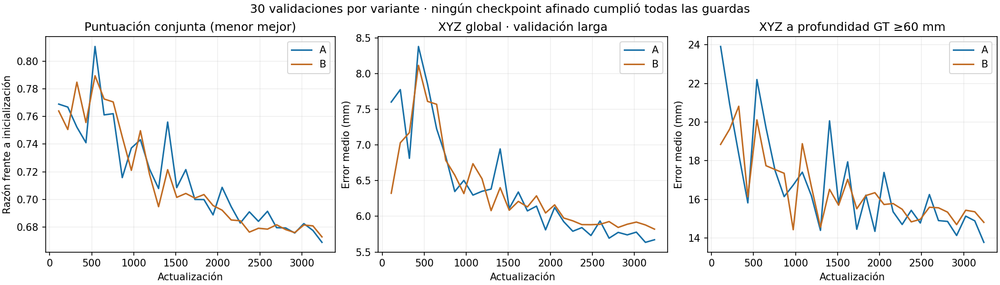
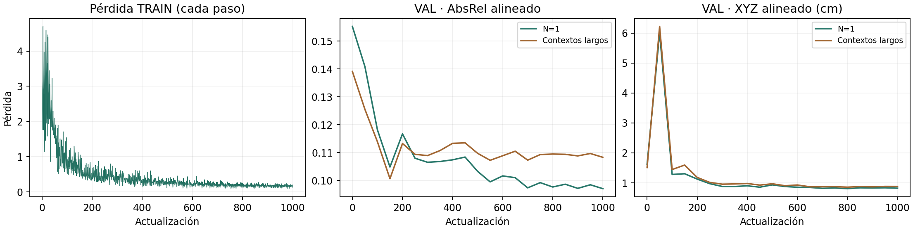
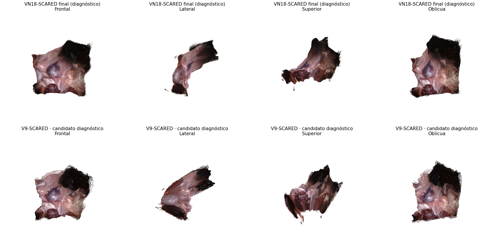

::: {.hero}
C3VD · REFERENCIA Y EXPERIMENTOS

**V9, VN19-A y VN19-B: qué entrenamos, qué cambió y qué aprendimos.** 

[Resumen](#estado){.pill} [Entrenamientos](#entrenamientos){.pill} [Comparaciones](#comparaciones){.pill} [Vistas](#vistas){.pill} [Experimentos](#experimentos){.pill} [SCARED VN18](#scared-vn18){.pill} [SCARED V9](#scared-v9){.pill} [Comparadores](#comparadores){.pill} [Tablas históricas](tablas/index.html){.pill}
:::

## Resumen de C3VD {#estado}

| Versión | Qué representa | Entrenamiento y selección | Estado |
|---|---|---|---|
| **V9** | Referencia de adaptación de las tres cabezas nativas de VGG-T³ | 1.000 pasos; seleccionado **850** | Referencia conservada. |
| **VN19-A** | Receta V9 sobre split y calendario actuales; selección densa aleatoria | 3.240 pasos; se examina el **final 3240** | Ningún candidato entrenado pasó todas las guardas. |
| **VN19-B** | Mismo control A, cambiando la selección densa a cobertura y repeticiones profundas | 3.240 pasos; se examina el **final 3240** | Ningún candidato entrenado pasó todas las guardas. |

**Conclusión actual:** VN19 mejora algunas métricas y ejemplos, pero no constituye una mejora conjunta demostrada sobre V9. A/B es una comparación controlada de una política compuesta; V9 frente a VN19 también cambia datos y presupuesto. Una reconstrucción visualmente favorable no sustituye las comprobaciones por secuencia.

## Datos y protocolo de comparación {#datos}

Las tablas y vistas principales usan **trans_t4_b**, los mismos **50 RGB a 336×336**, seleccionados entre IDs **0–596**. Las métricas puntúan los mismos **16 frames GT**, con **1.771.907 píxeles válidos**. Para esta comparación se utiliza una escala de profundidad compartida por contexto, **sin ICP**.

La nube de VGG-T³ procede de su **cabeza global de puntos**. La trayectoria procede de una **cabeza de cámara separada**. También se evalúa la ruta derivada D+K+pose: una mejora en una ruta no garantiza mejorar la otra.

| Contrato | Qué se verificó / se usa |
|---|---|
| RGB y GT | Rectificación ocam→pinhole coherente y correspondencia de frames. |
| Profundidad | Z axial en metros, separada de distancia radial y de unidades de visualización. |
| Intrínsecas | K ajustada con el mismo resize; a336: fx=fy≈214,054; cx=cy=168. |
| Poses y puntos | Convención C2W, traslación en SI y referencia del primer frame; puntos GT desde D/K/C2W coherentes. |
| Inferencia | RGB; no se suministran profundidad ni poses GT. K conocida solo en las rutas que lo declaran. |
| Evaluación y figuras | El ajuste de escala con GT está declarado; no equivale a recuperar escala absoluta sin GT. |

C3VD: secuencias disponibles y roles por versión

| Secuencia | Frames disponibles | IDs fuente | Referencia disponible |
| --- | --- | --- | --- |
| cecum_t1_b | 765 | 0--764 | Profundidad, calibración y poses por frame. |
| cecum_t2_b | 1142 | 0--1141 | Profundidad, calibración y poses por frame. |
| cecum_t3_a | 730 | 0--729 | Profundidad, calibración y poses por frame. |
| desc_t4_a | 148 | 0--147 | Profundidad, calibración y poses por frame. |
| sigmoid_t1_a | 700 | 0--699 | Profundidad, calibración y poses por frame. |
| sigmoid_t3_a | 613 | 0--612 | Profundidad, calibración y poses por frame. |
| trans_t1_b | 700 | 0--699 | Profundidad, calibración y poses por frame. |
| trans_t4_b | 597 | 0--596 | Profundidad, calibración y poses por frame. |
| cecum_t2_a | 370 | 0--369 | Profundidad, calibración y poses por frame. |
| trans_t1_a | 61 | 0--60 | Profundidad, calibración y poses por frame. |
| screening_t1 | 5458 | 0--5457 | RGB y calibración; poses provisionales. Sin profundidad GT local. |

| Secuencia | VGGT histórico / TTT V9 y V11 histórico | TTT VN18 / preparación VN19 |
| --- | --- | --- |
| cecum_t1_b | Entrenamiento | Entrenamiento |
| cecum_t2_b | Entrenamiento | Entrenamiento |
| cecum_t3_a | Entrenamiento | Validación |
| desc_t4_a | Entrenamiento | Entrenamiento |
| sigmoid_t1_a | Entrenamiento | Entrenamiento |
| sigmoid_t3_a | Entrenamiento | Entrenamiento |
| trans_t1_b | Validación | Entrenamiento |
| trans_t4_b | Validación | Validación |
| cecum_t2_a | Reserva del mismo phantom | Reserva del mismo phantom |
| trans_t1_a | Reserva del mismo phantom | Reserva del mismo phantom |
| screening_t1 | Reserva larga; sin profundidad GT local | Reserva larga; sin profundidad GT local |

El split cambió: `cecum_t3_a` pasó de TRAIN en V9 a VAL en VN19; `trans_t1_b` pasó de VAL a TRAIN. Por ello, comparar promedios sin declarar el rol de cada secuencia no es una comparación de generalización homogénea. Las reservas son del mismo phantom y ya han sido inspeccionadas; no son pacientes nuevos ni un test clínico ciego.

El inventario contiene diez secuencias cortas con D/K/poses y una screening larga. “Todos los ZIP disponibles” incluye versiones originales/derivadas y no equivale a secuencias independientes.

Por qué los splits importan al comparar V9 y VN19

V9 entrena con cecum_t1_b, cecum_t2_b, cecum_t3_a, desc_t4_a, sigmoid_t1_a y sigmoid_t3_a; valida con trans_t1_b y trans_t4_b.

VN19 sustituye cecum_t3_a por trans_t1_b en TRAIN y valida con cecum_t3_a/trans_t4_b. Cecum_t2_a y trans_t1_a permanecen como reservas del mismo phantom, ya inspeccionadas en el desarrollo. No son pacientes nuevos ni un test clínico ciego.

Por eso las diferencias V9/VN19 no aíslan solo el muestreo. Entre A/B sí se mantuvieron los contextos y su orden; cambiar únicamente ese muestreo tampoco separa los dos componentes internos de B.

## Cómo se entrenaron V9, VN19-A y VN19-B {#entrenamientos}

Son **fine-tunings desde pesos oficiales preentrenados**, no entrenamientos desde cero. Ejecutar primero zero-shot es una evaluación; no cambia esos pesos iniciales.

| Elemento | V9 | VN19-A | VN19-B |
|---|---|---|---|
| Inicialización | Pesos oficiales; no hereda las cabezas V7 incompatibles con TTT2 | Pesos oficiales frescos | La misma fuente y firma inicial que A |
| Módulos actualizados | Cabezas nativas de cámara, profundidad y puntos | Las mismas tres cabezas | Las mismas tres cabezas |
| Módulos congelados | Encoder/agregador y parámetros externos de TTT | Igual | Igual |
| TTT interno | Dos actualizaciones durante el forward | Dos | Dos |
| Resolución | 336×336 | 336×336 | 336×336 |
| Contextos RGB | 3 / 6 / 12 / 50 vistas; 56 ventanas | 3 / 6 / 12 / 50; 78 ventanas auditadas | Las mismas ventanas y orden que A |
| Selección densa | Dos vistas aleatorias por actualización | Dos vistas aleatorias independientes por actualización | Dos vistas con calendario de cobertura y repeticiones profundas |
| Actualizaciones | 1.000 | 3.240 | 3.240 |
| Targets densos, contando repeticiones | 2.000 | 6.480 | 6.480 |
| Frames originales con pérdida densa al finalizar | 430 | 919 de1.020 en el pool actual | 1.020 de1.020 en el pool actual |
| Checkpoint mostrado | Paso850 seleccionado en su validación | Final3240, diagnóstico | Final3240, diagnóstico |
| Aceptación | Selección mediante score conjunto V9 | Ningún afinado admisible por todas las guardas VN19 | Ningún afinado admisible por todas las guardas VN19 |

Los conteos de frames únicos se refieren a pérdida densa completa y a pools distintos. No significa que los demás frames no tengan contexto o supervisión de cámara. **Congelar TTT en el optimizador externo no desactiva su adaptación interna.** No se utilizó LoRA.

Pérdidas, hiperparámetros y módulos: detalle técnico

| Parámetro | V9 | VN19-A y VN19-B |
|---|---|---|
| Pérdida | $3L_{XYZ}+L_{\log D}+0.2L_{\nabla XYZ}+0.2L_{camera}$ | Se reutiliza la misma receta V9. |
| Referencia geométrica | 0,03m para parametrizar puntos, profundidad y traslación | Igual; no es una escala GT por secuencia durante inferencia. |
| Optimizador | AdamW | AdamW |
| LR máximo | 1e-5 | 1e-5 |
| Betas / eps | (0,9;0,95) / 1e-6 | Igual |
| Weight decay | 0,01 | 0,01 |
| LR temporal | Warmup25 y coseno, ligado al presupuesto total | Mismo esquema, sobre3.240 actualizaciones. |
| Clipping | Norma global1 de las cabezas | Igual; introduce acoplamiento entre gradientes. |
| Semilla | 1234 | 1234; A/B comparte firma inicial, no es una repetición con varias semillas. |
| Pérdidas densas | Dos imágenes; solo GT válido y vecinos válidos para gradientes | Igual; cambia cuáles se seleccionan. |
| Cámara | GT del contexto, cuatro refinamientos y geometría de cámara | Igual; geometría GT en rejilla cada12 píxeles y K comprobada. |
| Features congeladas | Caché comprobada contra forward nativo | Igual; no se interpreta como latencia de inferencia RGB. |

Las cabezas son los módulos entrenables; no se descongela el backbone completo. La disponibilidad de parámetros entrenables no garantiza gradiente directo útil en cada canal: por ejemplo, la confianza final no tenía pérdida directa en V9.

Calendarios, exposición real y límites de la comparación

| Vistas del contexto N | Pasos observados V9 | Pasos por brazo VN19 |
| --- | --- | --- |
| 3 | 131 | 720 |
| 6 | 356 | 720 |
| 12 | 183 | 720 |
| 50 | 330 | 1080 |

En VN19 se igualó el presupuesto de secuencia y cuartos de movimiento angular, con solapamiento GT auditado en TRAIN. Los dos targets son **imágenes dentro del contexto**, no dos ventanas ni las únicas poses supervisadas.

B recorre posiciones de las ventanas para asegurar cobertura densa y añade selecciones de vistas con una fracción profunda suficiente. Las repeticiones profundas no amplían el total de6.480 targets: cambian su distribución. La auditoría encontró514 selecciones de repetición adicional y cobertura completa en el paso3193.

Los pasos de V9 son los1.000 registrados; se muestra su checkpoint850. Las cifras totales de exposición no se atribuyen retrospectivamente todas al checkpoint850. Los tamaños3/6/12/50 son la receta estudiada, no capacidades óptimas demostradas.

## Comparaciones cuantitativas {#comparaciones}

**Mismos RGB y GT dentro de cada tabla.** Δ favorable>0 significa mejora; Δ<0, deterioro. Los porcentajes de A/B se calculan respecto a **V9**, mientras la tabla de zero-shot indica explícitamente esa otra referencia. Las distancias se muestran en **cm**, las rotaciones en **grados**.

### Profundidad y geometría

| Métrica | Zero-shot | V9 | VN19-A | VN19-B | Δ A/V9 favorable | Δ B/V9 favorable |
| --- | --- | --- | --- | --- | --- | --- |
| AbsRel ↓ | 0,1824 | 0,1486 | 0,1721 | 0,1722 | -15,84 % | -15,85 % |
| δ1 (%) ↑ | 72,10 | 78,38 | 74,87 | 73,03 | -4,48 % | -6,84 % |
| RMSE profundidad (cm) ↓ | 0,725 | 0,698 | 0,592 | 0,592 | +15,14 % | +15,12 % |
| XYZ medio (cm) ↓ | 0,724 | 0,476 | 0,568 | 0,575 | -19,47 % | -20,91 % |
| XYZ p95 (cm) ↓ | 2,131 | 1,305 | 1,301 | 1,337 | +0,27 % | -2,47 % |
| D + K calibrada + pose (cm) ↓ | 0,771 | 0,600 | 0,579 | 0,573 | +3,51 % | +4,49 % |

### Cámara y movimiento

| Métrica | Zero-shot | V9 | VN19-A | VN19-B | Δ A/V9 favorable | Δ B/V9 favorable |
| --- | --- | --- | --- | --- | --- | --- |
| Rotación media (°) ↓ | 10,797 | 6,907 | 6,340 | 6,169 | +8,20 % | +10,68 % |
| Centros anclados RMSE (cm) ↓ | 0,195 | 0,181 | 0,199 | 0,199 | -10,16 % | -10,40 % |
| RPEr histórico (°) ↓ | 1,759 | 1,476 | 1,261 | 1,250 | +14,57 % | +15,31 % |
| RPEt histórico (cm) ↓ | 0,065 | 0,065 | 0,062 | 0,062 | +4,46 % | +4,33 % |
| Error focal relativo (%) ↓ | 20,48 | 3,63 | 1,28 | 1,31 | +64,72 % | +63,79 % |

En Trans4, A/B mejoran focal, rotación y algunas medidas de D+cámara respecto a V9, pero empeoran AbsRel y XYZ global medio. Esa compensación impide describirlos como una mejora general.

Respecto a los pesos oficiales zero-shot

| Pesos | AbsRel ↓ | δ1 (%) ↑ | XYZ medio (cm) ↓ | Δ XYZ favorable/ZS | RPEr histórico (°) ↓ |
| --- | --- | --- | --- | --- | --- |
| Zero-shot | 0,1824 | 72,10 | 0,724 | 0,00 % | 1,759 |
| V9 | 0,1486 | 78,38 | 0,476 | +34,32 % | 1,476 |
| VN19-A | 0,1721 | 74,87 | 0,568 | +21,53 % | 1,261 |
| VN19-B | 0,1722 | 73,03 | 0,575 | +20,59 % | 1,250 |

Mismos50 RGB y mismos16 objetivos. Es una comparación de desarrollo. V9 es seleccionado850; VN19-A/B son finales3240, no aceptados por todas las guardas.
Los cuatro modelos se evalúan sobre los mismos50 RGB y16 objetivos GT. No usar el porcentaje frente a zero-shot como si fuera porcentaje frente aV9.

Ampliación a diez secuencias: TRAIN, VAL y reservas

| Grupo según VN19 | Secuencias | V9 XYZ(cm) | A XYZ(cm) | B XYZ(cm) | Δ B/A favorable |
| --- | --- | --- | --- | --- | --- |
| validation | 2 | 0,387 | 0,593 | 0,615 | -3,64 % |
| reserved | 2 | 1,208 | 0,995 | 0,997 | -0,12 % |
| train | 6 | 0,660 | 0,345 | 0,331 | 3,79 % |

La tabla utiliza escala compartida de profundidad por contexto, no ICP. La población VAL deVN19 incluye Cecum3, que fue TRAIN deV9; por eso el rol por modelo debe acompañar los valores. El análisis de las reservas es del mismo phantom y ya fue inspeccionado.

| Secuencia | Rol V9 / VN19 | V9 XYZ(cm) | A XYZ(cm) | B XYZ(cm) |
| --- | --- | --- | --- | --- |
| cecum_t1_b | train / train | 0,575 | 0,325 | 0,357 |
| cecum_t2_b | train / train | 0,798 | 0,949 | 0,846 |
| desc_t4_a | train / train | 0,596 | 0,159 | 0,157 |
| sigmoid_t1_a | train / train | 0,669 | 0,332 | 0,337 |
| sigmoid_t3_a | train / train | 0,553 | 0,180 | 0,176 |
| trans_t1_b | validation / train | 0,770 | 0,123 | 0,117 |
| cecum_t3_a | train / validation | 0,299 | 0,618 | 0,654 |
| trans_t4_b | validation / validation | 0,476 | 0,568 | 0,575 |
| cecum_t2_a | reserved / reserved | 1,014 | 0,895 | 0,937 |
| trans_t1_a | reserved / reserved | 1,401 | 1,095 | 1,056 |

Checkpoints: finales, intermedios y guardas

Se revisaron30 validaciones de cada brazo y se reprodujeron las60 decisiones. El final3240 tuvo el menor score conjunto A/B, pero ningún afinado pasó todas las guardas frente a la inicialización oficial. Eso no significa que los parámetros no se actualizaran ni que ninguna métrica mejorara.

Los intermedios deA tienen métricas registradas, pero no todos sus pesos conservados. DeB se reevaluó3132: mejoróXYZ2,44% enTrans4 frente aBfinal, pero empeoró5,88% enCecum2a. No se encontró un intermedio aceptable de forma conjunta.

Las guardas son criterios locales, no criterios del paper. V9 utilizó otra selección y otro split; comparar checkpoints finales con uno previamente seleccionado debe declararse.

[Inventario de pesos disponibles](tablas/diagnosticos/checkpoint_inventory.json) · [B3132 frente a final](tablas/diagnosticos/retained_intermediate_comparisons.csv)

{loading="lazy"}

## Vistas de las reconstrucciones {#vistas}

**Trans4 · 50 imágenes · 336² · 5.644.800 puntos por modelo.** La figura fuente procesó todos los puntos finitos; no se elimina geometría para esta presentación. Se mantienen centro y extensión comunes de visualización, con la escala GT compartida declarada, sin ICP ni ajuste rígido.

Cada fila presenta **frontal, lateral, superior y oblicua**. Se muestran las filas V9/A/B de la figura existente; no se ha recalculado ni editado la nube. [Abrir figura fuente completa a tamaño original](imagenes/C3VD_V9_VN18_VN19_cuatro_vistas.png), que también conserva la fila histórica VN18.

<figure class="c3vd-view-row">
<figcaption><strong>V9</strong> · Checkpoint seleccionado 850</figcaption>

</figure>

<button type="button" class="book-open-clouds" data-clouds="c3vd-v9">Cargar nube 3D</button><button type="button" class="book-open-metrics" data-metrics="c3vd-v9">Comparar métricas</button>

<figure class="c3vd-view-row">
<figcaption><strong>VN19-A</strong> · Final 3240 · selección densa aleatoria</figcaption>

</figure>

<button type="button" class="book-open-clouds" data-clouds="c3vd-vn19-a">Cargar nube 3D</button><button type="button" class="book-open-metrics" data-metrics="c3vd-vn19-a">Comparar métricas</button>

<figure class="c3vd-view-row">
<figcaption><strong>VN19-B</strong> · Final 3240 · cobertura y repetición profunda</figcaption>

</figure>

<button type="button" class="book-open-clouds" data-clouds="c3vd-vn19-b">Cargar nube 3D</button><button type="button" class="book-open-metrics" data-metrics="c3vd-vn19-b">Comparar métricas</button>

La trayectoria predicha es una salida distinta de la cabeza global de puntos. Una nube más compacta no demuestra una trayectoria más exacta.

{loading="lazy"}

Referencia visual adicional: VGGT y V9

{loading="lazy"}

La referencia VGGT es útil para examinar forma y apariencia, pero su entrenamiento histórico no tuvo el mismo presupuesto y módulos queV9/VN19. El visor portable histórico80/50 vistas y518/336² tampoco es una comparación igualada de arquitectura.

<button type="button" class="book-open-clouds" data-clouds="c3vd-v9,c3vd-vn19-a,c3vd-vn19-b">Comparar estas tres nubes en 3D</button><button type="button" class="book-open-metrics" data-metrics="c3vd-v9,c3vd-vn19-a,c3vd-vn19-b">Comparar tablas V9/A/B</button>

## Experimentos: hipótesis, método, resultados y conclusión {#experimentos}

Cada ficha separa **lo que se esperaba**, **lo que se ejecutó**, **lo que se observó** y **la interpretación**. “Apoyada” se limita a las condiciones medidas. “No respaldada” no equivale a demostrar que un factor nunca importa. Si hubo OOM o falta GT, la hipótesis geométrica puede quedar sin evaluar.

Las hipótesis están reformuladas para hacer legibles las preguntas de los registros históricos; no se presentan como un prerregistro. Su conclusión responde a la pregunta escrita en esa misma ficha.

Se reúnen **44 fichas de C3VD**. D14/VN12 y D15/VN17 son dos nombres de los mismos diagnósticos y se documentan una vez. Las familias D agrupan condiciones relacionadas; no representan cada forward como una hipótesis distinta. Los registros y CSV conservan el detalle.

<label for="experiment-search">Buscar experimento</label><input id="experiment-search" type="search" placeholder="Ej.: trayectoria, escala, LR, profundidad, VN19…"><label for="experiment-group">Tema</label><select id="experiment-group"><option value="">Todos los temas</option></select>

Índice de todas las fichas

| ID / equivalencias | Tema | Hipótesis | Conclusión sobre la hipótesis |
| --- | --- | --- | --- |
| [D01](#exp-d01) | Datos y geometría | Un contrato incoherente de unidades, poses o rectificación puede deformar la reconstrucción; corregirlo debería permitir reproyecciones GT coherentes. | Apoyada en los controles |
| [D02](#exp-d02) | Datos y geometría | Parte de las diferencias aparentes entre modelos puede venir de entradas, filtros o rutas de salida que no se estaban comparando en igualdad de condiciones. | Apoyada parcialmente |
| [D03](#exp-d03) | Contexto y trayectorias | Podría existir un umbral estable por cantidad de imágenes, distinguible del recorrido y de los saltos entre vistas. | No concluyente para un umbral |
| [D04](#exp-d04) | Contexto y trayectorias | Procesar todos los frames de Trans4, eliminando los saltos, podría mejorar su geometría respecto a las selecciones parciales. | No evaluable por OOM |
| [D05](#exp-d05) | Contexto y trayectorias | Una secuencia más extensa o dispersa podría degradar la geometría; los prefijos largos permitirían localizar dónde empieza el deterioro. | No concluyente para exactitud absoluta |
| [D06](#exp-d06) | Contexto y trayectorias | Manteniendo los mismos frames objetivo, cambiar las imágenes que los acompañan puede alterar sus estimaciones. | Apoyada con factor de confusión |
| [D07](#exp-d07) | Contexto y trayectorias | Cambiar el ancla o ampliar el contexto puede alterar las estimaciones de vistas comunes, además de cambiar el marco de referencia. | Apoyada para sensibilidad |
| [D08](#exp-d08) | Pipeline y componentes | El fallo podría proceder exclusivamente del wrapper y desaparecer al usar el forward original con condiciones igualadas. | No respaldada como explicación única |
| [D09](#exp-d09) | Pipeline y componentes | El deterioro de poses podría originarse únicamente dentro de la cabeza de cámara, sin un cambio relevante previo de los tokens. | No respaldada en su forma exclusiva |
| [D10](#exp-d10) | Pipeline y componentes | El estado de ciertas capas y tipos de tokens del agregador influye en la sensibilidad al contexto antes del decoder. | Apoyada para sensibilidad |
| [D11](#exp-d11) | Pipeline y componentes | Reducir el desacuerdo entre puntos globales y D+cámara sería suficiente para reducir el error geométrico contra GT. | No respaldada como explicación suficiente |
| [D12](#exp-d12) | Pipeline y componentes | Una diferencia de escala podría explicar una parte importante del deterioro observado y cambiar la lectura al alinear las salidas. | Apoyada parcialmente |
| [D13](#exp-d13) | Pipeline y componentes | El descenso de la pérdida TRAIN puede tener direcciones desfavorables para VAL; cambiar D/cámara puede afectar rutas derivadas sin modificar P. | Compatible, sin prueba causal |
| [D14 / VN12](#exp-d14) | Pipeline y componentes | Las discrepancias de caché, la iluminación, la profundidad o la falta de paralaje podrían explicar parte de los errores; es necesario separar estas alternativas. | Compatible, sin prueba causal |
| [D15 / VN17](#exp-d15) | Contexto y trayectorias | Añadir contexto RGB siempre mejora los mismos objetivos GT cuando se mantienen su población y el control de escala. | Contradice una mejora garantizada |
| [D17](#exp-d17) | Datos y geometría | Con un contrato geométrico coherente, la tubería puede completar forward/backward, actualizar pesos y aprender una muestra pequeña. | Apoyada para viabilidad |
| [D18](#exp-d18) | Entrenamientos históricos | Aumentar la exposición con encoder fijo podría producir una adaptación globalmente superior a los candidatos anteriores. | No concluyente para superioridad general |
| [D19](#exp-d19) | Pipeline y componentes | Aumentar los pasos internos TTT, manteniendo los pesos, mejora siempre la reconstrucción XYZ. | Contradice una mejora garantizada |
| [D20](#exp-d20) | Pipeline y componentes | Mejorar la rotación mediante poses recuperadas por PnP mejora necesariamente también la reconstrucción D+cámara. | Contradice una mejora garantizada |
| [D21](#exp-d21) | Pipeline y componentes | El filtrado y la confianza podrían explicar parte de la falta de cobertura, aunque no se cambien las coordenadas reconstruidas. | Apoyada parcialmente |
| [D22](#exp-d22) | Datos y geometría | La caché podría entregar tokens o geometría distintos del forward nativo y explicar el fallo observado. | No respaldada como fallo detectado |
| [VN1](#exp-vn1) | Entrenamientos históricos | Ampliar el muestreo con encoder congelado puede mejorar la adaptación. | Apoyada parcialmente |
| [VN2](#exp-vn2) | Entrenamientos históricos | Añadir movimiento relativo puede mejorar los errores relativos sin cambiar el calendario. | Apoyada para movimiento relativo |
| [VN3](#exp-vn3) | Entrenamientos históricos | Descongelar el último bloque global TTT puede mejorar el control VN2. | Apoyada parcialmente |
| [VN4](#exp-vn4) | Entrenamientos históricos | Cámara global, coherencia o su combinación pueden mejorar conjuntamente la geometría. | No respaldada en este piloto |
| [VN5](#exp-vn5) | Entrenamientos históricos | Un LR menor puede evitar parte del deterioro; aislar cámara puede reparar poses sin mover D/P. | Apoyada parcialmente |
| [VN6](#exp-vn6) | Entrenamientos históricos | Entrenar las tres cabezas sobre targets fijos puede mejorar también validación. | No respaldada en este piloto |
| [VN7](#exp-vn7) | Entrenamientos históricos | Estratificar con información de TRAIN puede mejorar el control VN6. | Apoyada solo frente al control deteriorado |
| [VN8](#exp-vn8) | Entrenamientos históricos | Congelar profundidad y actualizar cámara/puntos puede producir una mejora estable. | No respaldada como mejora estable |
| [VN9](#exp-vn9) | Entrenamientos históricos | La ganancia de VN8 se mantiene al repetir las mismas exposiciones en otros órdenes. | No reproducida en los órdenes probados |
| [VN10](#exp-vn10) | Entrenamientos históricos | Separar forma y radio puede reparar la geometría de puntos. | No respaldada para error sin registro |
| [VN11](#exp-vn11) | Entrenamientos históricos | Representar mejor el colon transverso en TRAIN puede mejorar el resultado. | Apoyada parcialmente |
| [VN13](#exp-vn13) | Entrenamientos históricos | El beneficio del muestreo representado puede mantenerse en varios órdenes. | Apoyada parcialmente |
| [VN14](#exp-vn14) | Entrenamientos históricos | Actualizar cámara, profundidad o ambas aisladamente puede reparar la geometría global. | No respaldada como corrección material |
| [VN15](#exp-vn15) | Entrenamientos históricos | Clipping por cabeza o gradiente espacial de D pueden mejorar materialmente el control. | No respaldada bajo las guardas |
| [VN16](#exp-vn16) | Entrenamientos históricos | La adaptación nativa D/P con cámara fija puede mejorar validación larga. | Apoyada para TTT en ese piloto |
| [VN18-C3VD](#exp-vn18-c3vd) | Entrenamientos históricos | La cobertura densa con contexto4/8/16 y validación16/50 puede mejorar su zero-shot. | Apoyada bajo sus guardas locales |
| [VN19-AB](#exp-vn19-ab) | V9 y VN19: supervisión y selección | Con idénticos pesos, contextos, pérdidas y presupuesto, cobertura y repetición profunda(B) pueden mejorar conjuntamente a selección aleatoria(A). | No respaldada como mejora conjunta |
| [VN19-CKPT](#exp-vn19-ckpt) | V9 y VN19: supervisión y selección | Un intermedio conservado puede superar al final y cumplir las guardas que este no cumple. | No se encontró un intermedio aceptable |
| [VN19-COB](#exp-vn19-cob) | V9 y VN19: supervisión y selección | B cumple la cobertura anunciada y aumenta la exposición a regiones profundas. | Apoyada para la distribución medida |
| [VN19-REG](#exp-vn19-reg) | V9 y VN19: supervisión y selección | La mayor exposición profunda mejora XYZ en regiones≥60 mm y en movimientos exigentes fuera deTRAIN. | No respaldada fuera de TRAIN |
| [VN19-CLIP](#exp-vn19-clip) | V9 y VN19: supervisión y selección | El clipping global acopla las tres cabezas y podría influir en las diferencias A/B. | Mecanismo confirmado; causalidad abierta |
| [K-MEM](#exp-k-mem) | Límites y cantidad de supervisión | K>2 puede ser viable si se controla la memoria sin cambiar el contextoN50. | Apoyada para viabilidad medida |
| [K-LEARN](#exp-k-learn) | Límites y cantidad de supervisión | K10 mejora la reconstrucción conjunta respecto aK2; K1 podría ser insuficiente. | No hay un K óptimo conjunto demostrado |

Datos y geometría · 4 fichas

D01 Verificar que el GT y las imágenes describen la misma cámara.Apoyada en los controles

| Parte | Registro |
| --- | --- |
| Modelo / ámbito | Ambos loaders / C3VD |
| Idea / pregunta | Verificar que el GT y las imágenes describen la misma cámara. |
| Teoría o hipótesis | Un contrato incoherente de unidades, poses o rectificación puede deformar la reconstrucción; corregirlo debería permitir reproyecciones GT coherentes. |
| Experimento realizado · cómo | Se auditó el formato V2 con CRC/SHA, se contrastó la rectificación de RGB y D y se verificó reproyección GT en cuatro pares por secuencia, conservando las modalidades originales. |
| Resultados observados | Los pares auditados pasan rectificación/reproyección y correspondencia de unidades. No se observa un contrato incorrecto en esos controles. |
| ¿Qué indica sobre la hipótesis? | Apoyada en los controles |
| Qué más puede concluirse | Corregir la adquisición era necesario; que los controles pasen no demuestra que todo el error residual proceda del modelo. |
| Límites | No atribuir toda diferencia residual a calibración ni certificar todos los frames por cuatro pares. |

La edición web conserva las mediciones de esta ficha. Las exportaciones específicas del diagnóstico, cuando existen, permanecen en el archivo local.

<button type="button" class="book-open-metrics" data-metrics="experiment-D01">Comparar datos de esta ficha</button>

D02 Evitar atribuir al modelo diferencias creadas por resolución, frames o representación.Apoyada parcialmente

| Parte | Registro |
| --- | --- |
| Modelo / ámbito | VGGT ZS/FT y TTT ZS/V9 |
| Idea / pregunta | Evitar atribuir al modelo diferencias creadas por resolución, frames o representación. |
| Teoría o hipótesis | Parte de las diferencias aparentes entre modelos puede venir de entradas, filtros o rutas de salida que no se estaban comparando en igualdad de condiciones. |
| Experimento realizado · cómo | Se compararon VGGT zero-shot/afinada y TTT zero-shot/V9 sobre las mismas entradas de cada condición a 336px, misma K y puntuación separada de puntos globales y D+cámara. Se conservaron también los OOM. |
| Resultados observados | Se completaron 84 inferencias y se registraron 32 OOM. V9 mejora su salida global frente a su zero-shot en las diez secuencias cortas, sin superar uniformemente a VGGT afinado. |
| ¿Qué indica sobre la hipótesis? | Apoyada parcialmente |
| Qué más puede concluirse | Una misma apariencia no garantiza el mismo protocolo. No es una ablación con presupuestos de entrenamiento idénticos. |
| Límites | Las superficies y trayectorias no se reducen a una métrica; los fallos OOM se publican, no se eliminan. |

Las nubes enlazadas son referencias o exportaciones relacionadas; consulta su caso y protocolo en el visor. No sustituyen todas las condiciones del ensayo.

<button type="button" class="book-open-clouds" data-clouds="c3vd-v9,c3vd-zero">Ver nubes relacionadas</button><button type="button" class="book-open-metrics" data-metrics="experiment-D02">Comparar datos de esta ficha</button>

D17 Comprobar aprendizaje e integración antes de un entrenamiento largo.Apoyada para viabilidad

| Parte | Registro |
| --- | --- |
| Modelo / ámbito | TTT C3VD, cámara/profundidad |
| Idea / pregunta | Comprobar aprendizaje e integración antes de un entrenamiento largo. |
| Teoría o hipótesis | Con un contrato geométrico coherente, la tubería puede completar forward/backward, actualizar pesos y aprender una muestra pequeña. |
| Experimento realizado · cómo | Se ejecutaron16 regresiones, auditoría de ocho ZIP,80 pasos sobre una muestra pequeña y dos pasos descartables de integración, comparando las predicciones con GT. |
| Resultados observados | 16 regresiones, ocho ZIP auditados, 80 pasos de muestra pequeña y dos de integración. AbsRel de la muestra:8,73484→0,08522; XYZ:339,857→6,592 mm. |
| ¿Qué indica sobre la hipótesis? | Apoyada para viabilidad |
| Qué más puede concluirse | Memorizar una muestra no demuestra generalización ni calidad final de la corrida larga. |
| Límites | Es memorización de una muestra y prueba de integración, no resultado de generalización ni calidad final del entrenamiento largo. |

La edición web conserva las mediciones de esta ficha. Las exportaciones específicas del diagnóstico, cuando existen, permanecen en el archivo local.

<button type="button" class="book-open-metrics" data-metrics="experiment-D17">Comparar datos de esta ficha</button>

D22 Verificar que la caché conserva las mismas características que la ruta nativa.No respaldada como fallo detectado

| Parte | Registro |
| --- | --- |
| Modelo / ámbito | TTT V9; referencia GT C3VD |
| Idea / pregunta | Verificar que la caché conserva las mismas características que la ruta nativa. |
| Teoría o hipótesis | La caché podría entregar tokens o geometría distintos del forward nativo y explicar el fallo observado. |
| Experimento realizado · cómo | Se auditaron59 colecciones, se reprodujeron11 contextos de3/6/12/50 vistas en ambos órdenes y se verificó la procedencia del control GT de cuatro vistas contra malla. No se volvió a calcular esa malla. |
| Resultados observados | 59 colecciones/1.358 vistas;11 contextos nativos comprobaron cuatro features bit-exactas. El control físico histórico tuvo mediana0,01585 mm y p950,04637 mm contra malla, sin registro. |
| ¿Qué indica sobre la hipótesis? | No respaldada como fallo detectado |
| Qué más puede concluirse | El control físico corresponde a cuatro vistas de Cecum1b; no certifica todas las secuencias completas. |
| Límites | El control físico no certifica las diez secuencias. Aquí se revisa su procedencia; no se recalcula la malla ni se afirma velocidad de carga nueva. |

La edición web conserva las mediciones de esta ficha. Las exportaciones específicas del diagnóstico, cuando existen, permanecen en el archivo local.

<button type="button" class="book-open-metrics" data-metrics="experiment-D22">Comparar datos de esta ficha</button>

Contexto y trayectorias · 6 fichas

D03 Separar cantidad de imágenes, recorrido y densidad de muestreo.No concluyente para un umbral

| Parte | Registro |
| --- | --- |
| Modelo / ámbito | Cuatro variantes; Trans1b y Trans4b |
| Idea / pregunta | Separar cantidad de imágenes, recorrido y densidad de muestreo. |
| Teoría o hipótesis | Podría existir un umbral estable por cantidad de imágenes, distinguible del recorrido y de los saltos entre vistas. |
| Experimento realizado · cómo | Se diseñaron prefijos, saltos y densidades en Trans1b/Trans4b:76 colecciones por cuatro variantes. Se registraron los casos completos y el soporte GT, sin sustituir silenciosamente los fallidos. |
| Resultados observados | Hubo 70 casos completos, incluidos reutilizados y smoke; el plan de 304 ejecuciones no se completó. Los contrastes no fijaron un punto universal de ruptura. |
| ¿Qué indica sobre la hipótesis? | No concluyente para un umbral |
| Qué más puede concluirse | La falta de un umbral en este plan parcial no prueba que el tamaño no importe. |
| Límites | Plan parcial, no304 resultados. VGGT/TTT FT18 casos cada uno; ZS17 cada uno. |

La edición web conserva las mediciones de esta ficha. Las exportaciones específicas del diagnóstico, cuando existen, permanecen en el archivo local.

<button type="button" class="book-open-metrics" data-metrics="experiment-D03">Comparar datos de esta ficha</button>

D04 Comprobar si eliminar los saltos procesando toda Trans4 mejora la nube.No evaluable por OOM

| Parte | Registro |
| --- | --- |
| Modelo / ámbito | TTT V9 / Trans4 |
| Idea / pregunta | Comprobar si eliminar los saltos procesando toda Trans4 mejora la nube. |
| Teoría o hipótesis | Procesar todos los frames de Trans4, eliminando los saltos, podría mejorar su geometría respecto a las selecciones parciales. |
| Experimento realizado · cómo | Se intentó un forward con los 597 frames de Trans4, stride1 y resolución336², sin reducir cantidad ni resolución tras detectar falta de memoria. |
| Resultados observados | El intento con 597 imágenes a 336² terminó en OOM durante normalización RGB, antes de una reconstrucción completa. |
| ¿Qué indica sobre la hipótesis? | No evaluable por OOM |
| Qué más puede concluirse | Es evidencia de viabilidad en ese equipo y ejecución, no de colapso geométrico del modelo a 597 vistas. |
| Límites | Límite de recursos de esta ejecución; no prueba de incapacidad geométrica a 597 ni autorización para reducir N silenciosamente. |

La edición web conserva las mediciones de esta ficha. Las exportaciones específicas del diagnóstico, cuando existen, permanecen en el archivo local.

<button type="button" class="book-open-metrics" data-metrics="experiment-D04">Comparar datos de esta ficha</button>

D05 Estudiar recorridos largos con prefijos y diferentes densidades.No concluyente para exactitud absoluta

| Parte | Registro |
| --- | --- |
| Modelo / ámbito | Cuatro variantes |
| Idea / pregunta | Estudiar recorridos largos con prefijos y diferentes densidades. |
| Teoría o hipótesis | Una secuencia más extensa o dispersa podría degradar la geometría; los prefijos largos permitirían localizar dónde empieza el deterioro. |
| Experimento realizado · cómo | Se prepararon ocho bloques de screening con N8/16/32/50 e intervalos de100/400/1.000 frames y el resto del recorrido; se añadieron72 pares de auditoría RGB y controles de referencia temporal. |
| Resultados observados | Se registraron 33 poblaciones, 132 ejecuciones y ocho bloques. Screening carece de profundidad GT local y su referencia temporal no quedó certificada. |
| ¿Qué indica sobre la hipótesis? | No concluyente para exactitud absoluta |
| Qué más puede concluirse | Se puede comparar cómo cambian las salidas, pero no certificar un umbral de error 3D contra una referencia inexistente. |
| Límites | RPE/ATE allí son provisionales; no usar para afirmar un umbral clínico exacto. |

La edición web conserva las mediciones de esta ficha. Las exportaciones específicas del diagnóstico, cuando existen, permanecen en el archivo local.

<button type="button" class="book-open-metrics" data-metrics="experiment-D05">Comparar datos de esta ficha</button>

D06 Cambiar las vistas acompañantes sin cambiar los frames que se puntúan.Apoyada con factor de confusión

| Parte | Registro |
| --- | --- |
| Modelo / ámbito | Cuatro variantes / screening |
| Idea / pregunta | Cambiar las vistas acompañantes sin cambiar los frames que se puntúan. |
| Teoría o hipótesis | Manteniendo los mismos frames objetivo, cambiar las imágenes que los acompañan puede alterar sus estimaciones. |
| Experimento realizado · cómo | Se fijaron32 frames objetivo. Se comparó su ejecución sola y con18 RGB añadidos de contexto cercano o lejano; se puntuaron los mismos frames y31 pares consecutivos comunes. |
| Resultados observados | Las estimaciones de 32 frames compartidos cambiaron según las 18 vistas añadidas; hubo 32 inferencias nuevas y 96 evaluaciones. |
| ¿Qué indica sobre la hipótesis? | Apoyada con factor de confusión |
| Qué más puede concluirse | El primer frame también cambiaba en parte de este diseño. Eso motivó el aislamiento posterior del ancla. |
| Límites | Esta primera prueba no controlaba el primer frame; motivó el aislamiento de ancla. |

La edición web conserva las mediciones de esta ficha. Las exportaciones específicas del diagnóstico, cuando existen, permanecen en el archivo local.

<button type="button" class="book-open-metrics" data-metrics="experiment-D06">Comparar datos de esta ficha</button>

D07 Separar el efecto del primer frame y de ampliar el contexto.Apoyada para sensibilidad

| Parte | Registro |
| --- | --- |
| Modelo / ámbito | Cuatro variantes / screening |
| Idea / pregunta | Separar el efecto del primer frame y de ampliar el contexto. |
| Teoría o hipótesis | Cambiar el ancla o ampliar el contexto puede alterar las estimaciones de vistas comunes, además de cambiar el marco de referencia. |
| Experimento realizado · cómo | Se controló el primer frame y se construyeron dos escaleras8→16→24→32→50 en ocho bloques, puntuando vistas compartidas. Se reutilizaron resultados verificados y recalcularon52 errores de pares. |
| Resultados observados | 128 inferencias nuevas, 32 reutilizadas y 168 evaluaciones mostraron cambios en vistas comunes al cambiar el ancla o la escalera 8/16/24/32/50. |
| ¿Qué indica sobre la hipótesis? | Apoyada para sensibilidad |
| Qué más puede concluirse | No permite atribuir el efecto únicamente a un token: reordenar también cambia el condicionamiento y la partición interna TTT. |
| Límites | Estabilidad no es exactitud; reordenar también cambia condicionamiento/particiónTTT, no solo un token aislado. |

La edición web conserva las mediciones de esta ficha. Las exportaciones específicas del diagnóstico, cuando existen, permanecen en el archivo local.

<button type="button" class="book-open-metrics" data-metrics="experiment-D07">Comparar datos de esta ficha</button>

D15 · VN17 Puntuar los mismos 16 objetivos al pasar de contexto16 a 50.Contradice una mejora garantizada

| Parte | Registro |
| --- | --- |
| Modelo / ámbito | TTT ZS/V9/VN16 y VGGT ZS/VN16 |
| Idea / pregunta | Puntuar los mismos 16 objetivos al pasar de contexto16 a 50. |
| Teoría o hipótesis | Añadir contexto RGB siempre mejora los mismos objetivos GT cuando se mantienen su población y el control de escala. |
| Experimento realizado · cómo | VN17 puntuó16 objetivos idénticos con contextos16/50:10 lecturas nuevas y20 contrastes pareados, con control de escala50 fija y nubes constantes para comprobar que coherencia no basta. |
| Resultados observados | En TTT VN16, D+cámara empeoró 20,546% en Cecum3 y 4,132% en Trans4; persistió con escala50 fija:14,351% y3,916%. |
| ¿Qué indica sobre la hipótesis? | Contradice una mejora garantizada |
| Qué más puede concluirse | También es VN17. No demuestra que 50 sea una capacidad máxima ni identifica un mecanismo único. |
| Límites | No demuestra una capacidadmaxN50; entrenamiento/exposición/contexto sigue como hipótesis, no mecanismo único probado. |

La edición web conserva las mediciones de esta ficha. Las exportaciones específicas del diagnóstico, cuando existen, permanecen en el archivo local.

<button type="button" class="book-open-metrics" data-metrics="experiment-D15">Comparar datos de esta ficha</button>

Pipeline y componentes · 10 fichas

D08 Comprobar si el comportamiento desaparece con el forward original.No respaldada como explicación única

| Parte | Registro |
| --- | --- |
| Modelo / ámbito | TTT ZS/V9 |
| Idea / pregunta | Comprobar si el comportamiento desaparece con el forward original. |
| Teoría o hipótesis | El fallo podría proceder exclusivamente del wrapper y desaparecer al usar el forward original con condiciones igualadas. |
| Experimento realizado · cómo | Se ejecutó el forward original con pesos y operadores comprobados y se compararon salidas igualadas de cámara, profundidad y puntos contra el wrapper, declarando el chunk utilizado. |
| Resultados observados | Los 12 forwards originales y controles igualados de poses, profundidad y puntos conservan el comportamiento observado. |
| ¿Qué indica sobre la hipótesis? | No respaldada como explicación única |
| Qué más puede concluirse | El wrapper no explica por sí solo el fallo; la prueba tampoco reproduce todos los benchmarks del paper. |
| Límites | No establece equivalencia de dominio ni de benchmark con el paper; la variante dechunk debe nombrarse. |

Las nubes enlazadas son referencias o exportaciones relacionadas; consulta su caso y protocolo en el visor. No sustituyen todas las condiciones del ensayo.

<button type="button" class="book-open-clouds" data-clouds="c3vd-v9,c3vd-zero">Ver nubes relacionadas</button><button type="button" class="book-open-metrics" data-metrics="experiment-D08">Comparar datos de esta ficha</button>

D09 Localizar si los cambios se producen solamente dentro de la cabeza de cámara.No respaldada en su forma exclusiva

| Parte | Registro |
| --- | --- |
| Modelo / ámbito | TTT ZS/V9 |
| Idea / pregunta | Localizar si los cambios se producen solamente dentro de la cabeza de cámara. |
| Teoría o hipótesis | El deterioro de poses podría originarse únicamente dentro de la cabeza de cámara, sin un cambio relevante previo de los tokens. |
| Experimento realizado · cómo | Se separaron los tokens del agregador y las vistas que lee la cabeza:8/8,16/8 y16/16. Se inspeccionaron cuatro refinamientos y controles GT frescos, sin cambiar los pesos. |
| Resultados observados | 88 salidas separaron contexto del agregador y contexto de la cabeza. En el caso de screening, RPEr de V9 fue 15,272→40,857→41,000° en los controles 8/8,16/8,16/16. |
| ¿Qué indica sobre la hipótesis? | No respaldada en su forma exclusiva |
| Qué más puede concluirse | Intervenir solo la cabeza puede no reparar una representación contextual ya alterada. La referencia screening sigue siendo provisional. |
| Límites | Head-subsets/leave-one-out son intervenciones diagnósticas; screening sigueprovisional. Referencias antiguas no exactas se conservaron. |

La edición web conserva las mediciones de esta ficha. Las exportaciones específicas del diagnóstico, cuando existen, permanecen en el archivo local.

<button type="button" class="book-open-metrics" data-metrics="experiment-D09">Comparar datos de esta ficha</button>

D10 Localizar capas o tipos de estado sensibles antes del decoder.Apoyada para sensibilidad

| Parte | Registro |
| --- | --- |
| Modelo / ámbito | TTT ZS/V9 |
| Idea / pregunta | Localizar capas o tipos de estado sensibles antes del decoder. |
| Teoría o hipótesis | El estado de ciertas capas y tipos de tokens del agregador influye en la sensibilidad al contexto antes del decoder. |
| Experimento realizado · cómo | Se intervinieron24 capas y se trasplantaron estados de cámara, patches y contexto8↔16 en cuatro grupos; se verificaron controles identidad y que los pesos permanecieran inmutables. |
| Resultados observados | Se hicieron 204 condiciones, 764 lecturas de cabeza y 3.056 refinamientos, incluyendo intervenciones en 24 capas y trasplantes de estado. |
| ¿Qué indica sobre la hipótesis? | Apoyada para sensibilidad |
| Qué más puede concluirse | Las capas más favorables se encontraron explorando las mismas ventanas; no son una nueva arquitectura validada. |
| Límites | Mejores/peores capas se escogieron explorando las mismas ventanas; no son arquitectura validada ni checkpoint desplegable. |

La edición web conserva las mediciones de esta ficha. Las exportaciones específicas del diagnóstico, cuando existen, permanecen en el archivo local.

<button type="button" class="book-open-metrics" data-metrics="experiment-D10">Comparar datos de esta ficha</button>

D11 Separar discrepancia entre cabezas, escala y error contra GT.No respaldada como explicación suficiente

| Parte | Registro |
| --- | --- |
| Modelo / ámbito | TTT V9 / VN2 / VN3 |
| Idea / pregunta | Separar discrepancia entre cabezas, escala y error contra GT. |
| Teoría o hipótesis | Reducir el desacuerdo entre puntos globales y D+cámara sería suficiente para reducir el error geométrico contra GT. |
| Experimento realizado · cómo | Se contrastaron P y D+cámara en seis pares modelo/secuencia, con controles GT, cambios de coordenadas y tolerancias0,5/1/2 mm. Se separó el efecto del registro del error local. |
| Resultados observados | 58 comparaciones de V9/VN2/VN3, controles GT y cambios de gauge muestran que reducir la discrepancia entre P y D+cámara no garantiza menor error externo. |
| ¿Qué indica sobre la hipótesis? | No respaldada como explicación suficiente |
| Qué más puede concluirse | El alineamiento Sim(3)/ICP de evaluación no corrige por sí solo deformaciones espaciales locales ni está disponible sin GT. |
| Límites | Sim3/ICP de scoring no son datos que el modelo tenga en despliegue; no corrigen deformación espacial local. |

La edición web conserva las mediciones de esta ficha. Las exportaciones específicas del diagnóstico, cuando existen, permanecen en el archivo local.

<button type="button" class="book-open-metrics" data-metrics="experiment-D11">Comparar datos de esta ficha</button>

D12 Comprobar si el deterioro de VN6 era solamente escala.Apoyada parcialmente

| Parte | Registro |
| --- | --- |
| Modelo / ámbito | TTT VN3/VN5/VN6 |
| Idea / pregunta | Comprobar si el deterioro de VN6 era solamente escala. |
| Teoría o hipótesis | Una diferencia de escala podría explicar una parte importante del deterioro observado y cambiar la lectura al alinear las salidas. |
| Experimento realizado · cómo | Se revisaron146 contextos GT y2.095 frames; se hicieron2.352 lecturas densas de VN3/VN5/VN6 y controles con escala de secuencia, escala por frame y Sim(3), todos etiquetados como diagnósticos GT. |
| Resultados observados | P raw de VN6 empeora 4,247%; una escala única cambia esa comparación a +0,221%, mientras Sim(3) sigue en −0,458% favorable. |
| ¿Qué indica sobre la hipótesis? | Apoyada parcialmente |
| Qué más puede concluirse | Cambiar m a cm solo cambia unidades. Los ajustes GT son oráculos de diagnóstico, no una reparación desplegable. |
| Límites | OráculosGT son diagnósticos;2 secuencias, una semilla,24 actualizaciones. No causan prueba de generalización. |

La edición web conserva las mediciones de esta ficha. Las exportaciones específicas del diagnóstico, cuando existen, permanecen en el archivo local.

<button type="button" class="book-open-metrics" data-metrics="experiment-D12">Comparar datos de esta ficha</button>

D13 Verificar si train y validación pueden favorecer direcciones diferentes y si las ramas son separables.Compatible, sin prueba causal

| Parte | Registro |
| --- | --- |
| Modelo / ámbito | TTT VN7 |
| Idea / pregunta | Verificar si train y validación pueden favorecer direcciones diferentes y si las ramas son separables. |
| Teoría o hipótesis | El descenso de la pérdida TRAIN puede tener direcciones desfavorables para VAL; cambiar D/cámara puede afectar rutas derivadas sin modificar P. |
| Experimento realizado · cómo | Se midieron gradientes de24 contextos TRAIN y seis objetivos VAL, con clipping; después se restauraron de forma independiente profundidad y cámara, manteniendo encoder y puntos fijos. |
| Resultados observados | Se midieron gradientes de 24 contextos y seis objetivos de validación; al restaurar cabezas se conservaron 100 salidas P nativas exactas. |
| ¿Qué indica sobre la hipótesis? | Compatible, sin prueba causal |
| Qué más puede concluirse | El coseno de gradientes no reproduce el precondicionamiento de Adam y no demuestra qué término causó el resultado final. |
| Límites | Coseno de gradientes sin precondicionamiento no predice por sí solo Adam ni atribuye causalmente una métrica. |

La edición web conserva las mediciones de esta ficha. Las exportaciones específicas del diagnóstico, cuando existen, permanecen en el archivo local.

<button type="button" class="book-open-metrics" data-metrics="experiment-D13">Comparar datos de esta ficha</button>

D14 · VN12 Revisar cache, luz, profundidad y paralaje sin adjudicar una causa de antemano.Compatible, sin prueba causal

| Parte | Registro |
| --- | --- |
| Modelo / ámbito | TTT VN12 |
| Idea / pregunta | Revisar cache, luz, profundidad y paralaje sin adjudicar una causa de antemano. |
| Teoría o hipótesis | Las discrepancias de caché, la iluminación, la profundidad o la falta de paralaje podrían explicar parte de los errores; es necesario separar estas alternativas. |
| Experimento realizado · cómo | Se contrastaron RGB, caché y exportación; se analizaron estratos GT de profundidad/brillo, paralaje, solapamiento, conectividad de pérdidas y normas de gradiente. No se manipuló causalmente la iluminación. |
| Resultados observados | La ruta RGB/cache/export pasó tras corregir tolerancia numérica del preflight. Se observaron giros de entrenamiento y asociaciones entre profundidad, brillo y error. |
| ¿Qué indica sobre la hipótesis? | Compatible, sin prueba causal |
| Qué más puede concluirse | También es el diagnóstico VN12. No prueba que todo se deba a reflejos, instrumentos, falta de giro o saturación. |
| Límites | No se demostró que toda la causa sean reflejos, instrumentos, falta absoluta de giros ni saturación global. |

La edición web conserva las mediciones de esta ficha. Las exportaciones específicas del diagnóstico, cuando existen, permanecen en el archivo local.

<button type="button" class="book-open-metrics" data-metrics="experiment-D14">Comparar datos de esta ficha</button>

D19 Evaluar si más pasos internos TTT mejoran siempre la calidad.Contradice una mejora garantizada

| Parte | Registro |
| --- | --- |
| Modelo / ámbito | TTT ZS/V9, Trans1b/Trans4b |
| Idea / pregunta | Evaluar si más pasos internos TTT mejoran siempre la calidad. |
| Teoría o hipótesis | Aumentar los pasos internos TTT, manteniendo los pesos, mejora siempre la reconstrucción XYZ. |
| Experimento realizado · cómo | Se probaron pesos fijos ZS/V9 en Trans1b/Trans4b con0/1/2/3 pasos TTT y chunks3486/27380; se comprobaron las salidas congeladas y se registró cada OOM. |
| Resultados observados | De20 condiciones,16 terminaron y4 dieron OOM. Con pesos fijos, TTT2 tuvo menor XYZ que1 o3 en las dos secuencias;3 mejoró rotación y empeoró XYZ. |
| ¿Qué indica sobre la hipótesis? | Contradice una mejora garantizada |
| Qué más puede concluirse | Se mantuvo TTT2. TTT0 usa memoria inicial y no equivale a entrenar de nuevo una arquitectura sin TTT. |
| Límites | Paso0 usa memoria inicial; no equivale a reentrenar un modelo sin TTT. No se usa el conjunto reservado para ajustar. |

Las nubes enlazadas son referencias o exportaciones relacionadas; consulta su caso y protocolo en el visor. No sustituyen todas las condiciones del ensayo.

<button type="button" class="book-open-clouds" data-clouds="c3vd-v9,c3vd-zero">Ver nubes relacionadas</button><button type="button" class="book-open-metrics" data-metrics="experiment-D19">Comparar datos de esta ficha</button>

D20 Comprobar si mejores poses reparan automáticamente la geometría D+cámara.Contradice una mejora garantizada

| Parte | Registro |
| --- | --- |
| Modelo / ámbito | VGGT ZS/FT y TTT ZS/V9 |
| Idea / pregunta | Comprobar si mejores poses reparan automáticamente la geometría D+cámara. |
| Teoría o hipótesis | Mejorar la rotación mediante poses recuperadas por PnP mejora necesariamente también la reconstrucción D+cámara. |
| Experimento realizado · cómo | Se sustituyeron de forma separada D/R/t por GT como oráculos y se resolvió PnP desde XYZ predicho sin GT, en una rejilla diagnóstica de ocho secuencias TRAIN/VAL. |
| Resultados observados | En V9 validación, PnP redujo rotación media a 4,36°, mientras D+pose pasó aproximadamente 6,12→6,33 mm; la salida global P no cambia. |
| ¿Qué indica sobre la hipótesis? | Contradice una mejora garantizada |
| Qué más puede concluirse | Oráculos D/R/t y PnP ayudan a separar errores, pero no se promovieron como corrección automática ni son el evaluador completo. |
| Límites | Oráculos no desplegables; diagnóstico en rejilla, no reemplazo del evaluador completo. PnP no se promovió como corrección automática. |

La edición web conserva las mediciones de esta ficha. Las exportaciones específicas del diagnóstico, cuando existen, permanecen en el archivo local.

<button type="button" class="book-open-metrics" data-metrics="experiment-D20">Comparar datos de esta ficha</button>

D21 Determinar si el filtrado o la confianza explican los huecos.Apoyada parcialmente

| Parte | Registro |
| --- | --- |
| Modelo / ámbito | TTT V9; ambos modelos como referencia |
| Idea / pregunta | Determinar si el filtrado o la confianza explican los huecos. |
| Teoría o hipótesis | El filtrado y la confianza podrían explicar parte de la falta de cobertura, aunque no se cambien las coordenadas reconstruidas. |
| Experimento realizado · cómo | Se compararon cuotas globales, por frame y por celdas con idéntico número de puntos retenidos. Se hizo backward para inspeccionar el gradiente directo del canal final de confianza. |
| Resultados observados | Tres políticas retuvieron4.798.080 puntos cada una. Las cuotas por celdas mejoraron cobertura media pero empeoraron F1; el canal final de confianza no recibió gradiente directo con la pérdidaV9. |
| ¿Qué indica sobre la hipótesis? | Apoyada parcialmente |
| Qué más puede concluirse | El filtro no inventa superficies. No se estableció que explique toda la región que falta; la confianza puede cambiar indirectamente. |
| Límites | Confianza puede cambiar indirectamente; no se demostró que explique todo el hueco de la captura. No se escogió filtro por apariencia. |

Las nubes enlazadas son referencias o exportaciones relacionadas; consulta su caso y protocolo en el visor. No sustituyen todas las condiciones del ensayo.

<button type="button" class="book-open-clouds" data-clouds="c3vd-v9,c3vd-zero">Ver nubes relacionadas</button><button type="button" class="book-open-metrics" data-metrics="experiment-D21">Comparar datos de esta ficha</button>

Entrenamientos históricos · 17 fichas

D18 Comprobar una adaptación con más exposición y encoder fijo.No concluyente para superioridad general

| Parte | Registro |
| --- | --- |
| Modelo / ámbito | TTT C3VD; no es VN11 |
| Idea / pregunta | Comprobar una adaptación con más exposición y encoder fijo. |
| Teoría o hipótesis | Aumentar la exposición con encoder fijo podría producir una adaptación globalmente superior a los candidatos anteriores. |
| Experimento realizado · cómo | Se descartó una prueba de100 pasos y se ejecutaron18.000 pasos reales. Se verificó la exportación de193 tensores de cabezas y1.281 congelados y cuatro inferencias comunes en Trans1b/Trans4b. |
| Resultados observados | V11 histórico completó 18.000 pasos y seleccionó13.200; el readout de selección registró P raw4,76914 mm y AbsRel 0,142286, con exportación y paridad verificadas. |
| ¿Qué indica sobre la hipótesis? | No concluyente para superioridad general |
| Qué más puede concluirse | No es VN11. Las métricas de selección no son el mismo protocolo que el readout final común de16 objetivos. |
| Límites | Validación usada para seleccionar pesos; métricas de selección no son equivalentes a la comparación final de 50 vistas ni prueban superioridad visual o generalización. |

La edición web conserva las mediciones de esta ficha. Las exportaciones específicas del diagnóstico, cuando existen, permanecen en el archivo local.

<button type="button" class="book-open-metrics" data-metrics="experiment-D18">Comparar datos de esta ficha</button>

VN1 Ampliar el muestreo con receta V9.Apoyada parcialmente

| Parte | Registro |
| --- | --- |
| Modelo / ámbito | TTT C3VD |
| Idea / pregunta | Ampliar el muestreo con receta V9. |
| Teoría o hipótesis | Ampliar el muestreo con encoder congelado puede mejorar la adaptación. |
| Experimento realizado · cómo | Se amplió el muestreo conservando el encoder fijo y la receta V9; se ejecutaron1.000 pasos y se seleccionó el600. |
| Resultados observados | P pasó de9,950 a 9,268 mm y AbsRel de0,32446 a 0,20030. Se planificó cobertura densa de1.239 IDs frente a 430 supervisados históricamente. |
| ¿Qué indica sobre la hipótesis? | Apoyada parcialmente |
| Qué más puede concluirse | Se aprendió respecto a la inicialización, pero cambiar cobertura y datos no prueba superar V9. |
| Límites | Conclusión limitada a la receta, las ventanas y el presupuesto de este ensayo; no sustituye una evaluación independiente. |

La edición web conserva las mediciones de esta ficha. Las exportaciones específicas del diagnóstico, cuando existen, permanecen en el archivo local.

<button type="button" class="book-open-metrics" data-metrics="experiment-VN1">Comparar datos de esta ficha</button>

VN2 Añadir supervisión de movimiento relativo.Apoyada para movimiento relativo

| Parte | Registro |
| --- | --- |
| Modelo / ámbito | TTT C3VD |
| Idea / pregunta | Añadir supervisión de movimiento relativo. |
| Teoría o hipótesis | Añadir movimiento relativo puede mejorar los errores relativos sin cambiar el calendario. |
| Experimento realizado · cómo | Se conservaron el calendario y los targets de VN1 y se añadió la supervisión de movimiento relativo;1.000 pasos, seleccionado 600. |
| Resultados observados | RPEr pasó de0,91561 a 0,82589° y RPEt de0,59578 a 0,55148 mm; el cambio en puntos fue pequeño. |
| ¿Qué indica sobre la hipótesis? | Apoyada para movimiento relativo |
| Qué más puede concluirse | La contribución a puntos fue pequeña; no es una solución completa de reconstrucción. |
| Límites | Conclusión limitada a la receta, las ventanas y el presupuesto de este ensayo; no sustituye una evaluación independiente. |

La edición web conserva las mediciones de esta ficha. Las exportaciones específicas del diagnóstico, cuando existen, permanecen en el archivo local.

<button type="button" class="book-open-metrics" data-metrics="experiment-VN2">Comparar datos de esta ficha</button>

VN3 Descongelar el último bloque global TTT.Apoyada parcialmente

| Parte | Registro |
| --- | --- |
| Modelo / ámbito | TTT C3VD |
| Idea / pregunta | Descongelar el último bloque global TTT. |
| Teoría o hipótesis | Descongelar el último bloque global TTT puede mejorar el control VN2. |
| Experimento realizado · cómo | Se actualizaron el bloque global23 y las tres cabezas, comparando con VN2;1.000 pasos, seleccionado 950. |
| Resultados observados | P pasó de9,260 a 8,993 mm y AbsRel de0,20032 a 0,19341. RPEr mejoró 2,665% frente al VN2 seleccionado. |
| ¿Qué indica sobre la hipótesis? | Apoyada parcialmente |
| Qué más puede concluirse | La mejora controlada fue limitada y no elimina las inconsistencias de las demás salidas. |
| Límites | Conclusión limitada a la receta, las ventanas y el presupuesto de este ensayo; no sustituye una evaluación independiente. |

La edición web conserva las mediciones de esta ficha. Las exportaciones específicas del diagnóstico, cuando existen, permanecen en el archivo local.

<button type="button" class="book-open-metrics" data-metrics="experiment-VN3">Comparar datos de esta ficha</button>

VN4 Comparar cámara global, coherencia y su combinación.No respaldada en este piloto

| Parte | Registro |
| --- | --- |
| Modelo / ámbito | TTT C3VD |
| Idea / pregunta | Comparar cámara global, coherencia y su combinación. |
| Teoría o hipótesis | Cámara global, coherencia o su combinación pueden mejorar conjuntamente la geometría. |
| Experimento realizado · cómo | Se ejecutaron cuatro brazos: control, cámara global anclada, coherencia y combinación;24 actualizaciones por brazo. |
| Resultados observados | Ninguno cumplió las guardas conjuntas. También se deterioró el control respecto a la inicialización. |
| ¿Qué indica sobre la hipótesis? | No respaldada en este piloto |
| Qué más puede concluirse | Ningún brazo cumplió las guardas y el control también se deterioró; no prolongar por suposición. |
| Límites | Conclusión limitada a la receta, las ventanas y el presupuesto de este ensayo; no sustituye una evaluación independiente. |

La edición web conserva las mediciones de esta ficha. Las exportaciones específicas del diagnóstico, cuando existen, permanecen en el archivo local.

<button type="button" class="book-open-metrics" data-metrics="experiment-VN4">Comparar datos de esta ficha</button>

VN5 Reducir LR y aislar el ajuste de cámara.Apoyada parcialmente

| Parte | Registro |
| --- | --- |
| Modelo / ámbito | TTT C3VD |
| Idea / pregunta | Reducir LR y aislar el ajuste de cámara. |
| Teoría o hipótesis | Un LR menor puede evitar parte del deterioro; aislar cámara puede reparar poses sin mover D/P. |
| Experimento realizado · cómo | Se comparó un LR conjunto menor con un control de cámara aislada y geometría congelada; dos brazos de24 pasos. |
| Resultados observados | El LR menor mejoró P3,10% respecto al control VN4, pero quedó 3,95% peor que el VN3 inicial; AbsRel empeoró 4,36%. Ambos seleccionaron paso 0. |
| ¿Qué indica sobre la hipótesis? | Apoyada parcialmente |
| Qué más puede concluirse | Reducir deterioro frente a un control no equivale a mejorar la inicialización ni la referencia. |
| Límites | Conclusión limitada a la receta, las ventanas y el presupuesto de este ensayo; no sustituye una evaluación independiente. |

La edición web conserva las mediciones de esta ficha. Las exportaciones específicas del diagnóstico, cuando existen, permanecen en el archivo local.

<button type="button" class="book-open-metrics" data-metrics="experiment-VN5">Comparar datos de esta ficha</button>

VN6 Entrenar tres cabezas con lecturas y targets fijos.No respaldada en este piloto

| Parte | Registro |
| --- | --- |
| Modelo / ámbito | TTT C3VD |
| Idea / pregunta | Entrenar tres cabezas con lecturas y targets fijos. |
| Teoría o hipótesis | Entrenar las tres cabezas sobre targets fijos puede mejorar también validación. |
| Experimento realizado · cómo | Con encoder congelado se actualizaron las tres cabezas durante24 pasos y se evaluaron los targets y lecturas fijos. |
| Resultados observados | La pérdida TRAIN bajó, pero P de VAL empeoró 4,247% y AbsRel 4,264%; se seleccionó paso 0. |
| ¿Qué indica sobre la hipótesis? | No respaldada en este piloto |
| Qué más puede concluirse | La pérdida train bajó mientras validación empeoró. No fue un fallo de ejecución. |
| Límites | Conclusión limitada a la receta, las ventanas y el presupuesto de este ensayo; no sustituye una evaluación independiente. |

La edición web conserva las mediciones de esta ficha. Las exportaciones específicas del diagnóstico, cuando existen, permanecen en el archivo local.

<button type="button" class="book-open-metrics" data-metrics="experiment-VN6">Comparar datos de esta ficha</button>

VN7 Estratificar el muestreo usando solo TRAIN.Apoyada solo frente al control deteriorado

| Parte | Registro |
| --- | --- |
| Modelo / ámbito | TTT C3VD |
| Idea / pregunta | Estratificar el muestreo usando solo TRAIN. |
| Teoría o hipótesis | Estratificar con información de TRAIN puede mejorar el control VN6. |
| Experimento realizado · cómo | Se introdujo estratificación basada en TRAIN y se comparó de forma pareada con VN6 durante24 pasos. |
| Resultados observados | P mejoró 3,876% frente a VN6, pero quedó 0,207% peor que la inicialización. AbsRel empeoró 5,905% y D+cámara4,737% frente al inicial. |
| ¿Qué indica sobre la hipótesis? | Apoyada solo frente al control deteriorado |
| Qué más puede concluirse | La ganancia respecto a VN6 no produjo una mejora conjunta respecto al punto de partida. |
| Límites | Conclusión limitada a la receta, las ventanas y el presupuesto de este ensayo; no sustituye una evaluación independiente. |

La edición web conserva las mediciones de esta ficha. Las exportaciones específicas del diagnóstico, cuando existen, permanecen en el archivo local.

<button type="button" class="book-open-metrics" data-metrics="experiment-VN7">Comparar datos de esta ficha</button>

VN8 Congelar profundidad y ajustar cámara/puntos.No respaldada como mejora estable

| Parte | Registro |
| --- | --- |
| Modelo / ámbito | TTT C3VD |
| Idea / pregunta | Congelar profundidad y ajustar cámara/puntos. |
| Teoría o hipótesis | Congelar profundidad y actualizar cámara/puntos puede producir una mejora estable. |
| Experimento realizado · cómo | Se mantuvo D congelada y se actualizaron cámara y P con el calendario VN7 durante24 pasos. |
| Resultados observados | D se mantuvo exacta. P mejoró 0,9745% en el paso 6, pero al24 quedó 0,1353% peor. Se seleccionó paso 6. |
| ¿Qué indica sobre la hipótesis? | No respaldada como mejora estable |
| Qué más puede concluirse | La pequeña ganancia intermedia fue transitoria; requiere controles de orden. |
| Límites | Conclusión limitada a la receta, las ventanas y el presupuesto de este ensayo; no sustituye una evaluación independiente. |

La edición web conserva las mediciones de esta ficha. Las exportaciones específicas del diagnóstico, cuando existen, permanecen en el archivo local.

<button type="button" class="book-open-metrics" data-metrics="experiment-VN8">Comparar datos de esta ficha</button>

VN9 Repetir las mismas exposiciones en otros órdenes.No reproducida en los órdenes probados

| Parte | Registro |
| --- | --- |
| Modelo / ámbito | TTT C3VD |
| Idea / pregunta | Repetir las mismas exposiciones en otros órdenes. |
| Teoría o hipótesis | La ganancia de VN8 se mantiene al repetir las mismas exposiciones en otros órdenes. |
| Experimento realizado · cómo | Se conservaron las exposiciones y se cambiaron tres órdenes:1235,1236,1237;24 pasos por orden. |
| Resultados observados | Los tres controles seleccionaron paso 0. La media final de P fue 9,08256±0,17170 mm; la ganancia de VN8 no se reprodujo de forma robusta. |
| ¿Qué indica sobre la hipótesis? | No reproducida en los órdenes probados |
| Qué más puede concluirse | Variar el orden no equivale a tres entrenamientos con inicializaciones independientes; los tres seleccionaron paso 0. |
| Límites | Conclusión limitada a la receta, las ventanas y el presupuesto de este ensayo; no sustituye una evaluación independiente. |

La edición web conserva las mediciones de esta ficha. Las exportaciones específicas del diagnóstico, cuando existen, permanecen en el archivo local.

<button type="button" class="book-open-metrics" data-metrics="experiment-VN9">Comparar datos de esta ficha</button>

VN10 Factorizar la pérdida de puntos en forma y radio.No respaldada para error sin registro

| Parte | Registro |
| --- | --- |
| Modelo / ámbito | TTT C3VD |
| Idea / pregunta | Factorizar la pérdida de puntos en forma y radio. |
| Teoría o hipótesis | Separar forma y radio puede reparar la geometría de puntos. |
| Experimento realizado · cómo | Se probó una pérdida de forma y log-radio, con profundidad congelada, durante24 pasos; comparación con VN8. |
| Resultados observados | El cambio favorable de P fue−2,917% raw, −0,131% con escala única y+0,413% con Sim(3). No mejoró el error sin registro. |
| ¿Qué indica sobre la hipótesis? | No respaldada para error sin registro |
| Qué más puede concluirse | Los alineamientos GT cambian la lectura, pero no convierten la pérdida en una mejora raw. |
| Límites | Conclusión limitada a la receta, las ventanas y el presupuesto de este ensayo; no sustituye una evaluación independiente. |

La edición web conserva las mediciones de esta ficha. Las exportaciones específicas del diagnóstico, cuando existen, permanecen en el archivo local.

<button type="button" class="book-open-metrics" data-metrics="experiment-VN10">Comparar datos de esta ficha</button>

VN11 Cambiar la representación anatómica de TRAIN.Apoyada parcialmente

| Parte | Registro |
| --- | --- |
| Modelo / ámbito | TTT C3VD |
| Idea / pregunta | Cambiar la representación anatómica de TRAIN. |
| Teoría o hipótesis | Representar mejor el colon transverso en TRAIN puede mejorar el resultado. |
| Experimento realizado · cómo | Dos brazos frescos desde pesos publicados compararon el split control y el representado;200 pasos por brazo. |
| Resultados observados | El representado mejoró P18,750%, AbsRel 6,756% y D+cámara2,551% frente al control, pero empeoró rotación1,279%. |
| ¿Qué indica sobre la hipótesis? | Apoyada parcialmente |
| Qué más puede concluirse | La representación anatómica importa en estos controles; no todas las métricas mejoraron. |
| Límites | Conclusión limitada a la receta, las ventanas y el presupuesto de este ensayo; no sustituye una evaluación independiente. |

La edición web conserva las mediciones de esta ficha. Las exportaciones específicas del diagnóstico, cuando existen, permanecen en el archivo local.

<button type="button" class="book-open-metrics" data-metrics="experiment-VN11">Comparar datos de esta ficha</button>

VN13 Repetir el control anatómico en tres órdenes.Apoyada parcialmente

| Parte | Registro |
| --- | --- |
| Modelo / ámbito | TTT C3VD |
| Idea / pregunta | Repetir el control anatómico en tres órdenes. |
| Teoría o hipótesis | El beneficio del muestreo representado puede mantenerse en varios órdenes. |
| Experimento realizado · cómo | Se ejecutaron tres órdenes por control/representado, con100 pasos por brazo y mismas exposiciones por par: seis brazos. |
| Resultados observados | El representado mejoró P1,205±0,265%, AbsRel 4,026±0,259% y D+cámara1,385±0,131%. Rotación y focal empeoraron0,522% y0,608%. |
| ¿Qué indica sobre la hipótesis? | Apoyada parcialmente |
| Qué más puede concluirse | Se repitió una ganancia pequeña; sigue habiendo regresiones en rotación y focal. |
| Límites | Conclusión limitada a la receta, las ventanas y el presupuesto de este ensayo; no sustituye una evaluación independiente. |

La edición web conserva las mediciones de esta ficha. Las exportaciones específicas del diagnóstico, cuando existen, permanecen en el archivo local.

<button type="button" class="book-open-metrics" data-metrics="experiment-VN13">Comparar datos de esta ficha</button>

VN14 Aislar el ajuste de cámara, D y ambos.No respaldada como corrección material

| Parte | Registro |
| --- | --- |
| Modelo / ámbito | TTT C3VD |
| Idea / pregunta | Aislar el ajuste de cámara, D y ambos. |
| Teoría o hipótesis | Actualizar cámara, profundidad o ambas aisladamente puede reparar la geometría global. |
| Experimento realizado · cómo | Se compararon cámara sola, profundidad sola y cámara+profundidad con la misma evaluación;100 pasos por brazo. |
| Resultados observados | Cambios favorables D+cámara: −1,402%, +0,290% y+0,060%. Se seleccionaron pasos 0/100/25 respectivamente. |
| ¿Qué indica sobre la hipótesis? | No respaldada como corrección material |
| Qué más puede concluirse | Los efectos fueron pequeños y no aparece una reparación conjunta de las ramas. |
| Límites | Conclusión limitada a la receta, las ventanas y el presupuesto de este ensayo; no sustituye una evaluación independiente. |

La edición web conserva las mediciones de esta ficha. Las exportaciones específicas del diagnóstico, cuando existen, permanecen en el archivo local.

<button type="button" class="book-open-metrics" data-metrics="experiment-VN14">Comparar datos de esta ficha</button>

VN15 Separar clipping por cabeza y gradiente espacial D.No respaldada bajo las guardas

| Parte | Registro |
| --- | --- |
| Modelo / ámbito | TTT C3VD |
| Idea / pregunta | Separar clipping por cabeza y gradiente espacial D. |
| Teoría o hipótesis | Clipping por cabeza o gradiente espacial de D pueden mejorar materialmente el control. |
| Experimento realizado · cómo | Se reutilizó el control y se ejecutaron tres brazos nuevos: clipping por cabeza, gradiente D y combinación;100 pasos por brazo. |
| Resultados observados | D+cámara mejoró 0,17905%,0,00013% y0,17816% respectivamente. Ninguno cumplió la mejora conjunta del 1% con guardas. |
| ¿Qué indica sobre la hipótesis? | No respaldada bajo las guardas |
| Qué más puede concluirse | Las mejoras fueron menores del 1% conjunto exigido. No demuestra que clipping nunca influya. |
| Límites | Conclusión limitada a la receta, las ventanas y el presupuesto de este ensayo; no sustituye una evaluación independiente. |

La edición web conserva las mediciones de esta ficha. Las exportaciones específicas del diagnóstico, cuando existen, permanecen en el archivo local.

<button type="button" class="book-open-metrics" data-metrics="experiment-VN15">Comparar datos de esta ficha</button>

VN16 Probar la adaptación nativa de D/P en ambos modelos.Apoyada para TTT en ese piloto

| Parte | Registro |
| --- | --- |
| Modelo / ámbito | TTT yVGGT C3VD |
| Idea / pregunta | Probar la adaptación nativa de D/P en ambos modelos. |
| Teoría o hipótesis | La adaptación nativa D/P con cámara fija puede mejorar validación larga. |
| Experimento realizado · cómo | Desde inicializaciones frescas se ajustaron D/P con normalización y calidad GT; encoder y cámara fijos. Se ejecutaron324 pasos por modelo y40 readouts. |
| Resultados observados | TTT pasó la guarda larga. VGGT falló por D+cámara en Trans4: −32,31% favorable. No se extendió la aceptación de un modelo al otro. |
| ¿Qué indica sobre la hipótesis? | Apoyada para TTT en ese piloto |
| Qué más puede concluirse | TTT pasó la guarda larga; el control VGGT no. No se generaliza el resultado de un modelo al otro. |
| Límites | Conclusión limitada a la receta, las ventanas y el presupuesto de este ensayo; no sustituye una evaluación independiente. |

La edición web conserva las mediciones de esta ficha. Las exportaciones específicas del diagnóstico, cuando existen, permanecen en el archivo local.

<button type="button" class="book-open-metrics" data-metrics="experiment-VN16">Comparar datos de esta ficha</button>

VN18-C3VD Extender cobertura D/P y validar también con contexto largo.Apoyada bajo sus guardas locales

| Parte | Registro |
| --- | --- |
| Modelo / ámbito | TTT |
| Idea / pregunta | Extender cobertura D/P y validar también con contexto largo. |
| Teoría o hipótesis | La cobertura densa con contexto4/8/16 y validación16/50 puede mejorar su zero-shot. |
| Experimento realizado · cómo | Se actualizaron D/P con una vista densa por paso, contextos4/8/16 y cobertura base; validación16/50. Se completaron3.240 pasos y se seleccionó3240. |
| Resultados observados | En el macro largo, AbsRel mejoró 50,476%, P57,651% y D+cámara51,265% frente a su propio zero-shot. Pasó sus guardas locales. |
| ¿Qué indica sobre la hipótesis? | Apoyada bajo sus guardas locales |
| Qué más puede concluirse | Mejoró frente a su inicialización; no demuestra superar V9 en todas las rutas ni mejorar poses, que estaban congeladas. |
| Límites | Conclusión limitada a la receta, las ventanas y el presupuesto de este ensayo; no sustituye una evaluación independiente. |

Las nubes enlazadas son referencias o exportaciones relacionadas; consulta su caso y protocolo en el visor. No sustituyen todas las condiciones del ensayo.

<button type="button" class="book-open-clouds" data-clouds="c3vd-vn18">Ver nubes relacionadas</button><button type="button" class="book-open-metrics" data-metrics="experiment-VN18-C3VD">Comparar datos de esta ficha</button>

V9 y VN19: supervisión y selección · 5 fichas

VN19-AB Volver a una receta V9 contrastada y comparar la distribución de supervisión.No respaldada como mejora conjunta

| Parte | Registro |
| --- | --- |
| Modelo / ámbito | VGG-T³ · C3VD |
| Idea / pregunta | Volver a una receta V9 contrastada y comparar la distribución de supervisión. |
| Teoría o hipótesis | Con idénticos pesos, contextos, pérdidas y presupuesto, cobertura y repetición profunda(B) pueden mejorar conjuntamente a selección aleatoria(A). |
| Experimento realizado · cómo | Dos corridas independientes desde pesos oficiales; 3.240 actualizaciones cada una, 6.480 targets densos, mismas78 ventanas y orden de contextos. La diferencia es la política compuesta de selección densa. |
| Resultados observados | Ambas terminaron y se reprodujeron sus60 decisiones de validación. Ningún checkpoint entrenado pasó todas las guardas frente a su inicialización. B frente aA: XYZ +3,79% favorable enTRAIN, −3,64% enVAL y −0,12% enreservas. |
| ¿Qué indica sobre la hipótesis? | No respaldada como mejora conjunta |
| Qué más puede concluirse | No separar causalmente cobertura y profundidad con este A/B. V9 tampoco es un control de presupuesto/split idéntico aVN19. |
| Límites | Una semilla por brazo original; datos del mismo phantom y validación inspeccionada. |

Las nubes enlazadas son referencias o exportaciones relacionadas; consulta su caso y protocolo en el visor. No sustituyen todas las condiciones del ensayo.

<button type="button" class="book-open-clouds" data-clouds="c3vd-v9,c3vd-vn19-a,c3vd-vn19-b">Ver nubes relacionadas</button><button type="button" class="book-open-metrics" data-metrics="experiment-VN19-AB">Comparar datos de esta ficha</button>

VN19-CKPT Comprobar si el checkpoint final ocultó un mejor intermedio.No se encontró un intermedio aceptable

| Parte | Registro |
| --- | --- |
| Modelo / ámbito | VGG-T³ · C3VD |
| Idea / pregunta | Comprobar si el checkpoint final ocultó un mejor intermedio. |
| Teoría o hipótesis | Un intermedio conservado puede superar al final y cumplir las guardas que este no cumple. |
| Experimento realizado · cómo | Revisión de30 validaciones por brazo y reproducción de las decisiones. Reevaluación de B3132 conservado en diez secuencias; inventario de los pesos realmente disponibles. |
| Resultados observados | El paso 3240 tuvo el menor score conjunto en ambos brazos, sin cumplir todas las guardas. B3132 mejoró XYZ 2,44% enTrans4 frente aBfinal, pero empeoró 5,88% en la reservaCecum2a. DeA no quedaron todos los pesos intermedios. |
| ¿Qué indica sobre la hipótesis? | No se encontró un intermedio aceptable |
| Qué más puede concluirse | Los mínimos aislados por métrica no forman un checkpoint que mejore todo. No afirmar que se reevaluaron pesos intermedios no conservados. |
| Límites | Los historiales existen, pero no permiten reconstruir todos los pesos descartados. |

Las nubes enlazadas son referencias o exportaciones relacionadas; consulta su caso y protocolo en el visor. No sustituyen todas las condiciones del ensayo.

<button type="button" class="book-open-clouds" data-clouds="c3vd-vn19-a,c3vd-vn19-b">Ver nubes relacionadas</button><button type="button" class="book-open-metrics" data-metrics="experiment-VN19-CKPT">Comparar datos de esta ficha</button>

VN19-COB Auditar lo que realmente recibió pérdida densa en cada variante.Apoyada para la distribución medida

| Parte | Registro |
| --- | --- |
| Modelo / ámbito | VGG-T³ · C3VD |
| Idea / pregunta | Auditar lo que realmente recibió pérdida densa en cada variante. |
| Teoría o hipótesis | B cumple la cobertura anunciada y aumenta la exposición a regiones profundas. |
| Experimento realizado · cómo | Reproducción de índices por actualización; conteos por posición, frame original y píxelGT. Vista profunda: al menos20% de píxeles válidos con profundidad≥60 mm. |
| Resultados observados | A:1.188/1.367 posiciones y919/1.020 frames con pérdida densa; B:1.367 y1.020. B completó cobertura en3193 y tuvo514 selecciones de repetición profunda. Exposición de píxeles≥60 mm:9,127% enA y9,631% enB. |
| ¿Qué indica sobre la hipótesis? | Apoyada para la distribución medida |
| Qué más puede concluirse | B aplicó la política. Cobertura densa no equivale a ausencia de toda supervisión previa: cámara usa todas las vistas y una rejilla geométrica. |
| Límites | Este resultado verifica una intervención, no demuestra que mejore generalización. |

Las nubes enlazadas son referencias o exportaciones relacionadas; consulta su caso y protocolo en el visor. No sustituyen todas las condiciones del ensayo.

<button type="button" class="book-open-clouds" data-clouds="c3vd-vn19-a,c3vd-vn19-b">Ver nubes relacionadas</button><button type="button" class="book-open-metrics" data-metrics="experiment-VN19-COB">Comparar datos de esta ficha</button>

VN19-REG Revisar si B mejoró específicamente la profundidad que priorizó.No respaldada fuera de TRAIN

| Parte | Registro |
| --- | --- |
| Modelo / ámbito | VGG-T³ · C3VD |
| Idea / pregunta | Revisar si B mejoró específicamente la profundidad que priorizó. |
| Teoría o hipótesis | La mayor exposición profunda mejora XYZ en regiones≥60 mm y en movimientos exigentes fuera deTRAIN. |
| Experimento realizado · cómo | Evaluación de50 combinaciones de diez secuencias y cinco pesos, por binsGT de profundidad y movimiento. Se mantienen raw y escala compartida; soporte inválido no cuenta como cero. |
| Resultados observados | En regiones≥60 mm, XYZ deB frente aA mejora3,18% enTRAIN, empeora8,03% enVAL y10,47% enreservas. En giro desde ancla≥25° tampoco aparece una ganancia uniforme. |
| ¿Qué indica sobre la hipótesis? | No respaldada fuera de TRAIN |
| Qué más puede concluirse | La media de entrenamiento puede ocultar un deterioro precisamente en la región objetivo. No atribuye el efecto a cobertura o sesgo profundo por separado. |
| Límites | Los roles varían entreV9 yVN19; las reservas ya fueron inspeccionadas. |

Las nubes enlazadas son referencias o exportaciones relacionadas; consulta su caso y protocolo en el visor. No sustituyen todas las condiciones del ensayo.

<button type="button" class="book-open-clouds" data-clouds="c3vd-vn19-a,c3vd-vn19-b">Ver nubes relacionadas</button><button type="button" class="book-open-metrics" data-metrics="experiment-VN19-REG">Comparar datos de esta ficha</button>

VN19-CLIP Identificar una interacción técnica entre gradientes densos y cámara.Mecanismo confirmado; causalidad abierta

| Parte | Registro |
| --- | --- |
| Modelo / ámbito | VGG-T³ · C3VD |
| Idea / pregunta | Identificar una interacción técnica entre gradientes densos y cámara. |
| Teoría o hipótesis | El clipping global acopla las tres cabezas y podría influir en las diferencias A/B. |
| Experimento realizado · cómo | Revisión de código y gradientes guardados: norma por cabeza, norma total antes de clipping y factor aplicado. A/B comparten la supervisión de cámara. |
| Resultados observados | Primer paso: misma pérdida cámara3,078119 y norma de gradiente cámara1,325042; norma total10,511245 enA y9,637219 enB. Al recortar una norma conjunta, cambia también el factor aplicado a cámara. |
| ¿Qué indica sobre la hipótesis? | Mecanismo confirmado; causalidad abierta |
| Qué más puede concluirse | El acoplamiento existe matemáticamente. No prueba que cause el deterioro final. VN15 ya probó clipping por cabeza en otra receta corta, sin mejora material. |
| Límites | No hay una ablación causal específica de clipping en el entrenamiento completoVN19. |

Las nubes enlazadas son referencias o exportaciones relacionadas; consulta su caso y protocolo en el visor. No sustituyen todas las condiciones del ensayo.

<button type="button" class="book-open-clouds" data-clouds="c3vd-vn19-a,c3vd-vn19-b">Ver nubes relacionadas</button><button type="button" class="book-open-metrics" data-metrics="experiment-VN19-CLIP">Comparar datos de esta ficha</button>

Límites y cantidad de supervisión · 2 fichas

K-MEM Verificar si dos targets densos son una obligación de arquitectura o recursos.Apoyada para viabilidad medida

| Parte | Registro |
| --- | --- |
| Modelo / ámbito | VGG-T³ · C3VD |
| Idea / pregunta | Verificar si dos targets densos son una obligación de arquitectura o recursos. |
| Teoría o hipótesis | K>2 puede ser viable si se controla la memoria sin cambiar el contextoN50. |
| Experimento realizado · cómo | Barrido deK enN3/6/12/50 con features nativas congeladas; tres actualizaciones reales por caso, backward y estadosAdamW. Separación entre erroresGPU y memoria comprometibleWindows. |
| Resultados observados | 29 casos v2:26 pasaron y3 OOM. EnN50, K16 completó tres pasos; K24 yK50 fallaron enbackward; K32 enforward/loss después de una actualización. K10 pasó con otra semilla y contexto. |
| ¿Qué indica sobre la hipótesis? | Apoyada para viabilidad medida |
| Qué más puede concluirse | Dos no es un requisito de la arquitectura. K16 es el mayor probado que pasó, no un límite exacto: no se barrió17..23 ni se incluye un encoder simultáneo residente. |
| Límites | Presupuesto y staging registrados; no es un máximo universal deGPU/modelo. |

La edición web conserva las mediciones de esta ficha. Las exportaciones específicas del diagnóstico, cuando existen, permanecen en el archivo local.

<button type="button" class="book-open-metrics" data-metrics="experiment-K-MEM">Comparar datos de esta ficha</button>

K-LEARN Probar si más targets densos mejoran conjuntamente validación.No hay un K óptimo conjunto demostrado

| Parte | Registro |
| --- | --- |
| Modelo / ámbito | VGG-T³ · C3VD |
| Idea / pregunta | Probar si más targets densos mejoran conjuntamente validación. |
| Teoría o hipótesis | K10 mejora la reconstrucción conjunta respecto aK2; K1 podría ser insuficiente. |
| Experimento realizado · cómo | Seis pilotos: K1/K2/K10 × semillas1234/5678,300 actualizaciones cada uno, seis contextosTRAIN50 y validación fija. Mismo encoder, tres cabezas, pérdidas y muestreo uniforme, sin prioridad profunda. |
| Resultados observados | Medias deXYZ:7,210/7,646/8,233 mm paraK1/2/10; AbsRel:0,1577/0,1538/0,1486. K1 mejoraXYZ5,70% frenteK2 pero empeoraAbsRel2,56%; K10 empeoraXYZ7,68% y mejoraAbsRel3,39%. |
| ¿Qué indica sobre la hipótesis? | No hay un K óptimo conjunto demostrado |
| Qué más puede concluirse | Más supervisión densa no garantiza mejorar todas las salidas. Se mantieneK2 como control, sin promover pesos de pilotos. |
| Límites | Igualar pasos cambia exposiciones densas; igualar300 exposiciones cambia pasosAdamW, LR y exposición de cámara. Dos semillas y dos secuenciasVAL no prueban superioridad estadística. |

La edición web conserva las mediciones de esta ficha. Las exportaciones específicas del diagnóstico, cuando existen, permanecen en el archivo local.

<button type="button" class="book-open-metrics" data-metrics="experiment-K-LEARN">Comparar datos de esta ficha</button>

[Descargar fichas en CSV](tablas/experimentos_c3vd.csv) · [Registro estructurado JSON](tablas/experimentos_c3vd.json)

## Interpretación y límites {#interpretacion}

| Conclusión respaldada | Lo que no demuestra |
|---|---|
| Calibración, unidades y referencia geométrica debían ser coherentes; los controles auditados pasan. | Que todos los errores residuales del dataset o del modelo estén descartados. |
| Las mismas imágenes pueden cambiar de estimación al cambiar sus acompañantes o el primer frame. | Un máximo universal de50 vistas o saturación de atención como causa única. |
| Profundidad, cámara y puntos globales pueden mejorar de forma diferente. | Que mejorar un componente garantice mejorar toda la reconstrucción. |
| VN19-B alcanzó más cobertura densa; no mejoró conjuntamente VAL y reservas. | Si cobertura, profundidad o su interacción causaron cada regresión. |
| K1/K2/K10 tienen compensaciones; K16 fue viable en el staging probado. | Que K2 sea óptimo o que K16 sea el límite exacto del modelo/GPU. |
| V9 sigue siendo la referencia conservada; A/B son candidatos útiles para diagnóstico. | Superioridad universal deV9, utilidad clínica o generalización a pacientes. |

Los experimentos propuestos pero **no realizados** —como el factorial cobertura×prioridad profunda con varias semillas— se mantienen fuera de la lista de resultados ejecutados. No se lanza un entrenamiento por reorganizar este documento.

Glosario: significado, cálculo y límites de las métricas

| Métrica | Cálculo / significado | Precaución |
|---|---|---|
| AbsRel↓ | Media de $|D_p-D_g|/D_g$ sobre GT válido | Declarar escala y soporte; no mide directamente poses. |
| RMSE D↓ | Raíz de la media de $(D_p-D_g)^2$ | Depende de unidades y penaliza errores grandes. |
| δ1↑ | Fracción con $\max(D_p/D_g,D_g/D_p)<1.25$ | δ2/δ3 usan1,25²/1,25³; no son metros. |
| XYZ medio / p95↓ | Media / percentil95 de distancia euclídea entre puntos correspondientes | No es CD; depende del marco y alineamiento. |
| CD↓ | Distancias de vecinos más próximos en ambos sentidos | Declarar suma/media, sin cuadrado y registro; Sim(3)+ICP puede ocultar parte de los errores originales. |
| NC↑ | Consistencia de normales en correspondencias de superficie | Depende de cómo se estiman normales; reducir CD no garantiza subir NC. |
| Accuracy / Completeness↓ | Predicción→GT / GT→predicción; Overall combina ambas | Se mide la superficie GT observada, no el colon anatómico completo. |
| ATE↓ | RMSE de centros tras el alineamiento global declarado | Sim(3) elimina escala global y marco; no demuestra escala métrica absoluta. |
| RPEr/RPEt↓ | Error del movimiento relativo entre pares de poses | Declarar intervalo de pares, agregación y unidades; pares seleccionados no son todos los frames originales. |
| AUC@θ↑ | Área normalizada bajo la curva de aciertos de error relativo de pose hasta θ | Error angular y parejas según protocolo; no intercambiable con ATE ni mAA. |
| RRA/RTA/mAA↑ | Aciertos angulares de rotación/dirección de traslación y agregado multiumbral del repo | No equivalen a traslación en cm ni a RPE consecutivo. |
| Error focal↓ | Diferencia relativa de focal predicha frente a K GT | No puntuar K suministrada como si hubiera sido aprendida. |
| Coherencia entre cabezas↓ | Distancia entre XYZ directo y desproyección D+K+pose | Una nube equivocada puede ser internamente coherente. |
| Cobertura@2mm↑ | Proporción de superficie GT observada cerca de una predicción bajo ese umbral | Métrica añadida; no es cobertura del órgano completo ni criterio nativo del paper. |
| Latencia / memoria↓ | Intervalos temporales / pico de memoria del proceso medido | Separar carga, preparación, inferencia, TTT, copiaCPU y exportación; GPU/software/resolución importan. |

**Sim(3):** transformación global $X'=sRX+t$ (escala, rotación y traslación). **ICP:** refinamiento iterativo del registro por correspondencias cercanas. Son herramientas de evaluación, no datos suministrados al encoder ni arreglos del modelo. Las tablas con escala de profundidad única y sinICP se mantienen separadas de las tablas conSim(3)+ICP.

**Porcentaje favorable:** para menor-es-mejor, $100(b-n)/b$; para mayor-es-mejor, $100(n-b)/b$. Bases cercanas a cero pueden producir porcentajes enormes; mirar también el valor absoluto. El cambio relativo deδ no son puntos porcentuales.

La profundidad/puntos y pose usan evaluadores, no salen como “calidad conocida” al llamar al modelo: requieren GT y un protocolo. Las métricas añadidas no se presentan como resultados nativos de los artículos.

Métricas del paper VGG-T³: referencia metodológica y C3VD

**Paper · Table1. Pointmap estimation**

| Dataset | CD ↓ | NC ↑ |
| --- | --- | --- |
| 7Scenes-D | 0.030 | 0.679 |
| 7Scenes-S | 0.107 | 0.716 |
| DTU | 1.654 | 0.685 |
| ETH3D | 0.480 | 0.789 |
| NRGBD-D | 0.029 | 0.867 |
| NRGBD-S | 0.056 | 0.893 |

CD conserva las unidades publicadas de cada benchmark. Dense/sparse no equivale a TRAIN/VAL ni a reducir puntos del visor. Resultados publicados en otros benchmarks; referencia metodológica, sin ranking ni porcentaje directo frente a C3VD/SCARED.

**Nuestras mediciones · familia de Table1**

| Dataset | Contexto | Pesos | Vistas GT | CD (cm) ↓ | NC ↑ |
| --- | --- | --- | --- | --- | --- |
| C3VD | trans_t4_b | V9 | 16 | 0,14720 | 0,70143 |
| C3VD | trans_t4_b | VN19-A | 16 | 0,17493 | 0,68614 |
| C3VD | trans_t4_b | VN19-B | 16 | 0,17588 | 0,70010 |

CD: Chamfer bidireccional medio sin cuadrado, tras Sim(3)+ICP. NC: normales KNN30. Se utilizan todos los píxeles GT válidos, sin submuestreo ni filtro de confianza. En SCARED solo es una superficie de un keyframe; no se puntúa la nube temporal completa.

**Paper · Table2. Video depth estimation**

| Dataset | δ < 1.25 ↑ | Abs Rel ↓ |
| --- | --- | --- |
| Bonn | 0.963 | 0.063 |
| KITTI | 0.967 | 0.076 |
| Sintel | 0.581 | 0.345 |

Resultados publicados en otros benchmarks; referencia metodológica, sin ranking ni porcentaje directo frente a C3VD/SCARED.

**Nuestras mediciones · familia de Table2**

| Dataset | Contexto | Pesos | Vistas GT | δ < 1,25 ↑ | Abs Rel ↓ |
| --- | --- | --- | --- | --- | --- |
| C3VD | trans_t4_b | V9 | 16 | 0,78385 | 0,14860 |
| C3VD | trans_t4_b | VN19-A | 16 | 0,74870 | 0,17214 |
| C3VD | trans_t4_b | VN19-B | 16 | 0,73026 | 0,17216 |

Misma familia de métricas y una escala positiva por contexto. C3VD se evalúa en16 frames; SCARED solo en un ancla, por lo que no constituye un benchmark de profundidad de vídeo completo.

**Paper · Table3. Camera pose estimation**

| Dataset | ATE ↓ | RPEr ↓ (°) | RPEt ↓ |
| --- | --- | --- | --- |
| ScanNet | 0.070 | 0.878 | 0.034 |
| Sintel | 0.234 | 1.553 | 0.117 |
| TUM | 0.037 | 0.533 | 0.028 |

ATE y RPEt se mantienen en las unidades originales del artículo. Nuestros valores C3VD aparecen explícitamente en cm. Resultados publicados en otros benchmarks; referencia metodológica, sin ranking ni porcentaje directo frente a C3VD/SCARED.

**Nuestras mediciones · familia de Table3**

| Dataset | Contexto | Pesos | ATE RMSE (cm) ↓ | RPEr RMSE (°) ↓ | RPEt RMSE (cm) ↓ |
| --- | --- | --- | --- | --- | --- |
| C3VD | trans_t4_b | V9 | 0,10172 | 1,47466 | 0,06841 |
| C3VD | trans_t4_b | VN19-A | 0,09598 | 1,25928 | 0,06262 |
| C3VD | trans_t4_b | VN19-B | 0,09659 | 1,24846 | 0,06250 |

Alineamiento global Sim(3) de centros mediante evo; RPE entre poses seleccionadas consecutivas, no entre todos los frames originales. SCARED se omite: no hay GT temporal independiente validada para estas ventanas. Estos valores difieren del control histórico anclado a escala de profundidad.

**Paper · Table4. Reconstruction latency**

| Imágenes | 1 GPU (s) | 2 GPU (s) | 4 GPU (s) |
| --- | --- | --- | --- |
| 1500 | 173.1 | 56.8 | 29.7 |
| 2000 | 230.7 | 74.8 | 48.5 |

A100 de 80 GB. No es el mismo hardware ni el mismo tamaño de colección que C3VD.

Las cifras publicadas proceden de otros datasets y hardware. No calcular un ranking o porcentaje directo C3VD/paper como si fueran el mismo benchmark.

Archivo cuantitativo VGGT y V9: reservas C3VD y protocolo histórico

**Reservas comunes:** cecum_t2_a y trans_t1_a;50 vistas336². Estas tablas pertenecen al protocolo congelado de octubre; no son las métricas del contexto Trans4 de16 objetivos de noviembre.

**VGG-T³ zero-shot / V9**

| Métrica / protocolo | Zero-shot | Afinado | Cambio favorable |
| --- | --- | --- | --- |
| CD(cm),Sim(3)+ICP | 0,22377 | 0,14711 | +34,26% |
| NC,después de registro | 0,71698 | 0,62603 | −12,68% |
| δ1,escala única de secuencia | 0,68468 | 0,88522 | +29,29% |
| AbsRel,escala única de secuencia | 0,19141 | 0,10427 | +45,53% |
| ATE RMSE(cm),Sim(3) | 0,55621 | 0,52393 | +5,80% |
| RPEr RMSE(°) | 1,01695 | 1,18046 | −16,08% |
| RPEt RMSE(cm) | 0,26458 | 0,23721 | +10,34% |

**VGGT zero-shot / fine-tuning histórico**

| Métrica / protocolo | Zero-shot | Afinado | Cambio favorable |
| --- | --- | --- | --- |
| Pose AUC@30(%) | 42,96190 | 46,01088 | +7,10% |
| Accuracy(cm),Sim(3),sinICP | 0,42109 | 0,25879 | +38,54% |
| Completeness(cm) | 0,25480 | 0,08506 | +66,62% |
| Overall(cm) | 0,33795 | 0,17192 | +49,13% |
| Inferencia histórica wrapper(s) | 11,600 | 11,747 | −1,26% |
| Pico CUDA asignado(GiB) | 5,620 | 5,620 | 0,00% |

Se conservan también los resultados de validación, las cifras publicadas Re10K/CO3Dv2, DTU y ETH3D, la curva memoria/tiempo y las tablas extendidas en el documento original. AUC es una métrica; Re10K, CO3Dv2 y ETH3D son datasets. Las superficies locales D+pose+K y puntos globales no son la misma ruta de salida.

[Tablas completas en LaTeX](tablas/tablas_papers_c3vd.tex) · [Informe completo de métricas/papers](tablas/index.html) · [Paper VGGT](https://arxiv.org/abs/2503.11651)

## Continuidad y consulta del archivo {#archivo}

La lectura principal está dedicada a C3VD. Los originales y ediciones anteriores se conservan en el archivo local. Esta edición web comparte la documentación, las tablas y una selección de reconstrucciones completas.

[Contenido de la edición web](catalogo/index.html){.pill} [Biblioteca de tablas](tablas/index.html){.pill} [Fichas de experimentos](tablas/experimentos_c3vd.csv){.pill}

## SCARED · entrenamiento VN18 {#scared-vn18}

Este bloque documenta **VN18 entrenado con SCARED**, separado de VN18-C3VD y de VN19-A/B. Partió de pesos oficiales frescos; no heredó el fine-tuning C3VD. Terminó **3.240 actualizaciones**. El final se conserva como **candidato diagnóstico**: mejoró medias, pero no pasó todas las guardas de validación.

### Cómo se entrenó

| Aspecto | VN18-SCARED | Diferencia respecto a V9 / VN19 |
| --- | --- | --- |
| Pesos iniciales | Pesos oficiales publicados, inicialización fresca. | También oficiales; no significa entrenamiento desde cero. |
| Módulos actualizados | Depth head y point head. | V9/VN19 también ajustan camera head. |
| Módulos congelados | Encoder, agregador/TTT externo y camera head. | No se supervisa cámara temporal en SCARED. |
| Adaptación interna TTT | Dos actualizaciones durante el forward. | Congelar sus parámetros externos no desactiva este mecanismo. |
| TRAIN | Datasets 1, 2, 3 y 6: 20 keyframes medidos; 48 ventanas. | Contextos con solo un ancla densa GT validada. |
| VAL / reservas | Dataset 7: 5 anclas. Datasets 8/9 fuera del ajuste; inspeccionados después. | No mezclar validación con un test clínico independiente. |
| Cuarentena | Datasets 4/5 fuera del ajuste geométrico; dataset 6/KF1 excluido del análisis temporal, ancla medida conservada. | Problemas documentados de calibración y tiempos; no se borraron los datos. |
| Entrada | Contextos de 1/4/8/16 vistas; RGB 336×266 (ancho×alto). | V9/VN19-C3VD usa 336² y 3/6/12/50 vistas. |
| GT de entrenamiento | XYZ medido del keyframe;Z axial mm→m, RGB/D rectificados y K con el mismo resize. | No se fabricaron etiquetas temporales para los RGB adicionales. |
| Supervisión | Un ancla medida por contexto y actualización; 3.240 exposiciones densas, incluyendo repeticiones. | V9/VN19 utiliza dos targets densos por actualización. |
| Normalización | D y XYZ divididos por la norma media de puntos GT válidos del ancla. | No se aplica directamente la referencia fija de 0,03 m de la receta V9. |
| Pérdida | Regresión nativa normalizada y confianza para D/P; auxiliar de calidad; pesos D=1, P=1. | La contribución de calidad no está demostrada como mejora causal por sí sola. |
| Optimizador | AdamW; LR 1e-5; betas (0,9; 0,95); eps 1e-6; weight decay 0,01. | Comparte varios hiperparámetros, pero la receta no es idéntica. |
| Clipping y LR | Norma 1 por cabeza; warmup 5%; coseno hasta 0,1×LR inicial. | V9/VN19 usa clipping global y warmup de 25 pasos. |
| Presupuesto / semilla | 3.240 pasos; semilla 1234. | Igual techo de pasos no implica igual cantidad de GT. |
| Selección | Mejora conjunta exigida 1%, máxima regresión 2%; ningún afinado admitido. | best_heads conserva paso 0; last.pt contiene el final 3240. |

Calendario real y alcance de la supervisión

| Distribución | Actualizaciones |
| --- | --- |
| Contexto 4 vistas | 750 |
| Contexto 1 vistas | 990 |
| Contexto 16 vistas | 750 |
| Contexto 8 vistas | 750 |
| dataset2 | 810 |
| dataset1 | 810 |
| dataset6 | 810 |
| dataset3 | 810 |

3.000 selecciones corresponden a cobertura equilibrada de anclas medidas y 240 a repetición de anclas profundas de TRAIN, con umbral de 0,10 m. Se mantienen 20 frames con supervisión densa GT distinta; los RGB de vídeo aportan contexto. Estos conteos no equivalen a 3.240 anclas independientes.

La escala de salida es normalizada por escena. Un único factor positivo GT usado al evaluar o visualizar no demuestra profundidad métrica absoluta a partir de RGB.

### Validación: la media y cada keyframe

| Validación | AbsRel ZS | AbsRel VN18 | Δ favorable | XYZ ZS (cm) | XYZ VN18 (cm) | Δ favorable |
| --- | --- | --- | --- | --- | --- | --- |
| KF1 | 0,2796 | 0,1731 | +38,08 % | 2,726 | 1,610 | +40,95 % |
| KF2 | 0,1836 | 0,1091 | +40,60 % | 1,521 | 0,915 | +39,83 % |
| KF3 | 0,0702 | 0,0490 | +30,29 % | 0,875 | 0,579 | +33,78 % |
| KF4 | 0,0689 | 0,0609 | +11,69 % | 0,670 | 0,861 | -28,52 % |
| KF5 | 0,0933 | 0,0491 | +47,32 % | 1,769 | 0,417 | +76,44 % |
| Promedio igual por KF | 0,1391 | 0,0882 | +36,59 % | 1,512 | 0,876 | +42,04 % |

Dataset7. Primero se promedian los contextos de cada keyframe; después los cinco keyframes reciben el mismo peso. KF4 empeora en XYZ aunque mejora el promedio. Esta es evidencia de validación, no de test.

La mejora media no anula la regresión XYZ de KF4. Por eso no se presenta `last.pt` como un checkpoint aceptado, aunque se utilice para estudiar sus reconstrucciones.

### SCARED8 y SCARED9: vistas y métricas reservadas

Cada caso utiliza el keyframe medido y 49 RGB de vídeo, 50 imágenes en total, 336×266. La reconstrucción guarda **4.468.800 puntos**. Las métricas describen **solo el ancla con GT**, no toda la superficie temporal ni la trayectoria. Se comparan los mismos RGB/GT entre pesos.

**SCARED8 · keyframe original 0**

| Métrica | V9 · C3VD | VN19-A · C3VD | VN18 · SCARED | Δ favorable VN18/V9 |
| --- | --- | --- | --- | --- |
| AbsRel ↓ | 0,0770 | 0,0964 | 0,0538 | +30,14 % |
| δ < 1,25 ↑ (%) | 94,38 | 92,07 | 99,12 | +5,03 % |
| RMSE profundidad ↓ (cm) | 1,202 | 1,377 | 0,841 | +30,01 % |
| Error XYZ medio ↓ (cm) | 2,510 | 4,231 | 0,910 | +63,75 % |
| Error XYZ p95 ↓ (cm) | 7,229 | 9,611 | 2,475 | +65,77 % |

Mismos50 RGB. Las métricas describen el único keyframe medido tras una escala positiva por contexto. No demuestran exactitud de toda la trayectoria. La comparación no aísla el efecto del dataset porque las recetas también difieren.

{loading="lazy"}

<button type="button" class="book-open-clouds" data-clouds="scared8-vn18,scared8-v9,scared8-vn19-a">Cargar las tres nubes SCARED8</button><button type="button" class="book-open-metrics" data-metrics="scared8-vn18,scared8-v9,scared8-vn19-a">Comparar métricas SCARED8</button>

**SCARED9 · keyframe original 0**

| Métrica | V9 · C3VD | VN19-A · C3VD | VN18 · SCARED | Δ favorable VN18/V9 |
| --- | --- | --- | --- | --- |
| AbsRel ↓ | 0,1277 | 0,1229 | 0,0610 | +52,21 % |
| δ < 1,25 ↑ (%) | 82,19 | 80,38 | 98,42 | +19,74 % |
| RMSE profundidad ↓ (cm) | 1,468 | 1,541 | 0,760 | +48,23 % |
| Error XYZ medio ↓ (cm) | 2,796 | 2,773 | 0,652 | +76,69 % |
| Error XYZ p95 ↓ (cm) | 5,321 | 5,603 | 1,714 | +67,80 % |

Mismos50 RGB. Las métricas describen el único keyframe medido tras una escala positiva por contexto. No demuestran exactitud de toda la trayectoria. La comparación no aísla el efecto del dataset porque las recetas también difieren.

{loading="lazy"}

<button type="button" class="book-open-clouds" data-clouds="scared9-vn18,scared9-v9,scared9-vn19-a">Cargar las tres nubes SCARED9</button><button type="button" class="book-open-metrics" data-metrics="scared9-vn18,scared9-v9,scared9-vn19-a">Comparar métricas SCARED9</button>

La transferencia VN18-SCARED → C3VD está integrada en la [comparación ampliada con V9-SCARED y las referencias C3VD](#scared-c3vd-trans4).

**Límite:** SCARED no aporta GT temporal independiente validada para estas ventanas. El visor distingue la trayectoria predicha y no inventa una trayectoria GT. VN19-SCARED A/B sigue en espera.

<!-- SCARED_V9_RESULTS_START -->

## SCARED · V9 adaptado {#scared-v9}

Entrenamiento completado: **1.000 actualizaciones**, 2.000 exposiciones densas de 20 anclas medidas distintas. Reconstrucciones mostradas: **paso 1000**, V9-SCARED · candidato diagnóstico. **Ningún checkpoint afinado pasó todas las guardas**: se muestra un candidato diagnóstico elegido por VAL; el selector conserva los pesos oficiales de paso0.

La mejora conjunta media alineada fue **37.67 %**, pero hubo regresiones superiores al 2 % en los keyframes **4**. Esta guarda añadida de investigación impide promocionar una mejora media que perjudica casos particulares; no es un criterio de aceptación del paper.

La cámara permanece congelada. Estas métricas describen profundidad/puntos en las anclas, no certifican la trayectoria o toda la reconstrucción temporal. La compatibilidad de ejecución y gradientes se comprobó; el registro físico RGB/XYZ independiente sigue siendo una limitación, distinta del chequeo algebraico D/K.

Receta, adaptación y split

| Elemento | V9-C3VD de referencia | V9 adaptado a SCARED |
| --- | --- | --- |
| Inicio | Pesos oficiales frescos | Pesos oficiales frescos; no continúa C3VD ni VN18 |
| Actualizar | Cámara + profundidad + puntos | Profundidad + puntos; cámara congelada por falta de GT temporal validada |
| Congelar | Encoder / TTT externo | Encoder / TTT externo; TTT interno de 2 pasos conservado |
| Pérdida | 3 L_XYZ + L_logD + 0,2 L_gradXYZ + 0,2 L_camera | Misma parte densa, omitiendo L_camera |
| Unidades | Referencia fija 0,03 m | Referencia fija 0,03 m; sin escala GT ajustada en TRAIN |
| Resolución / ventanas | 336²; 3/6/12/50 | 336×266; 3/6/12/50 + seis excepciones N=1 |
| Presupuesto | 1.000 pasos / 2.000 exposiciones densas | 1.000 pasos / 2.000 exposiciones; dos anclas en contextos independientes por paso |
| Optimizador | AdamW LR1e-5, WD0,01; clipping global1 | Igual; betas0,9/0,95, eps1e-6, warmup25 + coseno |
| Muestreo | Equilibrio por secuencia y giro | Rotación de datasets1/2/3/6; dos anclas distintas aleatorias; semilla1234 |
| TRAIN / VAL / reserva | Split histórico C3VD | 1/2/3/6:20 anclas y62 ventanas; VAL7:5 anclas; reserva8/9 |
| Exclusiones | Según geometría C3VD | 4/5 en cuarentena; vídeo6/KF1 excluido, ancla medida conservada |
| Comparación | Referencia histórica | Adaptación de receta; no reproducción literal ni ablación causal de un único factor |

Frente a VN18-SCARED cambian pérdidas, unidades, clipping, contextos, muestreo y presupuesto. Se comparan recetas completas bajo evaluación común; este contraste no identifica causalmente el efecto de una sola modificación.

Métricas de validación: zero-shot, VN18 y V9; medias y keyframes

Las columnas alineadas usan una escala positiva del ancla compartida por profundidad y puntos, sin ICP. No se comparan directamente las unidades raw normalizadas de VN18 con la referencia fija de V9.

**Ancla aislada · N=1**

| Pesos | AbsRel ↓ | δ1 (%) ↑ | XYZ (cm) ↓ | p95 (cm) ↓ | Δ AbsRel / ZS | Δ XYZ / ZS |
| --- | --- | --- | --- | --- | --- | --- |
| zero_shot | 0.15528 | 74.03142 | 1.62304 | 3.50388 | +0.00 % | +0.00 % |
| VN18_final | 0.10636 | 84.76748 | 0.92969 | 2.29237 | +31.50 % | +42.72 % |
| V9_best_candidate | 0.09711 | 90.98480 | 0.82205 | 1.87885 | +37.46 % | +49.35 % |
| V9_selected | 0.15528 | 74.03142 | 1.62304 | 3.50388 | +0.00 % | +0.00 % |
| V9_final | 0.09711 | 90.98480 | 0.82205 | 1.87885 | +37.46 % | +49.35 % |

**Contextos largos · mismas ventanas VN18**

| Pesos | AbsRel ↓ | δ1 (%) ↑ | XYZ (cm) ↓ | p95 (cm) ↓ | Δ AbsRel / ZS | Δ XYZ / ZS |
| --- | --- | --- | --- | --- | --- | --- |
| zero_shot | 0.13913 | 79.99277 | 1.51221 | 3.47420 | +0.00 % | +0.00 % |
| VN18_final | 0.08823 | 90.15824 | 0.87642 | 2.13812 | +36.59 % | +42.04 % |
| V9_best_candidate | 0.10835 | 87.15597 | 0.88095 | 2.16914 | +22.13 % | +41.74 % |
| V9_selected | 0.13913 | 79.99277 | 1.51221 | 3.47420 | +0.00 % | +0.00 % |
| V9_final | 0.10835 | 87.15597 | 0.88095 | 2.16914 | +22.13 % | +41.74 % |

**Por keyframe, contextos largos (peso igual por keyframe)**

| KF | AbsRel ZS | AbsRel candidato | Δ favorable | XYZ ZS (cm) | XYZ candidato (cm) | Δ favorable |
| --- | --- | --- | --- | --- | --- | --- |
| 1 | 0.27962 | 0.18234 | +34.79 % | 2.72642 | 1.33575 | +51.01 % |
| 2 | 0.18365 | 0.14046 | +23.52 % | 1.52107 | 1.03459 | +31.98 % |
| 3 | 0.07023 | 0.06417 | +8.63 % | 0.87451 | 0.45715 | +47.72 % |
| 4 | 0.06891 | 0.09620 | -39.59 % | 0.67004 | 0.85901 | -28.20 % |
| 5 | 0.09325 | 0.05856 | +37.20 % | 1.76900 | 0.71827 | +59.40 % |

{loading="lazy"}

SCARED8: reconstrucción reservada, cuatro vistas y comparación interactiva

Mismos 50 RGB y soporte GT histórico. El keyframe original0 es el único medido; los otros49 frames aportan contexto. Escala positiva del ancla solo al evaluar/visualizar, sin ICP. **4.468.800 puntos por nube, sin submuestreo**. Reservas ya inspeccionadas históricamente; no son test clínico ciego nuevo.

| Pesos | AbsRel ↓ | δ1 (%) ↑ | XYZ (cm) ↓ | p95 (cm) ↓ | Δ AbsRel / ZS | Δ XYZ / ZS |
| --- | --- | --- | --- | --- | --- | --- |
| VGG-T³ · zero-shot | 0.03890 | 99.95325 | 1.87279 | 2.74452 | +0.00 % | +0.00 % |
| VN18 · entrenado con SCARED | 0.05378 | 99.12174 | 0.91006 | 2.47462 | -38.26 % | +51.41 % |
| V9 · entrenado con C3VD | 0.07698 | 94.37771 | 2.51041 | 7.22945 | -97.91 % | -34.05 % |
| VN19-A · entrenado con C3VD | 0.09638 | 92.07015 | 4.23054 | 9.61134 | -147.81 % | -125.89 % |
| V9-SCARED · candidato diagnóstico | 0.08300 | 94.95566 | 0.93464 | 2.42242 | -113.39 % | +50.09 % |

{loading="lazy"}

<button type="button" class="book-open-clouds" data-clouds="scared8-vn18,scared8-scared-v9,scared8-v9,scared8-vn19-a">Comparar nubes y trayectorias predichas</button><button type="button" class="book-open-metrics" data-metrics="scared8-vn18,scared8-scared-v9,scared8-v9,scared8-vn19-a">Comparar métricas</button>

SCARED9: reconstrucción reservada, cuatro vistas y comparación interactiva

Mismos 50 RGB y soporte GT histórico. El keyframe original0 es el único medido; los otros49 frames aportan contexto. Escala positiva del ancla solo al evaluar/visualizar, sin ICP. **4.468.800 puntos por nube, sin submuestreo**. Reservas ya inspeccionadas históricamente; no son test clínico ciego nuevo.

| Pesos | AbsRel ↓ | δ1 (%) ↑ | XYZ (cm) ↓ | p95 (cm) ↓ | Δ AbsRel / ZS | Δ XYZ / ZS |
| --- | --- | --- | --- | --- | --- | --- |
| VGG-T³ · zero-shot | 0.13738 | 79.09464 | 2.34485 | 5.21760 | +0.00 % | +0.00 % |
| VN18 · entrenado con SCARED | 0.06105 | 98.41720 | 0.65165 | 1.71356 | +55.56 % | +72.21 % |
| V9 · entrenado con C3VD | 0.12774 | 82.19280 | 2.79592 | 5.32090 | +7.02 % | -19.24 % |
| VN19-A · entrenado con C3VD | 0.12288 | 80.37739 | 2.77307 | 5.60324 | +10.56 % | -18.26 % |
| V9-SCARED · candidato diagnóstico | 0.07533 | 97.38356 | 1.31196 | 2.39606 | +45.17 % | +44.05 % |

{loading="lazy"}

<button type="button" class="book-open-clouds" data-clouds="scared9-vn18,scared9-scared-v9,scared9-v9,scared9-vn19-a">Comparar nubes y trayectorias predichas</button><button type="button" class="book-open-metrics" data-metrics="scared9-vn18,scared9-scared-v9,scared9-v9,scared9-vn19-a">Comparar métricas</button>

[Descargar métricas de validación](tablas/scared_v9_validation.csv) · [Datos del resultado](tablas/scared_v9_resultados.json)

<!-- SCARED_V9_RESULTS_END -->

<!-- SCARED_C3VD_TRANSFER_V1_START -->

### Transferencia SCARED → C3VD · trans_t4_b {#scared-c3vd-trans4}

Se aplicaron **V9-SCARED (paso1000)** y **VN18-SCARED (paso3240)** al mismo recorrido C3VD: **50 RGB a336×336, IDs0–596**. VN18-SCARED ya estaba inferido y se verificó/reutilizó; se generó únicamente la nueva inferencia V9-SCARED. Se conservan **5.644.800 puntos por nube**, sin filtro de confianza, máscara GT ni submuestreo de la exportación.

Frente a VN18-SCARED, V9-SCARED reduce AbsRel un **8.35 %**, pero aumenta el error XYZ un **8.18 %** y p95 un **17.98 %**. No hay mejora conjunta demostrada. Ambos siguen siendo candidatos diagnósticos; no se eligen pesos usando este recorrido.

<button type="button" class="book-open-clouds" data-clouds="c3vd-v9,c3vd-scared-vn18,c3vd-scared-v9">Comparar nubes y trayectorias</button><button type="button" class="book-open-metrics" data-metrics="c3vd-v9,c3vd-scared-vn18,c3vd-scared-v9">Comparar métricas</button>

Métricas comparables: profundidad y cabeza global de puntos · siete variantes

Se puntúan exactamente16 frames GT y1.771.907 píxeles válidos. Profundidad, puntos y traslación comparten una escala positiva ajustada únicamente al evaluar; sin ICP ni registro rígido. Errores en cm.

| Pesos | Paso | AbsRel ↓ | δ1 (%) ↑ | RMSE D ↓ | XYZ medio ↓ | XYZ p95 ↓ |
| --- | --- | --- | --- | --- | --- | --- |
| Zero-shot · VGG-T³ | 0 | 0.1824 | 72.0958 | 0.7252 | 0.7242 | 2.1306 |
| V9-C3VD · referencia | 850 | 0.1486 | 78.3849 | 0.6978 | 0.4756 | 1.3048 |
| VN18-C3VD · seleccionado | 3240 | 0.1305 | 82.8774 | 0.4759 | 0.4656 | 1.1263 |
| VN19-A-C3VD · final diagnóstico | 3240 | 0.1721 | 74.8697 | 0.5922 | 0.5683 | 1.3013 |
| VN19-B-C3VD · final diagnóstico | 3240 | 0.1722 | 73.0258 | 0.5923 | 0.5751 | 1.3370 |
| VN18-SCARED · final diagnóstico | 3240 | 0.1942 | 61.4292 | 0.5725 | 0.7986 | 1.7163 |
| V9-SCARED · candidato diagnóstico | 1000 | 0.1780 | 66.5609 | 0.5999 | 0.8639 | 2.0248 |

Ruta D+K+pose y cámaras · comparación adicional con VGGT

| Pesos | D+K+pose (cm) ↓ | p95 (cm) ↓ | Rotación (°) ↓ | RMSE centros (cm) ↓ | Error focal (%) ↓ |
| --- | --- | --- | --- | --- | --- |
| Zero-shot · VGG-T³ | 0.7711 | 2.0430 | 10.7966 | 0.1950 | 20.4771 |
| V9-C3VD · referencia | 0.6000 | 1.9298 | 6.9067 | 0.1807 | 3.6312 |
| VN18-C3VD · seleccionado | 0.6420 | 1.6295 | 10.7966 | 0.2004 | 20.4771 |
| VN19-A-C3VD · final diagnóstico | 0.5789 | 1.5579 | 6.3401 | 0.1990 | 1.2811 |
| VN19-B-C3VD · final diagnóstico | 0.5730 | 1.5336 | 6.1691 | 0.1994 | 1.3149 |
| VN18-SCARED · final diagnóstico | 0.7705 | 1.6294 | 10.7966 | 0.1961 | 20.4771 |
| V9-SCARED · candidato diagnóstico | 0.8377 | 1.9059 | 10.7966 | 0.2485 | 20.4771 |
| VGGT · zero-shot | 0.8265 | 2.0024 | 7.7004 | 0.2073 | 26.4429 |
| VGGT · fine-tuning C3VD | 0.7638 | 1.7177 | 5.5409 | 0.6945 | 10.9758 |

Aquí se compara la misma ruta: profundidad predicha + pose predicha + K calibrada conocida, para VGGT y VGG-T³. La calibración entra en la desproyección, no como profundidad/pose GT en el encoder. Los valores de VGGT son la referencia igualada de50 vistas/336², no la demo histórica de80 vistas/518².

Los modelos SCARED mantienen exactamente los pesos oficiales de cámara: coinciden sus rotaciones e intrínsecas predichas con zero-shot. Las diferencias de traslación tras alinear dependen también de la escala de profundidad; no se presentan como aprendizaje nuevo de poses. El RMSE de centros anclados no es ATE con Sim(3).

Cuatro vistas con orientación y encuadre comunes

Se proyectan todos los puntos guardados. Las oclusiones del z-buffer pertenecen a la imagen estática; el visor conserva el100 % de los vértices.

{loading="lazy"}

<button type="button" class="book-open-clouds" data-clouds="c3vd-v9,c3vd-scared-vn18,c3vd-scared-v9">Comparar nubes y trayectorias</button><button type="button" class="book-open-metrics" data-metrics="c3vd-v9,c3vd-scared-vn18,c3vd-scared-v9">Comparar métricas</button>

Índice relativo D/P propuesto · lectura rápida, no métrica del paper

Zero-shot=50. Se usa S=100/(1+R), con R=(AbsRel/AbsRel_ZS)^0,5×(XYZ/XYZ_ZS)^0,25×(p95/p95_ZS)^0,25. Los pesos son una convención exploratoria. No mide calidad clínica, trayectoria ni porcentaje de superficie correcta; no intervino en la selección.

| Pesos | Índice relativo /100 |
| --- | --- |
| Zero-shot · VGG-T³ | 50.0 |
| V9-C3VD · referencia | 58.2 |
| VN18-C3VD · seleccionado | 60.8 |
| VN19-A-C3VD · final diagnóstico | 55.3 |
| VN19-B-C3VD · final diagnóstico | 55.1 |
| VN18-SCARED · final diagnóstico | 50.0 |
| V9-SCARED · candidato diagnóstico | 49.5 |

Para las variantes VGG-T³ de esta tabla, la secuencia quedó fuera de sus ajustes locales, pero se ha inspeccionado repetidamente durante el desarrollo. No se presupone que el entrenamiento histórico de VGGT tuviera el mismo split y presupuesto. Las recetas C3VD/SCARED difieren en GT, pérdidas, normalización y presupuesto; esta transferencia no aísla causalmente el efecto del dataset.

[Descargar tabla de métricas](tablas/c3vd_scared_transfer_v1.csv) · [Datos de la comparación](tablas/c3vd_scared_transfer_v1.json)

<!-- SCARED_C3VD_TRANSFER_V1_END -->

## Comparadores interactivos {#comparadores}

Esta edición web ofrece **15 nubes principales completas** de C3VD y SCARED. Cada nube conserva el **100 % de sus puntos guardados**. Las demás exportaciones del archivo local no se incluyen en esta publicación.

Abre **Nubes 3D** para elegir hasta cuatro archivos y manipularlos lado a lado. Abre **Tablas de métricas** para elegir resultados o tablas de los papers. Las nubes se cargan bajo demanda y conservan todos los puntos guardados. La carga puede ser pesada; **Liberar 3D** elimina sus buffers gráficos.

Las tablas solo muestran porcentajes cuando coinciden caso, soporte GT y protocolo. Las referencias de los papers se presentan por separado: otros datasets, unidades, hardware y reglas de evaluación no constituyen un benchmark emparejado.

<button id="open-bottom-clouds" type="button">Abrir comparador de nubes</button><button id="open-bottom-metrics" type="button">Abrir comparador de métricas</button><button id="release-bottom" type="button">Liberar y cerrar</button><a href="reconstrucciones/interactivo/comparador.html" target="_blank" rel="noopener">Abrir en otra pestaña</a>

<dialog id="book-comparison-dialog">
<strong>Comparación de reconstrucciones y métricas</strong><button type="button" id="close-book-dialog">Cerrar y liberar 3D</button>

</dialog>

No todos los ensayos generaron nubes exportadas. Sus fichas indican la disponibilidad y permiten comparar sus registros; no se ejecutaron nuevos entrenamientos ni inferencias para rellenar ausencias.
